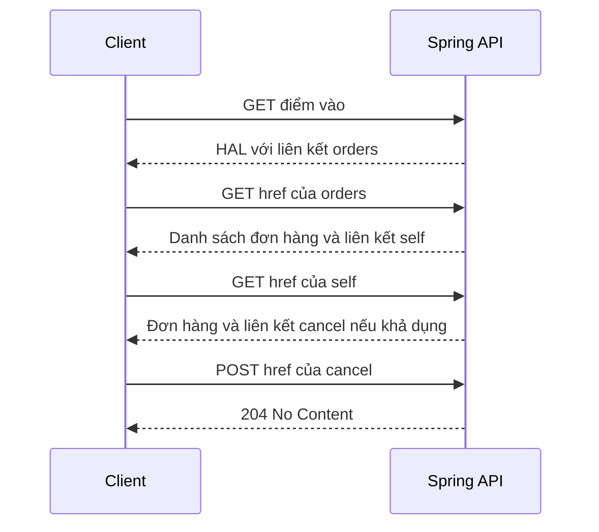

# Client không biết URI cố định

Trong một REST API có hypermedia, client chỉ cần biết URI điểm vào của API và ý nghĩa của các quan hệ liên kết. Server trả về những URI cần dùng trong từng phản hồi. Client đọc liên kết rồi đi theo liên kết đó, thay vì tự ghép đường dẫn như `/orders/42/cancellation`.

Spring HATEOAS giúp xây dựng kiểu hợp đồng này bằng các mô hình tài nguyên có liên kết, công cụ tạo URI từ mapping của controller và các định dạng hypermedia như HAL. Nhờ vậy, server có thể tổ chức lại đường dẫn mà không buộc client phải biết cấu trúc URI nội bộ.

## Mục tiêu

Sau bài học, bạn có thể:

- Giải thích vì sao client chỉ nên phụ thuộc vào điểm vào và quan hệ liên kết.
- Dùng `EntityModel`, `CollectionModel` và `RepresentationModel` để biểu diễn tài nguyên có hypermedia.
- Tạo liên kết từ mapping của Spring MVC bằng `linkTo` và `methodOn`.
- Trả về liên kết HAL và liên kết hành động theo trạng thái tài nguyên.
- Hiểu vai trò của affordance và kiểm thử hợp đồng liên kết.

## Vấn đề khi client tự tạo URI

Giả sử ứng dụng quản lý đơn hàng cung cấp API với các đường dẫn:

```text
GET  /api/orders
GET  /api/orders/{id}
POST /api/orders/{id}/cancellation
```

Client có thể tự tạo URI để hủy đơn:

```java
URI cancelUri = URI.create(apiBaseUrl + "/api/orders/" + orderId + "/cancellation");
```

Cách làm này khiến client phụ thuộc vào cấu trúc URI của server. Nếu server chuyển tài nguyên sang `/sales/orders/{id}` hoặc thay đổi đường dẫn thao tác hủy, client đang ghép URI theo quy ước cũ có thể ngừng hoạt động. Client cũng có thể phải tự suy luận thao tác nào hợp lệ từ trạng thái đơn hàng.

Với hypermedia, server gửi liên kết tới tài nguyên và hành động hiện có. Client chỉ cần hiểu quan hệ liên kết, ví dụ `orders` có nghĩa là danh sách đơn hàng và `cancel` có nghĩa là thao tác hủy đơn. Giá trị `href` cho biết URI hiện tại để thực hiện bước tiếp theo.

## Hợp đồng hypermedia gồm những gì?

| Thành phần | Ý nghĩa | Ví dụ |
|---|---|---|
| Điểm vào (entry point) | URI ban đầu mà client được cấu hình để truy cập | `https://api.example.test/` |
| Quan hệ (relation hoặc `rel`) | Ý nghĩa của liên kết trong ngữ cảnh tài nguyên | `self`, `orders`, `next`, `cancel` |
| `href` | URI đích do server cung cấp | `https://api.example.test/sales/orders/42` |
| Media type | Cách client đọc dữ liệu và liên kết | `application/hal+json` |

Client vẫn cần biết điểm vào, media type và ý nghĩa của những quan hệ mà nó sử dụng. Điều thay đổi là client không cần biết trước mọi đường dẫn hoặc tự xây URI từ ID và quy tắc định tuyến.

Các quan hệ chuẩn như `self`, `next` và `prev` có ý nghĩa phổ biến. Quan hệ nghiệp vụ như `orders` hoặc `cancel` cần được mô tả rõ trong hợp đồng API hoặc tài liệu profile để client hiểu đúng. Tên quan hệ là một phần của hợp đồng; không nên đổi ý nghĩa của nó một cách âm thầm.

## Thêm Spring HATEOAS

Với dự án Spring Boot dùng Gradle, thêm starter:

```groovy
dependencies {
    implementation 'org.springframework.boot:spring-boot-starter-hateoas'
}
```

Starter cung cấp các lớp mô hình hypermedia và tích hợp với Spring MVC. Spring Boot cũng tự cấu hình hỗ trợ HAL cho ứng dụng sử dụng starter này.

## Biểu diễn tài nguyên bằng model

Spring HATEOAS cung cấp một số kiểu model thường dùng:

- `RepresentationModel<T>` là lớp cơ sở cho một representation có thể chứa các liên kết.
- `EntityModel<T>` bọc một tài nguyên đơn lẻ cùng các liên kết của nó.
- `CollectionModel<T>` biểu diễn một tập hợp tài nguyên cùng các liên kết ở cấp tập hợp.

Ví dụ dưới đây dùng một DTO đơn giản. `OrderService` đại diện cho tầng nghiệp vụ của ứng dụng; các phương thức truy xuất và cập nhật dữ liệu được cài đặt trong tầng đó.

```java
public record OrderView(long id, String status, boolean cancellable) {
}
```

Controller có thể tạo liên kết dựa trên chính mapping của phương thức:

```java
import static org.springframework.hateoas.server.mvc.WebMvcLinkBuilder.linkTo;
import static org.springframework.hateoas.server.mvc.WebMvcLinkBuilder.methodOn;

import java.util.List;

import org.springframework.hateoas.CollectionModel;
import org.springframework.hateoas.EntityModel;
import org.springframework.hateoas.Link;
import org.springframework.http.ResponseEntity;
import org.springframework.web.bind.annotation.GetMapping;
import org.springframework.web.bind.annotation.PathVariable;
import org.springframework.web.bind.annotation.PostMapping;
import org.springframework.web.bind.annotation.RequestMapping;
import org.springframework.web.bind.annotation.RestController;

@RestController
@RequestMapping("/orders")
class OrderController {

    private final OrderService orders;

    OrderController(OrderService orders) {
        this.orders = orders;
    }

    @GetMapping
    CollectionModel<EntityModel<OrderView>> all() {
        List<EntityModel<OrderView>> items = orders.findAll().stream()
            .map(order -> EntityModel.of(
                order,
                linkTo(methodOn(OrderController.class).one(order.id())).withSelfRel()
            ))
            .toList();

        return CollectionModel.of(
            items,
            linkTo(methodOn(OrderController.class).all()).withSelfRel()
        );
    }

    @GetMapping("/{id}")
    EntityModel<OrderView> one(@PathVariable long id) {
        OrderView order = orders.findById(id);

        Link self = linkTo(methodOn(OrderController.class).one(id)).withSelfRel();
        EntityModel<OrderView> model = EntityModel.of(
            order,
            self,
            linkTo(methodOn(OrderController.class).all()).withRel("orders")
        );

        if (order.cancellable()) {
            model.add(linkTo(methodOn(OrderController.class).cancel(id)).withRel("cancel"));
        }

        return model;
    }

    @PostMapping("/{id}/cancellation")
    ResponseEntity<Void> cancel(@PathVariable long id) {
        orders.cancel(id);
        return ResponseEntity.noContent().build();
    }
}
```

`methodOn` tạo một lời gọi proxy để Spring HATEOAS xác định phương thức controller cần tham chiếu. `linkTo` kết hợp thông tin mapping của phương thức đó với địa chỉ ứng dụng hiện tại để tạo `Link`. Vì thế, code không phải tự nối chuỗi URI và không lặp lại đường dẫn đã khai báo trong annotation.

Trong ví dụ, liên kết `self` trỏ về representation của đơn hàng. Liên kết `orders` cho phép client quay lại tập hợp. Liên kết `cancel` chỉ được thêm khi đơn hàng có thể hủy. Điều kiện nghiệp vụ phải được xác định ở server; client sử dụng sự hiện diện của liên kết để biết hành động nào đang được công bố.

Một endpoint điểm vào có thể giới thiệu quan hệ `orders`:

```java
import java.util.Map;

import org.springframework.hateoas.EntityModel;
import org.springframework.web.bind.annotation.GetMapping;
import org.springframework.web.bind.annotation.RestController;

import static org.springframework.hateoas.server.mvc.WebMvcLinkBuilder.linkTo;
import static org.springframework.hateoas.server.mvc.WebMvcLinkBuilder.methodOn;

@RestController
class ApiEntryPoint {

    @GetMapping("/")
    EntityModel<Map<String, String>> root() {
        return EntityModel.of(
            Map.of("service", "orders"),
            linkTo(methodOn(OrderController.class).all()).withRel("orders")
        );
    }
}
```

Client được cấu hình URI của điểm vào. Từ đó, client tìm `_links.orders.href` trong representation để truy cập danh sách đơn hàng. Nếu server đổi mapping của `OrderController`, Spring HATEOAS tạo liên kết theo mapping mới và điểm vào tiếp tục giới thiệu liên kết đó.

## HAL: đưa liên kết vào JSON

HAL là một định dạng JSON biểu diễn tài nguyên và các liên kết. Một representation đơn hàng có thể trông như sau:

```json
{
  "id": 42,
  "status": "NEW",
  "cancellable": true,
  "_links": {
    "self": {
      "href": "https://api.example.test/sales/orders/42"
    },
    "orders": {
      "href": "https://api.example.test/sales/orders"
    },
    "cancel": {
      "href": "https://api.example.test/sales/orders/42/cancellation"
    }
  }
}
```

Đây là ví dụ minh họa cấu trúc HAL; URI thực tế được tạo từ mapping đang chạy. Với client HTTP, có thể yêu cầu định dạng này bằng header:

```http
GET / HTTP/1.1
Host: api.example.test
Accept: application/hal+json
```

Client đọc `href` của quan hệ `orders`, gửi request tới URI đó, rồi tiếp tục đọc các liên kết trong representation nhận được. Khi cần hủy đơn, client tìm quan hệ `cancel` và dùng URI của liên kết đó. Client không cần ghép `/orders/`, ID và `/cancellation` thành một đường dẫn.

Luồng khám phá tài nguyên có thể hình dung như sau:



Sự hiện diện của liên kết thể hiện hành động mà server công bố trong representation hiện tại. Nó không thay thế kiểm tra quyền truy cập hoặc kiểm tra trạng thái ở server: trạng thái có thể thay đổi giữa lúc client đọc liên kết và lúc gửi request.

## Mô tả hành động với affordance

Một `Link` cơ bản cho client biết đích đến và quan hệ của liên kết. Tuy nhiên, chỉ nhìn vào liên kết `cancel`, client chưa chắc biết cần dùng HTTP method nào hoặc phải gửi dữ liệu đầu vào theo cấu trúc nào.

Spring HATEOAS hỗ trợ `Affordance` để gắn mô tả hành động với liên kết. Ví dụ, có thể gắn thao tác hủy vào liên kết `self`:

```java
import static org.springframework.hateoas.server.mvc.WebMvcLinkBuilder.afford;

Link self = linkTo(methodOn(OrderController.class).one(id)).withSelfRel();

if (order.cancellable()) {
    self = self.andAffordance(
        afford(methodOn(OrderController.class).cancel(id))
    );
}

return EntityModel.of(order, self);
```

Affordance được suy ra từ phương thức controller, nên có thể mang thông tin về thao tác như HTTP method và các đầu vào mà endpoint yêu cầu. Để truyền tải mô tả hành động này cho client, ứng dụng cần dùng định dạng hypermedia có hỗ trợ affordance, chẳng hạn HAL-FORMS, và cấu hình thương lượng nội dung phù hợp. HAL JSON thông thường biểu diễn các liên kết trong `_links`; chỉ có một liên kết HAL không đồng nghĩa client đã nhận được schema đầy đủ cho một biểu mẫu hoặc thao tác.

Hãy chọn mức mô tả phù hợp với client. Nếu client đã biết hợp đồng của quan hệ `cancel`, một liên kết có thể đủ để client chọn đúng thao tác. Nếu client cần khám phá cả method và cấu trúc dữ liệu cần gửi, hãy cung cấp affordance qua media type hỗ trợ thông tin đó.

## Kiểm thử hợp đồng liên kết

Kiểm thử nên xác nhận các quan hệ cần thiết có mặt trong representation và các hành động không khả dụng được ẩn đi. Ví dụ với MockMvc:

```java
import static org.springframework.test.web.servlet.request.MockMvcRequestBuilders.get;
import static org.springframework.test.web.servlet.result.MockMvcResultMatchers.content;
import static org.springframework.test.web.servlet.result.MockMvcResultMatchers.jsonPath;
import static org.springframework.test.web.servlet.result.MockMvcResultMatchers.status;
import static org.mockito.BDDMockito.given;

import org.junit.jupiter.api.BeforeEach;
import org.junit.jupiter.api.Test;
import org.springframework.beans.factory.annotation.Autowired;
import org.springframework.boot.test.autoconfigure.web.servlet.WebMvcTest;
import org.springframework.boot.test.mock.mockito.MockBean;
import org.springframework.hateoas.MediaTypes;
import org.springframework.test.web.servlet.MockMvc;

@WebMvcTest(OrderController.class)
class OrderControllerTest {

    @Autowired
    MockMvc mockMvc;

    @MockBean
    OrderService orders;

    @BeforeEach
    void setUp() {
        given(orders.findById(42L)).willReturn(new OrderView(42L, "NEW", true));
        given(orders.findById(99L)).willReturn(new OrderView(99L, "SHIPPED", false));
    }

    @Test
    void publishesCancelLinkWhenOrderCanBeCancelled() throws Exception {
        mockMvc.perform(get("/orders/{id}", 42).accept(MediaTypes.HAL_JSON))
            .andExpect(status().isOk())
            .andExpect(content().contentTypeCompatibleWith(MediaTypes.HAL_JSON))
            .andExpect(jsonPath("$._links.self.href").exists())
            .andExpect(jsonPath("$._links.cancel.href").exists());
    }

    @Test
    void omitsCancelLinkWhenOrderCannotBeCancelled() throws Exception {
        mockMvc.perform(get("/orders/{id}", 99).accept(MediaTypes.HAL_JSON))
            .andExpect(status().isOk())
            .andExpect(jsonPath("$._links.cancel").doesNotExist());
    }
}
```

Trong `@WebMvcTest`, `OrderService` được giả lập để mỗi trường hợp có trạng thái nghiệp vụ rõ ràng. Trong kiểm thử tích hợp của client, nên lấy URI từ `href` của quan hệ rồi gọi URI đó. Cách này xác nhận cả khả năng khám phá và khả năng đi theo liên kết, thay vì chỉ xác nhận một chuỗi đường dẫn cụ thể.

## Khi server thay đổi URI

Giả sử server đổi mapping của controller từ `/orders` sang `/sales/orders`. Các liên kết được tạo bằng `linkTo(methodOn(...))` sẽ phản ánh mapping mới. Nếu URI điểm vào vẫn ổn định và quan hệ `orders` vẫn giữ nguyên ý nghĩa, client có thể tiếp tục đi theo `href` mới mà không cần biết đường dẫn đã thay đổi.

Điều này không có nghĩa URI có thể thay đổi tùy ý mà không cần quản lý hợp đồng. Client vẫn phụ thuộc vào:

- URI điểm vào đã được cung cấp hoặc cấu hình.
- Media type và cách giải mã representation.
- Ý nghĩa ổn định của các quan hệ mà client sử dụng.
- Quy tắc HTTP và dữ liệu đầu vào được mô tả cho từng hành động.

Khi thay đổi ý nghĩa của một quan hệ, cấu trúc representation hoặc quy tắc nghiệp vụ, API vẫn cần tài liệu, kiểm thử tương thích và chiến lược phiên bản phù hợp. Hypermedia giúp giảm phụ thuộc vào cách định tuyến; nó không xóa bỏ hợp đồng giữa client và server.

## Lỗi thường gặp

| Cách làm | Hệ quả | Cách xử lý |
|---|---|---|
| Client nối chuỗi để tạo URI từ ID | Client phụ thuộc vào cấu trúc đường dẫn | Đọc `href` từ quan hệ liên kết |
| Dùng tên `rel` như thể đó là một URI | Nhầm ý nghĩa liên kết với địa chỉ đích | Đọc URI trong thuộc tính `href` |
| Đổi ý nghĩa của quan hệ tùy tiện | Client hiểu sai hành động hoặc tài nguyên | Giữ ngữ nghĩa ổn định và tài liệu hóa quan hệ tùy chỉnh |
| Cho rằng có liên kết nghĩa là request chắc chắn thành công | Bỏ qua quyền và trạng thái có thể thay đổi | Server luôn xác thực lại quyền và điều kiện nghiệp vụ |
| Cho rằng HAL link tự mô tả đầy đủ biểu mẫu | Client không biết schema hoặc method cần dùng | Dùng affordance và media type hỗ trợ khi cần mô tả hành động |

## Ghi nhớ

Một client dùng hypermedia bắt đầu từ URI điểm vào, đọc quan hệ liên kết và theo `href` do server cung cấp. Spring HATEOAS giúp tạo các liên kết đó từ mapping của controller, đóng gói chúng trong `EntityModel` hoặc `CollectionModel`, và xuất ra định dạng như HAL. Khi cần mô tả chi tiết hơn về thao tác, affordance kết hợp với media type phù hợp có thể cung cấp thêm thông tin cho client. Hợp đồng API vì vậy tập trung vào ý nghĩa của tài nguyên và quan hệ, thay vì buộc client ghi nhớ từng đường dẫn của server.
