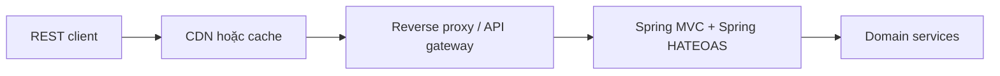

# Layered system

> Một ứng dụng khách gọi API qua một tên miền công khai. Request có thể đi qua CDN, reverse proxy, API gateway rồi mới đến ứng dụng Spring. Ứng dụng vẫn trả về cùng tài nguyên và các liên kết hypermedia, dù client không cần biết có bao nhiêu thành phần trung gian xử lý request. Đó là một ví dụ về ràng buộc **Layered System** trong kiến trúc REST.

Layered System (hệ thống phân lớp) là một trong các ràng buộc kiến trúc REST. Ràng buộc này cho phép tổ chức hệ thống thành các lớp trung gian theo cấu trúc phân cấp. Một thành phần chỉ cần biết và tương tác với lớp liền kề; nó không cần biết request sẽ đi qua những thành phần nào phía sau hoặc phản hồi được tạo ra từ hệ thống gốc nào.

Trong phạm vi Spring HATEOAS, hiểu đúng Layered System giúp thiết kế API hoạt động ổn định khi được đặt sau gateway, proxy, load balancer hoặc cache. Các liên kết hypermedia cần phản ánh địa chỉ công khai mà client có thể truy cập, trong khi các lớp trung gian vẫn có thể định tuyến, áp dụng chính sách và lưu cache theo đúng ngữ nghĩa HTTP.

## Layered System trong REST là gì?

REST cho phép một hệ thống được tạo thành từ nhiều lớp. Một thành phần có thể đóng vai trò server đối với lớp phía trước và đồng thời là client đối với lớp phía sau. Ví dụ, API gateway nhận request từ ứng dụng di động, kiểm tra token rồi chuyển tiếp request đến một dịch vụ Spring. Đối với ứng dụng di động, gateway là server; đối với dịch vụ Spring, gateway là client.



Client giao tiếp với điểm vào được công bố. Các lớp trung gian có thể định tuyến request, cân bằng tải, xác thực, ghi log, áp dụng giới hạn lưu lượng hoặc phục vụ phản hồi đã cache. Client không cần biết một request cụ thể đã đi qua bao nhiêu lớp.

Ràng buộc này tập trung vào **ranh giới nhìn thấy giữa các thành phần**, không bắt buộc ứng dụng phải có đúng ba tầng presentation, business và data. Một hệ thống có thể có nhiều proxy hoặc gateway, và một hệ thống ba tầng truyền thống cũng chưa chắc đã tuân thủ đầy đủ các ràng buộc REST khác.

## Vì sao REST sử dụng hệ thống phân lớp?

Layered System đem lại một số lợi ích khi hệ thống có nhiều client, nhiều dịch vụ hoặc phải vận hành qua hạ tầng mạng phức tạp.

| Lợi ích | Cách hoạt động | Ví dụ |
| --- | --- | --- |
| Giảm phụ thuộc giữa client và server gốc | Client chỉ giao tiếp với điểm vào công khai; các lớp phía sau có thể được thay đổi độc lập nếu vẫn giữ hợp đồng. | Gateway chuyển từ một service sang cụm service mới mà ứng dụng di động không phải biết topology nội bộ. |
| Tập trung chính sách | Một lớp trung gian có thể thực hiện các xử lý dùng chung trước khi request đến dịch vụ. | Gateway xác thực token, áp dụng rate limit và ghi log tương quan. |
| Cải thiện khả năng mở rộng | Load balancer phân phối request tới nhiều instance; cache giảm số lần gọi đến server gốc. | Nhiều instance Spring Boot cùng phục vụ `/api/orders`. |
| Cách ly hệ thống cũ | Một lớp adapter che giấu giao thức hoặc cấu trúc cũ khỏi client mới. | Gateway chuyển REST request thành lời gọi tới hệ thống ERP nội bộ. |
| Hỗ trợ triển khai linh hoạt | Có thể thay đổi vị trí, số lượng hoặc công nghệ của một lớp mà không buộc mọi client thay đổi. | Thêm CDN hoặc thay reverse proxy mà vẫn giữ URL API công khai. |

Các lợi ích này đi kèm chi phí. Mỗi lớp có thể thêm độ trễ, điểm lỗi, cấu hình và khó khăn khi truy vết request. Vì vậy, chỉ nên thêm lớp trung gian khi có trách nhiệm rõ ràng như định tuyến, bảo mật, cache hoặc chuyển đổi giao thức.

## Các thành phần thường gặp

### Proxy và reverse proxy

Proxy chuyển tiếp request thay mặt client hoặc server. Forward proxy thường đại diện cho client khi truy cập mạng bên ngoài. Reverse proxy đứng trước một hoặc nhiều server, nhận request từ client rồi chuyển tiếp đến server phù hợp.

Reverse proxy thường cung cấp một tên miền công khai, kết thúc TLS, giới hạn kích thước request hoặc chuyển tiếp đến nhiều ứng dụng. Client nhìn thấy địa chỉ của reverse proxy thay vì địa chỉ mạng nội bộ của ứng dụng.

### API gateway

API gateway là điểm vào tập trung cho nhiều API hoặc dịch vụ. Gateway có thể định tuyến theo path hoặc host, xác thực, giới hạn tốc độ, ghi log và đôi khi tổng hợp dữ liệu từ nhiều service. Gateway cần giữ đúng ngữ nghĩa HTTP và hợp đồng được công bố cho client.

Không nên đưa toàn bộ nghiệp vụ miền vào gateway. Các quy tắc như một đơn hàng có được hủy hay không vẫn nên được kiểm tra tại dịch vụ sở hữu đơn hàng. Gateway có thể chặn request không hợp lệ ở lớp truy cập, nhưng service phải bảo vệ invariant nghiệp vụ của chính nó.

### Load balancer

Load balancer phân phối request tới nhiều instance của cùng một dịch vụ hoặc nhiều node có khả năng xử lý tương đương. Client sử dụng một địa chỉ ổn định trong khi hạ tầng có thể thêm hoặc loại bỏ instance.

Với API REST stateless, request có thể được gửi đến bất kỳ instance phù hợp nào mà không cần phụ thuộc vào trạng thái phiên lưu trong bộ nhớ của một instance cụ thể. Điều này giúp cân bằng tải dễ hơn. Nếu ứng dụng lưu session cục bộ, hệ thống có thể phải dùng sticky session hoặc chia sẻ session store; khi đó lợi ích mở rộng ngang bị hạn chế.

### Cache và CDN

Cache có thể nằm ở client, proxy, gateway hoặc CDN. Khi response cho phép cache và cache key phù hợp, lớp trung gian có thể trả dữ liệu mà không gọi server gốc. HTTP cung cấp các cơ chế như `Cache-Control`, `ETag`, `Last-Modified`, `Vary` và conditional request để kiểm soát việc này.

Ví dụ, danh sách danh mục công khai có thể được cache trong thời gian ngắn. Dữ liệu đơn hàng cá nhân thường cần chính sách riêng, chẳng hạn `Cache-Control: private` hoặc `no-store`, tùy yêu cầu bảo mật và nghiệp vụ. Không được giả định mọi response đều có thể cache chỉ vì request đi qua CDN.

## Layered System và các ràng buộc REST khác

Layered System phối hợp với các ràng buộc REST khác để tạo ra một hệ thống có thể mở rộng và tiến hóa.

| Ràng buộc | Vai trò khi kết hợp với Layered System |
| --- | --- |
| Client-Server | Tách giao diện và nhu cầu của client khỏi cách server lưu trữ, xử lý dữ liệu. Các lớp trung gian không làm mất ranh giới này. |
| Stateless | Mỗi request mang đủ ngữ cảnh cần thiết để xử lý; load balancer có thể chuyển request đến instance khác. |
| Cacheable | Proxy hoặc CDN có thể tái sử dụng response khi chính sách cache cho phép. |
| Uniform Interface | Các thành phần trao đổi qua giao diện thống nhất, dựa trên tài nguyên, representation, method và hypermedia. |
| Layered System | Che giấu topology nội bộ và cho phép các lớp trung gian cung cấp dịch vụ chung. |
| Code-on-Demand (tùy chọn) | Client có thể tải và thực thi mã khi hệ thống hỗ trợ; điều này độc lập với việc request đi qua bao nhiêu lớp. |

Một gateway không làm API trở thành RESTful chỉ bằng việc đứng giữa client và service. API vẫn cần tuân thủ các ràng buộc REST tương ứng; Layered System chỉ là một phần của kiến trúc.

## Ảnh hưởng tới liên kết hypermedia

Spring HATEOAS tạo liên kết dựa trên mapping của controller và thông tin request hiện tại. Khi ứng dụng chạy trực tiếp, host, scheme và port có thể phản ánh đúng địa chỉ client sử dụng. Khi ứng dụng đứng sau reverse proxy, ứng dụng có thể chỉ nhìn thấy địa chỉ nội bộ như `http://orders-service:8080`, trong khi client truy cập qua `https://api.example.com`.

Nếu thông tin chuyển tiếp từ proxy không được xử lý đúng, liên kết được tạo bởi `linkTo(methodOn(...))` có thể trỏ đến host, scheme hoặc prefix nội bộ. Client theo liên kết đó sẽ không truy cập được, dù endpoint thực tế đang hoạt động.

### Ví dụ tạo link từ controller

Giả sử controller cung cấp endpoint đọc đơn hàng:

```java
import static org.springframework.hateoas.server.mvc.WebMvcLinkBuilder.linkTo;
import static org.springframework.hateoas.server.mvc.WebMvcLinkBuilder.methodOn;

import java.util.UUID;

import org.springframework.hateoas.EntityModel;
import org.springframework.web.bind.annotation.GetMapping;
import org.springframework.web.bind.annotation.PathVariable;
import org.springframework.web.bind.annotation.RequestMapping;
import org.springframework.web.bind.annotation.RestController;

@RestController
@RequestMapping("/api/orders")
class OrderController {

    private final OrderService orderService;

    OrderController(OrderService orderService) {
        this.orderService = orderService;
    }

    @GetMapping("/{id}")
    EntityModel<OrderView> one(@PathVariable UUID id) {
        OrderView order = orderService.get(id);

        return EntityModel.of(order,
            linkTo(methodOn(OrderController.class).one(id)).withSelfRel());
    }
}
```

`linkTo(methodOn(...))` giúp tạo URL dựa trên mapping của controller thay vì nối chuỗi path. Tuy nhiên, kết quả vẫn cần đúng với địa chỉ mà client nhìn thấy. Việc tạo link dựa trên mapping không tự giải quyết mọi khác biệt do proxy gây ra; ứng dụng phải nhận diện đúng thông tin request đã được proxy chuyển tiếp.

### Cấu hình forwarded headers trong Spring Boot

Reverse proxy thường gửi các header như `Forwarded` hoặc `X-Forwarded-Proto`, `X-Forwarded-Host`, `X-Forwarded-Port` và `X-Forwarded-Prefix` để mô tả request gốc. Spring Framework có thể sử dụng các thông tin này khi tạo URL. Với Spring Boot, có thể cấu hình chiến lược xử lý forwarded headers:

```yaml
server:
  forward-headers-strategy: framework
```

Chiến lược `framework` sử dụng cơ chế của Spring Framework để xử lý forwarded headers. `native` giao việc xử lý cho web server/container nếu container hỗ trợ. `none` tắt việc xử lý. Chọn chiến lược phù hợp với reverse proxy và container đang chạy; không bật một cách máy móc nếu hạ tầng đã xử lý forwarded headers ở tầng native.

Các header forwarded có thể bị client giả mạo nếu request đi thẳng đến ứng dụng. Vì vậy, chỉ tin cậy chúng khi request đến từ proxy được kiểm soát. Proxy biên cần xóa hoặc ghi đè các giá trị forwarded do client gửi lên rồi đặt giá trị phản ánh request thực tế. Không công khai ứng dụng phía sau để client tùy ý gửi các header này nếu cấu hình ứng dụng coi chúng là đáng tin.

Nếu gateway công bố API dưới một path prefix như `/store`, proxy cần chuyển tiếp prefix chính xác và ứng dụng cần xử lý nó đúng cách. Cần kiểm tra cả `href` trong response thực tế, vì cấu hình header và khả năng hỗ trợ có thể khác nhau giữa Nginx, ingress controller, load balancer và servlet container.

## Ví dụ luồng request qua nhiều lớp

Một client lấy thông tin đơn hàng qua API gateway:

1. Client gửi `GET https://api.example.com/api/orders/42` và yêu cầu media type HAL bằng `Accept: application/hal+json`.
2. CDN kiểm tra cache. Nếu response còn hiệu lực và cache key phù hợp, CDN có thể trả response đã cache.
3. Nếu cần gọi tiếp, reverse proxy kết thúc TLS và chuyển request đến API gateway.
4. Gateway xác thực token, áp dụng rate limit và định tuyến request đến instance Spring Boot phù hợp.
5. Ứng dụng Spring xử lý request, truy vấn service và tạo `EntityModel` cùng các link.
6. Response đi ngược qua các lớp. Mỗi lớp thực hiện trách nhiệm của mình và không làm thay đổi ngữ nghĩa của representation hoặc các header cần thiết.
7. Client đọc dữ liệu và các quan hệ trong `_links`, rồi tiếp tục theo `href` được cung cấp.

Điểm quan trọng là client chỉ cần biết hợp đồng API công khai. Nếu vị trí của service hoặc số lượng gateway thay đổi, các liên kết vẫn phải trỏ đến tài nguyên có thể truy cập theo hợp đồng đó.

## Kiểm thử ứng dụng khi chạy sau proxy

Kiểm thử controller trực tiếp thường chạy với host mặc định của MockMvc. Điều này chưa đủ để xác nhận link được tạo đúng khi có reverse proxy. Nên có kiểm thử cung cấp forwarded headers và xác minh URL công khai được dùng trong response.

Ví dụ minh họa với MockMvc:

```java
mockMvc.perform(get("/api/orders/{id}", orderId)
        .header("X-Forwarded-Proto", "https")
        .header("X-Forwarded-Host", "api.example.com")
        .header("X-Forwarded-Port", "443")
        .accept(MediaType.parseMediaType("application/hal+json")))
    .andExpect(status().isOk())
    .andExpect(jsonPath("$._links.self.href")
        .value("https://api.example.com/api/orders/" + orderId));
```

Kiểm thử này chỉ phản ánh cấu hình xử lý forwarded headers đang được bật trong ứng dụng kiểm thử. Nếu môi trường dùng path prefix, hãy bổ sung `X-Forwarded-Prefix` và xác minh URL có prefix công khai. Ngoài kiểm thử tự động, nên kiểm tra một response từ môi trường staging sau đúng reverse proxy sẽ dùng khi triển khai.

Các điểm nên xác minh:

- `href` sử dụng HTTPS khi client truy cập bằng HTTPS.
- Host và port là địa chỉ công khai, không phải hostname nội bộ của container.
- Path prefix được giữ đúng nếu gateway có rewrite hoặc mount API dưới prefix.
- Các quan hệ `self`, `orders` và các action link đều dẫn đến URL có thể truy cập.
- Cache không phục vụ response cá nhân cho người dùng khác; response có dữ liệu nhạy cảm có chính sách cache phù hợp.
- Request đi thẳng từ client không thể giả mạo forwarded headers để tạo link sang host tùy ý.

## Những lỗi thường gặp

| Lỗi | Hệ quả | Cách khắc phục |
| --- | --- | --- |
| Nghĩ Layered System đồng nghĩa với kiến trúc ba tầng | Thiết kế bị giới hạn vào một cách chia presentation/business/data, bỏ qua proxy và gateway. | Hiểu đây là ranh giới giữa các thành phần trong chuỗi xử lý request. |
| Để client gọi trực tiếp hostname nội bộ | Client phụ thuộc vào topology triển khai và có thể không truy cập được service. | Công bố một điểm vào ổn định và để gateway định tuyến. |
| Không cấu hình forwarded headers sau reverse proxy | Spring HATEOAS sinh link chứa scheme, host hoặc port nội bộ. | Cấu hình forwarded headers theo đúng proxy/container và kiểm thử `href`. |
| Tin mọi forwarded header từ Internet | Client có thể giả mạo host hoặc scheme được dùng khi tạo URL. | Chỉ tin proxy đã kiểm soát; proxy biên xóa header do client tự gửi và ghi giá trị chuẩn. |
| Cache mọi response ở gateway | Dữ liệu riêng tư hoặc dữ liệu đã lỗi thời có thể được trả sai người dùng. | Dựa trên `Cache-Control`, validator, `Vary` và đặc điểm dữ liệu để đặt chính sách cache. |
| Đưa quy tắc nghiệp vụ vào gateway | Nhiều service có thể bỏ qua kiểm tra quan trọng khi được gọi qua đường khác. | Để service sở hữu tài nguyên kiểm tra quyền và invariant nghiệp vụ. |
| Thêm quá nhiều lớp trung gian | Tăng độ trễ, độ phức tạp vận hành và khó truy vết lỗi. | Mỗi lớp phải có trách nhiệm và giá trị vận hành cụ thể. |

## Ghi nhớ

- Layered System là ràng buộc REST cho phép request đi qua nhiều lớp trung gian; mỗi thành phần chỉ cần biết lớp liền kề.
- Proxy, reverse proxy, API gateway, load balancer và cache là các ví dụ phổ biến về thành phần trung gian.
- Client nên phụ thuộc vào địa chỉ và hợp đồng API công khai, không phụ thuộc hostname hoặc topology nội bộ.
- Spring HATEOAS có thể tạo link dựa trên mapping controller, nhưng ứng dụng phía sau proxy cần xử lý forwarded headers để `href` phản ánh URL công khai.
- Chỉ tin forwarded headers từ proxy đáng tin cậy; cấu hình sai có thể gây link sai hoặc mở ra nguy cơ giả mạo host.
- Layered System hỗ trợ mở rộng, bảo mật và tiến hóa hệ thống, đồng thời cần được cân nhắc với độ trễ và chi phí vận hành.

## Tài liệu tham khảo

- [Fielding Dissertation – Architectural Styles and the Design of Network-based Software Architectures](https://www.ics.uci.edu/~fielding/pubs/dissertation/top.htm)
- [Spring Boot Reference – Running Behind a Front-end Proxy Server](https://docs.spring.io/spring-boot/reference/howto/webserver.html#howto.webserver.use-behind-a-proxy-server)
- [Spring Framework – ForwardedHeaderFilter](https://docs.spring.io/spring-framework/reference/web/webmvc/filters.html#filters-forwarded-headers)
- [Spring HATEOAS Reference Documentation](https://docs.spring.io/spring-hateoas/docs/current/reference/html/)
