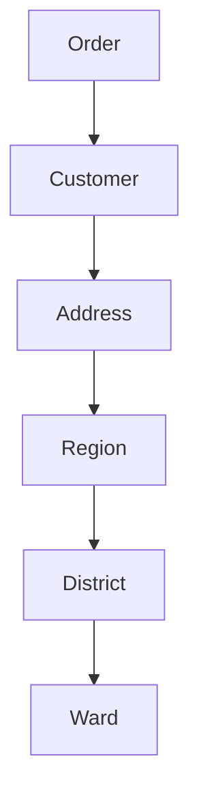

# Giới hạn độ sâu

## Mục tiêu

Sau bài này, bạn có thể xác định độ sâu nhúng tài nguyên trong một response hypermedia, giới hạn số tầng `_embedded` để tránh representation quá lớn hoặc lặp vòng, xây dựng HAL lồng nhau bằng `HalModelBuilder`, giữ link đến tài nguyên ở tầng không nhúng và kiểm thử giới hạn đã áp dụng.

## 1. Vì sao cần giới hạn độ sâu?

Một tài nguyên thường liên kết đến nhiều tài nguyên khác. Ví dụ, đơn hàng có khách hàng, khách hàng có địa chỉ, địa chỉ thuộc khu vực, khu vực có danh sách đơn vị hành chính cấp dưới. Nếu API nhúng toàn bộ quan hệ theo cách đệ quy, một response có thể chứa rất nhiều tầng dữ liệu.

Một đồ thị tài nguyên đơn giản:



Nếu client chỉ cần thông tin đơn hàng, khách hàng và địa chỉ, việc nhúng thêm khu vực, quận và phường có thể làm response lớn hơn mức cần thiết. Trong các mô hình có quan hệ hai chiều, ví dụ khách hàng có đơn hàng và mỗi đơn hàng lại chứa khách hàng, việc nhúng đệ quy còn có thể lặp lại cùng một tài nguyên nhiều lần.

Giới hạn độ sâu nhúng xác định số tầng tài nguyên con được đưa trực tiếp vào `_embedded`. Khi chạm giới hạn, API vẫn có thể cung cấp link đến tài nguyên tiếp theo để client tải riêng khi cần.

Lợi ích chính:

- Giữ response gọn và giảm lượng dữ liệu truyền qua mạng.
- Tránh tạo representation có cấu trúc lặp vòng hoặc quá sâu.
- Giảm chi phí ánh xạ và tuần tự hóa các quan hệ không cần thiết.
- Cho client quyền chọn tải thêm tài nguyên theo nhu cầu.
- Giúp hợp đồng API có quy tắc nhất quán về mức dữ liệu được nhúng.

## 2. Độ sâu được tính như thế nào?

Một quy ước dễ hiểu là tính tài nguyên gốc ở độ sâu 0. Mỗi lần đi theo một quan hệ và nhúng tài nguyên con, độ sâu tăng thêm 1.

Ví dụ với giới hạn `maxDepth = 2`:

| Độ sâu | Tài nguyên | Cách biểu diễn |
|---:|---|---|
| 0 | Đơn hàng gốc | Payload chính |
| 1 | Khách hàng | Được nhúng |
| 2 | Địa chỉ khách hàng | Được nhúng |
| 3 | Khu vực của địa chỉ | Chỉ cung cấp link |
| 4 | Quận/huyện | Không được mở rộng trong response này |

Minh họa cấu trúc HAL:

```json
{
  "id": "order-42",
  "_links": {
    "self": {
      "href": "/orders/order-42"
    }
  },
  "_embedded": {
    "customer": {
      "id": "customer-7",
      "_links": {
        "self": {
          "href": "/customers/customer-7"
        }
      },
      "_embedded": {
        "address": {
          "id": "address-15",
          "_links": {
            "self": {
              "href": "/addresses/address-15"
            },
            "region": {
              "href": "/regions/3"
            }
          }
        }
      }
    }
  }
}
```

Trong ví dụ, khu vực không xuất hiện trong `_embedded` vì đã đạt giới hạn. Link `region` vẫn cho phép client tải tài nguyên đó bằng request riêng.

Quy ước độ sâu phải được định nghĩa rõ trong API. Một số hệ thống tính root là 1 thay vì 0; điều quan trọng là tài liệu, code và test sử dụng cùng một quy ước.

## 3. Spring HATEOAS kiểm soát việc nhúng như thế nào?

Spring HATEOAS cung cấp các representation model như `EntityModel`, `CollectionModel` và API xây dựng HAL chuyên biệt là `HalModelBuilder`. Với `HalModelBuilder`, ứng dụng chỉ định tường minh tài nguyên nào được nhúng thông qua `embed(...)`. Builder cũng có thể nhúng một HAL representation khác, cho phép tạo cấu trúc `_embedded` lồng nhau.

Điều này có nghĩa là chính assembler hoặc thành phần tạo representation quyết định nhúng quan hệ nào và dừng ở tầng nào. `HalModelBuilder` không nhận một tham số `maxDepth` chung để tự động duyệt toàn bộ object graph. Hãy đưa chính sách độ sâu vào logic xây dựng model.

Ví dụ, builder tạo một representation HAL từ payload chính và thêm tài nguyên con:

```java
RepresentationModel<?> model = HalModelBuilder
        .halModelOf(orderSummary)
        .link(orderSelfLink)
        .embed(customerRepresentation, LinkRelation.of("customer"))
        .build();
```

Trong đó:

- `halModelOf(...)` đặt payload chính của representation.
- `link(...)` thêm link ở cấp representation hiện tại.
- `embed(..., LinkRelation.of("customer"))` nhúng representation khách hàng dưới relation `customer`.
- `build()` tạo representation để Spring HATEOAS tuần tự hóa thành HAL.

Tài nguyên con có thể là một đối tượng dữ liệu đơn giản hoặc một HAL representation khác chứa link và các tài nguyên nhúng sâu hơn. Chính khả năng lồng HAL representation này cho phép ứng dụng kiểm soát từng tầng.

## 4. Xây dựng HAL representation có giới hạn độ sâu

Giả sử hệ thống quản lý danh mục phân cấp. Mỗi danh mục có thể có danh mục cha. API muốn nhúng chuỗi danh mục cha tối đa hai tầng; sau đó chỉ công bố link đến danh mục cha tiếp theo.

Tạo DTO gọn cho dữ liệu được công bố:

```java
public record CategorySummary(
        UUID id,
        String name
) {
}
```

Assembler dùng `HalModelBuilder` để xây representation đệ quy:

```java
import java.util.UUID;

import org.springframework.hateoas.Link;
import org.springframework.hateoas.LinkRelation;
import org.springframework.hateoas.RepresentationModel;
import org.springframework.hateoas.mediatype.hal.HalModelBuilder;
import org.springframework.stereotype.Component;

import static org.springframework.hateoas.server.mvc.WebMvcLinkBuilder.linkTo;
import static org.springframework.hateoas.server.mvc.WebMvcLinkBuilder.methodOn;

@Component
public class CategoryHalAssembler {

    private static final int MAX_EMBED_DEPTH = 2;

    public RepresentationModel<?> toModel(Category category) {
        return toModel(category, 0, MAX_EMBED_DEPTH);
    }

    private RepresentationModel<?> toModel(
            Category category, int depth, int maxDepth) {

        int remainingDepth = Math.max(0, maxDepth - depth);

        HalModelBuilder builder = HalModelBuilder
                .halModelOf(new CategorySummary(
                        category.getId(),
                        category.getName()))
                .link(linkTo(methodOn(CategoryController.class)
                        .getCategory(category.getId(), remainingDepth))
                        .withSelfRel());

        Category parent = category.getParent();

        if (parent != null) {
            int childDepth = Math.max(0, maxDepth - depth - 1);

            Link parentLink = linkTo(methodOn(CategoryController.class)
                    .getCategory(parent.getId(), childDepth))
                    .withRel("parent");

            // Luôn công bố link; chỉ nhúng payload khi còn ngân sách độ sâu.
            builder.link(parentLink);

            if (depth < maxDepth) {
                builder.embed(
                        toModel(parent, depth + 1, maxDepth),
                        LinkRelation.of("parent")
                );
            }
        }

        return builder.build();
    }
}
```

Controller nhận độ sâu nhúng mà client yêu cầu, sau đó giới hạn theo chính sách tối đa của server:

```java
@RestController
@RequestMapping("/categories")
public class CategoryController {

    private static final int SERVER_MAX_EMBED_DEPTH = 2;

    private final CategoryService categoryService;
    private final CategoryHalAssembler assembler;

    public CategoryController(
            CategoryService categoryService,
            CategoryHalAssembler assembler) {
        this.categoryService = categoryService;
        this.assembler = assembler;
    }

    @GetMapping("/{id}")
    public RepresentationModel<?> getCategory(
            @PathVariable UUID id,
            @RequestParam(defaultValue = "1") int embedDepth) {

        int effectiveDepth = Math.min(
                Math.max(embedDepth, 0),
                SERVER_MAX_EMBED_DEPTH
        );

        Category category = categoryService.getRequired(id);
        return assembler.toModel(category, effectiveDepth);
    }
}
```

Trong ví dụ, assembler có thể cung cấp overload nhận độ sâu đã được kiểm tra:

```java
public RepresentationModel<?> toModel(Category category, int maxDepth) {
    return toModel(category, 0, maxDepth);
}
```

Các phương thức `getCategory(id, remainingDepth)` trong link builder giữ lại mức nhúng còn lại khi client theo link đến tài nguyên con. Nếu không muốn công bố khả năng điều chỉnh độ sâu qua query parameter, có thể bỏ `embedDepth` khỏi controller và giữ một hằng số chính sách trong assembler.

Cách hoạt động:

1. Root bắt đầu ở độ sâu 0.
2. Nếu tài nguyên có quan hệ cha, assembler luôn tạo link `parent`.
3. Khi `depth < maxDepth`, assembler tạo representation của cha và nhúng nó theo relation `parent`.
4. Khi đã đạt giới hạn, assembler không gọi đệ quy nữa; link `parent` vẫn còn để client tải riêng.
5. Mỗi representation có self link phản ánh URI của tài nguyên tương ứng.

Đoạn code giả định `Category` có `getId()`, `getName()`, `getParent()`; service và mapping controller được triển khai tương ứng. Nếu dùng một quan hệ khác như customer, address hoặc order items, thay phần lấy tài nguyên con và relation cho phù hợp.

## 5. Giới hạn giá trị do client gửi

Nếu API cho phép client chọn `embedDepth`, server vẫn phải áp dụng ngưỡng tối đa. Không nên tin giá trị request một cách trực tiếp:

```java
int effectiveDepth = Math.min(
        Math.max(requestedDepth, 0),
        SERVER_MAX_EMBED_DEPTH
);
```

Quy tắc:

- Giá trị âm được đưa về 0, nghĩa là không nhúng tài nguyên con.
- Giá trị trong khoảng cho phép được sử dụng.
- Giá trị lớn hơn giới hạn server được hạ xuống mức tối đa.
- Nếu tham số không hợp lệ về kiểu dữ liệu, Spring MVC có thể trả lỗi binding; hãy thống nhất cách xử lý lỗi với hợp đồng API.

Giới hạn server bảo vệ cả chi phí xử lý lẫn kích thước response. Nếu chỉ để client tự chọn độ sâu không giới hạn, một request có thể kích hoạt việc tải và tuần tự hóa một đồ thị tài nguyên rất lớn.

Không nhất thiết phải cung cấp tham số độ sâu cho mọi API. Nếu client không có nhu cầu thực tế, một mức cố định theo endpoint thường dễ tài liệu hóa và kiểm thử hơn.

## 6. Xử lý quan hệ vòng và tài nguyên lặp

Độ sâu tối đa giúp đệ quy dừng sau một số tầng hữu hạn, kể cả khi dữ liệu có chu trình. Tuy nhiên, nó không ngăn một tài nguyên xuất hiện lặp lại trong nhiều nhánh của cùng representation.

Ví dụ, hai đơn hàng có thể cùng nhúng một khách hàng; hoặc hai danh mục có thể cùng trỏ đến một danh mục cha chung. Khi đồ thị quan hệ phức tạp, nên cân nhắc thêm tập ID đã đi qua trên nhánh hiện tại.

Ý tưởng:

```java
if (depth >= maxDepth || visitedIds.contains(resource.getId())) {
    builder.link(resourceLink);
} else {
    visitedIds.add(resource.getId());
    builder.embed(toModel(child, depth + 1, maxDepth, visitedIds),
            LinkRelation.of("child"));
    visitedIds.remove(resource.getId());
}
```

Tập `visitedIds` ở đây đại diện cho các tài nguyên đang có mặt trên nhánh đệ quy hiện tại. Khi quay lui khỏi một nhánh, loại ID khỏi tập để một nhánh khác vẫn có thể nhúng cùng tài nguyên nếu hợp đồng cho phép.

Nếu muốn loại bỏ mọi tài nguyên đã xuất hiện ở bất kỳ nhánh nào, dùng tập ID toàn cục cho cả quá trình xây representation. Hai chính sách có ý nghĩa khác nhau:

- **Theo nhánh:** ngăn chu trình trên đường đi hiện tại nhưng cho phép cùng tài nguyên xuất hiện ở hai nhánh khác nhau.
- **Toàn cục:** chỉ nhúng một lần trong toàn bộ response, các lần sau chỉ công bố link.

Chọn chính sách phù hợp với semantics của dữ liệu. Không nên loại bỏ tài nguyên chỉ vì ID lặp nếu client cần thấy cùng một tài nguyên trong nhiều ngữ cảnh khác nhau.

## 7. Độ sâu khác với số lượng phần tử

Giới hạn độ sâu chỉ kiểm soát số tầng lồng nhau. Nó không giới hạn số phần tử ở mỗi tầng.

Ví dụ một đơn hàng nhúng danh sách 10.000 dòng hàng. Dù `maxDepth = 1`, response vẫn có thể rất lớn. Với collection lớn, cần kết hợp:

- Phân trang hoặc giới hạn số phần tử.
- Link đến endpoint collection riêng.
- Chỉ nhúng một phần tử hoặc trường tóm tắt khi phù hợp.
- Giới hạn kích thước response và thời gian xử lý.
- Tách dữ liệu chi tiết khỏi representation tổng quan.

Ví dụ HAL chỉ nhúng một phần tóm tắt và cung cấp link đến collection đầy đủ:

```json
{
  "id": "order-42",
  "_links": {
    "self": {
      "href": "/orders/order-42"
    },
    "items": {
      "href": "/orders/order-42/items"
    }
  },
  "_embedded": {
    "recentItems": [
      {
        "id": "item-1",
        "name": "Keyboard"
      },
      {
        "id": "item-2",
        "name": "Mouse"
      }
    ]
  }
}
```

Relation `recentItems` chỉ biểu diễn phần tóm tắt mà endpoint cam kết. Link `items` dẫn đến collection đầy đủ, có thể hỗ trợ phân trang. Nếu client cần dữ liệu sâu hoặc nhiều phần tử, nó tải riêng qua link đó.

## 8. Không để entity persistence quyết định độ sâu response

Một lỗi thường gặp là trả trực tiếp entity JPA có quan hệ hai chiều và để Jackson tuần tự hóa toàn bộ object graph. Cách này khiến cấu trúc response phụ thuộc vào mapping persistence, có thể gặp:

- Vòng tham chiếu giữa hai entity.
- Lazy loading phát sinh truy vấn ngoài dự kiến.
- Nhiều dữ liệu nội bộ bị công bố.
- Payload thay đổi khi quan hệ database thay đổi.
- Khó xác định chính xác giới hạn độ sâu của hypermedia.

Hãy dùng DTO hoặc representation model để quyết định rõ trường dữ liệu và quan hệ nào được nhúng. Service có thể tải đúng dữ liệu cần thiết; assembler hoặc `HalModelBuilder` tạo representation theo độ sâu được phép.

`@JsonIgnore`, `@JsonManagedReference` hoặc `@JsonBackReference` có thể hỗ trợ serialization trong một số mô hình Jackson, nhưng không thay thế chính sách nhúng hypermedia. Những annotation đó điều khiển serialization của thuộc tính, không diễn đạt đầy đủ quan hệ điều hướng mà API muốn công bố.

Cũng cần lưu ý rằng giới hạn độ sâu representation không tự động giới hạn độ sâu truy vấn database. Nếu service đã tải cả đồ thị lớn trước khi assembler dừng nhúng, chi phí truy vấn vẫn có thể cao. Hãy kết hợp giới hạn representation với projection, fetch plan hoặc truy vấn phù hợp.

## 9. Kiểm thử giới hạn độ sâu

Kiểm thử nên xác nhận cả cấu trúc `_embedded` và link còn lại ở tầng bị giới hạn. Với HAL, có thể dùng MockMvc:

```java
mockMvc.perform(get("/categories/{id}", rootId)
        .param("embedDepth", "1")
        .accept(MediaTypes.HAL_JSON))
    .andExpect(status().isOk())
    .andExpect(jsonPath("$._embedded.parent").exists())
    .andExpect(jsonPath("$._embedded.parent._embedded.parent")
            .doesNotExist())
    .andExpect(jsonPath("$._embedded.parent._links.parent.href")
            .exists());
```

Với `embedDepth=0`, response không nhúng tài nguyên cha nhưng vẫn có link:

```java
mockMvc.perform(get("/categories/{id}", rootId)
        .param("embedDepth", "0")
        .accept(MediaTypes.HAL_JSON))
    .andExpect(status().isOk())
    .andExpect(jsonPath("$._embedded.parent").doesNotExist())
    .andExpect(jsonPath("$._links.parent.href").exists());
```

Kiểm tra giá trị vượt ngưỡng để bảo đảm server áp dụng giới hạn:

```java
mockMvc.perform(get("/categories/{id}", rootId)
        .param("embedDepth", "99")
        .accept(MediaTypes.HAL_JSON))
    .andExpect(status().isOk())
    .andExpect(jsonPath("$._embedded.parent").exists())
    .andExpect(jsonPath("$._embedded.parent._embedded.parent")
            .exists())
    .andExpect(jsonPath("$._embedded.parent._embedded.parent._embedded.parent")
            .doesNotExist());
```

Ngoài ra, nên kiểm thử:

1. Tài nguyên không có quan hệ con không tạo `_embedded` rỗng ngoài ý muốn.
2. Độ sâu 0 chỉ trả payload gốc và link liên quan.
3. Độ sâu tối đa trả đúng số tầng nhúng đã quy định.
4. Quan hệ vòng không làm đệ quy vô hạn.
5. Link ở tầng bị giới hạn vẫn trỏ đến endpoint hợp lệ.
6. Collection lớn được phân trang hoặc giới hạn số phần tử độc lập với độ sâu.
7. Link self giữ lại tham số độ sâu nếu tham số đó là một phần của representation.

Khi kiểm tra JSONPath, cần dùng đúng tên relation do `LinkRelation` hoặc `@Relation` công bố. Tên relation trong `_embedded` là một phần hợp đồng mà client sử dụng.

## 10. Những lỗi thường gặp

**Nhầm giới hạn độ sâu với giới hạn số lượng.** Một tầng có thể chứa hàng nghìn phần tử. Hãy phân trang hoặc giới hạn số item riêng.

**Chỉ bỏ embedded mà không cung cấp link.** Client mất khả năng khám phá tài nguyên ở tầng tiếp theo. Khi không nhúng, hãy giữ relation link nếu tài nguyên vẫn có thể truy cập.

**Để client yêu cầu độ sâu tùy ý.** Giá trị lớn có thể tạo response rất nặng. Luôn áp dụng giới hạn tối đa phía server.

**Để Jackson tự tuần tự hóa entity graph.** Cấu trúc persistence không phải hợp đồng hypermedia. Dùng DTO, assembler và `HalModelBuilder` để quyết định nội dung được nhúng.

**Chỉ giới hạn serialization mà không giới hạn truy vấn.** Response có thể ngắn nhưng service vẫn tải cả đồ thị. Thiết kế fetch plan theo dữ liệu thực sự cần dùng.

**Không kiểm tra chu trình.** Giới hạn độ sâu bảo đảm dừng, nhưng đồ thị có thể lặp cùng tài nguyên nhiều lần. Cân nhắc tập ID theo nhánh hoặc toàn cục.

**Self link không phản ánh tham số depth.** Nếu độ sâu làm thay đổi representation và được điều khiển qua query parameter, link self nên giữ lại giá trị hiệu lực để client có thể tải lại cùng dạng representation.

## 11. Nguyên tắc thiết kế

- Xác định rõ root ở độ sâu 0 hay 1 và ghi quy ước trong hợp đồng.
- Đặt một giới hạn tối đa ở server; chỉ cho client chọn trong phạm vi được phép khi có nhu cầu.
- Chỉ gọi `embed(...)` khi còn ngân sách độ sâu.
- Khi dừng nhúng, vẫn công bố link đến tài nguyên liên quan.
- Dùng DTO hoặc HAL representation thay vì để entity persistence tự quyết định cấu trúc.
- Theo dõi ID đã đi qua nếu đồ thị có chu trình hoặc nhiều nhánh dùng chung tài nguyên.
- Giới hạn số phần tử và phân trang collection độc lập với giới hạn độ sâu.
- Kiểm thử cả tầng nhúng cuối cùng và link thay thế.

## Kết luận

Giới hạn độ sâu giúp Spring HATEOAS tạo response HAL có cấu trúc vừa đủ cho nhu cầu của client. `HalModelBuilder` cho phép nhúng tường minh cả đối tượng dữ liệu lẫn HAL representation lồng nhau; assembler có thể dùng bộ đếm độ sâu để dừng nhúng và giữ lại link đến tài nguyên tiếp theo. Hãy kết hợp giới hạn tầng với giới hạn số phần tử, xử lý chu trình, DTO và fetch plan phù hợp, rồi kiểm thử JSON HAL để bảo vệ hợp đồng API.

## Tài liệu tham khảo

- [Spring HATEOAS Reference – Building HAL representation models](https://docs.spring.io/spring-hateoas/docs/current/reference/html/#mediatypes.hal)
- [HalModelBuilder API](https://docs.spring.io/spring-hateoas/docs/current/api/org/springframework/hateoas/mediatype/hal/HalModelBuilder.html)

