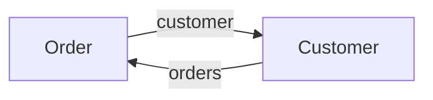
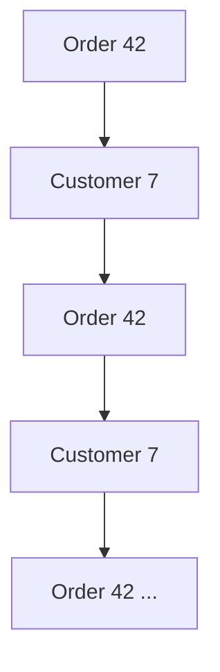
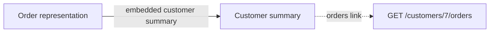

# Tránh vòng tham chiếu trong Embedded Resources

Embedded resource giúp client nhận được dữ liệu liên quan ngay trong representation hiện tại. Ví dụ, khi đọc một đơn hàng, client có thể cần thông tin khách hàng hoặc một phần danh sách mặt hàng của đơn. Tuy nhiên, nếu các tài nguyên nhúng lẫn nhau theo nhiều chiều, biểu diễn có thể tạo thành vòng tham chiếu: đơn hàng nhúng khách hàng, khách hàng lại nhúng danh sách đơn hàng, mỗi đơn hàng tiếp tục nhúng khách hàng.

Vòng tham chiếu có thể khiến response phình to, lặp dữ liệu, gây lỗi tuần tự hóa hoặc tạo ra hợp đồng API khó hiểu. Với Spring HATEOAS, cách thiết kế an toàn là quyết định rõ tài nguyên nào cần nhúng, giới hạn độ sâu của dữ liệu nhúng và dùng liên kết hypermedia cho những quan hệ cần điều hướng ngược lại. Bài học này trình bày cách nhận diện vòng tham chiếu, chọn ranh giới embedding và kiểm thử representation để tránh đệ quy ngoài ý muốn.

## 1. Embedded resource và liên kết hypermedia khác nhau thế nào?

Một embedded resource đưa dữ liệu của tài nguyên liên quan vào representation hiện tại. Một link chỉ công bố quan hệ và URI để client có thể truy cập tài nguyên đó khi cần.

Ví dụ, representation đơn hàng có thể nhúng thông tin tóm tắt khách hàng:

```json
{
  "id": "42",
  "status": "PENDING",
  "customer": {
    "id": "7",
    "displayName": "Nguyen An"
  }
}
```

Hoặc chỉ công bố một liên kết tới khách hàng:

```json
{
  "id": "42",
  "status": "PENDING",
  "_links": {
    "self": { "href": "/orders/42" },
    "customer": { "href": "/customers/7" }
  }
}
```

Trong ví dụ đầu, dữ liệu khách hàng nằm ngay trong response đơn hàng. Trong ví dụ sau, client phải theo link `customer` nếu cần thông tin chi tiết. Link không tự tuần tự hóa representation của khách hàng, vì vậy nó không tạo vòng lặp dữ liệu chỉ vì khách hàng cũng có quan hệ tới đơn hàng.

Trong HAL, tài nguyên nhúng thường được biểu diễn dưới `_embedded`, còn các link nằm dưới `_links`. Cấu trúc cụ thể phụ thuộc model và cách Spring HATEOAS serialize representation. Không phải mọi object lồng nhau trong Java đều tự động trở thành một HAL embedded resource; hãy thiết kế model theo media type và hợp đồng mà API công bố.

## 2. Vòng tham chiếu hình thành như thế nào?

Xét mô hình nghiệp vụ gồm hai loại tài nguyên:

- Một `Order` thuộc về một `Customer`.
- Một `Customer` có thể có nhiều `Order`.

Quan hệ trong domain có thể được biểu diễn hai chiều:



Nếu serializer duyệt toàn bộ object graph và mỗi representation nhúng đầy đủ đối tượng liên quan, luồng tuần tự hóa có thể tiếp tục như sau:



Đây là vòng tham chiếu. Nó thường xuất hiện khi API trả trực tiếp entity ORM có quan hệ hai chiều, hoặc khi các model representation tự nhúng toàn bộ tài nguyên liên quan mà không giới hạn chiều sâu.

Không phải mọi quan hệ hai chiều trong domain đều phải được biểu diễn hai chiều trong API. Domain có thể cần truy cập cả `order.customer` và `customer.orders`, nhưng client không nhất thiết cần cả hai tập dữ liệu trong cùng một response.

## 3. Hệ quả của việc nhúng đệ quy

Vòng tham chiếu không chỉ là lỗi kỹ thuật của JSON serializer. Nó còn làm thay đổi kích thước, độ trễ và ý nghĩa của hợp đồng API.

| Hệ quả | Vì sao xảy ra |
| --- | --- |
| Lỗi tuần tự hóa hoặc đệ quy sâu | Serializer tiếp tục đi theo quan hệ đã quay lại object trước đó. |
| Response quá lớn | Một tài nguyên kéo theo nhiều tài nguyên khác, mỗi tài nguyên lại nhúng thêm quan hệ. |
| Dữ liệu lặp | Cùng một khách hàng hoặc đơn hàng xuất hiện nhiều lần ở các nhánh khác nhau. |
| Truy vấn ORM tăng mạnh | Việc đọc các quan hệ lazy trong lúc serialize có thể kích hoạt nhiều truy vấn. |
| Khó cache | Representation lớn và thay đổi theo nhiều tài nguyên liên quan. |
| Hợp đồng khó tiến hóa | Thay đổi một tài nguyên có thể ảnh hưởng sâu tới response của nhiều tài nguyên khác. |

Ngay cả khi serializer có cơ chế phát hiện vòng lặp và không ném lỗi, response vẫn có thể chứa dữ liệu dư thừa hoặc cấu trúc không phù hợp với nhu cầu client. Vì vậy, cần giải quyết ở ranh giới representation thay vì chỉ dựa vào cấu hình serializer.

## 4. Nguyên tắc: nhúng theo một chiều, điều hướng chiều ngược lại bằng link

Một cách thiết kế dễ hiểu là chọn một chiều embedding chính. Ví dụ, response đơn hàng nhúng một bản tóm tắt khách hàng, nhưng response khách hàng chỉ cung cấp link tới collection đơn hàng.



Với cách này:

- Client đọc đơn hàng và nhận ngay thông tin khách hàng tối thiểu cần hiển thị.
- Client cần danh sách đơn hàng của khách thì theo relation `orders`.
- Tài nguyên khách hàng không nhúng lại toàn bộ đơn hàng vào mỗi response.
- Dữ liệu không quay lại tài nguyên ban đầu trong cùng một nhánh representation.

Ví dụ HAL minh họa:

```json
{
  "id": "42",
  "status": "PENDING",
  "_embedded": {
    "customer": {
      "id": "7",
      "displayName": "Nguyen An"
    }
  },
  "_links": {
    "self": { "href": "/orders/42" },
    "customer": { "href": "/customers/7" }
  }
}
```

Đây là cấu trúc minh họa cho hợp đồng có một customer summary được nhúng và một link tới tài nguyên khách hàng đầy đủ. Tùy cách xây representation và serializer, cách khai báo model để tạo `_embedded` có thể khác nhau. Điều cần giữ là phần nhúng có phạm vi hữu hạn, còn việc điều hướng tới tài nguyên đầy đủ được thực hiện qua link.

## 5. Dùng projection hoặc DTO tóm tắt thay vì nhúng domain entity

Một cách hiệu quả để tránh vòng tham chiếu là không đưa domain entity trực tiếp vào representation. Thay vào đó, tạo projection chỉ chứa trường mà client cần.

Ví dụ projection khách hàng:

```java
public record CustomerSummary(
        UUID id,
        String displayName
) {}
```

Representation đơn hàng chỉ giữ phần tóm tắt:

```java
public record OrderView(
        UUID id,
        String status,
        BigDecimal total,
        CustomerSummary customer
) {}
```

Assembler tạo view từ domain object:

```java
@Component
class OrderViewAssembler {

    OrderView toView(Order order) {
        Customer customer = order.getCustomer();

        CustomerSummary summary = new CustomerSummary(
                customer.getId(),
                customer.getDisplayName()
        );

        return new OrderView(
                order.getId(),
                order.getStatus().name(),
                order.getTotal(),
                summary
        );
    }
}
```

`CustomerSummary` không chứa danh sách `orders`, nên nhánh biểu diễn dừng tại đây. Nếu client cần thông tin chi tiết hoặc danh sách đơn của khách hàng, representation có thể công bố relation tới endpoint tương ứng.

Ví dụ trên là nested DTO trong payload. Nếu hợp đồng yêu cầu một HAL embedded resource thực sự dưới `_embedded`, hãy biểu diễn và serialize phần đó bằng cơ chế hypermedia phù hợp của Spring HATEOAS. Không nên chỉ đổi tên một thuộc tính Java thành `embedded` rồi giả định serializer sẽ tự tạo đúng cấu trúc HAL.

## 6. Dùng EntityModel và link cho tài nguyên liên quan

Nếu client không cần dữ liệu liên quan ngay lập tức, chỉ công bố link là lựa chọn gọn hơn. Spring HATEOAS cho phép bọc DTO trong `EntityModel` và thêm link tới tài nguyên liên quan:

```java
@Component
class OrderModelAssembler {

    EntityModel<OrderView> toModel(Order order) {
        OrderView view = new OrderView(
                order.getId(),
                order.getStatus().name(),
                order.getTotal()
        );

        return EntityModel.of(
                view,
                linkTo(methodOn(OrderController.class).one(order.getId()))
                        .withSelfRel(),
                linkTo(methodOn(CustomerController.class)
                        .one(order.getCustomer().getId()))
                        .withRel("customer")
        );
    }
}
```

Trong ví dụ, `customer` là link tới endpoint khách hàng. Model không nhúng `Customer` và cũng không nhúng danh sách đơn hàng của khách. Client chỉ tải tài nguyên liên quan khi cần. `OrderView` chỉ chứa các trường đơn hàng mà response này cần công bố.

## 7. Kiểm soát độ sâu embedding

Không có quy tắc rằng mọi quan hệ đều phải được nhúng hoặc chỉ được nhúng đúng một cấp. Hãy xác định độ sâu tối đa dựa trên nhu cầu client và chi phí response.

Một chính sách phổ biến:

| Cấp | Cách biểu diễn gợi ý | Ví dụ |
| --- | --- | --- |
| Tài nguyên gốc | Representation đầy đủ theo hợp đồng. | `Order` với ID, trạng thái và tổng tiền. |
| Quan hệ cần hiển thị ngay | Embedded summary hoặc projection nhỏ. | Tên và mã khách hàng. |
| Quan hệ sâu hơn | Link tới tài nguyên liên quan. | Link `orders` của khách hàng hoặc `products` của mặt hàng. |
| Quan hệ quay lại tài nguyên gốc | Chỉ dùng link, không nhúng lại. | Customer không nhúng lại Order vừa được đọc. |

Ví dụ, một đơn hàng có thể nhúng các dòng hàng với mã sản phẩm và số lượng, nhưng mỗi dòng hàng chỉ công bố link tới sản phẩm. Sản phẩm không nhúng ngược lại tất cả đơn hàng có chứa nó.

Độ sâu nên là quyết định của hợp đồng API, không phụ thuộc ngẫu nhiên vào việc serializer gặp object nào trước. Nếu cần nhiều chế độ chi tiết, có thể cung cấp endpoint hoặc tham số mở rộng có giới hạn và tài liệu hóa rõ.

## 8. Embedded collection không đồng nghĩa với toàn bộ object graph

Trong HAL, một collection có thể được biểu diễn bằng `_embedded` và các relation được đặt tên rõ ràng. Spring HATEOAS có `CollectionModel` để biểu diễn một tập hợp các representation model; mỗi item có thể có link riêng.

Ví dụ collection đơn hàng:

```java
CollectionModel<EntityModel<OrderView>> model =
        orderAssembler.toCollectionModel(orders);

model.add(linkTo(methodOn(OrderController.class).all()).withSelfRel());
```

Collection này biểu diễn danh sách đơn hàng. Nó không có nghĩa mỗi đơn hàng phải nhúng khách hàng, khách hàng phải nhúng mọi đơn hàng, rồi các đơn hàng đó lại nhúng khách hàng. Mỗi cấp embedding cần được quyết định riêng trong representation model.

Khi tạo collection lồng nhau hoặc tài nguyên nhúng có quan hệ riêng, hãy kiểm tra relation của từng cấp và đảm bảo model con không kéo theo các collection không cần thiết. `@Relation` có thể giúp tùy chỉnh tên relation cho item và collection; tên relation cần ổn định để client tìm được đúng phần nhúng.

## 9. Tách quan hệ domain khỏi quan hệ representation

Quan hệ trong domain model phản ánh nghiệp vụ và cách ứng dụng truy cập dữ liệu. Quan hệ trong representation phản ánh thông tin client cần nhận hoặc khả năng điều hướng. Hai loại quan hệ không cần giống hệt nhau.

Ví dụ domain có thể có:

```java
class Customer {
    private List<Order> orders;
}

class Order {
    private Customer customer;
}
```

Đây là quan hệ hai chiều hữu ích cho nghiệp vụ hoặc ORM. Representation có thể được thiết kế khác:

- `OrderView` chứa `CustomerSummary`.
- `OrderModel` công bố link `customer` tới khách hàng đầy đủ.
- `CustomerModel` công bố link `orders` tới collection đơn hàng.
- `OrderView` không được nhúng lại vào `CustomerSummary`.

Không nên serialize trực tiếp entity có quan hệ hai chiều rồi kỳ vọng JSON hoặc HAL tự quyết định cách cắt vòng tham chiếu. Hãy tạo representation riêng, nơi từng trường và từng link được lựa chọn có chủ đích.

## 10. Vì sao JsonManagedReference và JsonBackReference không phải giải pháp chính?

Jackson cung cấp các annotation như `@JsonManagedReference`, `@JsonBackReference` và `@JsonIdentityInfo` để kiểm soát việc serialize object graph có tham chiếu hai chiều. Chúng có thể hữu ích khi API thực sự muốn serialize một object graph theo quy tắc Jackson.

Tuy nhiên, trong API hypermedia, các annotation này không thay thế việc thiết kế representation:

- Chúng gắn cách serialize vào class domain hoặc DTO, làm tăng phụ thuộc giữa model dữ liệu và hợp đồng JSON.
- Chúng không tự quyết định quan hệ nào nên là embedded resource và quan hệ nào nên là link HAL.
- Chúng không giải quyết response quá lớn nếu nhiều nhánh quan hệ vẫn được serialize.
- Cấu trúc JSON tham chiếu bằng ID có thể không tương đương với relation hypermedia mà client cần.

Ưu tiên DTO/projection và model representation có cấu trúc rõ. Chỉ dùng annotation Jackson khi đó là lựa chọn có chủ đích cho serialization và đã kiểm thử đúng cấu trúc response.

## 11. Tránh vòng tham chiếu khi dùng JPA/Hibernate

Vòng tham chiếu thường xuất hiện khi controller trả trực tiếp entity có `@OneToMany` và `@ManyToOne` hai chiều. Việc truy cập quan hệ lazy trong lúc Jackson serialize còn có thể kích hoạt truy vấn bổ sung hoặc lỗi khi session đã đóng.

Một số thực hành giúp tránh vấn đề:

1. Không trả trực tiếp entity JPA từ controller.
2. Dùng projection hoặc DTO để chỉ lấy trường cần cho response.
3. Dùng query phù hợp để tải dữ liệu cần thiết, tránh truy vấn từng quan hệ trong vòng lặp assembler.
4. Không để assembler gọi repository cho từng item nếu có thể lấy dữ liệu theo lô.
5. Chuyển quan hệ ngược thành link thay vì nhúng toàn bộ object graph.
6. Kiểm thử số truy vấn hoặc theo dõi SQL khi collection lớn.

Nếu cần customer summary cho danh sách đơn hàng, có thể dùng projection hoặc fetch strategy có chủ đích để lấy ID và tên khách hàng trong cùng truy vấn phù hợp. Không cần tải cả danh sách đơn hàng của khách chỉ để tạo một representation đơn hàng.

## 12. Bảo đảm link không tạo vòng lặp điều hướng vô hạn

Link hypermedia không gây vòng tuần tự hóa như embedding, nhưng API vẫn có thể tạo một đồ thị điều hướng rất dày. Ví dụ `Order` có link `customer`, `Customer` có link `orders`, mỗi `Order` lại có link `customer`. Đây là các link hợp lệ nếu chúng phản ánh quan hệ nghiệp vụ; client chỉ đi theo link khi cần.

Không cần loại bỏ mọi liên kết hai chiều. Hãy bảo đảm mỗi relation có ý nghĩa và client không bị buộc phải tự động duyệt vô hạn. Client nên điều hướng theo tác vụ của người dùng, có giới hạn số bước hoặc tránh tự động mở rộng mọi link đệ quy.

Phân biệt rõ:

- **Vòng tham chiếu dữ liệu nhúng:** server serialize dữ liệu lặp hoặc đệ quy trong một response. Cần cắt graph bằng projection, giới hạn độ sâu hoặc thay quan hệ bằng link.
- **Chu trình liên kết hypermedia:** các tài nguyên có link trỏ qua lại. Điều này có thể hoàn toàn hợp lệ; client kiểm soát việc điều hướng.

## 13. Kiểm thử representation không có vòng tham chiếu

Kiểm thử cần xác nhận response kết thúc, có kích thước hợp lý và chứa đúng mức dữ liệu nhúng. Đừng chỉ kiểm tra request trả `200`; response có thể vẫn chứa dữ liệu lặp ngoài ý muốn.

Với MockMvc, có thể kiểm tra các trường và link mà client cần:

```java
mockMvc.perform(get("/orders/{id}", orderId)
        .accept(MediaTypes.HAL_JSON))
    .andExpect(status().isOk())
    .andExpect(jsonPath("$.id").value(orderId.toString()))
    .andExpect(jsonPath("$._links.self.href").exists())
    .andExpect(jsonPath("$._links.customer.href").exists())
    .andExpect(jsonPath("$._embedded.customer.orders").doesNotExist());
```

Đường dẫn JSONPath trong ví dụ là hợp đồng minh họa; hãy thay bằng relation và cấu trúc thực tế của API. Nếu customer được nhúng dạng summary, hãy xác nhận các trường summary có mặt và collection `orders` không bị nhúng đệ quy.

Các kiểm tra nên có:

- Response serialize thành công và không vượt giới hạn kích thước dự kiến.
- Customer summary chỉ chứa các trường cần thiết.
- Quan hệ ngược được công bố bằng link thay vì nhúng lại tài nguyên gốc.
- Mỗi relation embedded có tên ổn định.
- Collection lớn không kéo theo nhiều tầng tài nguyên không cần thiết.
- Số truy vấn database không tăng theo kiểu N+1 khi số item tăng.
- Client có thể theo link để lấy chi tiết mà không cần toàn bộ object graph trong response đầu tiên.

## 14. Các lỗi thường gặp

**Nhúng entity hai chiều trực tiếp.** Quan hệ `Order.customer` và `Customer.orders` có thể tạo vòng lặp khi serialize. Dùng DTO/projection và quyết định chiều embedding.

**Nhúng tài nguyên liên quan quá sâu.** Một item kéo theo collection lớn và các quan hệ con khác. Giới hạn độ sâu và chỉ nhúng dữ liệu client cần ngay.

**Cho rằng mọi object lồng nhau đều là HAL embedded resource.** Object property thông thường và resource dưới `_embedded` có cấu trúc serialization khác nhau. Hãy kiểm tra media type và model thực tế.

**Dùng annotation Jackson để che triệu chứng.** `@JsonBackReference` hoặc `@JsonIdentityInfo` có thể thay đổi serialization nhưng không tự tạo hợp đồng hypermedia tốt.

**Nhúng lại tài nguyên gốc trong quan hệ ngược.** Nếu đơn hàng nhúng customer, customer summary không nên chứa lại danh sách đơn hàng đầy đủ.

**Nhầm chu trình link với vòng lặp serialization.** Link trỏ qua lại là đồ thị điều hướng; nó không serialize toàn bộ tài nguyên đích vào response hiện tại.

**Để assembler truy vấn từng quan hệ.** Việc tải dữ liệu theo từng item có thể tạo N+1 query. Chuẩn bị projection hoặc truy vấn theo lô.

## 15. Bài tập thực hành và tiêu chí hoàn thành

Hãy thiết kế API cho `Order` và `Customer` có quan hệ hai chiều trong domain:

1. Tạo domain model với `Order.customer` và `Customer.orders` để mô phỏng quan hệ nghiệp vụ.
2. Tạo `OrderView` chỉ chứa mã đơn, trạng thái, tổng tiền và `CustomerSummary`.
3. Không đưa `Customer.orders` vào `CustomerSummary`.
4. Tạo representation đơn hàng với self link và link `customer`.
5. Tạo representation khách hàng với self link và link `orders` tới collection đơn hàng.
6. Nếu cần nhúng customer summary trong HAL, cấu hình representation/embedded relation theo media type và xác nhận `_embedded` có đúng cấu trúc.
7. Kiểm tra response đơn hàng không nhúng lại danh sách đơn của khách hàng.
8. Kiểm tra response khách hàng không nhúng lại toàn bộ customer trong mỗi đơn hàng.
9. Dùng MockMvc xác nhận link điều hướng vẫn hoạt động khi dữ liệu liên quan không được nhúng.
10. Kiểm tra số truy vấn và kích thước response khi collection tăng lên.

Bạn đã biết cách tránh vòng tham chiếu khi có thể phân biệt dữ liệu nhúng với link, chọn một chiều embedding có chủ đích, dùng projection giới hạn trường và độ sâu, tách domain graph khỏi representation graph và kiểm thử response HAL thực tế. Cách thiết kế này giúp API cung cấp đủ ngữ cảnh cho client mà vẫn giữ response gọn, dễ cache và dễ tiến hóa.
