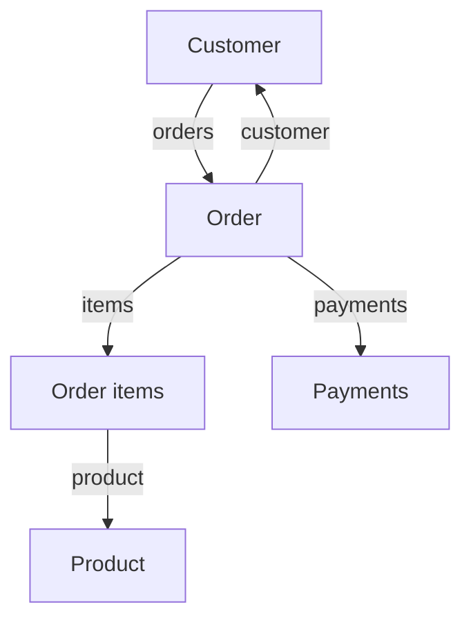
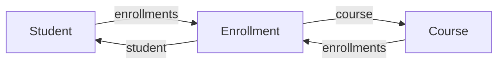

# Link đến tài nguyên liên quan

Trong REST API dùng Spring HATEOAS, một tài nguyên thường có quan hệ với nhiều tài nguyên khác. Đơn hàng thuộc về một khách hàng, chứa nhiều dòng hàng và có thể liên quan tới thanh toán hoặc giao hàng. Thay vì nhúng toàn bộ đối tượng liên quan vào mọi response, API có thể công bố các link hypermedia để client khám phá và truy cập từng tài nguyên theo nhu cầu.

Link liên quan mô tả mối quan hệ giữa tài nguyên hiện tại và tài nguyên đích. Ví dụ, representation của đơn hàng có thể có `customer`, `items` và `payments`. Client đọc relation (`rel`) để hiểu ý nghĩa, sau đó theo `href` do server cung cấp. Spring HATEOAS hỗ trợ tạo các link này từ mapping controller bằng `WebMvcLinkBuilder`, rồi gắn chúng vào `EntityModel`, `CollectionModel` hoặc lớp kế thừa `RepresentationModel`.

## Association trong API có hypermedia

Association là mối liên hệ nghiệp vụ giữa các tài nguyên. Trong mô hình dữ liệu, quan hệ có thể là một-một, một-nhiều hoặc nhiều-nhiều. Trong API hypermedia, quan hệ đó có thể được thể hiện bằng link để client điều hướng từ tài nguyên này sang tài nguyên khác.

Ví dụ miền bán hàng:



Mỗi mũi tên biểu diễn một hướng điều hướng được API công bố. Quan hệ trong domain không bắt buộc phải được công bố theo cả hai chiều. API chỉ nên tạo link theo những hướng client thực sự cần sử dụng.

Ví dụ, response của một đơn hàng:

```json
{
  "id": "ORD-2048",
  "status": "PENDING",
  "total": 1250000,
  "_links": {
    "self": {
      "href": "/api/orders/ORD-2048"
    },
    "customer": {
      "href": "/api/customers/C-100"
    },
    "items": {
      "href": "/api/orders/ORD-2048/items"
    },
    "payments": {
      "href": "/api/orders/ORD-2048/payments"
    }
  }
}
```

Client không cần biết trước cấu trúc URL của khách hàng hay dòng hàng. Nó tìm relation `customer` hoặc `items`, rồi gọi `href` tương ứng. Nếu server thay đổi đường dẫn nhưng giữ nguyên ý nghĩa relation, client tiếp tục điều hướng theo link mới được cung cấp.

## Chọn relation cho tài nguyên liên quan

Tên relation nên mô tả rõ quan hệ từ tài nguyên hiện tại tới đích. Một số relation thường gặp trong API bán hàng:

| Tài nguyên nguồn | Relation | Tài nguyên đích | Ý nghĩa |
|---|---|---|---|
| `Order` | `customer` | `Customer` | Khách hàng đặt đơn |
| `Customer` | `orders` | Collection `Order` | Các đơn hàng của khách hàng |
| `Order` | `items` | Collection `OrderItem` | Các dòng hàng trong đơn |
| `OrderItem` | `product` | `Product` | Sản phẩm được đặt |
| `Order` | `payments` | Collection `Payment` | Các khoản thanh toán liên quan |
| `Order` | `shipment` | `Shipment` | Thông tin giao hàng |

Ưu tiên relation chuẩn của IANA khi ý nghĩa phù hợp. Với relation nghiệp vụ riêng như `customer`, `items` hoặc `payments`, cần thống nhất tên trong hợp đồng API và giữ ngữ nghĩa ổn định. API công khai có thể dùng URI relation mở rộng nếu cần định danh toàn cục; HAL cũng hỗ trợ CURIE để rút gọn URI relation dài.

Không dùng một relation cho nhiều ý nghĩa khác nhau. Ví dụ, nếu `items` luôn là các dòng hàng của đơn hàng, không đổi nó thành danh sách sản phẩm được khách hàng yêu thích ở một endpoint khác. Client sử dụng relation để hiểu ngữ nghĩa, không nên phải đoán theo URL.

## Tạo link tới tài nguyên liên quan bằng WebMvcLinkBuilder

Spring HATEOAS cung cấp `linkTo(...)` và `methodOn(...)` để tạo URI từ mapping controller. Giả sử controller có endpoint đọc khách hàng và danh sách đơn hàng của khách hàng:

```java
import java.util.UUID;

import org.springframework.hateoas.CollectionModel;
import org.springframework.hateoas.EntityModel;
import org.springframework.web.bind.annotation.GetMapping;
import org.springframework.web.bind.annotation.PathVariable;
import org.springframework.web.bind.annotation.RequestMapping;
import org.springframework.web.bind.annotation.RestController;

@RestController
@RequestMapping("/api/customers")
public class CustomerController {

    @GetMapping("/{id}")
    public EntityModel<CustomerResponse> one(@PathVariable UUID id) {
        // Lấy khách hàng và tạo representation.
    }

    @GetMapping("/{id}/orders")
    public CollectionModel<EntityModel<OrderResponse>> orders(
            @PathVariable UUID id
    ) {
        // Trả các đơn hàng của khách hàng.
    }
}
```

Từ `OrderController`, có thể tạo link tới khách hàng:

```java
import org.springframework.hateoas.Link;

import static org.springframework.hateoas.server.mvc.WebMvcLinkBuilder.linkTo;
import static org.springframework.hateoas.server.mvc.WebMvcLinkBuilder.methodOn;

Link customerLink = linkTo(
        methodOn(CustomerController.class).one(customerId)
).withRel("customer");
```

Tạo link tới collection đơn hàng của một khách hàng:

```java
Link customerOrdersLink = linkTo(
        methodOn(CustomerController.class).orders(customerId)
).withRel("orders");
```

`methodOn(...)` cung cấp tham chiếu tới phương thức controller cùng tham số; `linkTo(...)` sử dụng mapping để tạo URI. Cách này tránh nối chuỗi URL thủ công và giúp link cập nhật theo mapping khi route thay đổi.

## Gắn link liên quan vào EntityModel

Với một tài nguyên đơn, `EntityModel<T>` bọc content và các link. Assembler là nơi thích hợp để tập trung cách biểu diễn và điều hướng của một loại tài nguyên.

```java
import java.util.UUID;

import org.springframework.hateoas.EntityModel;
import org.springframework.hateoas.server.RepresentationModelAssembler;
import org.springframework.stereotype.Component;

import static org.springframework.hateoas.server.mvc.WebMvcLinkBuilder.linkTo;
import static org.springframework.hateoas.server.mvc.WebMvcLinkBuilder.methodOn;

@Component
public class OrderModelAssembler
        implements RepresentationModelAssembler<Order, EntityModel<OrderResponse>> {

    @Override
    public EntityModel<OrderResponse> toModel(Order order) {
        UUID id = order.getId();

        EntityModel<OrderResponse> model = EntityModel.of(
                new OrderResponse(
                        id,
                        order.getStatus().name(),
                        order.getTotal()
                ),
                linkTo(methodOn(OrderController.class).one(id)).withSelfRel()
        );

        if (order.getCustomerId() != null) {
            model.add(linkTo(methodOn(CustomerController.class)
                    .one(order.getCustomerId())).withRel("customer"));
        }

        model.add(linkTo(methodOn(OrderController.class)
                .items(id)).withRel("items"));

        if (order.hasPayments()) {
            model.add(linkTo(methodOn(OrderController.class)
                    .payments(id)).withRel("payments"));
        }

        return model;
    }
}
```

Assembler luôn tạo `self`, thêm `customer` khi đơn hàng có khách hàng, và tạo `items` để client truy cập các dòng hàng. Link `payments` chỉ xuất hiện khi đơn hàng có dữ liệu thanh toán. Các phương thức `one(...)`, `items(...)` và `payments(...)` là endpoint minh họa cần được khai báo trong controller tương ứng.

Điều kiện tạo link nên phản ánh ngữ nghĩa nghiệp vụ. Nếu collection thanh toán có thể rỗng nhưng endpoint vẫn hợp lệ và client cần khám phá collection đó, link `payments` có thể luôn xuất hiện. Nếu link chỉ có ý nghĩa khi khoản thanh toán đã được khởi tạo, có thể thêm nó theo trạng thái. Quyết định phụ thuộc hợp đồng API, không chỉ phụ thuộc việc database hiện có bản ghi hay chưa.

## Biểu diễn association một-nhiều

Với quan hệ một-nhiều, chẳng hạn một khách hàng có nhiều đơn hàng, API có thể công bố link từ khách hàng tới collection đơn hàng:

```java
import java.util.UUID;

import org.springframework.hateoas.EntityModel;
import org.springframework.hateoas.server.RepresentationModelAssembler;
import org.springframework.stereotype.Component;

import static org.springframework.hateoas.server.mvc.WebMvcLinkBuilder.linkTo;
import static org.springframework.hateoas.server.mvc.WebMvcLinkBuilder.methodOn;

@Component
public class CustomerModelAssembler
        implements RepresentationModelAssembler<Customer, EntityModel<CustomerResponse>> {

    @Override
    public EntityModel<CustomerResponse> toModel(Customer customer) {
        UUID id = customer.getId();

        return EntityModel.of(
                new CustomerResponse(id, customer.getName()),
                linkTo(methodOn(CustomerController.class).one(id)).withSelfRel(),
                linkTo(methodOn(CustomerController.class).orders(id))
                        .withRel("orders")
        );
    }
}
```

Client tải khách hàng trước, sau đó theo relation `orders` để lấy danh sách đơn hàng. Cách này cho phép server quyết định cách phân trang, lọc hoặc tổ chức collection. Client không phải tự ghép `/customers/{id}/orders`.

Ở chiều ngược lại, mỗi đơn hàng có thể có link `customer`. Hai link này tạo thành đường điều hướng hai chiều, nhưng không bắt buộc mọi API phải công bố cả hai. Hãy cung cấp chiều điều hướng phù hợp với tác vụ của client.

## Biểu diễn association nhiều-nhiều

Quan hệ nhiều-nhiều thường xuất hiện giữa `Student` và `Course`, `Product` và `Tag`, hoặc `User` và `Role`. API có thể tạo link tới collection liên quan ở cả hai phía.

Ví dụ, từ sản phẩm tới các tag:

```java
model.add(linkTo(methodOn(ProductController.class)
        .tags(productId)).withRel("tags"));
```

Từ tag tới các sản phẩm:

```java
model.add(linkTo(methodOn(TagController.class)
        .products(tagId)).withRel("products"));
```

Nếu bản thân quan hệ có dữ liệu và vòng đời riêng, nên xem quan hệ đó như một tài nguyên độc lập. Ví dụ, một đăng ký khóa học có ngày đăng ký, trạng thái, điểm số và ngày hoàn thành. Khi đó, `Enrollment` là tài nguyên liên kết giữa `Student` và `Course`, có URI và representation riêng.



Biểu diễn `Enrollment` giúp client thao tác với chính mối quan hệ, chẳng hạn xem trạng thái đăng ký hoặc hủy đăng ký, thay vì chỉ nhận một link trực tiếp giữa hai tài nguyên.

## Link association hay nhúng tài nguyên liên quan?

HAL hỗ trợ cả liên kết và embedded resource. Link nằm trong `_links`; tài nguyên được nhúng nằm trong `_embedded`. Hai cách có mục đích khác nhau:

| Cách biểu diễn | Đặc điểm | Khi phù hợp |
|---|---|---|
| Link tới tài nguyên liên quan | Response nguồn chứa relation và `href`; client tải tài nguyên đích khi cần | Tài nguyên liên quan lớn, được dùng độc lập, có phân quyền hoặc cache riêng |
| Embedded resource | Response nguồn chứa representation của tài nguyên liên quan trong `_embedded` | Client thường cần dữ liệu liên quan ngay cùng response và payload có kích thước kiểm soát được |
| Kết hợp link và embedded | Có snapshot dữ liệu liên quan cùng link để truy cập bản đầy đủ | Client cần hiển thị nhanh nhưng vẫn cần điều hướng tới tài nguyên gốc |

Ví dụ chỉ dùng link:

```json
{
  "id": "ORD-2048",
  "_links": {
    "self": { "href": "/api/orders/ORD-2048" },
    "customer": { "href": "/api/customers/C-100" }
  }
}
```

Ví dụ nhúng một phần dữ liệu khách hàng và vẫn cung cấp link:

```json
{
  "id": "ORD-2048",
  "_embedded": {
    "customer": {
      "id": "C-100",
      "displayName": "Nguyen An",
      "_links": {
        "self": { "href": "/api/customers/C-100" }
      }
    }
  },
  "_links": {
    "self": { "href": "/api/orders/ORD-2048" },
    "customer": { "href": "/api/customers/C-100" }
  }
}
```

Không nên nhúng toàn bộ đồ thị quan hệ của domain object vào một response. Việc đó có thể tạo payload lớn, vòng tham chiếu, dữ liệu lặp và phụ thuộc chặt giữa các representation. Hãy chọn dữ liệu embedded theo nhu cầu đọc cụ thể và giới hạn độ sâu của representation.

## Tránh phụ thuộc trực tiếp vào quan hệ JPA

Một entity JPA có thể có association hai chiều như `Order.customer` và `Customer.orders`. Tuần tự hóa trực tiếp entity có thể dẫn tới vòng tham chiếu, lazy-loading ngoài ý muốn hoặc truy vấn N+1 khi tạo response collection.

Nên lấy dữ liệu cần thiết qua service hoặc projection, rồi tạo DTO và link:

```java
public record OrderSummary(
        UUID id,
        String status,
        UUID customerId
) {}
```

Assembler dùng `customerId` để tạo link `customer`; nó không cần gọi `customer.getOrders()` hoặc duyệt toàn bộ đồ thị entity. Service có thể tối ưu truy vấn, tải dữ liệu liên quan theo lô hoặc chỉ lấy các ID cần thiết.

Khi trả collection lớn, tránh để assembler truy cập lazy association riêng cho từng item. Hãy kiểm soát query bằng fetch strategy, projection hoặc batch query ở tầng service/repository. Link builder chỉ cần ID và mapping endpoint để tạo URI.

## Quyền truy cập và link liên quan

Không phải người dùng nào cũng được phép truy cập mọi tài nguyên liên quan. Server có thể không công bố link `payments` cho người dùng không có quyền xem thanh toán, hoặc không công bố link `customer` nếu thông tin khách hàng bị giới hạn theo vai trò.

Có thể đưa capability đã được tính toán vào representation:

```java
if (capabilities.canViewPayments(order)) {
    model.add(linkTo(methodOn(OrderController.class)
            .payments(order.getId())).withRel("payments"));
}
```

`capabilities` là thành phần của ứng dụng xác định quyền/capability theo người dùng hiện tại. Không nên lặp lại toàn bộ quy tắc authorization trong assembler. Quan trọng hơn, việc link không xuất hiện không thay thế kiểm tra bảo mật ở endpoint đích. Client có thể gọi URI trực tiếp hoặc quyền có thể thay đổi sau khi response được tạo; server vẫn phải xác thực và phân quyền cho từng request.

## Kiểm thử link đến tài nguyên liên quan

Kiểm thử response nên xác nhận relation liên quan tồn tại và URI trỏ đúng endpoint. Với MockMvc:

```java
import static org.springframework.test.web.servlet.request.MockMvcRequestBuilders.get;
import static org.springframework.test.web.servlet.result.MockMvcResultMatchers.jsonPath;
import static org.springframework.test.web.servlet.result.MockMvcResultMatchers.status;
import static org.hamcrest.Matchers.endsWith;

import org.springframework.hateoas.MediaTypes;

mockMvc.perform(get("/api/orders/{id}", orderId)
        .accept(MediaTypes.HAL_JSON))
    .andExpect(status().isOk())
    .andExpect(jsonPath("$._links.self.href").exists())
    .andExpect(jsonPath("$._links.customer.href")
            .value(endsWith("/api/customers/" + customerId)))
    .andExpect(jsonPath("$._links.items.href")
            .value(endsWith("/api/orders/" + orderId + "/items")));
```

Matcher `endsWith(...)` giúp test không phụ thuộc scheme, host hoặc port của môi trường. Có thể bổ sung kiểm thử theo link: lấy `href` của `customer`, gọi URI đó trong test và xác nhận tài nguyên khách hàng trả về thành công.

Với association tùy chọn, kiểm tra cả hai trường hợp:

```java
mockMvc.perform(get("/api/orders/{id}", orderWithoutCustomerId)
        .accept(MediaTypes.HAL_JSON))
    .andExpect(status().isOk())
    .andExpect(jsonPath("$._links.customer").doesNotExist());
```

Nếu hợp đồng yêu cầu link collection `items` luôn có mặt ngay cả khi chưa có dòng hàng, hãy kiểm thử rằng link vẫn tồn tại với collection rỗng. Điều này giúp client phân biệt một collection hợp lệ đang rỗng với trường hợp API không công bố quan hệ.

## Những lỗi thường gặp

| Lỗi | Hệ quả | Cách xử lý |
|---|---|---|
| Nhúng toàn bộ entity liên quan | Payload lớn, vòng tham chiếu hoặc lộ trường nội bộ | Dùng DTO và link tới tài nguyên liên quan |
| Nối chuỗi URL bằng ID | Link dễ sai khi mapping thay đổi | Dùng `linkTo(methodOn(...))` |
| Đặt relation không nhất quán | Client khó khám phá cùng một loại quan hệ | Dùng vocabulary relation thống nhất |
| Công bố mọi quan hệ hai chiều | API có nhiều link không cần thiết | Chỉ công bố hướng điều hướng phục vụ client |
| Dùng link vắng mặt làm cơ chế bảo mật | Endpoint có thể bị gọi trực tiếp | Kiểm tra quyền tại endpoint đích |
| Để assembler duyệt lazy association | N+1 query khi trả collection | Lấy ID/projection qua service và kiểm soát truy vấn |
| Không phân biệt link với embedded | Client hiểu sai dữ liệu đầy đủ hay tham chiếu | Dùng `_links` cho điều hướng, `_embedded` cho representation nhúng |
| Bỏ qua tài nguyên association có dữ liệu riêng | Khó quản lý trạng thái của mối quan hệ | Tạo resource riêng như `Enrollment` khi cần |

## Quy trình thiết kế link liên quan

1. Xác định các tài nguyên và quan hệ nghiệp vụ mà client cần điều hướng.
2. Chọn relation có ngữ nghĩa rõ ràng và ổn định cho từng hướng điều hướng.
3. Quyết định dùng link, embedded resource hay kết hợp dựa trên nhu cầu đọc và kích thước response.
4. Tạo endpoint cho tài nguyên đích hoặc collection liên quan.
5. Dùng `WebMvcLinkBuilder` để tạo URI từ mapping controller.
6. Gắn link vào `EntityModel` hoặc `CollectionModel` trong assembler.
7. Công bố link theo trạng thái và capability phù hợp, đồng thời giữ kiểm tra quyền ở endpoint.
8. Kiểm soát truy vấn dữ liệu để tránh lazy-loading và N+1 khi tạo collection.
9. Kiểm thử relation, `href`, association tùy chọn và khả năng theo link tới tài nguyên đích.

## Kết luận

Link đến tài nguyên liên quan biến association trong domain thành các hướng điều hướng mà client có thể khám phá qua hypermedia. Spring HATEOAS giúp tạo link theo mapping controller và gắn chúng vào representation bằng `EntityModel`, `CollectionModel` hoặc assembler. Khi relation được đặt tên ổn định, link chỉ công bố theo capability phù hợp, dữ liệu nhúng được giới hạn và các endpoint đích vẫn kiểm tra quyền, API có thể biểu diễn quan hệ một-nhiều và nhiều-nhiều mà không buộc client phụ thuộc vào cấu trúc dữ liệu nội bộ.
