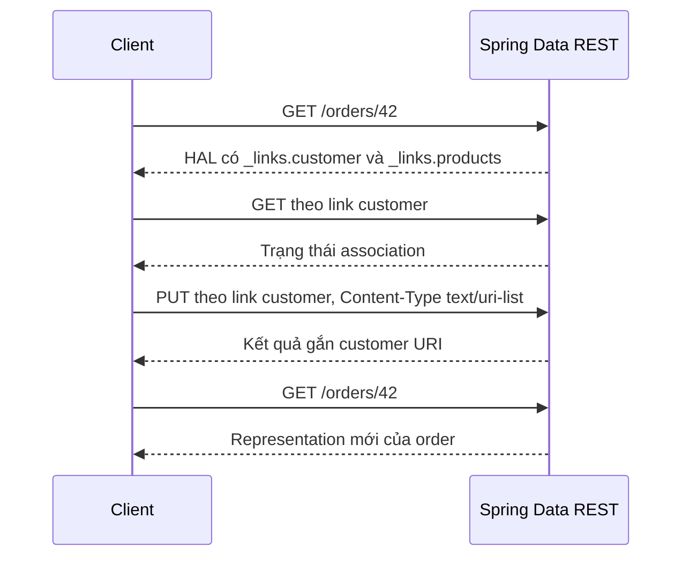

# Resource association độc lập

Trong một API REST, hai tài nguyên có thể liên kết với nhau mà không cần nhúng toàn bộ dữ liệu của tài nguyên này vào tài nguyên kia. Ví dụ, một đơn hàng tham chiếu tới khách hàng và có nhiều sản phẩm. Client cần biết URI để khám phá các tài nguyên liên quan, đồng thời có thể cần thay đổi quan hệ khách hàng hoặc danh sách sản phẩm.

Spring Data REST cung cấp **association resource**: một sub-resource có URI riêng đại diện cho quan hệ giữa một item resource và tài nguyên được liên kết. Client có thể đọc hoặc thao tác với quan hệ thông qua URI này bằng các HTTP method được hỗ trợ. Cách tiếp cận đó giúp client quản lý liên kết mà không phải gửi lại toàn bộ nội dung đơn hàng.

Bài học này thuộc chương **Associations** trong module **SPRING_HATEOAS**, tập trung vào cách Spring Data REST công bố association resource, cách phân biệt quan hệ một-một/một-nhiều/nhiều-nhiều, thao tác bằng `GET`, `PUT`, `POST`, `DELETE`, tùy chỉnh relation và path, cũng như kiểm thử hợp đồng hypermedia.

Sau bài học, bạn có thể:

- Giải thích association resource và vai trò của URI quan hệ độc lập.
- Phân biệt item resource, related resource và association resource.
- Khai báo quan hệ JPA để Spring Data REST công bố link tương ứng.
- Dùng `text/uri-list` để gắn tài nguyên theo URI.
- Phân biệt cách dùng `PUT`, `POST` và `DELETE` cho association một phần tử hoặc collection.
- Tùy chỉnh path và relation bằng `@RestResource`.
- Chọn khi nào nên dùng association resource và khi nào nên mô hình hóa quan hệ thành một entity riêng.
- Kiểm thử link, thao tác liên kết và các trường hợp không được phép.

## 1. Association resource là gì?

Một association mô tả quan hệ giữa các tài nguyên. Ví dụ:

- Đơn hàng thuộc về một khách hàng.
- Đơn hàng có nhiều sản phẩm.
- Người dùng tham gia nhiều nhóm.
- Bài viết có nhiều thẻ.

Nếu API chỉ trả về dữ liệu lồng nhau, client có thể phải tải hoặc gửi lại cả đối tượng cha khi chỉ muốn thay đổi một quan hệ. Association resource tách thao tác quan hệ thành một URI riêng. Với Spring Data REST, URI đó thường là sub-resource nằm dưới URI của item resource:

```text
/orders/42                 item resource của đơn hàng
/orders/42/customer        association resource tới khách hàng
/orders/42/products       association resource tới các sản phẩm
```

`/orders/42/customer` đại diện cho quan hệ customer của đơn hàng số 42; `/orders/42/products` đại diện cho quan hệ products của đơn hàng đó. Đây là các endpoint có thể được client khám phá qua link trong biểu diễn HAL.

Association resource là tài nguyên HTTP có thể định địa chỉ và thao tác độc lập trong hợp đồng API. Nó **không tự động trở thành một entity hoặc một bảng riêng trong cơ sở dữ liệu**. Phần lưu trữ quan hệ vẫn do mapping JPA và persistence layer quyết định.

## 2. Phân biệt item resource và association resource

Giả sử API quản lý đơn hàng và khách hàng. Có ba URI mang ý nghĩa khác nhau:

| URI | Loại resource | Ý nghĩa |
|---|---|---|
| `/orders/42` | Item resource | Nội dung của đơn hàng số 42. |
| `/customers/7` | Item resource | Nội dung của khách hàng số 7. |
| `/orders/42/customer` | Association resource | Quan hệ customer hiện tại của đơn hàng số 42. |

Khi client `GET /orders/42`, Spring Data REST có thể trả representation HAL với các link:

```json
{
  "id": 42,
  "status": "PENDING",
  "_links": {
    "self": {
      "href": "http://localhost:8080/orders/42"
    },
    "customer": {
      "href": "http://localhost:8080/orders/42/customer"
    },
    "products": {
      "href": "http://localhost:8080/orders/42/products"
    }
  }
}
```

Link `customer` không nhất thiết trỏ thẳng tới `/customers/7`. Nó trỏ tới association resource, nơi client có thể đọc trạng thái quan hệ hoặc thay đổi tài nguyên được liên kết. Client có thể theo link đó để khám phá tiếp.

Đây là điểm quan trọng của HATEOAS: client sử dụng relation và `href` được server công bố, thay vì tự ghép `/orders/{id}/customer` hoặc đoán endpoint từ tên thuộc tính Java.

## 3. Spring Data REST tạo association resource như thế nào?

Spring Data REST xuất các repository thành REST resources. Với mỗi item resource, framework phát hiện các association của domain type và công bố link tới association resource tương ứng. Tên link và path mặc định dựa trên tên thuộc tính association; có thể tùy chỉnh bằng `@RestResource` trên thuộc tính.

Ví dụ repository:

```java
import org.springframework.data.jpa.repository.JpaRepository;
import org.springframework.data.rest.core.annotation.RepositoryRestResource;

@RepositoryRestResource(path = "orders")
public interface OrderRepository extends JpaRepository<Order, Long> {
}

@RepositoryRestResource(path = "customers")
public interface CustomerRepository extends JpaRepository<Customer, Long> {
}

@RepositoryRestResource(path = "products")
public interface ProductRepository extends JpaRepository<Product, Long> {
}
```

Các repository trên được Spring Data REST xuất thành collection resources `/orders`, `/customers` và `/products`, cùng item resources tương ứng. Association resource được công bố dựa trên các thuộc tính liên kết của entity mà repository quản lý.

Để có cơ chế này, ứng dụng cần Spring Data REST, thường qua dependency `spring-boot-starter-data-rest`, cùng Spring Data JPA nếu dùng JPA. Chỉ thêm `spring-boot-starter-hateoas` sẽ cung cấp các abstraction hypermedia như `Link`, `EntityModel` và assembler, nhưng tự nó không xuất repository hoặc tạo association resource của Spring Data REST.

## 4. Khai báo association trong entity

Ví dụ `Order` có một khách hàng và nhiều sản phẩm. Đơn hàng có thể chưa được gán khách hàng nên association customer là tùy chọn:

```java
import jakarta.persistence.Entity;
import jakarta.persistence.GeneratedValue;
import jakarta.persistence.GenerationType;
import jakarta.persistence.Id;
import jakarta.persistence.JoinColumn;
import jakarta.persistence.JoinTable;
import jakarta.persistence.ManyToMany;
import jakarta.persistence.ManyToOne;
import jakarta.persistence.FetchType;

import org.springframework.data.rest.core.annotation.RestResource;

import java.util.LinkedHashSet;
import java.util.Set;

@Entity
public class Order {

    @Id
    @GeneratedValue(strategy = GenerationType.IDENTITY)
    private Long id;

    @ManyToOne(fetch = FetchType.LAZY, optional = true)
    @JoinColumn(name = "customer_id")
    @RestResource(path = "customer", rel = "customer")
    private Customer customer;

    @ManyToMany
    @JoinTable(
            name = "order_product",
            joinColumns = @JoinColumn(name = "order_id"),
            inverseJoinColumns = @JoinColumn(name = "product_id")
    )
    @RestResource(path = "products", rel = "products")
    private Set<Product> products = new LinkedHashSet<>();

    // Constructors, getters and setters.
}
```

`Customer` và `Product` là entity được xuất qua repository riêng:

```java
import jakarta.persistence.Entity;
import jakarta.persistence.GeneratedValue;
import jakarta.persistence.GenerationType;
import jakarta.persistence.Id;

@Entity
public class Customer {

    @Id
    @GeneratedValue(strategy = GenerationType.IDENTITY)
    private Long id;

    private String name;

    // Constructors, getters and setters.
}

@Entity
public class Product {

    @Id
    @GeneratedValue(strategy = GenerationType.IDENTITY)
    private Long id;

    private String name;

    // Constructors, getters and setters.
}
```

Các annotation quan trọng:

- `@ManyToOne` khai báo association từ nhiều đơn hàng tới một khách hàng.
- `@ManyToMany` khai báo association collection giữa đơn hàng và sản phẩm.
- `@JoinColumn` và `@JoinTable` xác định cấu trúc lưu quan hệ trong JPA.
- `@RestResource` tùy chỉnh tên path và relation được Spring Data REST công bố.

Cardinality trong JPA quyết định cách association resource được thao tác:

| JPA mapping | Hình dạng quan hệ | Hướng thao tác chính |
|---|---|---|
| `@OneToOne` | To-one | `PUT` để gắn một URI; `DELETE` nếu quan hệ có thể rỗng. |
| `@ManyToOne` | To-one | `PUT` để gắn một URI; `DELETE` nếu quan hệ có thể rỗng. |
| `@OneToMany` | Collection | `POST` để thêm một phần tử vào collection. |
| `@ManyToMany` | Collection | `POST` để thêm một phần tử vào collection. |

Với cấu hình trên, client có thể khám phá link `customer` và `products` từ item resource của đơn hàng. Spring Data REST xử lý association dựa trên metadata persistence và repository được xuất.

## 5. Association một tài nguyên: thay đổi quan hệ bằng PUT

Với association to-one như `Order.customer`, client cần gắn một URI khách hàng vào association resource. Spring Data REST dùng `PUT` với media type `text/uri-list`:

```http
PUT /orders/42/customer
Content-Type: text/uri-list

http://localhost:8080/customers/7
```

Ví dụ bằng cURL:

```bash
curl -i -X PUT \
  http://localhost:8080/orders/42/customer \
  -H "Content-Type: text/uri-list" \
  --data-binary "http://localhost:8080/customers/7"
```

Request body là URI của tài nguyên khách hàng, không phải JSON chứa toàn bộ khách hàng. Spring Data REST dùng URI đó để phân giải tài nguyên và gắn nó vào association của đơn hàng.

Đối với association to-one, chỉ gửi một URI. Nếu gửi nhiều URI cho một association chỉ nhận một tài nguyên, Spring Data REST trả `400 Bad Request`.

Để đọc trạng thái association, client có thể gọi:

```http
GET /orders/42/customer
Accept: application/hal+json
```

Association resource hỗ trợ `GET` với `application/hal+json` và `application/json`. Client nên theo link `customer` lấy từ item resource thay vì tự tạo URI.

## 6. Gỡ association to-one

Nếu association là tùy chọn, client có thể gửi `DELETE` tới association resource để bỏ liên kết:

```bash
curl -i -X DELETE \
  http://localhost:8080/orders/42/customer
```

Thao tác này gỡ quan hệ giữa đơn hàng và khách hàng. Nó không xóa tài nguyên khách hàng tại `/customers/7` và cũng không xóa đơn hàng tại `/orders/42`.

Khả năng gỡ phụ thuộc vào tính tùy chọn của association. Với association không được phép rỗng, `DELETE` có thể trả `405 Method Not Allowed`. Vì vậy, nếu nghiệp vụ bắt buộc đơn hàng phải có khách hàng, client không thể dùng association resource để bỏ liên kết đó.

Ví dụ entity ở mục trước dùng `optional = true` để minh họa quan hệ có thể được gỡ. Nếu đổi thành `optional = false`, cần giữ quy tắc bắt buộc khách hàng trong schema và nghiệp vụ, đồng thời không công bố thao tác gỡ như một khả năng hợp lệ.

## 7. Association collection: thêm phần tử bằng POST

Với association collection như `Order.products`, `POST` thêm một tài nguyên vào collection association. Request vẫn dùng `text/uri-list`:

```http
POST /orders/42/products
Content-Type: text/uri-list

http://localhost:8080/products/11
```

Ví dụ bằng cURL:

```bash
curl -i -X POST \
  http://localhost:8080/orders/42/products \
  -H "Content-Type: text/uri-list" \
  --data-binary "http://localhost:8080/products/11"
```

Spring Data REST chỉ hỗ trợ `POST` cho collection association. Thao tác này thêm tài nguyên được chỉ định vào collection; nó không tạo mới `Product` vì URI trong body trỏ tới một tài nguyên đã được xuất.

Để đọc trạng thái collection association:

```http
GET /orders/42/products
Accept: application/hal+json
```

Phản hồi biểu diễn trạng thái quan hệ hiện tại. Client có thể khám phá các tài nguyên sản phẩm liên kết từ representation đó.

## 8. PUT và DELETE với collection association

Association resource hỗ trợ `PUT` để bind tài nguyên được chỉ định bằng URI hoặc danh sách URI. Media type vẫn là `text/uri-list`. Khi dùng `PUT` cho collection, client gửi các URI cần bind vào association. Tài liệu mô tả thao tác là bind URI(s) được gửi; đừng tự suy ra cách thay thế toàn bộ collection nếu chưa xác nhận hành vi của phiên bản và mapping đang dùng.

Ví dụ body gồm nhiều URI, mỗi URI trên một dòng:

```http
PUT /orders/42/products
Content-Type: text/uri-list

http://localhost:8080/products/11
http://localhost:8080/products/12
```

`DELETE` trên association resource có ý nghĩa gỡ association. Tài liệu Spring Data REST mô tả thao tác này là unbind association; không nên diễn giải nó thành xóa các entity sản phẩm được liên kết. Với collection association, nếu giao diện cần gỡ một phần tử cụ thể, hãy thiết kế và kiểm thử rõ URI thao tác cho phần tử đó theo phiên bản framework đang dùng, hoặc tạo endpoint nghiệp vụ riêng. Không mặc định rằng `DELETE` trên URI collection sẽ chỉ gỡ một phần tử.

Đối với quan hệ collection lớn, cân nhắc phân trang, giới hạn kích thước payload và thiết kế thao tác thêm/gỡ theo từng phần tử. Tránh gửi một danh sách URI khổng lồ chỉ để thay đổi một liên kết nhỏ.

## 9. Tùy chỉnh path và relation bằng RestResource

Mặc định, Spring Data REST lấy tên property để tạo path và relation. Có thể tùy chỉnh bằng `@RestResource`:

```java
@ManyToOne(fetch = FetchType.LAZY, optional = true)
@JoinColumn(name = "customer_id")
@RestResource(path = "buyer", rel = "buyer")
private Customer customer;
```

Khi đó, association resource được công bố dưới path `/orders/{id}/buyer` và link trong HAL dùng relation `buyer`. `path` điều khiển đoạn URI; `rel` điều khiển tên quan hệ mà client dùng để khám phá link.

Nếu muốn ẩn association khỏi API, có thể đặt `exported = false`:

```java
@ManyToOne(fetch = FetchType.LAZY)
@JoinColumn(name = "internal_customer_id")
@RestResource(exported = false)
private Customer internalCustomer;
```

Khi association không được export, client không nhận link tới association resource tương ứng. Việc ẩn link cần đi cùng cấu hình bảo mật và quy tắc export phù hợp; không xem việc không công bố link là cơ chế phân quyền duy nhất.

## 10. Quy trình client khám phá và thay đổi quan hệ

Một client HATEOAS không cần biết trước cấu trúc path của association. Luồng tổng quát:



Các bước thực hiện:

1. Gọi item resource và đọc relation cần thao tác, ví dụ `customer`.
2. Theo `href` của relation để truy cập association resource.
3. Dùng HTTP method phù hợp với cardinality của quan hệ.
4. Gửi URI của tài nguyên liên quan qua `text/uri-list` khi bind.
5. Đọc lại association hoặc item resource để xác nhận trạng thái mới.

Client không nên tự nối `/orders/42/customer` nếu server đã trả link. Nếu path được đổi bằng `@RestResource`, client vẫn hoạt động khi tiếp tục theo relation `buyer` và `href` mới.

## 11. Association resource không phải lúc nào cũng là mô hình domain phù hợp

Association resource phù hợp khi quan hệ chủ yếu là việc liên kết một tài nguyên hiện có với tài nguyên khác. Ví dụ đơn hàng tham chiếu khách hàng, bài viết gắn thẻ hoặc nhân viên thuộc phòng ban.

Nếu chính quan hệ có dữ liệu và vòng đời nghiệp vụ riêng, nên cân nhắc mô hình hóa quan hệ thành một entity độc lập. Ví dụ một dòng đơn hàng có:

- Số lượng sản phẩm.
- Đơn giá tại thời điểm đặt hàng.
- Chiết khấu áp dụng.
- Trạng thái giao hàng của dòng hàng.
- Thời điểm thêm hoặc hủy dòng hàng.

Trong trường hợp này, quan hệ Order–Product không còn là một liên kết thuần túy. Có thể tạo entity `OrderLine` với ID, repository và resource riêng:

```java
import java.math.BigDecimal;

import jakarta.persistence.Entity;
import jakarta.persistence.GeneratedValue;
import jakarta.persistence.GenerationType;
import jakarta.persistence.Id;
import jakarta.persistence.ManyToOne;

@Entity
public class OrderLine {

    @Id
    @GeneratedValue(strategy = GenerationType.IDENTITY)
    private Long id;

    @ManyToOne(optional = false)
    private Order order;

    @ManyToOne(optional = false)
    private Product product;

    private int quantity;

    private BigDecimal unitPrice;
}
```

Khi đó `/orderLines/{id}` biểu diễn một dòng đơn hàng có danh tính và dữ liệu riêng. API có thể kiểm soát cập nhật số lượng, giá, trạng thái và quyền thao tác ở cấp dòng hàng. Association resource vẫn có thể dùng để liên kết Order với OrderLine, nhưng không nên dùng một `@ManyToMany` đơn giản để che giấu dữ liệu nghiệp vụ của quan hệ.

## 12. Quan hệ JPA, phía sở hữu và tính nhất quán

Association resource là lớp HTTP; JPA mapping vẫn quyết định cách quan hệ được lưu. Khi dùng quan hệ hai chiều, cần xác định phía sở hữu (*owning side*) và phía nghịch đảo (`mappedBy`). Thay đổi collection ở phía nghịch đảo mà không cập nhật phía sở hữu có thể không được ghi xuống cơ sở dữ liệu như mong đợi.

Ví dụ với `Order.products`, nếu `Order` là phía sở hữu của `@ManyToMany`, association endpoint cập nhật collection này. Nếu chuyển mapping sang `mappedBy`, hãy kiểm tra cách Spring Data REST cập nhật association và bảo đảm logic domain đồng bộ hai phía.

Ngoài ra, cần quyết định rõ:

- Có cho phép association rỗng hay không (`optional`, `nullable`, ràng buộc database).
- Cascade nào thực sự cần thiết; không bật cascade remove chỉ vì API cho phép gỡ link.
- Khi xóa tài nguyên đích, quan hệ được xử lý theo quy tắc nào.
- Có cần cập nhật cả hai phía trong bộ nhớ trước khi lưu hay không.
- Có cần kiểm tra tenant, quyền sở hữu hoặc điều kiện nghiệp vụ trước khi bind URI hay không.

Gỡ association không đồng nghĩa xóa entity đích. Cấu hình cascade và quan hệ database phải phản ánh chính xác vòng đời domain.

## 13. Bảo mật và giới hạn export

Association resource có thể thay đổi quan hệ giữa các tài nguyên, vì vậy cần được bảo vệ như các endpoint ghi dữ liệu khác.

- Xác thực client trước khi cho phép đọc hoặc thay đổi association.
- Phân quyền theo tài nguyên cha và tài nguyên đích; không chỉ kiểm tra người dùng có thể gọi endpoint chung.
- Xác minh URI trong `text/uri-list` trỏ tới tài nguyên mà người dùng được phép liên kết.
- Ẩn repository, method hoặc association không nên công bố bằng `@RestResource(exported = false)` khi phù hợp.
- Không dựa vào việc client không nhìn thấy link để ngăn request trực tiếp.
- Kiểm tra các quy tắc toàn vẹn như khách hàng còn hoạt động, sản phẩm còn được phép bán hoặc quan hệ không tạo vòng phụ thuộc trái phép.

Spring Data REST chỉ xuất những method repository có mặt và được phép export; method bị đánh dấu `exported = false` sẽ không được công bố theo cơ chế tương ứng. Tuy nhiên, authorization vẫn cần được cấu hình riêng trong ứng dụng.

## 14. Kiểm thử association resource

Kiểm thử nên xác nhận cả khả năng khám phá link lẫn thao tác liên kết. Ví dụ với MockMvc:

```java
import org.junit.jupiter.api.Test;
import org.springframework.beans.factory.annotation.Autowired;
import org.springframework.boot.test.autoconfigure.web.servlet.AutoConfigureMockMvc;
import org.springframework.boot.test.context.SpringBootTest;
import org.springframework.test.web.servlet.MockMvc;

import static org.hamcrest.Matchers.endsWith;
import static org.springframework.test.web.servlet.request.MockMvcRequestBuilders.get;
import static org.springframework.test.web.servlet.request.MockMvcRequestBuilders.put;
import static org.springframework.test.web.servlet.result.MockMvcResultMatchers.jsonPath;
import static org.springframework.test.web.servlet.result.MockMvcResultMatchers.status;

@SpringBootTest
@AutoConfigureMockMvc
class OrderAssociationResourceTest {

    @Autowired
    MockMvc mockMvc;

    @Test
    void orderRepresentationPublishesAssociationLinks() throws Exception {
        mockMvc.perform(get("/orders/42").accept("application/hal+json"))
                .andExpect(status().isOk())
                .andExpect(jsonPath("$._links.customer.href",
                        endsWith("/orders/42/customer")))
                .andExpect(jsonPath("$._links.products.href",
                        endsWith("/orders/42/products")));
    }

    @Test
    void putBindsCustomerByResourceUri() throws Exception {
        mockMvc.perform(put("/orders/42/customer")
                        .contentType("text/uri-list")
                        .content("http://localhost/customers/7"))
                .andExpect(status().is2xxSuccessful());
    }
}
```

Ví dụ giả định fixture đã tạo đơn hàng `42`, khách hàng `7`, các repository được export và association `customer` là tùy chọn. URL trong body phải khớp base URI và mapping được ứng dụng sử dụng. Tùy cấu hình trả body khi update, phản hồi thành công có thể là `200 OK` hoặc `204 No Content`; vì vậy test trên chỉ xác nhận nhóm status 2xx.

Nên bổ sung các trường hợp:

| Trường hợp | Điều cần xác nhận |
|---|---|
| `GET` item resource | Có relation tới association resource. |
| `GET` association resource | Trả trạng thái quan hệ và media type được hỗ trợ. |
| `PUT` to-one với một URI | Gắn đúng tài nguyên đích. |
| `PUT` to-one với nhiều URI | Trả `400 Bad Request`. |
| `POST` to-many | Thêm phần tử vào collection association. |
| `DELETE` association tùy chọn | Gỡ quan hệ mà không xóa tài nguyên đích. |
| `DELETE` association bắt buộc | Bị từ chối theo quy tắc association. |
| `exported = false` | Link/endpoint association không được công bố. |
| URI đích không tồn tại hoặc không được phép | Request bị từ chối theo quy tắc phân giải và bảo mật. |

## 15. Những lỗi thường gặp

| Lỗi | Hệ quả | Cách xử lý |
|---|---|---|
| Nhầm association resource với item resource | Client gọi nhầm endpoint để đọc hoặc sửa entity đích. | Phân biệt URI của entity và URI của quan hệ. |
| Gửi JSON entity vào association endpoint | Sai media type hoặc payload không đúng hợp đồng. | Gửi URI bằng `Content-Type: text/uri-list`. |
| Gửi nhiều URI cho association to-one | Request bị từ chối với `400 Bad Request`. | Chỉ gửi một URI cho quan hệ đơn. |
| Dùng POST cho association to-one | Method không phù hợp với cardinality. | Dùng PUT để bind tài nguyên to-one. |
| Nghĩ DELETE sẽ xóa entity đích | Có thể dẫn đến hiểu sai vòng đời dữ liệu. | DELETE gỡ quan hệ; thao tác xóa entity dùng item resource. |
| Cho rằng mọi association đều có thể gỡ | Quan hệ bắt buộc có thể trả `405 Method Not Allowed`. | Xác định tính optional và quy tắc domain. |
| Dùng ManyToMany cho quan hệ có thuộc tính nghiệp vụ | Không có nơi rõ ràng để lưu quantity, price hoặc trạng thái. | Tạo entity liên kết như `OrderLine`. |
| Dùng path hard-code ở client | Client hỏng khi `@RestResource` thay đổi path. | Theo relation và `href` do server trả về. |
| Chỉ kiểm thử repository mà không kiểm thử HTTP | Không phát hiện lỗi export, relation hoặc media type. | Bổ sung MockMvc integration test. |

## 16. Quy trình thiết kế và áp dụng

Khi cần công bố quan hệ giữa các tài nguyên, hãy thực hiện theo trình tự:

1. Xác định quan hệ là to-one hay collection association.
2. Xác định quan hệ có dữ liệu hoặc vòng đời riêng hay chỉ là liên kết giữa các entity hiện có.
3. Khai báo JPA mapping đúng phía sở hữu, optionality và ràng buộc database.
4. Xuất các repository cần thiết bằng Spring Data REST.
5. Dùng `@RestResource` để đặt path/relation hoặc ẩn association nếu không được phép công bố.
6. Kiểm tra HAL item resource để khám phá link association.
7. Dùng `GET`, `PUT`, `POST`, `DELETE` theo cardinality và media type được hỗ trợ.
8. Kiểm tra quyền, URI đích, cascade và tính toàn vẹn dữ liệu.
9. Viết integration test cho link, bind, unbind và trường hợp bị từ chối.

Association resource biến một quan hệ giữa các tài nguyên thành một điểm truy cập có URI riêng. Khi client theo link và gửi URI của tài nguyên đích bằng đúng media type, nó có thể thay đổi quan hệ mà không cần biết cấu trúc entity hoặc gửi lại toàn bộ tài nguyên cha. Với quan hệ có dữ liệu và nghiệp vụ riêng, hãy nâng quan hệ thành một resource domain có danh tính rõ ràng.

## Tài liệu tham khảo

- [Spring Data REST – Repository resources, mục The Association Resource](https://docs.spring.io/spring-data/rest/reference/repository-resources.html)
- [Spring Data REST – Configuring the REST URL Path](https://docs.spring.io/spring-data/rest/reference/customizing/configuring-the-rest-url-path.html)
- [Spring Data REST – RestResource API](https://docs.spring.io/spring-data/rest/reference/api/java/org/springframework/data/rest/core/annotation/RestResource.html)
- [Spring HATEOAS – Reference Documentation](https://docs.spring.io/spring-hateoas/docs/current/reference/html/)
