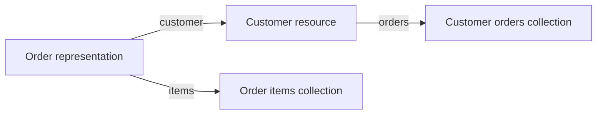
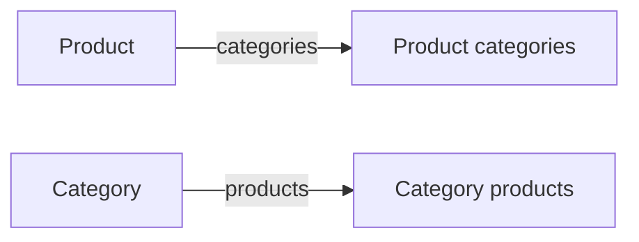

# Relation cho association trong Spring HATEOAS

Trong một domain model, tài nguyên thường có quan hệ với nhau: đơn hàng thuộc về khách hàng, đơn hàng có nhiều dòng hàng, sản phẩm thuộc nhiều danh mục hoặc người dùng tham gia nhiều nhóm. Khi công bố các quan hệ đó qua REST API, Spring HATEOAS dùng link relation (`rel`) để mô tả ý nghĩa của từng liên kết trong representation.

Relation cho client biết một link dẫn tới loại tài nguyên hoặc khả năng nào. Ví dụ, relation `customer` có thể dẫn từ đơn hàng tới khách hàng sở hữu đơn; relation `items` dẫn tới collection các dòng hàng. Client dựa vào relation để khám phá API mà không cần tự ghép URI từ tên thuộc tính Java hoặc cấu trúc database.

Bài học này giải thích cách chọn relation cho association một-một, nhiều-một, một-nhiều và nhiều-nhiều; cách tạo link bằng Spring HATEOAS; khi nào nên nhúng dữ liệu; và cách giữ tên relation ổn định trong hợp đồng API.

## 1. Relation mô tả quan hệ giữa tài nguyên và link đích

Một hypermedia link có hai thành phần quan trọng:

- `href`: URI của tài nguyên đích.
- `rel`: quan hệ giữa representation hiện tại và tài nguyên tại URI đó.

Ví dụ representation đơn hàng:

```json
{
  "id": "42",
  "status": "PENDING",
  "_links": {
    "self": {
      "href": "/orders/42"
    },
    "customer": {
      "href": "/customers/7"
    },
    "items": {
      "href": "/orders/42/items"
    }
  }
}
```

Ở đây, `self` trỏ tới chính đơn hàng; `customer` mô tả quan hệ từ đơn hàng tới khách hàng; `items` mô tả quan hệ tới collection các dòng hàng của đơn. Relation không phải tên bảng, tên field hay annotation quan hệ ORM. Nó là một phần của hợp đồng hypermedia mà client dùng để hiểu link.

Relation cũng không tự mô tả toàn bộ thao tác HTTP. Một link HAL thông thường cung cấp relation và URI; client cần hợp đồng API hoặc affordance phù hợp để biết method, payload và điều kiện thao tác khi những thông tin đó không hiển nhiên.

## 2. Association trong domain không quyết định trực tiếp relation của API

Một quan hệ trong Java/JPA mô tả cách ứng dụng lưu trữ hoặc truy cập dữ liệu. Relation trong representation mô tả cách client khám phá tài nguyên. Hai khái niệm có liên quan nhưng không bắt buộc trùng nhau.

Ví dụ domain model:

```java
class Order {
    private Customer customer;
    private List<OrderItem> items;
}

class Customer {
    private List<Order> orders;
}
```

API có thể công bố:

- Từ `Order` tới `Customer` bằng relation `customer`.
- Từ `Order` tới collection `OrderItem` bằng relation `items`.
- Từ `Customer` tới collection `Order` bằng relation `orders`.

Không cần serialize trực tiếp object graph hai chiều. Representation của đơn hàng có thể có link `customer`; representation của khách hàng có link `orders`. Client chỉ tải tài nguyên liên quan khi cần.



## 3. Chọn relation cho association một-một và nhiều-một

Với quan hệ một-một hoặc nhiều-một, tài nguyên hiện tại thường liên kết tới một tài nguyên đích. Hãy dùng tên relation mô tả vai trò của tài nguyên đích trong ngữ cảnh hiện tại.

Ví dụ:

| Tài nguyên hiện tại | Association | Relation gợi ý | URI đích |
| --- | --- | --- | --- |
| Order | Khách hàng sở hữu đơn | `customer` | `/customers/7` |
| Order | Địa chỉ giao hàng | `shipping-address` | `/addresses/18` |
| Invoice | Đơn hàng liên quan | `order` | `/orders/42` |
| Employee | Phòng ban | `department` | `/departments/3` |

Relation nên dùng danh từ có nghĩa với client. Ví dụ `customer` dễ hiểu hơn `customerId`, vì link dẫn tới tài nguyên khách hàng chứ không chỉ cung cấp một giá trị ID.

Nếu association là tùy chọn, chỉ thêm link khi tài nguyên liên quan thực sự tồn tại và client được phép khám phá nó. Nếu association bắt buộc, link thường có thể xuất hiện trên mọi representation của loại tài nguyên đó.

## 4. Chọn relation cho association một-nhiều

Với quan hệ một-nhiều, tài nguyên hiện tại liên kết tới một collection. Dùng relation số nhiều hoặc tên collection thể hiện tập tài nguyên đích.

Ví dụ:

| Tài nguyên hiện tại | Association | Relation gợi ý | URI đích |
| --- | --- | --- | --- |
| Order | Các dòng hàng | `items` | `/orders/42/items` |
| Customer | Các đơn hàng | `orders` | `/customers/7/orders` |
| Department | Nhân viên thuộc phòng ban | `employees` | `/departments/3/employees` |
| Blog | Các bài viết | `articles` | `/blogs/5/articles` |

Một link tới collection không có nghĩa tất cả item phải được nhúng trong representation hiện tại. Client có thể theo relation để lấy collection, rồi tiếp tục theo self link của từng item.

Nếu collection được nhúng trực tiếp, cần xác định relation embedded và giới hạn số lượng hoặc độ sâu dữ liệu. Đối với danh sách lớn, link tới endpoint collection thường phù hợp hơn việc nhúng toàn bộ.

## 5. Chọn relation cho association nhiều-nhiều

Với quan hệ nhiều-nhiều, mỗi phía có thể liên kết tới collection tài nguyên ở phía kia. Ví dụ một sản phẩm thuộc nhiều danh mục và một danh mục chứa nhiều sản phẩm:



Relation nên được đặt theo hướng nhìn từ tài nguyên hiện tại:

- Từ sản phẩm tới collection danh mục: `categories`.
- Từ danh mục tới collection sản phẩm: `products`.

Không nên đặt một relation chung như `associations` cho mọi quan hệ nếu client cần phân biệt ý nghĩa. Relation cụ thể giúp client biết link nào dẫn tới danh mục, link nào dẫn tới sản phẩm mà không phải suy luận từ URI.

Nếu association nhiều-nhiều có thuộc tính riêng, chẳng hạn vai trò của người dùng trong nhóm hoặc thứ tự sản phẩm trong danh mục, hãy cân nhắc biểu diễn association đó thành một tài nguyên riêng. Khi đó link có thể trỏ tới collection các association resource thay vì chỉ tới hai đầu quan hệ.

## 6. Dùng relation chuẩn khi có ý nghĩa phù hợp

Spring HATEOAS cung cấp `IanaLinkRelations` cho các relation đã đăng ký phổ biến, ví dụ `SELF`, `NEXT`, `PREV` và `RELATED`. Dùng relation chuẩn khi ngữ nghĩa của link thực sự khớp với định nghĩa của relation đó.

Ví dụ self link:

```java
model.add(linkTo(methodOn(OrderController.class).one(orderId))
        .withRel(IanaLinkRelations.SELF));
```

Với association cụ thể như khách hàng hoặc dòng hàng, một relation có tên miền nghiệp vụ như `customer` hoặc `items` thường diễn đạt tốt hơn relation chung `related`. `related` có thể dùng khi chỉ cần nói tài nguyên có liên quan mà không có vai trò cụ thể hơn, nhưng nếu client cần hiểu association thì hãy ưu tiên relation đặc tả rõ.

Không gán `self` cho link tới tài nguyên liên quan. `self` luôn trỏ tới chính tài nguyên đang được biểu diễn; link từ đơn hàng tới khách hàng cần relation `customer`.

## 7. Tạo association link bằng WebMvcLinkBuilder

Trong Spring MVC, `WebMvcLinkBuilder` tạo URI dựa trên mapping controller. Ví dụ các endpoint đọc đơn hàng, khách hàng và dòng hàng:

```java
@RestController
@RequestMapping("/orders")
class OrderController {

    @GetMapping("/{id}")
    EntityModel<OrderView> one(@PathVariable UUID id) {
        // Trả representation đơn hàng.
    }
}

@RestController
@RequestMapping("/customers")
class CustomerController {

    @GetMapping("/{id}")
    EntityModel<CustomerView> one(@PathVariable UUID id) {
        // Trả representation khách hàng.
    }
}

@RestController
@RequestMapping("/orders/{orderId}/items")
class OrderItemController {

    @GetMapping
    CollectionModel<EntityModel<OrderItemView>> byOrder(
            @PathVariable UUID orderId) {
        // Trả collection dòng hàng của đơn.
    }
}
```

Assembler tạo link cho các association:

```java
@Component
class OrderModelAssembler
        implements RepresentationModelAssembler<Order, EntityModel<OrderView>> {

    @Override
    public EntityModel<OrderView> toModel(Order order) {
        UUID id = order.getId();
        OrderView view = new OrderView(
                id,
                order.getStatus().name(),
                order.getTotal()
        );

        return EntityModel.of(
                view,
                linkTo(methodOn(OrderController.class).one(id)).withSelfRel(),
                linkTo(methodOn(CustomerController.class)
                        .one(order.getCustomer().getId())).withRel("customer"),
                linkTo(methodOn(OrderItemController.class)
                        .byOrder(id)).withRel("items")
        );
    }
}
```

`methodOn(...)` tham chiếu method controller để dựng URI theo mapping và tham số. Nó không thực thi endpoint. Khi mapping thay đổi, link được tạo theo mapping mới. Các class DTO và domain trong ví dụ đại diện cho kiểu của ứng dụng.

## 8. Tên relation nên mô tả vai trò, không lộ chi tiết triển khai

Tên relation là hợp đồng giữa server và client. Một relation tốt có các đặc điểm:

- Mô tả vai trò của tài nguyên đích trong ngữ cảnh hiện tại.
- Ổn định khi đổi tên class, field, bảng hoặc repository.
- Dùng nhất quán giữa các endpoint.
- Phân biệt được association khác nhau.
- Không chứa thông tin nội bộ như tên bảng hoặc tên package Java.

Ví dụ nên dùng:

| Tên nên tránh | Relation dễ hiểu hơn |
| --- | --- |
| `customerEntity` | `customer` |
| `order_customer_fk` | `customer` |
| `orderItemsList` | `items` |
| `productCategoryJoin` | `categories` hoặc `products` theo hướng association |
| `getCustomerById` | `customer` |

Relation không nhất thiết phải giống tên property trong Java. Nếu domain field là `buyerAccount`, API vẫn có thể dùng `customer` nếu đó là thuật ngữ ổn định mà client hiểu. Điều quan trọng là tài liệu hợp đồng giải thích ý nghĩa và server không đổi tên tùy tiện.

## 9. Relation tùy chỉnh và khả năng tương tác

Các relation như `customer`, `items` hoặc `orders` thường được dùng trong API nội bộ hoặc hệ sinh thái client do cùng nhóm kiểm soát. Khi thiết kế API công khai cần khả năng tương tác rộng, hãy cân nhắc dùng relation đã đăng ký hoặc extension relation có định danh URI tuyệt đối theo quy ước Web Linking.

Extension relation dùng URI giúp tránh xung đột tên giữa các API khác nhau. Với HAL, CURIE có thể cung cấp dạng viết tắt cho URI relation dài. Spring HATEOAS hỗ trợ cấu hình `CurieProvider` để ánh xạ prefix ngắn sang URI tài liệu relation. Khi dùng CURIE, hãy bảo đảm client có thể hiểu prefix và tài liệu relation giải thích ngữ nghĩa của association.

Không nên thay đổi một relation ngắn thành một URI hoặc prefix mới mà không xem xét client đang tiêu thụ hợp đồng cũ. Nếu cần đổi tên, có thể duy trì relation cũ trong giai đoạn chuyển tiếp hoặc phát hành phiên bản hợp đồng mới theo chính sách tương thích của API.

## 10. Relation của link association và embedded resource

Link và embedded resource giải quyết hai nhu cầu khác nhau:

| Cách biểu diễn | Ý nghĩa | Khi phù hợp |
| --- | --- | --- |
| Link `customer` | Công bố URI của khách hàng liên quan. | Client có thể tải khách hàng khi cần. |
| Embedded customer summary | Đưa một phần dữ liệu khách hàng vào response hiện tại. | Client thường xuyên cần vài trường tóm tắt. |
| Link `items` | Công bố URI collection dòng hàng. | Collection có thể lớn hoặc cần phân trang. |
| Embedded item collection | Đưa các item vào representation hiện tại. | Collection nhỏ, giới hạn và cần ngay trong cùng response. |

Một representation có thể vừa nhúng dữ liệu tóm tắt vừa công bố link tới tài nguyên đầy đủ. Khi đó, relation embedded và link cần có ý nghĩa nhất quán. Tránh nhúng toàn bộ object graph hai chiều vì có thể gây vòng tham chiếu, response lớn và truy vấn ORM dư thừa.

Nếu dùng HAL, các embedded resources nằm dưới `_embedded`; các link association nằm dưới `_links`. Không phải object property lồng nhau nào cũng tự động trở thành embedded resource HAL. Hãy kiểm tra serializer và response thực tế.

## 11. Xử lý association tùy chọn và quyền truy cập

Không phải association nào cũng luôn tồn tại hoặc luôn hiển thị cho mọi client. Ví dụ đơn hàng có thể chưa gắn địa chỉ giao hàng; khách hàng có thể không được phép xem thông tin thanh toán của một đơn.

Một số nguyên tắc:

- Nếu association không tồn tại, không tạo link tới URI giả hoặc tài nguyên không có.
- Nếu tài nguyên liên quan tồn tại nhưng client không được phép khám phá, áp dụng chính sách công bố link nhất quán với bảo mật ứng dụng.
- Nếu client cần biết association chưa được gán, mô tả trạng thái đó bằng trường dữ liệu hoặc affordance phù hợp; đừng tạo link `self` tới tài nguyên không tồn tại.
- Endpoint đích luôn phải xác thực và phân quyền khi request đến. Việc link xuất hiện không cấp quyền truy cập.

Ví dụ thêm link khách hàng khi association có giá trị:

```java
OrderView view = new OrderView(
        order.getId(),
        order.getStatus().name(),
        order.getTotal()
);
EntityModel<OrderView> model = EntityModel.of(
        view,
        linkTo(methodOn(OrderController.class).one(order.getId())).withSelfRel()
);

if (order.getCustomer() != null) {
    model.add(linkTo(methodOn(CustomerController.class)
            .one(order.getCustomer().getId())).withRel("customer"));
}

return model;
```

Nếu model được xây dựng cho người dùng có quyền khác nhau, việc quyết định công bố link có thể cần một policy/service chuyên trách. Không nên rải điều kiện phân quyền phức tạp trong nhiều assembler.

## 12. Kiểm thử relation của association

Kiểm thử nên xác nhận cả relation lẫn URI đích. Chỉ kiểm tra `hasLink("customer")` là chưa đủ nếu link có thể trỏ nhầm khách hàng.

Unit test assembler:

```java
@Test
void exposesCustomerAndItemsAssociations() {
    Order order = anOrderWithCustomerAndItems(orderId, customerId);

    EntityModel<OrderView> model = assembler.toModel(order);

    assertThat(model.getRequiredLink("customer").getHref())
            .endsWith("/customers/" + customerId);
    assertThat(model.getRequiredLink("items").getHref())
            .endsWith("/orders/" + orderId + "/items");
}
```

`anOrderWithCustomerAndItems` đại diện cho fixture của dự án. Nếu link builder cần request context, hãy thiết lập context trong unit test hoặc xác nhận URI qua kiểm thử HTTP.

Kiểm thử response HAL bằng MockMvc:

```java
mockMvc.perform(get("/orders/{id}", orderId)
        .accept(MediaTypes.HAL_JSON))
    .andExpect(status().isOk())
    .andExpect(jsonPath("$._links.self.href").exists())
    .andExpect(jsonPath("$._links.customer.href")
            .value(endsWith("/customers/" + customerId)))
    .andExpect(jsonPath("$._links.items.href")
            .value(endsWith("/orders/" + orderId + "/items")));
```

Ngoài ra, nên kiểm thử association không tồn tại, collection rỗng, quyền truy cập và các link của từng item trong collection. Nếu relation có nhiều link cùng tên, HAL có thể serialize thành mảng; test cần xác nhận cardinality và nội dung theo hợp đồng.

## 13. Các lỗi thường gặp khi đặt relation cho association

**Dùng `self` cho tài nguyên liên quan.** Link từ đơn hàng tới khách hàng không phải self link của đơn hàng; hãy dùng relation `customer`.

**Dùng một relation chung cho mọi association.** `related` không giúp client phân biệt khách hàng, dòng hàng và địa chỉ giao hàng. Dùng tên cụ thể khi có thể.

**Đặt relation theo tên bảng hoặc field database.** Điều đó làm hợp đồng API phụ thuộc vào chi tiết triển khai. Chọn tên theo ngữ nghĩa tài nguyên.

**Dùng số ít cho collection hoặc số nhiều cho một item mà không có quy ước.** Chọn tên nhất quán: `customer` cho một khách hàng, `items` cho collection dòng hàng.

**Cho rằng relation mô tả cardinality hoặc HTTP method.** Relation chỉ mô tả mối quan hệ; URI đích và hợp đồng endpoint xác định tài nguyên cùng cách truy cập.

**Nhầm link association với embedded data.** Link công bố đường điều hướng; embedded resource đưa dữ liệu vào response. Chọn theo nhu cầu client và kích thước dữ liệu.

**Đổi relation tùy tiện.** Client có thể tìm link bằng tên relation. Đổi tên là thay đổi hợp đồng và cần chính sách tương thích.

**Công bố link không kiểm tra quyền.** Endpoint đích vẫn phải bảo vệ tài nguyên độc lập với việc link có xuất hiện hay không.

## 14. Bài tập thực hành và tiêu chí hoàn thành

Hãy thiết kế API cho `Order`, `Customer`, `OrderItem`, `Product` và `Category`:

1. Xác định association một-một, nhiều-một, một-nhiều và nhiều-nhiều trong domain.
2. Chọn relation theo hướng nhìn từ từng tài nguyên: `customer`, `items`, `orders`, `product`, `categories`, `products`.
3. Viết controller GET cho tài nguyên liên quan và collection tương ứng.
4. Dùng `WebMvcLinkBuilder` để tạo link bằng `linkTo(methodOn(...))`.
5. Thêm association link vào representation bằng assembler.
6. Phân biệt link tới collection với embedded collection.
7. Xử lý association tùy chọn và không tạo link tới tài nguyên không tồn tại.
8. Kiểm tra relation cùng `href` bằng JUnit và MockMvc.
9. Đổi tên một mapping controller và xác nhận URI mới được sinh tự động trong khi relation giữ ổn định.
10. Viết tài liệu ngắn giải thích ý nghĩa từng relation cho client.

Bạn đã hiểu relation cho association khi có thể chọn tên relation phản ánh vai trò của tài nguyên đích, biểu diễn đúng quan hệ một hoặc nhiều tài nguyên, tạo URI từ mapping controller, phân biệt link với embedded resource và kiểm thử hợp đồng HAL. Các relation được đặt tốt giúp client khám phá các quan hệ nghiệp vụ mà không phụ thuộc vào cấu trúc domain hoặc database của server.
