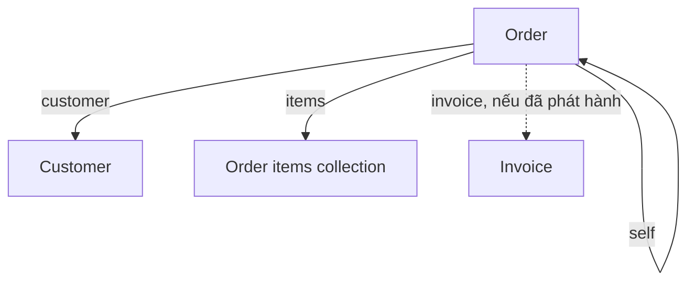

# Thiết kế quan hệ ổn định

Trong REST API dùng Spring HATEOAS, quan hệ giữa các tài nguyên được công bố qua link và relation. Một đơn hàng có thể liên kết đến khách hàng, các dòng hàng, hóa đơn và lô giao hàng. Client đọc relation để hiểu ý nghĩa của liên kết, rồi dùng `href` để truy cập tài nguyên liên quan. Khi relation có tên và ý nghĩa ổn định, server có thể thay đổi cấu trúc database hoặc cách tổ chức endpoint mà client vẫn điều hướng theo cùng một hợp đồng.

Thiết kế quan hệ ổn định bắt đầu từ góc nhìn tài nguyên công khai. Quan hệ trong JPA như `@ManyToOne`, `@OneToMany` hoặc tên foreign key chỉ mô tả mô hình lưu trữ và domain. Chúng không tự quyết định relation mà API nên công bố. API cần chọn tên theo ý nghĩa nghiệp vụ, xác định cardinality, quy định khi quan hệ vắng mặt và tạo link đến đúng tài nguyên.

## Quan hệ trong domain và quan hệ trong hypermedia

Giả sử một đơn hàng có một khách hàng, nhiều dòng hàng và có thể có một hóa đơn. Ở tầng domain, các quan hệ này có thể được mô hình hóa bằng object reference hoặc foreign key. Ở tầng API, chúng được công bố thành các link có relation:



| Quan hệ nghiệp vụ | Cardinality thường gặp | Relation API gợi ý |
| --- | --- | --- |
| Đơn hàng thuộc về một khách hàng | Nhiều đơn hàng đến một khách hàng | `customer` |
| Đơn hàng có nhiều dòng hàng | Một đến nhiều | `items` |
| Đơn hàng có hóa đơn khi đã phát hành | Không hoặc một | `invoice` |
| Một sản phẩm xuất hiện trong nhiều đơn hàng | Nhiều đến nhiều | `product` từ item; `orders` từ sản phẩm nếu use case cần |

Relation API diễn đạt ý nghĩa mà client cần hiểu, không nhất thiết phản chiếu tên thuộc tính Java. Nếu entity có trường `buyerAccount`, API vẫn có thể công bố relation `customer` nếu đó là thuật ngữ ổn định trong hợp đồng. Ngược lại, không nên tự động biến tên field `customerEntity` thành relation chỉ vì nó tồn tại trong code.

Một relation cũng không đồng nghĩa với embedded resource. Link trong `_links.customer` cho client URI để truy cập khách hàng. Nếu response cần kèm tên khách hàng, ứng dụng có thể thêm summary trong `_embedded.customer`. Quyết định embed hay chỉ cung cấp link là quyết định về payload; ý nghĩa của relation `customer` cần nhất quán trong cả hai trường hợp.

## Các nguyên tắc giữ relation ổn định

Một relation tốt có ngữ nghĩa rõ, không phụ thuộc implementation và được dùng nhất quán:

- **Theo nghiệp vụ:** dùng `customer`, `items`, `invoice` thay vì tên bảng hoặc tên foreign key.
- **Ổn định qua refactor:** đổi class `BuyerEntity` thành `Account` không tự làm đổi relation công khai `customer`.
- **Nhất quán:** cùng một relation luôn dẫn đến cùng một loại tài nguyên hoặc cùng một khả năng.
- **Đúng cardinality:** relation đơn lẻ và relation collection phải có ý nghĩa rõ ràng.
- **Không tái sử dụng sai nghĩa:** không đổi relation `customer` để trỏ sang tài khoản thanh toán chỉ vì hai khái niệm được hợp nhất trong database.
- **Có thể tiến hóa:** thêm relation mới khi có khái niệm mới; không âm thầm đổi ý nghĩa relation mà client cũ đang dùng.

Tên relation nên được xem như một phần hợp đồng API. Đổi tên relation có thể làm client không tìm thấy liên kết, dù URI đích vẫn hoạt động. Vì vậy, hãy xem xét thay đổi relation cẩn thận như thay đổi tên trường JSON hoặc media type.

## Chọn relation chuẩn hay relation mở rộng

Spring HATEOAS dùng `LinkRelation` để biểu diễn relation của một `Link`. Một số relation phổ biến đã được đăng ký trong IANA, chẳng hạn `self`, `next`, `prev`, `collection` và `item`. Khi ngữ nghĩa phù hợp, dùng relation chuẩn giúp client hiểu liên kết mà không cần tài liệu riêng của API.

Với quan hệ đặc thù của domain như `customer`, `invoice` hoặc `items`, API có thể công bố relation mở rộng. Trong hợp đồng cần định danh toàn cục, relation mở rộng nên là URI; HAL CURIE cho phép biểu diễn URI relation bằng tên ngắn có namespace. Một token ngắn như `customer` cũng thường được dùng theo quy ước của API nội bộ, nhưng client chỉ hiểu nó khi hợp đồng đã định nghĩa ý nghĩa đó.

| Loại relation | Ví dụ | Khi dùng |
| --- | --- | --- |
| Relation chuẩn IANA | `self`, `next`, `prev` | Khi ý nghĩa đúng với định nghĩa chuẩn. |
| Relation mở rộng theo quy ước API | `customer`, `items`, `invoice` | Khi domain có thuật ngữ ổn định và được tài liệu hóa. |
| URI relation | `https://api.example.com/rels/customer` | Khi cần định danh mở rộng có namespace toàn cục. |
| CURIE | `ex:customer` | Khi HAL cần biểu diễn ngắn gọn relation mở rộng có namespace. |

Không dùng relation chuẩn chỉ vì tên có vẻ gần nghĩa. Ví dụ, `item` và `collection` có ý nghĩa chuẩn cụ thể; không nên gán chúng cho bất kỳ link nào chỉ vì đích là một item hoặc collection. Hãy chọn relation theo ngữ nghĩa được định nghĩa.

Ví dụ HAL có thể khai báo CURIE `ex` để rút gọn relation URI:

```json
{
  "_links": {
    "curies": [
      {
        "name": "ex",
        "href": "https://api.example.com/rels/{rel}",
        "templated": true
      }
    ],
    "self": {
      "href": "https://api.example.com/orders/o-42"
    },
    "ex:customer": {
      "href": "https://api.example.com/customers/c-17"
    }
  }
}
```

Client có thể mở rộng `ex:customer` theo CURIE để biết URI relation đầy đủ. CURIE giúp tên relation ngắn gọn trong HAL; nó không thay đổi `href` của tài nguyên đích.

## Link relation và embedded relation là hai việc khác nhau

`withRel("customer")` đặt relation cho một link trong `_links`. `@Relation(itemRelation = ..., collectionRelation = ...)` và `LinkRelationProvider` xác định tên resource khi nó được nhúng trong `_embedded` hoặc khi cần đặt tên collection. Annotation không tự tạo association link.

Ví dụ kiểu resource có thể khai báo relation cho trường hợp được nhúng:

```java
import java.util.UUID;

import org.springframework.hateoas.RepresentationModel;
import org.springframework.hateoas.server.core.Relation;

@Relation(itemRelation = "order", collectionRelation = "orders")
public class OrderModel extends RepresentationModel<OrderModel> {

    private final UUID id;

    public OrderModel(UUID id) {
        this.id = id;
    }

    public UUID getId() {
        return id;
    }
}
```

Trong khi đó, link đến một đơn hàng hoặc khách hàng vẫn được tạo riêng trong assembler bằng `withSelfRel()` hoặc `withRel("customer")`. Giữ hai cơ chế này tách biệt giúp tránh nhầm tên khóa `_embedded` với relation điều hướng trong `_links`.

## Tạo association link bằng assembler

Spring HATEOAS cho phép tạo link từ mapping controller bằng `linkTo(...)` và `methodOn(...)`. Assembler chuyển domain object thành representation rồi thêm các link quan hệ.

DTO đơn hàng chỉ chứa dữ liệu công khai:

```java
import java.math.BigDecimal;
import java.util.UUID;

public record OrderSummary(
        UUID id,
        String status,
        BigDecimal totalAmount
) {
}
```

Assembler công bố quan hệ đến khách hàng và collection dòng hàng:

```java
import static org.springframework.hateoas.server.mvc.WebMvcLinkBuilder.linkTo;
import static org.springframework.hateoas.server.mvc.WebMvcLinkBuilder.methodOn;

import org.springframework.hateoas.EntityModel;
import org.springframework.hateoas.server.RepresentationModelAssembler;
import org.springframework.stereotype.Component;

@Component
class OrderAssembler
        implements RepresentationModelAssembler<Order, EntityModel<OrderSummary>> {

    @Override
    public EntityModel<OrderSummary> toModel(Order order) {
        OrderSummary summary = new OrderSummary(
                order.getId(),
                order.getStatus().name(),
                order.getTotalAmount());

        EntityModel<OrderSummary> model = EntityModel.of(summary,
                linkTo(methodOn(OrderController.class)
                        .one(order.getId())).withSelfRel(),
                linkTo(methodOn(CustomerController.class)
                        .one(order.getCustomer().getId())).withRel("customer"),
                linkTo(methodOn(OrderItemController.class)
                        .allForOrder(order.getId())).withRel("items"));

        if (order.getInvoiceId() != null) {
            model.add(linkTo(methodOn(InvoiceController.class)
                    .one(order.getInvoiceId())).withRel("invoice"));
        }

        return model;
    }
}
```

Các method `one(...)` và `allForOrder(...)` đại diện cho endpoint của ứng dụng. Assembler không ghép chuỗi URL; nó mô tả method controller để Spring HATEOAS tạo URI theo mapping hiện hành.

Trong ví dụ, `customer` là quan hệ đơn lẻ, `items` là collection và `invoice` là quan hệ tùy chọn. Khi hóa đơn chưa được phát hành, link `invoice` không xuất hiện. Nếu hợp đồng cho phép, client hiểu rằng quan hệ hóa đơn hiện chưa khả dụng. Nếu cần phân biệt “chưa có hóa đơn” với “không được phép xem hóa đơn”, hãy mô hình hóa trạng thái rõ trong payload hoặc qua relation/hành động riêng; không nên buộc client suy ra quyền chỉ từ việc thiếu link.

Assembler nên nhận domain object đã được service tải cùng dữ liệu cần thiết. Nếu gọi repository riêng cho từng association trong `toModel`, ánh xạ collection có thể tạo truy vấn N+1. Hãy dùng projection, fetch plan hoặc batch loading phù hợp.

## Cardinality và cách công bố quan hệ

Cardinality của domain association ảnh hưởng đến hình dạng API, nhưng không bắt buộc API phải phản chiếu cấu trúc lưu trữ.

| Cardinality | Cách công bố thường dùng | Hành vi khi không có dữ liệu |
| --- | --- | --- |
| Một đến một | Link đơn như `customer` hoặc `invoice`. | Bỏ link nếu association thực sự tùy chọn và hiện không có đích. |
| Một đến nhiều | Link collection như `items`. | Có thể giữ link collection dù collection rỗng; endpoint trả collection rỗng. |
| Nhiều đến một | Mỗi resource con có link đơn như `order` hoặc `customer`. | Theo quy tắc nghiệp vụ và quyền truy cập. |
| Nhiều đến nhiều | Link đến collection liên quan; có thể có resource association riêng. | Collection có thể rỗng hoặc chỉ hiển thị phần người dùng được phép truy cập. |

Đối với collection, việc không có phần tử thường không có nghĩa là không có quan hệ. Ví dụ, đơn hàng vẫn có collection `items` dù chưa có dòng hàng; client có thể theo link `items` và nhận một collection rỗng. Với association đơn lẻ tùy chọn như `invoice`, nếu chưa tồn tại hóa đơn thì thường không có URI đích để công bố.

Phân biệt rõ ba trạng thái:

1. Quan hệ tồn tại và tài nguyên có thể truy cập.
2. Quan hệ tồn tại nhưng hiện không có item, ví dụ collection rỗng.
3. Quan hệ không tồn tại, không khả dụng hoặc người dùng hiện tại không được phép truy cập.

Đừng dùng cùng một cách biểu diễn cho mọi trạng thái nếu client cần phân biệt chúng. Với quan hệ tùy chọn, có thể thêm trường trạng thái như `invoiceStatus`; với collection, công bố link đến collection và để endpoint trả danh sách rỗng.

## Association link trong HAL

Khi serialize dưới HAL, relation trở thành tên thuộc tính trong `_links`:

```json
{
  "id": "o-42",
  "status": "PAID",
  "totalAmount": 125000,
  "_links": {
    "self": {
      "href": "https://shop.example/api/orders/o-42"
    },
    "customer": {
      "href": "https://shop.example/api/customers/c-17"
    },
    "items": {
      "href": "https://shop.example/api/orders/o-42/items"
    },
    "invoice": {
      "href": "https://shop.example/api/invoices/v-9"
    }
  }
}
```

Client tìm relation `customer` thay vì giả định URL khách hàng luôn có dạng `/api/customers/{id}`. Server có thể đổi endpoint sang `/api/accounts/{id}` hoặc chuyển sang một dịch vụ khác mà client vẫn tìm link theo relation `customer`.

Nếu API đồng thời nhúng summary khách hàng, response có thể chứa `_embedded.customer` cùng `_links.customer`. Relation giống nhau giúp client nhận biết chúng cùng nói về một association: embedded content là bản tóm tắt, link là đường dẫn đến resource đầy đủ.

## Không để relation phụ thuộc schema database

Giả sử database ban đầu lưu `order.customer_id`. Sau đó hệ thống thay đổi để khách hàng được quản lý bởi dịch vụ Account, và đơn hàng lưu `account_reference`. Nếu API đã công bố relation `customer`, client vẫn có thể theo relation đó sau khi backend thay đổi cách lưu.

Một số quy tắc hữu ích:

- Không tạo relation trực tiếp từ tên foreign key như `customerId` hoặc `accountRef`.
- Không công bố tên bảng như `order_customer` hoặc `invoice_record`.
- Không để tên class persistence như `CustomerJpaEntity` trở thành tên relation.
- Dùng mapper/assembler để ánh xạ domain association sang resource relation.
- Giữ URI đích do server tạo và để client theo `href` thay vì tự ghép từ ID.

ID có thể xuất hiện trong payload để hiển thị hoặc tham chiếu, nhưng client không nên cần ID để tái tạo URI. Nếu định danh nội bộ thay đổi, self link và association link vẫn là nguồn điều hướng chính thức.

## Nested URI và canonical URI cho association

Một association collection có thể được truy cập qua URI lồng trong tài nguyên cha, ví dụ `/api/orders/{orderId}/items`. Tài nguyên item có thể có self link nested `/api/orders/{orderId}/items/{itemId}` hoặc canonical URI `/api/order-items/{itemId}`.

Chọn nested URI khi item chỉ có ý nghĩa trong phạm vi parent hoặc định danh phụ thuộc parent. Chọn canonical URI khi item có vòng đời độc lập và được tham chiếu từ nhiều ngữ cảnh. Dù chọn cách nào, relation `items` từ đơn hàng vẫn giữ ý nghĩa là collection dòng hàng của đơn hàng đó.

Đổi route không nhất thiết phải đổi relation. Nếu collection items chuyển từ `/api/orders/{id}/items` sang `/api/order-items?orderId={id}`, assembler chỉ cần tạo `href` mới nhưng vẫn dùng relation `items`. Client tiếp tục theo relation mà không cần biết route đã thay đổi.

## Khi association tự nó là một resource

Với quan hệ nhiều-nhiều đơn giản, link đến collection liên quan có thể đủ. Nhưng nếu bản thân mối quan hệ có thuộc tính hoặc vòng đời riêng, hãy cân nhắc mô hình hóa nó thành resource.

Ví dụ, quan hệ thành viên giữa dự án và người dùng có thể chứa vai trò, ngày tham gia, trạng thái lời mời và người cấp quyền. Thay vì chỉ liên kết `project` với `users`, API có thể công bố collection `memberships`:

```json
{
  "id": "project-7",
  "_links": {
    "self": {
      "href": "https://work.example/api/projects/project-7"
    },
    "memberships": {
      "href": "https://work.example/api/projects/project-7/memberships"
    }
  }
}
```

Một membership có self link riêng và link đến hai đầu quan hệ:

```json
{
  "id": "membership-31",
  "role": "EDITOR",
  "status": "ACTIVE",
  "_links": {
    "self": {
      "href": "https://work.example/api/memberships/membership-31"
    },
    "project": {
      "href": "https://work.example/api/projects/project-7"
    },
    "member": {
      "href": "https://work.example/api/users/user-12"
    }
  }
}
```

Resource association giúp client đọc hoặc thay đổi thuộc tính của chính mối quan hệ mà không cần biết bảng nối trong database. Đây là lựa chọn phù hợp cho membership, subscription, assignment, enrollment hoặc các quan hệ có trạng thái và hành vi riêng.

## Relation không phải cơ chế phân quyền

Assembler có thể chỉ công bố link hành động khi thao tác phù hợp với trạng thái và quyền của người dùng. Ví dụ, link `cancel` chỉ xuất hiện khi đơn hàng đang chờ xử lý và người dùng có quyền hủy. Tuy nhiên, việc không thấy link không thay thế kiểm tra bảo mật tại endpoint.

Server phải xác thực, phân quyền và kiểm tra lại trạng thái mỗi khi client theo link. Quyền có thể thay đổi giữa lúc representation được tạo và lúc request được gửi. Không đưa association link đến dữ liệu nhạy cảm chỉ vì quan hệ tồn tại trong database; chỉ công bố resource mà người dùng hiện tại được phép khám phá.

## Kiểm thử hợp đồng association

Kiểm thử response HAL nên xác nhận relation có mặt đúng lúc, trỏ đến tài nguyên đúng loại và giữ nguyên ý nghĩa qua các thay đổi implementation. Ví dụ với MockMvc:

```java
import static org.springframework.test.web.servlet.request.MockMvcRequestBuilders.get;
import static org.springframework.test.web.servlet.result.MockMvcResultMatchers.content;
import static org.springframework.test.web.servlet.result.MockMvcResultMatchers.jsonPath;
import static org.springframework.test.web.servlet.result.MockMvcResultMatchers.status;

import org.junit.jupiter.api.Test;
import org.springframework.beans.factory.annotation.Autowired;
import org.springframework.boot.test.autoconfigure.web.servlet.AutoConfigureMockMvc;
import org.springframework.boot.test.context.SpringBootTest;
import org.springframework.hateoas.MediaTypes;
import org.springframework.test.web.servlet.MockMvc;

@SpringBootTest
@AutoConfigureMockMvc
class OrderAssociationTest {

    @Autowired
    MockMvc mockMvc;

    @Test
    void orderPublishesStableAssociationRelations() throws Exception {
        mockMvc.perform(get("/api/orders/{id}", "o-42")
                        .accept(MediaTypes.HAL_JSON))
                .andExpect(status().isOk())
                .andExpect(content().contentTypeCompatibleWith(MediaTypes.HAL_JSON))
                .andExpect(jsonPath("$._links.self.href").exists())
                .andExpect(jsonPath("$._links.customer.href").exists())
                .andExpect(jsonPath("$._links.items.href").exists());
    }

    @Test
    void invoiceRelationIsAbsentWhenInvoiceDoesNotExist() throws Exception {
        mockMvc.perform(get("/api/orders/{id}", "o-43")
                        .accept(MediaTypes.HAL_JSON))
                .andExpect(status().isOk())
                .andExpect(jsonPath("$._links.invoice").doesNotExist());
    }
}
```

Fixture cần có đơn hàng `o-42` với khách hàng và collection items, cùng đơn hàng `o-43` chưa có hóa đơn. Các test này kiểm tra relation, không khóa hợp đồng vào một hostname cụ thể. Có thể bổ sung bước đọc `href` từ response rồi gọi URI đó để xác nhận link dẫn đến tài nguyên đúng loại. Cách kiểm thử này xác minh cả relation lẫn khả năng điều hướng thực tế.

Các kiểm thử nên có thêm:

- Collection `items` rỗng vẫn có link nếu endpoint collection luôn tồn tại.
- Relation `invoice` xuất hiện khi hóa đơn được phát hành và biến mất khi association không còn khả dụng.
- Người dùng thiếu quyền không nhận link đến association nhạy cảm.
- Thay đổi route không làm thay đổi relation công khai.
- Relation mở rộng hoặc CURIE được serialize theo cấu hình HAL đã công bố.
- Client có thể theo association link mà không tự ghép URI từ ID.

## Lỗi thường gặp

| Vấn đề | Hệ quả | Cách xử lý |
| --- | --- | --- |
| Dùng tên field hoặc foreign key làm relation | Client phụ thuộc vào mô hình persistence. | Chọn relation theo thuật ngữ nghiệp vụ. |
| Đổi relation khi refactor class | Client cũ không tìm được link. | Cố định relation bằng hợp đồng và test. |
| Dùng cùng một relation cho hai ý nghĩa | Client không thể phân biệt tài nguyên đích. | Chọn relation riêng, không tái sử dụng sai nghĩa. |
| Nhầm relation với `@Relation` của embedded model | Mong annotation tự tạo link trong `_links`. | Dùng `withRel` để tạo link; `@Relation` đặt tên embedded resource. |
| Bỏ link collection khi collection rỗng | Client không thể khám phá endpoint collection. | Giữ link collection nếu endpoint vẫn tồn tại và được phép truy cập. |
| Nhúng association thay vì công bố link trong mọi trường hợp | Response lớn và dữ liệu dễ lỗi thời. | Chọn embed theo nhu cầu; luôn cân nhắc link đến resource đầy đủ. |
| Coi link là quyền truy cập | Endpoint có thể bị gọi trực tiếp trái quyền. | Kiểm tra quyền tại server cho từng request. |

## Nguyên tắc thiết kế

- Đặt relation theo ý nghĩa nghiệp vụ, độc lập với entity, bảng và foreign key.
- Giữ relation ổn định khi thay đổi route hoặc cấu trúc persistence.
- Dùng relation chuẩn IANA khi ngữ nghĩa phù hợp; dùng relation mở rộng có quy ước hoặc URI namespace khi cần.
- Phân biệt link relation trong `_links` với item/collection relation của `_embedded`.
- Thể hiện cardinality và trạng thái tùy chọn nhất quán.
- Mô hình hóa association thành resource riêng khi mối quan hệ có thuộc tính hoặc vòng đời riêng.
- Tạo link bằng Spring HATEOAS và kiểm thử relation cùng khả năng theo link.
- Chỉ công bố các quan hệ phù hợp với quyền hiện tại; endpoint luôn kiểm tra quyền lại.

Thiết kế quan hệ ổn định giúp client hiểu đồ thị tài nguyên bằng ý nghĩa nghiệp vụ thay vì chi tiết triển khai. Khi relation giữ nguyên ngữ nghĩa và server công bố URI qua link, backend có thể đổi schema, class hoặc route mà client vẫn khám phá được các tài nguyên liên quan theo cùng một hợp đồng hypermedia.
