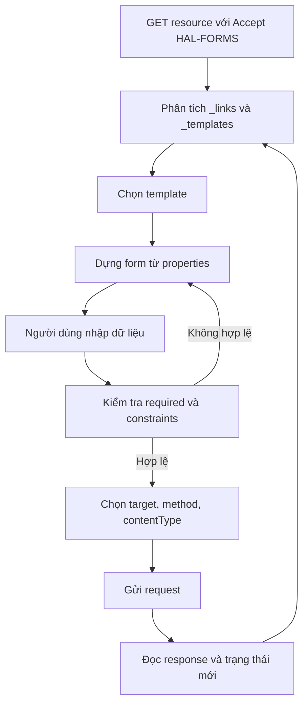
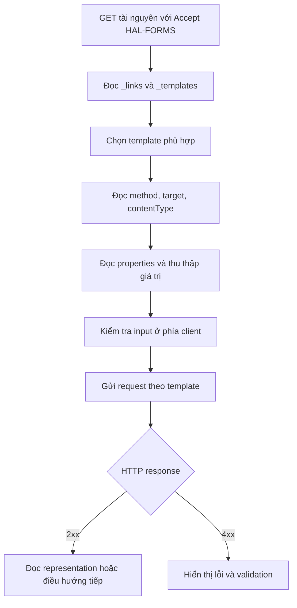

# HAL-FORMS client

HAL-FORMS mở rộng HAL bằng cách mô tả các thao tác mà client có thể thực hiện trên tài nguyên. Một HAL-FORMS document không chỉ chứa link để điều hướng mà còn có `_templates`: tập các mẫu request mô tả HTTP method, URI đích, media type của request và các thuộc tính đầu vào. Client đọc metadata này để tạo form hoặc dựng request động mà không phải hard-code toàn bộ endpoint và payload.

Ví dụ, một tài nguyên đơn hàng có thể cung cấp template `cancelOrder` dùng `POST`, template `updateOrder` dùng `PATCH`, cùng các property tương ứng. Khi trạng thái đơn hàng thay đổi, server có thể thay đổi template và link được công bố. Client tiếp tục khám phá các khả năng mới từ response kế tiếp.

Bài học này thuộc chương **HAL-FORMS** trong module **SPRING_HATEOAS**, tập trung vào phía client: thương lượng media type, đọc `_links` và `_templates`, chọn template, dựng giao diện từ property, tải options, xác thực dữ liệu, mã hóa request và xử lý response.

Sau bài học, bạn có thể:

- Nhận biết HAL-FORMS qua media type `application/prs.hal-forms+json`.
- Phân tích `_templates`, template key và các thuộc tính `method`, `target`, `contentType`, `properties`.
- Tạo form từ `name`, `prompt`, `type`, `required`, `readOnly`, `value` và các ràng buộc.
- Xử lý options inline hoặc tải options từ URI được mô tả.
- Gửi request theo HTTP method và media type của template.
- Phân biệt request có body và request mã hóa dữ liệu vào query string.
- Xử lý lỗi, template không hỗ trợ và thay đổi trạng thái sau khi submit.
- Thiết kế client có khả năng tương thích khi server bổ sung template hoặc metadata.

## 1. HAL-FORMS client làm gì?

Một client HAL-FORMS thực hiện một vòng đời cơ bản:

1. Gửi request với `Accept: application/prs.hal-forms+json`.
2. Phân tích response JSON, các link trong `_links` và template trong `_templates`.
3. Chọn template tương ứng với hành động mà người dùng muốn thực hiện.
4. Dựng giao diện từ các property và giá trị mặc định.
5. Thu thập dữ liệu, kiểm tra các ràng buộc mà template công bố.
6. Tạo request với target, method, `Content-Type` và payload đúng theo template.
7. Đọc response mới để cập nhật giao diện và khám phá các khả năng tiếp theo.



HAL-FORMS là một media type riêng, dù cấu trúc có nhiều điểm giống HAL. Client không nên coi một response HAL thông thường là HAL-FORMS nếu response không có `_templates` hợp lệ. Ngược lại, client HAL-FORMS vẫn có thể sử dụng `_links` để điều hướng như một client HAL.

## 2. Yêu cầu media type và tải document

Media type của HAL-FORMS là:

```http
application/prs.hal-forms+json
```

Client nên yêu cầu media type này qua header `Accept`:

```http
GET /orders/42 HTTP/1.1
Host: api.example.com
Accept: application/prs.hal-forms+json
```

Server trả response có `Content-Type` tương ứng:

```http
HTTP/1.1 200 OK
Content-Type: application/prs.hal-forms+json
```

Ví dụ dùng Fetch API:

```javascript
async function getHalForms(url) {
  const response = await fetch(url, {
    headers: {
      Accept: "application/prs.hal-forms+json"
    }
  });

  if (!response.ok) {
    throw new Error(`Không tải được resource: HTTP ${response.status}`);
  }

  const contentType = response.headers.get("Content-Type") ?? "";
  if (!contentType.toLowerCase().includes("application/prs.hal-forms+json")) {
    throw new Error(`Media type không được hỗ trợ: ${contentType}`);
  }

  return response.json();
}
```

Trong một số API, client lấy HAL-FORMS document trực tiếp từ resource. Trong luồng khác, response HAL ban đầu có thể công bố một link relation trỏ tới URL cung cấp HAL-FORMS document; client theo link đó và gửi `Accept` phù hợp. Dù dùng cách nào, client cần dùng URI do server trả về thay vì đoán URL của form.

Nếu response không có `Content-Type` HAL-FORMS hoặc không có `_templates` hợp lệ, client nên báo rằng thao tác form không được mô tả theo HAL-FORMS. Không nên tự suy ra method và payload từ tên property.

## 3. Cấu trúc document và _templates

Một HAL-FORMS document thường có hai phần chính:

- `_links`: các link tới resource hiện tại và resource liên quan.
- `_templates`: các mẫu mô tả state transition có thể thực hiện.

Ví dụ:

```json
{
  "id": 42,
  "status": "PENDING",
  "_links": {
    "self": {
      "href": "https://api.example.com/orders/42"
    }
  },
  "_templates": {
    "default": {
      "title": "Cập nhật đơn hàng",
      "method": "PATCH",
      "contentType": "application/json",
      "properties": [
        {
          "name": "note",
          "prompt": "Ghi chú",
          "type": "text",
          "required": false,
          "value": ""
        }
      ]
    }
  }
}
```

`_templates` là một object mà key là tên template, còn value là metadata của template. Nếu chỉ có một template, key nên là `default`. Nếu có nhiều template, server có thể đặt tên theo hành động hoặc affordance, ví dụ `updateOrder`, `cancelOrder` hay `addPayment`.

Theo đặc tả, nếu không có key `default`, client có thể coi template đầu tiên là template mặc định. Client nên giữ khả năng chọn template theo key cụ thể, thay vì chỉ luôn lấy `default`, bởi một tài nguyên có thể công bố nhiều state transition khác nhau.

`_templates` là phần bắt buộc của HAL-FORMS document. Nếu thiếu hoặc không thể phân tích, client nên bỏ qua template document đó. Các thuộc tính mở rộng mà client chưa hiểu nên được bỏ qua để hỗ trợ tiến hóa hợp đồng.

## 4. Đọc metadata của template

Một template có các thuộc tính chính sau:

| Thuộc tính | Ý nghĩa đối với client |
|---|---|
| `title` | Nhãn dễ đọc để hiển thị hành động hoặc tiêu đề form. |
| `method` | HTTP method dùng khi submit, ví dụ `GET`, `POST`, `PUT`, `PATCH`, `DELETE`. |
| `target` | URI đích để gửi request; nếu không có hoặc không hợp lệ, dùng `href` của link `self`. |
| `contentType` | Media type dùng để mã hóa request body. Nếu thiếu hoặc không nhận diện được, đặc tả yêu cầu mặc định `application/json`. |
| `properties` | Các tham số đầu vào của state transition. Nếu thiếu hoặc rỗng, template không yêu cầu tham số. |

Ví dụ template có target riêng:

```json
{
  "_templates": {
    "createPayment": {
      "title": "Tạo thanh toán",
      "method": "POST",
      "target": "https://api.example.com/payments",
      "contentType": "application/json",
      "properties": [
        { "name": "orderId", "type": "number", "required": true },
        { "name": "amount", "type": "number", "required": true }
      ]
    }
  }
}
```

Trong ví dụ này, link `self` có thể trỏ tới đơn hàng, còn template gửi dữ liệu tới `/payments`. Client phải ưu tiên `target` hợp lệ nếu template có khai báo. Nếu `target` không được cung cấp, client dùng `href` của link `self`; nếu không có cả hai, template không có đích gửi hợp lệ và nên được bỏ qua.

Nếu method bị thiếu, rỗng hoặc client không hiểu giá trị method, đặc tả HAL-FORMS quy định xử lý như `GET`. Với client thực tế, nên ghi nhận template không chuẩn để quan sát API và không tự gửi body cho một method không được hiểu.

## 5. Chọn template phù hợp

Khi một document chứa nhiều template, client cần hiển thị các hành động phù hợp với ngữ cảnh. Ví dụ:

```json
{
  "_templates": {
    "updateOrder": {
      "title": "Cập nhật đơn hàng",
      "method": "PUT",
      "properties": [
        { "name": "note", "type": "text", "required": false }
      ]
    },
    "cancelOrder": {
      "title": "Hủy đơn hàng",
      "method": "POST",
      "target": "https://api.example.com/orders/42/cancellation",
      "properties": [
        { "name": "reason", "type": "text", "required": true }
      ]
    }
  }
}
```

Client có thể dựng hai hành động riêng. Khi người dùng chọn “Hủy đơn hàng”, client dùng template `cancelOrder`; khi chọn “Cập nhật đơn hàng”, client dùng `updateOrder`.

Một helper nhỏ để chọn template:

```javascript
function selectTemplate(document, templateKey) {
  const templates = document?._templates;

  if (!templates || typeof templates !== "object") {
    throw new Error("HAL-FORMS document không có _templates hợp lệ");
  }

  const template = templates[templateKey]
    ?? (templateKey === "default" ? Object.values(templates)[0] : undefined);

  if (!template || typeof template !== "object") {
    throw new Error(`Không tìm thấy template: ${templateKey}`);
  }

  return template;
}
```

Nếu người dùng chọn một hành động cụ thể, truyền đúng key của template đó. Fallback sang template đầu tiên chỉ phù hợp khi client muốn chọn template mặc định và document không có key `default`.

## 6. Đọc properties và dựng trường nhập liệu

Mỗi phần tử trong `properties` mô tả một tham số gửi tới server. `name` là tên tham số bắt buộc; nếu thiếu hoặc rỗng, client nên bỏ qua property đó. `prompt` là nhãn hiển thị; nếu thiếu, client có thể dùng `name` làm nhãn.

Các thuộc tính thường gặp:

| Thuộc tính | Cách client sử dụng |
|---|---|
| `name` | Tên field trong payload hoặc query string. |
| `prompt` | Label hiển thị cho người dùng. |
| `type` | Loại input như `text`, `email`, `number`, `date`, `textarea`, `checkbox`. |
| `required` | Nếu `true`, yêu cầu người dùng nhập giá trị. Mặc định là `false`. |
| `readOnly` | Nếu `true`, hiển thị nhưng không cho sửa và không gửi như field chỉnh sửa. |
| `value` | Giá trị ban đầu; nếu thiếu, coi như chuỗi rỗng. |
| `templated` | Cho biết `value` chứa URI template cần mở rộng. |
| `regex` | Biểu thức kiểm tra giá trị. |
| `placeholder` | Gợi ý định dạng hoặc giá trị mẫu. |
| `min`, `max` | Giới hạn giá trị số hoặc phạm vi phù hợp. |
| `minLength`, `maxLength` | Giới hạn độ dài chuỗi. |

Ví dụ:

```json
{
  "name": "email",
  "prompt": "Địa chỉ email",
  "type": "email",
  "required": true,
  "placeholder": "name@example.com",
  "regex": "^[^\\s@]+@[^\\s@]+\\.[^\\s@]+$"
}
```

Client có thể dùng `type` để chọn control phù hợp, `required` để đánh dấu bắt buộc và `regex` để kiểm tra sơ bộ trước khi submit. Property `readOnly` nên được hiển thị dưới dạng chỉ đọc và không đưa vào dữ liệu chỉnh sửa. Nếu `required` hoặc `readOnly` không xuất hiện, mặc định của chúng là `false`.

Các thuộc tính validation là gợi ý để cải thiện trải nghiệm người dùng. Server vẫn phải xác thực lại mọi dữ liệu vì client có thể bị bỏ qua hoặc bị sửa đổi.

## 7. Giá trị mặc định và URI template trong property

`value` cung cấp giá trị ban đầu cho property. Nếu không có `value`, client dùng giá trị rỗng theo đặc tả. Giá trị có thể được dùng để điền form khi chỉnh sửa một tài nguyên hiện tại.

Nếu `templated: true`, giá trị đó được xem là URI template theo RFC 6570 và client cần mở rộng biến trước khi sử dụng. Ví dụ:

```json
{
  "name": "callbackUrl",
  "prompt": "Callback URL",
  "type": "url",
  "value": "https://client.example.com/callback{?code}",
  "templated": true
}
```

Client phải nhận biết cờ `templated` và mở rộng biến theo cú pháp URI Template. Không nên nối chuỗi thủ công vì có thể sai quy tắc mã hóa biến hoặc dấu phân cách. Nếu `templated` không có hoặc là `false`, hãy xử lý `value` như giá trị thông thường.

Với các property dùng làm input body, client cần chuyển đổi kiểu phù hợp khi serialize JSON. Ví dụ `number` nên trở thành số JSON, `checkbox` có thể trở thành boolean và `date` thường được gửi dưới dạng chuỗi theo định dạng được API công bố. Với `application/x-www-form-urlencoded`, giá trị được mã hóa thành chuỗi theo quy tắc form URL encoding.

## 8. Xử lý options inline

Một property có `options` có thể đại diện cho danh sách giá trị giới hạn như dropdown, radio hoặc checkbox. Nếu các lựa chọn được nhúng trực tiếp, chúng xuất hiện trong `options.inline`:

```json
{
  "name": "shippingMethod",
  "prompt": "Phương thức giao hàng",
  "type": "radio",
  "options": {
    "selectedValues": ["STANDARD"],
    "inline": [
      { "prompt": "Tiêu chuẩn", "value": "STANDARD" },
      { "prompt": "Nhanh", "value": "EXPRESS" },
      { "prompt": "Trong ngày", "value": "SAME_DAY" }
    ],
    "minItems": 1,
    "maxItems": 1
  }
}
```

Client dùng `prompt` để hiển thị nhãn và `value` để gửi lên server. `selectedValues` chứa giá trị được chọn ban đầu. Nếu options chỉ là mảng chuỗi, client có thể dùng chính chuỗi đó làm cả prompt và value.

Với dữ liệu dạng object, `promptField` và `valueField` cho phép chỉ định tên trường tương ứng. Mặc định chúng lần lượt là `prompt` và `value`:

```json
{
  "options": {
    "inline": [
      { "label": "Giao hàng tiêu chuẩn", "code": "STD" },
      { "label": "Giao hàng nhanh", "code": "EXP" }
    ],
    "promptField": "label",
    "valueField": "code"
  }
}
```

Nếu cả `inline` và `link` cùng xuất hiện, đặc tả ưu tiên `inline`; client không cần tải nguồn từ xa. Hỗ trợ `options` là tùy chọn trong đặc tả, nhưng client có hỗ trợ nên xử lý `selectedValues`, `minItems` và `maxItems` để tạo control phù hợp.

## 9. Tải options từ resource bên ngoài

Nếu danh sách lựa chọn thay đổi thường xuyên hoặc quá lớn, server có thể mô tả options bằng `options.link`:

```json
{
  "name": "shippingMethod",
  "prompt": "Phương thức giao hàng",
  "type": "select",
  "options": {
    "selectedValues": ["STANDARD"],
    "link": {
      "href": "https://api.example.com/shipping-options",
      "type": "application/json",
      "templated": false
    },
    "promptField": "label",
    "valueField": "code"
  }
}
```

Client gửi `GET` tới `options.link.href`. Header `Accept` nên dùng giá trị `options.link.type`; nếu không có, mặc định `application/json`. Nếu link được đánh dấu `templated`, client cần mở rộng URI template trước khi gọi.

Response có thể là mảng giá trị đơn giản:

```json
["STANDARD", "EXPRESS", "SAME_DAY"]
```

Hoặc mảng object:

```json
[
  { "label": "Tiêu chuẩn", "code": "STANDARD" },
  { "label": "Nhanh", "code": "EXPRESS" }
]
```

Với object, client dùng `promptField` và `valueField` để tạo nhãn và giá trị. Nếu resource trả về các trường bổ sung mà client không hiểu, hãy bỏ qua chúng. Điều này giúp server bổ sung metadata mà không phá vỡ client cũ.

Nếu `options.inline` và `options.link` cùng có mặt, dùng inline options theo quy tắc của đặc tả. Không gửi request tải options trong trường hợp đó.

## 10. Options nhiều lựa chọn

Với checkbox hoặc multi-select, `selectedValues` là một mảng. `minItems` và `maxItems` mô tả số lượng giá trị tối thiểu/tối đa được chọn:

```json
{
  "name": "notificationChannels",
  "prompt": "Kênh nhận thông báo",
  "type": "checkbox",
  "options": {
    "selectedValues": ["EMAIL"],
    "inline": ["EMAIL", "SMS", "PUSH"],
    "minItems": 1,
    "maxItems": 2
  }
}
```

Client nên kiểm tra số lượng lựa chọn trước khi submit. Nếu `minItems` không có, mặc định là `0`; nếu `maxItems` không có, không có giới hạn trên theo mô tả của đặc tả. Các ràng buộc này vẫn phải được server kiểm tra lại.

Khi gửi JSON, mảng được serialize thành JSON array. Khi gửi `application/x-www-form-urlencoded`, mỗi giá trị có thể được gửi thành một cặp name/value lặp lại, ví dụ `notificationChannels=EMAIL&notificationChannels=SMS`.

## 11. Tạo request URL cho GET, DELETE và HEAD

Các method không gửi request body như `GET`, `DELETE` hoặc `HEAD` sử dụng tên và giá trị property để tạo query string. Client phải mã hóa tên và giá trị theo quy tắc URL/form encoding.

Ví dụ template:

```json
{
  "_templates": {
    "searchOrders": {
      "title": "Tìm đơn hàng",
      "method": "GET",
      "properties": [
        { "name": "status", "value": "PAID" },
        { "name": "customer", "value": "" }
      ]
    }
  }
}
```

Với giá trị người dùng nhập `status=PAID` và `customer=Lan Nguyen`, request URL có thể trở thành:

```text
/orders?status=PAID&customer=Lan+Nguyen
```

Client JavaScript có thể dùng `URL` và `URLSearchParams`:

```javascript
function buildQueryUrl(target, values) {
  const url = new URL(target);

  for (const [name, value] of Object.entries(values)) {
    if (Array.isArray(value)) {
      for (const item of value) url.searchParams.append(name, String(item));
    } else if (value !== undefined && value !== null) {
      url.searchParams.set(name, String(value));
    }
  }

  return url;
}
```

Nếu template có sẵn query parameter, helper trên giữ lại các tham số đó và thêm hoặc cập nhật các property. Với nhiều giá trị, dùng `append` để tạo các cặp lặp lại thay vì ghi đè.

## 12. Mã hóa body cho POST, PUT và PATCH

Với method có body như `POST`, `PUT` hoặc `PATCH`, client sử dụng `contentType` của template để serialize các property.

### application/json

Đây là định dạng body bắt buộc client HAL-FORMS phải hỗ trợ. Payload là một JSON object có key là `property.name` và value là dữ liệu người dùng đã nhập:

```json
{
  "title": "Đơn hàng tháng 11",
  "completed": false
}
```

Ví dụ gửi request:

```javascript
async function submitJson(target, method, values) {
  return fetch(target, {
    method,
    headers: {
      Accept: "application/prs.hal-forms+json, application/hal+json, application/json",
      "Content-Type": "application/json"
    },
    body: JSON.stringify(values)
  });
}
```

### application/x-www-form-urlencoded

Client nên hỗ trợ thêm định dạng form URL encoded. Dùng `URLSearchParams` để mã hóa:

```javascript
function encodeFormUrl(values) {
  const body = new URLSearchParams();

  for (const [name, value] of Object.entries(values)) {
    if (Array.isArray(value)) {
      for (const item of value) body.append(name, String(item));
    } else if (value !== undefined && value !== null) {
      body.append(name, String(value));
    }
  }

  return body;
}
```

Khi gửi, đặt `Content-Type: application/x-www-form-urlencoded` và truyền `body.toString()` hoặc đối tượng `URLSearchParams`. Mảng nhiều giá trị được biểu diễn thành nhiều cặp cùng tên.

Nếu server công bố một media type khác, client cần codec hoặc tài liệu riêng để serialize đúng. Không nên gửi JSON tùy tiện khi template yêu cầu định dạng khác.

## 13. Một helper submit theo template

Đoạn code sau kết hợp target, method, content type và dữ liệu đã nhập. Nó giả định `document` là HAL-FORMS document, `templateKey` là key được chọn và `values` đã được client validate:

```javascript
function getTemplateTarget(document, template) {
  if (typeof template.target === "string" && template.target.trim()) {
    return template.target;
  }

  const selfHref = document?._links?.self?.href;
  if (typeof selfHref === "string" && selfHref.trim()) {
    return selfHref;
  }

  throw new Error("Template không có target hoặc self link hợp lệ");
}

async function submitTemplate(document, templateKey, values) {
  const template = selectTemplate(document, templateKey);
  const target = getTemplateTarget(document, template);
  const method = String(template.method || "GET").toUpperCase();
  const contentType = String(template.contentType || "application/json").toLowerCase();
  const noBody = ["GET", "HEAD", "DELETE"].includes(method);

  const headers = {
    Accept: "application/prs.hal-forms+json, application/hal+json, application/json"
  };

  let url = target;
  let body;

  if (noBody) {
    url = buildQueryUrl(target, values).toString();
  } else if (contentType === "application/json") {
    headers["Content-Type"] = "application/json";
    body = JSON.stringify(values);
  } else if (contentType === "application/x-www-form-urlencoded") {
    headers["Content-Type"] = "application/x-www-form-urlencoded;charset=UTF-8";
    body = encodeFormUrl(values).toString();
  } else {
    throw new Error(`Chưa có encoder cho contentType: ${contentType}`);
  }

  return fetch(url, { method, headers, body });
}
```

Helper minh họa luồng xử lý cơ bản. Ứng dụng thực tế cần bổ sung xử lý method được phép, credentials/authentication, CSRF nếu dùng cookie session, CORS và các trạng thái response. Không gửi body với `GET`, `HEAD` hoặc `DELETE` trong cách mã hóa request URL của HAL-FORMS.

## 14. Xử lý response sau khi submit

Sau khi gửi request, client cần đọc status code và response body. Các trường hợp phổ biến:

| Response | Hành vi client |
|---|---|
| `200 OK` | Đọc representation mới, cập nhật dữ liệu và các link/template. |
| `201 Created` | Đọc resource mới; dùng header `Location` nếu có và các link trong body. |
| `202 Accepted` | Thông báo thao tác đang xử lý; theo link trạng thái nếu server cung cấp. |
| `204 No Content` | Cập nhật giao diện theo kết quả thành công nhưng không cố parse JSON rỗng. |
| `400 Bad Request` / `422 Unprocessable Content` | Hiển thị lỗi validation hoặc Problem Details nếu response có. |
| `401 Unauthorized` / `403 Forbidden` | Yêu cầu đăng nhập hoặc thông báo không đủ quyền. |
| `404 Not Found` / `409 Conflict` | Thông báo tài nguyên không còn tồn tại hoặc trạng thái xung đột; tải lại resource nếu phù hợp. |

Ví dụ xử lý response an toàn:

```javascript
async function readSubmissionResponse(response) {
  if (response.status === 204) {
    return { ok: true, body: null };
  }

  const contentType = response.headers.get("Content-Type") ?? "";
  const body = contentType.includes("json")
    ? await response.json()
    : await response.text();

  if (!response.ok) {
    const message = typeof body === "object" && body?.detail
      ? body.detail
      : `Request thất bại: HTTP ${response.status}`;
    throw new Error(message);
  }

  return { ok: true, body };
}
```

Sau thành công, client nên dùng representation mới hoặc tải lại resource qua link do server trả về. Không nên giữ nguyên template cũ nếu trạng thái nghiệp vụ có thể đã thay đổi. Ví dụ, sau khi thanh toán, link `pay` có thể biến mất và link `receipt` xuất hiện.

## 15. Validation phía client và server

HAL-FORMS có thể mô tả một số quy tắc đầu vào:

- `required`: trường bắt buộc.
- `regex`: biểu thức kiểm tra định dạng.
- `min`, `max`: giới hạn giá trị.
- `minLength`, `maxLength`: giới hạn độ dài.
- `options.minItems`, `options.maxItems`: giới hạn số lựa chọn.

Client nên dùng chúng để phản hồi nhanh trước khi gửi request. Ví dụ, nếu `required: true`, không cho submit khi giá trị rỗng; nếu có `regex`, kiểm tra pattern; nếu là multi-select, kiểm tra số lượng đã chọn.

Tuy nhiên, validation client chỉ phục vụ trải nghiệm. Người dùng có thể sửa request bằng công cụ khác hoặc gọi API trực tiếp. Server phải kiểm tra lại kiểu dữ liệu, quyền, trạng thái và mọi ràng buộc nghiệp vụ. Không được xem `readOnly`, `required` hay việc ẩn một template là biện pháp bảo mật.

Đặc biệt, property `readOnly` chỉ hướng dẫn client không cho chỉnh sửa field. Server vẫn phải quyết định field nào được phép bind và cập nhật. Client cũng không nên gửi lại các trường read-only nếu không cần thiết.

## 16. Tương thích khi template thay đổi

Một mục tiêu của HAL-FORMS là cho phép server công bố state transition tại runtime. Vì vậy, client nên được thiết kế để chịu được việc server thêm property hoặc template mới:

- Bỏ qua thuộc tính không nhận diện được thay vì làm hỏng toàn bộ document.
- Bỏ qua property không có `name` hợp lệ.
- Dùng `name` làm prompt khi `prompt` không có.
- Dùng chuỗi rỗng khi `value` không có.
- Coi `required` và `readOnly` không có là `false`.
- Coi `contentType` thiếu hoặc không nhận diện là `application/json` theo đặc tả.
- Xử lý cả một template mặc định và nhiều template có key riêng.
- Không hard-code tên template nếu server đã công bố các key và title.
- Luôn dùng `target` hoặc link `self` trong document để gửi request.

Client không nên phụ thuộc thứ tự property để gán giá trị. Hãy ánh xạ theo `name`, vì server có thể thay đổi thứ tự các trường mà không làm thay đổi semantics.

## 17. Bảo mật khi thực thi template

HAL-FORMS mô tả request mà client có thể gửi; nó không tự xác thực hay phân quyền. Client cần áp dụng các nguyên tắc sau:

- Chỉ gửi thông tin xác thực tới origin được tin cậy và được ứng dụng cho phép.
- Không mặc định mọi `target` từ response đều an toàn để gửi cookie hoặc bearer token.
- Áp dụng CORS và CSRF phù hợp với mô hình xác thực của ứng dụng.
- Không hiển thị hoặc gửi các property read-only như dữ liệu có thể chỉnh sửa.
- Không tin `options` hay `regex` là quy tắc bảo mật; server phải validate lại.
- Không thực thi script hoặc HTML lấy từ `title`, `prompt`, `placeholder` hay các trường văn bản khác.
- Không tự động submit template khi vừa tải document; cần có hành động rõ ràng của người dùng hoặc một workflow được cho phép.

Nếu client chạy ở môi trường server-to-server, cần kiểm tra origin và redirect trước khi gửi credential để tránh chuyển token sang host không mong muốn.

## 18. Kiểm thử HAL-FORMS client

Client nên có test cho việc phân tích document, dựng payload và gửi request:

| Nhóm test | Nội dung cần xác nhận |
|---|---|
| Media type | Request dùng `Accept` HAL-FORMS và xử lý `Content-Type` trả về. |
| Template selection | Chọn đúng key; fallback template đầu tiên khi không có `default` theo quy tắc. |
| Target | Dùng `target` khi hợp lệ, nếu không dùng `self.href`. |
| Method | Dùng method được công bố; xử lý method không nhận diện theo đặc tả. |
| Property | Bỏ qua property thiếu name, xử lý prompt/value mặc định và readOnly. |
| Validation | required, regex, min/max, minLength/maxLength và options count. |
| Options | Inline, remote link, selectedValues, promptField/valueField. |
| Serialization | JSON object, form-urlencoded, query string và mảng nhiều giá trị. |
| Response | 200, 201, 202, 204 và lỗi 4xx/5xx. |
| Evolution | Bỏ qua thuộc tính mới không nhận diện mà vẫn xử lý phần còn lại. |

Ví dụ unit test với Vitest cho việc chọn template và serialize body:

```javascript
import { describe, expect, it } from "vitest";

describe("HAL-FORMS client", () => {
  it("uses the default template when it exists", () => {
    const document = {
      _templates: {
        default: { method: "POST" },
        update: { method: "PATCH" }
      }
    };

    expect(selectTemplate(document, "default").method).toBe("POST");
  });

  it("falls back to the first template when default is absent", () => {
    const document = {
      _templates: {
        create: { method: "POST" },
        update: { method: "PATCH" }
      }
    };

    expect(selectTemplate(document, "default").method).toBe("POST");
  });

  it("serializes repeated values for form encoding", () => {
    const body = encodeFormUrl({ channels: ["EMAIL", "SMS"] });

    expect(body.toString()).toBe("channels=EMAIL&channels=SMS");
  });
});
```

Ngoài unit test, nên có integration test với API thật hoặc mock server để xác nhận header, redirect, target, credentials và response media type. Đặc biệt, kiểm thử một luồng hoàn chỉnh từ GET HAL-FORMS đến submit rồi đọc representation mới.

## 19. Những lỗi thường gặp

| Lỗi | Hệ quả | Cách xử lý |
|---|---|---|
| Gửi `Accept: application/hal+json` khi cần form metadata | Response có thể không chứa `_templates`. | Yêu cầu `application/prs.hal-forms+json`. |
| Coi HAL và HAL-FORMS là cùng media type | Client bỏ qua hoặc không hiểu template. | Kiểm tra `Content-Type` và `_templates`. |
| Luôn chọn template `default` | Không thực hiện được các hành động có key riêng. | Cho phép chọn template theo key/title. |
| Bỏ qua `target` | Gửi request tới URI của resource thay vì endpoint hành động. | Ưu tiên target hợp lệ; fallback sang self href. |
| Gửi mọi request bằng POST | Sai method và state transition. | Dùng `method` của template. |
| Luôn serialize JSON | Server từ chối body có media type khác. | Dùng `contentType` của template và encoder phù hợp. |
| Gửi body với GET/DELETE | Request không theo quy tắc encoding của HAL-FORMS. | Mã hóa property thành query string. |
| Bỏ qua readOnly và required | Form cho phép nhập sai hoặc gửi trường không được chỉnh sửa. | Dựng control theo metadata và validate trước submit. |
| Không xử lý options từ xa | Dropdown/radio thiếu lựa chọn. | GET options.link và dùng type, promptField, valueField. |
| Tin validation phía client | Dữ liệu không hợp lệ vẫn có thể tới server. | Server luôn validate và phân quyền lại. |
| Parse JSON khi response là 204 | Client gặp lỗi parse body rỗng. | Xử lý status 204 trước khi đọc body. |
| Giữ template cũ sau state transition | Giao diện hiển thị hành động đã không còn hợp lệ. | Đọc representation mới sau submit. |

## 20. Quy trình xây dựng client

Khi triển khai client HAL-FORMS, thực hiện theo trình tự:

1. Gửi request với `Accept: application/prs.hal-forms+json` và xác nhận response media type.
2. Phân tích `_links` và `_templates`; nếu template không hợp lệ, hiển thị trạng thái không hỗ trợ.
3. Cho phép chọn template theo key hoặc title, sử dụng quy tắc default khi phù hợp.
4. Chọn target từ `template.target`, hoặc từ `self.href` khi target không có.
5. Dựng control từ property, giá trị ban đầu, required, readOnly, type và constraints.
6. Tải options từ xa khi cần và xử lý selectedValues cùng giới hạn số lựa chọn.
7. Validate dữ liệu ở client để cải thiện trải nghiệm.
8. Serialize request theo method và contentType; dùng query string cho method không có body.
9. Gửi request với header phù hợp và xử lý status/body trả về.
10. Đọc representation mới và cập nhật link/template để phản ánh trạng thái hiện tại.
11. Kiểm thử các trường hợp lỗi, template mới, property mới và options từ xa.

HAL-FORMS client sử dụng metadata runtime để biến các affordance thành hành động có thể thực thi. Khi client đọc đúng template, dựng form theo property và gửi request theo target, method cùng content type, giao diện có thể thích nghi với trạng thái API mà không phải hard-code từng thao tác. Server vẫn giữ quyền quyết định cuối cùng về validation, trạng thái và bảo mật.

## Tài liệu tham khảo

- [Spring HATEOAS – HAL-FORMS](https://docs.spring.io/spring-hateoas/docs/current/reference/html/)
- [HAL-FORMS Media Type specification](https://rwcbook.com/hal-forms/)
- [HAL Explorer – HAL-FORMS support](https://toedter.github.io/hal-explorer/snapshot/reference-doc/)
- [RFC 6570 – URI Template](https://www.rfc-editor.org/rfc/rfc6570)
# HAL-FORMS client

HAL-FORMS giúp client khám phá các thao tác mà API công bố ngay trong representation. Ngoài dữ liệu và các liên kết HAL trong `_links`, response có thể chứa `_templates` mô tả cách gửi một thao tác như `POST`, `PUT` hoặc `PATCH`, URI đích, media type của request và các trường đầu vào.

Một HAL-FORMS client đọc template, chọn thao tác phù hợp, thu thập giá trị cho các property rồi gửi request tới target được server công bố. Nhờ đó, client không phải tự đoán endpoint cập nhật, HTTP method hay tên trường của request body. Spring HATEOAS cung cấp các thành phần hỗ trợ client như `HypermediaWebClientConfigurer`, `LinkDiscoverer` và `Traverson`; phần chọn template, hiển thị form và xây dựng payload vẫn thuộc logic ứng dụng client.

## HAL-FORMS client làm gì?

Giả sử client cần cập nhật hồ sơ nhân viên. Với API thông thường, client có thể phải biết trước rằng:

- URI cập nhật là `/api/employees/{id}`.
- Phải gửi HTTP `PUT`.
- Request body có các trường `firstName`, `lastName` và `role`.
- Request dùng `application/json`.

Nếu API thay đổi URI hoặc tên input field, client viết cứng những quy tắc này có thể phải sửa theo. HAL-FORMS chuyển một phần mô tả thao tác sang response. Client khám phá template từ tài nguyên hiện tại và sử dụng metadata được cung cấp.

Quy trình tổng quát:



Client vẫn cần biết ý nghĩa nghiệp vụ của các thao tác mà nó hỗ trợ. HAL-FORMS giúp khám phá cách gọi và cấu trúc input tại runtime; nó không tự quyết định người dùng nên chọn thao tác nào.

## Yêu cầu đúng media type

HAL-FORMS dùng media type:

```http
application/prs.hal-forms+json
```

Client yêu cầu representation HAL-FORMS bằng header `Accept`:

```http
GET /api/employees/42 HTTP/1.1
Accept: application/prs.hal-forms+json
Accept-Language: vi
```

`Accept` mô tả định dạng client muốn nhận. `Accept-Language` có thể được dùng để server trả title, prompt và placeholder theo ngôn ngữ phù hợp nếu ứng dụng đã cấu hình resource bundle.

HAL-FORMS là một phần mở rộng độc lập của HAL. Client cần phân biệt `application/hal+json` với `application/prs.hal-forms+json`: response HAL thông thường có `_links` và có thể có `_embedded`; response HAL-FORMS bổ sung `_templates` để mô tả thao tác. Nếu client chỉ yêu cầu `application/hal+json`, nó không nên giả định response sẽ có form template.

## Đọc cấu trúc `_templates`

Ví dụ response của một nhân viên có thể có dạng:

```json
{
  "id": "42",
  "firstName": "An",
  "lastName": "Nguyen",
  "role": "ENGINEER",
  "_links": {
    "self": {
      "href": "https://api.example.com/api/employees/42"
    }
  },
  "_templates": {
    "default": {
      "title": "Update employee",
      "method": "put",
      "contentType": "application/json",
      "properties": [
        {
          "name": "firstName",
          "required": true,
          "type": "text"
        },
        {
          "name": "lastName",
          "required": true,
          "type": "text"
        },
        {
          "name": "role",
          "required": true,
          "type": "text",
          "options": {
            "inline": ["ENGINEER", "MANAGER", "DESIGNER"]
          }
        }
      ]
    }
  }
}
```

`_templates` là object chứa một hoặc nhiều template. Mỗi template mô tả một affordance mà server công bố. Khi chỉ có một template, HAL-FORMS yêu cầu tên `default`. Khi có nhiều affordance, template thường được đặt tên theo affordance hoặc phương thức controller tương ứng, trừ khi ứng dụng đặt tên rõ ràng.

Các thuộc tính chính của template:

| Thuộc tính | Ý nghĩa với client |
|---|---|
| `title` | Tên dễ đọc để hiển thị thao tác |
| `method` | HTTP method cần dùng, ví dụ `post`, `put`, `patch` |
| `target` | URI nhận request; có thể vắng mặt nếu target chính là link mà affordance gắn vào |
| `contentType` | Media type của request body khi server công bố |
| `properties` | Danh sách trường mà client có thể hoặc cần gửi |

Khi `target` không xuất hiện, client dùng `href` của link mà template gắn vào, thường là `_links.self.href`. Khi `contentType` không xuất hiện, client cần dùng media type mặc định đã được hợp đồng API quy định hoặc được cấu hình cho endpoint; không nên tự suy luận media type chỉ từ tên property.

## Đọc metadata của property

Mỗi phần tử trong `properties` mô tả một trường input. Client có thể dùng metadata để tạo form, hiển thị hướng dẫn và kiểm tra dữ liệu trước khi gửi.

| Thuộc tính | Cách client có thể sử dụng |
|---|---|
| `name` | Tên field trong payload gửi tới server |
| `required` | Đánh dấu field bắt buộc |
| `readOnly` | Hiển thị nhưng không cho sửa nếu giá trị là `true` |
| `type` | Chọn loại input, ví dụ `text`, `email`, `date`, `number` |
| `prompt` | Nhãn dễ đọc cho field |
| `placeholder` | Gợi ý định dạng hoặc giá trị mẫu |
| `regex` | Kiểm tra định dạng chuỗi theo pattern được công bố |
| `min`, `max` | Giới hạn giá trị số hoặc phạm vi |
| `minLength`, `maxLength` | Giới hạn độ dài chuỗi |
| `options` | Danh sách lựa chọn tĩnh hoặc nguồn lựa chọn từ xa |

Spring HATEOAS có thể tạo một số metadata từ kiểu input, Jackson và Bean Validation. Ví dụ, `@Email` có thể được ánh xạ thành input type `email`, `@Pattern` thành `regex`, `@NotNull` thành `required`, và các ràng buộc số/độ dài có thể tạo `min`, `max`, `minLength` hoặc `maxLength`. Những thuộc tính mặc định có thể bị lược khỏi response; client cần áp dụng default theo HAL-FORMS thay vì coi việc thiếu thuộc tính là lỗi định dạng.

Một property có `options.inline` cung cấp danh sách giá trị ngay trong response. `options` cũng có thể chỉ tới một tài nguyên từ xa để client tải lựa chọn động. Client nên hỗ trợ cả hai dạng nếu hợp đồng API sử dụng chúng.

Metadata giúp client tạo trải nghiệm nhập liệu tốt hơn, nhưng server vẫn là nơi xác thực cuối cùng. Dữ liệu có thể bị sửa sau kiểm tra phía client hoặc gửi trực tiếp mà không qua giao diện form.

## Chọn template phù hợp

Một resource có thể công bố nhiều template, ví dụ:

- `default`: thay thế toàn bộ hồ sơ bằng `PUT`.
- `partiallyUpdateEmployee`: cập nhật một phần bằng `PATCH`.
- `deleteEmployee`: thao tác xóa nếu API công bố affordance tương ứng.

Client cần chọn template dựa trên ý định của người dùng và khả năng mà ứng dụng hỗ trợ. Không nên luôn chọn `default` nếu response có nhiều template với ý nghĩa khác nhau.

Ví dụ đọc template `default` bằng Jackson `JsonNode`:

```java
JsonNode document = ...;

JsonNode templates = document.path("_templates");
JsonNode updateTemplate = templates.path("default");

if (updateTemplate.isMissingNode()) {
    throw new IllegalStateException("API không công bố template cập nhật mặc định");
}

String method = updateTemplate.path("method").asText();
JsonNode properties = updateTemplate.path("properties");
```

Nếu client cần hiển thị các lựa chọn, hãy duyệt qua `templates.fieldNames()` và tạo danh sách thao tác từ tên template cùng `title`, `method` và metadata tương ứng. Không giả định mọi API đều chỉ có một template.

## Cấu hình WebClient để đọc hypermedia

Spring HATEOAS cung cấp `HypermediaWebClientConfigurer` để đăng ký các encoder và decoder cần thiết cho những media type hypermedia mà ứng dụng hỗ trợ. Có thể cấu hình một `WebClient.Builder` như sau:

```java
import org.springframework.context.annotation.Bean;
import org.springframework.context.annotation.Configuration;
import org.springframework.hateoas.client.HypermediaWebClientConfigurer;
import org.springframework.web.reactive.function.client.WebClient;

@Configuration
public class HypermediaClientConfiguration {

    @Bean
    WebClient.Builder hypermediaWebClientBuilder(
            HypermediaWebClientConfigurer configurer
    ) {
        return configurer.registerHypermediaTypes(WebClient.builder());
    }
}
```

Sau đó inject builder và tạo client:

```java
@Service
public class EmployeeApiClient {

    private final WebClient webClient;

    public EmployeeApiClient(WebClient.Builder builder) {
        this.webClient = builder
                .baseUrl("https://api.example.com")
                .build();
    }
}
```

Nếu dùng Spring Boot, có thể đăng ký `WebClientCustomizer` để áp dụng `configurer.registerHypermediaTypes(...)` vào builder do Boot tự cấu hình. Việc này hữu ích khi ứng dụng có nhiều WebClient cần cùng hỗ trợ hypermedia.

## Tải HAL-FORMS document bằng WebClient

Client có thể đọc response dưới dạng `JsonNode` để truy cập linh hoạt vào `_links` và `_templates`:

```java
import com.fasterxml.jackson.databind.JsonNode;
import org.springframework.hateoas.MediaTypes;
import org.springframework.http.HttpHeaders;
import reactor.core.publisher.Mono;

public Mono<JsonNode> loadEmployeeForm(URI employeeUri) {
    return webClient.get()
            .uri(employeeUri)
            .accept(MediaTypes.HAL_FORMS_JSON)
            .header(HttpHeaders.ACCEPT_LANGUAGE, "vi")
            .retrieve()
            .bodyToMono(JsonNode.class);
}
```

`MediaTypes.HAL_FORMS_JSON` là hằng media type của Spring HATEOAS. Nếu client dùng `WebClient` thuần không có hypermedia configurer, Jackson vẫn có thể đọc JSON thông thường, nhưng cấu hình `HypermediaWebClientConfigurer` giúp đăng ký đầy đủ hỗ trợ codec cho các hypermedia representation và kiểu model Spring HATEOAS.

## Xác định target và request metadata

Client cần lấy URI đích từ template. Theo HAL-FORMS, `target` chỉ được xuất hiện khi affordance trỏ tới URI khác link mà nó gắn vào. Nếu không có `target`, client dùng `href` của link tương ứng.

```java
JsonNode template = document.path("_templates").path("default");

String target = template.path("target").asText();
if (target.isBlank()) {
    target = document.path("_links").path("self").path("href").asText();
}

if (target.isBlank()) {
    throw new IllegalStateException("HAL-FORMS document không có target hoặc self link");
}

HttpMethod method = HttpMethod.valueOf(
        template.path("method").asText().toUpperCase(Locale.ROOT)
);

String contentTypeValue = template.path("contentType").asText();
```

Nếu `target` là URI tương đối, client cần resolve nó dựa trên URI của document đã tải về. Nếu `target` là URI tuyệt đối, có thể sử dụng trực tiếp sau khi kiểm tra host và scheme nằm trong phạm vi được phép. Không nên chuyển tiếp credential hoặc token tới một host khác chỉ vì response chứa link tới host đó.

Nếu template không có `contentType`, client dùng media type mặc định đã thỏa thuận với API. Trong ví dụ tiếp theo, API quy định JSON là mặc định khi thuộc tính này vắng mặt. Với API khác, hãy lấy quy tắc từ hợp đồng tương ứng.

## Xây dựng payload và gửi request

Payload gửi đi chỉ chứa dữ liệu theo các property mà template mô tả. Client không gửi lại object `_templates` hoặc `_links` như một phần của request body.

Ví dụ API quy định JSON khi `contentType` không được công bố:

```java
import java.net.URI;
import java.util.Locale;
import java.util.Map;

import com.fasterxml.jackson.databind.JsonNode;
import org.springframework.http.HttpMethod;
import org.springframework.http.MediaType;
import org.springframework.hateoas.MediaTypes;
import reactor.core.publisher.Mono;

public Mono<Void> submitUpdate(JsonNode document, URI documentUri) {
    JsonNode template = document.path("_templates").path("default");

    String targetValue = template.path("target").asText();
    if (targetValue.isBlank()) {
        targetValue = document.path("_links").path("self").path("href").asText();
    }
    if (targetValue.isBlank()) {
        return Mono.error(new IllegalStateException("Thiếu target và self link"));
    }

    URI target = documentUri.resolve(targetValue);
    HttpMethod method = HttpMethod.valueOf(
            template.path("method").asText().toUpperCase(Locale.ROOT));

    String contentTypeValue = template.path("contentType").asText();
    MediaType contentType = contentTypeValue.isBlank()
            ? MediaType.APPLICATION_JSON
            : MediaType.parseMediaType(contentTypeValue);

    Map<String, Object> payload = Map.of(
            "firstName", "An",
            "lastName", "Nguyen",
            "role", "MANAGER"
    );

    return webClient.method(method)
            .uri(target)
            .contentType(contentType)
            .accept(MediaTypes.HAL_FORMS_JSON)
            .bodyValue(payload)
            .retrieve()
            .toBodilessEntity()
            .then();
}
```

Ví dụ dùng `Map` để minh họa payload được tạo từ các tên property trong template. Ứng dụng thực tế nên chuyển dữ liệu form thành DTO hoặc cấu trúc phù hợp với `contentType` mà server công bố. Nếu template dùng media type khác JSON, client phải chọn cách encode body tương ứng thay vì luôn gọi `bodyValue(Map)`.

`Accept` của request gửi đi mô tả định dạng response mà client mong muốn nhận. Nếu endpoint cập nhật trả `204 No Content`, phần body response rỗng là bình thường. Nếu endpoint trả representation mới, có thể dùng `bodyToMono(JsonNode.class)` hoặc kiểu model phù hợp thay cho `toBodilessEntity()`.

## Hỗ trợ input và validation trong giao diện client

Client có thể tạo form động bằng cách duyệt `properties`:

```java
JsonNode properties = template.path("properties");

for (JsonNode property : properties) {
    String name = property.path("name").asText();
    String type = property.path("type").asText("text");
    boolean required = property.path("required").asBoolean(false);
    boolean readOnly = property.path("readOnly").asBoolean(false);
    String prompt = property.path("prompt").asText(name);
    String placeholder = property.path("placeholder").asText("");

    // Dùng metadata để tạo input phù hợp trong UI.
}
```

Một số cách hiển thị:

- `type=email`: dùng input email và kiểm tra định dạng cơ bản.
- `type=date`: hiển thị date picker.
- `required=true`: đánh dấu trường bắt buộc.
- `readOnly=true`: hiển thị giá trị nhưng không cho sửa.
- `regex`, `min`, `max`, `minLength`, `maxLength`: hỗ trợ kiểm tra trước khi gửi.
- `options.inline`: hiển thị danh sách lựa chọn có sẵn.
- `options.link`: tải danh sách lựa chọn từ tài nguyên được chỉ định.

Client nên giữ nguyên giá trị đang nhập khi server trả lỗi validation, hiển thị thông báo phù hợp và cho phép người dùng sửa. Không dùng validation phía client làm lý do bỏ qua kiểm tra ở server; server luôn phải xác thực request độc lập.

## Xử lý nhiều template và nhiều loại thao tác

Một response có thể chứa nhiều template, ví dụ `default` cho PUT và `partiallyUpdateEmployee` cho PATCH. Client nên xây danh sách hành động từ `_templates` thay vì mặc định chỉ có một template.

| Template | Method | Mục đích | Input thường gặp |
|---|---|---|---|
| `default` | `put` | Thay thế representation có thể cập nhật | Các trường bắt buộc của tài nguyên |
| `partiallyUpdateEmployee` | `patch` | Cập nhật một phần | Các trường tùy chọn |
| `createEmployee` | `post` | Tạo tài nguyên mới | Các trường khởi tạo |

Tên template là định danh để client chọn affordance. Đừng suy ra method chỉ từ tên template; luôn đọc `method` từ metadata. Tương tự, đừng suy ra `target` từ đường dẫn hoặc ID; hãy dùng target hoặc link được công bố.

## Dùng Traverson và LinkDiscoverer

Spring HATEOAS có các tiện ích client hỗ trợ điều hướng hypermedia:

- `Traverson` đi theo chuỗi link relation từ entry point tới tài nguyên đích. Nó phù hợp khi client muốn điều hướng theo relation thay vì tự ghép URI.
- `LinkDiscoverer` tìm link theo relation trong nội dung representation. Có thể dùng để lấy link `self`, `orders` hoặc relation tùy chỉnh.
- `HypermediaWebClientConfigurer` đăng ký encoder/decoder hypermedia cho `WebClient`.
- `HypermediaRestTemplateConfigurer` đăng ký hỗ trợ hypermedia cho `RestTemplate`.

Các tiện ích điều hướng link không tự thay thế logic xử lý `_templates`. Client vẫn cần đọc template để biết method, target, content type và input properties, sau đó tạo request tương ứng. `Traverson` giúp tìm đường tới tài nguyên; HAL-FORMS template giúp hiểu thao tác có thể thực hiện tại tài nguyên đó.

Ví dụ `Traverson` theo relation trong API HAL:

```java
Traverson traverson = new Traverson(
        URI.create("https://api.example.com/api/"),
        MediaTypes.HAL_JSON
);

String customerName = traverson
        .follow("orders", "customer")
        .toObject("$.displayName");
```

Ví dụ minh họa việc theo link relation. Khi cần đọc HAL-FORMS và gửi template, dùng HTTP client đã cấu hình hypermedia rồi xử lý `_templates` như các phần trước.

## Bảo mật và độ tin cậy của metadata

HAL-FORMS mô tả thao tác mà server công bố, nhưng client cần áp dụng chính sách an toàn khi sử dụng metadata:

1. Chỉ gửi request tới scheme và host được phép; không tự động gửi token hoặc cookie sang host lạ.
2. Chỉ hỗ trợ những HTTP method mà client cho phép trong ứng dụng.
3. Kiểm tra `target` đã resolve đúng URI trước khi gửi request.
4. Không gửi dữ liệu nhạy cảm vào field không được xác định trong template hoặc ngoài mục đích của thao tác.
5. Không xem `required`, `regex` hay `readOnly` là ranh giới bảo mật; server vẫn phải xác thực, phân quyền và validate.
6. Xử lý lỗi HTTP, timeout, redirect và thay đổi template một cách rõ ràng.

Việc client có thấy affordance không có nghĩa người dùng chắc chắn có quyền thực hiện nó tại thời điểm gửi request. Quyền có thể thay đổi giữa lúc tải form và lúc submit. Server là nơi quyết định cuối cùng.

## Kiểm thử HAL-FORMS client

Kiểm thử nên xác nhận client đọc đúng media type, chọn đúng template, resolve target, gửi đúng method/content type và tạo body theo property. Có thể dùng `MockWebServer`, WireMock hoặc một HTTP server test để kiểm tra request thực tế.

Các tình huống cần kiểm tra:

| Tình huống | Kết quả mong đợi |
|---|---|
| Response có một template `default` | Client chọn template đó |
| Response có nhiều template | Client chọn theo thao tác người dùng |
| `target` vắng mặt | Client dùng `self.href` của link gắn affordance |
| `target` là URI tương đối | Client resolve theo URI của document |
| `contentType` có mặt | Request dùng đúng media type được công bố |
| `contentType` vắng mặt | Client dùng default đã thỏa thuận |
| Property bắt buộc thiếu giá trị | UI báo lỗi trước khi gửi hoặc server trả validation error |
| Property có options từ xa | Client tải danh sách lựa chọn theo link |
| Server trả `400` hoặc `422` | Client hiển thị lỗi và giữ dữ liệu người dùng đã nhập |
| Server trả `204` | Client xử lý response rỗng bình thường |

Ví dụ kiểm thử đơn giản với `WebTestClient` khi muốn xác nhận client test có thể giải mã hypermedia model:

```java
@SpringBootTest
@AutoConfigureWebTestClient
class EmployeeHypermediaClientTest {

    @Autowired
    WebTestClient.Builder builder;

    @Autowired
    HypermediaWebTestClientConfigurer configurer;

    @Test
    void requestsHalFormsRepresentation() {
        WebTestClient client = builder.apply(configurer).build();

        client.get()
                .uri("/api/employees/42")
                .accept(MediaTypes.HAL_FORMS_JSON)
                .exchange()
                .expectStatus().isOk()
                .expectHeader().contentTypeCompatibleWith(MediaTypes.HAL_FORMS_JSON)
                .expectBody()
                .jsonPath("$._links.self.href").exists()
                .jsonPath("$._templates.default.method").isEqualTo("put");
    }
}
```

Test này xác nhận server cung cấp HAL-FORMS document theo hợp đồng. Với client service thực tế, nên bổ sung test bằng HTTP stub để xác nhận request PUT/PATCH mà client tạo ra có đúng URI, method, content type và body.

## Những lỗi thường gặp

| Lỗi | Hệ quả | Cách xử lý |
|---|---|---|
| Gửi `Accept: application/hal+json` nhưng mong có `_templates` | Server có thể trả HAL không có form metadata | Yêu cầu `application/prs.hal-forms+json` |
| Giả định template luôn tên `default` | Không chọn được affordance khi có nhiều template | Duyệt `_templates` và chọn theo tên/ý nghĩa |
| Giả định `target` luôn có mặt | Client không gửi được request dù affordance gắn vào self link | Dùng `self.href` khi `target` vắng mặt |
| Luôn hard-code PUT | Bỏ qua method do server công bố | Đọc `method` từ template |
| Luôn giả định JSON | Gửi sai request media type | Đọc `contentType` hoặc dùng default đã thỏa thuận |
| Gửi toàn bộ document làm body | Lẫn metadata hypermedia vào input nghiệp vụ | Chỉ gửi payload theo các property của template |
| Coi metadata là validation bảo mật | Request giả mạo có thể vượt qua client | Validate và authorize ở server |
| Dùng Traverson như form engine | Không xử lý method và input template | Dùng Traverson để điều hướng, tự xử lý `_templates` |
| Chuyển credential sang target không tin cậy | Có nguy cơ lộ token hoặc cookie | Kiểm tra origin và chính sách credential |

## Quy trình xây dựng HAL-FORMS client

1. Cấu hình `WebClient` hoặc `RestTemplate` với Spring HATEOAS hypermedia configurer.
2. Gửi request với `Accept: application/prs.hal-forms+json`.
3. Đọc `_links` và `_templates` từ response.
4. Chọn template theo thao tác mà người dùng hoặc workflow cần thực hiện.
5. Đọc `method`, `target`, `contentType` và `properties`.
6. Resolve target nếu là URI tương đối; kiểm tra origin và method trước khi gửi.
7. Thu thập input, áp dụng metadata cho UI và validation phía client.
8. Tạo payload chỉ gồm các property được gửi và encode theo content type.
9. Gửi request, xử lý response thành công hoặc lỗi, rồi tiếp tục điều hướng theo các link mới.

## Kết luận

HAL-FORMS client đọc `_templates` để khám phá thao tác, method, target, media type và các trường input mà server công bố. Spring HATEOAS hỗ trợ tích hợp client thông qua `HypermediaWebClientConfigurer`, `LinkDiscoverer`, `Traverson` và các configurer cho client/test khác. Client vẫn phải chọn template, tạo giao diện, xây payload và gửi request theo metadata; đồng thời kiểm tra target, bảo vệ credential và xử lý validation ở cả hai phía. Khi điều hướng theo link và submit theo template, client có thể thích ứng tốt hơn với thay đổi endpoint và input của API.

## Tài liệu tham khảo

- [Spring HATEOAS Reference – HAL-FORMS](https://docs.spring.io/spring-hateoas/docs/current/reference/html/#mediatypes.hal-forms): cấu trúc template, thuộc tính property, options và affordance.
- [Spring HATEOAS Reference – Client-side Support](https://docs.spring.io/spring-hateoas/docs/current/reference/html/#client): `Traverson`, `LinkDiscoverer`, `HypermediaWebClientConfigurer`, `WebTestClient` và `RestTemplate`.
- [HAL-FORMS Specification](https://rwcbook.github.io/hal-forms/): quy tắc định dạng `_templates` và property metadata.
