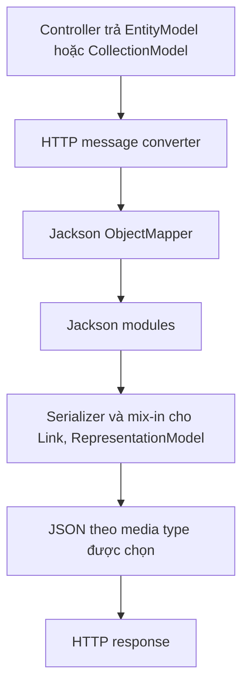

# Jackson module

Jackson module là một gói mở rộng cho `ObjectMapper` hoặc `JsonMapper`. Module có thể đăng ký serializer, deserializer, key serializer, mix-in, subtype và các thành phần tùy biến khác để Jackson chuyển đổi Java object thành JSON và ngược lại theo quy tắc của ứng dụng.

Spring HATEOAS sử dụng Jackson module để biến các representation model thành định dạng hypermedia. Ví dụ, một `EntityModel<OrderDto>` không nên được serialize như một object Java có trường `content` và `links` thông thường khi client yêu cầu HAL. Module HAL hướng dẫn Jackson tạo `_links`, `_embedded`, relation và các metadata đúng với cấu trúc HAL.

## Jackson module nằm ở đâu trong quá trình serialize?

Khi controller trả về một representation model, Spring MVC chọn message converter phù hợp với media type response. Converter dùng mapper đã được cấu hình để serialize object. Jackson module cung cấp quy tắc chuyển đổi cho các kiểu Java mà module quản lý.



Module không phải message converter và cũng không tự chọn HTTP media type. Nó bổ sung quy tắc cho mapper. Message converter/codec kết hợp mapper với media type để đọc hoặc ghi body.

## Jackson module là gì?

Trong Jackson 2, `com.fasterxml.jackson.databind.Module` là abstraction đăng ký các quy tắc cho `ObjectMapper`; `SimpleModule` là lớp tiện ích thường dùng khi cần thêm serializer hoặc deserializer. Ví dụ một module có thể quy định enum `OrderStatus` được xuất thành mã API ngắn thay vì tên enum nội bộ.

```java
import java.io.IOException;

import com.fasterxml.jackson.core.JsonGenerator;
import com.fasterxml.jackson.databind.JsonSerializer;
import com.fasterxml.jackson.databind.SerializerProvider;
import com.fasterxml.jackson.databind.module.SimpleModule;

public class OrderJacksonModule extends SimpleModule {

    public OrderJacksonModule() {
        super("order-api-module");

        addSerializer(OrderStatus.class, new JsonSerializer<OrderStatus>() {
            @Override
            public void serialize(
                    OrderStatus value,
                    JsonGenerator generator,
                    SerializerProvider serializers) throws IOException {
                generator.writeString(value.getApiCode());
            }
        });
    }
}
```

`OrderStatus` và `getApiCode()` là kiểu domain do ứng dụng định nghĩa. Module trên chỉ kiểm soát cách enum được serialize. Nó không cần biết controller nào trả enum và không thay đổi quy tắc hypermedia của Spring HATEOAS.

Các khả năng thường được dùng trong một module:

- Serializer chuyển một kiểu Java thành cấu trúc JSON tùy chỉnh.
- Deserializer đọc JSON và tạo kiểu Java tương ứng.
- Key serializer/deserializer xử lý key của `Map`.
- Mix-in bổ sung annotation Jackson cho kiểu không thể sửa trực tiếp.
- Modifier hoặc subtype registration điều chỉnh quá trình xử lý kiểu.

Không nên viết serializer tùy chỉnh nếu quy tắc mặc định của Jackson đã đáp ứng hợp đồng. Serializer riêng làm tăng trách nhiệm bảo trì và cần test cả chiều đọc nếu API có nhận lại kiểu dữ liệu đó.

## Vì sao Spring HATEOAS cần module riêng?

Các kiểu như `Link`, `RepresentationModel`, `EntityModel`, `CollectionModel` và `PagedModel` chứa cấu trúc hypermedia. Cách serialize chúng phụ thuộc vào media type đang được dùng.

Với HAL, client mong đợi link nằm trong `_links`, embedded resource nằm trong `_embedded`, và tên relation tuân theo quy tắc của HAL. Một serializer JSON thông thường không thể tự suy ra các quy tắc đó chỉ từ tên field Java.

Spring HATEOAS cung cấp các Jackson module dành cho các định dạng hypermedia được hỗ trợ. Trong dòng Spring HATEOAS 2.x dùng Jackson 2, những module thường gặp gồm:

| Module | Vai trò |
| --- | --- |
| `Jackson2HalModule` | Serialize và deserialize `Link` cùng representation model theo HAL. |
| `Jackson2HalFormsModule` | Xử lý các thành phần của tài liệu HAL-FORMS, bao gồm template và property metadata. |
| `Jackson2CollectionJsonModule` | Hỗ trợ representation theo Collection+JSON. |
| `Jackson2UberModule` | Hỗ trợ định dạng UBER. |

Với HAL, module đăng ký serializer/deserializer và mix-in cần thiết để representation model được chuyển thành JSON hypermedia. HAL module cũng có `HalHandlerInstantiator` để tạo các handler đặc thù như serializer và deserializer có phụ thuộc vào relation provider, CURIE provider, message resolver và cấu hình HAL.

## Phân biệt module của HAL và module của ứng dụng

Một ứng dụng có thể dùng đồng thời module Spring HATEOAS và module do chính ứng dụng viết:

| Module | Phạm vi | Ví dụ |
| --- | --- | --- |
| Module hypermedia của Spring HATEOAS | Cấu trúc link, embedded resource và representation model theo media type. | `Jackson2HalModule` |
| Module của ứng dụng | Cách serialize kiểu domain hoặc DTO riêng. | `OrderJacksonModule` |

Module ứng dụng nên tập trung vào kiểu dữ liệu do ứng dụng sở hữu. Tránh đăng ký serializer mới cho `Link`, `EntityModel` hoặc `RepresentationModel` nếu mục tiêu chỉ là đổi cách hiển thị một trường DTO. Việc ghi đè serializer hypermedia có thể làm mất `_links`, `_embedded`, CURIE hoặc các quy tắc mà Spring HATEOAS đã cung cấp.

## Cấu hình Spring HATEOAS trong ứng dụng Spring Boot

Với ứng dụng Spring Boot MVC, starter HATEOAS thường là cách đơn giản nhất để có cấu hình hypermedia và mapper phù hợp:

```kotlin
dependencies {
    implementation("org.springframework.boot:spring-boot-starter-web")
    implementation("org.springframework.boot:spring-boot-starter-hateoas")
}
```

Spring Boot auto-configure các thành phần Spring HATEOAS và mapper để serialize response theo định dạng hypermedia. Khi dùng auto-configuration, thường không cần tự tạo một `ObjectMapper` mới chỉ để đăng ký HAL module.

Trong ứng dụng cần bật cấu hình hypermedia tường minh, có thể dùng `@EnableHypermediaSupport`:

```java
import org.springframework.context.annotation.Configuration;
import org.springframework.hateoas.config.EnableHypermediaSupport;
import org.springframework.hateoas.config.EnableHypermediaSupport.HypermediaType;

@Configuration
@EnableHypermediaSupport(type = HypermediaType.HAL)
class HypermediaConfiguration {
}
```

Annotation này đăng ký các Jackson module cần thiết để render `EntityModel` và `CollectionModel` theo định dạng hypermedia đã chọn, đồng thời có thể đăng ký các thành phần hỗ trợ phía client như `LinkDiscoverer` nếu dependency tương ứng có mặt.

Spring Boot đã có auto-configuration cho phần lớn ứng dụng; chỉ bật `@EnableHypermediaSupport` khi cần kiểm soát cấu hình hypermedia tường minh. Tránh tạo hai bộ cấu hình độc lập rồi không rõ converter đang dùng mapper nào. Ở các phiên bản Spring Boot mới, việc tự bật annotation cũng có thể làm thay đổi cách Boot áp dụng tùy chỉnh mapper, nên cần đọc hướng dẫn đúng phiên bản đang dùng.

Với WebFlux, không kết hợp `spring-boot-starter-hateoas` dành cho MVC với WebFlux. Dùng dependency `spring-hateoas` trực tiếp cùng `spring-boot-starter-webflux`, rồi xác nhận codec hypermedia của stack reactive được cấu hình.

## Đăng ký module tùy chỉnh qua Spring Boot

Trong Spring Boot 3.x sử dụng Jackson 2, các bean kiểu `com.fasterxml.jackson.databind.Module` được đăng ký với mapper được auto-configure. Có thể khai báo module ứng dụng thành bean:

```java
import com.fasterxml.jackson.databind.Module;
import org.springframework.context.annotation.Bean;
import org.springframework.context.annotation.Configuration;

@Configuration
class JacksonConfiguration {

    @Bean
    Module orderJacksonModule() {
        return new OrderJacksonModule();
    }
}
```

Spring Boot áp dụng module bean vào mapper được xây từ cấu hình auto-configured. Vì vậy, module `OrderJacksonModule` có thể tùy chỉnh `OrderStatus` trong khi Spring HATEOAS vẫn dùng module HAL để serialize các link và representation model.

Nếu không dùng Spring Boot, đăng ký module vào chính `ObjectMapper` mà message converter sử dụng:

```java
ObjectMapper mapper = new ObjectMapper();
mapper.registerModule(new OrderJacksonModule());
```

Đoạn code này chỉ minh họa cách đăng ký một module Jackson thông thường. Với mapper độc lập dùng để serialize HAL, cần cấu hình đầy đủ các thành phần HAL mà phiên bản Spring HATEOAS yêu cầu, bao gồm module và handler instantiator phù hợp. Chỉ gọi `registerModule(new OrderJacksonModule())` không tự biến mapper thành HAL mapper.

## Không thay thế mapper mặc định một cách tùy tiện

Tạo `new ObjectMapper()` trong một bean rồi dùng mapper đó để serialize response có thể bỏ qua các module, naming strategy, date/time support, mix-in và các tùy chỉnh mà Spring Boot hoặc Spring HATEOAS đã đăng ký.

Nếu cần một mapper riêng cho một tác vụ độc lập, hãy giới hạn phạm vi sử dụng của nó. Nếu muốn thay mapper HTTP mặc định, phải cấu hình đầy đủ module và converter/codec liên quan, rồi kiểm thử response qua HTTP. Đừng chỉ kiểm tra một mapper phụ trong unit test trong khi ứng dụng thực tế dùng mapper khác.

## Tùy chỉnh media type bằng HypermediaMappingInformation

Nếu ứng dụng cần tạo một media type hypermedia riêng, Spring HATEOAS cung cấp SPI `HypermediaMappingInformation`. Cấu hình triển khai interface này công bố media type được hỗ trợ và cung cấp Jackson module để chuyển representation model sang cấu trúc tương ứng.

Ví dụ khung cấu hình trong Spring HATEOAS 2.x với Jackson 2:

```java
import java.util.List;

import com.fasterxml.jackson.databind.Module;
import org.springframework.context.annotation.Bean;
import org.springframework.context.annotation.Configuration;
import org.springframework.hateoas.client.LinkDiscoverer;
import org.springframework.hateoas.config.HypermediaMappingInformation;
import org.springframework.http.MediaType;

@Configuration
class AcmeMediaTypeConfiguration implements HypermediaMappingInformation {

    @Override
    public List<MediaType> getMediaTypes() {
        return List.of(MediaType.parseMediaType("application/vnd.acme+json"));
    }

    @Override
    public Module getJacksonModule() {
        return new AcmeJacksonModule();
    }

    @Bean
    LinkDiscoverer acmeLinkDiscoverer() {
        return new AcmeLinkDiscoverer();
    }
}
```

`AcmeJacksonModule` và `AcmeLinkDiscoverer` là thành phần do ứng dụng hoặc thư viện media type tự triển khai. Module thường cần serializer/deserializer cho các kiểu representation model như `RepresentationModel`, `EntityModel`, `CollectionModel` và `PagedModel`. `LinkDiscoverer` cho phép client tìm link theo relation trong representation của media type mới.

Nếu chỉ cần trả HAL, không cần viết SPI này; hãy dùng module HAL có sẵn. SPI phù hợp khi thực sự định nghĩa một media type khác với quy tắc serialize, cấu trúc link và cách client khám phá link riêng.

`getJacksonModule()` là lựa chọn gọn khi chỉ cần đăng ký module. Nếu cần cấu hình sâu hơn trên mapper, chẳng hạn cài đặt `HandlerInstantiator`, có thể override `configureObjectMapper(...)`. Chỉ dùng cách nâng cao khi module thực sự cần các thành phần đó.

## Kiểm soát thứ tự và xung đột module

Một mapper có thể nhận nhiều module. Khi nhiều module cùng đăng ký serializer, deserializer hoặc mix-in cho một kiểu, kết quả có thể phụ thuộc thứ tự đăng ký và cách Jackson áp dụng cấu hình.

Một số nguyên tắc:

- Đặt tên module có ý nghĩa để log và debug dễ hơn.
- Không đăng ký lặp cùng một module ở nhiều nơi nếu không có chủ đích.
- Không để module ứng dụng ghi đè serializer của kiểu hypermedia.
- Kiểm tra thứ tự khi nhiều module cùng xử lý một kiểu.
- Sau khi thay đổi module, test mapper thực tế và response HTTP.

Jackson có thể bỏ qua một số lần đăng ký trùng dựa trên registration ID, nhưng không nên dựa vào hành vi đó để giải quyết cấu hình module chồng chéo. Cần xác định module nào chịu trách nhiệm cho mỗi kiểu dữ liệu.

## Kiểm thử serialization trực tiếp

Một unit test có thể dùng mapper được Spring cấu hình để xác nhận `EntityModel` trở thành HAL JSON. Ví dụ trong ứng dụng Spring Boot 3.x và Spring HATEOAS 2.x:

```java
import static org.assertj.core.api.Assertions.assertThat;

import com.fasterxml.jackson.databind.JsonNode;
import com.fasterxml.jackson.databind.ObjectMapper;
import org.junit.jupiter.api.Test;
import org.springframework.beans.factory.annotation.Autowired;
import org.springframework.boot.test.context.SpringBootTest;
import org.springframework.hateoas.EntityModel;
import org.springframework.hateoas.Link;

@SpringBootTest
class HalJacksonModuleTest {

    @Autowired
    ObjectMapper objectMapper;

    @Test
    void serializesEntityModelAsHal() throws Exception {
        EntityModel<OrderDto> model = EntityModel.of(
                new OrderDto("o-42", "PAID"),
                Link.of("/api/orders/o-42", "self"));

        String json = objectMapper.writeValueAsString(model);
        JsonNode document = objectMapper.readTree(json);

        assertThat(document.path("_links").path("self")
                .path("href").asText())
                .isEqualTo("/api/orders/o-42");
        assertThat(document.path("status").asText()).isEqualTo("PAID");
    }
}
```

`OrderDto` là DTO của ứng dụng. Test này xác nhận mapper được inject từ Spring context có thể serialize model theo HAL. Nếu test dùng mapper tự tạo bằng `new ObjectMapper()`, nó có thể không phản ánh cấu hình mapper mà HTTP converter đang sử dụng.

## Kiểm thử qua HTTP converter

Unit test mapper giúp khoanh vùng lỗi serializer. Tuy nhiên, một integration test qua MockMvc còn kiểm tra cả controller mapping, content negotiation và message converter:

```java
import static org.springframework.test.web.servlet.request.MockMvcRequestBuilders.get;
import static org.springframework.test.web.servlet.result.MockMvcResultMatchers.content;
import static org.springframework.test.web.servlet.result.MockMvcResultMatchers.jsonPath;
import static org.springframework.test.web.servlet.result.MockMvcResultMatchers.status;

import org.junit.jupiter.api.Test;
import org.springframework.beans.factory.annotation.Autowired;
import org.springframework.boot.test.autoconfigure.web.servlet.AutoConfigureMockMvc;
import org.springframework.boot.test.context.SpringBootTest;
import org.springframework.hateoas.MediaTypes;
import org.springframework.test.web.servlet.MockMvc;

@SpringBootTest
@AutoConfigureMockMvc
class OrderHalResponseTest {

    @Autowired
    MockMvc mockMvc;

    @Test
    void endpointUsesConfiguredHalSerialization() throws Exception {
        mockMvc.perform(get("/api/orders/{id}", "o-42")
                        .accept(MediaTypes.HAL_JSON))
                .andExpect(status().isOk())
                .andExpect(content().contentTypeCompatibleWith(MediaTypes.HAL_JSON))
                .andExpect(jsonPath("$._links.self.href").exists());
    }
}
```

Fixture cần có đơn hàng `o-42`. Nếu mapper serialize đúng trong unit test nhưng response HTTP không có `_links`, hãy kiểm tra converter được chọn, `produces`, `Accept` và mapper thực tế mà converter dùng.

## Jackson 2 và Jackson 3: kiểm tra tên module theo phiên bản

Tên lớp và package thay đổi khi hệ sinh thái chuyển từ Jackson 2 sang Jackson 3. Không sao chép import từ tài liệu của major version khác mà không kiểm tra dependency của dự án.

| Hệ sinh thái | Module HAL | Module HAL-FORMS | Package Jackson |
| --- | --- | --- | --- |
| Spring HATEOAS 2.x với Jackson 2 | `Jackson2HalModule` | `Jackson2HalFormsModule` | `com.fasterxml.jackson.databind` |
| Spring HATEOAS 3.x với Jackson 3 | `HalJacksonModule` | `HalFormsJacksonModule` | `tools.jackson.databind` |

Spring Boot 3.x chủ yếu dùng Jackson 2 và `ObjectMapper`; Spring Boot 4.x ưu tiên Jackson 3 và `JsonMapper`. Khi nâng cấp, cần kiểm tra đồng thời Spring Boot, Spring HATEOAS, Jackson và các module tùy chỉnh. Một module biên dịch với Jackson 2 không thể đăng ký trực tiếp vào mapper Jackson 3 vì đây là hai API/package khác nhau.

Spring Boot 4.x cung cấp `JsonMapperBuilderCustomizer` và `JacksonModule` cho Jackson 3; các component serializer có thể được đăng ký bằng `@JacksonComponent`. Không trộn `com.fasterxml.jackson.*` với `tools.jackson.*` trong cùng một module chỉ để làm cho code tương thích nhiều phiên bản.

## Lỗi thường gặp

| Vấn đề | Hệ quả | Cách xử lý |
| --- | --- | --- |
| Tự tạo `ObjectMapper` không có module HAL | `EntityModel` không được serialize theo cấu trúc HAL. | Dùng mapper do Spring cấu hình hoặc đăng ký đầy đủ cấu hình hypermedia. |
| Nghĩ Jackson module tự chọn HTTP media type | Body và `Content-Type` có thể không khớp. | Cấu hình converter và `produces` riêng cho media type. |
| Đăng ký serializer ứng dụng cho `EntityModel` | Có thể làm mất `_links` hoặc `_embedded`. | Chỉ tùy chỉnh kiểu domain/DTO mà ứng dụng sở hữu. |
| Ghi đè mapper mặc định mà quên module khác | Mất hỗ trợ date/time, HAL hoặc cấu hình chung. | Tùy chỉnh mapper hiện có hoặc đăng ký builder customizer/module bean. |
| Đăng ký cùng module ở nhiều nơi | Cấu hình khó theo dõi và có thể xung đột. | Chọn một nơi quản lý module và test mapper cuối cùng. |
| Dùng import Jackson 2 trong dự án Jackson 3 | Không biên dịch hoặc module không tương thích. | Kiểm tra major version và dùng tên lớp/package đúng phiên bản. |
| Chỉ test mapper phụ | Test pass nhưng HTTP response sai. | Bổ sung MockMvc/WebTestClient test với converter thực tế. |

## Nguyên tắc thiết kế

- Xem Jackson module là cơ chế mở rộng mapper, không phải message converter hoặc media type.
- Dùng module HAL/HAL-FORMS có sẵn để serialize representation model theo định dạng tương ứng.
- Để Spring Boot hoặc `@EnableHypermediaSupport` quản lý module hypermedia khi có thể.
- Đăng ký module tùy chỉnh cho kiểu dữ liệu của ứng dụng, tránh ghi đè serializer hypermedia.
- Dùng `HypermediaMappingInformation` khi triển khai một media type hypermedia mới.
- Không thay mapper mặc định nếu chưa tái tạo đầy đủ module và cấu hình cần thiết.
- Phân biệt API Jackson 2 và Jackson 3 khi chọn import và tên module.
- Kiểm thử cả JSON serialization trực tiếp lẫn response qua HTTP converter.

Jackson module là lớp mở rộng giúp Jackson hiểu cách chuyển đổi các kiểu dữ liệu đặc thù. Trong Spring HATEOAS, module hypermedia biến representation model thành cấu trúc HAL hoặc HAL-FORMS mà client có thể điều hướng. Khi module được đăng ký đúng vào mapper mà ứng dụng thực sự sử dụng, dữ liệu, link và media type sẽ được serialize nhất quán theo hợp đồng API.

## Tài liệu tham khảo

- [Spring HATEOAS Reference — Registering a custom media type](https://docs.spring.io/spring-hateoas/docs/current/reference/html/#mediatypes.custom)
- [Spring HATEOAS 2.5 API — Jackson2HalModule](https://docs.spring.io/spring-hateoas/docs/2.5.x/api/org/springframework/hateoas/mediatype/hal/Jackson2HalModule.html)
- [Spring HATEOAS 2.5 API — HypermediaMappingInformation](https://docs.spring.io/spring-hateoas/docs/2.5.x/api/org/springframework/hateoas/config/HypermediaMappingInformation.html)
- [Spring Boot — Spring HATEOAS auto-configuration](https://docs.spring.io/spring-boot/reference/web/spring-hateoas.html)
- [Spring Boot — JSON and Jackson modules](https://docs.spring.io/spring-boot/reference/features/json.html)
