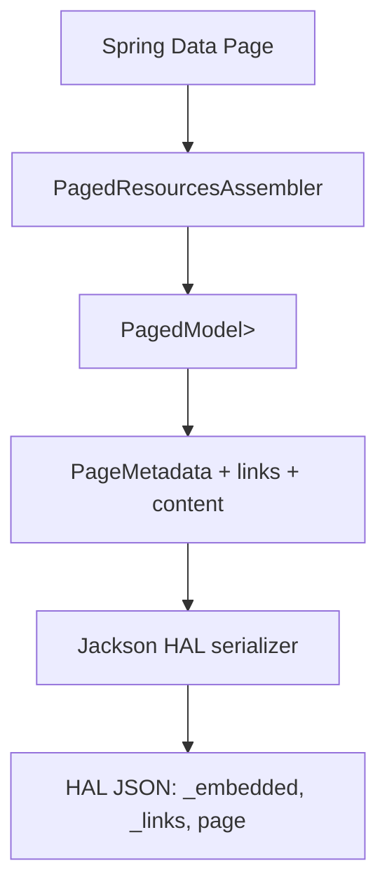

# Serialize page metadata trong Spring HATEOAS

Khi một REST API trả về collection có phân trang, client thường cần biết trang hiện tại, kích thước trang, tổng số phần tử và tổng số trang. Spring HATEOAS biểu diễn thông tin này bằng `PagedModel.PageMetadata`. Khi `PagedModel` được serialize thành HAL JSON bằng Jackson và cấu hình hypermedia phù hợp, metadata được công bố trong thuộc tính `page` bên cạnh `_embedded` và `_links`.

Điều quan trọng là chọn đúng representation trước khi serialize. `Page<T>` của Spring Data là kết quả truy vấn phía server; `PagedModel<T>` là representation hypermedia dành cho client. `PagedResourcesAssembler` chuyển đổi `Page<T>` thành `PagedModel<T>`, tạo metadata trang và các link điều hướng. Jackson sau đó serialize model theo media type mà API công bố.

## 1. Page metadata là gì?

Page metadata mô tả vị trí và kích thước của một trang trong toàn bộ tập kết quả. Trong Spring HATEOAS, metadata này được biểu diễn bằng `PagedModel.PageMetadata`.

Các trường chính:

| Trường | Ý nghĩa |
| --- | --- |
| `size` | Số phần tử tối đa trên một trang. |
| `number` | Chỉ số trang hiện tại, mặc định bắt đầu từ `0`. |
| `totalElements` | Tổng số phần tử trong toàn bộ kết quả. |
| `totalPages` | Tổng số trang theo kích thước trang và số phần tử. |

Ví dụ, nếu có 53 đơn hàng và mỗi trang chứa tối đa 20 đơn, metadata của trang thứ hai có thể là:

```json
{
  "size": 20,
  "totalElements": 53,
  "totalPages": 3,
  "number": 1
}
```

`number` là `1` vì Spring Data dùng chỉ số trang bắt đầu từ `0`; đây là trang thứ hai theo cách đếm thông thường. Metadata mô tả trang hiện tại, còn các liên kết như `prev` và `next` cho client biết cách chuyển trang.

## 2. Phân biệt Page, PageMetadata và PagedModel

Ba kiểu thường xuất hiện trong luồng phân trang nhưng có trách nhiệm khác nhau:

| Kiểu | Vai trò |
| --- | --- |
| `Page<T>` | Kết quả phân trang từ tầng truy vấn, thường do Spring Data trả về. |
| `PagedModel.PageMetadata` | Các con số mô tả trang: size, number, totalElements và totalPages. |
| `PagedModel<T>` | Representation hypermedia chứa các item, page metadata và link cấp collection. |

Không nên xem `Page<T>` là hợp đồng JSON công khai. Cấu trúc nội bộ của `Page` có thể thay đổi theo phiên bản Spring Data và không tự diễn đạt đầy đủ các relation hypermedia mà client cần. Hãy chuyển `Page<T>` thành `PagedModel<T>` trước khi trả response.

`PagedModel` kế thừa khả năng biểu diễn collection và link của Spring HATEOAS, đồng thời giữ metadata trang. Khi serialize HAL, các item thường nằm dưới `_embedded`, các link nằm dưới `_links`, còn metadata nằm dưới `page`.

## 3. Cấu trúc HAL JSON có page metadata

Một response HAL cho collection đơn hàng có thể có dạng:

```json
{
  "_embedded": {
    "orders": [
      {
        "id": "42",
        "status": "PENDING",
        "_links": {
          "self": {
            "href": "/orders/42"
          }
        }
      }
    ]
  },
  "_links": {
    "first": { "href": "/orders?page=0&size=20" },
    "prev": { "href": "/orders?page=0&size=20" },
    "self": { "href": "/orders?page=1&size=20" },
    "next": { "href": "/orders?page=2&size=20" },
    "last": { "href": "/orders?page=2&size=20" }
  },
  "page": {
    "size": 20,
    "totalElements": 53,
    "totalPages": 3,
    "number": 1
  }
}
```

Đây là response minh họa; số item trong `_embedded.orders` phụ thuộc dữ liệu thực của trang và các link phụ thuộc request cùng kết quả truy vấn. Ba phần có ý nghĩa riêng:

- `_embedded.orders` chứa representation của từng đơn hàng.
- `_links` cho phép client điều hướng giữa collection và các trang.
- `page` cho biết metadata định lượng của trang hiện tại.

Client nên sử dụng link `next` hoặc `prev` khi cần chuyển trang và dùng metadata để hiển thị thông tin như “trang 2 trên 3”. Không nên tự tính URI tiếp theo chỉ từ `number` và `size`.

## 4. Tạo PagedModel thủ công bằng PageMetadata

Có thể tạo `PagedModel` trực tiếp khi đã có danh sách representation và metadata:

```java
List<EntityModel<OrderView>> items = orders.stream()
        .map(orderAssembler::toModel)
        .toList();

PagedModel.PageMetadata metadata = new PagedModel.PageMetadata(
        20,  // size
        1,   // number: trang thứ hai, đánh số từ 0
        53,  // totalElements
        3    // totalPages
);

PagedModel<EntityModel<OrderView>> model =
        PagedModel.of(items, metadata);
```

Thứ tự tham số của constructor là `size`, `number`, `totalElements`, `totalPages`. Hãy chú ý không đảo `number` và `size`, vì cả hai đều là số và trình biên dịch không thể phát hiện lỗi ngữ nghĩa này.

Khi tự tạo model, bạn chịu trách nhiệm thêm link cấp collection:

```java
model.add(Link.of("/orders?page=1&size=20", "self"));
```

Ví dụ dùng URI cố định chỉ để minh họa việc gắn link. Trong ứng dụng thực tế, nên tạo URI từ mapping controller hoặc builder phù hợp và giữ các tham số lọc, sắp xếp hiện tại.

Tạo `PageMetadata` thủ công phù hợp khi dữ liệu phân trang đến từ nguồn không phải Spring Data `Page`, hoặc khi ứng dụng tự quản lý thuật toán phân trang. Nếu đã có `Page<T>`, hãy ưu tiên assembler để tránh tự tính sai metadata và link.

## 5. Chuyển Page thành PagedModel bằng PagedResourcesAssembler

Trong Spring MVC tích hợp Spring Data, `PagedResourcesAssembler<T>` chuyển `Page<T>` thành `PagedModel` và tạo các link điều hướng tương ứng. Có thể truyền một `RepresentationModelAssembler` để chuyển từng phần tử.

Ví dụ assembler cho item:

```java
@Component
class OrderModelAssembler
        implements RepresentationModelAssembler<Order, EntityModel<OrderView>> {

    @Override
    public EntityModel<OrderView> toModel(Order order) {
        OrderView view = new OrderView(
                order.getId(),
                order.getStatus().name(),
                order.getTotal()
        );

        return EntityModel.of(
                view,
                linkTo(methodOn(OrderController.class)
                        .one(order.getId())).withSelfRel()
        );
    }
}
```

Controller:

```java
@RestController
@RequestMapping("/orders")
class OrderController {

    private final OrderService orderService;
    private final OrderModelAssembler assembler;

    OrderController(OrderService orderService, OrderModelAssembler assembler) {
        this.orderService = orderService;
        this.assembler = assembler;
    }

    @GetMapping
    PagedModel<EntityModel<OrderView>> all(
            Pageable pageable,
            PagedResourcesAssembler<Order> pagedAssembler) {

        Page<Order> page = orderService.findAll(pageable);
        return pagedAssembler.toModel(page, assembler);
    }

    @GetMapping("/{id}")
    EntityModel<OrderView> one(@PathVariable UUID id) {
        return assembler.toModel(orderService.getRequired(id));
    }
}
```

`toModel(page, assembler)` chuyển từng `Order` thành `EntityModel<OrderView>`, tạo `PagedModel`, gắn page metadata và xây các link phân trang. Việc này giúp controller tập trung vào việc lấy `Page` từ service và trả representation.

`PagedResourcesAssembler` được Spring Data Web cung cấp khi cấu hình phân giải `Pageable` được bật. Trong ứng dụng Spring Boot thông thường, tính năng này thường được auto-configure; với cấu hình tùy chỉnh, hãy xác nhận Spring Data Web đã được đăng ký.

## 6. Jackson serialize page metadata như thế nào?

Khi controller trả `PagedModel` và request chọn HAL JSON, bộ chuyển đổi HTTP của Spring HATEOAS dùng cấu hình Jackson hỗ trợ hypermedia để serialize model. `PageMetadata` được biểu diễn thành object `page` với các thuộc tính `size`, `totalElements`, `totalPages` và `number`.

Luồng khái quát:



Jackson không cần serialize trực tiếp `PageImpl` để tạo phần `page`. Metadata đã được biểu diễn rõ ràng trong `PagedModel`. Đây là một ranh giới hữu ích: tầng truy vấn cung cấp kết quả trang; Spring HATEOAS tạo representation; Jackson serialize representation theo media type.

Nếu response chỉ chứa mảng JSON hoặc cấu trúc không có `_links`, `_embedded` và `page` như dự kiến, hãy kiểm tra kiểu trả về của controller, `Accept` header và converter hypermedia đang xử lý response.

## 7. Cấu hình HAL converter và Jackson module

Spring HATEOAS cần cấu hình hypermedia để Jackson biết cách serialize `RepresentationModel`, `Link`, `CollectionModel` và `PagedModel`. Với Spring Boot sử dụng starter HATEOAS, auto-configuration thường đăng ký converter và Jackson module phù hợp với media type được hỗ trợ.

Trong ứng dụng cấu hình thủ công, có thể bật HAL qua:

```java
@Configuration
@EnableHypermediaSupport(type = HypermediaType.HAL)
class HypermediaConfiguration {
}
```

Client yêu cầu HAL JSON:

```http
GET /orders?page=1&size=20 HTTP/1.1
Accept: application/hal+json
```

Response cần có content type tương thích với `application/hal+json`. Không nên tự tạo một `ObjectMapper` mới rồi dùng nó để serialize `PagedModel` nếu mapper đó chưa được đăng ký các module và cấu hình hypermedia cần thiết. Làm vậy có thể khiến link và metadata được serialize như object Java thông thường hoặc không đúng định dạng HAL.

Nếu ứng dụng cần tùy chỉnh Jackson, hãy mở rộng cấu hình mapper/converter do Spring Boot hoặc Spring HATEOAS quản lý, thay vì thay thế toàn bộ cấu hình mặc định mà không đăng ký lại hỗ trợ hypermedia.

## 8. Ý nghĩa và quy tắc của từng giá trị metadata

`size` là kích thước trang được sử dụng trong truy vấn. Trang cuối có thể chứa ít item hơn giá trị này; `size` không phải số item thực tế có trong response.

`number` là chỉ số trang hiện tại. Với cấu hình mặc định của Spring Data, trang đầu tiên là `0`. Nếu API thay đổi cách đánh số trang ở lớp web, hãy kiểm tra resolver và link được tạo để client nhận đúng quy ước.

`totalElements` là tổng số phần tử phù hợp với truy vấn, thường tính sau khi áp dụng filter. Nó không nhất thiết là tổng số bản ghi của toàn bảng.

`totalPages` là tổng số trang theo kích thước trang và tổng số phần tử. Với collection rỗng, số trang có thể là `0`; hãy kiểm tra response rỗng của ứng dụng và không tự giả định luôn có ít nhất một trang.

Metadata và links bổ sung cho nhau. `page` cung cấp số liệu để hiển thị hoặc tính toán; `_links` là nguồn điều hướng thực tế. Khi API dùng cursor pagination hoặc URI có query parameter phức tạp, client càng nên theo link thay vì tự suy luận URL.

## 9. Metadata không chứa mọi thông tin truy vấn

`PageMetadata` mô tả kích thước, chỉ số trang, tổng số phần tử và tổng số trang. Nó không phải bản mô tả đầy đủ của toàn bộ truy vấn.

Ví dụ, metadata không nhất thiết chứa:

- Các điều kiện filter như `status=PENDING`.
- Tiêu chí sort như `createdAt,desc`.
- Tên tenant hoặc phạm vi dữ liệu.
- Cursor hoặc token truy vấn tùy chỉnh.

Những thông tin này thường được phản ánh trong URI của các link phân trang hoặc trong dữ liệu mà API công bố riêng. Khi tạo link thủ công, phải giữ các query parameter ảnh hưởng đến kết quả. Khi dùng `PagedResourcesAssembler`, hãy kiểm tra các link được tạo với request có filter và sort để xác nhận ngữ cảnh truy vấn được giữ đúng.

## 10. Xử lý collection rỗng và trang cuối

Với collection rỗng, response vẫn có thể là một `PagedModel` có metadata và self link. Không nên trả một kiểu JSON hoàn toàn khác chỉ vì không có item nếu hợp đồng endpoint xác định response luôn là paged representation.

Với trang đầu, thường không có `prev`; với trang cuối, thường không có `next`. Các link `first`, `last` và `self` phụ thuộc cách assembler tạo pagination links và trạng thái kết quả. Hãy dùng response thực tế làm căn cứ trong test thay vì giả định mọi relation luôn xuất hiện.

Ví dụ ma trận kiểm thử:

| Tình huống | number | prev | next |
| --- | ---: | --- | --- |
| Trang đầu, có nhiều trang | `0` | Không | Có |
| Trang giữa | `1` hoặc lớn hơn | Có | Có |
| Trang cuối | `totalPages - 1` | Có | Không |
| Chỉ có một trang | `0` | Không | Không |
| Không có phần tử | Theo metadata của page rỗng | Không có trang trước | Không có trang sau |

Nếu client cần hiển thị “không có kết quả”, hãy dựa vào content rỗng hoặc `totalElements == 0`, không suy luận chỉ từ việc thiếu `next`.

## 11. Tùy chỉnh serialization của page metadata

Trong hầu hết trường hợp, nên giữ cấu trúc `page` chuẩn của `PagedModel` để client có thể sử dụng một hợp đồng ổn định. Nếu chỉ cần đổi tên hoặc bổ sung một trường hiển thị, hãy cân nhắc tạo representation riêng thay vì chỉnh sửa trực tiếp class framework.

Ví dụ, nếu API cần thêm thông tin mô tả filter đang áp dụng, có thể tạo wrapper hoặc DTO metadata riêng:

```java
public record OrderPageInfo(
        long size,
        long number,
        long totalElements,
        long totalPages,
        String appliedStatus
) {}
```

Wrapper representation có thể chứa `PagedModel` hoặc dùng model riêng để công bố thêm thông tin. Cần cân nhắc kỹ cấu trúc HAL cuối cùng để không làm mất `_links`, `_embedded` hoặc relation collection.

Không nên áp dụng `@JsonIgnore` hoặc custom serializer lên `PagedModel` một cách tùy tiện để ẩn `page`, vì client có thể đang dựa vào metadata đó. Nếu có yêu cầu đổi cấu trúc lớn, hãy xem đó là thay đổi hợp đồng API và kiểm thử tất cả client liên quan.

## 12. Không serialize PageImpl trực tiếp làm hợp đồng API

Một controller có thể trả `Page<Order>` trực tiếp và Jackson có thể serialize một số thuộc tính của implementation đó. Tuy nhiên, cấu trúc này gắn response với chi tiết của Spring Data thay vì một representation hypermedia được thiết kế rõ.

Những vấn đề thường gặp:

- Response có thể lộ cấu trúc nội bộ của `PageImpl`.
- Không có các relation điều hướng hypermedia phù hợp.
- Cấu trúc JSON có thể thay đổi theo phiên bản thư viện.
- Client phải hiểu cấu trúc của Spring Data thay vì hợp đồng API.
- Khó bổ sung link self, next, prev và relation nghiệp vụ một cách nhất quán.

Hãy chuyển `Page<T>` thành `PagedModel<D>` bằng `PagedResourcesAssembler` hoặc tạo `PagedModel` thủ công khi có lý do rõ ràng. Cách này giúp định nghĩa hợp đồng công khai độc lập với kiểu kết quả truy vấn.

## 13. Kiểm thử page metadata với MockMvc

Kiểm thử HTTP xác nhận Jackson và converter đã serialize `PagedModel` đúng media type. Ví dụ:

```java
mockMvc.perform(get("/orders")
        .param("page", "1")
        .param("size", "20")
        .accept(MediaTypes.HAL_JSON))
    .andExpect(status().isOk())
    .andExpect(content().contentTypeCompatibleWith(MediaTypes.HAL_JSON))
    .andExpect(jsonPath("$.page.size").value(20))
    .andExpect(jsonPath("$.page.number").value(1))
    .andExpect(jsonPath("$.page.totalElements").value(53))
    .andExpect(jsonPath("$.page.totalPages").value(3))
    .andExpect(jsonPath("$._links.self.href").exists())
    .andExpect(jsonPath("$._embedded.orders").isArray());
```

Tên relation `orders` cần khớp relation collection mà ứng dụng cấu hình. Nếu page metadata không xuất hiện, kiểm tra controller có trả `PagedModel` không, request có chọn HAL JSON không và converter hypermedia có được đăng ký không.

Nên bổ sung kiểm thử cho:

- Trang đầu, trang giữa và trang cuối.
- Collection rỗng và collection chỉ có một trang.
- Filter và sort được giữ trong các link `prev`/`next`.
- Self link của từng item và self link của collection.
- URI được sinh đúng sau reverse proxy nếu ứng dụng dùng URI tuyệt đối.
- Client đọc `page` metadata và theo link để chuyển trang.

## 14. Kiểm tra metadata trong unit test

Ngoài HTTP test, có thể kiểm tra `PagedModel` trong bộ nhớ trước khi serialize:

```java
PagedModel.PageMetadata metadata = new PagedModel.PageMetadata(
        20, 1, 53, 3
);

PagedModel<OrderModel> model = PagedModel.of(orderModels, metadata);

assertThat(model.getMetadata().getSize()).isEqualTo(20);
assertThat(model.getMetadata().getNumber()).isEqualTo(1);
assertThat(model.getMetadata().getTotalElements()).isEqualTo(53);
assertThat(model.getMetadata().getTotalPages()).isEqualTo(3);
```

Unit test xác nhận metadata được tạo đúng trong model. Nó không thay thế kiểm thử serialization vì JSON output còn phụ thuộc Jackson module, converter và media type. Hãy dùng cả hai mức test để tách lỗi tạo model khỏi lỗi serialize.

## 15. Các lỗi thường gặp khi serialize page metadata

**Trả `Page<T>` trực tiếp.** Dùng `PagedModel<T>` làm representation công khai để kiểm soát metadata và hypermedia links.

**Nhầm chỉ số trang bắt đầu từ 1.** Spring Data mặc định dùng `0` cho trang đầu. Kiểm tra `number` và URI `page` trong response.

**Đảo thứ tự tham số PageMetadata.** Constructor nhận `size`, `number`, `totalElements`, `totalPages`. Viết test cho từng trường để phát hiện lỗi.

**Chỉ kiểm tra page mà bỏ qua links.** Metadata không thay thế `prev`, `next` hoặc `self`. Client nên điều hướng theo URI được công bố.

**Tự tạo ObjectMapper không có module HATEOAS.** Mapper có thể không serialize link và model theo HAL. Hãy dùng converter/cấu hình do Spring quản lý hoặc đăng ký đầy đủ hỗ trợ hypermedia.

**Nhầm size với số item thực tế.** Trang cuối có thể ít item hơn `size`; `size` mô tả kích thước trang.

**Cho rằng page metadata chứa filter và sort.** Các tham số này thường được giữ trong link hoặc mô tả riêng, không nằm trong bốn trường metadata cơ bản.

**Không kiểm thử page rỗng.** Response rỗng vẫn cần tuân theo hợp đồng representation và không có link điều hướng tới trang không tồn tại.

## 16. Bài tập thực hành và tiêu chí hoàn thành

Hãy xây dựng endpoint `GET /orders` có phân trang và serialize metadata bằng Jackson:

1. Tạo service trả `Page<Order>` từ Spring Data repository.
2. Tạo `OrderModelAssembler` chuyển mỗi `Order` thành `EntityModel<OrderView>` có self link.
3. Dùng `PagedResourcesAssembler.toModel(page, assembler)` trong controller.
4. Yêu cầu `application/hal+json` và kiểm tra response có `_embedded`, `_links`, `page`.
5. Xác nhận `size`, `number`, `totalElements`, `totalPages` khớp `Page` nguồn.
6. Kiểm tra trang đầu, trang giữa, trang cuối và collection rỗng.
7. Thêm filter và sort, xác nhận các link phân trang giữ query parameter.
8. Viết unit test cho `PageMetadata` và integration test cho JSON output.
9. Thử trả trực tiếp `Page<T>` trong một test để quan sát sự khác biệt với `PagedModel`.
10. Xác nhận client có thể dùng link `next` và `prev` mà không tự ghép URL.

Bạn đã hiểu cách serialize page metadata khi có thể chuyển `Page<T>` thành `PagedModel`, tạo metadata đúng thứ tự, cấu hình Jackson/HAL converter, đọc được object `page` trong JSON và kiểm thử đồng thời metadata cùng pagination links. Điều đó giúp API công bố thông tin phân trang ổn định, dễ tiêu thụ và ít phụ thuộc vào cấu trúc nội bộ của Spring Data.

## Tài liệu tham khảo chính thức

- [Spring HATEOAS Reference Documentation – Paged Resources](https://docs.spring.io/spring-hateoas/docs/current/reference/html/#server.paged-resources)
- [PagedModel API](https://docs.spring.io/spring-hateoas/docs/current/api/org/springframework/hateoas/PagedModel.html)
- [PagedResourcesAssembler API](https://docs.spring.io/spring-data/commons/docs/current/api/org/springframework/data/web/PagedResourcesAssembler.html)
- [Spring HATEOAS Reference Documentation – HAL](https://docs.spring.io/spring-hateoas/docs/current/reference/html/#mediatypes.hal)
