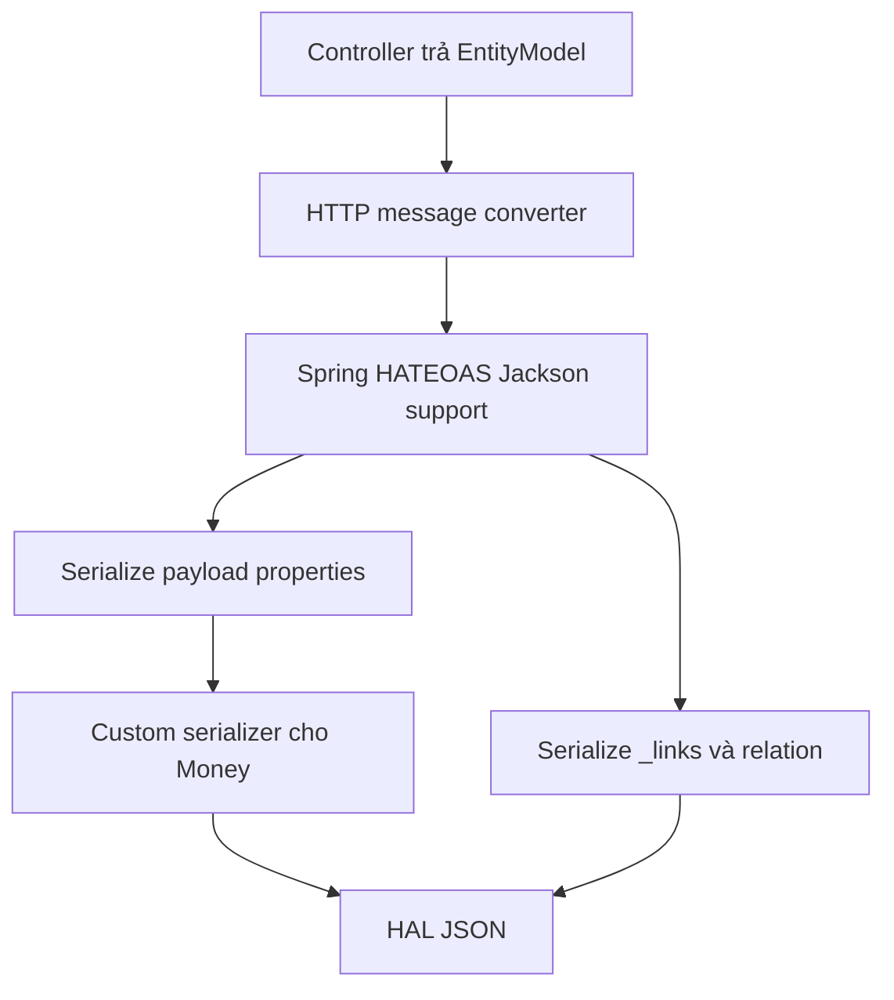

# Custom Jackson serializer trong Spring HATEOAS

Spring HATEOAS dùng Jackson để chuyển representation model thành JSON theo media type như HAL. Phần lớn trường dữ liệu có thể được serialize bằng cơ chế mặc định của Jackson. Tuy nhiên, đôi khi một kiểu dữ liệu cần có định dạng JSON riêng: một value object tiền tệ cần công bố amount và currency, một kiểu trạng thái cần biểu diễn bằng mã ổn định, hoặc một trường thời gian cần định dạng theo hợp đồng API.

Jackson cho phép tạo custom serializer cho một kiểu Java hoặc một thuộc tính cụ thể. Khi dùng cùng Spring HATEOAS, cần đăng ký serializer vào đúng `ObjectMapper` được HTTP message converter sử dụng, đồng thời giữ nguyên các module xử lý `Link`, `RepresentationModel`, `CollectionModel` và `PagedModel`. Bài học này trình bày cách viết, đăng ký, giới hạn phạm vi và kiểm thử custom serializer mà không làm hỏng cấu trúc hypermedia.

## 1. Custom serializer là gì?

Serializer là thành phần chuyển một giá trị Java thành nội dung JSON. Jackson có serializer mặc định cho các kiểu phổ biến như `String`, số, boolean, collection, record và Java bean. Khi định dạng mặc định không phù hợp với hợp đồng API, có thể cung cấp một serializer riêng.

Ví dụ, ứng dụng có value object:

```java
public record Money(BigDecimal amount, Currency currency) {}
```

Với serializer mặc định, JSON có thể phụ thuộc vào cách Jackson nhìn thấy record và các kiểu con. API có thể muốn một cấu trúc ổn định, dễ hiểu:

```json
{
  "amount": 125000,
  "currency": "VND"
}
```

Custom serializer định nghĩa chính xác cách ghi cấu trúc đó. Nó chịu trách nhiệm cho giá trị `Money`; các phần khác của representation vẫn do Jackson và Spring HATEOAS xử lý.

## 2. Khi nào nên viết custom serializer?

Chỉ nên viết serializer riêng khi các cấu hình Jackson đơn giản không đáp ứng được hợp đồng.

| Nhu cầu | Cách nên xem xét trước |
| --- | --- |
| Đổi tên thuộc tính JSON | `@JsonProperty` hoặc naming strategy. |
| Bỏ qua một thuộc tính | `@JsonIgnore` hoặc `@JsonInclude`. |
| Định dạng ngày/giờ | `@JsonFormat` và Java Time module. |
| Serialize một value object thành một cấu trúc JSON riêng | Custom `JsonSerializer`. |
| Chọn serializer cho một thuộc tính cụ thể | `@JsonSerialize(using = ...)`. |
| Áp dụng serializer cho một kiểu trên toàn ứng dụng | Jackson `Module` hoặc Spring Boot `@JsonComponent`. |
| Thay đổi cách serialize link HAL hoặc relation | Cấu hình Spring HATEOAS tương ứng, không ghi lại serializer của `Link` một cách tùy tiện. |

Custom serializer hữu ích khi có quy tắc chuyển đổi có cấu trúc, chẳng hạn `Money` luôn được xuất thành amount và currency. Nếu chỉ cần đổi tên hoặc định dạng đơn giản, annotation thường dễ đọc và ít mã hơn.

## 3. Vị trí custom serializer trong luồng serialize hypermedia

Khi controller trả `EntityModel<OrderView>`, Spring HATEOAS chịu trách nhiệm serialize phần model và link theo media type được chọn. Jackson serialize các giá trị bên trong payload, bao gồm những kiểu có custom serializer đã đăng ký.



Custom serializer cho `Money` định dạng trường `total`. Serializer HAL của Spring HATEOAS vẫn tạo `_links`, `_embedded` và các phần tử hypermedia khác. Đây là ranh giới quan trọng: tùy chỉnh giá trị trong payload không đòi hỏi thay thế serializer của toàn bộ `EntityModel` hoặc `Link`.

## 4. Viết serializer bằng JsonSerializer hoặc StdSerializer

Jackson cung cấp `JsonSerializer<T>` làm lớp cơ sở. `StdSerializer<T>` là lớp tiện dụng hơn khi muốn khai báo kiểu dữ liệu mà serializer xử lý.

Ví dụ serializer cho `Money`:

```java
import com.fasterxml.jackson.core.JsonGenerator;
import com.fasterxml.jackson.databind.SerializerProvider;
import com.fasterxml.jackson.databind.ser.std.StdSerializer;

import java.io.IOException;

public class MoneySerializer extends StdSerializer<Money> {

    public MoneySerializer() {
        super(Money.class);
    }

    @Override
    public void serialize(
            Money value,
            JsonGenerator generator,
            SerializerProvider provider) throws IOException {

        generator.writeStartObject();
        generator.writeNumberField("amount", value.amount());
        generator.writeStringField(
                "currency",
                value.currency().getCurrencyCode()
        );
        generator.writeEndObject();
    }
}
```

`serialize(...)` nhận giá trị Java, `JsonGenerator` để ghi JSON và `SerializerProvider` để truy cập các dịch vụ serialize khác. Ở đây serializer tạo một object JSON có hai field. `BigDecimal` được ghi dưới dạng JSON number; mã tiền tệ được ghi dưới dạng chuỗi ISO như `VND`.

Ví dụ giả định `amount` và `currency` không null theo invariant của `Money`. Nếu kiểu dữ liệu cho phép null, cần xác định rõ cách biểu diễn và xử lý null thay vì để lỗi phát sinh khi gọi `getCurrencyCode()`.

## 5. Đăng ký serializer bằng Spring Boot JsonComponent

Nếu ứng dụng dùng Spring Boot, có thể đánh dấu serializer bằng `@JsonComponent`. Spring Boot sẽ phát hiện và đăng ký serializer với cấu hình Jackson mà nó quản lý.

```java
import com.fasterxml.jackson.core.JsonGenerator;
import com.fasterxml.jackson.databind.SerializerProvider;
import org.springframework.boot.jackson.JsonComponent;
import com.fasterxml.jackson.databind.ser.std.StdSerializer;

import java.io.IOException;

@JsonComponent
public class MoneyJsonSerializer extends StdSerializer<Money> {

    public MoneyJsonSerializer() {
        super(Money.class);
    }

    @Override
    public void serialize(
            Money value,
            JsonGenerator generator,
            SerializerProvider provider) throws IOException {

        generator.writeStartObject();
        generator.writeNumberField("amount", value.amount());
        generator.writeStringField("currency", value.currency().getCurrencyCode());
        generator.writeEndObject();
    }
}
```

`@JsonComponent` phù hợp khi serializer thuộc ứng dụng Spring Boot và cần được đăng ký theo cơ chế Jackson của Boot. Có thể đặt serializer và deserializer cùng một component nếu ứng dụng cần cả hai chiều.

Không đăng ký cùng một serializer đồng thời bằng nhiều cơ chế nếu không có lý do cụ thể. Hãy chọn một cách đăng ký để tránh cấu hình khó theo dõi.

## 6. Đăng ký serializer bằng Jackson Module

Một lựa chọn khác là tạo `SimpleModule` và thêm serializer vào module. Cách này hữu ích khi muốn gom nhiều serializer liên quan hoặc không muốn gắn annotation Spring Boot lên class serializer.

```java
import com.fasterxml.jackson.databind.Module;
import com.fasterxml.jackson.databind.module.SimpleModule;
import org.springframework.context.annotation.Bean;
import org.springframework.context.annotation.Configuration;

@Configuration
class JacksonConfiguration {

    @Bean
    Module moneyModule() {
        SimpleModule module = new SimpleModule("money-module");
        module.addSerializer(Money.class, new MoneySerializer());
        return module;
    }
}
```

Trong cấu hình Spring Boot thông thường, các bean Jackson `Module` được dùng để tùy chỉnh mapper do Boot xây dựng. Nếu ứng dụng tự cấu hình HTTP message converter hoặc `ObjectMapper` riêng cho HAL, cần bảo đảm module được đăng ký trên mapper thực sự serialize response hypermedia.

Không nên tạo một `ObjectMapper` độc lập trong service rồi kỳ vọng serializer của nó tự động ảnh hưởng tới response từ controller. HTTP response được ghi bởi message converter, vì vậy phải cấu hình đúng mapper/converter của luồng HTTP.

## 7. Áp dụng serializer cho một thuộc tính bằng JsonSerialize

Nếu chỉ một thuộc tính cần định dạng riêng, có thể dùng `@JsonSerialize` trên field hoặc accessor:

```java
public class OrderView {

    private UUID id;
    private String status;

    @JsonSerialize(using = MoneySerializer.class)
    private Money total;

    // Constructor và getter.
}
```

Cách này giới hạn serializer ở thuộc tính `total` của model này. Những thuộc tính `Money` ở các class khác vẫn dùng serializer mặc định hoặc serializer được đăng ký theo cấu hình toàn cục.

Chọn giữa annotation và module theo phạm vi mong muốn:

- Dùng `@JsonSerialize` khi quy tắc chỉ thuộc về một thuộc tính.
- Dùng module hoặc `@JsonComponent` khi mọi giá trị thuộc kiểu đó cần có cùng định dạng.

Không nên vừa gắn annotation vừa đăng ký serializer toàn cục cho cùng một mục đích nếu chưa xác định rõ ưu tiên và phạm vi. Một cấu hình nhất quán sẽ dễ kiểm thử hơn.

## 8. Dùng custom serializer bên trong EntityModel

Giả sử output DTO chứa `Money`:

```java
public record OrderView(
        UUID id,
        String status,
        Money total
) {}
```

Assembler bọc DTO trong `EntityModel` và thêm self link:

```java
@Component
class OrderModelAssembler {

    EntityModel<OrderView> toModel(Order order) {
        OrderView view = new OrderView(
                order.getId(),
                order.getStatus().name(),
                order.getTotal()
        );

        return EntityModel.of(
                view,
                linkTo(methodOn(OrderController.class)
                        .one(order.getId())).withSelfRel()
        );
    }
}
```

Khi serializer `Money` được đăng ký trên mapper xử lý response, HAL JSON có thể có cấu trúc:

```json
{
  "id": "42",
  "status": "PENDING",
  "total": {
    "amount": 125000,
    "currency": "VND"
  },
  "_links": {
    "self": {
      "href": "/orders/42"
    }
  }
}
```

Trường `total` được custom serializer xử lý. `_links.self` vẫn do Spring HATEOAS serialize. Điều này cho phép tùy chỉnh định dạng một value object mà không làm mất hypermedia metadata.

## 9. Không ghi lại serializer của RepresentationModel hoặc Link một cách tùy tiện

Spring HATEOAS đăng ký các thành phần Jackson riêng để chuyển `Link`, relation, `EntityModel`, `CollectionModel`, `PagedModel` và affordance sang cấu trúc media type. Nếu thay thế serializer cho các kiểu này bằng serializer tự viết mà không tái tạo toàn bộ quy tắc HATEOAS, response có thể mất `_links`, `_embedded`, page metadata hoặc cấu trúc HAL-FORMS.

Ví dụ, không nên viết custom serializer cho `EntityModel<?>` chỉ để thay đổi cách trường `Money` hiển thị. Hãy serialize `Money` riêng như các phần trước. Cũng không nên tự ghi `_links` trong serializer của `OrderView`; link thuộc trách nhiệm của model hypermedia và Spring HATEOAS.

Nếu mục tiêu là thay đổi cách relation được đặt tên, cách link được render hoặc một quy tắc HAL cụ thể, hãy tìm cấu hình chuyên biệt của Spring HATEOAS như relation provider, `HalConfiguration` hoặc affordance model. Custom Jackson serializer chỉ nên là lựa chọn khi cần kiểm soát JSON của một kiểu dữ liệu thực sự.

## 10. Serializer toàn cục có thể ảnh hưởng nhiều media type

Một serializer đăng ký cho `Money` ở cấp `ObjectMapper` có thể ảnh hưởng tới mọi response dùng mapper đó, không chỉ HAL. Nếu cùng DTO được trả ở `application/json` và `application/hal+json`, trường `Money` có thể có cùng cấu trúc trong cả hai response.

Điều này thường tốt nếu định dạng `Money` là một phần ổn định của hợp đồng dữ liệu. Nhưng nếu chỉ muốn thay đổi cách hiển thị trong một media type, cần giới hạn serializer ở mapper/converter tương ứng hoặc dùng DTO representation riêng cho media type đó.

Khi ứng dụng có nhiều converter hoặc nhiều `ObjectMapper`, đừng giả định tất cả đều dùng chung module. Hãy kiểm thử từng đường content negotiation thực tế và xác nhận serializer có mặt ở mapper đang xử lý response.

## 11. Kết hợp với các tính năng Jackson khác

Custom serializer có thể phối hợp với các cấu hình Jackson khác, nhưng cần hiểu mỗi thành phần giải quyết việc gì:

- `@JsonProperty` đổi tên property.
- `@JsonInclude` kiểm soát điều kiện đưa property vào JSON.
- `@JsonFormat` định dạng một số kiểu ngày giờ hoặc giá trị được hỗ trợ.
- `@JsonSerialize` chọn serializer cho kiểu hoặc thuộc tính.
- Jackson `Module` đăng ký serializer, deserializer, mixin hoặc các thành phần mở rộng.
- `@JsonComponent` là cơ chế Spring Boot để phát hiện serializer/deserializer.

Nếu serializer tự ghi toàn bộ object, một số annotation trên các property bên trong object có thể không được áp dụng theo cách bạn mong đợi, vì serializer đang tự quyết định nội dung JSON. Khi muốn tái sử dụng serializer mặc định cho một giá trị con, có thể dùng `SerializerProvider.defaultSerializeValue(...)` thay vì tự xử lý mọi kiểu dữ liệu.

Ví dụ:

```java
generator.writeStartObject();
generator.writeFieldName("amount");
provider.defaultSerializeValue(value.amount(), generator);
generator.writeStringField("currency", value.currency().getCurrencyCode());
generator.writeEndObject();
```

## 12. Tránh đệ quy và lỗi trong custom serializer

Một lỗi phổ biến là gọi lại chính serializer đang thực thi cho cùng giá trị. Ví dụ, bên trong `MoneySerializer`, gọi `provider.defaultSerializeValue(value, generator)` sẽ tìm lại serializer cho `Money` và có thể gây đệ quy vô hạn.

Hãy chỉ serialize các thành phần con như `amount` hoặc `currency`, hoặc ủy quyền cho serializer của một kiểu khác. Không gọi `ObjectMapper.writeValueAsString(value)` trên cùng object từ bên trong serializer của chính object đó.

Một số nguyên tắc an toàn:

- Luôn ghi cặp `writeStartObject()`/`writeEndObject()` hoặc cấu trúc JSON tương ứng hợp lệ.
- Không ghi field name trùng ngoài ý muốn.
- Xử lý null theo hợp đồng; Jackson thường dùng null serializer riêng thay vì gọi `serialize(...)` cho giá trị null.
- Ném `IOException` hoặc lỗi serialize phù hợp khi dữ liệu không thể biểu diễn.
- Không thực hiện truy vấn database hoặc gọi dịch vụ mạng trong serializer.
- Không lưu trạng thái mutable theo từng request trong serializer singleton.
- Giữ kết quả serialize ổn định để cache và client dễ dự đoán.

Serializer chỉ nên chuyển đổi dữ liệu đã có thành JSON. Logic nghiệp vụ, phân quyền và tải dữ liệu nên được xử lý ở service hoặc assembler trước đó.

## 13. Custom serializer khác custom deserializer

Serializer xử lý chiều Java object sang JSON. Deserializer xử lý chiều JSON sang Java object. Hai chiều không tự động đối xứng.

Ví dụ, API có thể serialize `Money` thành:

```json
{
  "amount": 125000,
  "currency": "VND"
}
```

Nhưng request đầu vào có thể dùng một DTO khác, chẳng hạn `MoneyInput`, hoặc chấp nhận một chuỗi như `125000 VND`. Không nên giả định custom serializer tự làm cho Jackson đọc được định dạng tương ứng.

Nếu cần nhận JSON theo cấu trúc riêng, hãy viết `JsonDeserializer<Money>` hoặc dùng DTO input và chuyển đổi trong service. Với REST API, tách input DTO khỏi output representation thường giúp kiểm soát trường được phép ghi và tránh vô tình cho client cập nhật dữ liệu chỉ đọc.

## 14. Kiểm thử custom serializer độc lập

Trước tiên, kiểm tra serializer bằng `ObjectMapper` trong unit test để xác nhận cấu trúc JSON của kiểu dữ liệu:

```java
@Test
void serializesMoneyAsAmountAndCurrency() throws Exception {
    ObjectMapper mapper = new ObjectMapper();
    SimpleModule module = new SimpleModule();
    module.addSerializer(Money.class, new MoneySerializer());
    mapper.registerModule(module);

    String json = mapper.writeValueAsString(
            new Money(new BigDecimal("125000"), Currency.getInstance("VND"))
    );

    JsonNode node = mapper.readTree(json);
    assertThat(node.path("amount").decimalValue())
            .isEqualByComparingTo("125000");
    assertThat(node.path("currency").asText()).isEqualTo("VND");
}
```

Unit test này chỉ xác nhận logic serializer. Nó chưa chứng minh module đã được đăng ký trong Spring Boot hoặc mapper dùng bởi HAL converter.

## 15. Kiểm thử custom serializer qua HAL response

Hãy thêm integration test để xác nhận cả payload lẫn hypermedia links vẫn được serialize đúng:

```java
mockMvc.perform(get("/orders/{id}", orderId)
        .accept(MediaTypes.HAL_JSON))
    .andExpect(status().isOk())
    .andExpect(content().contentTypeCompatibleWith(MediaTypes.HAL_JSON))
    .andExpect(jsonPath("$.total.amount").value(125000))
    .andExpect(jsonPath("$.total.currency").value("VND"))
    .andExpect(jsonPath("$._links.self.href")
            .value(endsWith("/orders/" + orderId)));
```

Nếu API hỗ trợ cả JSON thông thường, kiểm tra thêm `Accept: application/json` để xác định serializer toàn cục có ảnh hưởng tới response đó hay không. Nếu có HAL collection hoặc `PagedModel`, hãy kiểm tra `_embedded`, `_links` và `page` vẫn tồn tại sau khi thêm module.

Khi test thất bại:

1. Xác nhận serializer hoạt động trong unit test.
2. Xác nhận module hoặc `@JsonComponent` được Spring phát hiện.
3. Xác nhận HTTP message converter dùng mapper có module đó.
4. Xác nhận request chọn đúng media type.
5. Kiểm tra cấu trúc HAL và link không bị serializer khác ghi đè.

## 16. Các lỗi thường gặp

**Viết serializer khi annotation đã đủ.** Dùng `@JsonFormat`, `@JsonProperty` hoặc `@JsonInclude` cho thay đổi đơn giản.

**Đăng ký module vào ObjectMapper không được dùng bởi HTTP converter.** Unit test có thể thành công nhưng response thật không đổi. Kiểm tra mapper của luồng HTTP.

**Thay serializer của EntityModel hoặc Link.** Điều này có thể phá cấu trúc HAL. Tùy chỉnh kiểu dữ liệu bên trong payload thay vì ghi lại serializer hypermedia.

**Gọi defaultSerializeValue với chính object đang serialize.** Điều đó có thể gọi lại cùng serializer và gây đệ quy. Chỉ ủy quyền cho các giá trị con.

**Cho rằng serializer cũng xử lý request body.** Muốn đọc JSON theo định dạng riêng, cần deserializer hoặc input DTO phù hợp.

**Không kiểm tra ảnh hưởng trên media type khác.** Serializer đăng ký toàn cục có thể tác động tới cả JSON và HAL. Kiểm thử từng representation được hỗ trợ.

**Đưa logic nghiệp vụ vào serializer.** Serializer chỉ nên định dạng dữ liệu; việc tải dữ liệu và quyết định quyền thuộc tầng khác.

**Không kiểm thử cấu trúc hypermedia sau thay đổi.** Hãy xác nhận `_links`, `_embedded` và page metadata vẫn được serialize đúng.

## 17. Bài tập thực hành và tiêu chí hoàn thành

Hãy tùy chỉnh cách serialize giá trị tiền tệ trong API đơn hàng:

1. Tạo value object `Money` gồm `amount` và `currency`.
2. Viết `MoneySerializer extends StdSerializer<Money>` để ghi JSON object.
3. Đăng ký serializer bằng `@JsonComponent` hoặc một Jackson `Module` bean.
4. Dùng `Money` trong `OrderView` và bọc DTO bằng `EntityModel`.
5. Trả response HAL JSON với self link của đơn hàng.
6. Xác nhận `total` có cấu trúc `amount` và `currency` như hợp đồng.
7. Xác nhận `_links.self` vẫn được Spring HATEOAS serialize.
8. Kiểm thử `application/json` nếu API hỗ trợ media type đó.
9. Viết deserializer hoặc input DTO riêng nếu API cần nhận payload tiền tệ theo cấu trúc tương ứng.
10. Kiểm tra null, giá trị không hợp lệ và trường hợp response collection hoặc page.

Bạn đã nắm được custom Jackson serializer khi có thể chọn đúng phạm vi tùy chỉnh, viết `JsonSerializer` hoặc `StdSerializer`, đăng ký nó vào mapper mà HTTP converter thực sự dùng, giữ nguyên serializer hypermedia của Spring HATEOAS và kiểm thử cả JSON payload lẫn cấu trúc HAL. Cách làm này giúp định dạng dữ liệu theo hợp đồng API mà không làm mất khả năng điều hướng của representation.

## Tài liệu tham khảo chính thức

- [Jackson Databind – JsonSerializer API](https://javadoc.io/doc/com.fasterxml.jackson.core/jackson-databind/latest/com/fasterxml/jackson/databind/JsonSerializer.html)
- [Jackson Databind – SimpleModule API](https://javadoc.io/doc/com.fasterxml.jackson.core/jackson-databind/latest/com/fasterxml/jackson/databind/module/SimpleModule.html)
- [Spring Boot – Customize the Jackson ObjectMapper](https://docs.spring.io/spring-boot/reference/features/json.html)
- [Spring HATEOAS Reference Documentation – HAL](https://docs.spring.io/spring-hateoas/docs/current/reference/html/#mediatypes.hal)
