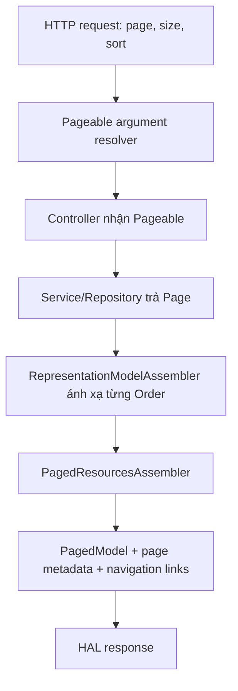

# PagedResourcesAssembler

Khi một API trả về collection lớn, server thường chia dữ liệu thành nhiều trang. Client cần biết trang hiện tại, tổng số phần tử, số trang và URI để đi đến trang trước hoặc trang tiếp theo. Trong Spring Data và Spring HATEOAS, `PagedResourcesAssembler` chuyển một `Page<T>` thành `PagedModel<R>` có metadata phân trang và các hypermedia link tương ứng.

Thay vì tự dựng JSON cho `page`, tự nối query string cho `next` hoặc tính toán link `first`/`last`, controller có thể giao phần việc này cho `PagedResourcesAssembler`. Khi kết hợp với `RepresentationModelAssembler`, mỗi item được chuyển thành resource model có self link; collection được bọc trong `PagedModel` với metadata và link điều hướng.

## Từ Page đến PagedModel

Spring Data cung cấp các kiểu phân trang chính:

- `Pageable` mô tả yêu cầu phân trang và sắp xếp từ client: số trang, kích thước trang và sort.
- `Page<T>` chứa dữ liệu của trang hiện tại cùng metadata như tổng số phần tử và tổng số trang.
- `PagedResourcesAssembler<T>` chuyển `Page<T>` thành một hypermedia model.
- `PagedModel<R>` là collection representation có page metadata và các link điều hướng.

Luồng xử lý tổng quát:



Tên `PagedResourcesAssembler` vẫn được dùng trong API Spring Data, trong khi kiểu kết quả hiện đại là `PagedModel`. Trong các phiên bản Spring HATEOAS cũ, tài liệu có thể dùng tên `PagedResources`; khi đọc ví dụ cũ, cần phân biệt tên kiểu lịch sử với API hiện tại.

## Resource model và assembler cho item

Trước tiên, xác định representation mà API công bố cho từng đơn hàng. Resource model kế thừa `RepresentationModel` để mang link:

```java
import java.math.BigDecimal;
import java.util.UUID;

import org.springframework.hateoas.RepresentationModel;
import org.springframework.hateoas.server.core.Relation;

@Relation(itemRelation = "order", collectionRelation = "orders")
public class OrderResource extends RepresentationModel<OrderResource> {

    private final UUID id;
    private final String status;
    private final BigDecimal totalAmount;

    public OrderResource(UUID id, String status, BigDecimal totalAmount) {
        this.id = id;
        this.status = status;
        this.totalAmount = totalAmount;
    }

    public UUID getId() {
        return id;
    }

    public String getStatus() {
        return status;
    }

    public BigDecimal getTotalAmount() {
        return totalAmount;
    }
}
```

`@Relation` khai báo tên item relation là `order` và collection relation là `orders`. Nhờ vậy, HAL có thể dùng `_embedded.orders` để chứa các item. Tên relation là một phần hợp đồng API; nó không phụ thuộc tên bảng hoặc tên class persistence.

Assembler chuyển domain object thành `OrderResource` và tạo self link cho từng item:

```java
import static org.springframework.hateoas.server.mvc.WebMvcLinkBuilder.linkTo;
import static org.springframework.hateoas.server.mvc.WebMvcLinkBuilder.methodOn;

import org.springframework.hateoas.server.RepresentationModelAssembler;
import org.springframework.stereotype.Component;

@Component
public class OrderResourceAssembler
        implements RepresentationModelAssembler<Order, OrderResource> {

    @Override
    public OrderResource toModel(Order order) {
        OrderResource resource = new OrderResource(
                order.getId(),
                order.getStatus().name(),
                order.getTotalAmount());

        resource.add(linkTo(methodOn(OrderController.class)
                .one(order.getId())).withSelfRel());

        return resource;
    }
}
```

`Order` là domain entity của ứng dụng. Assembler không phân trang và không truy vấn repository; nó chỉ chuyển một entity đã được tải thành representation. `PagedResourcesAssembler` sẽ gọi assembler cho từng item trong `Page`.

## Dùng PagedResourcesAssembler trong controller

Spring Data Web hỗ trợ bind query parameter thành `Pageable`. `PagedResourcesAssembler` có thể được Spring inject vào controller:

```java
import java.util.UUID;

import org.springframework.data.domain.Page;
import org.springframework.data.domain.Pageable;
import org.springframework.data.web.PagedResourcesAssembler;
import org.springframework.hateoas.MediaTypes;
import org.springframework.hateoas.PagedModel;
import org.springframework.web.bind.annotation.GetMapping;
import org.springframework.web.bind.annotation.PathVariable;
import org.springframework.web.bind.annotation.RequestMapping;
import org.springframework.web.bind.annotation.RestController;

@RestController
@RequestMapping("/api/orders")
class OrderController {

    private final OrderService service;
    private final OrderResourceAssembler orderAssembler;
    private final PagedResourcesAssembler<Order> pagedAssembler;

    OrderController(
            OrderService service,
            OrderResourceAssembler orderAssembler,
            PagedResourcesAssembler<Order> pagedAssembler) {
        this.service = service;
        this.orderAssembler = orderAssembler;
        this.pagedAssembler = pagedAssembler;
    }

    @GetMapping(produces = MediaTypes.HAL_JSON_VALUE)
    PagedModel<OrderResource> all(Pageable pageable) {
        Page<Order> page = service.findAll(pageable);
        return pagedAssembler.toModel(page, orderAssembler);
    }

    @GetMapping(value = "/{id}", produces = MediaTypes.HAL_JSON_VALUE)
    OrderResource one(@PathVariable UUID id) {
        return orderAssembler.toModel(service.findById(id));
    }
}
```

Điểm chính của controller:

1. `Pageable pageable` được Spring Data Web tạo từ query parameter của request.
2. Service trả `Page<Order>` từ repository hoặc tầng truy vấn.
3. `toModel(page, orderAssembler)` ánh xạ từng `Order` thành `OrderResource`.
4. Assembler phân trang tạo `PagedModel<OrderResource>` gồm item, page metadata và các link điều hướng.

Trong ví dụ, `OrderService.findAll(Pageable)` đại diện cho phương thức nghiệp vụ gọi repository phân trang. Controller không tự tính `totalPages`, không tự nối `?page=...` và không cần lặp vòng lặp chuyển đổi từng item.

`PagedResourcesAssembler` thuộc Spring Data Commons (`org.springframework.data.web`). Ứng dụng cần dependency Spring Data tương ứng với kho dữ liệu đang dùng, cùng Spring HATEOAS. Spring Boot tự cấu hình hỗ trợ Spring Data Web trong các ứng dụng có cấu hình repository phù hợp; với cấu hình Spring không dùng auto-configuration, bật hỗ trợ bằng `@EnableSpringDataWebSupport` để đăng ký resolver `Pageable` và các thành phần liên quan.

## Hình dạng HAL của PagedModel

Một response HAL phân trang có dạng khái quát:

```json
{
  "_embedded": {
    "orders": [
      {
        "id": "o-42",
        "status": "PAID",
        "totalAmount": 125000,
        "_links": {
          "self": {
            "href": "https://shop.example/api/orders/o-42"
          }
        }
      },
      {
        "id": "o-43",
        "status": "PENDING",
        "totalAmount": 85000,
        "_links": {
          "self": {
            "href": "https://shop.example/api/orders/o-43"
          }
        }
      }
    ]
  },
  "_links": {
    "first": {
      "href": "https://shop.example/api/orders?page=0&size=2"
    },
    "self": {
      "href": "https://shop.example/api/orders?page=0&size=2"
    },
    "next": {
      "href": "https://shop.example/api/orders?page=1&size=2"
    },
    "last": {
      "href": "https://shop.example/api/orders?page=4&size=2"
    }
  },
  "page": {
    "size": 2,
    "totalElements": 10,
    "totalPages": 5,
    "number": 0
  }
}
```

Các trường quan trọng:

| Thành phần | Ý nghĩa |
| --- | --- |
| `_embedded.orders` | Các resource item của trang hiện tại. |
| `_links.self` | URI của truy vấn trang hiện tại. |
| `_links.first` | URI của trang đầu tiên. |
| `_links.prev` | URI của trang trước nếu tồn tại. |
| `_links.next` | URI của trang tiếp theo nếu tồn tại. |
| `_links.last` | URI của trang cuối cùng. |
| `page.size` | Kích thước trang hiện tại. |
| `page.totalElements` | Tổng số phần tử theo truy vấn. |
| `page.totalPages` | Tổng số trang. |
| `page.number` | Số thứ tự trang hiện tại, mặc định bắt đầu từ 0. |

Các link biên phụ thuộc vị trí trang. Trang đầu không có `prev`; trang cuối không có `next`. Với collection rỗng, không có item trong `_embedded`, nhưng page metadata và self link vẫn có thể được công bố.

## Các overload thường dùng

`PagedResourcesAssembler` có thể tạo model từ `Page<T>` theo nhiều cách:

```java
// Dùng mặc định EntityModel để bọc từng item.
PagedModel<EntityModel<Order>> model = pagedAssembler.toModel(page);

// Dùng assembler tùy chỉnh để chuyển item thành resource.
PagedModel<OrderResource> model = pagedAssembler.toModel(page, orderAssembler);
```

Khi cần cung cấp link collection tường minh, có thể truyền thêm `Link`:

```java
Link self = linkTo(methodOn(OrderController.class).all(pageable))
        .withSelfRel();

PagedModel<OrderResource> model = pagedAssembler.toModel(
        page, orderAssembler, self);
```

Ví dụ này giả định controller có method `all(Pageable)` và link builder có thể lấy mapping cùng query parameter từ method đó. Trong trường hợp thông thường, overload `toModel(page, orderAssembler)` đã đủ để assembler phân trang tạo các link theo request hiện tại; chỉ truyền link tùy chỉnh khi cần thay đổi base URI hoặc quy tắc link.

## Trang rỗng và metadata relation

Một trang có thể rỗng vì chưa có dữ liệu hoặc vì client yêu cầu một trang vượt quá phạm vi. `Page<T>` vẫn mang thông tin về page request và tổng số phần tử. `PagedResourcesAssembler` có phương thức `toEmptyModel(...)` để tạo representation rỗng khi cần chỉ định rõ kiểu resource dùng để xác định relation collection:

```java
PagedModel<?> empty = pagedAssembler.toEmptyModel(
        page,
        OrderResource.class);
```

Kiểu `OrderResource.class` giúp relation provider xác định tên collection ngay cả khi không có item để suy ra kiểu. Điều này quan trọng khi hợp đồng cần giữ relation ổn định cho collection rỗng. Nếu response không cần chỉ định kiểu embedded resource, có thể dùng luồng `toModel(page, orderAssembler)` và kiểm tra hình dạng rỗng mà ứng dụng đang công bố.

Không nên tự trả `[]` thay cho `PagedModel` nếu client cần page metadata hoặc link điều hướng. Một collection rỗng vẫn có thể là kết quả hợp lệ của một truy vấn phân trang và vẫn cần thông tin về trang.

## Pageable query parameter

Spring Data Web thường bind các query parameter `page`, `size` và `sort` thành `Pageable`:

```http
GET /api/orders?page=1&size=20&sort=createdAt,desc
Accept: application/hal+json
```

Ý nghĩa:

- `page=1`: trang thứ hai nếu đánh số từ 0.
- `size=20`: tối đa 20 item trên một trang.
- `sort=createdAt,desc`: sắp xếp theo `createdAt` giảm dần.

Có thể đặt mặc định ở controller bằng `@PageableDefault`:

```java
import org.springframework.data.domain.Pageable;
import org.springframework.data.domain.Sort;
import org.springframework.data.web.PageableDefault;

@GetMapping(produces = MediaTypes.HAL_JSON_VALUE)
PagedModel<OrderResource> all(
        @PageableDefault(
                size = 20,
                sort = "createdAt",
                direction = Sort.Direction.DESC) Pageable pageable) {
    return pagedAssembler.toModel(service.findAll(pageable), orderAssembler);
}
```

Khi client không truyền `page`, `size` hoặc `sort`, resolver sử dụng cấu hình mặc định. Link được tạo bởi assembler sẽ phản ánh pageable của request, bao gồm các tham số cần thiết để client tiếp tục điều hướng.

## Bảo toàn filter và sort trong pagination links

Collection thường có filter ngoài pagination, ví dụ:

```text
/api/orders?status=PAID&customerId=c-17&page=0&size=20&sort=createdAt,desc
```

Khi client theo link `next`, filter `status`, `customerId`, sort và size cần được giữ lại; chỉ số trang thay đổi. `PagedResourcesAssembler` tạo link theo request và pageable hiện tại, do đó các tham số query trong request context có thể được giữ trong các link phân trang.

Controller cần khai báo filter tường minh và bảo đảm service áp dụng cùng filter khi truy vấn:

```java
@GetMapping(produces = MediaTypes.HAL_JSON_VALUE)
PagedModel<OrderResource> search(
        @RequestParam(required = false) OrderStatus status,
        @RequestParam(required = false) UUID customerId,
        Pageable pageable) {

    Page<Order> page = service.search(status, customerId, pageable);
    return pagedAssembler.toModel(page, orderAssembler);
}
```

Hãy kiểm tra href của `next` trong test để bảo đảm filter và sort thực sự được giữ. Nếu ứng dụng tự dựng base link hoặc chạy qua reverse proxy/context path, cấu hình forwarded headers và base URI đúng để các link không trỏ về host nội bộ.

## Cấu hình pageable và giới hạn kích thước

Không nên cho client yêu cầu page size tùy ý không giới hạn. Một request với `size=1000000` có thể gây tải lớn cho database và bộ nhớ. Hãy giới hạn page size tối đa và chọn default phù hợp với payload.

Trong Spring Boot, có thể tùy chỉnh `PageableHandlerMethodArgumentResolver` qua customizer do Spring Data cung cấp. Ví dụ cấu hình có thể giới hạn size và bật đánh số trang từ 1 nếu hợp đồng API yêu cầu:

```java
import org.springframework.context.annotation.Bean;
import org.springframework.context.annotation.Configuration;
import org.springframework.data.web.config.PageableHandlerMethodArgumentResolverCustomizer;

@Configuration
class PageableConfiguration {

    @Bean
    PageableHandlerMethodArgumentResolverCustomizer pageableCustomizer() {
        return resolver -> {
            resolver.setMaxPageSize(100);
            resolver.setOneIndexedParameters(true);
        };
    }
}
```

Khi bật `setOneIndexedParameters(true)`, client gửi `page=1` cho trang đầu tiên, nhưng Spring Data vẫn biểu diễn page index nội bộ theo quy tắc của `Pageable`. Link do assembler tạo phải phản ánh cùng cấu hình resolver. Chỉ bật one-indexed khi hợp đồng API đã quy định rõ và mọi client hiểu cách đánh số này.

Có thể cấu hình tên query parameter cho page và size nếu API có quy ước khác. Khi thay đổi tên hoặc indexing, cần kiểm thử các link được sinh ra vì chúng là hướng dẫn điều hướng mà client sẽ theo.

## Sắp xếp ổn định giữa các trang

Phân trang theo offset có thể tạo kết quả trùng hoặc bỏ sót khi dữ liệu thay đổi giữa hai request. Ví dụ, client đọc trang 0 rồi một bản ghi mới được chèn vào đầu danh sách trước khi client đọc trang 1; phần tử cuối trang 0 có thể xuất hiện lại ở trang 1.

Để giảm vấn đề do thứ tự không ổn định:

- Sắp xếp theo một trường có ý nghĩa và thêm khóa duy nhất làm tie-breaker, ví dụ `createdAt,desc` rồi `id,desc`.
- Chọn thứ tự mặc định rõ ràng nếu client không gửi sort.
- Không cho phép client sort theo tên thuộc tính tùy ý; whitelist các trường sort được phép.
- Với dữ liệu thay đổi liên tục hoặc rất lớn, cân nhắc keyset/seek pagination thay cho offset pagination.

`PagedResourcesAssembler` làm việc tự nhiên với `Page<T>` của Spring Data. Nếu chuyển sang keyset pagination hoặc cursor token, response có thể vẫn dùng `CollectionModel` và các link `next`/`prev` tùy chỉnh, nhưng không nên giả định metadata `totalPages` luôn có sẵn.

## Page, Slice và collection không phân trang

`Page<T>` cung cấp tổng số phần tử và tổng số trang; để có thông tin này, repository thường cần thực hiện count query. `Slice<T>` chỉ cho biết còn trang tiếp theo hay không và thường tránh count query. Một `List<T>` không chứa metadata phân trang.

| Kiểu kết quả | Metadata | Có thể dùng trực tiếp với PagedResourcesAssembler? |
| --- | --- | --- |
| `Page<T>` | Content, page number, size, total elements, total pages | Có. |
| `Slice<T>` | Content, page number/size và cờ hasNext/hasPrevious | Không trực tiếp qua overload nhận `Page<T>`; cần tạo link/collection model riêng. |
| `List<T>` | Chỉ có các item | Không; cần tự cung cấp thông tin trang hoặc trả collection thường. |

Nếu count query quá tốn kém, có thể chọn `Slice<T>` và công bố `self`, `next` hoặc `prev` theo thông tin `hasNext()`/`hasPrevious()`. Không nên tự điền `totalElements` hoặc `totalPages` giả chỉ để có cấu trúc `PagedModel`.

## Kiểm thử pagination links bằng MockMvc

Kiểm thử response HAL cần xác nhận page metadata, embedded relation và link điều hướng. Ví dụ với dữ liệu kiểm thử có 5 đơn hàng và page size là 2:

```java
import static org.springframework.test.web.servlet.request.MockMvcRequestBuilders.get;
import static org.springframework.test.web.servlet.result.MockMvcResultMatchers.content;
import static org.springframework.test.web.servlet.result.MockMvcResultMatchers.jsonPath;
import static org.springframework.test.web.servlet.result.MockMvcResultMatchers.status;

import org.junit.jupiter.api.Test;
import org.springframework.beans.factory.annotation.Autowired;
import org.springframework.boot.test.autoconfigure.web.servlet.AutoConfigureMockMvc;
import org.springframework.boot.test.context.SpringBootTest;
import org.springframework.hateoas.MediaTypes;
import org.springframework.test.web.servlet.MockMvc;

@SpringBootTest
@AutoConfigureMockMvc
class OrderPaginationTest {

    @Autowired
    MockMvc mockMvc;

    @Test
    void firstPageContainsNextAndLastLinks() throws Exception {
        mockMvc.perform(get("/api/orders")
                        .param("page", "0")
                        .param("size", "2")
                        .accept(MediaTypes.HAL_JSON))
                .andExpect(status().isOk())
                .andExpect(content().contentTypeCompatibleWith(MediaTypes.HAL_JSON))
                .andExpect(jsonPath("$.page.size").value(2))
                .andExpect(jsonPath("$.page.totalElements").value(5))
                .andExpect(jsonPath("$.page.totalPages").value(3))
                .andExpect(jsonPath("$.page.number").value(0))
                .andExpect(jsonPath("$._embedded.orders").isArray())
                .andExpect(jsonPath("$._links.self.href").exists())
                .andExpect(jsonPath("$._links.first.href").exists())
                .andExpect(jsonPath("$._links.next.href").exists())
                .andExpect(jsonPath("$._links.last.href").exists())
                .andExpect(jsonPath("$._links.prev").doesNotExist());
    }

    @Test
    void lastPageDoesNotContainNextLink() throws Exception {
        mockMvc.perform(get("/api/orders")
                        .param("page", "2")
                        .param("size", "2")
                        .accept(MediaTypes.HAL_JSON))
                .andExpect(status().isOk())
                .andExpect(jsonPath("$.page.number").value(2))
                .andExpect(jsonPath("$._links.prev.href").exists())
                .andExpect(jsonPath("$._links.next").doesNotExist());
    }
}
```

Các assertion giả định fixture có đúng 5 đơn hàng và endpoint dùng page index bắt đầu từ 0. Nếu test data thay đổi, cập nhật `totalElements` và `totalPages` theo fixture. Nên bổ sung test cho collection rỗng, filter/sort được giữ trong `next` link và page size vượt giới hạn.

## Lỗi thường gặp

| Vấn đề | Hệ quả | Cách xử lý |
| --- | --- | --- |
| Tự tạo page JSON và link bằng chuỗi | Link thiếu tham số hoặc sai khi route đổi. | Dùng `PagedResourcesAssembler` với `Page<T>`. |
| Trả `List<T>` nhưng client cần page metadata | Client không biết tổng số trang hoặc cách đi tiếp. | Truy vấn `Page<T>` và chuyển thành `PagedModel`. |
| Dùng `Slice<T>` như `Page<T>` | Không có total elements/pages để công bố chính xác. | Dùng link next/prev riêng hoặc dùng Page khi cần count. |
| Không giới hạn `size` | Request có thể tải quá nhiều dữ liệu. | Cấu hình max page size và default hợp lý. |
| Sort không có tie-breaker | Item có thể trùng hoặc thiếu giữa các trang khi giá trị sort bằng nhau. | Thêm trường duy nhất vào sort. |
| Collection relation thay đổi theo class | Client không tìm thấy `_embedded` key ổn định. | Khai báo `@Relation` trên resource model. |
| Kiểm thử chỉ page metadata | Có thể bỏ sót link `next`, `prev` hoặc href sai. | Kiểm thử cả `_links` và `_embedded`. |

## Nguyên tắc thiết kế

- Dùng `Pageable` để nhận yêu cầu phân trang và `Page<T>` khi cần tổng số phần tử/trang.
- Dùng `PagedResourcesAssembler<T>` để chuyển `Page<T>` thành `PagedModel<R>`.
- Truyền `RepresentationModelAssembler<T, R>` để mỗi item có dữ liệu và link riêng.
- Dùng relation collection ổn định cho embedded items, chẳng hạn `orders`.
- Giữ filter, sort và page size trong các link điều hướng.
- Giới hạn page size, chọn sort mặc định ổn định và whitelist trường sort.
- Dùng `toEmptyModel(...)` khi cần xác định relation cho collection rỗng.
- Chọn `Slice` hoặc cursor pagination khi không cần count hoặc dữ liệu quá lớn.
- Kiểm thử page metadata, `_embedded`, link biên và href thực tế.

`PagedResourcesAssembler` kết nối phân trang của Spring Data với hypermedia của Spring HATEOAS. Nó chuyển một `Page<T>` thành `PagedModel` có dữ liệu, metadata và link để client tiếp tục điều hướng. Khi controller dùng assembler cùng resource assembler, client không phải tự tính trang kế tiếp hoặc ghép query string; server công bố các URI phù hợp với truy vấn và cấu hình phân trang hiện tại.
