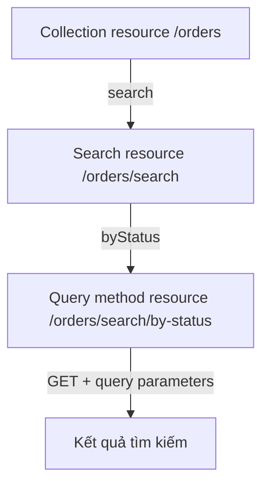

# Search sort

Spring Data REST công bố các phương thức truy vấn của repository dưới dạng search resources. Mỗi phương thức tìm kiếm có một link riêng trong resource `search`; client theo link đó để thực hiện truy vấn. Nếu finder method hỗ trợ phân trang, client còn có thể gửi tiêu chí sắp xếp qua tham số `sort`.

Khi xây dựng controller hoặc service tích hợp với các repository đã được Spring Data REST export, Spring Data REST cung cấp `RepositoryEntityLinks` để tạo link tới search resource. Các overload nhận `Sort` hoặc `Pageable` giúp đưa tiêu chí sắp xếp vào link được tạo. Nhờ vậy, link công bố cho client đã thể hiện thứ tự kết quả mong muốn và vẫn tuân theo mapping repository mà Spring Data REST quản lý.

## Mục tiêu

Sau bài học, bạn có thể:

- Giải thích search resource và query method resource trong Spring Data REST.
- Khai báo finder method hỗ trợ `Pageable` để cho phép sắp xếp kết quả tìm kiếm.
- Dùng `RepositoryEntityLinks.linkToSearchResource()` để tạo link cho một finder cụ thể.
- Dùng `linksToSearchResources()` để lấy link của tất cả finder trong repository.
- Truyền `Sort` hoặc `Pageable` để pre-expand thông tin sort trong link.
- Kiểm tra relation, URI template và kết quả sort của query method resource.
- Nhận biết các giới hạn khi sắp xếp theo thuộc tính domain.

## Search resource và query method resource

Spring Data REST tạo collection resource cho repository được export. Nếu repository có các query method được export, collection resource cung cấp link `search` tới search resource. Search resource trả về danh sách link tới từng query method resource. Search resource và query method resource là tài nguyên chỉ đọc, được truy cập bằng HTTP `GET`.

Luồng điều hướng có dạng:



Ví dụ repository có finder tìm đơn hàng theo trạng thái:

```java
import org.springframework.data.domain.Page;
import org.springframework.data.domain.Pageable;
import org.springframework.data.repository.PagingAndSortingRepository;
import org.springframework.data.repository.query.Param;
import org.springframework.data.rest.core.annotation.RepositoryRestResource;
import org.springframework.data.rest.core.annotation.RestResource;

@RepositoryRestResource(path = "orders", collectionResourceRel = "orders")
public interface OrderRepository
        extends PagingAndSortingRepository<Order, Long> {

    @RestResource(path = "by-status", rel = "byStatus")
    Page<Order> findByStatus(
        @Param("status") String status,
        Pageable pageable
    );
}
```

Trong ví dụ:

- Repository được export tại collection resource `/orders`.
- Search resource nằm tại `/orders/search`.
- `@RestResource(path = "by-status", rel = "byStatus")` đặt path và relation của finder.
- Finder trả về `Page<Order>` và nhận `Pageable`, do đó query method resource hỗ trợ phân trang và sort.
- `@Param("status")` công bố tên query parameter dùng để truyền trạng thái.

Client có thể khám phá finder từ search resource thay vì tự suy ra path:

```http
GET /orders/search
Accept: application/hal+json
```

Response HAL minh họa:

```json
{
  "_links": {
    "byStatus": {
      "href": "https://api.example.test/orders/search/by-status{?status,page,size,sort}",
      "templated": true
    }
  }
}
```

Tên relation và path trong response đến từ mapping của repository. URI template cho biết client có thể cung cấp `status`, `page`, `size` và `sort`. Hình thức template cụ thể phụ thuộc các tham số finder và cấu hình Spring Data REST.

## Cú pháp sort cho query method resource

Với finder hỗ trợ phân trang, Spring Data REST nhận các tham số:

| Tham số | Ý nghĩa |
|---|---|
| `page` | Số trang, bắt đầu từ `0` |
| `size` | Số phần tử mỗi trang |
| `sort` | Một hoặc nhiều tiêu chí sắp xếp |

Một tiêu chí sort có dạng `property,direction`, trong đó direction là `asc` hoặc `desc`. Ví dụ:

```http
GET /orders/search/by-status?status=NEW&sort=createdAt,desc
```

Có thể gửi nhiều tham số `sort` để sắp xếp theo nhiều thuộc tính:

```http
GET /orders/search/by-status?status=NEW&sort=createdAt,desc&sort=id,asc
```

Ví dụ trên sắp xếp đơn hàng mới nhất trước. Nếu nhiều đơn hàng có cùng thời điểm tạo, `id` tăng dần được dùng làm tiêu chí phụ để tạo thứ tự ổn định hơn.

Query method phải hỗ trợ `Pageable` để Spring Data REST công bố khả năng phân trang và các tham số `page`, `size`, `sort`. Một finder chỉ nhận tham số tìm kiếm thông thường và trả `List<T>` không tự động có hợp đồng phân trang/sort này.

## Tạo link tìm kiếm có sort bằng RepositoryEntityLinks

`RepositoryEntityLinks` là thành phần của Spring Data REST, triển khai `EntityLinks` và hiểu mapping của các repository được export. Dùng nó khi cần tạo link tới tài nguyên do Spring Data REST quản lý, đặc biệt là search resources.

Spring Data REST cung cấp hai nhóm phương thức:

| Phương thức | Kết quả |
|---|---|
| `linkToSearchResource(type, relation)` | Link tới finder có relation được chỉ định |
| `linkToSearchResource(type, relation, Sort)` | Link tới finder, pre-expand các biến sort nếu finder hỗ trợ |
| `linkToSearchResource(type, relation, Pageable)` | Link tới finder, pre-expand thông tin phân trang và sort nếu có |
| `linksToSearchResources(type)` | Tập hợp link tới tất cả finder được export |
| `linksToSearchResources(type, Sort)` | Tập hợp link finder với thông tin sort được pre-expand nếu áp dụng |
| `linksToSearchResources(type, Pageable)` | Tập hợp link finder với thông tin phân trang và sort được pre-expand nếu áp dụng |

Ví dụ tạo link tới finder `byStatus` với đơn hàng mới nhất trước:

```java
import org.springframework.data.domain.Sort;
import org.springframework.data.rest.webmvc.support.RepositoryEntityLinks;
import org.springframework.hateoas.Link;
import org.springframework.hateoas.LinkRelation;
import org.springframework.stereotype.Component;

@Component
class OrderSearchLinks {

    private final RepositoryEntityLinks entityLinks;

    OrderSearchLinks(RepositoryEntityLinks entityLinks) {
        this.entityLinks = entityLinks;
    }

    Link newestByStatus() {
        Sort sort = Sort.by(
            Sort.Order.desc("createdAt"),
            Sort.Order.asc("id")
        );

        return entityLinks.linkToSearchResource(
            Order.class,
            LinkRelation.of("byStatus"),
            sort
        );
    }
}
```

`LinkRelation.of("byStatus")` phải khớp với relation mà finder công bố qua `@RestResource(rel = "byStatus")`. `Sort` mô tả thứ tự mong muốn; `RepositoryEntityLinks` dùng metadata repository để tìm search resource và tạo URI theo mapping hiện hành.

Relation truyền vào phải ánh xạ tới một finder được export. Nếu finder bị ẩn hoặc relation không khớp mapping, link search tương ứng không thể được tạo như mong muốn. Một số overload được đánh dấu nullable trong API; hãy kiểm tra chữ ký của phiên bản Spring Data REST đang dùng và xử lý kết quả nullable trước khi thêm link vào model. Lỗi thường gặp là truyền tên method Java như `findByStatus` trong khi relation đã được tùy chỉnh thành `byStatus`.

### Dependency và bean RepositoryEntityLinks

Với ứng dụng Spring Boot dùng Spring Data REST và JPA, có thể thêm các starter tương ứng:

```groovy
dependencies {
    implementation 'org.springframework.boot:spring-boot-starter-data-rest'
    implementation 'org.springframework.boot:spring-boot-starter-data-jpa'
}
```

Spring Boot auto-configure Spring Data REST và cung cấp `RepositoryEntityLinks` trong application context. Có thể inject bean này qua constructor như ví dụ trên. Nếu dùng một Spring Data store khác, thay starter JPA bằng starter của store đó.

## Pre-expand sort có nghĩa là gì?

Một link tới query method resource có thể là URI template vì finder cần tham số tìm kiếm hoặc tham số phân trang. Khi truyền `Sort` vào `linkToSearchResource()`, Spring Data REST dùng đối tượng sort để pre-expand các template variable tương ứng nếu có.

Ví dụ sort:

```java
Sort sort = Sort.by(
    Sort.Order.desc("createdAt"),
    Sort.Order.asc("id")
);

Link link = entityLinks.linkToSearchResource(
    Order.class,
    LinkRelation.of("byStatus"),
    sort
);
```

Với finder có tham số `status`, link vẫn có thể là template cho giá trị `status`, trong khi các chỉ thị sort đã được đưa vào URI. Response có thể có hình thức tương tự:

```json
{
  "_links": {
    "byStatus": {
      "href": "https://api.example.test/orders/search/by-status{?status,page,size}&sort=createdAt,desc&sort=id,asc",
      "templated": true
    }
  }
}
```

Đây là ví dụ minh họa cấu trúc, không phải chuỗi URI cố định cho mọi phiên bản hoặc cấu hình. Thứ tự tham số, cách encode dấu phẩy và các biến còn lại phụ thuộc template variable provider và cấu hình Spring Data REST. Hãy kiểm tra `href` thực tế trong ứng dụng.

Pre-expand sort giúp server công bố thứ tự đã chọn trong link. Client vẫn cần cung cấp các biến tìm kiếm còn thiếu như `status`; nó không phải gửi lại sort đã được đưa vào link. Nếu API muốn client tự chọn sort động, có thể công bố template chưa pre-expand bằng phương thức không nhận `Sort`.

## Dùng Pageable khi cần cả page, size và sort

Nếu muốn tạo link đã xác định cả trang, kích thước trang và thứ tự sắp xếp, dùng overload nhận `Pageable`:

```java
import org.springframework.data.domain.PageRequest;
import org.springframework.data.domain.Pageable;
import org.springframework.data.domain.Sort;
import org.springframework.hateoas.Link;
import org.springframework.hateoas.LinkRelation;

Sort sort = Sort.by(
    Sort.Order.desc("createdAt"),
    Sort.Order.asc("id")
);

Pageable pageable = PageRequest.of(0, 25, sort);

Link firstPage = entityLinks.linkToSearchResource(
    Order.class,
    LinkRelation.of("byStatus"),
    pageable
);
```

Overload `Pageable` hữu ích khi link cần mang theo một trạng thái truy vấn đầy đủ hơn. Nó pre-expand các template variable phân trang và sort mà finder hỗ trợ. Các tham số finder như `status` vẫn có thể là biến template để client cung cấp.

Nếu chỉ muốn gắn thứ tự sort mà không cố định trang và kích thước trang, overload nhận `Sort` diễn đạt ý định rõ hơn. Nếu muốn link cho trang đầu với size cụ thể và sort cụ thể, dùng `Pageable`.

## Lấy tất cả search links đã gắn sort

Một repository có thể có nhiều finder:

```java
@RestResource(path = "by-status", rel = "byStatus")
Page<Order> findByStatus(@Param("status") String status, Pageable pageable);

@RestResource(path = "by-customer", rel = "byCustomer")
Page<Order> findByCustomerEmail(
    @Param("email") String email,
    Pageable pageable
);
```

Nếu muốn công bố mọi search link của repository cùng một tiêu chí sort, dùng `linksToSearchResources()`:

```java
import org.springframework.data.domain.Sort;
import org.springframework.data.rest.webmvc.support.RepositoryEntityLinks;
import org.springframework.hateoas.Links;

class OrderSearchNavigation {

    private final RepositoryEntityLinks entityLinks;

    OrderSearchNavigation(RepositoryEntityLinks entityLinks) {
        this.entityLinks = entityLinks;
    }

    Links searchesByNewest() {
        Sort sort = Sort.by(
            Sort.Order.desc("createdAt"),
            Sort.Order.asc("id")
        );

        return entityLinks.linksToSearchResources(Order.class, sort);
    }
}
```

Kết quả là `Links` chứa các link tới những finder được export của `OrderRepository`. Những finder hỗ trợ sort có thể được pre-expand theo sort được truyền vào; finder không có khả năng phân trang/sort không tự có thêm khả năng đó chỉ vì caller truyền `Sort`.

Nếu chỉ cần một finder, dùng `linkToSearchResource()` sẽ diễn đạt rõ relation cần tìm và tránh phải lọc lại toàn bộ tập link.

## Đưa search links vào representation

Có thể gắn search links vào một representation của ứng dụng, chẳng hạn một trang điều hướng đơn hàng:

```java
import java.util.List;

import org.springframework.data.domain.Sort;
import org.springframework.data.rest.webmvc.support.RepositoryEntityLinks;
import org.springframework.hateoas.CollectionModel;
import org.springframework.hateoas.Links;
import org.springframework.web.bind.annotation.GetMapping;
import org.springframework.web.bind.annotation.RestController;

@RestController
class OrderNavigationController {

    private final RepositoryEntityLinks entityLinks;

    OrderNavigationController(RepositoryEntityLinks entityLinks) {
        this.entityLinks = entityLinks;
    }

    @GetMapping("/order-search-options")
    CollectionModel<Object> searchOptions() {
        Sort newestFirst = Sort.by(
            Sort.Order.desc("createdAt"),
            Sort.Order.asc("id")
        );

        Links searchLinks =
            entityLinks.linksToSearchResources(Order.class, newestFirst);

        return CollectionModel.of(List.of(), searchLinks);
    }
}
```

Representation trên chỉ minh họa việc gắn các link finder vào một resource điều hướng. Trong ứng dụng thực tế, có thể dùng một model riêng chứa mô tả các lựa chọn tìm kiếm và thêm các link vào model đó. Controller này không thay thế search resource do Spring Data REST tự xuất bản; nó chỉ tái sử dụng link tới các finder đã được export.

## Cấu hình và giới hạn của finder

Để search sort hoạt động, cần kiểm tra các điều kiện:

1. Repository được Spring Data REST export.
2. Finder method được export và có relation đúng.
3. Finder nhận `Pageable` hoặc có khả năng phân trang tương đương.
4. Thuộc tính dùng trong `Sort` là property hợp lệ của domain model.
5. Repository implementation hỗ trợ truy vấn phân trang và sắp xếp.

Spring Data REST cho phép tùy chỉnh path và relation qua `@RestResource`. Nếu method được đánh dấu `exported = false`, finder không xuất hiện trong search resource và `RepositoryEntityLinks` không thể tạo link tới finder đó.

Ví dụ:

```java
@RestResource(path = "by-status", rel = "byStatus")
Page<Order> findByStatus(
    @Param("status") String status,
    Pageable pageable
);
```

Nếu bỏ `Pageable`:

```java
@RestResource(path = "by-status", rel = "byStatus")
List<Order> findByStatus(@Param("status") String status);
```

Finder thứ hai không khai báo khả năng phân trang qua `Pageable`, vì vậy không nên kỳ vọng query method resource có đầy đủ tham số `page`, `size` và `sort`. Chọn kiểu trả về và chữ ký method theo khả năng mà API cần công bố.

### Chỉ cho phép sort theo property phù hợp

Spring Data REST dùng tên property trong domain model để tạo sort. Có thể sắp xếp theo property cấp cao nhất và property lồng nhau bằng property path. Không thể dùng một association link như thể nó là trường scalar có thể sort.

Ví dụ:

```http
GET /orders/search/by-status?status=NEW&sort=createdAt,desc
```

Nếu `customer` là association tới một resource khác, không nên mặc định `sort=customer,asc` sẽ sắp xếp theo nội dung của resource liên kết. Nếu cần sort theo thuộc tính của đối tượng liên quan, xác định property path được persistence layer hỗ trợ và kiểm tra truy vấn thực tế.

Đối với API công khai, nên giới hạn các property được hỗ trợ sort và tài liệu hóa chúng. Điều này giúp tránh để client phụ thuộc vào tên field nội bộ hoặc yêu cầu database sắp xếp trên các cột không phù hợp.

## Kiểm thử search sort

Kiểm thử tích hợp nên xác nhận search resource công bố finder, query method resource nhận nhiều tiêu chí sort và kết quả được trả theo thứ tự mong muốn.

Ví dụ request tìm đơn hàng theo trạng thái:

```http
GET /orders/search/by-status?status=NEW&sort=createdAt,desc&sort=id,asc
Accept: application/hal+json
```

Kiểm thử search resource có thể xác nhận relation finder:

```java
import static org.springframework.test.web.servlet.request.MockMvcRequestBuilders.get;
import static org.springframework.test.web.servlet.result.MockMvcResultMatchers.jsonPath;
import static org.springframework.test.web.servlet.result.MockMvcResultMatchers.status;

import org.junit.jupiter.api.Test;
import org.springframework.beans.factory.annotation.Autowired;
import org.springframework.boot.test.autoconfigure.web.servlet.AutoConfigureMockMvc;
import org.springframework.boot.test.context.SpringBootTest;
import org.springframework.hateoas.MediaTypes;
import org.springframework.test.web.servlet.MockMvc;

@SpringBootTest
@AutoConfigureMockMvc
class OrderSearchResourceTest {

    @Autowired
    MockMvc mockMvc;

    @Test
    void exposesByStatusFinder() throws Exception {
        mockMvc.perform(get("/orders/search").accept(MediaTypes.HAL_JSON))
            .andExpect(status().isOk())
            .andExpect(jsonPath("$._links.byStatus.href").exists());
    }
}
```

Để kiểm tra sort thực sự, chuẩn bị một số đơn hàng có `createdAt` khác nhau và gọi query method resource với hai tham số `sort`. Sau đó xác nhận phần tử đầu tiên có thời điểm tạo mới nhất; nếu thời điểm bằng nhau, xác nhận thứ tự theo `id`. Dữ liệu kiểm thử cần được cô lập hoặc xóa sau mỗi test để tránh phụ thuộc thứ tự chạy.

Khi kiểm tra link được tạo bởi `RepositoryEntityLinks`, nên phân tích URI và query parameters thay vì so sánh toàn bộ chuỗi `href`. Cách này tránh test bị phụ thuộc thứ tự tham số hoặc cách percent-encode dấu phẩy.

## Lỗi thường gặp

| Lỗi | Hệ quả | Cách xử lý |
|---|---|---|
| Finder không nhận `Pageable` nhưng kỳ vọng có sort | Query method resource không công bố khả năng phân trang/sort như mong đợi | Thêm `Pageable` và kiểu trả về `Page<T>` hoặc kiểu hỗ trợ phù hợp |
| Dùng tên method Java thay cho relation tùy chỉnh | `linkToSearchResource()` không tìm thấy finder | Truyền `LinkRelation` khớp `@RestResource(rel = "...")` |
| Tự ghép path `/search/...` | Link hỏng khi đổi repository path hoặc finder path | Dùng `RepositoryEntityLinks` |
| Nghĩ truyền `Sort` sẽ tạo sort cho mọi finder | Finder không hỗ trợ paging/sort vẫn không có khả năng đó | Kiểm tra chữ ký finder và URI template được công bố |
| Nhầm overload `Sort` với `Pageable` | Link thiếu trạng thái page hoặc size mong muốn | Dùng `Sort` cho thứ tự; dùng `Pageable` khi cần cả page, size và sort |
| Bỏ qua kết quả nullable của `linkToSearchResource()` | Có thể thêm link null hoặc gây lỗi runtime | Kiểm tra relation và xử lý trường hợp finder không được export |
| Sort theo association như sort một field thông thường | Query có thể lỗi hoặc không mang nghĩa mong muốn | Dùng property path được hỗ trợ và xác minh truy vấn |
| So sánh toàn bộ href trong test | Test dễ vỡ khi thứ tự/encoding query thay đổi | Parse URI và kiểm tra từng query parameter |

## Ghi nhớ

Spring Data REST tạo search resource để client khám phá các finder được export. Finder nhận `Pageable` có thể hỗ trợ `page`, `size` và nhiều tham số `sort`. `RepositoryEntityLinks.linkToSearchResource()` tạo link tới một finder theo domain type và relation; overload nhận `Sort` pre-expand thứ tự sắp xếp, còn overload nhận `Pageable` có thể pre-expand cả thông tin phân trang. `linksToSearchResources()` tạo link cho tất cả finder của repository. Hãy dùng relation đúng với `@RestResource`, kiểm tra finder có hỗ trợ phân trang, giới hạn property sort hợp lệ và kiểm thử query parameters trên link thực tế.

## Tài liệu tham khảo

- [Spring Data REST – Repository resources and search resources](https://docs.spring.io/spring-data/rest/reference/repository-resources.html)
- [Spring Data REST – Programmatic links](https://docs.spring.io/spring-data/rest/reference/integration.html)
- [RepositoryEntityLinks API](https://docs.spring.io/spring-data/rest/reference/api/java/org/springframework/data/rest/webmvc/support/RepositoryEntityLinks.html)
- [Spring Data Commons – Pageable and Sort web support](https://docs.spring.io/spring-data/commons/reference/repositories/core-extensions-web.html)
