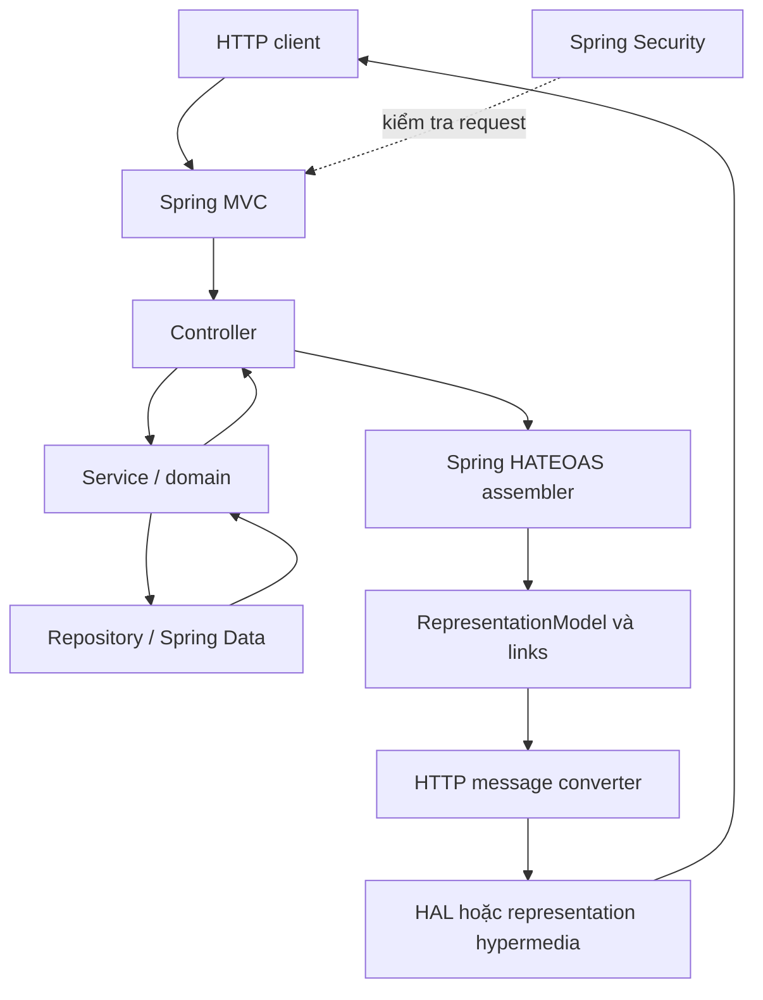

# Vị trí trong Spring

## Mục tiêu

Spring HATEOAS là thư viện trong hệ sinh thái Spring giúp ứng dụng xây dựng REST API theo hướng hypermedia. Thư viện cung cấp mô hình representation có thể mang liên kết, công cụ tạo URI từ mapping của controller, assembler chuyển dữ liệu miền thành representation và tích hợp để tuần tự hóa các mô hình đó thành định dạng như HAL.

Spring HATEOAS đứng ở ranh giới giữa lớp xử lý HTTP và phần representation mà client nhận được. Nó giúp ứng dụng mô tả tài nguyên và những bước client có thể đi tiếp bằng các liên kết trong response. Nó không thay thế Spring MVC, Spring Boot, tầng nghiệp vụ, tầng truy cập dữ liệu hay Spring Security.

Sau bài học, bạn có thể:

- Xác định trách nhiệm của Spring HATEOAS trong một ứng dụng Spring REST.
- Phân biệt Spring HATEOAS với Spring MVC, Spring Boot và Spring Data REST.
- Tổ chức controller, service, assembler và representation model theo trách nhiệm rõ ràng.
- Cấu hình hỗ trợ hypermedia và trả representation HAL từ controller.
- Kiểm thử các liên kết trong response để bảo vệ hợp đồng API.

## Spring HATEOAS nằm ở đâu trong kiến trúc ứng dụng?

Một ứng dụng REST trên Spring thường có các phần sau:

| Thành phần | Trách nhiệm chính |
|---|---|
| Spring Boot | Tạo nền tảng ứng dụng, quản lý cấu hình và tự động cấu hình các thành phần khi có dependency phù hợp. |
| Spring MVC | Nhận HTTP request, ánh xạ URL và method vào controller, chuyển đổi request/response và quản lý HTTP status, header. |
| Controller | Điều phối request, gọi use case hoặc service, chọn status và trả kết quả cho tầng web. |
| Service / domain | Thực hiện quy tắc nghiệp vụ, kiểm tra trạng thái và quyền thực hiện hành động trong phạm vi ứng dụng. |
| Spring Data / repository | Truy vấn và lưu dữ liệu. |
| Spring HATEOAS | Biểu diễn tài nguyên, gắn link relation, tạo liên kết từ mapping và hỗ trợ chuyển model thành representation hypermedia. |
| Spring Security | Xác thực người gọi và thực thi quyền truy cập vào endpoint hoặc dữ liệu. |

Luồng xử lý tổng quát:



Spring Security kiểm soát ai được phép gọi endpoint. Spring HATEOAS giúp response chỉ ra các liên kết phù hợp với representation được tạo. Việc ẩn một link theo trạng thái hoặc quyền có thể cải thiện trải nghiệm điều hướng, nhưng không thay thế kiểm tra quyền ở server. Client có thể tự tạo request đến URI đã biết; endpoint vẫn phải xác thực và phân quyền ở mọi lần gọi.

### Spring HATEOAS và Spring MVC

Spring MVC cung cấp cơ chế web: `@RestController`, `@GetMapping`, `@PostMapping`, `ResponseEntity`, `HttpMessageConverter` và các thành phần xử lý request. Spring HATEOAS bổ sung cách xây dựng nội dung hypermedia để controller trả về.

Ví dụ, controller có thể trả một DTO thuần, khi đó response chỉ có dữ liệu. Khi trả `EntityModel<OrderResponse>`, response có thể bao gồm DTO cùng `_links`. Với `CollectionModel` hoặc `PagedModel`, ứng dụng có thể mô tả collection và các liên kết điều hướng giữa các trang.

Spring HATEOAS tận dụng mapping của Spring MVC để tạo link tới handler method. Vì vậy, khi đường dẫn được thay đổi trong annotation của controller, link được tạo từ mapping có thể tiếp tục phản ánh đường dẫn mới mà code assembler không cần ghép chuỗi URL thủ công.

### Spring HATEOAS và Spring Boot

Spring Boot giúp đưa Spring HATEOAS vào ứng dụng thuận tiện hơn thông qua starter và auto-configuration. Với ứng dụng Spring Boot dùng Spring MVC, dependency thường dùng là:

```groovy
dependencies {
    implementation("org.springframework.boot:spring-boot-starter-web")
    implementation("org.springframework.boot:spring-boot-starter-hateoas")
}
```

Hoặc với Maven:

```xml
<dependency>
    <groupId>org.springframework.boot</groupId>
    <artifactId>spring-boot-starter-hateoas</artifactId>
</dependency>
```

Khi dùng Spring Boot dependency management, nên để BOM của phiên bản Spring Boot quản lý phiên bản tương thích thay vì tự chọn một phiên bản Spring HATEOAS khác. Starter đưa thư viện và các tích hợp cần thiết vào classpath; auto-configuration của Boot thiết lập hỗ trợ hypermedia phù hợp với môi trường ứng dụng.

Trong ứng dụng Spring Framework không dùng Boot, có thể khai báo dependency `org.springframework.hateoas:spring-hateoas` và bật hỗ trợ hypermedia rõ ràng trong cấu hình. Ví dụ cấu hình HAL:

```java
import org.springframework.context.annotation.Configuration;
import org.springframework.hateoas.config.EnableHypermediaSupport;
import org.springframework.hateoas.config.HypermediaType;

@Configuration
@EnableHypermediaSupport(type = HypermediaType.HAL)
class HypermediaConfiguration {
}
```

Trong ứng dụng Boot đã có auto-configuration cho HATEOAS, thông thường không cần thêm cấu hình này chỉ để bật HAL. Tránh khai báo cấu hình trùng lặp nếu ứng dụng đã được cấu hình theo cách Boot hỗ trợ.

## Các kiểu model mà Spring HATEOAS cung cấp

Spring HATEOAS tách dữ liệu ứng dụng khỏi cấu trúc hypermedia bằng các kiểu model chuyên dụng:

| Kiểu | Vai trò |
|---|---|
| `RepresentationModel<T>` | Lớp cơ sở cho representation có thể mang một tập `Link`. |
| `EntityModel<T>` | Bọc một đối tượng nội dung cùng các link của tài nguyên đó. |
| `CollectionModel<T>` | Biểu diễn một collection các representation và các link ở cấp collection. |
| `PagedModel<T>` | Biểu diễn collection có thông tin phân trang và các link điều hướng trang. |
| `Link` | Mô tả một liên kết với URI và quan hệ (`rel`) cùng các thuộc tính link liên quan. |

Ví dụ, một `EntityModel<OrderResponse>` có thể chứa thông tin trạng thái đơn hàng và link `self`, `collection`, `cancel`. Một `CollectionModel<EntityModel<OrderResponse>>` có thể chứa danh sách đơn hàng và link tới collection. Một `PagedModel` còn có thể mang các link `first`, `prev`, `self`, `next` và `last` tùy trang hiện tại.

Các link được gắn bằng quan hệ. `self` là quan hệ chuẩn thường dùng cho chính tài nguyên; `collection` biểu thị collection liên quan; `next` và `prev` mô tả điều hướng. Ứng dụng cũng có thể dùng quan hệ tùy chỉnh như `cancel` hoặc `approve`. Tên quan hệ cần ổn định và có ý nghĩa rõ ràng để client có thể dựa vào chúng thay vì phụ thuộc vào đường dẫn cố định.

## Phân chia trách nhiệm giữa controller và assembler

Một cách tổ chức dễ duy trì là để service xử lý nghiệp vụ, assembler chuyển đối tượng miền thành representation và controller xử lý giao thức HTTP. Assembler không nên trở thành nơi thực hiện nghiệp vụ hoặc truy vấn dữ liệu tùy tiện.

Ví dụ sau minh họa assembler tạo link dựa trên mapping của controller. Các kiểu `Order`, `OrderService` và `OrderResponse` là những thành phần miền/DTO của ứng dụng mẫu.

```java
import org.springframework.hateoas.EntityModel;
import org.springframework.hateoas.IanaLinkRelations;
import org.springframework.hateoas.server.RepresentationModelAssembler;
import org.springframework.stereotype.Component;

import static org.springframework.hateoas.server.mvc.WebMvcLinkBuilder.linkTo;
import static org.springframework.hateoas.server.mvc.WebMvcLinkBuilder.methodOn;

@Component
class OrderModelAssembler
        implements RepresentationModelAssembler<Order, EntityModel<OrderResponse>> {

    @Override
    public EntityModel<OrderResponse> toModel(Order order) {
        EntityModel<OrderResponse> model = EntityModel.of(OrderResponse.from(order));

        model.add(linkTo(methodOn(OrderController.class)
                .findById(order.getId())).withSelfRel());

        model.add(linkTo(methodOn(OrderController.class)
                .findAll()).withRel(IanaLinkRelations.COLLECTION));

        if (order.canBeCancelled()) {
            model.add(linkTo(methodOn(OrderController.class)
                    .cancel(order.getId())).withRel("cancel"));
        }

        return model;
    }
}
```

`RepresentationModelAssembler` định nghĩa một cách nhất quán để chuyển domain object thành representation. `linkTo(methodOn(...))` tham chiếu tới handler method của controller; `methodOn` tạo lời gọi giả lập để Spring HATEOAS xác định mapping, chứ không thực thi phương thức controller đó. `withSelfRel()` gắn quan hệ `self`; `withRel("cancel")` gắn quan hệ tùy chỉnh.

Việc chỉ thêm link `cancel` khi đơn hàng có thể hủy giúp representation phản ánh trạng thái hiện tại của tài nguyên. Tuy nhiên, `cancel` vẫn phải kiểm tra trạng thái và quyền ở service/controller khi client thực hiện request. Link là chỉ dẫn điều hướng, không phải vé thông hành để bỏ qua bảo vệ nghiệp vụ.

Controller có thể dùng assembler như sau:

```java
import java.util.UUID;

import org.springframework.hateoas.CollectionModel;
import org.springframework.hateoas.EntityModel;
import org.springframework.http.ResponseEntity;
import org.springframework.web.bind.annotation.GetMapping;
import org.springframework.web.bind.annotation.PathVariable;
import org.springframework.web.bind.annotation.PostMapping;
import org.springframework.web.bind.annotation.RequestMapping;
import org.springframework.web.bind.annotation.RestController;

@RestController
@RequestMapping("/api/orders")
class OrderController {

    private final OrderService orderService;
    private final OrderModelAssembler assembler;

    OrderController(OrderService orderService, OrderModelAssembler assembler) {
        this.orderService = orderService;
        this.assembler = assembler;
    }

    @GetMapping("/{id}")
    EntityModel<OrderResponse> findById(@PathVariable UUID id) {
        return assembler.toModel(orderService.findById(id));
    }

    @GetMapping
    CollectionModel<EntityModel<OrderResponse>> findAll() {
        return assembler.toCollectionModel(orderService.findAll());
    }

    @PostMapping("/{id}/cancellation")
    ResponseEntity<Void> cancel(@PathVariable UUID id) {
        orderService.cancel(id);
        return ResponseEntity.noContent().build();
    }
}
```

Controller không tự ghép các URL trong JSON. Assembler chịu trách nhiệm gắn liên kết; Spring HATEOAS tạo URL từ mapping; Spring MVC và HTTP message converter chuyển model thành response. Cách chia này cũng cho phép kiểm thử assembler riêng và kiểm thử endpoint qua MockMvc.

## HAL là định dạng representation, không phải tầng nghiệp vụ

Spring HATEOAS cung cấp mô hình hypermedia và tích hợp với các định dạng representation. HAL là một định dạng phổ biến, biểu diễn liên kết trong thuộc tính `_links` và tài nguyên nhúng trong `_embedded`. Với HAL JSON, media type thường dùng là `application/hal+json`.

Ví dụ response cho một đơn hàng:

```json
{
  "id": "7f2b6c9a-1f5c-4d6d-9f10-1a2b3c4d5e6f",
  "status": "PENDING",
  "_links": {
    "self": {
      "href": "https://api.example.com/api/orders/7f2b6c9a-1f5c-4d6d-9f10-1a2b3c4d5e6f"
    },
    "collection": {
      "href": "https://api.example.com/api/orders"
    },
    "cancel": {
      "href": "https://api.example.com/api/orders/7f2b6c9a-1f5c-4d6d-9f10-1a2b3c4d5e6f/cancellation"
    }
  }
}
```

Client đọc quan hệ `self` để truy cập lại tài nguyên, quan hệ `collection` để điều hướng về danh sách và quan hệ `cancel` để biết hành động hủy đang được cung cấp. Client nên tìm link theo quan hệ thay vì tự suy ra URL từ ID hoặc ghép chuỗi đường dẫn.

Một `Link` thông thường cho biết URI và quan hệ. Nếu API cần mô tả phong phú hơn về thao tác, chẳng hạn HTTP method, trường đầu vào hoặc cấu trúc form, Spring HATEOAS còn hỗ trợ affordance. Định dạng như HAL-FORMS có thể biểu diễn các affordance đó cho client. Hãy chọn định dạng và cấu hình hypermedia tương ứng với hợp đồng mà client cần tiêu thụ; không giả định một link HAL thông thường đã mô tả đầy đủ schema của request.

## Spring HATEOAS khác gì Spring Data REST?

Hai dự án có liên quan nhưng giải quyết hai mức độ khác nhau:

| Spring HATEOAS | Spring Data REST |
|---|---|
| Cung cấp API và abstraction để ứng dụng tự xây representation hypermedia. | Tự động xuất bản REST resource từ Spring Data repository theo quy ước. |
| Thường được dùng trong controller do đội phát triển thiết kế. | Tập trung vào việc đưa repository và tài nguyên liên quan ra HTTP với cấu hình phù hợp. |
| Cho phép kiểm soát chi tiết DTO, use case, link và cấu trúc response. | Giảm lượng controller cần viết cho các trường hợp CRUD theo repository. |
| Không quyết định mô hình lưu trữ hoặc tự xuất bản repository. | Dựa trên Spring Data và sử dụng các khả năng hypermedia của Spring HATEOAS. |

Nếu API có quy trình nghiệp vụ riêng, nhiều trạng thái và hành động theo ngữ cảnh, controller kết hợp service và assembler thường đem lại quyền kiểm soát rõ ràng. Nếu mục tiêu là xuất bản nhanh repository theo quy ước, Spring Data REST có thể phù hợp. Có thể kết hợp các cách tiếp cận trong một hệ thống, nhưng cần thiết kế ranh giới endpoint và representation nhất quán.

## Kiểm thử vị trí và vai trò của hypermedia

Kiểm thử controller nên xác nhận response có media type mong muốn và chứa các link relation cần thiết. Ví dụ với MockMvc:

```java
import static org.springframework.test.web.servlet.request.MockMvcRequestBuilders.get;
import static org.springframework.test.web.servlet.result.MockMvcResultMatchers.content;
import static org.springframework.test.web.servlet.result.MockMvcResultMatchers.jsonPath;
import static org.springframework.test.web.servlet.result.MockMvcResultMatchers.status;

import org.springframework.hateoas.MediaTypes;

mockMvc.perform(get("/api/orders/{id}", orderId)
                .accept(MediaTypes.HAL_JSON))
        .andExpect(status().isOk())
        .andExpect(content().contentTypeCompatibleWith(MediaTypes.HAL_JSON))
        .andExpect(jsonPath("$._links.self.href").exists())
        .andExpect(jsonPath("$._links.collection.href").exists())
        .andExpect(jsonPath("$._links.cancel.href").exists());
```

Nên có thêm trường hợp đơn hàng không thể hủy để xác nhận link `cancel` không xuất hiện. Nếu client phụ thuộc vào quan hệ link, các kiểm thử này bảo vệ hợp đồng điều hướng khi đường dẫn hoặc cấu trúc controller thay đổi.

## Những nhầm lẫn cần tránh

- **Xem Spring HATEOAS là framework thay thế Spring MVC:** Spring MVC tiếp nhận và xử lý HTTP request; Spring HATEOAS xây representation hypermedia để trả về.
- **Đưa nghiệp vụ vào assembler:** assembler chuyển đổi dữ liệu và tạo link. Quy tắc chuyển trạng thái, kiểm tra điều kiện và lưu dữ liệu thuộc service/domain.
- **Coi link là cơ chế phân quyền:** server vẫn phải xác thực và phân quyền khi endpoint được gọi, kể cả khi client không nhận link tới endpoint đó.
- **Ghép URL bằng chuỗi:** cách này dễ sai khi mapping đổi, ứng dụng chạy dưới context path hoặc có cấu hình proxy. Dùng link builder gắn với mapping của Spring.
- **Đồng nhất Spring HATEOAS với Spring Data REST:** một bên là bộ công cụ xây hypermedia; bên kia là cơ chế xuất bản repository thành REST resource theo quy ước.
- **Cho rằng HAL mô tả mọi chi tiết của thao tác:** link HAL cơ bản chủ yếu cho biết URI và quan hệ. Dùng affordance và định dạng hỗ trợ affordance khi client cần biết thêm về thao tác hoặc form.

## Cách xác định Spring HATEOAS có phù hợp

Spring HATEOAS phù hợp khi API muốn client khám phá tài nguyên và hành động tiếp theo qua liên kết do server cung cấp, khi URI có thể thay đổi theo quá trình tiến hóa API, hoặc khi representation cần mô tả điều hướng collection và phân trang. Thư viện đặc biệt hữu ích khi ứng dụng muốn duy trì ranh giới rõ giữa domain object, DTO và representation HTTP.

Nếu API chỉ cần trả JSON đơn giản cho một client nội bộ cố định và không có nhu cầu điều hướng bằng hypermedia, có thể chỉ cần Spring MVC và DTO. Khi chọn HATEOAS, hãy duy trì link relation ổn định, kiểm thử sự hiện diện của các quan hệ quan trọng và bảo đảm mọi endpoint vẫn tự thực thi xác thực, phân quyền cùng quy tắc nghiệp vụ.
