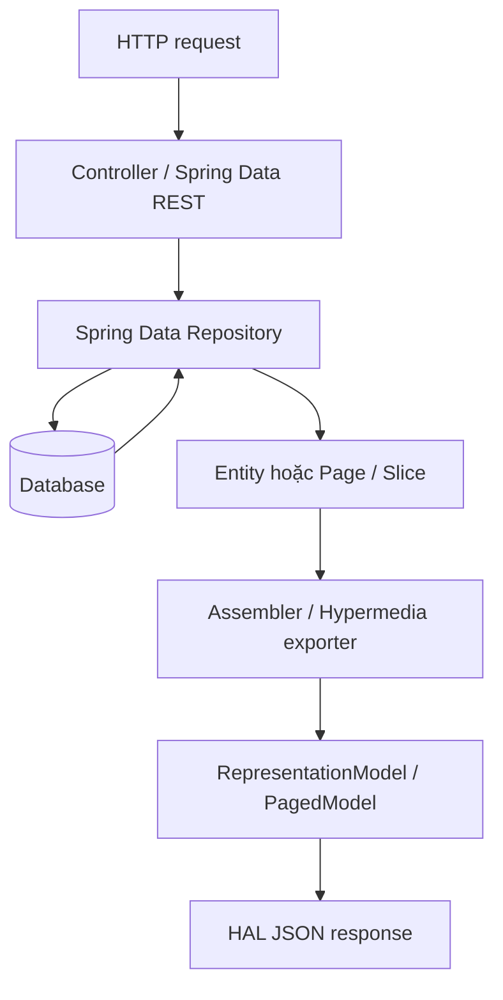

# Tích hợp Spring Data

Spring Data cung cấp các repository để truy vấn và lưu trữ dữ liệu. Spring HATEOAS bổ sung lớp biểu diễn hypermedia để client có thể khám phá tài nguyên và điều hướng qua các liên kết. Khi kết hợp hai công nghệ, ứng dụng có thể lấy dữ liệu từ repository, chuyển kết quả thành mô hình có liên kết và trả về các trang dữ liệu mà client có thể tiếp tục duyệt.

Trong phạm vi **Spring HATEOAS**, bài học này tập trung vào hai cách tích hợp thường gặp:

1. **Controller do ứng dụng quản lý:** dùng Spring Data repository để truy vấn, `RepresentationModelAssembler` để tạo biểu diễn cho từng phần tử và `PagedResourcesAssembler` để tạo mô hình phân trang có liên kết.
2. **Spring Data REST:** xuất repository thành tài nguyên REST có thể khám phá, thường dùng HAL làm định dạng hypermedia mặc định.

Hai cách có thể cùng dùng Spring Data và Spring HATEOAS, nhưng giao quyền kiểm soát API khác nhau. Controller tùy chỉnh phù hợp khi cần điều phối nghiệp vụ và định hình phản hồi chi tiết. Spring Data REST phù hợp khi muốn xuất nhanh các thao tác repository theo quy ước, sau đó tùy biến đường dẫn, quan hệ và biểu diễn.

Sau bài học, bạn có thể:

- Phân biệt vai trò của repository, controller và mô hình hypermedia.
- Chuyển `Page<T>` thành `PagedModel` bằng `PagedResourcesAssembler`.
- Dùng `RepresentationModelAssembler` để giữ cách tạo liên kết nhất quán cho từng phần tử.
- Hiểu cách `Pageable`, `Page`, `Slice` ảnh hưởng tới điều hướng.
- Cấu hình repository export bằng Spring Data REST và điều chỉnh quan hệ liên kết.
- Kiểm thử liên kết, metadata phân trang và các giới hạn của API được sinh từ repository.

## 1. Các lớp trách nhiệm khi tích hợp

Một ứng dụng thường có luồng xử lý như sau:



Mỗi thành phần đảm nhiệm một việc:

| Thành phần | Trách nhiệm |
|---|---|
| Spring Data repository | Truy vấn, phân trang, sắp xếp và lưu dữ liệu. |
| Controller hoặc Spring Data REST | Nhận HTTP request, áp dụng quy tắc nghiệp vụ và chọn kết quả cần trả về. |
| `RepresentationModelAssembler` | Chuyển một đối tượng miền thành mô hình có các liên kết cần thiết. |
| `PagedResourcesAssembler` | Chuyển `Page<T>` thành `PagedModel`, gắn metadata và liên kết trang. |
| Spring HATEOAS / HAL | Tuần tự hóa mô hình thành biểu diễn hypermedia mà client có thể đọc. |

Repository không tự quyết định toàn bộ hợp đồng REST. Ví dụ, `findAll(Pageable)` trả về một `Page<Product>` chứa dữ liệu và thông tin trang; controller quyết định liên kết `self`, `product`, `category` hoặc `purchase` nào cần có trong phản hồi. Khi dùng Spring Data REST, exporter đảm nhiệm phần tạo tài nguyên và liên kết theo quy ước của nó.

## 2. Chuẩn bị dependency và repository

Với controller tùy chỉnh dùng Spring MVC, Spring Data JPA và Spring HATEOAS, có thể bắt đầu bằng các starter sau. Ví dụ dùng Maven và giả định dự án đã kế thừa dependency management của Spring Boot:

```xml
<dependencies>
    <dependency>
        <groupId>org.springframework.boot</groupId>
        <artifactId>spring-boot-starter-web</artifactId>
    </dependency>
    <dependency>
        <groupId>org.springframework.boot</groupId>
        <artifactId>spring-boot-starter-data-jpa</artifactId>
    </dependency>
    <dependency>
        <groupId>org.springframework.boot</groupId>
        <artifactId>spring-boot-starter-hateoas</artifactId>
    </dependency>
</dependencies>
```

Nếu muốn xuất repository trực tiếp bằng Spring Data REST, thêm `spring-boot-starter-data-rest`. Cần có driver cơ sở dữ liệu phù hợp với hệ thống đang dùng. Hãy để Spring Boot quản lý phiên bản tương thích giữa Spring Data, Spring HATEOAS và Spring Framework; tránh tự nâng riêng một thư viện mà không kiểm tra bộ phiên bản.

Ví dụ một entity và repository:

```java
import java.math.BigDecimal;

import jakarta.persistence.Entity;
import jakarta.persistence.GeneratedValue;
import jakarta.persistence.GenerationType;
import jakarta.persistence.Id;
import jakarta.persistence.Table;

@Entity
@Table(name = "products")
public class Product {

    @Id
    @GeneratedValue(strategy = GenerationType.IDENTITY)
    private Long id;

    private String name;
    private BigDecimal price;

    protected Product() {
    }

    public Product(String name, BigDecimal price) {
        this.name = name;
        this.price = price;
    }

    public Long getId() {
        return id;
    }

    public String getName() {
        return name;
    }

    public BigDecimal getPrice() {
        return price;
    }
}
```

```java
import org.springframework.data.jpa.repository.JpaRepository;

public interface ProductRepository extends JpaRepository<Product, Long> {
}
```

`JpaRepository` kế thừa các khả năng repository cơ bản và hỗ trợ truy vấn phân trang qua `Pageable`. Với hệ lưu trữ khác, có thể dùng repository tương ứng của Spring Data; phần tích hợp hypermedia ở tầng web vẫn theo cùng ý tưởng.

## 3. Chuyển một entity thành mô hình hypermedia

Khi tự viết controller, nên tách logic tạo liên kết khỏi phần truy vấn. `RepresentationModelAssembler<T, D>` định nghĩa cách chuyển một đối tượng kiểu `T` thành mô hình biểu diễn `D`. Với một sản phẩm, assembler có thể thêm liên kết `self` và liên kết tới tập hợp sản phẩm.

```java
import org.springframework.hateoas.EntityModel;
import org.springframework.hateoas.server.RepresentationModelAssembler;
import org.springframework.stereotype.Component;

import static org.springframework.hateoas.server.mvc.WebMvcLinkBuilder.linkTo;
import static org.springframework.hateoas.server.mvc.WebMvcLinkBuilder.methodOn;

@Component
public class ProductModelAssembler
        implements RepresentationModelAssembler<Product, EntityModel<Product>> {

    @Override
    public EntityModel<Product> toModel(Product product) {
        return EntityModel.of(
                product,
                linkTo(methodOn(ProductController.class).one(product.getId()))
                        .withSelfRel(),
                linkTo(ProductController.class).withRel("products")
        );
    }
}
```

`toModel` chỉ tập trung tạo biểu diễn. Nếu quy tắc nghiệp vụ cho phép xem giá, đánh giá hoặc đặt mua theo trạng thái, assembler hoặc một lớp chuyên trách có thể bổ sung các liên kết tương ứng. Hãy giữ quan hệ liên kết ổn định theo ý nghĩa nghiệp vụ để client không phụ thuộc tên class hoặc cấu trúc nội bộ của entity.

Controller có thể dùng cùng assembler cho endpoint chi tiết:

```java
import org.springframework.http.HttpStatus;
import org.springframework.hateoas.EntityModel;
import org.springframework.web.bind.annotation.GetMapping;
import org.springframework.web.bind.annotation.PathVariable;
import org.springframework.web.bind.annotation.RequestMapping;
import org.springframework.web.bind.annotation.RestController;
import org.springframework.web.server.ResponseStatusException;

@RestController
@RequestMapping("/products")
public class ProductController {

    private final ProductRepository repository;
    private final ProductModelAssembler assembler;

    public ProductController(
            ProductRepository repository,
            ProductModelAssembler assembler) {
        this.repository = repository;
        this.assembler = assembler;
    }

    @GetMapping("/{id}")
    public EntityModel<Product> one(@PathVariable Long id) {
        Product product = repository.findById(id)
                .orElseThrow(() -> new ResponseStatusException(HttpStatus.NOT_FOUND));

        return assembler.toModel(product);
    }
}
```

Khi controller và assembler cùng dùng `linkTo(methodOn(...))`, liên kết được dựng từ mapping của controller. Nếu đường dẫn chi tiết sản phẩm thay đổi, nơi tạo liên kết vẫn tham chiếu phương thức `one` thay vì phải tự ghép chuỗi URL.

## 4. Phân trang hypermedia với `PagedResourcesAssembler`

Spring Data thường trả kết quả phân trang dưới dạng `Page<T>`. Đối tượng này chứa nội dung trang, số trang hiện tại, kích thước trang, tổng số phần tử và tổng số trang. Trả trực tiếp `Page` hoặc `PageImpl` qua Jackson khiến cấu trúc JSON phụ thuộc vào lớp triển khai của Spring Data. Với API hypermedia, hãy chuyển `Page` thành `PagedModel`.

Spring Data cung cấp `PagedResourcesAssembler<T>` để thực hiện chuyển đổi này. Tên lớp vẫn giữ chữ `Resources` vì lý do tương thích API, nhưng phương thức `toModel` trả về `org.springframework.hateoas.PagedModel`.

Lưu ý có hai kiểu cùng tên `PagedModel` ở hai package khác nhau. `org.springframework.hateoas.PagedModel` là mô hình của Spring HATEOAS, có thể chứa liên kết điều hướng. Từ Spring Data 3.3, `org.springframework.data.web.PagedModel` cũng được cung cấp như một DTO đơn giản để ổn định cấu trúc tuần tự hóa của `Page`, nhưng DTO này không tự cung cấp các liên kết hypermedia. Nếu mục tiêu là điều hướng qua liên kết, hãy dùng kiểu của Spring HATEOAS.

```java
import org.springframework.data.domain.Page;
import org.springframework.data.domain.Pageable;
import org.springframework.data.web.PageableDefault;
import org.springframework.data.web.PagedResourcesAssembler;
import org.springframework.hateoas.EntityModel;
import org.springframework.hateoas.PagedModel;
import org.springframework.web.bind.annotation.GetMapping;

// Đặt phương thức này bên trong ProductController ở ví dụ trước.
@GetMapping
public PagedModel<EntityModel<Product>> all(
        @PageableDefault(size = 20, sort = "name") Pageable pageable,
        PagedResourcesAssembler<Product> pagedAssembler) {

    Page<Product> page = repository.findAll(pageable);
    return pagedAssembler.toModel(page, assembler);
}
```

Khi gọi `toModel(page, assembler)`, Spring Data và Spring HATEOAS phối hợp để:

1. Chuyển từng `Product` trong trang thành `EntityModel<Product>` bằng assembler đã cung cấp.
2. Gắn `PageMetadata` chứa kích thước trang, số trang, tổng số phần tử và tổng số trang.
3. Tạo các liên kết phân trang như `self`, `prev` và `next` khi phù hợp với vị trí trang.
4. Dùng cấu hình phân giải `Pageable` của ứng dụng để dựng tham số điều hướng nhất quán với request.

Ví dụ request:

```http
GET /products?page=0&size=2&sort=name,asc
Accept: application/hal+json
```

Một phản hồi HAL rút gọn có thể có hình dạng như sau (các trường dữ liệu sản phẩm được lược bớt):

```json
{
  "_embedded": {
    "products": [
      {
        "name": "Keyboard",
        "price": 750000,
        "_links": {
          "self": { "href": "https://api.example.com/products/10" },
          "products": { "href": "https://api.example.com/products" }
        }
      },
      {
        "name": "Monitor",
        "price": 4200000,
        "_links": {
          "self": { "href": "https://api.example.com/products/11" }
        }
      }
    ]
  },
  "_links": {
    "self": { "href": "https://api.example.com/products?page=0&size=2&sort=name,asc" },
    "next": { "href": "https://api.example.com/products?page=1&size=2&sort=name,asc" }
  },
  "page": {
    "size": 2,
    "totalElements": 5,
    "totalPages": 3,
    "number": 0
  }
}
```

Quan hệ trong `_embedded` phụ thuộc cấu hình quan hệ của kiểu biểu diễn. Nếu cần tên ổn định, có thể dùng `@Relation` trên kiểu biểu diễn phù hợp để khai báo `itemRelation` và `collectionRelation`, sau đó kiểm thử tên quan hệ thực tế trong HAL.

`PagedResourcesAssembler` thường được Spring Data Web cấu hình để có thể nhận làm tham số controller. Trong ứng dụng Spring không dùng cấu hình tự động của Spring Boot, có thể bật hỗ trợ web Spring Data bằng `@EnableSpringDataWebSupport`. Nếu cần chỉ định liên kết gốc khác với URI của phương thức hiện tại, dùng overload `toModel(page, assembler, link)` để truyền `Link` phù hợp.

### Tham số phân trang và sắp xếp

Spring Data Web thường ánh xạ các tham số request thành `Pageable`:

| Tham số | Ý nghĩa |
|---|---|
| `page` | Số trang, bắt đầu từ `0` theo cấu hình mặc định. |
| `size` | Số phần tử yêu cầu trong một trang. |
| `sort` | Thuộc tính sắp xếp và chiều sắp xếp, ví dụ `sort=name,asc`. Có thể truyền nhiều tiêu chí. |

`@PageableDefault` đặt giá trị mặc định cho một endpoint. Ứng dụng cũng có thể cấu hình tên tham số, kích thước trang mặc định và giới hạn kích thước tối đa trên resolver. Không nên để client yêu cầu trang quá lớn hoặc sắp xếp tùy ý theo mọi thuộc tính của entity. Hãy giới hạn page size, xác định trường sort được hỗ trợ và cân nhắc chỉ mục cơ sở dữ liệu cho truy vấn thường dùng.

### Chọn `Page` hay `Slice`

`Page<T>` cung cấp tổng số phần tử và tổng số trang. Để tính các giá trị này, truy vấn có thể cần chạy thêm câu lệnh đếm, tùy repository và truy vấn cụ thể. Nếu giao diện chỉ cần biết còn trang tiếp theo hay không, `Slice<T>` thường đủ và tránh yêu cầu tổng số phần tử.

Spring Data hỗ trợ `SlicedResourcesAssembler` để chuyển `Slice<T>` thành `SlicedModel` có liên kết điều hướng phù hợp. Mô hình này tập trung vào trạng thái có trang trước hoặc trang sau, không công bố tổng số trang như `PagedModel`. Hãy chọn loại mô hình dựa trên thông tin client thực sự cần, đặc biệt với tập dữ liệu lớn.

## 5. Tích hợp trực tiếp bằng Spring Data REST

Spring Data REST tự xuất các repository Spring Data thành tài nguyên REST. Với cấu hình mặc định, client có thể bắt đầu từ URL gốc của ứng dụng, đọc các liên kết trong HAL và khám phá collection resource, item resource hoặc search resource. Đây là cách tích hợp HATEOAS ở mức exporter, không cần viết controller CRUD cho từng repository.

Để bật Spring Data REST trong ứng dụng Spring Boot, thêm dependency:

```xml
<dependency>
    <groupId>org.springframework.boot</groupId>
    <artifactId>spring-boot-starter-data-rest</artifactId>
</dependency>
```

Repository có thể khai báo đường dẫn và quan hệ collection:

```java
import org.springframework.data.jpa.repository.JpaRepository;
import org.springframework.data.rest.core.annotation.RepositoryRestResource;

@RepositoryRestResource(
        path = "products",
        collectionResourceRel = "products"
)
public interface ProductRepository extends JpaRepository<Product, Long> {
}
```

Spring Data REST có thể xuất collection tại `/products` và tài nguyên phần tử tại `/products/{id}`. Khi client gọi URL gốc, phản hồi HAL chứa liên kết tới collection. Client đi theo liên kết `products` để lấy danh sách, rồi đi theo `self` của phần tử để xem một sản phẩm cụ thể.

Ví dụ cấu trúc tài nguyên gốc:

```json
{
  "_links": {
    "products": {
      "href": "https://api.example.com/products"
    },
    "profile": {
      "href": "https://api.example.com/api/alps"
    }
  }
}
```

Collection resource của repository hỗ trợ phân trang nếu repository cung cấp khả năng tương ứng. Các tham số `page`, `size` và `sort` được dùng để yêu cầu trang dữ liệu. Spring Data REST tạo liên kết điều hướng và metadata trang trong phản hồi HAL.

### Tùy chỉnh đường dẫn và quan hệ

`path` quyết định URI được xuất; `collectionResourceRel` quyết định tên quan hệ collection mà client nhìn thấy. Hai giá trị này có vai trò khác nhau. Ví dụ `/products` là đường dẫn, còn `products` là quan hệ liên kết. Với query method, có thể dùng `@RestResource` để tùy chỉnh đường dẫn và quan hệ:

```java
import java.util.List;

import org.springframework.data.repository.query.Param;
import org.springframework.data.rest.core.annotation.RestResource;

@RepositoryRestResource(path = "products", collectionResourceRel = "products")
public interface ProductRepository extends JpaRepository<Product, Long> {

    @RestResource(path = "by-name", rel = "by-name")
    List<Product> findByNameContainingIgnoreCase(@Param("name") String name);
}
```

Query resource có thể được khám phá từ liên kết `search` của collection. Client theo liên kết `by-name` và truyền tham số `name` theo hợp đồng. Không nên để client tự đoán URL tìm kiếm từ tên phương thức Java.

### Quan hệ giữa các entity

Với các association như `Product` thuộc một `Category`, Spring Data REST có thể công bố liên kết quan hệ tới tài nguyên liên quan. Client có thể theo liên kết để đọc tài nguyên quan hệ và dùng endpoint association theo các HTTP method mà exporter cho phép để cập nhật liên kết. Tên đường dẫn và quan hệ mặc định dựa trên thuộc tính association; có thể tùy chỉnh bằng `@RestResource`.

Việc có một liên kết association không đồng nghĩa toàn bộ đối tượng liên quan sẽ được nhúng vào phản hồi. HAL thường biểu diễn quan hệ bằng URI trong `_links`, để client chủ động đi theo liên kết khi cần dữ liệu. Nếu muốn thay đổi góc nhìn dữ liệu, hãy cân nhắc projection.

## 6. Projection và excerpt cho biểu diễn Spring Data REST

Repository REST exporter thường biểu diễn entity theo các thuộc tính được xuất. Đôi khi client chỉ cần một phần dữ liệu, ví dụ trang danh sách sản phẩm chỉ cần tên và giá. Spring Data REST hỗ trợ projection để định nghĩa góc nhìn dữ liệu.

```java
import java.math.BigDecimal;

import org.springframework.data.rest.core.config.Projection;

@Projection(name = "summary", types = Product.class)
public interface ProductSummary {
    Long getId();
    String getName();
    BigDecimal getPrice();
}
```

Projection được đánh dấu bằng `@Projection` và khai báo các getter muốn xuất. Có thể dùng query parameter `projection` để yêu cầu góc nhìn đã công bố, hoặc cấu hình excerpt projection cho collection nếu muốn một biểu diễn tóm tắt mặc định. Projection cần được đặt trong package được Spring Data REST quét, thường là cùng package với entity hoặc package con; cũng có thể đăng ký bằng cấu hình.

Projection là một phần của hợp đồng API. Bổ sung hoặc đổi excerpt projection sau khi API đã phát hành có thể làm client nhận một cấu trúc khác. Đặc biệt, cần rà soát dữ liệu nhạy cảm: projection có thể làm lộ thuộc tính mà biểu diễn mặc định đã ẩn bằng cấu hình tuần tự hóa. Không đưa trường bí mật như mật khẩu, token hoặc dữ liệu riêng tư vào projection.

## 7. Chọn giữa controller tùy chỉnh và Spring Data REST

| Tiêu chí | Controller + Spring HATEOAS | Spring Data REST |
|---|---|---|
| Quyền kiểm soát endpoint | Tự định nghĩa method, status code và luồng nghiệp vụ. | Export theo quy ước của repository, có điểm tùy biến. |
| Tạo liên kết | Dùng assembler và `linkTo` theo controller. | Exporter tự tạo liên kết repository, item, search và association. |
| Phân trang | Dùng `Pageable` cùng `PagedResourcesAssembler` hoặc `SlicedResourcesAssembler`. | Exporter tạo phân trang dựa trên khả năng repository. |
| Nghiệp vụ phức tạp | Phù hợp với quy trình nhiều bước, kiểm tra trạng thái và điều phối service. | Phù hợp với CRUD và query resource theo quy ước. |
| Kiểm soát biểu diễn | Có thể thiết kế DTO và relation theo từng use case. | Dùng annotation, projection, excerpt và cấu hình exporter. |

Có thể dùng cả hai trong một ứng dụng, nhưng cần phân định endpoint rõ ràng. Tránh để controller tùy chỉnh và Spring Data REST cùng ánh xạ một đường dẫn hoặc cùng công bố hai hợp đồng khác nhau cho một thao tác. Nếu một repository chỉ phục vụ controller nghiệp vụ, có thể tắt export ở repository bằng `@RepositoryRestResource(exported = false)`.

Spring Data REST có thể tự công bố các thao tác CRUD dựa trên những method repository được export. Hãy quyết định rõ repository nào được phép truy cập qua HTTP và method nào cần ẩn bằng `@RestResource(exported = false)`. Với nghiệp vụ quan trọng, hãy đặt kiểm tra quyền, bất biến và giao dịch trong service/domain layer thay vì dựa vào việc client có nhìn thấy liên kết hay không.

## 8. Kiểm thử tích hợp repository và hypermedia

Khi dùng controller tùy chỉnh, kiểm thử nên xác nhận đồng thời kết quả truy vấn, cấu trúc HAL và các liên kết phân trang. Ví dụ sau giả định ứng dụng đã có dữ liệu kiểm thử với nhiều hơn hai sản phẩm:

```java
import org.junit.jupiter.api.Test;
import org.springframework.beans.factory.annotation.Autowired;
import org.springframework.boot.test.autoconfigure.web.servlet.AutoConfigureMockMvc;
import org.springframework.boot.test.context.SpringBootTest;
import org.springframework.hateoas.MediaTypes;
import org.springframework.test.web.servlet.MockMvc;

import static org.springframework.test.web.servlet.request.MockMvcRequestBuilders.get;
import static org.springframework.test.web.servlet.result.MockMvcResultMatchers.content;
import static org.springframework.test.web.servlet.result.MockMvcResultMatchers.jsonPath;
import static org.springframework.test.web.servlet.result.MockMvcResultMatchers.status;

@SpringBootTest
@AutoConfigureMockMvc
class ProductControllerTest {

    @Autowired
    MockMvc mockMvc;

    @Test
    void productPageContainsItemsMetadataAndNavigationLinks() throws Exception {
        mockMvc.perform(get("/products")
                        .param("page", "0")
                        .param("size", "2")
                        .accept(MediaTypes.HAL_JSON))
                .andExpect(status().isOk())
                .andExpect(content().contentTypeCompatibleWith(MediaTypes.HAL_JSON))
                .andExpect(jsonPath("$._links.self.href").exists())
                .andExpect(jsonPath("$._links.next.href").exists())
                .andExpect(jsonPath("$.page.size").value(2))
                .andExpect(jsonPath("$._embedded.products").isArray());
    }
}
```

Tên quan hệ trong `_embedded` phải khớp cấu hình thực tế của kiểu biểu diễn. Nếu dùng relation tùy chỉnh, hãy cập nhật JSONPath theo hợp đồng đã công bố. Để kiểm thử ổn định, chuẩn bị dữ liệu bằng fixture hoặc repository test setup; không phụ thuộc dữ liệu còn sót lại trong môi trường chạy.

Với Spring Data REST, kiểm thử từ URL gốc giúp xác nhận khả năng khám phá repository:

```java
mockMvc.perform(get("/").accept(MediaTypes.HAL_JSON))
        .andExpect(status().isOk())
        .andExpect(jsonPath("$._links.products.href").exists());
```

Sau đó kiểm tra collection resource, item resource và search resource bằng quan hệ liên kết. Nếu API cho phép cập nhật association hoặc CRUD, kiểm thử cả HTTP method được công bố và các trường hợp bị từ chối do quyền hoặc trạng thái nghiệp vụ.

Các câu hỏi cần trả lời trong một bộ kiểm thử tích hợp:

- Client có thể bắt đầu từ entry point và khám phá collection mà không ghép URL không?
- Mỗi phần tử có liên kết `self` đúng tài nguyên không?
- Trang đầu, trang giữa, trang cuối và trang rỗng có liên kết điều hướng đúng không?
- `page`, `size` và `sort` trong liên kết tiếp theo có giữ cấu hình resolver không?
- Quan hệ collection, query và association có tên ổn định không?
- Projection có chỉ công bố dữ liệu được phép không?
- Những thao tác CRUD nào được công bố, và máy chủ có thực thi xác thực/phân quyền tương ứng không?

## 9. Các lỗi thường gặp khi tích hợp

| Lỗi | Hệ quả | Cách xử lý |
|---|---|---|
| Trả trực tiếp `PageImpl` từ controller | JSON phụ thuộc lớp triển khai Spring Data, khó giữ hợp đồng ổn định. | Chuyển sang `PagedModel` bằng `PagedResourcesAssembler`. |
| Tự dựng URL phân trang bằng chuỗi | Link có thể sai khi đổi base path hoặc cấu hình tham số `Pageable`. | Dùng assembler để tạo link theo request và resolver. |
| Trả entity thô mà không có assembler | Mỗi endpoint có thể tạo relation khác nhau hoặc thiếu `self`. | Dùng `RepresentationModelAssembler` chung cho kiểu tài nguyên. |
| Nhầm `org.springframework.data.web.PagedModel` với `org.springframework.hateoas.PagedModel` | Có thể trả metadata trang mà không có liên kết hypermedia. | Chọn đúng kiểu theo mục tiêu; dùng HATEOAS `PagedModel` cho điều hướng. |
| Cho rằng Spring Data REST chỉ tạo endpoint đọc | Repository có thể tự công bố thao tác tạo, sửa, xóa theo cấu hình và method được export. | Rà soát và giới hạn repository/method được export. |
| Dùng projection mà không kiểm tra dữ liệu nhạy cảm | Trường bị ẩn ở biểu diễn mặc định có thể xuất hiện trở lại. | Kiểm tra từng projection như một phần của hợp đồng công khai. |
| Dùng tổng số trang cho truy vấn lớn dù client không cần | Có thể phát sinh count query tốn kém. | Cân nhắc `Slice` và `SlicedResourcesAssembler`. |
| Xem việc ẩn link là kiểm soát truy cập | Client vẫn có thể gọi URI đã biết hoặc lưu từ trước. | Kiểm tra quyền và trạng thái tại server cho mọi request. |

## 10. Quy trình tích hợp đề xuất

Khi đưa một repository vào API hypermedia, hãy thực hiện theo trình tự:

1. Chọn mô hình công bố API: controller tùy chỉnh hay Spring Data REST.
2. Xác định dữ liệu repository cần trả về và kiểu kết quả `Page`, `Slice` hay một entity đơn.
3. Định nghĩa quan hệ liên kết theo nghiệp vụ và chọn `RepresentationModelAssembler` cho từng kiểu tài nguyên nếu dùng controller.
4. Với phân trang, nhận `Pageable` từ request và chuyển kết quả bằng `PagedResourcesAssembler`; dùng `SlicedResourcesAssembler` nếu không cần tổng số phần tử.
5. Với Spring Data REST, cấu hình đường dẫn, collection relation, query relation, association và projection có chủ đích.
6. Rà soát method repository được export, xác thực, phân quyền và các bất biến nghiệp vụ.
7. Kiểm thử entry point, media type, relation, metadata phân trang và các trạng thái dữ liệu.

Spring Data đảm nhiệm truy vấn và phân trang; Spring HATEOAS định hình cách client khám phá và điều hướng kết quả. Khi hai phần được ghép qua assembler hoặc Spring Data REST exporter, API có thể cung cấp dữ liệu cùng các liên kết phản ánh khả năng hiện tại, trong khi vẫn giữ quyền kiểm soát hợp đồng ở tầng ứng dụng.

## Tài liệu tham khảo

- [Spring Data Commons – Web support và hypermedia cho Page/Slice](https://docs.spring.io/spring-data/commons/reference/repositories/core-extensions-web.html)
- [Spring Data Commons – PagedResourcesAssembler API](https://docs.spring.io/spring-data/commons/docs/current/api/org/springframework/data/web/PagedResourcesAssembler.html)
- [Spring Data REST – Repository resources](https://docs.spring.io/spring-data/rest/reference/repository-resources.html)
- [Spring Data REST – Projections and excerpts](https://docs.spring.io/spring-data/rest/reference/projections-excerpts.html)
- [Spring Data REST – Configuring REST URL paths and relations](https://docs.spring.io/spring-data/rest/reference/customizing/configuring-the-rest-url-path.html)
