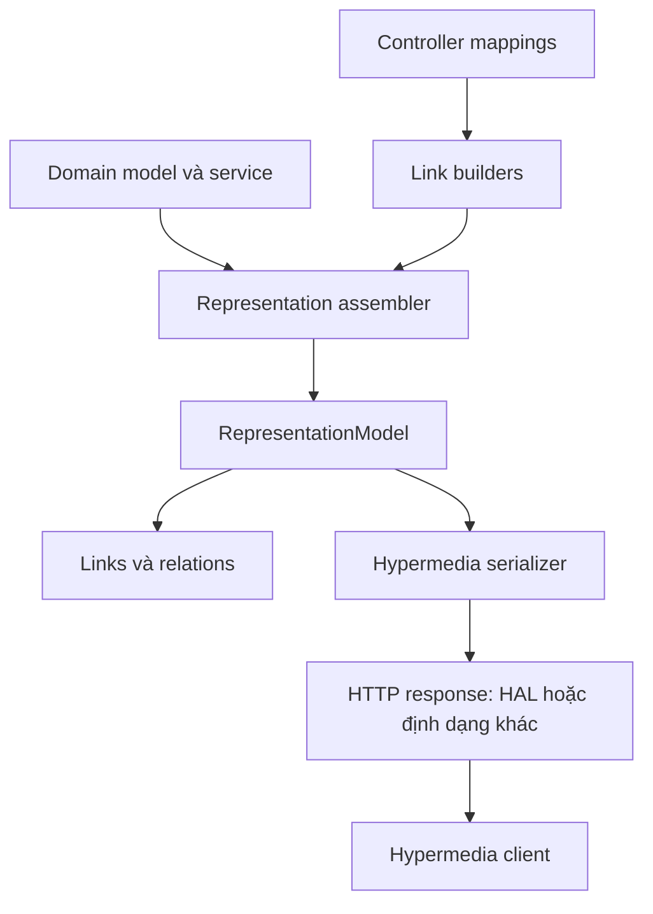

# Các module chính

## Mục tiêu

Sau bài này, bạn có thể nhận diện các nhóm chức năng chính của Spring HATEOAS, hiểu cách chúng phối hợp để tạo API hypermedia và chọn đúng thành phần khi xây dựng controller, representation, liên kết, định dạng phản hồi hoặc client điều hướng API.

## 1. Nhìn Spring HATEOAS như một tập hợp các lớp chức năng

Spring HATEOAS là thư viện giúp ứng dụng Spring xây dựng và sử dụng representation có hypermedia. Khi nói đến các module chính trong bài này, ta đang nói đến **các nhóm chức năng của thư viện**. Chúng không phải là những dependency Maven độc lập mà mọi ứng dụng đều phải cài riêng.

Các nhóm chức năng thường gặp gồm:

1. **Representation models:** mô hình hóa dữ liệu tài nguyên cùng metadata hypermedia.
2. **Links và link builders:** tạo liên kết đến tài nguyên, thao tác hoặc bước tiếp theo.
3. **Assemblers:** chuyển domain object thành representation dành cho API.
4. **Hypermedia formats:** tuần tự hóa representation theo HAL, HAL-FORMS và các định dạng được hỗ trợ.
5. **Spring web integration:** kết nối link với mapping của Spring MVC hoặc Spring WebFlux.
6. **Client navigation:** hỗ trợ client khám phá và đi theo liên kết hypermedia.

Các nhóm này phối hợp với nhau trong một request. Domain service cung cấp dữ liệu, assembler tạo representation, link builder tạo liên kết dựa trên controller mapping, sau đó message converter tuần tự hóa kết quả theo media type mà client yêu cầu.



## 2. Representation models: mô hình dữ liệu trả về

Nhóm representation model cung cấp các kiểu lớp để biểu diễn tài nguyên và tập hợp tài nguyên. Các lớp thường dùng nằm trong package `org.springframework.hateoas`.

| Kiểu | Vai trò | Khi sử dụng |
|---|---|---|
| `RepresentationModel<T>` | Lớp cơ sở có thể chứa các link | Tạo model API tùy chỉnh |
| `EntityModel<T>` | Bao một đối tượng nội dung cùng các link | Trả về một tài nguyên |
| `CollectionModel<T>` | Biểu diễn một tập hợp model cùng các link cấp tập hợp | Trả về danh sách tài nguyên |
| `PagedModel<T>` | Biểu diễn tập hợp có phân trang và metadata trang | Trả về kết quả phân trang |

Ví dụ, ứng dụng có thể dùng `EntityModel` để trả về một đơn hàng:

```java
@GetMapping("/{id}")
public EntityModel<Order> getOrder(@PathVariable UUID id) {
    Order order = orderService.getRequired(id);

    return EntityModel.of(
            order,
            linkTo(methodOn(OrderController.class)
                    .getOrder(id)).withSelfRel(),
            linkTo(methodOn(OrderController.class)
                    .getOrders()).withRel("orders")
    );
}
```

Representation chứa dữ liệu đơn hàng, link `self` đến chính đơn hàng và link `orders` đến danh sách. Client có thể đi theo các liên kết này mà không cần tự ghép URL.

Với danh sách, có thể tạo `CollectionModel`:

```java
@GetMapping
public CollectionModel<EntityModel<Order>> getOrders() {
    List<EntityModel<Order>> items = orderService.findAll()
            .stream()
            .map(order -> EntityModel.of(
                    order,
                    linkTo(methodOn(OrderController.class)
                            .getOrder(order.getId())).withSelfRel()))
            .toList();

    return CollectionModel.of(
            items,
            linkTo(methodOn(OrderController.class)
                    .getOrders()).withSelfRel()
    );
}
```

`CollectionModel` cho phép API gắn link ở cấp tập hợp, chẳng hạn link đến trang hiện tại hoặc một nhóm tài nguyên liên quan. Khi kết quả có phân trang, `PagedModel` bổ sung thông tin trang và các link điều hướng như `first`, `prev`, `self`, `next`, `last`. Trong Spring MVC, `PagedResourcesAssembler` có thể chuyển `Page<T>` của Spring Data thành `PagedModel` và tạo metadata điều hướng tương ứng.

Một lưu ý về thiết kế: representation model là hợp đồng bên ngoài của API. Không nhất thiết phải trả thẳng entity persistence. DTO hoặc model phản hồi chuyên biệt giúp kiểm soát trường dữ liệu được công bố và giảm phụ thuộc giữa API với cấu trúc lưu trữ.

## 3. Links và link builders: tạo đường dẫn có ý nghĩa

Nhóm link cung cấp các thành phần để mô tả quan hệ giữa tài nguyên:

- `Link` chứa đích liên kết và relation.
- `LinkRelation` biểu diễn tên quan hệ, ví dụ `self`, `next` hoặc `orders`.
- Link builder tạo URL dựa trên mapping của controller, giúp hạn chế việc hard-code đường dẫn.

Với Spring MVC, API phổ biến là `WebMvcLinkBuilder`. Các hàm `linkTo(...)` và `methodOn(...)` cho phép tham chiếu phương thức controller:

```java
Link self = linkTo(methodOn(OrderController.class)
        .getOrder(orderId))
        .withSelfRel();

Link collection = linkTo(methodOn(OrderController.class)
        .getOrders())
        .withRel("orders");
```

`methodOn` tạo một tham chiếu dùng để Spring HATEOAS phân tích mapping và tham số của phương thức. Lời gọi này không thực thi nghiệp vụ của controller như một request HTTP thực sự.

Nên dùng relation chuẩn khi phù hợp, chẳng hạn `self`, `next`, `prev` hoặc `first`. Với quan hệ nghiệp vụ riêng, hãy chọn tên dễ hiểu, ổn định và nhất quán. Client cần biết cách diễn giải relation mà nó sử dụng; việc đổi tên relation có thể ảnh hưởng đến các client phụ thuộc vào tên đó.

## 4. Assemblers: tách domain object khỏi representation

Assembler chịu trách nhiệm chuyển một đối tượng nghiệp vụ thành model mà API công bố. Interface thường dùng là `RepresentationModelAssembler<T, D>`, trong đó `T` là kiểu dữ liệu nguồn và `D` là kiểu representation đích.

Ví dụ:

```java
@Component
public class OrderModelAssembler
        implements RepresentationModelAssembler<Order, EntityModel<Order>> {

    @Override
    public EntityModel<Order> toModel(Order order) {
        return EntityModel.of(
                order,
                linkTo(methodOn(OrderController.class)
                        .getOrder(order.getId())).withSelfRel(),
                linkTo(methodOn(OrderController.class)
                        .getOrders()).withRel("orders")
        );
    }
}
```

Controller có thể sử dụng assembler để giữ phần xử lý HTTP gọn:

```java
@GetMapping("/{id}")
public EntityModel<Order> getOrder(@PathVariable UUID id) {
    return assembler.toModel(orderService.getRequired(id));
}
```

Assembler hữu ích khi nhiều endpoint cần tạo cùng một kiểu representation. Nó tập trung quy tắc tạo link và ánh xạ dữ liệu ở một nơi, giúp response nhất quán hơn. Với collection, interface cung cấp phương thức `toCollectionModel(...)` để chuyển nhiều đối tượng nguồn thành một `CollectionModel`.

Trong hệ thống lớn, có thể tạo các assembler riêng cho từng loại tài nguyên hoặc từng góc nhìn API. Tránh đưa truy vấn nghiệp vụ phức tạp vào assembler; dữ liệu và quyết định nghiệp vụ nên được cung cấp bởi service hoặc một thành phần chuyên trách.

## 5. Hypermedia formats: cách representation được gửi qua HTTP

Representation model mô tả dữ liệu và liên kết ở mức đối tượng Java. Hypermedia format quyết định cấu trúc JSON hoặc payload được gửi cho client. Spring HATEOAS hỗ trợ nhiều định dạng, trong đó thường gặp:

| Định dạng | Media type | Đặc điểm |
|---|---|---|
| HAL | `application/hal+json` | Dùng `_links` và `_embedded` để biểu diễn liên kết và tài nguyên nhúng |
| HAL-FORMS | `application/prs.hal-forms+json` | Mở rộng HAL với template mô tả thao tác và trường đầu vào |
| Collection+JSON | `application/vnd.collection+json` | Tập trung vào collection, item, link và template |
| UBER | `application/vnd.amundsen-uber+json` | Định dạng hypermedia biểu diễn các control và dữ liệu |
| ALPS | `application/alps+json` | Mô tả ngữ nghĩa và profile của dữ liệu/hoạt động |

HAL là lựa chọn phổ biến khi xây dựng API Spring HATEOAS. Một response HAL đơn giản có dạng:

```json
{
  "id": "42",
  "status": "PENDING",
  "_links": {
    "self": {
      "href": "/orders/42"
    },
    "orders": {
      "href": "/orders"
    }
  }
}
```

Trong đó, `_links` chứa các liên kết. Khi API nhúng tài nguyên liên quan, `_embedded` có thể chứa representation của các tài nguyên đó. Cấu trúc cụ thể phụ thuộc model và cách serializer được cấu hình.

Client và server cần thống nhất media type. Client thường gửi header `Accept` để yêu cầu định dạng mong muốn. Server cần có converter phù hợp và trả về `Content-Type` tương ứng. Không nên giả định rằng mọi client đều hiểu cùng một định dạng hypermedia.

## 6. Tích hợp với Spring MVC và WebFlux

Spring HATEOAS tích hợp với hai mô hình web chính của Spring:

- **Spring MVC:** sử dụng `WebMvcLinkBuilder` để tạo link từ mapping của controller MVC.
- **Spring WebFlux:** sử dụng `WebFluxLinkBuilder` cho ứng dụng reactive, hỗ trợ cách khai báo link phù hợp với controller WebFlux.

Việc chọn link builder cần khớp với stack web của ứng dụng. Một ứng dụng Spring MVC thông thường dùng `WebMvcLinkBuilder`; ứng dụng WebFlux nên dùng API dành cho WebFlux. Cả hai đều giúp liên kết bám theo mapping thực tế khi đường dẫn hoặc tham số controller thay đổi.

Spring Boot có thể tự cấu hình các thành phần hypermedia thông qua starter và cơ chế auto-configuration. Nếu không dùng Spring Boot, ứng dụng có thể bật hỗ trợ hypermedia bằng cấu hình Spring HATEOAS, chẳng hạn `@EnableHypermediaSupport`, và đăng ký các thành phần serialization phù hợp với định dạng lựa chọn.

## 7. Client navigation: khám phá API từ các liên kết

Spring HATEOAS không chỉ hỗ trợ tạo response phía server. Thư viện còn có `Traverson`, một client điều hướng API hypermedia theo relation. Thay vì tự nối nhiều URL, client bắt đầu từ entry point, theo các relation đã biết và chuyển đổi response thành kiểu dữ liệu cần dùng.

Ví dụ minh họa:

```java
Traverson traverson = new Traverson(
        URI.create("https://api.example.com"),
        MediaTypes.HAL_JSON
);

CollectionModel<EntityModel<Order>> orders = traverson
        .follow("orders")
        .toObject(new ParameterizedTypeReference<
                CollectionModel<EntityModel<Order>>>() {});
```

Đường đi cụ thể phụ thuộc relation mà API thực sự công bố và loại response ở mỗi bước. Client vẫn cần biết những relation nghiệp vụ mà nó quan tâm, nhưng không phải tự ghép từng đoạn URL. Với ứng dụng cần gọi API phức tạp hơn, có thể kết hợp các HTTP client của Spring với logic đọc link và relation từ response.

## 8. Khai báo dependency

Với ứng dụng Spring Boot, cách đơn giản là thêm starter tương ứng để Boot quản lý phiên bản tương thích:

**Gradle**

```groovy
dependencies {
    implementation("org.springframework.boot:spring-boot-starter-hateoas")
}
```

**Maven**

```xml
<dependency>
    <groupId>org.springframework.boot</groupId>
    <artifactId>spring-boot-starter-hateoas</artifactId>
</dependency>
```

Nếu tích hợp Spring HATEOAS mà không dùng Spring Boot, dependency thư viện chính là `org.springframework.hateoas:spring-hateoas`. Khi tự quản lý phiên bản, cần chọn phiên bản tương thích với Spring Framework và Spring Data đang dùng. Với Spring Boot, nên để dependency management của Boot quyết định phiên bản thay vì khai báo một phiên bản Spring HATEOAS tùy ý.

## 9. Kiểm thử sự phối hợp giữa các nhóm chức năng

Kiểm thử API nên xác nhận representation có dữ liệu mong đợi, link được tạo đúng và media type phù hợp. Ví dụ với MockMvc và HAL:

```java
mockMvc.perform(get("/orders/{id}", orderId)
        .accept(MediaTypes.HAL_JSON))
    .andExpect(status().isOk())
    .andExpect(content().contentTypeCompatibleWith(
            MediaTypes.HAL_JSON))
    .andExpect(jsonPath("$.id").value(orderId.toString()))
    .andExpect(jsonPath("$._links.self.href").exists())
    .andExpect(jsonPath("$._links.orders.href").exists());
```

Ngoài kiểm thử từng response, nên kiểm tra các hành vi có ý nghĩa với client:

- Relation quan trọng vẫn giữ ổn định qua các lần thay đổi implementation.
- Link trỏ đến endpoint đang hoạt động và phản ánh đúng tham số.
- Collection và trang dữ liệu có link điều hướng phù hợp.
- API trả đúng media type mà client yêu cầu.
- Các thay đổi trong DTO hoặc serializer không vô tình loại bỏ metadata mà client đang dùng.

Để kiểm tra khả năng tiến hóa hợp đồng, hãy ưu tiên kiểm thử những relation và hành vi mà client phụ thuộc vào thay vì khóa cứng mọi chi tiết JSON không có ý nghĩa công khai. Có thể thay đổi cách tổ chức controller hoặc service mà không ảnh hưởng client nếu representation tiếp tục công bố các relation và semantics đã cam kết.

## 10. Chọn đúng thành phần cho từng nhu cầu

| Nhu cầu | Thành phần nên xem xét |
|---|---|
| Trả về một tài nguyên có link | `EntityModel<T>` |
| Trả về một tập hợp | `CollectionModel<T>` |
| Trả về kết quả phân trang | `PagedModel<T>` và `PagedResourcesAssembler` |
| Tạo URL từ controller MVC | `WebMvcLinkBuilder` |
| Tạo URL từ controller WebFlux | `WebFluxLinkBuilder` |
| Ánh xạ domain object thành representation | `RepresentationModelAssembler` |
| Tuần tự hóa response theo HAL | HAL media type và hypermedia message converter |
| Điều hướng API từ phía client | `Traverson` |

Khi thiết kế, hãy bắt đầu từ hợp đồng mà client cần sử dụng: tài nguyên nào được trả về, relation nào cho phép điều hướng, định dạng nào được hỗ trợ và dữ liệu nào được công bố. Sau đó chọn representation model, assembler, link builder và media type phù hợp. Cách tiếp cận này giúp các lớp chức năng có ranh giới rõ ràng và dễ kiểm thử.

## Kết luận

Spring HATEOAS gồm các nhóm chức năng bổ trợ lẫn nhau: representation models giữ cấu trúc tài nguyên, links và link builders mô tả quan hệ điều hướng, assemblers chuyển dữ liệu nghiệp vụ thành representation, hypermedia formats quyết định cách biểu diễn trên HTTP, còn tích hợp MVC/WebFlux và Traverson hỗ trợ server lẫn client. Nắm được vai trò của từng nhóm giúp tổ chức API rõ ràng, giảm hard-code URL và giữ hợp đồng hypermedia ổn định khi implementation thay đổi.

