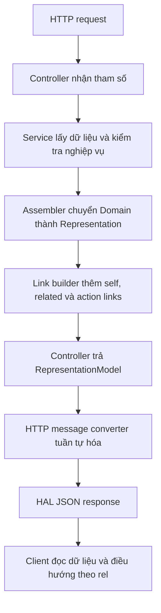

# Quy trình xây response

Trong một REST API dùng Spring HATEOAS, xây dựng response là quá trình chuyển dữ liệu nghiệp vụ thành một biểu diễn tài nguyên có nội dung và các liên kết hypermedia. Client nhận được biểu diễn đó có thể đọc dữ liệu, nhận diện tài nguyên hiện tại qua liên kết `self`, tìm tài nguyên liên quan và khám phá các thao tác mà server công bố.

Một response có hypermedia thường được tạo theo luồng: controller nhận yêu cầu, service lấy dữ liệu và áp dụng quy tắc nghiệp vụ, assembler chuyển đối tượng miền thành representation, link builder thêm các liên kết, rồi controller trả representation để Spring chuyển thành định dạng như HAL JSON. Tách rõ các bước này giúp cách biểu diễn nhất quán giữa nhiều endpoint và giúp kiểm thử hợp đồng API dễ dàng hơn.

## Luồng xử lý tổng thể



| Bước | Thành phần | Trách nhiệm |
|---|---|---|
| 1 | Controller | Nhận request, đọc path variable, query parameter và gọi service |
| 2 | Service | Truy xuất dữ liệu, áp dụng quy tắc nghiệp vụ và quyền truy cập |
| 3 | Assembler | Chuyển đối tượng miền thành representation dành cho API |
| 4 | Link builder | Tạo `self`, liên kết tới tài nguyên liên quan và liên kết thao tác |
| 5 | Controller | Trả `EntityModel`, `CollectionModel` hoặc `PagedModel` |
| 6 | Message converter | Tuần tự hóa representation theo media type được thương lượng |

Controller chịu trách nhiệm điều phối HTTP. Service quyết định dữ liệu và hành động nào hợp lệ theo nghiệp vụ. Assembler định nghĩa cách dữ liệu đó xuất hiện trong API. Link builder tạo URL từ ánh xạ Spring MVC để các liên kết bám theo endpoint thực tế.

## 1. Xác định representation sẽ trả về

Trước khi tạo liên kết, hãy xác định cấu trúc dữ liệu mà client cần. Một đối tượng miền như `Order` thường chứa chi tiết phục vụ lưu trữ và xử lý nội bộ. API có thể chỉ cần công bố mã đơn hàng, trạng thái và tổng tiền, vì vậy nên chuyển thành DTO thay vì tuần tự hóa trực tiếp entity.

Spring HATEOAS cung cấp một số kiểu mô hình thường dùng:

| Kiểu mô hình | Khi sử dụng | Cách biểu diễn |
|---|---|---|
| `RepresentationModel<T>` | Muốn định nghĩa lớp representation riêng có thể mang liên kết | Lớp DTO kế thừa `RepresentationModel` |
| `EntityModel<T>` | Trả về một nội dung cùng các liên kết | Bọc một DTO hoặc đối tượng dữ liệu |
| `CollectionModel<T>` | Trả về một tập hợp tài nguyên | Bọc collection các representation cùng liên kết của tập hợp |
| `PagedModel<T>` | Trả về kết quả có phân trang | Bọc nội dung trang, metadata trang và liên kết điều hướng |

Ví dụ, response đơn hàng chỉ công bố các trường mà client cần:

```java
import java.math.BigDecimal;
import java.util.UUID;

public record OrderResponse(
        UUID id,
        String status,
        BigDecimal total
) {}
```

`OrderResponse` là nội dung của tài nguyên. Các liên kết hypermedia sẽ được gắn vào mô hình bên ngoài, ví dụ `EntityModel<OrderResponse>`. Cách tách này giữ DTO tập trung vào dữ liệu, còn lớp mô hình HATEOAS chịu trách nhiệm điều hướng.

Nếu representation có cấu trúc phức tạp hoặc cần các phương thức hỗ trợ tạo liên kết, có thể tạo lớp riêng kế thừa `RepresentationModel`. Với response đơn giản, `EntityModel` thường đủ dùng.

## 2. Tạo liên kết dựa trên ánh xạ controller

Spring HATEOAS có `WebMvcLinkBuilder` để tạo liên kết từ các phương thức controller. Hai phương thức thường dùng là:

- `linkTo(...)`: tạo builder từ controller hoặc phương thức controller.
- `methodOn(...)`: tạo tham chiếu tới phương thức controller để builder đọc mapping và tham số đường dẫn.

Ví dụ tạo liên kết tới endpoint xem một đơn hàng:

```java
linkTo(methodOn(OrderController.class).one(orderId)).withSelfRel();
```

`withSelfRel()` đặt quan hệ `self` cho liên kết tới chính tài nguyên hiện tại. Để tạo quan hệ riêng, dùng `withRel("orders")`, `withRel("customer")` hoặc một tên quan hệ phù hợp với ý nghĩa nghiệp vụ.

Các liên kết nên được tạo từ mapping thay vì nối chuỗi URL thủ công. Khi route thay đổi, cách tạo link dựa trên phương thức controller giúp liên kết được cập nhật theo mapping. Client cũng nên tìm liên kết bằng quan hệ (`rel`) và xem `href` là đích do server cung cấp.

## 3. Dùng assembler để chuyển dữ liệu thành response

`RepresentationModelAssembler<T, D>` chuẩn hóa cách chuyển một đối tượng miền kiểu `T` thành representation kiểu `D`. Với đơn hàng, assembler có thể tạo nội dung `OrderResponse`, gắn liên kết `self`, liên kết về tập hợp và liên kết hủy nếu trạng thái cho phép.

```java
import org.springframework.hateoas.EntityModel;
import org.springframework.hateoas.server.RepresentationModelAssembler;
import org.springframework.stereotype.Component;

import static org.springframework.hateoas.server.mvc.WebMvcLinkBuilder.linkTo;
import static org.springframework.hateoas.server.mvc.WebMvcLinkBuilder.methodOn;

@Component
public class OrderModelAssembler
        implements RepresentationModelAssembler<Order, EntityModel<OrderResponse>> {

    @Override
    public EntityModel<OrderResponse> toModel(Order order) {
        var id = order.getId();

        EntityModel<OrderResponse> model = EntityModel.of(
                new OrderResponse(
                        id,
                        order.getStatus().name(),
                        order.getTotal()
                ),
                linkTo(methodOn(OrderController.class).one(id)).withSelfRel(),
                linkTo(methodOn(OrderController.class).all()).withRel("orders")
        );

        if (order.canBeCancelled()) {
            model.add(linkTo(methodOn(OrderController.class).cancel(id))
                    .withRel("cancel"));
        }

        return model;
    }
}
```

Trong ví dụ, `Order`, `OrderStatus` và các phương thức service là kiểu miền của ứng dụng. `canBeCancelled()` đại diện cho quy tắc nghiệp vụ xác định đơn hàng có thể hủy hay không. Assembler tạo liên kết `cancel` khi điều kiện này đúng; do đó client có thể nhận biết thao tác đang được công bố cho tài nguyên.

Assembler có thể được dùng lại ở endpoint chi tiết, danh sách hoặc các quy trình khác cần biểu diễn đơn hàng. Nếu nhiều loại response có quy tắc liên kết khác nhau, hãy tách assembler theo representation hoặc theo ngữ cảnh thay vì gom mọi điều kiện vào một lớp quá lớn.

## 4. Trả representation từ controller

Controller nhận service và assembler qua dependency injection. Endpoint chi tiết trả về một `EntityModel`; endpoint danh sách trả về `CollectionModel`.

```java
import java.util.List;
import java.util.UUID;
import java.util.stream.Collectors;

import org.springframework.hateoas.CollectionModel;
import org.springframework.hateoas.EntityModel;
import org.springframework.http.ResponseEntity;
import org.springframework.web.bind.annotation.GetMapping;
import org.springframework.web.bind.annotation.PathVariable;
import org.springframework.web.bind.annotation.PostMapping;
import org.springframework.web.bind.annotation.RequestMapping;
import org.springframework.web.bind.annotation.RestController;

import static org.springframework.hateoas.server.mvc.WebMvcLinkBuilder.linkTo;
import static org.springframework.hateoas.server.mvc.WebMvcLinkBuilder.methodOn;

@RestController
@RequestMapping("/api/orders")
public class OrderController {

    private final OrderService service;
    private final OrderModelAssembler assembler;

    public OrderController(OrderService service, OrderModelAssembler assembler) {
        this.service = service;
        this.assembler = assembler;
    }

    @GetMapping("/{id}")
    public EntityModel<OrderResponse> one(@PathVariable UUID id) {
        Order order = service.findRequired(id);
        return assembler.toModel(order);
    }

    @GetMapping
    public CollectionModel<EntityModel<OrderResponse>> all() {
        List<EntityModel<OrderResponse>> orders = service.findAll().stream()
                .map(assembler::toModel)
                .collect(Collectors.toList());

        return CollectionModel.of(
                orders,
                linkTo(methodOn(OrderController.class).all()).withSelfRel()
        );
    }

    @PostMapping("/{id}/cancel")
    public ResponseEntity<Void> cancel(@PathVariable UUID id) {
        service.cancel(id);
        return ResponseEntity.noContent().build();
    }
}
```

Ở endpoint chi tiết, controller lấy đơn hàng từ service rồi giao việc biểu diễn cho assembler. Ở endpoint danh sách, mỗi đơn hàng được chuyển qua cùng assembler, sau đó tập hợp được bọc trong `CollectionModel` với liên kết `self` của collection.

Endpoint `cancel` thực hiện thao tác nghiệp vụ. Việc response trước đó có liên kết `cancel` không thay thế xác thực và kiểm tra trạng thái trong endpoint này. Dữ liệu có thể thay đổi sau khi client đọc response; service vẫn phải từ chối thao tác nếu điều kiện không còn hợp lệ.

## 5. Xây response cho dữ liệu phân trang

Với danh sách lớn, response nên mang theo metadata trang và liên kết tới các trang khác. Spring HATEOAS tích hợp với Spring Data thông qua `PagedResourcesAssembler` để chuyển `Page<T>` thành `PagedModel<D>` bằng representation assembler.

```java
@GetMapping
public PagedModel<EntityModel<OrderResponse>> all(
        Pageable pageable,
        PagedResourcesAssembler<Order> pages
) {
    Page<Order> result = service.findAll(pageable);
    return pages.toModel(result, assembler);
}
```

Đoạn mã là phần thay thế cho endpoint danh sách không phân trang ở ví dụ trước. Các kiểu `Page`, `Pageable` và `PagedResourcesAssembler` đến từ Spring Data. Bộ chuyển đổi tạo các liên kết điều hướng phù hợp với trang hiện tại, giúp client theo `next` hoặc `prev` thay vì tự tính tham số trang.

Khi có bộ lọc hoặc sắp xếp, hãy bảo đảm các liên kết trang tiếp theo giữ đúng ngữ cảnh truy vấn. Client nên theo URL do server trả về để không làm mất các tham số đó.

## 6. Chọn media type và tạo HAL response

Representation model là cấu trúc đối tượng trong ứng dụng. Media type quyết định cách cấu trúc đó được tuần tự hóa qua HTTP. HAL là định dạng thường dùng với Spring HATEOAS; client có thể yêu cầu bằng header:

```http
GET /api/orders/7a8f HTTP/1.1
Accept: application/hal+json
```

Response HAL minh họa:

```json
{
  "id": "7a8f",
  "status": "PENDING",
  "total": 1250000,
  "_links": {
    "self": {
      "href": "/api/orders/7a8f"
    },
    "orders": {
      "href": "/api/orders"
    },
    "cancel": {
      "href": "/api/orders/7a8f/cancel"
    }
  }
}
```

Trong HAL, `_links` chứa các liên kết theo quan hệ. Response collection thường biểu diễn các phần tử trong `_embedded`; cấu trúc cụ thể phụ thuộc collection relation và cấu hình hypermedia. Spring Boot cùng `spring-boot-starter-hateoas` thường tự cấu hình hỗ trợ hypermedia cho ứng dụng. Với cấu hình Spring MVC thủ công, có thể bật hỗ trợ HAL bằng `@EnableHypermediaSupport(type = HypermediaType.HAL)`.

HAL cơ bản cho biết quan hệ và đích liên kết. Chỉ một liên kết `cancel` không tự mô tả đầy đủ HTTP method, kiểu nội dung hoặc các trường request. Nếu client cần khám phá biểu mẫu hay dữ liệu đầu vào của thao tác, có thể gắn affordance vào link và sử dụng media type hỗ trợ affordance như HAL-FORMS. Cả server lẫn client phải thống nhất định dạng đó.

## 7. Kiểm thử response và hợp đồng hypermedia

Kiểm thử response HATEOAS cần xác nhận cả dữ liệu lẫn liên kết. Chỉ kiểm tra HTTP status hoặc trường `id` chưa đủ, vì client có thể phụ thuộc vào quan hệ `self`, liên kết collection hoặc hành động khả dụng.

Ví dụ với MockMvc:

```java
import static org.springframework.test.web.servlet.request.MockMvcRequestBuilders.get;
import static org.springframework.test.web.servlet.result.MockMvcResultMatchers.content;
import static org.springframework.test.web.servlet.result.MockMvcResultMatchers.jsonPath;
import static org.springframework.test.web.servlet.result.MockMvcResultMatchers.status;

import org.springframework.hateoas.MediaTypes;

mockMvc.perform(get("/api/orders/{id}", pendingOrderId)
        .accept(MediaTypes.HAL_JSON))
    .andExpect(status().isOk())
    .andExpect(content().contentTypeCompatibleWith(MediaTypes.HAL_JSON))
    .andExpect(jsonPath("$.id").exists())
    .andExpect(jsonPath("$._links.self.href").exists())
    .andExpect(jsonPath("$._links.orders.href").exists())
    .andExpect(jsonPath("$._links.cancel.href").exists());
```

Với một đơn hàng không còn được phép hủy, kiểm thử nên xác nhận liên kết `cancel` không xuất hiện:

```java
mockMvc.perform(get("/api/orders/{id}", deliveredOrderId)
        .accept(MediaTypes.HAL_JSON))
    .andExpect(status().isOk())
    .andExpect(jsonPath("$._links.self.href").exists())
    .andExpect(jsonPath("$._links.cancel").doesNotExist());
```

Các kiểm thử này bảo vệ quy tắc biểu diễn theo trạng thái. Có thể bổ sung kiểm thử cho collection và phân trang để xác nhận `self`, `next`, `prev` cùng các tham số lọc hoặc sắp xếp được giữ đúng.

### Kiểm thử khả năng tiến hóa của hợp đồng

Khi API đổi đường dẫn nội bộ, client sử dụng HATEOAS vẫn có thể tiếp tục hoạt động nếu các quan hệ liên kết và ngữ nghĩa của chúng được giữ ổn định. Ví dụ, endpoint chi tiết có thể chuyển từ `/api/orders/{id}` sang `/api/v2/orders/{id}`; response mới vẫn công bố `self` và `cancel` với `href` tương ứng.

Vì vậy, kiểm thử hợp đồng nên tập trung vào những điều client cần hiểu:

- Quan hệ `self` luôn trỏ tới tài nguyên hiện tại.
- Quan hệ `orders` dẫn tới collection đơn hàng.
- Quan hệ `cancel` chỉ xuất hiện khi thao tác được công bố là khả dụng.
- Quan hệ liên kết giữ nguyên ý nghĩa qua các lần thay đổi route.
- Media type và cấu trúc nội dung được duy trì theo hợp đồng đã công bố.

Không nên viết kiểm thử buộc mọi URL phải giữ nguyên nếu mục tiêu của hợp đồng là cho phép server tổ chức lại route. Có thể kiểm tra `href` là URI hợp lệ và dùng đúng endpoint trong cấu hình kiểm thử; phần quan trọng đối với client là tìm đúng `rel` và theo `href` nhận được.

## Các lỗi thường gặp khi xây response

| Vấn đề | Hệ quả | Cách xử lý |
|---|---|---|
| Nối chuỗi URL thủ công | Link dễ sai khi mapping thay đổi | Dùng `linkTo(methodOn(...))` |
| Trả entity JPA trực tiếp | Có thể lộ trường nội bộ, gặp vòng tham chiếu hoặc lazy loading | Chuyển sang DTO và `EntityModel` |
| Chỉ thêm `self` | Client khó khám phá tài nguyên liên quan và thao tác | Bổ sung các quan hệ có ý nghĩa nghiệp vụ |
| Luôn thêm mọi action link | Client nhìn thấy thao tác không phù hợp trạng thái hoặc quyền | Quyết định link dựa trên quy tắc nghiệp vụ và quyền hiện tại |
| Chỉ kiểm tra response body | Có thể bỏ sót lỗi trong hợp đồng điều hướng | Kiểm thử cả `_links`, collection và trạng thái |
| Cho rằng HAL link đã mô tả request | Client không biết method hoặc dữ liệu đầu vào | Dùng affordance và media type phù hợp khi cần |

## Checklist cho một response HATEOAS

1. Xác định DTO hoặc representation mà client cần đọc.
2. Lấy dữ liệu và kiểm tra quyền, trạng thái trong service.
3. Chuyển đối tượng miền qua assembler.
4. Thêm `self`, liên kết collection và các liên kết nghiệp vụ liên quan.
5. Chỉ công bố action link khi thao tác phù hợp với trạng thái và quyền hiện tại.
6. Trả về `EntityModel`, `CollectionModel` hoặc `PagedModel` từ controller.
7. Thương lượng media type và xác nhận response được tuần tự hóa đúng định dạng.
8. Kiểm thử dữ liệu, quan hệ liên kết và hành vi khi hợp đồng API tiến hóa.

## Kết luận

Quy trình xây response với Spring HATEOAS bắt đầu từ dữ liệu nghiệp vụ, chuyển dữ liệu thành representation, gắn liên kết dựa trên mapping controller và trả mô hình hypermedia qua controller. `RepresentationModelAssembler` giúp thống nhất cách tạo response; `EntityModel`, `CollectionModel` và `PagedModel` đáp ứng các dạng tài nguyên đơn, tập hợp và phân trang; HAL cung cấp định dạng để client đọc nội dung cùng các quan hệ liên kết. Khi kiểm thử cả dữ liệu lẫn `rel`, ứng dụng có thể thay đổi route và mở rộng khả năng API với hợp đồng điều hướng rõ ràng hơn.
