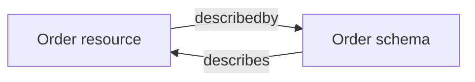

# Tra cứu relation chuẩn

## Mục tiêu

Sau bài này, bạn có thể tra cứu link relation trong IANA Link Relations Registry, đọc đúng phần mô tả và tài liệu tham chiếu, xác định chiều quan hệ giữa tài nguyên hiện tại và tài nguyên đích, chọn relation chuẩn phù hợp cho API và sử dụng các hằng số tương ứng trong Spring HATEOAS. Bạn cũng có thể nhận biết khi nào cần extension relation URI và kiểm thử relation đã serialize trong HAL.

## 1. Link relation mô tả điều gì?

Một link hypermedia kết nối tài nguyên hiện tại với một tài nguyên đích. Link relation mô tả ý nghĩa của kết nối đó.

Có thể đọc một link như câu:

> Tài nguyên hiện tại có quan hệ **R** với tài nguyên đích.

Ví dụ:

```json
{
  "_links": {
    "self": {
      "href": "/orders/42"
    },
    "collection": {
      "href": "/orders"
    },
    "related": {
      "href": "/customers/7"
    }
  }
}
```

Trong response trên:

- `self` xác định URI của chính tài nguyên hiện tại.
- `collection` cho biết đích là collection chứa tài nguyên hiện tại.
- `related` là relation chuẩn cho biết target có liên quan đến đơn hàng. Nếu client cần phân biệt rõ đây là khách hàng của đơn hàng, API có thể dùng extension relation URI như phần sau.

Relation không phải tên endpoint, HTTP method hay media type. Nó mô tả ngữ nghĩa của mối quan hệ giữa link context và link target. Ví dụ, relation `search` nói rằng đích có thể được dùng để tìm kiếm tài nguyên liên quan; bản thân relation không khẳng định endpoint phải dùng GET hay POST. Method và dữ liệu đầu vào có thể được mô tả thêm bằng affordance hoặc định dạng hypermedia phù hợp.

## 2. IANA Link Relations Registry là nguồn tra cứu chính

IANA duy trì **Link Relations Registry** để công bố các relation đã đăng ký. Mỗi mục thường có các trường:

| Trường | Cần đọc để làm gì |
|---|---|
| Relation Name | Token chính thức dùng trong thuộc tính `rel` |
| Description | Ý nghĩa của relation, đặc biệt là quan hệ giữa context và target |
| Reference | RFC hoặc tài liệu đặc tả giải thích semantics |
| Notes | Ghi chú bổ sung, trường hợp sử dụng hoặc quan hệ với relation khác |

Trang registry: [IANA – Link Relations](https://www.iana.org/assignments/link-relations).

Registry cung cấp các định dạng HTML, CSV, XML và TXT. Khi cần tra cứu nhanh, có thể tìm tên relation trên trang HTML. Khi muốn kiểm tra tự động hoặc so sánh nhiều mục, CSV/XML hữu ích hơn.

IANA registry có thể được cập nhật theo thời gian. Hãy tra cứu trực tiếp khi thiết kế một API mới hoặc review relation, thay vì dựa vào danh sách sao chép từ một bài viết cũ.

## 3. Quy trình tra cứu một relation

Không nên chọn relation chỉ vì tên tiếng Anh nghe có vẻ phù hợp. Hãy kiểm tra theo trình tự:

1. **Xác định context:** response hoặc tài nguyên nào đang chứa link?
2. **Xác định target:** link sẽ đưa client đến tài nguyên nào?
3. **Viết câu quan hệ:** “Context có quan hệ gì với target?”
4. **Tìm Relation Name:** tìm token phù hợp trong IANA registry.
5. **Đọc Description:** kiểm tra mô tả có khớp với chiều quan hệ và mục đích thực tế không.
6. **Mở Reference:** đọc phần đặc tả nếu semantics còn mơ hồ hoặc có ràng buộc chuyên biệt.
7. **Kiểm tra Notes:** xem relation có synonym, relation ngược chiều hoặc giới hạn sử dụng không.
8. **Kiểm tra Spring HATEOAS:** xác định framework có hằng số tương ứng trong `IanaLinkRelations` hay không.

Ví dụ, nếu một representation đơn hàng cung cấp link đến collection chứa nó, câu quan hệ là:

> Đơn hàng hiện tại thuộc về collection đơn hàng.

Relation `collection` phù hợp vì registry định nghĩa target là tài nguyên đại diện cho collection của context. Nếu dùng `item` hoặc `related` thay thế, client sẽ nhận semantics khác.

## 4. Một số relation thường gặp

Bảng dưới đây là điểm bắt đầu khi thiết kế API. Luôn đối chiếu mô tả hiện hành trong registry trước khi sử dụng.

| Relation | Ý nghĩa khái quát | Ví dụ trong API |
|---|---|---|
| `self` | URI định danh cho context | Link đến chính đơn hàng |
| `collection` | Target là collection chứa context | Từ một đơn hàng đến danh sách đơn hàng |
| `item` | Target là một item trong collection context | Từ collection đến một phần tử |
| `related` | Target là tài nguyên có liên quan | Từ đơn hàng đến khách hàng |
| `up` | Target là tài nguyên cha trong cấu trúc phân cấp | Từ danh mục con đến danh mục cha |
| `next` | Target là tài nguyên tiếp theo trong chuỗi | Trang kết quả kế tiếp |
| `prev` | Target là tài nguyên ngay trước trong chuỗi | Trang kết quả trước |
| `search` | Target dùng để tìm kiếm context và tài nguyên liên quan | Link đến chức năng tìm kiếm đơn hàng |
| `alternate` | Target là biểu diễn hoặc tài nguyên thay thế cho context | Bản biểu diễn khác của tài liệu |
| `canonical` | Target là phiên bản được ưu tiên của tài nguyên | URI chuẩn của tài nguyên có alias |
| `describedby` | Target cung cấp thông tin mô tả context | Từ đơn hàng đến tài liệu schema |
| `describes` | Target là tài nguyên được context mô tả | Từ tài liệu schema đến tài nguyên được mô tả |

Đừng suy ra semantics từ tên một cách riêng lẻ. Ví dụ `describedby` và `describes` có hướng ngược nhau:

- Nếu đơn hàng trỏ đến tài liệu mô tả nó, dùng `describedby`.
- Nếu tài liệu mô tả trỏ đến đơn hàng được mô tả, dùng `describes`.

Tương tự, `prev` không đồng nghĩa với `first`: `prev` trỏ đến phần tử liền trước, còn `first` trỏ đến phần tử ở đầu chuỗi.

## 5. Xác định chiều context và target

Đây là bước dễ nhầm nhất khi chọn relation. Cùng hai tài nguyên nhưng đổi hướng link có thể cần relation khác.

Ví dụ với quan hệ tài liệu và đơn hàng:



Hai link trên không phải hai cách viết cho cùng một chiều. Relation được đọc từ context đang chứa link đến target của link.

Một số câu hỏi giúp xác định đúng chiều:

- Link đang nằm trong representation của tài nguyên nào?
- Target có phải collection chứa context hay một item thuộc collection?
- Target là tài nguyên cha hay tài nguyên con?
- Target mô tả context, hay context mô tả target?
- Target là phiên bản chuẩn của context hay một phiên bản thay thế?

Nếu không thể diễn đạt quan hệ bằng một câu rõ ràng, có thể bạn đang chọn relation quá rộng hoặc chưa hiểu đúng vai trò của target.

## 6. Registered relation và extension relation

RFC 8288 chia link relation thành hai nhóm.

**Registered relation** là token đã được đăng ký trong IANA registry. Ví dụ: `self`, `collection`, `next`, `search`. Các ứng dụng có thể tái sử dụng cùng semantics mà không phải định nghĩa lại.

**Extension relation** là URI xác định duy nhất semantics do ứng dụng hoặc tổ chức định nghĩa. Dùng nhóm này khi registry không có relation phù hợp và quan hệ thực sự đặc thù với API.

Ví dụ extension relation:

```text
https://api.example.com/rels/approval
https://api.example.com/rels/risk-assessment
```

URI nên thuộc quyền kiểm soát của tổ chức định nghĩa relation. Tài liệu tại URI đó có thể giải thích semantics cho con người và nhà phát triển. Client không nên mặc định tự động truy cập URI này mỗi lần nhận response; RFC 8288 khuyến nghị tránh việc đó để không tạo tải không cần thiết cho server.

Không nên dùng một token tùy ý như `approval` rồi xem nó là relation chuẩn IANA. Spring HATEOAS cho phép tạo `LinkRelation` từ chuỗi, nhưng khả năng tạo đối tượng trong Java không có nghĩa chuỗi đó đã đăng ký hoặc có semantics liên thông giữa các ứng dụng. Khi serialize extension relation trong HAL, hãy dùng URI hoặc CURIE theo quy tắc của định dạng.

## 7. Kiểm tra relation bằng Spring HATEOAS

Spring HATEOAS cung cấp `IanaLinkRelations` để tham chiếu các relation chuẩn dưới dạng hằng số kiểu `LinkRelation`.

Ví dụ:

```java
import org.springframework.hateoas.IanaLinkRelations;
import org.springframework.hateoas.Link;

Link self = Link.of("/orders/42", IanaLinkRelations.SELF);
Link collection = Link.of("/orders", IanaLinkRelations.COLLECTION);
Link next = Link.of("/orders?page=2", IanaLinkRelations.NEXT);
Link docs = Link.of("/docs/orders", IanaLinkRelations.DESCRIBED_BY);
```

Tên hằng số Java có thể dùng dấu gạch dưới để dễ đọc, trong khi giá trị relation được serialize là token IANA, ví dụ `DESCRIBED_BY` tương ứng với `describedby`.

Khi cần kiểm tra một relation có thuộc IANA hay không, dùng:

```java
boolean registered =
        IanaLinkRelations.isIanaRel("next");

boolean custom =
        IanaLinkRelations.isIanaRel(
                LinkRelation.of("https://api.example.com/rels/approval"));
```

Kết quả của ví dụ đầu là `true`; ví dụ thứ hai là `false` vì URI extension không phải relation token đã đăng ký trong IANA. API `isIanaRel` hỗ trợ cả chuỗi và `LinkRelation`; việc so sánh registered relation tuân theo quy tắc không phân biệt chữ hoa/chữ thường của RFC 8288.

Ưu tiên hằng số `IanaLinkRelations` cho relation chuẩn thay vì tự gõ chuỗi. Cách này giúp IDE gợi ý tên hợp lệ và làm rõ ý định của code.

## 8. Tạo extension relation bằng LinkRelation

Khi không tìm được relation chuẩn có semantics phù hợp, có thể tạo extension relation bằng `LinkRelation.of(...)`:

```java
import org.springframework.hateoas.Link;
import org.springframework.hateoas.LinkRelation;

Link approval = Link.of(
        "/orders/42/approval",
        LinkRelation.of(
                "https://api.example.com/rels/approval")
);
```

Trong ví dụ, URI relation định danh quan hệ nghiệp vụ “approval”. Tổ chức cần duy trì tài liệu mô tả quan hệ đó, ví dụ:

- Context: representation của đơn hàng.
- Target: endpoint hoặc tài nguyên phê duyệt.
- Ý nghĩa: target cung cấp quy trình hoặc thông tin để phê duyệt đơn hàng.
- Quyền và điều kiện: khi nào relation được công bố.
- Hành vi client có thể thực hiện: theo link hoặc đọc affordance nếu có.

Relation URI không thay thế target href. URI trong `LinkRelation` định danh **loại quan hệ**; href của `Link` xác định **tài nguyên đích cụ thể**.

Nếu dùng extension relation trong HAL, có thể cấu hình CURIE để rút gọn URI relation thành một tên có prefix. HAL response sẽ cung cấp link `curies` để client ánh xạ tên rút gọn về URI gốc:

```json
{
  "_links": {
    "curies": {
      "name": "ex",
      "href": "https://api.example.com/rels/{rel}",
      "templated": true
    },
    "ex:approval": {
      "href": "/orders/42/approval"
    }
  }
}
```

Trong ví dụ, `ex:approval` đại diện cho URI relation đầy đủ `https://api.example.com/rels/approval`. Prefix và URI template phải được công bố trong response scope để client giải nghĩa relation.

## 9. Khi nào nên dùng relation chuẩn, khi nào cần extension?

Dùng relation chuẩn khi semantics đã khớp với quan hệ mà API muốn diễn tả. Ví dụ:

- Dùng `collection` để trỏ từ item đến collection chứa nó.
- Dùng `next` và `prev` để điều hướng chuỗi kết quả.
- Dùng `search` cho tài nguyên tìm kiếm.
- Dùng `describedby` để trỏ đến tài liệu mô tả context.

Dùng extension relation khi semantics đặc thù không thể diễn đạt chính xác bằng relation chuẩn. Ví dụ, một hệ thống nghiệp vụ có quan hệ `approval` với các quy tắc riêng về vòng phê duyệt. Không nên dùng `related` chỉ để tránh định nghĩa relation riêng nếu client thực sự cần phân biệt hành động phê duyệt với các quan hệ liên quan khác.

Ngược lại, không tạo extension relation chỉ để đổi tên một relation chuẩn theo ngôn ngữ nội bộ. Việc tạo `nextPage` khi IANA đã có `next` làm giảm khả năng tái sử dụng của client.

## 10. Các bước review một relation trước khi đưa vào API

Trước khi merge thay đổi representation, review relation theo checklist:

1. Relation có tồn tại trong IANA registry không?
2. Description có khớp với câu quan hệ context → target không?
3. Reference có đặc tả rõ semantics không?
4. Nếu dùng relation chuẩn, code có thể dùng hằng `IanaLinkRelations` tương ứng không?
5. Nếu dùng extension, relation có phải URI ổn định thuộc quyền kiểm soát của tổ chức không?
6. Nếu HAL dùng CURIE, response có khai báo prefix và template đầy đủ không?
7. Tên relation có được giữ ổn định qua các phiên bản API không?
8. Client có thể hiểu relation mà không cần dựa vào tên controller hoặc tên class Java không?
9. Relation có bị dùng nhầm như HTTP method, media type hoặc tên endpoint không?
10. Test có xác nhận relation được serialize đúng và href trỏ đến target phù hợp không?

Nếu semantics hoặc hướng quan hệ chưa rõ, hãy quay lại mô tả use case trước khi thêm link. Relation là một phần của hợp đồng hypermedia, vì vậy đổi tên hoặc đổi ý nghĩa có thể ảnh hưởng đến client.

## 11. Kiểm thử relation đã serialize trong HAL

Unit test có thể xác nhận Spring HATEOAS nhận diện relation chuẩn:

```java
import static org.assertj.core.api.Assertions.assertThat;

import org.junit.jupiter.api.Test;
import org.springframework.hateoas.IanaLinkRelations;
import org.springframework.hateoas.LinkRelation;

class LinkRelationTest {

    @Test
    void identifiesRegisteredIanaRelations() {
        assertThat(IanaLinkRelations.isIanaRel("next")).isTrue();
        assertThat(IanaLinkRelations.isIanaRel(
                IanaLinkRelations.COLLECTION)).isTrue();
    }

    @Test
    void treatsApplicationRelationAsAnExtension() {
        LinkRelation approval = LinkRelation.of(
                "https://api.example.com/rels/approval");

        assertThat(IanaLinkRelations.isIanaRel(approval)).isFalse();
    }
}
```

Unit test trên kiểm tra phân loại relation. Để xác nhận hợp đồng thực tế, dùng MockMvc kiểm tra HAL response:

```java
mockMvc.perform(get("/orders/{id}", orderId)
        .accept(MediaTypes.HAL_JSON))
    .andExpect(status().isOk())
    .andExpect(jsonPath("$._links.self.href").exists())
    .andExpect(jsonPath("$._links.collection.href")
            .value(endsWith("/orders")))
    .andExpect(jsonPath("$._links.describedby.href")
            .exists());
```

Test này giả định assembler công bố ba relation trên và endpoint trả HAL. Nếu dùng extension relation với CURIE, kiểm tra cả `_links.curies` và khóa relation rút gọn:

```java
.andExpect(jsonPath("$._links.curies.name").value("ex"))
.andExpect(jsonPath("$._links['ex:approval'].href")
        .value(endsWith("/orders/" + orderId + "/approval")));
```

Không nên chỉ kiểm tra link có tồn tại. Cần xác nhận tên relation và target đúng với semantics đã chọn. Một relation chuẩn nhưng trỏ nhầm tài nguyên vẫn tạo ra hợp đồng sai.

## 12. Những lỗi thường gặp

**Chọn relation theo tên nghe hợp lý.** Tên gần nghĩa không bảo đảm semantics giống nhau. Đọc Description và Reference trong IANA registry.

**Không xác định chiều context và target.** `describedby` và `describes` là hai quan hệ ngược chiều. Xác định tài nguyên đang chứa link trước khi chọn.

**Dùng relation chuẩn cho một semantics quá đặc thù.** Client có thể hiểu sai hành vi target. Dùng extension URI khi không có relation chuẩn phù hợp.

**Dùng token tùy ý như thể đã đăng ký.** `LinkRelation.of("approval")` chỉ tạo đối tượng trong Java; nó không đăng ký relation với IANA. Với extension relation trong HAL, dùng URI hoặc CURIE hợp lệ.

**Nối tên class hoặc controller vào relation public.** Refactor code có thể vô tình thay đổi hợp đồng. Chọn relation dựa trên semantics nghiệp vụ và giữ ổn định.

**Tạo extension URI không thuộc quyền kiểm soát.** URI relation cần có tính duy nhất và ổn định. Dùng namespace do tổ chức sở hữu hoặc được ủy quyền.

**Không cung cấp CURIE mapping khi dùng relation URI rút gọn.** Client không thể giải nghĩa prefix nếu response thiếu link `curies`.

**Nhầm relation với method hoặc media type.** Relation mô tả quan hệ; method và content type là metadata khác của tương tác HTTP.

## 13. Nguyên tắc thiết kế

- Tra cứu IANA registry trước khi tạo relation mới.
- Đọc cả Description, Reference và Notes, không chỉ tên relation.
- Xác định rõ context và target để chọn đúng chiều quan hệ.
- Dùng `IanaLinkRelations` cho relation chuẩn đã có trong Spring HATEOAS.
- Dùng `LinkRelation.of(uriString)` cho extension relation có semantics riêng.
- Dùng CURIE khi cần rút gọn extension URI trong HAL và luôn công bố mapping.
- Giữ relation public ổn định, độc lập với tên class và controller.
- Kiểm thử relation cùng href sau serialization, không chỉ kiểm tra Java object.

## Kết luận

Tra cứu relation chuẩn bắt đầu từ IANA Link Relations Registry: xác định context và target, đọc Relation Name, Description, Reference và Notes, rồi đối chiếu semantics với mục đích của link. Spring HATEOAS cung cấp `IanaLinkRelations` cho các relation chuẩn và `LinkRelation.of(...)` cho relation do ứng dụng định nghĩa. Khi không có relation chuẩn phù hợp, hãy dùng extension URI ổn định và CURIE nếu cần rút gọn trong HAL. Kiểm thử tên relation và href thực tế để bảo vệ hợp đồng hypermedia mà client sử dụng.

## Tài liệu tham khảo

- [IANA – Link Relations Registry](https://www.iana.org/assignments/link-relations)
- [RFC 8288 – Web Linking, Section 2.1](https://www.rfc-editor.org/rfc/rfc8288.html#section-2.1)
- [Spring HATEOAS Reference – IANA link relations](https://docs.spring.io/spring-hateoas/docs/current/reference/html/#fundamentals.link-relations.iana)
- [Spring HATEOAS Reference – CurieProvider](https://docs.spring.io/spring-hateoas/docs/current/reference/html/#mediatypes.hal.curie-provider)
- [Spring HATEOAS API – IanaLinkRelations](https://docs.spring.io/spring-hateoas/docs/current/api/org/springframework/hateoas/IanaLinkRelations.html)

