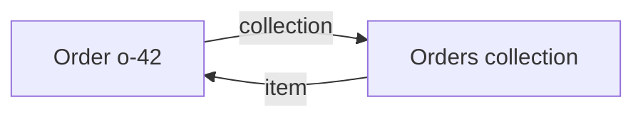

# Tránh dùng sai relation trong Spring HATEOAS

Trong hypermedia, một link không chỉ là URI. Relation (`rel`) cho client biết mối quan hệ giữa tài nguyên đang được biểu diễn và tài nguyên ở đích link. Nếu dùng sai relation, URI vẫn có thể truy cập được nhưng client hiểu sai ý nghĩa của link, chọn sai bước điều hướng hoặc không thể tái sử dụng logic khám phá API.

Spring HATEOAS cung cấp `IanaLinkRelations` cho các relation đã đăng ký phổ biến và `LinkRelation` để biểu diễn relation trong model. Khi thiết kế API, hãy chọn relation theo ngữ nghĩa của quan hệ, không theo tên method, field Java hay HTTP method. Với quan hệ riêng của miền nghiệp vụ, hãy dùng một extension relation ổn định và tài liệu hóa nó rõ ràng.

## 1. Relation mô tả quan hệ, không mô tả riêng URI

Một link thường có hai thành phần cốt lõi:

- `href`: URI mà client có thể truy cập.
- `rel`: ý nghĩa của mối quan hệ giữa context resource và tài nguyên đích.

Ví dụ representation đơn hàng:

```json
{
  "id": "o-42",
  "status": "PENDING",
  "_links": {
    "self": {
      "href": "/orders/o-42"
    },
    "customer": {
      "href": "/customers/c-7"
    },
    "items": {
      "href": "/orders/o-42/items"
    }
  }
}
```

`self` nói rằng link trỏ tới chính đơn hàng đang được biểu diễn. `customer` nói rằng đích link là khách hàng liên quan tới đơn hàng. `items` nói rằng đích link là collection các dòng hàng của đơn. Relation không phải tên route và cũng không phải một bản sao của URI.

Client nên dựa vào relation để hiểu loại liên kết và dùng `href` để điều hướng. Nếu client phải đoán ý nghĩa link từ đường dẫn hoặc tên class nội bộ, hợp đồng hypermedia đã bị ràng buộc quá chặt với cách server triển khai.

## 2. Ưu tiên relation chuẩn đã đăng ký khi ngữ nghĩa phù hợp

IANA duy trì Web Linking Relation Type Registry. Các relation được đăng ký có định nghĩa công khai để nhiều API và client có thể hiểu theo cùng một nghĩa. Spring HATEOAS cung cấp `IanaLinkRelations` để tránh viết tay những tên relation chuẩn.

Một số relation thường gặp:

| Relation | Ý nghĩa sử dụng điển hình |
| --- | --- |
| `self` | URI của chính tài nguyên đang được biểu diễn. |
| `next` | Phần tử hoặc trang kế tiếp trong một chuỗi có thứ tự. |
| `prev` | Phần tử hoặc trang trước trong một chuỗi có thứ tự. |
| `first` | Phần tử hoặc trang đầu tiên của chuỗi. |
| `last` | Phần tử hoặc trang cuối cùng của chuỗi. |
| `collection` | Collection mà tài nguyên hiện tại là thành viên. |
| `item` | Một tài nguyên thành viên của collection hiện tại. |
| `up` | Tài nguyên cha trong cấu trúc phân cấp. |
| `related` | Tài nguyên có liên quan khi không có quan hệ cụ thể hơn. |
| `alternate` | Một lựa chọn thay thế cho tài nguyên hiện tại. |
| `canonical` | URI được xem là phiên bản chuẩn hoặc ưu tiên của tài nguyên. |
| `search` | Tài nguyên cung cấp chức năng tìm kiếm liên quan. |
| `help` | Tài nguyên hướng dẫn hoặc trợ giúp cho context hiện tại. |
| `license` | Thông tin giấy phép áp dụng cho context hiện tại. |

Không chọn relation chỉ vì tên của nó nghe có vẻ phù hợp. Hãy đọc định nghĩa registry và xác định context resource cùng target resource trong link của mình. Nếu ngữ nghĩa không khớp, hãy chọn relation khác hoặc định nghĩa extension relation.

Khi dùng relation đã đăng ký, hãy giữ cách viết chuẩn trong registry, thường là chữ thường như `self`, `next` và `collection`. Dùng hằng `IanaLinkRelations` giúp tránh sai chính tả và khác biệt cách viết giữa các nơi trong code.

## 3. Dùng self sai cho tài nguyên liên quan

Một lỗi phổ biến là gắn relation `self` cho mọi link được tạo trong một representation. `self` chỉ nên trỏ tới chính tài nguyên đang được biểu diễn.

Ví dụ sai:

```java
return EntityModel.of(orderView,
        linkTo(methodOn(OrderController.class).one(orderId)).withSelfRel(),
        linkTo(methodOn(CustomerController.class).one(customerId)).withSelfRel());
```

Representation đơn hàng không thể có hai URI `self` mang hai ý nghĩa khác nhau. Link tới khách hàng phải dùng relation `customer` hoặc extension relation tương ứng.

Ví dụ đúng:

```java
return EntityModel.of(orderView,
        linkTo(methodOn(OrderController.class).one(orderId)).withSelfRel(),
        linkTo(methodOn(CustomerController.class).one(customerId))
                .withRel("customer"));
```

Nếu tài nguyên có nhiều URI alias, hãy xác định một URI self chuẩn. URI thay thế có thể được công bố bằng relation phù hợp như `alternate`, hoặc được hỗ trợ bằng redirect theo chính sách tương thích của API.

## 4. Không dùng related khi đã có quan hệ cụ thể

`related` có nghĩa là tài nguyên đích có liên quan tới context theo một cách không được chỉ rõ. Đây là relation hợp lệ, nhưng quá chung nếu client cần biết loại quan hệ.

Ví dụ, trong representation đơn hàng:

- `customer` diễn đạt rõ khách hàng sở hữu đơn.
- `items` diễn đạt rõ collection dòng hàng.
- `shipping-address` diễn đạt rõ địa chỉ giao hàng.

Nếu tất cả đều được gắn relation `related`, client phải xem URI hoặc tải tài nguyên đích mới biết link nào là khách hàng, link nào là dòng hàng. Điều đó làm giảm giá trị của hypermedia.

Dùng `related` khi quan hệ thực sự không có vai trò cụ thể hơn hoặc khi API cố ý công bố một liên kết liên quan chung. Nếu quan hệ có tên nghiệp vụ rõ ràng và ổn định, hãy dùng relation cụ thể.

## 5. Không nhầm collection với item

Relation `collection` và `item` mô tả hai hướng khác nhau:

- Từ một item, `collection` dẫn tới collection mà item là thành viên.
- Từ một collection, `item` dẫn tới một tài nguyên thành viên.

Ví dụ, representation đơn hàng có thể công bố link `collection` tới `/orders`; representation collection `/orders` có thể có các item được nhúng và link `item` nếu hợp đồng cần link riêng.



Không dùng `collection` để đặt tên cho link từ collection tới một item, và không dùng `item` để trỏ từ item về collection. Nếu API chỉ cần self link cho từng item trong `_embedded`, relation `self` của item thường đã đủ; không cần thêm `item` một cách máy móc.

## 6. Không dùng next và prev cho quan hệ thông thường

`next`, `prev`, `first` và `last` mô tả vị trí trong một chuỗi có thứ tự. Chúng thường được dùng cho pagination hoặc các tài nguyên được tổ chức thành series.

Không dùng `next` chỉ vì một tài nguyên được tạo sau tài nguyên hiện tại theo thời gian nếu không có khái niệm chuỗi mà client đang điều hướng. Tương tự, không dùng `prev` để chỉ tài nguyên cha hoặc tài nguyên liên quan trước đó theo ý nghĩa nghiệp vụ.

Với phân trang, link `next` nên trỏ tới trang kế tiếp trong cùng truy vấn, giữ filter, sort và page size cần thiết. Link `prev` trỏ tới trang trước. Link `first` và `last` trỏ tới hai đầu chuỗi trang nếu API hỗ trợ.

Nếu quan hệ là tài nguyên cha-con, dùng relation phản ánh cấu trúc như `up`, hoặc relation nghiệp vụ cụ thể. Nếu là tài nguyên liên quan không có thứ tự, dùng relation như `customer`, `related` hoặc extension relation phù hợp.

## 7. Không dùng relation để mã hóa HTTP method

Relation mô tả quan hệ giữa tài nguyên, không phải tên HTTP method. Các tên như `GET`, `POST`, `PUT`, `PATCH` hoặc `DELETE` không thay thế được relation có ngữ nghĩa.

Ví dụ, một link tới endpoint tạo đơn hàng không nên có relation `POST` chỉ vì endpoint nhận POST. Relation vẫn cần mô tả ý nghĩa của liên kết tới target; nếu client cần biết method và input payload, hãy công bố affordance.

Spring HATEOAS cho phép gắn affordance vào link:

```java
Link orders = linkTo(methodOn(OrderController.class).all())
        .withSelfRel()
        .andAffordance(afford(
                methodOn(OrderController.class).create(null)
        ));
```

Affordance tham chiếu method controller để mô tả thao tác, bao gồm HTTP method và metadata input/output có thể suy ra. HAL-FORMS có thể serialize thông tin đó thành template. Link relation và affordance giải quyết hai phần khác nhau của hợp đồng.

## 8. Không dùng tên method hoặc tên field làm relation một cách máy móc

Các tên như `getCustomerById`, `order_customer_fk`, `customerEntity` hoặc `findItems` phản ánh cách triển khai. Chúng không phải relation tốt cho client.

Ưu tiên tên ngắn, ổn định, diễn đạt vai trò của target:

| Tên không nên dùng | Relation dễ hiểu hơn |
| --- | --- |
| `getCustomerById` | `customer` |
| `orderItemsList` | `items` |
| `customerEntity` | `customer` |
| `order_customer_fk` | `customer` |
| `findRelatedProducts` | `related-products` hoặc relation URI đã định nghĩa |

Relation không cần trùng tên property Java. API có thể dùng `buyer` thay vì `customer` nếu đó là thuật ngữ nghiệp vụ chính xác và ổn định. Hãy ghi rõ ý nghĩa trong tài liệu hợp đồng và giữ relation ổn định khi đổi tên class, field hoặc bảng database.

## 9. Không tự tạo short relation và xem nó như relation IANA

Relation chuẩn có tên được đăng ký trong IANA registry. Nếu dùng một tên như `customer`, `items` hoặc `cancel` mà không có trong registry, đó là extension relation của API, không phải relation IANA chỉ vì nó xuất hiện trong `_links`.

Theo Web Linking, extension relation nên được định danh bằng URI tuyệt đối để tránh xung đột tên giữa các hệ thống. Ví dụ:

```java
LinkRelation customerRel = LinkRelation.of(
        "https://api.example.com/rels/customer");

Link customer = linkTo(methodOn(CustomerController.class)
        .one(customerId)).withRel(customerRel);
```

Với API nội bộ, một số hệ thống dùng short relation theo quy ước riêng để đơn giản hóa. Nếu chọn cách đó, hãy xem chúng là vocabulary riêng của API, tài liệu hóa rõ ràng và không tuyên bố đó là relation IANA. Với API công khai hoặc cần khả năng tương tác rộng, URI relation tuyệt đối giúp tránh xung đột và cho phép client tra cứu định nghĩa.

HAL hỗ trợ CURIE để rút gọn URI relation dài. Server có thể công bố prefix và URI template của tài liệu relation; client có thể mở rộng CURIE để hiểu relation đầy đủ. Chỉ dùng CURIE khi server và client tuân theo quy ước HAL và cấu hình được kiểm thử.

## 10. Không nhầm rel với title, name, type hoặc profile

HAL link object có thể chứa nhiều thuộc tính ngoài `href` và relation. Mỗi thuộc tính có vai trò riêng:

| Thuộc tính | Vai trò |
| --- | --- |
| `rel` | Ý nghĩa của mối quan hệ giữa context và target. |
| `href` | URI đích của link. |
| `title` | Nhãn mô tả dành cho người đọc hoặc giao diện. |
| `name` | Tên định danh bổ sung cho link trong một số trường hợp. |
| `type` | Gợi ý media type của tài nguyên đích. |
| `hreflang` | Ngôn ngữ của tài nguyên đích khi có ý nghĩa. |
| `profile` | URI mô tả thêm semantics của tài nguyên đích. |
| `deprecation` | URI thông tin về việc link relation hoặc link đang bị deprecated. |

Không dùng `title` để thay relation vì title có thể thay đổi theo ngôn ngữ hoặc cách hiển thị. Không dùng `type` để nói link là customer hay order; `type` mô tả media type. Không dùng `name` thay cho relation nếu client cần xác định ý nghĩa quan hệ.

## 11. Chú ý cardinality: một relation có thể có nhiều link

Không phải relation nào cũng chỉ có một link. Ví dụ, một tài nguyên có thể có nhiều link `alternate` tới các biến thể hoặc định dạng khác nhau. HAL có thể biểu diễn nhiều link cùng relation dưới dạng mảng.

Tuy nhiên, một số relation thường có một link chính trong representation, chẳng hạn `self`. Nếu cùng một item nhận hai self link tới URI khác nhau, client có thể không biết URI nào là địa chỉ chuẩn.

Khi thiết kế cardinality:

- Xác định relation nào là đơn trị trong hợp đồng, ví dụ `self`.
- Xác định relation nào có thể lặp, ví dụ nhiều `alternate`.
- Không thêm cùng một link nhiều lần từ assembler, controller và processor.
- Kiểm thử số lượng link khi relation có quy tắc cardinality.
- Nếu một quan hệ có nhiều target khác nhau, hãy xác định client có phân biệt chúng bằng `name`, title, URI relation riêng hoặc thuộc tính link khác hay không.

Không nên giả định mọi relation lặp đều sai; cần dựa vào ngữ nghĩa và hợp đồng. Nhưng duplicate do nhiều lớp cùng thêm link thường là lỗi thiết kế hoặc lỗi triển khai.

## 12. Dùng IanaLinkRelations thay vì chuỗi tự gõ

Spring HATEOAS cung cấp các hằng `IanaLinkRelations` cho relation IANA phổ biến. Dùng chúng để tránh typo và làm rõ rằng code đang dùng một relation chuẩn.

Ví dụ:

```java
import org.springframework.hateoas.IanaLinkRelations;

model.add(linkTo(methodOn(OrderController.class).one(orderId))
        .withRel(IanaLinkRelations.SELF));

model.add(linkTo(methodOn(OrderController.class).all())
        .withRel(IanaLinkRelations.COLLECTION));
```

Đối với self link, `withSelfRel()` thường ngắn và dễ đọc:

```java
model.add(linkTo(methodOn(OrderController.class).one(orderId))
        .withSelfRel());
```

Với relation tùy chỉnh, dùng `LinkRelation.of(...)` để thể hiện rõ kiểu relation:

```java
LinkRelation customerRel = LinkRelation.of(
        "https://api.example.com/rels/customer");
model.add(linkTo(methodOn(CustomerController.class).one(customerId))
        .withRel(customerRel));
```

Không cần tự khai báo lại một hằng cho relation IANA nếu Spring HATEOAS đã cung cấp. Nếu tạo hằng cho extension relation của dự án, hãy tập trung chúng ở một nơi và tài liệu hóa semantics.

## 13. Kiểm thử relation đúng ngữ nghĩa

Kiểm thử cần xác nhận cả relation và URI. Chỉ kiểm tra link tồn tại chưa đủ nếu link có thể trỏ tới tài nguyên sai.

Unit test assembler:

```java
@Test
void exposesSelfAndCustomerWithCorrectRelations() {
    EntityModel<OrderView> model = assembler.toModel(order);

    assertThat(model.getRequiredLink(IanaLinkRelations.SELF).getHref())
            .endsWith("/orders/" + order.getId());

    assertThat(model.getRequiredLink("customer").getHref())
            .endsWith("/customers/" + order.getCustomer().getId());
}
```

Ví dụ dùng short relation `customer` cho API nội bộ. Nếu API dùng extension URI, hãy truy vấn bằng chính `LinkRelation` đó trong test.

Kiểm thử HAL response:

```java
mockMvc.perform(get("/orders/{id}", orderId)
        .accept(MediaTypes.HAL_JSON))
    .andExpect(status().isOk())
    .andExpect(jsonPath("$._links.self.href")
            .value(endsWith("/orders/" + orderId)))
    .andExpect(jsonPath("$._links.customer.href")
            .value(endsWith("/customers/" + customerId)));
```

Nên bổ sung test cho các trường hợp:

- `self` chỉ xuất hiện một lần và trỏ đúng tài nguyên hiện tại.
- Link tới tài nguyên liên quan không dùng `self`.
- `next` và `prev` chỉ xuất hiện khi collection có trang tương ứng.
- `collection` và `item` được dùng đúng hướng.
- Relation tùy chỉnh giữ nguyên qua serialization.
- Relation lặp được serialize theo cardinality mà hợp đồng cho phép.
- Client có thể điều hướng theo `href` và hiểu target dựa trên `rel`.

## 14. Kiểm tra relation khi API tiến hóa

Relation là một phần của hợp đồng công khai. Thay đổi route không nhất thiết phải thay relation; thay đổi relation có thể làm client không còn tìm thấy link dù URI vẫn hoạt động.

Ví dụ, server chuyển mapping từ `/customers/{id}` sang `/people/{id}`. Nếu relation `customer` vẫn giữ nguyên và target URI mới được tạo từ controller mapping, client vẫn có thể tìm link theo cùng relation.

Ngược lại, đổi `customer` thành `client` mà không duy trì tương thích có thể làm client đang tìm `customer` thất bại. Trước khi đổi relation:

1. Xác định client nào đang tiêu thụ relation cũ.
2. Đánh giá xem semantics có thực sự thay đổi hay chỉ tên gọi chưa tốt.
3. Nếu cần chuyển đổi, công bố relation mới trong giai đoạn tương thích khi phù hợp.
4. Cập nhật tài liệu relation và kiểm thử contract.
5. Loại bỏ relation cũ theo chính sách versioning/deprecation đã thống nhất.

Không đổi relation chỉ để phản ánh tên class hoặc field vừa được refactor nội bộ.

## 15. Các lỗi thường gặp

**Dùng `self` cho link tới tài nguyên khác.** Self chỉ trỏ tới context resource. Dùng relation phản ánh tài nguyên đích.

**Dùng `related` cho mọi association.** Chọn relation cụ thể như `customer`, `items` hoặc `shipping-address` khi semantics rõ ràng.

**Đảo `collection` và `item`.** `collection` từ item tới collection chứa nó; `item` từ collection tới một thành viên.

**Dùng `next` cho quan hệ không có thứ tự.** Next/prev mô tả vị trí trong chuỗi, không phải quan hệ cha-con hoặc liên quan chung.

**Dùng HTTP method làm rel.** Relation không phải `GET` hoặc `POST`; dùng affordance để mô tả thao tác và input/output.

**Dùng tên method hoặc tên database làm rel.** Relation phải là vocabulary ổn định dành cho client.

**Xem short custom rel là IANA relation.** Relation không có trong registry là extension relation; với khả năng tương tác công khai, ưu tiên URI tuyệt đối.

**Nhầm rel với title hoặc type.** Mỗi thuộc tính link có ngữ nghĩa riêng; không dùng nhãn hiển thị thay relation.

**Cho rằng một rel luôn chỉ có một link hoặc luôn có thể lặp.** Xác định cardinality theo semantics và kiểm thử.

## 16. Bài tập thực hành và tiêu chí hoàn thành

Hãy rà soát relation trong API đơn hàng:

1. Liệt kê link của `Order`, `Customer`, `OrderItem` và collection `Orders`.
2. Đánh dấu relation nào thuộc IANA registry và relation nào là extension của API.
3. Thay các chuỗi IANA tự gõ bằng `IanaLinkRelations` tương ứng.
4. Đảm bảo mỗi representation có một self link trỏ tới chính nó.
5. Dùng relation cụ thể cho khách hàng, dòng hàng và địa chỉ giao hàng.
6. Kiểm tra hướng dùng `collection` và `item`.
7. Kiểm tra `next` và `prev` chỉ mô tả điều hướng trong chuỗi phân trang.
8. Chuyển mô tả thao tác POST/PATCH sang affordance khi client cần method và input metadata.
9. Định danh extension relation bằng URI tuyệt đối và cân nhắc CURIE cho HAL.
10. Viết unit test và MockMvc test xác nhận rel, href, cardinality và tính tương thích khi mapping thay đổi.

Bạn đã biết cách tránh dùng sai relation khi có thể xác định đúng context và target của link, chọn relation IANA theo định nghĩa, tạo extension relation có định danh rõ, phân biệt relation với affordance và metadata hiển thị, đồng thời kiểm thử cả semantics lẫn URI. Relation được dùng chính xác giúp client khám phá API ổn định ngay cả khi server thay đổi cấu trúc triển khai.

## Tài liệu tham khảo chính thức

- [IANA Link Relations Registry](https://www.iana.org/assignments/link-relations/link-relations.xhtml)
- [RFC 8288 – Web Linking](https://www.rfc-editor.org/rfc/rfc8288)
- [Spring HATEOAS Reference Documentation – Links](https://docs.spring.io/spring-hateoas/docs/current/reference/html/#fundamentals.links)
- [Spring HATEOAS API – IanaLinkRelations](https://docs.spring.io/spring-hateoas/docs/current/api/org/springframework/hateoas/IanaLinkRelations.html)
- [Spring HATEOAS API – LinkRelation](https://docs.spring.io/spring-hateoas/docs/current/api/org/springframework/hateoas/LinkRelation.html)
