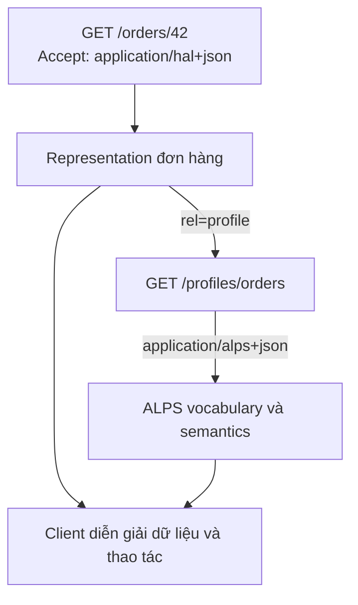

# Relation dạng profile

Một custom relation cho client biết link dẫn tới loại tài nguyên hoặc thao tác nào. Nhưng đôi khi tên relation và media type chưa đủ để giải thích vocabulary, quy ước dữ liệu hoặc semantics nghiệp vụ của representation. Khi đó, API có thể công bố một profile để mô tả phần ngữ nghĩa bổ sung mà representation tuân theo.

Web Linking định nghĩa relation chuẩn `profile` để biểu diễn mối quan hệ giữa representation hiện tại và profile của nó. Spring HATEOAS cung cấp `IanaLinkRelations.PROFILE` để tạo link này. Một profile có thể được mô tả bằng ALPS (Application-Level Profile Semantics), một media type dành cho metadata ngữ nghĩa của tài nguyên. Spring HATEOAS cung cấp các value object `Alps`, `Descriptor`, `Doc` và `Ext` để xây dựng tài liệu ALPS trực tiếp trong controller.

Bài học này tập trung vào cách công bố profile link trong representation, xây dựng ALPS document và phân biệt profile với custom relation URI/CURIE.

## Mục tiêu

Sau bài học, bạn có thể:

- Giải thích ý nghĩa của IANA link relation `profile` theo RFC 6906.
- Phân biệt profile URI, profile link và custom link relation.
- Dùng `IanaLinkRelations.PROFILE` để công bố profile từ một representation.
- Tạo ALPS document bằng API của Spring HATEOAS.
- Mô tả thuộc tính dữ liệu và semantics thao tác bằng ALPS descriptor.
- Trả ALPS với media type `application/alps+json`.
- Kiểm thử profile link và ALPS document trong HTTP response.
- Thiết kế profile URI ổn định để hỗ trợ client và khả năng tiến hóa API.

## Profile là gì?

Profile mô tả thêm semantics của một representation, chẳng hạn:

- Các quy ước và ràng buộc của những trường dữ liệu.
- Ý nghĩa nghiệp vụ của một thuộc tính.
- Vocabulary mà client có thể sử dụng để diễn giải dữ liệu.
- Các thao tác hoặc trạng thái có ý nghĩa trong miền nghiệp vụ.

Theo RFC 6906, profile bổ sung ngữ nghĩa mà media type cơ sở chưa mô tả. Profile không được thay đổi semantics cơ bản của representation khi client không biết profile đó. Nhờ vậy, client chỉ hiểu media type vẫn có thể xử lý representation theo quy tắc cơ bản; client hiểu profile có thể áp dụng thêm các quy tắc chuyên biệt.

Ví dụ, hai API đều trả JSON hoặc HAL và có trường `status`. Media type cho biết cách đọc cấu trúc dữ liệu, nhưng không giải thích đầy đủ `PENDING_REVIEW`, `READY_TO_SHIP` hay `CANCELLED` có ý nghĩa nghiệp vụ gì. Profile có thể định nghĩa vocabulary và quy ước trạng thái đó.

Profile được nhận diện bằng URI. URI này chủ yếu đóng vai trò định danh; nó không bắt buộc phải truy xuất được như một trang web. Tuy nhiên, nếu API có thể cung cấp tài liệu máy đọc hoặc tài liệu cho nhà phát triển tại URI đó, client sẽ dễ khám phá semantics hơn.

## IANA link relation profile

RFC 6906 đăng ký relation `profile`. Relation này cho biết representation của resource tuân theo một profile nhất định, mà không làm thay đổi semantics cơ bản của representation.

Trong Spring HATEOAS, dùng hằng `IanaLinkRelations.PROFILE`:

```java
import org.springframework.hateoas.IanaLinkRelations;
import org.springframework.hateoas.Link;

Link profileLink = Link.of(
    "https://api.example.test/profiles/orders",
    IanaLinkRelations.PROFILE
);
```

Khi serialize theo HAL, link có thể xuất hiện như sau:

```json
{
  "_links": {
    "profile": {
      "href": "https://api.example.test/profiles/orders"
    }
  }
}
```

Client nhìn thấy relation `profile` và biết URI đích định danh profile mà representation tuân theo. Đây là một relation chuẩn của IANA, không phải custom relation do API tự đặt.

### Gắn profile link vào representation

Một representation có thể chứa link `self`, link nghiệp vụ và link `profile`. Ví dụ:

```java
import org.springframework.hateoas.EntityModel;
import org.springframework.hateoas.IanaLinkRelations;
import org.springframework.hateoas.Link;
import org.springframework.hateoas.MediaTypes;

EntityModel<OrderView> model = EntityModel.of(
    order,
    Link.of("/orders/42").withSelfRel(),
    Link.of("/profiles/orders", IanaLinkRelations.PROFILE)
        .withType(MediaTypes.ALPS_JSON_VALUE)
        .withTitle("Ngữ nghĩa của tài nguyên đơn hàng")
);
```

`withType(MediaTypes.ALPS_JSON_VALUE)` cho biết media type mà client có thể mong đợi ở tài nguyên profile. `withTitle()` bổ sung nhãn dễ đọc. Khi trả model bằng HAL, response có thể có cấu trúc:

```json
{
  "id": 42,
  "status": "READY_TO_SHIP",
  "total": 1250000,
  "_links": {
    "self": {
      "href": "/orders/42"
    },
    "profile": {
      "href": "/profiles/orders",
      "type": "application/alps+json",
      "title": "Ngữ nghĩa của tài nguyên đơn hàng"
    }
  }
}
```

Trong ứng dụng thực tế, nên dùng `WebMvcLinkBuilder` hoặc `WebFluxLinkBuilder` để tạo URI từ mapping controller thay vì tự ghép đường dẫn. Ví dụ:

```java
Link profileLink = linkTo(ProfileController.class)
    .slash("orders")
    .withRel(IanaLinkRelations.PROFILE)
    .withType(MediaTypes.ALPS_JSON_VALUE);
```

Đoạn code giả định `ProfileController` có mapping cấp lớp là `/profiles` và method profile được ánh xạ tới `/orders`.

## Profile relation khác custom relation như thế nào?

Profile link và custom relation URI giải quyết hai câu hỏi khác nhau:

| Cơ chế | Câu hỏi mà client được trả lời | Ví dụ |
|---|---|---|
| Custom relation | Link này dẫn tới loại tài nguyên hoặc thao tác nào? | `ex:cancel`, `ex:payments` |
| Profile relation | Representation hiện tại tuân theo vocabulary hoặc semantics bổ sung nào? | `profile` trỏ tới `/profiles/orders` |
| Profile URI | Profile được định danh bằng URI nào? | `https://api.example.test/profiles/orders` |
| ALPS descriptor | Thuật ngữ hoặc thao tác trong profile có nghĩa gì? | `status`, `cancelOrder`, `createOrder` |

Ví dụ, relation `ex:cancel` có thể chỉ tới endpoint hủy đơn hàng. Profile của representation giải thích `cancel` có nghĩa gì trong miền đơn hàng, điều kiện trạng thái nào cho phép hủy và các thuật ngữ liên quan.

Một link relation tùy chỉnh nên được định danh bằng URI duy nhất, hoặc được rút gọn bằng CURIE trong HAL. Profile không thay thế relation của link hành động. Nếu client cần khám phá thao tác hủy, API vẫn cần công bố link có relation tương ứng; profile chỉ bổ sung tài liệu semantics cho vocabulary của API.

### Phân biệt rel profile với Link.withProfile

Spring HATEOAS có hai API dễ bị nhầm:

- `withRel(IanaLinkRelations.PROFILE)` đặt relation của link thành `profile`. Đây là cách công bố một link tới profile của representation hiện tại.
- `withProfile(uri)` đặt thuộc tính `profile` trên chính link object. Thuộc tính này mô tả profile liên quan tới target của link trong các representation hỗ trợ thuộc tính đó.

Ví dụ:

```java
Link profileRelation = Link.of(
    "/profiles/orders",
    IanaLinkRelations.PROFILE
);

Link customerLink = Link.of("/customers/7", "customer")
    .withProfile("https://api.example.test/profiles/customer");
```

Hai link có ý nghĩa khác nhau. Link đầu có relation `profile`, nên nó công bố profile của representation hiện tại. Link thứ hai vẫn có relation `customer`; thuộc tính `profile` bổ sung thông tin về profile của tài nguyên đích mà link trỏ tới.

Nếu mục tiêu là cho client biết representation hiện tại tuân theo profile nào, hãy công bố link có relation `profile`. Không dùng `withProfile()` như thể nó tự tạo ra một relation `profile`.

Với HAL, thuộc tính `profile` trên link object có thể được serialize riêng:

```json
{
  "_links": {
    "customer": {
      "href": "/customers/7",
      "profile": "https://api.example.test/profiles/customer"
    }
  }
}
```

Ở đây relation vẫn là `customer`. Thuộc tính `profile` chỉ mô tả profile liên quan tới tài nguyên đích của link.


## ALPS là gì?

ALPS (Application-Level Profile Semantics) là media type dùng để cung cấp metadata dựa trên profile cho một resource khác. Một ALPS document mô tả semantics ứng dụng theo cách độc lập với media type biểu diễn resource. Vì vậy, cùng một profile có thể giải thích representation HAL, Collection+JSON, Siren hoặc một định dạng ứng dụng khác.

Spring HATEOAS hỗ trợ ALPS qua package:

```java
org.springframework.hateoas.mediatype.alps
```

Các kiểu chính:

| Kiểu | Vai trò |
|---|---|
| `Alps` | Tài liệu ALPS gốc, chứa version, doc và descriptors |
| `Descriptor` | Mô tả một thuật ngữ, thuộc tính hoặc semantics thao tác |
| `Doc` | Phần mô tả bằng văn bản hoặc liên kết tài liệu |
| `Ext` | Tham chiếu tới phần mở rộng metadata bên ngoài |
| `Type` | Phân loại descriptor như `SEMANTIC`, `SAFE`, `IDEMPOTENT`, `UNSAFE` |
| `Format` | Định dạng nội dung của phần `Doc`, ví dụ `TEXT`, `HTML`, `MARKDOWN`, `ASCIIDOC` |

Media type của ALPS JSON là `application/alps+json`, được Spring HATEOAS cung cấp qua `MediaTypes.ALPS_JSON` và `MediaTypes.ALPS_JSON_VALUE`.

ALPS không phải một media type thay thế HAL. HAL mô tả cách serialize representation có link; ALPS mô tả semantics của vocabulary mà representation sử dụng.

## Descriptor trong ALPS

Một descriptor có thể mô tả một thuộc tính hoặc một thao tác:

| Trường | Ý nghĩa |
|---|---|
| `id` | Định danh duy nhất của descriptor trong profile |
| `name` | Tên thuật ngữ hoặc thao tác mà client có thể nhận diện |
| `type` | Loại semantics của descriptor |
| `doc` | Nội dung giải thích descriptor |
| `href` | URI tham chiếu liên quan nếu cần |
| `descriptor` | Các descriptor con để mô tả cấu trúc lồng nhau |
| `ext` | Metadata mở rộng được tham chiếu từ bên ngoài |
| `rt` | Resource type liên quan tới descriptor |

Các giá trị `Type` quan trọng:

| Type | Ý nghĩa |
|---|---|
| `SEMANTIC` | Thuật ngữ hoặc dữ liệu có ý nghĩa trong miền ứng dụng |
| `SAFE` | Thao tác không làm thay đổi trạng thái resource |
| `IDEMPOTENT` | Thao tác có cùng hiệu ứng khi được thực hiện lặp lại |
| `UNSAFE` | Thao tác có thể làm thay đổi trạng thái resource |

Ví dụ, `status` là descriptor kiểu `SEMANTIC`; thao tác truy vấn có thể là `SAFE`; thao tác thay thế dữ liệu thường là `IDEMPOTENT`; thao tác hủy đơn hàng có thể là `UNSAFE`.

ALPS mô tả vocabulary và semantics ở mức ứng dụng. Nó không tự tạo endpoint, không cấp quyền thực hiện thao tác và không thay thế validation hoặc affordance metadata của một media type khác.

## Xây dựng ALPS document bằng Spring HATEOAS

Spring HATEOAS không yêu cầu bật một cấu hình riêng để tạo ALPS. Bạn tạo đối tượng `Alps` và trả về từ controller MVC hoặc WebFlux. Ví dụ sau mô tả một đơn hàng:

```java
import java.util.List;

import org.springframework.hateoas.MediaTypes;
import org.springframework.hateoas.mediatype.alps.Alps;
import org.springframework.hateoas.mediatype.alps.Descriptor;
import org.springframework.hateoas.mediatype.alps.Format;
import org.springframework.hateoas.mediatype.alps.Type;
import org.springframework.web.bind.annotation.GetMapping;
import org.springframework.web.bind.annotation.RequestMapping;
import org.springframework.web.bind.annotation.RestController;

@RestController
@RequestMapping("/profiles")
class ProfileController {

    @GetMapping(
        value = "/orders",
        produces = MediaTypes.ALPS_JSON_VALUE
    )
    Alps orders() {
        return Alps.alps()
            .version("1.0")
            .doc(Alps.doc()
                .href("https://api.example.test/docs/order-profile")
                .value("Vocabulary và semantics của tài nguyên đơn hàng.")
                .format(Format.TEXT)
                .build())
            .descriptor(List.of(
                Descriptor.builder()
                    .id("order")
                    .name("order")
                    .type(Type.SEMANTIC)
                    .descriptor(List.of(
                        Descriptor.builder()
                            .id("order-id")
                            .name("id")
                            .type(Type.SEMANTIC)
                            .build(),
                        Descriptor.builder()
                            .id("order-status")
                            .name("status")
                            .type(Type.SEMANTIC)
                            .build(),
                        Descriptor.builder()
                            .id("order-total")
                            .name("total")
                            .type(Type.SEMANTIC)
                            .build(),
                        Descriptor.builder()
                            .id("cancel-order")
                            .name("cancel")
                            .type(Type.UNSAFE)
                            .build()
                    ))
                    .build()
            ))
            .build();
    }
}
```

Đoạn code dùng `Alps.alps()` để tạo document builder, `Alps.doc()` để tạo phần mô tả và `Descriptor.builder()` để khai báo vocabulary. `Type.UNSAFE` cho biết descriptor `cancel` đại diện một thao tác có thể thay đổi trạng thái.

Controller công bố endpoint profile với `produces = MediaTypes.ALPS_JSON_VALUE`. Khi client yêu cầu:

```http
GET /profiles/orders HTTP/1.1
Accept: application/alps+json
```

Spring HATEOAS serialize đối tượng `Alps` thành ALPS JSON. Hình thức response rút gọn có thể như sau:

```json
{
  "version": "1.0",
  "doc": {
    "format": "TEXT",
    "href": "https://api.example.test/docs/order-profile",
    "value": "Vocabulary và semantics của tài nguyên đơn hàng."
  },
  "descriptor": [
    {
      "id": "order",
      "name": "order",
      "type": "SEMANTIC",
      "descriptor": [
        { "id": "order-id", "name": "id", "type": "SEMANTIC" },
        { "id": "order-status", "name": "status", "type": "SEMANTIC" },
        { "id": "order-total", "name": "total", "type": "SEMANTIC" },
        { "id": "cancel-order", "name": "cancel", "type": "UNSAFE" }
      ]
    }
  ]
}
```

Đây là metadata profile, không phải payload của đơn hàng. Các descriptor con định nghĩa vocabulary mà client có thể dùng khi diễn giải representation hoặc các thao tác liên quan.

## Công bố profile link cùng HAL representation

Khi đã có profile endpoint, resource đơn hàng có thể công bố link tới profile:

```java
import org.springframework.hateoas.EntityModel;
import org.springframework.hateoas.IanaLinkRelations;
import org.springframework.hateoas.Link;
import org.springframework.hateoas.MediaTypes;
import org.springframework.web.bind.annotation.GetMapping;
import org.springframework.web.bind.annotation.PathVariable;
import org.springframework.web.bind.annotation.RequestMapping;
import org.springframework.web.bind.annotation.RestController;

import static org.springframework.hateoas.server.mvc.WebMvcLinkBuilder.linkTo;
import static org.springframework.hateoas.server.mvc.WebMvcLinkBuilder.methodOn;

record OrderView(long id, String status, long total) {
}

interface OrderService {
    OrderView findById(long id);
}

@RestController
@RequestMapping("/orders")
class OrderController {

    private final OrderService orders;

    OrderController(OrderService orders) {
        this.orders = orders;
    }

    @GetMapping("/{id}")
    EntityModel<OrderView> one(@PathVariable long id) {
        OrderView order = orders.findById(id);

        Link self = linkTo(methodOn(OrderController.class).one(id))
            .withSelfRel();

        Link profile = linkTo(ProfileController.class)
            .slash("orders")
            .withRel(IanaLinkRelations.PROFILE)
            .withType(MediaTypes.ALPS_JSON_VALUE)
            .withTitle("Vocabulary và semantics của tài nguyên đơn hàng");

        return EntityModel.of(order, self, profile);
    }
}
```

Ở đây `ProfileController` có mapping cấp lớp `/profiles`, nên `linkTo(ProfileController.class).slash("orders")` tạo link tới endpoint profile `/profiles/orders`. `withRel(IanaLinkRelations.PROFILE)` đặt relation chuẩn; `withType()` thông báo media type ALPS của target.

Client có thể điều hướng theo hai bước:



Không phải client nào cũng cần tải profile. Client không biết profile vẫn có thể xử lý HAL theo semantics cơ bản; client có hỗ trợ profile có thể lấy ALPS document để hiểu thêm vocabulary.

## Profile link và custom relation URI/CURIE

Trong HAL, relation chuẩn được định danh bằng tên đã đăng ký với IANA. Relation mở rộng do API tự định nghĩa phải dùng URI để tránh trùng tên hoặc xung đột semantics. Spring HATEOAS hỗ trợ `CurieProvider` để rút gọn các URI relation đó thành CURIE.

Ví dụ:

```json
{
  "_links": {
    "curies": {
      "name": "ex",
      "href": "https://api.example.test/rels/{rel}",
      "templated": true
    },
    "ex:cancel": {
      "href": "/orders/42/cancellation"
    },
    "profile": {
      "href": "/profiles/orders",
      "type": "application/alps+json"
    }
  }
}
```

Trong ví dụ:

- `ex:cancel` là custom relation, có thể mở rộng thành URI `https://api.example.test/rels/cancel`.
- `profile` là IANA relation chuẩn.
- ALPS document tại `/profiles/orders` có thể mô tả semantics của `cancel` và các thuật ngữ khác.

CURIE rút gọn tên relation URI; profile giải thích semantics bổ sung của representation. Hai cơ chế có thể được dùng cùng nhau.

## Khi nào nên dùng profile?

Profile hữu ích khi nhiều resource hoặc nhiều media type cùng chia sẻ một vocabulary:

- Nhiều endpoint dùng chung khái niệm trạng thái đơn hàng.
- HAL và JSON khác nhau nhưng cần dùng cùng bộ thuật ngữ nghiệp vụ.
- Client cần biết semantics của thuộc tính mà schema JSON không thể giải thích đầy đủ.
- API muốn công bố một vocabulary dùng chung cho nhiều resource type.
- Nhà cung cấp muốn mô tả semantics của các custom relation và thao tác ở một nơi.

Profile không nên trở thành một bản sao dài của tài liệu hướng dẫn API. Hãy tập trung vào vocabulary, semantics và các quy ước máy có thể nhận diện. Các hướng dẫn quy trình, ví dụ phức tạp và nội dung dành cho người dùng có thể được liên kết qua phần `Doc` hoặc tài liệu riêng.

## Thiết kế và quản lý profile URI

Profile URI là một phần hợp đồng mà client có thể lưu lại và nhận diện. Vì vậy:

1. Dùng URI ổn định, có namespace thuộc quyền quản lý của tổ chức.
2. Đặt tên profile theo resource hoặc vocabulary mà nó mô tả.
3. Nếu URI có thể truy xuất, trả về tài liệu profile phù hợp, chẳng hạn ALPS JSON.
4. Duy trì semantics của profile hiện có; nếu thay đổi không tương thích, phát hành profile URI mới.
5. Có thể công bố nhiều profile nếu một representation tuân theo nhiều bộ semantics bổ sung.
6. Không giả định client sẽ tự động tải profile; client có thể chỉ dùng URI như một định danh.

Profile URI không phải endpoint thao tác. Việc client truy xuất profile không cấp quyền thực hiện các thao tác mà profile mô tả. Server vẫn phải kiểm tra xác thực, phân quyền và trạng thái nghiệp vụ ở endpoint thật.

## Kiểm thử profile link và ALPS document

Kiểm thử nên xác nhận representation có link với relation `profile`, link chỉ đúng URI và target trả đúng media type ALPS.

Ví dụ kiểm thử tích hợp:

```java
import static org.mockito.BDDMockito.given;
import static org.hamcrest.Matchers.endsWith;
import static org.springframework.test.web.servlet.request.MockMvcRequestBuilders.get;
import static org.springframework.test.web.servlet.result.MockMvcResultMatchers.content;
import static org.springframework.test.web.servlet.result.MockMvcResultMatchers.jsonPath;
import static org.springframework.test.web.servlet.result.MockMvcResultMatchers.status;

import org.junit.jupiter.api.Test;
import org.springframework.beans.factory.annotation.Autowired;
import org.springframework.boot.test.autoconfigure.web.servlet.AutoConfigureMockMvc;
import org.springframework.boot.test.context.SpringBootTest;
import org.springframework.boot.test.mock.mockito.MockBean;
import org.springframework.hateoas.MediaTypes;
import org.springframework.test.web.servlet.MockMvc;

@SpringBootTest
@AutoConfigureMockMvc
class OrderProfileLinkTest {

    @Autowired
    MockMvc mockMvc;

    @MockBean
    OrderService orders;

    @Test
    void publishesProfileLinkFromOrderRepresentation() throws Exception {
        given(orders.findById(42L))
            .willReturn(new OrderView(42L, "READY_TO_SHIP", 1_250_000L));

        mockMvc.perform(get("/orders/42").accept(MediaTypes.HAL_JSON))
            .andExpect(status().isOk())
            .andExpect(content().contentTypeCompatibleWith(MediaTypes.HAL_JSON))
            .andExpect(jsonPath("$._links.profile.href", endsWith("/profiles/orders")))
            .andExpect(jsonPath("$._links.profile.type")
                .value(MediaTypes.ALPS_JSON_VALUE));
    }

    @Test
    void servesAlpsProfileDocument() throws Exception {
        mockMvc.perform(get("/profiles/orders").accept(MediaTypes.ALPS_JSON))
            .andExpect(status().isOk())
            .andExpect(content().contentTypeCompatibleWith(MediaTypes.ALPS_JSON))
            .andExpect(jsonPath("$.version").value("1.0"))
            .andExpect(jsonPath("$.descriptor[0].id").value("order"));
    }
}
```

Ví dụ giả định `OrderController`, `ProfileController` và `OrderService` nằm trong cùng application context. Nếu dùng test slice thay vì `@SpringBootTest`, hãy import controller profile, mock service và cấu hình hypermedia tương ứng.

Ngoài ra, nên kiểm thử:

- Link `profile` vẫn được công bố khi representation có thêm custom relation.
- Profile endpoint trả đúng `application/alps+json`.
- ALPS document có descriptor ổn định cho các field và thao tác công khai.
- Client không hiểu profile vẫn có thể đọc representation theo media type cơ bản.
- Profile URI cũ vẫn giữ semantics đã công bố hoặc được thay bằng URI mới có chủ đích.

## Lỗi thường gặp

| Lỗi | Hệ quả | Cách xử lý |
|---|---|---|
| Dùng custom relation `profile` tự đặt | Có thể nhầm với relation chuẩn IANA | Dùng `IanaLinkRelations.PROFILE` |
| Nhầm profile relation với `Link.withProfile()` | Profile của representation hiện tại không được công bố như mong đợi | Thêm link có relation `profile`; chỉ dùng `withProfile()` cho thuộc tính profile của link target |
| Dùng ALPS thay cho HAL | Client mất cấu trúc representation và link điều hướng | Trả HAL cho resource và ALPS riêng cho profile |
| Nghĩ ALPS tự tạo endpoint hoặc affordance | Client thấy vocabulary nhưng không có link thao tác thực tế | Công bố link/affordance riêng cho thao tác |
| Dùng profile URI không ổn định | Client khó nhận diện semantics qua các phiên bản | Dùng URI ổn định và phát hành URI mới khi thay đổi không tương thích |
| Nhồi toàn bộ tài liệu hướng dẫn vào descriptor | Profile khó đọc và khó tái sử dụng | Mô tả vocabulary ngắn gọn; liên kết tài liệu chi tiết qua `Doc` |
| Coi profile URI luôn phải tải được | Client có thể xử lý sai khi URI chỉ là định danh | Chỉ dereference nếu profile được thiết kế để cung cấp tài liệu tại URI đó |
| Cho rằng profile thay thế bảo mật | Client có thể cố gọi thao tác không được phép | Kiểm tra quyền và điều kiện nghiệp vụ tại endpoint |

## Ghi nhớ

Relation `profile` theo RFC 6906 cho biết representation tuân theo một bộ semantics bổ sung mà không thay đổi semantics cơ bản của media type. Spring HATEOAS cung cấp `IanaLinkRelations.PROFILE` để công bố link tới profile. ALPS (`application/alps+json`) có thể mô tả vocabulary, thuộc tính và semantics thao tác bằng các descriptor; Spring HATEOAS hỗ trợ tạo tài liệu này qua `Alps`, `Descriptor`, `Doc` và `Type`. Profile bổ sung ý nghĩa cho custom relation URI/CURIE nhưng không thay thế link điều hướng hoặc affordance thực tế. Giữ profile URI ổn định, công bố media type của profile và kiểm thử cả profile link lẫn ALPS document.

## Tài liệu tham khảo

- [RFC 6906 – The 'profile' Link Relation Type](https://www.rfc-editor.org/rfc/rfc6906.html)
- [ALPS – Application-Level Profile Semantics](https://alps.io/spec/)
- [Spring HATEOAS – ALPS](https://docs.spring.io/spring-hateoas/docs/current/reference/html/#mediatypes.alps)
- [IanaLinkRelations API](https://docs.spring.io/spring-hateoas/docs/current/api/org/springframework/hateoas/IanaLinkRelations.html)
- [Alps API](https://docs.spring.io/spring-hateoas/docs/current/api/org/springframework/hateoas/mediatype/alps/Alps.html)
- [Link API](https://docs.spring.io/spring-hateoas/docs/current/api/org/springframework/hateoas/Link.html)
