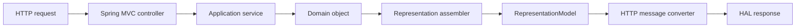

# Controller trả representation

## Mục tiêu

Sau bài này, bạn có thể xây dựng Spring MVC controller trả về representation model của Spring HATEOAS, chọn đúng kiểu trả về cho tài nguyên đơn, collection và dữ liệu phân trang, kết hợp `ResponseEntity` khi cần điều khiển status/header, đồng thời kiểm thử response HAL qua MockMvc.

## 1. Controller là điểm đưa representation ra HTTP

Trong Spring HATEOAS, controller nhận HTTP request, gọi service để xử lý nghiệp vụ và trả về một representation có dữ liệu cùng hypermedia links. Spring MVC chịu trách nhiệm ghi đối tượng trả về vào HTTP response thông qua các message converter đã cấu hình.

Một luồng xử lý thường gặp:



Controller không cần tự tạo chuỗi JSON. Nó trả về một kiểu Java mô tả representation; Spring HATEOAS và message converter chuyển đổi kiểu đó thành định dạng hypermedia đã thương lượng.

Ví dụ response HAL của một đơn hàng:

```json
{
  "id": "order-42",
  "status": "PENDING",
  "total": 125000,
  "_links": {
    "self": {
      "href": "/orders/order-42"
    },
    "collection": {
      "href": "/orders"
    }
  }
}
```

Các trường dữ liệu mô tả đơn hàng; `_links` cung cấp các URI mà client có thể theo. Đây là representation mà controller công bố cho client, không phải cấu trúc entity persistence bắt buộc của ứng dụng.

## 2. Dùng @RestController để trả response body

Trong Spring MVC, `@RestController` là annotation kết hợp `@Controller` và `@ResponseBody`. Vì vậy, giá trị trả về từ phương thức controller được ghi vào response body qua cơ chế chuyển đổi của Spring MVC.

```java
@RestController
@RequestMapping("/orders")
public class OrderController {

    private final OrderService orderService;
    private final OrderModelAssembler assembler;

    public OrderController(
            OrderService orderService,
            OrderModelAssembler assembler) {
        this.orderService = orderService;
        this.assembler = assembler;
    }

    @GetMapping("/{id}")
    public OrderModel getOrder(@PathVariable UUID id) {
        return assembler.toModel(orderService.getRequired(id));
    }
}
```

Đây là phần rút gọn của controller; constructor injection và các dependency được trình bày đầy đủ ở ví dụ endpoint chi tiết bên dưới.

Nếu dùng `@Controller` thông thường, có thể đặt `@ResponseBody` ở từng phương thức hoặc ở cấp class để Spring xử lý giá trị trả về như response body. Nếu không có `@ResponseBody`, một giá trị kiểu String có thể được hiểu là tên view thay vì nội dung response.

Với API REST dùng Spring HATEOAS, `@RestController` thường là lựa chọn đơn giản và rõ ràng. Controller trả về các kiểu như `RepresentationModel`, `EntityModel`, `CollectionModel` hoặc `PagedModel`; message converter sẽ serialize chúng theo media type được chọn.

## 3. Chọn kiểu representation cho từng endpoint

Spring HATEOAS cung cấp một số kiểu model phổ biến:

| Kiểu trả về | Dùng khi | Ví dụ |
|---|---|---|
| `RepresentationModel<T>` | Model cơ sở có links | DTO kế thừa RepresentationModel |
| `EntityModel<T>` | Bao một đối tượng cùng links | Một đơn hàng |
| `CollectionModel<T>` | Bao một tập hợp cùng links cấp collection | Danh sách đơn hàng |
| `PagedModel<T>` | Bao một trang dữ liệu, metadata và links phân trang | Trang kết quả tìm kiếm |
| `ResponseEntity<T>` | Cần kiểm soát status và headers ngoài body | Tạo tài nguyên trả 201 và Location |

Có thể trả trực tiếp một lớp kế thừa `RepresentationModel`, hoặc bao dữ liệu bằng `EntityModel`. Ví dụ:

```java
import java.math.BigDecimal;
import java.util.UUID;

import org.springframework.hateoas.RepresentationModel;
import org.springframework.hateoas.server.core.Relation;

@Relation(value = "order", collectionRelation = "orders")
public class OrderModel extends RepresentationModel<OrderModel> {

    private final UUID id;
    private final String status;
    private final BigDecimal total;

    public OrderModel(UUID id, String status, BigDecimal total) {
        this.id = id;
        this.status = status;
        this.total = total;
    }

    public UUID getId() {
        return id;
    }

    public String getStatus() {
        return status;
    }

    public BigDecimal getTotal() {
        return total;
    }
}
```

Với lớp này, controller có thể trả `OrderModel` trực tiếp. Dữ liệu và links cùng nằm trong một representation model.

Nếu dùng DTO không kế thừa `RepresentationModel`, có thể bao nó bằng `EntityModel<OrderView>`:

```java
EntityModel<OrderView> model = EntityModel.of(
        orderView,
        orderSelfLink
);
```

Chọn một kiểu nhất quán theo cách tổ chức assembler của dự án. Điều quan trọng là controller trả representation model mà Spring HATEOAS có thể xử lý, thay vì tự ghép JSON hoặc để entity persistence quyết định hợp đồng công khai.

## 4. Tách chuyển đổi representation vào assembler

Assembler giúp nhiều endpoint sử dụng cùng một quy tắc ánh xạ domain object thành representation. Controller chỉ điều phối service và assembler.

Ví dụ assembler cho đơn hàng:

```java
@Component
public class OrderModelAssembler
        implements RepresentationModelAssembler<Order, OrderModel> {

    @Override
    public OrderModel toModel(Order order) {
        OrderModel model = new OrderModel(
                order.getId(),
                order.getStatus().name(),
                order.getTotal()
        );

        model.add(linkTo(methodOn(OrderController.class)
                .getOrder(order.getId())).withSelfRel());

        model.add(linkTo(methodOn(OrderController.class)
                .getOrders()).withRel("collection"));

        return model;
    }

    @Override
    public CollectionModel<OrderModel> toCollectionModel(
            Iterable<? extends Order> orders) {

        CollectionModel<OrderModel> collection =
                RepresentationModelAssembler.super
                        .toCollectionModel(orders);

        collection.add(linkTo(methodOn(OrderController.class)
                .getOrders()).withSelfRel());

        return collection;
    }
}
```

Các import chính:

```java
import org.springframework.hateoas.CollectionModel;
import org.springframework.hateoas.server.RepresentationModelAssembler;
import org.springframework.stereotype.Component;

import static org.springframework.hateoas.server.mvc.WebMvcLinkBuilder.linkTo;
import static org.springframework.hateoas.server.mvc.WebMvcLinkBuilder.methodOn;
```

Phương thức `toModel(...)` chuyển một đơn hàng thành `OrderModel` và thêm link. `toCollectionModel(...)` sử dụng implementation mặc định để chuyển từng item, sau đó thêm self link ở cấp collection.

Assembler không nên trở thành nơi thực thi nghiệp vụ. Việc kiểm tra quyền, thay đổi trạng thái hoặc truy vấn dữ liệu thuộc service/domain. Assembler tập trung vào trường dữ liệu công khai và các quan hệ hypermedia cần công bố.

## 5. Controller trả representation cho một tài nguyên

Sau khi có assembler, endpoint chi tiết có thể trả về `OrderModel`:

```java
@RestController
@RequestMapping(
        value = "/orders",
        produces = MediaTypes.HAL_JSON_VALUE
)
public class OrderController {

    private final OrderService orderService;
    private final OrderModelAssembler assembler;

    public OrderController(
            OrderService orderService,
            OrderModelAssembler assembler) {
        this.orderService = orderService;
        this.assembler = assembler;
    }

    @GetMapping("/{id}")
    public OrderModel getOrder(@PathVariable UUID id) {
        Order order = orderService.getRequired(id);
        return assembler.toModel(order);
    }
}
```

Controller thực hiện ba bước:

1. Nhận ID từ path variable.
2. Gọi service lấy domain object theo quy tắc nghiệp vụ.
3. Dùng assembler tạo representation rồi trả về.

`produces = MediaTypes.HAL_JSON_VALUE` giới hạn định dạng response của mapping. Client cần gửi `Accept: application/hal+json` để yêu cầu HAL. Nếu ứng dụng hỗ trợ nhiều định dạng, có thể khai báo nhiều media type hoặc để content negotiation theo cấu hình chung.

Không cần gọi Jackson trực tiếp trong controller. Spring MVC chọn message converter phù hợp và serialize `OrderModel` thành HAL, bao gồm dữ liệu và links.

## 6. Controller trả collection

Endpoint collection nên trả `CollectionModel<T>` thay vì một `List<T>` thuần khi API cần hypermedia ở cấp tập hợp.

```java
@GetMapping
public CollectionModel<OrderModel> getOrders() {
    List<Order> orders = orderService.findAll();

    return assembler.toCollectionModel(orders);
}
```

Với assembler ở phần trước, response HAL có thể có dạng:

```json
{
  "_embedded": {
    "orders": [
      {
        "id": "order-42",
        "status": "PENDING",
        "total": 125000,
        "_links": {
          "self": {
            "href": "/orders/order-42"
          },
          "collection": {
            "href": "/orders"
          }
        }
      }
    ]
  },
  "_links": {
    "self": {
      "href": "/orders"
    }
  }
}
```

Tên relation trong `_embedded` phụ thuộc metadata relation của kiểu model, ví dụ `@Relation(value = "order", collectionRelation = "orders")`. Hãy khai báo relation tường minh nếu client phụ thuộc vào tên đó.

Nếu endpoint trả collection rỗng, cung cấp fallback type khi cần để serializer xác định relation collection:

```java
return CollectionModel.empty(OrderModel.class)
        .add(linkTo(methodOn(OrderController.class)
                .getOrders()).withSelfRel());
```

Không nên trả `List<Order>` trực tiếp nếu hợp đồng yêu cầu link cấp collection hoặc relation embedded ổn định. Collection model cho phép API biểu diễn cả các item và khả năng điều hướng ở cấp tập hợp.

## 7. Controller trả dữ liệu phân trang

Với collection lớn, controller nên nhận `Pageable`, service trả `Page<T>`, sau đó `PagedResourcesAssembler` chuyển thành `PagedModel<T>`.

```java
@GetMapping("/search")
public PagedModel<OrderModel> searchOrders(
        Pageable pageable,
        PagedResourcesAssembler<Order> pagedAssembler) {

    Page<Order> page = orderService.findOrders(pageable);

    return pagedAssembler.toModel(page, assembler);
}
```

Response HAL có thể bao gồm:

- `_embedded` chứa các item của trang hiện tại.
- `_links.first`, `_links.prev`, `_links.self`, `_links.next`, `_links.last` khi phù hợp.
- `page.size`, `page.totalElements`, `page.totalPages` và `page.number`.

`PagedResourcesAssembler` đảm nhiệm việc áp dụng assembler cho từng phần tử và tạo link phân trang theo request hiện tại. Client nên theo href server trả về thay vì tự cộng số trang, vì link có thể chứa filter, sort hoặc các tham số khác.

Nếu controller cần công bố bộ lọc, hãy đưa chúng vào truy vấn service và kiểm tra các link điều hướng có giữ nguyên filter. Không tự ghép link phân trang trong controller khi đã có cơ chế assembler phù hợp.

## 8. Dùng ResponseEntity khi cần điều khiển HTTP response

Trả trực tiếp representation model là đủ khi status mặc định là 200 và không cần tùy chỉnh headers. Khi cần trả status hoặc header cụ thể, bọc representation trong `ResponseEntity<T>`.

Ví dụ tạo đơn hàng mới:

```java
@PostMapping(consumes = MediaType.APPLICATION_JSON_VALUE)
public ResponseEntity<OrderModel> createOrder(
        @Valid @RequestBody CreateOrderRequest request) {

    Order created = orderService.create(request);
    OrderModel model = assembler.toModel(created);

    URI location = URI.create(
            model.getRequiredLink(IanaLinkRelations.SELF).getHref()
    );

    return ResponseEntity.created(location).body(model);
}
```

Response có status `201 Created`, header `Location` trỏ đến tài nguyên mới và body chứa representation của đơn hàng vừa tạo.

Ví dụ cập nhật trả 200:

```java
@PutMapping("/{id}")
public ResponseEntity<OrderModel> updateOrder(
        @PathVariable UUID id,
        @Valid @RequestBody UpdateOrderRequest request) {

    Order updated = orderService.update(id, request);
    return ResponseEntity.ok(assembler.toModel(updated));
}
```

Nếu endpoint xóa không cần trả representation, có thể trả `ResponseEntity.noContent().build()` để biểu diễn `204 No Content`. Nếu API muốn client tiếp tục khám phá sau thao tác, có thể cân nhắc trả representation phù hợp theo hợp đồng.

Các import thường dùng:

```java
import java.net.URI;

import org.springframework.http.MediaType;
import org.springframework.http.ResponseEntity;
import org.springframework.hateoas.IanaLinkRelations;
import org.springframework.hateoas.MediaTypes;
```

`ResponseEntity` chỉ điều khiển status, headers và body. Nội dung body vẫn nên là representation model được xây dựng bằng assembler.

## 9. Content negotiation quyết định định dạng response

Controller có thể trả cùng một kiểu Java nhưng response media type khác nhau tùy request và cấu hình.

Ví dụ client yêu cầu HAL:

```http
GET /orders/42 HTTP/1.1
Accept: application/hal+json
```

Server trả:

```http
HTTP/1.1 200 OK
Content-Type: application/hal+json
```

Nếu endpoint chỉ hỗ trợ HAL nhưng client yêu cầu XML, Spring MVC thường trả `406 Not Acceptable`. Nếu request body gửi sai media type so với `consumes`, server có thể trả `415 Unsupported Media Type`.

Khi endpoint hỗ trợ HAL-FORMS, có thể khai báo thêm `MediaTypes.HAL_FORMS_JSON_VALUE` trong `produces`. Khi client gửi `Accept: application/prs.hal-forms+json`, converter tương ứng có thể serialize affordance thành `_templates`.

Hãy phân biệt:

- `Accept`: định dạng response client muốn nhận.
- `Content-Type`: định dạng request body client gửi.
- `produces`: media type endpoint có thể trả.
- `consumes`: media type endpoint có thể nhận.

## 10. Xử lý tài nguyên không tồn tại và lỗi request

Controller nên để service hoặc tầng nghiệp vụ xác định tài nguyên có tồn tại hay không. Nếu không tìm thấy, service có thể ném exception miền hoặc exception phù hợp; `@ControllerAdvice` ánh xạ lỗi đó thành HTTP status và body theo hợp đồng API.

Ví dụ:

```java
@RestControllerAdvice
public class ApiExceptionHandler {

    @ExceptionHandler(OrderNotFoundException.class)
    public ResponseEntity<ProblemDetail> handleNotFound(
            OrderNotFoundException exception) {

        ProblemDetail problem = ProblemDetail.forStatusAndDetail(
                HttpStatus.NOT_FOUND,
                exception.getMessage()
        );

        problem.setTitle("Order not found");
        return ResponseEntity.status(HttpStatus.NOT_FOUND).body(problem);
    }
}
```

Ví dụ dùng `ProblemDetail` của Spring Framework để biểu diễn lỗi. Nếu API có định dạng lỗi hypermedia riêng, hãy cấu hình và kiểm thử nó theo cùng nguyên tắc content negotiation. Không nên trả một representation thành công với dữ liệu rỗng chỉ để tránh status lỗi.

Lỗi validation của `@Valid` cũng nên được ánh xạ nhất quán, thường là 400. Client cần nhận được thông tin đủ rõ để sửa request mà không làm lộ stack trace hoặc chi tiết nội bộ.

## 11. Kiểm thử controller trả representation bằng MockMvc

MockMvc kiểm tra request đi qua Spring MVC, controller, assembler và message converter mà không cần khởi động HTTP server thật.

Kiểm tra endpoint item:

```java
mockMvc.perform(get("/orders/{id}", orderId)
        .accept(MediaTypes.HAL_JSON))
    .andExpect(status().isOk())
    .andExpect(content().contentTypeCompatibleWith(
            MediaTypes.HAL_JSON))
    .andExpect(jsonPath("$.id").value(orderId.toString()))
    .andExpect(jsonPath("$._links.self.href")
            .value(endsWith("/orders/" + orderId)));
```

Kiểm tra collection:

```java
mockMvc.perform(get("/orders")
        .accept(MediaTypes.HAL_JSON))
    .andExpect(status().isOk())
    .andExpect(jsonPath("$._embedded.orders").isArray())
    .andExpect(jsonPath("$._links.self.href").exists())
    .andExpect(jsonPath("$._embedded.orders[0]._links.self.href")
            .exists());
```

Kiểm tra tạo tài nguyên:

```java
mockMvc.perform(post("/orders")
        .contentType(MediaType.APPLICATION_JSON)
        .accept(MediaTypes.HAL_JSON)
        .content("""
            {
              "customerId": "customer-7",
              "note": "Giao sau 17 giờ"
            }
            """))
    .andExpect(status().isCreated())
    .andExpect(header().exists(HttpHeaders.LOCATION))
    .andExpect(jsonPath("$._links.self.href").exists());
```

Các test giả định controller, service và fixture đã được cấu hình trong test context. Với test slice `@WebMvcTest`, cần import assembler và mock các dependency của controller nếu chúng không nằm trong slice.

Nên kiểm tra thêm:

1. Endpoint trả 200 và đúng media type khi client yêu cầu HAL.
2. Collection rỗng vẫn serialize đúng relation theo hợp đồng.
3. Endpoint phân trang trả metadata và link điều hướng đúng.
4. Endpoint tạo mới trả 201, Location và self link trỏ cùng tài nguyên.
5. Client yêu cầu media type không hỗ trợ nhận 406.
6. Request body có media type không được hỗ trợ nhận 415.
7. Tài nguyên không tồn tại trả 404.
8. Request validation sai trả status và body lỗi đúng hợp đồng.

## 12. Những lỗi thường gặp

**Trả entity JPA trực tiếp từ controller.** Entity có thể chứa quan hệ persistence, lazy proxy hoặc trường nội bộ. Dùng DTO và representation model để kiểm soát dữ liệu công khai.

**Trả List thuần trong endpoint cần hypermedia.** Client không nhận được link cấp collection hoặc relation embedded. Dùng `CollectionModel` và assembler.

**Tự serialize JSON trong controller.** Việc này bỏ qua content negotiation và message converter. Trả kiểu representation Java để Spring MVC xử lý.

**Gắn link trong mọi controller một cách lặp lại.** Các response dễ có relation không nhất quán. Dùng assembler hoặc processor phù hợp để tập trung logic.

**Dùng ResponseEntity nhưng body không phải representation.** Status và headers có thể đúng nhưng client không có hypermedia links. Đưa representation model vào body.

**Quên Location khi tạo tài nguyên.** Client phải tự đoán URI của tài nguyên mới. Trả 201 cùng Location và self link.

**Khai báo produces nhưng không có converter tương ứng.** Content negotiation có thể thất bại hoặc response không có cấu trúc mong đợi. Kiểm tra cấu hình Spring HATEOAS và test qua HTTP.

**Cho rằng link thay thế validation hoặc authorization.** Client có thể gửi request trực tiếp. Server phải kiểm tra quyền và quy tắc nghiệp vụ ở mọi endpoint.

## 13. Nguyên tắc thiết kế

- Dùng `@RestController` để controller trả response body theo cơ chế Spring MVC.
- Trả `RepresentationModel`, `EntityModel`, `CollectionModel` hoặc `PagedModel` tùy loại tài nguyên.
- Dùng assembler để ánh xạ domain object thành representation và link.
- Dùng `ResponseEntity<T>` khi cần kiểm soát status hoặc headers.
- Trả 201 và Location khi tạo tài nguyên mới.
- Dùng `PagedResourcesAssembler` cho `Page<T>` và link điều hướng.
- Để message converter xử lý serialization và content negotiation.
- Dùng DTO để giới hạn dữ liệu công khai.
- Kiểm thử status, media type, body, links và headers bằng MockMvc.

## Kết luận

Spring MVC controller có thể trả trực tiếp representation model của Spring HATEOAS; message converter sẽ serialize model thành HAL hoặc định dạng hypermedia đã thương lượng. Dùng model đơn cho tài nguyên, `CollectionModel` cho collection và `PagedModel` cho dữ liệu phân trang. Khi cần status hoặc headers cụ thể, bọc representation trong `ResponseEntity`. Tách ánh xạ vào assembler, giữ logic nghiệp vụ ở service và kiểm thử response HTTP qua MockMvc để bảo vệ hợp đồng hypermedia.

## Tài liệu tham khảo

- [Spring HATEOAS Reference – Representation models](https://docs.spring.io/spring-hateoas/docs/current/reference/html/#fundamentals.representation-models)
- [Spring HATEOAS Reference – Spring MVC integration](https://docs.spring.io/spring-hateoas/docs/current/reference/html/#server.mvc)
- [Spring Framework Reference – @RestController](https://docs.spring.io/spring-framework/reference/web/webmvc/mvc-controller/ann.html)
- [Spring Framework Reference – ResponseEntity](https://docs.spring.io/spring-framework/reference/web/webmvc/mvc-controller/ann-methods/responseentity.html)

