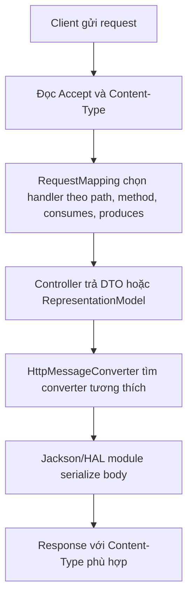

# Content negotiation MVC

Content negotiation là cơ chế để client và server thống nhất định dạng representation được trao đổi qua HTTP. Trong Spring MVC, client thường gửi header `Accept` để yêu cầu media type muốn nhận; Spring chọn controller mapping và `HttpMessageConverter` phù hợp để ghi response. Với Spring HATEOAS, cơ chế này quyết định representation model được serialize thành HAL, HAL-FORMS hay một định dạng khác.

Ví dụ, cùng một đơn hàng có thể được trả dưới dạng HAL JSON (`application/hal+json`) để client điều hướng qua `_links`, hoặc HAL-FORMS (`application/prs.hal-forms+json`) để client còn đọc được `_templates` mô tả thao tác. Việc chọn media type cần nhất quán giữa `Accept`, `produces`, hypermedia configuration và converter đang được đăng ký trong ứng dụng.

## Hai header cần phân biệt

`Accept` và `Content-Type` thường bị nhầm vì cả hai đều chứa media type, nhưng chúng mô tả hai chiều khác nhau:

| Header | Hướng | Ý nghĩa | Ví dụ |
|---|---|---|---|
| `Accept` | Client gửi tới server | Client muốn nhận response ở định dạng nào | `application/hal+json` |
| `Content-Type` | Client gửi body tới server hoặc server gửi response | Body hiện tại được mã hóa theo định dạng nào | `application/json` |

Ví dụ request GET không có body:

```http
GET /api/orders/ORD-2048 HTTP/1.1
Accept: application/hal+json
```

Server có thể trả:

```http
HTTP/1.1 200 OK
Content-Type: application/hal+json

{
  "id": "ORD-2048",
  "status": "PENDING",
  "_links": {
    "self": { "href": "/api/orders/ORD-2048" }
  }
}
```

Với request PUT có JSON body, client gửi cả hai header:

```http
PUT /api/orders/ORD-2048 HTTP/1.1
Content-Type: application/json
Accept: application/hal+json

{
  "note": "Giao hàng buổi sáng"
}
```

`Content-Type` cho biết cách đọc request body; `Accept` cho biết client muốn nhận response theo định dạng nào. Server có thể đọc JSON và trả HAL JSON trong cùng một request.

## Spring MVC chọn media type như thế nào?

Spring MVC mặc định dùng header `Accept` để xác định media type client yêu cầu. Quá trình xử lý có thể hình dung như sau:



Các thành phần có vai trò riêng:

- `Accept` tham gia lựa chọn representation mà client muốn nhận.
- `produces` giới hạn media type mà một handler có thể trả.
- `Content-Type` của request được so với `consumes` khi handler nhận body.
- `HttpMessageConverter` đọc request body hoặc ghi response body theo media type và kiểu Java.
- Hypermedia configuration đăng ký Jackson module và converter để serialize representation model theo định dạng được hỗ trợ.

Nếu client gửi nhiều media type trong `Accept`, có thể kèm quality value (`q`) để biểu thị mức ưu tiên:

```http
Accept: application/prs.hal-forms+json;q=1.0, application/hal+json;q=0.8, application/json;q=0.5
```

Server chọn một định dạng tương thích theo mapping và khả năng của converter. Nếu không có định dạng nào được chấp nhận, Spring MVC có thể trả `406 Not Acceptable`.

## Khai báo media type bằng produces

`produces` khai báo định dạng response mà một controller method có thể tạo. Spring MVC dùng điều kiện này để so khớp với `Accept`:

```java
import java.util.UUID;

import org.springframework.hateoas.EntityModel;
import org.springframework.hateoas.MediaTypes;
import org.springframework.web.bind.annotation.GetMapping;
import org.springframework.web.bind.annotation.PathVariable;
import org.springframework.web.bind.annotation.RequestMapping;
import org.springframework.web.bind.annotation.RestController;

@RestController
@RequestMapping("/api/orders")
public class OrderController {

    private final OrderService service;
    private final OrderModelAssembler assembler;

    public OrderController(OrderService service, OrderModelAssembler assembler) {
        this.service = service;
        this.assembler = assembler;
    }

    @GetMapping(value = "/{id}", produces = MediaTypes.HAL_JSON_VALUE)
    public EntityModel<OrderResponse> one(@PathVariable UUID id) {
        return assembler.toModel(service.findRequired(id));
    }
}
```

Ở đây handler chỉ nhận request có `Accept` tương thích với `application/hal+json`. Spring HATEOAS chuyển `EntityModel<OrderResponse>` thành HAL JSON thông qua hypermedia-aware message converter.

Có thể khai báo nhiều media type trong một mapping nếu cùng handler và representation có thể phục vụ các định dạng đó:

```java
@GetMapping(
        value = "/{id}",
        produces = {
                MediaTypes.HAL_JSON_VALUE,
                MediaTypes.HAL_FORMS_JSON_VALUE
        }
)
public EntityModel<OrderResponse> one(@PathVariable UUID id) {
    return assembler.toModel(service.findRequired(id));
}
```

Chỉ khai báo nhiều `produces` khi ứng dụng đã đăng ký hỗ trợ tất cả media type tương ứng. Nếu response cần khác nhau đáng kể, ví dụ một dạng có `_templates` và một dạng không có, hãy cân nhắc handler riêng cho từng representation để dễ kiểm soát hợp đồng.

## Khai báo consumes cho request body

`consumes` giới hạn media type của body client gửi lên. Nó không quyết định định dạng response; định dạng response vẫn được thương lượng qua `Accept` và `produces`.

```java
import java.util.UUID;

import jakarta.validation.Valid;
import org.springframework.hateoas.EntityModel;
import org.springframework.hateoas.MediaTypes;
import org.springframework.http.MediaType;
import org.springframework.http.ResponseEntity;
import org.springframework.web.bind.annotation.PathVariable;
import org.springframework.web.bind.annotation.PutMapping;
import org.springframework.web.bind.annotation.RequestBody;

@PutMapping(
        value = "/{id}",
        consumes = MediaType.APPLICATION_JSON_VALUE,
        produces = MediaTypes.HAL_JSON_VALUE
)
public ResponseEntity<EntityModel<OrderResponse>> update(
        @PathVariable UUID id,
        @Valid @RequestBody UpdateOrderRequest request
) {
    Order updated = service.update(id, request);
    return ResponseEntity.ok(assembler.toModel(updated));
}
```

Trong ví dụ, server chỉ nhận request body JSON. Sau khi cập nhật thành công, server trả representation HAL JSON. Nếu client gửi XML trong `Content-Type`, request không thỏa `consumes` và Spring MVC trả `415 Unsupported Media Type`.

Nếu không khai báo `consumes`, Spring vẫn dùng các `HttpMessageConverter` đã đăng ký để tìm converter có thể đọc body. Khai báo `consumes` hữu ích khi API muốn giới hạn rõ hợp đồng đầu vào.

## Media type thường dùng với Spring HATEOAS

Spring HATEOAS cung cấp hằng media type trong `MediaTypes`, tránh phải tự gõ chuỗi ở nhiều nơi:

| Media type | Hằng Spring HATEOAS | Công dụng |
|---|---|---|
| `application/hal+json` | `MediaTypes.HAL_JSON` / `HAL_JSON_VALUE` | HAL JSON với `_links` và `_embedded` |
| `application/prs.hal-forms+json` | `MediaTypes.HAL_FORMS_JSON` / `HAL_FORMS_JSON_VALUE` | HAL-FORMS với `_templates` mô tả thao tác |
| `application/alps+json` | `MediaTypes.ALPS_JSON` / `ALPS_JSON_VALUE` | ALPS profile mô tả ngữ nghĩa và descriptor |
| `application/vnd.collection+json` | `MediaTypes.COLLECTION_JSON` / `COLLECTION_JSON_VALUE` | Collection+JSON |
| `application/vnd.amundsen-uber+json` | `MediaTypes.UBER_JSON` / `UBER_JSON_VALUE` | UBER hypermedia format |

Với module Spring HATEOAS cơ bản, HAL và HAL-FORMS là hai định dạng thường gặp nhất. Chỉ đưa media type vào `produces` nếu ứng dụng có hypermedia mapping và converter thực sự hỗ trợ nó.

## Bật hypermedia support cho Spring MVC

Spring HATEOAS cần đăng ký Jackson module và converter tương ứng để serialize `EntityModel`, `CollectionModel` và các kiểu kế thừa `RepresentationModel` theo media type được chọn.

### Ứng dụng Spring Boot

Với Spring Boot MVC, thêm starter:

```groovy
dependencies {
    implementation 'org.springframework.boot:spring-boot-starter-web'
    implementation 'org.springframework.boot:spring-boot-starter-hateoas'
}
```

Spring Boot tự cấu hình phần lớn hạ tầng Spring HATEOAS. Auto-configuration đăng ký `JsonMapper` phù hợp và các bean cần thiết, vì vậy ứng dụng Boot thường không cần thêm `@EnableHypermediaSupport`.

Boot mặc định có hành vi đặc biệt: request chấp nhận `application/json` có thể nhận response `application/hal+json`. Điều này giúp client JSON thông thường tương thích với API hypermedia mà không cần gửi media type HAL tường minh. Có thể tắt alias này bằng cấu hình:

```yaml
spring:
  hateoas:
    use-hal-as-default-json-media-type: false
```

Sau khi tắt, `application/json` và `application/hal+json` được phân biệt rõ hơn. Điều này hữu ích khi API thật sự muốn cung cấp một DTO JSON thuần song song với HAL.

Không thêm `@EnableHypermediaSupport` chỉ để “bật HATEOAS” trong ứng dụng Boot đã dùng auto-configuration. Khi tự bật annotation, ứng dụng chuyển sang tự kiểm soát cấu hình hypermedia và phần tùy biến `JsonMapper` mà Boot thực hiện trước đó không còn được áp dụng theo cách mặc định.

### Cấu hình Spring MVC tự quản lý

Nếu không dùng auto-configuration của Spring Boot, có thể bật một hoặc nhiều định dạng hypermedia cho Web MVC:

```java
import org.springframework.context.annotation.Configuration;
import org.springframework.hateoas.config.EnableHypermediaSupport;
import org.springframework.hateoas.config.EnableHypermediaSupport.HypermediaType;
import org.springframework.hateoas.support.WebStack;

@Configuration
@EnableHypermediaSupport(
        type = { HypermediaType.HAL, HypermediaType.HAL_FORMS },
        stacks = WebStack.WEBMVC
)
public class HypermediaMvcConfiguration {
}
```

`type` nhận một mảng `HypermediaType`, vì vậy có thể bật HAL và HAL-FORMS cùng lúc. `stacks = WebStack.WEBMVC` giới hạn cấu hình vào Spring MVC; điều này hữu ích nếu ứng dụng đồng thời dùng một số thành phần WebFlux cho client nhưng không muốn tự động bật hypermedia cho stack đó.

Annotation đăng ký các Jackson module và hạ tầng cần thiết để render representation model. Nếu dùng Spring Boot, hãy chọn auto-configuration hoặc tự kiểm soát cấu hình có chủ đích, tránh khai báo chồng lấp.

## Phục vụ HAL và HAL-FORMS tại cùng URI

Một tài nguyên có thể được biểu diễn theo HAL hoặc HAL-FORMS. HAL tập trung vào link và embedded resource; HAL-FORMS bổ sung template mô tả method và input. Có thể dùng hai handler cùng path nhưng khác `produces` để mỗi media type có representation rõ ràng:

```java
@GetMapping(value = "/{id}", produces = MediaTypes.HAL_JSON_VALUE)
public EntityModel<EmployeeResponse> oneAsHal(@PathVariable UUID id) {
    return assembler.toModel(service.findRequired(id));
}

@GetMapping(value = "/{id}", produces = MediaTypes.HAL_FORMS_JSON_VALUE)
public EntityModel<EmployeeResponse> oneAsHalForms(@PathVariable UUID id) {
    return assembler.toModel(service.findRequired(id));
}
```

Assembler có thể gắn affordance PUT vào self link. Với HAL JSON, client nhận link; với HAL-FORMS, converter có thể render thêm `_templates` dựa trên affordance. Controller không phải tự tạo JSON template.

Client chọn representation qua `Accept`:

```http
GET /api/employees/42 HTTP/1.1
Accept: application/hal+json
```

hoặc:

```http
GET /api/employees/42 HTTP/1.1
Accept: application/prs.hal-forms+json
```

Nếu ứng dụng chỉ bật HAL mà chưa bật HAL-FORMS, request thứ hai không có converter tương thích và có thể nhận `406 Not Acceptable`. Khai báo `produces` một mình không tự đăng ký converter cho media type đó.

## Phân biệt HAL và JSON thuần trong cùng API

Một số API cần duy trì endpoint JSON thuần cho client cũ và đồng thời cung cấp HAL cho client có khả năng điều hướng. Với Spring Boot, trước hết tắt hành vi mặc định map `application/json` sang HAL:

```yaml
spring:
  hateoas:
    use-hal-as-default-json-media-type: false
```

Sau đó có thể khai báo hai handler cùng URL, một handler trả DTO JSON và handler còn lại trả `EntityModel`:

```java
@GetMapping(value = "/{id}", produces = MediaType.APPLICATION_JSON_VALUE)
public OrderResponse oneAsJson(@PathVariable UUID id) {
    return service.findRequired(id).toResponse();
}

@GetMapping(value = "/{id}", produces = MediaTypes.HAL_JSON_VALUE)
public EntityModel<OrderResponse> oneAsHal(@PathVariable UUID id) {
    return assembler.toModel(service.findRequired(id));
}
```

Khi client gửi `Accept: application/json`, Spring chọn handler JSON; khi client gửi `Accept: application/hal+json`, Spring chọn handler HAL. Cả hai representation cần có hợp đồng riêng và được kiểm thử độc lập. Chỉ nên duy trì hai dạng nếu có nhu cầu tương thích hoặc tích hợp thực tế, vì mỗi dạng làm tăng số hợp đồng mà nhóm phát triển phải bảo vệ.

## Cấu hình ContentNegotiationConfigurer

Spring MVC mặc định dùng `Accept`. Nếu hệ thống cũ cần chọn media type bằng query parameter, có thể đăng ký mapping qua `WebMvcConfigurer`:

```java
import org.springframework.context.annotation.Configuration;
import org.springframework.hateoas.MediaTypes;
import org.springframework.http.MediaType;
import org.springframework.web.servlet.config.annotation.ContentNegotiationConfigurer;
import org.springframework.web.servlet.config.annotation.WebMvcConfigurer;

@Configuration
public class WebContentNegotiationConfiguration implements WebMvcConfigurer {

    @Override
    public void configureContentNegotiation(ContentNegotiationConfigurer configurer) {
        configurer
                .favorParameter(true)
                .parameterName("format")
                .mediaType("hal", MediaTypes.HAL_JSON)
                .mediaType("json", MediaType.APPLICATION_JSON);
    }
}
```

Client khi đó có thể gọi `/api/orders/ORD-2048?format=hal` hoặc `?format=json`. Query parameter strategy cần mapping media type tương ứng. Nếu đã bật strategy này, hãy quy định rõ thứ tự ưu tiên giữa query parameter và `Accept` để client không gửi hai lựa chọn mâu thuẫn.

Đối với API mới, ưu tiên header `Accept` theo HTTP. Không nên dùng path extension như `/orders/42.json` làm chiến lược chính; Spring Framework khuyến nghị query parameter nếu bắt buộc phải dùng URL-based content negotiation, do các vấn đề an toàn và mơ hồ khi suy luận media type từ phần mở rộng đường dẫn.

## Lỗi 406 và 415

Hai lỗi này liên quan tới hai chiều media type khác nhau:

| Status | Nguyên nhân | Ví dụ |
|---|---|---|
| `406 Not Acceptable` | Server không thể tạo response theo `Accept` mà client yêu cầu | Endpoint chỉ `produces = application/hal+json`, client yêu cầu `application/xml` |
| `415 Unsupported Media Type` | Server không thể đọc request body theo `Content-Type` gửi lên hoặc body không khớp `consumes` | Endpoint `consumes = application/json`, client gửi XML |

Khi gặp 406, kiểm tra `produces`, `Accept`, hypermedia support và converter ghi response. Khi gặp 415, kiểm tra `Content-Type`, `consumes` và converter đọc request body. Không xử lý cả hai lỗi bằng cách thay header một cách ngẫu nhiên; hãy xác định phía nào của quá trình trao đổi không tương thích.

## Kiểm thử Content Negotiation bằng MockMvc

MockMvc giúp kiểm tra handler được chọn, status và `Content-Type` thực tế. Ví dụ test HAL:

```java
import static org.springframework.test.web.servlet.request.MockMvcRequestBuilders.get;
import static org.springframework.test.web.servlet.result.MockMvcResultMatchers.content;
import static org.springframework.test.web.servlet.result.MockMvcResultMatchers.jsonPath;
import static org.springframework.test.web.servlet.result.MockMvcResultMatchers.status;

import org.junit.jupiter.api.Test;
import org.springframework.beans.factory.annotation.Autowired;
import org.springframework.boot.test.autoconfigure.web.servlet.AutoConfigureMockMvc;
import org.springframework.boot.test.context.SpringBootTest;
import org.springframework.hateoas.MediaTypes;
import org.springframework.test.web.servlet.MockMvc;

@SpringBootTest
@AutoConfigureMockMvc
class OrderContentNegotiationTest {

    @Autowired
    MockMvc mockMvc;

    @Test
    void returnsHalWhenClientAcceptsHalJson() throws Exception {
        mockMvc.perform(get("/api/orders/ORD-2048")
                .accept(MediaTypes.HAL_JSON))
            .andExpect(status().isOk())
            .andExpect(content().contentTypeCompatibleWith(MediaTypes.HAL_JSON))
            .andExpect(jsonPath("$._links.self.href").exists());
    }
}
```

Kiểm tra 406 khi yêu cầu media type không được endpoint hỗ trợ:

Các đoạn kiểm tra 406 và 415 sau đây là phần bổ sung cho test class `OrderContentNegotiationTest` ở trên.

```java
import static org.springframework.test.web.servlet.request.MockMvcRequestBuilders.get;
import static org.springframework.test.web.servlet.result.MockMvcResultMatchers.status;

import org.springframework.http.MediaType;

mockMvc.perform(get("/api/orders/ORD-2048")
        .accept(MediaType.APPLICATION_XML))
    .andExpect(status().isNotAcceptable());
```

Kiểm tra 415 khi gửi sai `Content-Type` cho endpoint chỉ nhận JSON:

```java
import static org.springframework.test.web.servlet.request.MockMvcRequestBuilders.put;
import static org.springframework.test.web.servlet.result.MockMvcResultMatchers.status;

mockMvc.perform(put("/api/orders/ORD-2048")
        .contentType(MediaType.APPLICATION_XML)
        .accept(MediaTypes.HAL_JSON)
        .content("<order><note>Giao buổi sáng</note></order>"))
    .andExpect(status().isUnsupportedMediaType());
```

Nếu ứng dụng bật alias `application/json` sang HAL theo mặc định của Spring Boot, hãy kiểm thử hành vi đó:

```java
mockMvc.perform(get("/api/orders/ORD-2048")
        .accept(MediaType.APPLICATION_JSON))
    .andExpect(status().isOk())
    .andExpect(content().contentTypeCompatibleWith(MediaTypes.HAL_JSON))
    .andExpect(jsonPath("$._links.self.href").exists());
```

Nếu đã đặt `spring.hateoas.use-hal-as-default-json-media-type=false`, assertion cuối phải phản ánh representation JSON thuần mà API công bố. Không dùng chung một test cho hai cấu hình trái ngược.

Với endpoint hỗ trợ HAL-FORMS, thêm test tương ứng:

```java
mockMvc.perform(get("/api/employees/42")
        .accept(MediaTypes.HAL_FORMS_JSON))
    .andExpect(status().isOk())
    .andExpect(content().contentTypeCompatibleWith(MediaTypes.HAL_FORMS_JSON))
    .andExpect(jsonPath("$._templates").exists());
```

Test cần có affordance thực sự được gắn vào model; chỉ bật converter HAL-FORMS không tự tạo template nếu controller/assembler không công bố thao tác.

## Những lỗi thường gặp

| Lỗi | Hệ quả | Cách xử lý |
|---|---|---|
| Dùng `Content-Type` để chọn response | Client gửi header sai mục đích | Dùng `Accept` và `produces` cho response |
| Dùng `Accept` để mô tả request body | Server không biết body được mã hóa theo dạng nào | Dùng `Content-Type` và `consumes` |
| Chỉ khai báo `produces` rồi nghĩ converter tự có | Có thể nhận 406 khi thiếu hypermedia support | Bật Spring HATEOAS media type/converter tương ứng |
| Chỉ bật HAL nhưng yêu cầu HAL-FORMS | Không có converter tương thích | Bật `HypermediaType.HAL_FORMS` và kiểm tra affordance |
| Gắn `produces` quá rộng | Handler có thể được chọn cho định dạng mà nó không serialize đúng | Khai báo media type thực sự được hỗ trợ |
| Không hiểu alias JSON mặc định của Boot | Client `Accept: application/json` nhận HAL ngoài dự kiến | Giữ mặc định có chủ đích hoặc đặt property thành `false` |
| Thêm `@EnableHypermediaSupport` vào Boot tùy tiện | Can thiệp auto-configuration và tùy biến mapper | Ưu tiên Boot auto-configuration nếu không cần tự kiểm soát |
| Dùng path extension để chọn media type | URL mơ hồ và có rủi ro bảo mật | Dùng `Accept`; nếu cần URL-based, ưu tiên query parameter |
| Không test 406/415 | Lỗi tích hợp chỉ xuất hiện ở môi trường client thật | Viết MockMvc test cho cả hai chiều media type |

## Quy trình triển khai

1. Chọn media type mà API sẽ công bố, ví dụ HAL hoặc HAL-FORMS.
2. Bật hypermedia support cho Spring MVC bằng Spring Boot auto-configuration hoặc cấu hình tường minh.
3. Dùng `produces` để khai báo response media type của từng handler.
4. Dùng `consumes` để giới hạn media type của request body khi cần.
5. Kiểm tra `Accept` và `Content-Type` mà client thực sự gửi.
6. Quyết định rõ có giữ alias `application/json` sang HAL mặc định của Spring Boot hay không.
7. Nếu phục vụ nhiều representation, tách mapping hoặc handler theo `produces` và định nghĩa hợp đồng riêng.
8. Kiểm thử media type thành công, `406`, `415`, HAL-FORMS template và hành vi alias JSON.

## Kết luận

Content negotiation trong Spring MVC kết nối yêu cầu media type của client với representation mà server có thể tạo. `Accept` và `produces` điều khiển định dạng response; `Content-Type` và `consumes` điều khiển định dạng request body. Spring HATEOAS cung cấp media type constants và hypermedia-aware converter để serialize representation model thành HAL hoặc HAL-FORMS. Trong Spring Boot, auto-configuration thường đủ và mặc định ánh xạ `application/json` sang HAL; với cấu hình MVC tự quản lý, `@EnableHypermediaSupport` đăng ký hạ tầng cho các hypermedia type được chọn. Khi hiểu rõ alias mặc định, khai báo media type chính xác và kiểm thử cả 406 lẫn 415, API có thể phục vụ nhiều client với representation phù hợp mà vẫn giữ hợp đồng HTTP rõ ràng.

## Tài liệu tham khảo

- [Spring Framework – Content Types in Spring MVC](https://docs.spring.io/spring-framework/reference/web/webmvc/mvc-config/content-negotiation.html): cách Spring MVC xác định media type được yêu cầu và cấu hình `ContentNegotiationConfigurer`.
- [Spring Framework – Request Mapping: Consumes and Produces](https://docs.spring.io/spring-framework/reference/web/webmvc/mvc-controller/ann-requestmapping.html): cách `consumes` khớp `Content-Type` và `produces` khớp `Accept`.
- [Spring HATEOAS Reference – Configuration](https://docs.spring.io/spring-hateoas/docs/current/reference/html/#configuration): kích hoạt hypermedia support và Jackson modules.
- [Spring HATEOAS – MediaTypes API](https://docs.spring.io/spring-hateoas/docs/current/api/org/springframework/hateoas/MediaTypes.html): hằng HAL, HAL-FORMS và các media type khác.
- [Spring Boot – Spring HATEOAS](https://docs.spring.io/spring-boot/reference/web/spring-hateoas.html): auto-configuration và `spring.hateoas.use-hal-as-default-json-media-type`.
