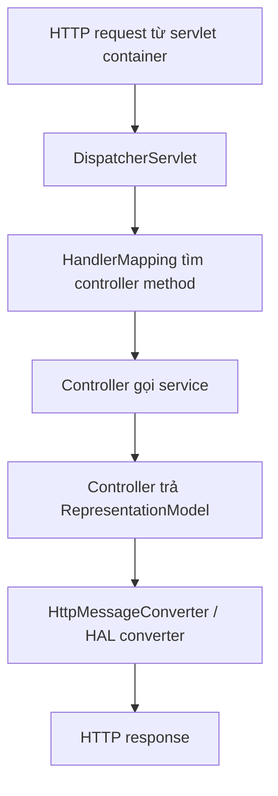

# MVC và servlet context

Spring HATEOAS tích hợp với Spring MVC để tạo link dựa trên mapping của controller và request HTTP hiện tại. Khi ứng dụng được triển khai dưới một context path, chạy qua servlet mapping hoặc nằm sau reverse proxy, URI công khai có thể khác với path mà controller khai báo. Hiểu servlet context và request context giúp link `self`, link collection và link hành động luôn trỏ đúng địa chỉ mà client truy cập được.

Trong Spring MVC, `DispatcherServlet` tiếp nhận request, sử dụng `WebApplicationContext` để tìm controller và xử lý mapping. Spring HATEOAS dùng thông tin mapping cùng request hiện tại để dựng URI. Các API như `WebMvcLinkBuilder`, `ServletUriComponentsBuilder` và `RequestContextHolder` kết nối ba phần đó.

Bài học này thuộc chương **Spring MVC integration** trong module **SPRING_HATEOAS**, tập trung vào quan hệ giữa `ServletContext`, `WebApplicationContext`, `DispatcherServlet`, request context và cách tạo link đúng khi ứng dụng có context path, servlet path hoặc forwarded headers.

Sau bài học, bạn có thể:

- Phân biệt `ServletContext`, `WebApplicationContext` và request context.
- Giải thích vai trò của `DispatcherServlet` khi Spring HATEOAS tạo link.
- Phân biệt context path, servlet path, path info và request URI.
- Dùng `WebMvcLinkBuilder` để tạo link từ mapping controller.
- Dùng `ServletUriComponentsBuilder` khi cần URI dựa trên request hiện tại.
- Hiểu cách `RequestContextHolder` cung cấp request cho code tạo link.
- Cấu hình forwarded headers khi ứng dụng chạy sau reverse proxy.
- Kiểm thử URI sinh ra với MockMvc và context path.

## 1. Các context trong ứng dụng Spring MVC

Các khái niệm có tên gần giống nhau nhưng đại diện cho những phạm vi khác nhau:

| Thành phần | Phạm vi | Vai trò |
|---|---|---|
| `ServletContext` | Một web application trong servlet container | Cung cấp context path, tài nguyên web, thuộc tính và đăng ký servlet/filter/listener. |
| `WebApplicationContext` | Spring container dành cho web | Quản lý controller, service, handler mapping, converter và các Spring bean khác. |
| `HttpServletRequest` | Một HTTP request | Chứa method, URI, context path, servlet path, header, query parameter và thông tin request. |
| `RequestContextHolder` | Thread hiện tại trong thời gian xử lý request | Cung cấp `RequestAttributes`, thường chứa `ServletRequestAttributes` cho request hiện hành. |

`ServletContext` không phải đối tượng đại diện cho một request. Nó tồn tại trong vòng đời web application. `HttpServletRequest` chỉ tồn tại trong vòng đời request. `WebApplicationContext` là container bean của Spring và có thể được liên kết với `ServletContext`.

Spring HATEOAS thường không yêu cầu controller inject trực tiếp `ServletContext` để tạo link. Với request MVC thông thường, hãy dùng `WebMvcLinkBuilder`; framework sử dụng mapping và request context phù hợp để dựng URI.

## 2. DispatcherServlet và WebApplicationContext

`DispatcherServlet` là front controller của Spring MVC. Một request đi qua servlet này sẽ được xử lý theo luồng khái quát:



`WebApplicationContext` chứa các bean mà `DispatcherServlet` cần, như controller, `RequestMappingHandlerMapping`, argument resolver và message converter. Trong ứng dụng có cấu hình context phân cấp, có thể tồn tại root application context và một child `WebApplicationContext` cho từng `DispatcherServlet`.

Spring HATEOAS tích hợp với Spring MVC thông qua các thành phần MVC-specific như `WebMvcLinkBuilder` và hypermedia message converter. Khi controller trả `EntityModel`, `CollectionModel` hoặc `PagedModel`, converter phù hợp sẽ serialize representation theo media type client yêu cầu.

Nếu ứng dụng có nhiều `DispatcherServlet` với servlet mapping khác nhau, cần bảo đảm request đang được xử lý trong đúng servlet context và link được tạo từ request tương ứng. Không nên tự lấy một mapping cố định rồi dùng cho mọi servlet.

## 3. Context path, servlet path và request URI

Khi dựng URI, cần phân biệt các thành phần của đường dẫn:

| Thuộc tính Servlet API | Ý nghĩa |
|---|---|
| `getContextPath()` | Prefix của web application trong servlet container; có thể là chuỗi rỗng khi deploy ở root. |
| `getServletPath()` | Phần path được ánh xạ tới servlet hiện tại. |
| `getPathInfo()` | Phần path còn lại sau servlet mapping dạng path, nếu có. |
| `getRequestURI()` | Path của request trên server, bao gồm context path nhưng không gồm query string. |
| `getRequestURL()` | URL đầy đủ của request, không bao gồm query string. |

Ví dụ ứng dụng được deploy với context path `/shop`, `DispatcherServlet` được ánh xạ tới `/api/*`, còn controller xử lý `/orders/42`:

```text
Context path:  /shop
Servlet path:  /api
Path info:     /orders/42
Request URI:   /shop/api/orders/42
```

Địa chỉ mà client truy cập là `/shop/api/orders/42` trên host và scheme tương ứng. Mapping controller vẫn có thể chỉ là `/orders/{id}` vì servlet mapping `/api/*` đã xác định prefix trước khi request tới handler.

Không nên nhầm context path với `@RequestMapping`. Context path phụ thuộc cách deploy ứng dụng; controller mapping thuộc hợp đồng endpoint bên trong ứng dụng. Khi ứng dụng được deploy ở root, context path là `""`; khi deploy dưới `/shop`, context path là `/shop`.

## 4. Tạo link theo controller mapping bằng WebMvcLinkBuilder

`WebMvcLinkBuilder` là API dành cho Spring MVC. Nó kết hợp mapping trên controller class và method với tham số được truyền vào `methodOn(...)` để tạo URI.

```java
import org.springframework.hateoas.EntityModel;
import org.springframework.hateoas.Link;
import org.springframework.web.bind.annotation.GetMapping;
import org.springframework.web.bind.annotation.PathVariable;
import org.springframework.web.bind.annotation.RequestMapping;
import org.springframework.web.bind.annotation.RestController;

import static org.springframework.hateoas.server.mvc.WebMvcLinkBuilder.linkTo;
import static org.springframework.hateoas.server.mvc.WebMvcLinkBuilder.methodOn;

@RestController
@RequestMapping("/orders")
class OrderController {

    private final OrderService orderService;

    OrderController(OrderService orderService) {
        this.orderService = orderService;
    }

    @GetMapping("/{id}")
    EntityModel<OrderResponse> one(@PathVariable("id") Long id) {
        OrderResponse response = orderService.findResponseById(id);

        Link self = linkTo(methodOn(OrderController.class).one(id)).withSelfRel();
        return EntityModel.of(response, self);
    }
}
```

Trong ví dụ, `methodOn(OrderController.class).one(id)` tạo một proxy invocation để Spring HATEOAS đọc annotation mapping và giá trị tham số. Controller method không được thực thi để truy vấn dữ liệu lần thứ hai. `linkTo(...)` dùng request hiện tại làm cơ sở URI, sau đó ghép mapping controller và method.

Nếu request đến qua context path `/shop`, link `self` được tạo trong request đó sẽ giữ prefix tương ứng. Nếu có servlet mapping prefix, URI được tạo cũng cần phản ánh mapping hiện tại.

Đây là cách ưu tiên khi link trỏ tới controller Spring MVC trong cùng ứng dụng. Khi mapping thay đổi, link builder đọc metadata mapping mới thay vì yêu cầu sửa URL hard-code ở nhiều nơi.

## 5. methodOn không gọi controller thật

`methodOn(...)` tạo proxy để ghi nhận method invocation. Ví dụ:

```java
Link orderLink = linkTo(methodOn(OrderController.class).one(42L))
        .withSelfRel();
```

Lời gọi `one(42L)` trong biểu thức trên không chạy phần thân controller và không gọi repository/service. Nó chỉ cung cấp method cùng tham số để Spring HATEOAS suy ra mapping.

Do đó:

- Không đặt logic nghiệp vụ vào biểu thức `methodOn(...)`.
- Không dựa vào giá trị trả về từ controller invocation để lấy DTO.
- Tham số path/query cần truyền phải là giá trị mà link cần công bố.
- Với tham số phức tạp hoặc kiểu không thể suy ra URI, hãy cân nhắc tạo link tường minh bằng `UriComponentsBuilder` hoặc một link factory.

Ví dụ với query parameter:

```java
import org.springframework.web.bind.annotation.RequestParam;

@GetMapping
CollectionModel<EntityModel<OrderResponse>> all(
        @RequestParam(required = false) String status) {
    // Trả collection đã lọc theo status.
}
```

Khi muốn tạo link tới collection đã lọc, truyền giá trị tương ứng vào invocation proxy:

```java
Link filteredOrders = linkTo(methodOn(OrderController.class).all("PAID"))
        .withRel("orders");
```

Spring HATEOAS dùng mapping và tham số invocation để tạo URI phù hợp với method signature. Nếu không muốn một query parameter xuất hiện trong link, dùng giá trị null hoặc một overload/helper khác theo hợp đồng method; hãy kiểm tra URL được tạo trong test.

## 6. RequestContextHolder cung cấp request hiện tại

`WebMvcLinkBuilder` cần biết request hiện tại để xác định scheme, host, port và servlet mapping làm cơ sở cho link tuyệt đối. Spring MVC đưa request attributes vào `RequestContextHolder` trong thời gian xử lý request.

Có thể đọc request hiện tại để kiểm tra hoặc xử lý một trường hợp đặc biệt:

```java
import jakarta.servlet.http.HttpServletRequest;
import org.springframework.web.context.request.RequestContextHolder;
import org.springframework.web.context.request.ServletRequestAttributes;

ServletRequestAttributes attributes =
        (ServletRequestAttributes) RequestContextHolder.currentRequestAttributes();

HttpServletRequest request = attributes.getRequest();

String contextPath = request.getContextPath();
String servletPath = request.getServletPath();
String requestUri = request.getRequestURI();
```

`currentRequestAttributes()` ném `IllegalStateException` nếu thread hiện tại không có request attributes. Trong code ứng dụng, chỉ đọc request context khi đang xử lý request MVC. Không nên gọi tùy tiện trong constructor bean hoặc khi khởi động application context.

Spring MVC tự quản lý việc bind và restore request attributes trong luồng xử lý servlet. Không cần tự gọi `RequestContextHolder.setRequestAttributes(...)` trong controller thông thường.

## 7. RequestContextFilter và RequestContextListener

Ngoài `DispatcherServlet`, Spring cung cấp hai cơ chế để expose request context cho code chạy trong servlet environment:

- `RequestContextFilter`: filter đưa request attributes vào `RequestContextHolder` trong phạm vi filter chain.
- `RequestContextListener`: listener bind request context khi servlet container tạo request và dọn dẹp khi request kết thúc.

Trong một ứng dụng Spring MVC chuẩn, `DispatcherServlet` đã expose request context nên thường không cần thêm hai thành phần này chỉ để `WebMvcLinkBuilder` hoạt động.

Chúng hữu ích khi một phần xử lý servlet nằm ngoài `DispatcherServlet` nhưng vẫn cần các API phụ thuộc request context. Chỉ đăng ký khi có nhu cầu thực tế; tránh đăng ký trùng lặp nhiều cơ chế quản lý cùng request attributes.

Nếu code chạy trong executor hoặc thread do ứng dụng tự tạo, request context không tự động được truyền sang thread đó. Không nên dùng `RequestContextHolder` như một kho dữ liệu toàn cục hoặc tự copy request attributes sang background thread mà không kiểm soát vòng đời.

## 8. ServletUriComponentsBuilder và các điểm bắt đầu URI

`ServletUriComponentsBuilder` cung cấp các factory dựa trên request servlet hiện tại:

| Factory | URI cơ sở |
|---|---|
| `fromCurrentContextPath()` | Scheme, host, port và context path. |
| `fromCurrentServletMapping()` | Scheme, host, port, context path và servlet mapping hiện tại. |
| `fromCurrentRequestUri()` | URI đầy đủ của request hiện tại, không gồm query string. |
| `fromCurrentRequest()` | URI request hiện tại, bao gồm query string. |

Ví dụ:

```java
import org.springframework.web.servlet.support.ServletUriComponentsBuilder;

String contextBase = ServletUriComponentsBuilder
        .fromCurrentContextPath()
        .build()
        .toUriString();

String servletBase = ServletUriComponentsBuilder
        .fromCurrentServletMapping()
        .build()
        .toUriString();

String requestUri = ServletUriComponentsBuilder
        .fromCurrentRequestUri()
        .build()
        .toUriString();
```

Chọn factory theo điểm bắt đầu mà bạn cần. Ví dụ, nếu controller mapping `/orders/{id}` nằm dưới servlet mapping `/api/*`, `fromCurrentServletMapping()` có thể làm base để nối `/orders/{id}`. Nếu dùng `fromCurrentContextPath()`, bạn phải tính cả servlet prefix `/api` trong path được nối.

Không nối lặp context path hoặc servlet path. `fromCurrentRequest()` đã chứa request URI và query string; nếu lại thêm toàn bộ controller path vào đó, kết quả có thể bị lặp endpoint. Với link theo controller mapping, ưu tiên `WebMvcLinkBuilder` để tránh tự xử lý các thành phần này.

## 9. Tạo URI thủ công khi cần

Trong một số trường hợp, link không trỏ tới controller method trong ứng dụng, ví dụ URI của một hệ thống ngoài hoặc một endpoint canonical được cấu hình. Có thể dùng `ServletUriComponentsBuilder` hoặc `UriComponentsBuilder` và sau đó bọc bằng `Link`:

```java
import org.springframework.hateoas.Link;
import org.springframework.web.servlet.support.ServletUriComponentsBuilder;

Link documentLink = Link.of(
        ServletUriComponentsBuilder.fromCurrentContextPath()
                .path("/documents/{id}")
                .buildAndExpand(100L)
                .toUriString()
).withRel("document");
```

Ví dụ tạo URI theo context path hiện tại rồi nối `/documents/100`. Nếu servlet mapping có prefix riêng, cần dùng `fromCurrentServletMapping()` hoặc thêm prefix tương ứng. Đừng vừa lấy servlet mapping làm base vừa nối lại chính prefix đó.

Đối với URI bên ngoài, thường nên lấy base URI từ cấu hình có kiểm soát thay vì dùng request host hiện tại. Điều này giúp tránh tạo link tới host không đáng tin cậy khi request đi qua proxy hoặc có Host header không được xác thực.

## 10. Context path không phải API version hay controller prefix

Ba loại prefix thường bị nhầm:

| Loại | Ví dụ | Nơi cấu hình |
|---|---|---|
| Context path | `/shop` | Servlet container hoặc cấu hình deploy ứng dụng. |
| Servlet mapping | `/api/*` | Đăng ký `DispatcherServlet`. |
| Controller mapping | `/orders/{id}` | `@RequestMapping`, `@GetMapping`. |

API version có thể là một phần của controller mapping, ví dụ `/v1/orders`, hoặc được triển khai theo một cơ chế khác. Không nên đưa version vào context path chỉ để link builder tạo URI có version. Hãy để version thuộc hợp đồng API và mapping mà controller công bố.

Nếu ứng dụng đổi context path từ root sang `/shop`, link builder có thể phản ánh prefix deploy mới mà không phải sửa từng link. Nếu đổi controller mapping, link builder phản ánh mapping mới khi code được cập nhật.

## 11. Reverse proxy và forwarded headers

Ứng dụng thường chạy sau reverse proxy hoặc ingress. Client gọi địa chỉ công khai:

```text
https://api.example.com/gateway/orders/42
```

Nhưng servlet container có thể nhận request nội bộ:

```text
http://orders-service:8080/orders/42
```

Nếu ứng dụng không xử lý forwarded headers, link được tạo từ request có thể dùng `http`, hostname nội bộ hoặc thiếu prefix `/gateway`. Reverse proxy thường truyền thông tin công khai qua header chuẩn `Forwarded` hoặc các header `X-Forwarded-*` như `X-Forwarded-Proto`, `X-Forwarded-Host`, `X-Forwarded-Port` và `X-Forwarded-Prefix`.

Với servlet stack, Spring Framework cung cấp `ForwardedHeaderFilter` để chuyển các forwarded header đáng tin cậy thành thông tin request mà ứng dụng sử dụng. Trong Spring Boot, có thể cấu hình `server.forward-headers-strategy=framework` khi cần xử lý theo cơ chế framework; hãy kiểm tra cấu hình theo phiên bản Boot và môi trường triển khai.

Không tin forwarded header từ client tùy ý. Chỉ bật xử lý khi ứng dụng đứng sau proxy đáng tin cậy đã xóa header do client gửi và ghi lại giá trị đúng. Nếu không, kẻ tấn công có thể giả mạo host, scheme hoặc prefix để khiến ứng dụng sinh link tới địa chỉ không mong muốn.

Nếu proxy đã rewrite prefix, hãy cấu hình forwarded header tương ứng và xác nhận proxy gửi đúng `X-Forwarded-Prefix`. Không tự cộng prefix vào mọi link trong controller, vì filter có thể đã áp dụng nó và dẫn đến đường dẫn bị lặp.

## 12. Ảnh hưởng của async và background thread

`RequestContextHolder` giữ request attributes theo thread. Khi xử lý đồng bộ trong `DispatcherServlet`, request context có sẵn. Nhưng khi ứng dụng chuyển công việc sang executor, scheduler hoặc một background thread, thread mới không tự động có request attributes.

Ví dụ không nên làm:

```java
executor.execute(() -> {
    // Không giả định thread này có HttpServletRequest hiện tại.
    Link link = linkTo(methodOn(OrderController.class).one(42L)).withSelfRel();
});
```

Nếu link cần được tạo cho response HTTP, hãy tạo link trong luồng xử lý request khi request context còn tồn tại. Nếu tác vụ nền cần gửi link qua email hoặc lưu vào event, hãy truyền một base URI canonical đã được cấu hình và tạo URI từ dữ liệu rõ ràng, thay vì phụ thuộc vào request thread đã kết thúc.

Đối với servlet async, Spring MVC quản lý các lần dispatch theo vòng đời request; tuy nhiên không nên mặc định mọi thread do ứng dụng tạo đều có request context. Hãy kiểm thử đúng mô hình async đang dùng.

## 13. Kiểm thử context path bằng MockMvc

MockMvc có thể mô phỏng context path để xác nhận link sinh ra có giữ prefix deploy. Ví dụ:

```java
import org.junit.jupiter.api.Test;
import org.springframework.beans.factory.annotation.Autowired;
import org.springframework.boot.test.autoconfigure.web.servlet.AutoConfigureMockMvc;
import org.springframework.boot.test.context.SpringBootTest;
import org.springframework.hateoas.MediaTypes;
import org.springframework.test.web.servlet.MockMvc;

import static org.hamcrest.Matchers.endsWith;
import static org.springframework.test.web.servlet.request.MockMvcRequestBuilders.get;
import static org.springframework.test.web.servlet.result.MockMvcResultMatchers.jsonPath;
import static org.springframework.test.web.servlet.result.MockMvcResultMatchers.status;

@SpringBootTest
@AutoConfigureMockMvc
class ServletContextLinkTest {

    @Autowired
    MockMvc mockMvc;

    @Test
    void selfLinkContainsApplicationContextPath() throws Exception {
        mockMvc.perform(get("/shop/orders/42")
                        .contextPath("/shop")
                        .accept(MediaTypes.HAL_JSON))
                .andExpect(status().isOk())
                .andExpect(jsonPath("$._links.self.href",
                        endsWith("/shop/orders/42")));
    }
}
```

Ví dụ giả định ứng dụng dùng `DispatcherServlet` mapping mặc định và controller mapping `/orders/{id}`. MockMvc request URI chứa context path `/shop`; servlet context path được khai báo tương ứng bằng `.contextPath("/shop")`.

Nếu ứng dụng dùng servlet mapping `/api/*`, cần mô phỏng cả request URI, context path và servlet path sao cho nhất quán với mapping đã đăng ký. Ví dụ request tới `/shop/api/orders/42` phải phản ánh context path `/shop`, servlet path `/api` và phần path còn lại `/orders/42`. Cấu hình MockMvc cần tương ứng với cách ứng dụng đăng ký DispatcherServlet.

## 14. Kiểm thử forwarded headers

Nếu ứng dụng bật `ForwardedHeaderFilter`, hãy kiểm thử link theo scheme/host/prefix công khai. Ví dụ request mô phỏng:

```java
mockMvc.perform(get("/orders/42")
        .header("X-Forwarded-Proto", "https")
        .header("X-Forwarded-Host", "api.example.com")
        .header("X-Forwarded-Prefix", "/gateway")
        .accept(MediaTypes.HAL_JSON))
    .andExpect(status().isOk())
    .andExpect(jsonPath("$._links.self.href")
        .value("https://api.example.com/gateway/orders/42"));
```

Đoạn assertion này chỉ đúng khi filter được đăng ký trong MockMvc test, mapping controller là `/orders/{id}` và proxy prefix được xử lý theo cấu hình tương ứng. Nếu test không chạy filter, các header chỉ là dữ liệu header thông thường và không tự thay đổi request URL.

Nên kiểm thử thêm trường hợp request không có forwarded header để bảo đảm link vẫn hợp lệ trong môi trường nội bộ. Không nên chỉ test bằng một host cố định nếu ứng dụng có nhiều môi trường deploy.

## 15. Lỗi thường gặp

| Lỗi | Hệ quả | Cách xử lý |
|---|---|---|
| Nhầm `ServletContext` với `HttpServletRequest` | Dùng thông tin deploy thay cho dữ liệu request. | Lấy context path từ request khi cần xử lý URI hiện tại. |
| Tự nối context path vào link builder | Prefix bị lặp như `/shop/shop/orders/42`. | Để `WebMvcLinkBuilder` xử lý request context. |
| Bỏ qua servlet mapping | Link thiếu prefix `/api` hoặc dùng sai base path. | Dùng MVC link builder hoặc chọn đúng `fromCurrentServletMapping()`. |
| Gọi `WebMvcLinkBuilder` ngoài request context | Không xác định được base URI của servlet request. | Tạo link trong request hoặc dùng base URI tường minh. |
| Dùng `methodOn` như lời gọi controller thật | Kỳ vọng service chạy hoặc nhận DTO trả về. | Hiểu đây là proxy invocation chỉ ghi nhận mapping và tham số. |
| Tạo link trong background thread | `RequestContextHolder` không có request attributes. | Truyền base URI rõ ràng hoặc tạo link trong request thread. |
| Không xử lý forwarded headers | Link chứa host nội bộ hoặc scheme sai. | Cấu hình forwarded header filter/strategy phía sau proxy tin cậy. |
| Tin forwarded header từ client bất kỳ | Có thể sinh link tới host giả mạo. | Chỉ tin header do reverse proxy được kiểm soát ghi lại. |
| Ghép path với `fromCurrentRequest()` | Path endpoint bị lặp hoặc query string không mong muốn. | Chọn đúng factory context/servlet/request URI. |
| Test không mô phỏng context path | Lỗi prefix chỉ xuất hiện khi deploy. | Dùng MockMvc `.contextPath(...)` và kiểm tra `href`. |

## 16. Quy trình tạo link đúng servlet context

Khi tích hợp Spring HATEOAS với Spring MVC, hãy thực hiện theo trình tự:

1. Xác định `DispatcherServlet` mapping và context path của ứng dụng.
2. Dùng `WebMvcLinkBuilder.linkTo(methodOn(...))` cho link trỏ tới controller trong ứng dụng.
3. Để framework lấy request context thay vì tự ghép context path hoặc servlet path.
4. Dùng `ServletUriComponentsBuilder` khi cần base URI từ context path, servlet mapping hoặc request URI cụ thể.
5. Bảo đảm `RequestContextHolder` được dùng trong request thread; không giả định background thread có request attributes.
6. Nếu chạy sau reverse proxy, cấu hình forwarded headers từ proxy tin cậy và tránh áp dụng prefix hai lần.
7. Kiểm thử `href` với context path, servlet mapping, scheme/host và forwarded prefix đại diện cho môi trường thật.
8. Kiểm tra response HAL qua HTTP để xác nhận link có thể truy cập từ client.

Spring MVC cung cấp request context và metadata mapping để Spring HATEOAS tạo URI phù hợp với ứng dụng đang chạy. Khi phân biệt rõ servlet context, servlet mapping và controller mapping, đồng thời cấu hình forwarded headers đúng, các link hypermedia có thể giữ nguyên tính đúng đắn qua nhiều môi trường deploy mà không cần hard-code prefix trong từng controller.

## Tài liệu tham khảo

- [Spring HATEOAS – WebMvcLinkBuilder API](https://docs.spring.io/spring-hateoas/docs/current/api/org/springframework/hateoas/server/mvc/WebMvcLinkBuilder.html)
- [Spring Framework – ServletUriComponentsBuilder API](https://docs.spring.io/spring-framework/docs/current/javadoc-api/org/springframework/web/servlet/support/ServletUriComponentsBuilder.html)
- [Spring Framework – RequestContextHolder API](https://docs.spring.io/spring-framework/docs/current/javadoc-api/org/springframework/web/context/request/RequestContextHolder.html)
- [Spring Framework – ForwardedHeaderFilter API](https://docs.spring.io/spring-framework/docs/current/javadoc-api/org/springframework/web/filter/ForwardedHeaderFilter.html)
- [Jakarta Servlet – ServletContext API](https://jakarta.ee/specifications/servlet/6.0/apidocs/jakarta.servlet/jakarta/servlet/servletcontext)
