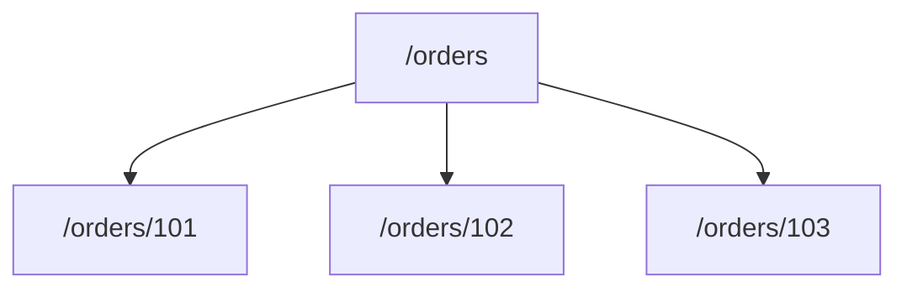

# Resource naming

Thiết kế tên resource là bước quan trọng khi xây dựng REST API. Một URI tốt giúp người đọc nhận ra loại tài nguyên, định danh một tài nguyên cụ thể và hiểu mối quan hệ giữa các tài nguyên. Trong API có hypermedia, URI còn là đích của các link mà server công bố. Client nên khám phá và theo link do server trả về thay vì tự ghép URI theo một quy ước ngầm.

Spring HATEOAS không áp đặt một quy tắc đặt tên URI duy nhất. Spring MVC cung cấp mapping để định nghĩa endpoint; Spring HATEOAS cung cấp link builder để tạo link dựa trên mapping đó. Vì vậy, nhóm phát triển cần thống nhất cách đặt tên resource trước, sau đó dùng mapping và link builder để giữ hợp đồng API nhất quán.

## Mục tiêu

Sau bài học, bạn có thể:

- Phân biệt resource, collection resource và URI định danh một resource.
- Đặt tên resource bằng danh từ và biểu diễn collection bằng tên số nhiều.
- Chọn cấu trúc URI phẳng hoặc lồng nhau theo quan hệ sở hữu và phạm vi vòng đời.
- Phân biệt path segment, query parameter và link relation.
- Thiết kế URI ổn định, dễ đọc và không phụ thuộc cấu trúc database.
- Dùng Spring MVC mapping và Spring HATEOAS link builder để tạo link.
- Biểu diễn thao tác nghiệp vụ qua HTTP method, resource và affordance.
- Nhận diện các lỗi đặt tên khiến API khó tiến hóa.

## Resource và URI

Resource là khái niệm mà API muốn công bố: đơn hàng, khách hàng, sản phẩm, khoản thanh toán hoặc một yêu cầu hủy. URI là định danh dùng để tham chiếu resource đó. Hai khái niệm có liên quan nhưng không đồng nhất:

- Resource mô tả đối tượng hoặc khái niệm trong miền nghiệp vụ.
- URI định danh resource trong không gian địa chỉ của API.
- Representation là dữ liệu mà server gửi để mô tả trạng thái hoặc nội dung resource tại một thời điểm.
- Link cho client biết URI nào có thể được theo để khám phá resource hoặc thao tác liên quan.

Ví dụ, đơn hàng có thể được định danh bằng:

```text
/orders/8f4b2f9a-2e44-4f3d-9a2a-7f93c8c4b4d1
```

URI này không nhất thiết phải phản ánh tên bảng, tên class hay khóa chính trong database. Nếu sau này hệ thống chuyển từ một bảng quan hệ sang một kho dữ liệu khác, URI công khai vẫn có thể giữ nguyên.

Trong REST, client tương tác với resource qua representation và semantics của HTTP. Đừng để client phụ thuộc vào cách server lưu dữ liệu hoặc cách ứng dụng tổ chức package.

## Quy tắc đặt tên resource

### Dùng danh từ thay cho động từ

Path nên biểu diễn resource. HTTP method thể hiện loại thao tác mà client muốn thực hiện:

| Mục đích | URI | HTTP method |
|---|---|---|
| Lấy danh sách đơn hàng | `/orders` | `GET` |
| Tạo đơn hàng | `/orders` | `POST` |
| Lấy một đơn hàng | `/orders/{orderId}` | `GET` |
| Thay thế đơn hàng | `/orders/{orderId}` | `PUT` |
| Cập nhật một phần đơn hàng | `/orders/{orderId}` | `PATCH` |
| Xóa đơn hàng | `/orders/{orderId}` | `DELETE` |

Các path như `/getOrders`, `/createOrder` hoặc `/deleteOrder/42` lặp lại hành động trong tên URI. Chúng khiến client phải học một quy ước RPC riêng và làm mất tính nhất quán giữa resource với HTTP method.

Tên resource thường là danh từ số nhiều cho collection và giữ nguyên tên collection cho item:

```text
/orders
/orders/{orderId}
/customers
/customers/{customerId}
/products
/products/{productId}
```

Quy tắc số nhiều không phải yêu cầu bắt buộc của HTTP hay REST. Điều quan trọng là chọn một quy ước rõ ràng và áp dụng nhất quán trong toàn API. Tránh lúc dùng `/order`, lúc dùng `/orders`, hoặc lúc dùng `/customer/{id}` và lúc dùng `/customers/{id}`.

### Dùng chữ thường và dấu gạch ngang

Path segment nên dùng chữ thường. Khi một tên gồm nhiều từ, dùng dấu gạch ngang để phân tách:

```text
/purchase-orders
/shipping-addresses
/order-items
```

Tránh trộn chữ hoa, dấu gạch dưới và cách viết camelCase trong cùng một API:

| Nên dùng | Tránh dùng |
|---|---|
| `/shipping-addresses` | `/ShippingAddresses` |
| `/order-items` | `/order_items` |
| `/payment-methods` | `/paymentMethods` |
| `/customer-preferences` | `/CustomerPreferences` |

URI path có phân biệt chữ hoa và chữ thường theo quy tắc so khớp URI của server. Hai đường dẫn chỉ khác chữ hoa có thể trở thành hai URI khác nhau. Chuẩn hóa chữ thường giúp giảm lỗi và tránh tạo các alias không cần thiết.

### Chọn tên có nghĩa trong miền nghiệp vụ

Tên resource nên phản ánh ngôn ngữ mà người dùng nghiệp vụ và client hiểu được. Ví dụ, nếu API công bố khái niệm `shipment`, không nên đổi thành `logistics-records` hoặc `tbl_ship_hdr` chỉ vì tên nội bộ trong database như vậy.

Ưu tiên tên ổn định:

- `invoices` thay vì `invoice_table`.
- `shipments` thay vì `delivery_job_records`.
- `customers` thay vì `crm_customer_entity`.

Tên nội bộ có thể thay đổi theo kiến trúc. Tên resource là một phần hợp đồng công khai nên cần được chọn theo domain language và duy trì qua các lần refactor.

## Collection resource và item resource

Một collection resource đại diện cho tập hợp các resource cùng loại. Item resource đại diện cho một phần tử được định danh trong collection.



Collection thường hỗ trợ:

- `GET /orders` để đọc danh sách hoặc một trang kết quả.
- `POST /orders` để tạo một đơn hàng.
- Query parameter để lọc, tìm kiếm, phân trang hoặc sắp xếp.

Item thường hỗ trợ:

- `GET /orders/{orderId}` để đọc một đơn hàng.
- `PUT` hoặc `PATCH` để cập nhật theo semantics của endpoint.
- `DELETE` để xóa nếu nghiệp vụ cho phép.

Không nên tạo một path riêng cho từng cách xem collection nếu đó chỉ là biến thể của cùng một collection. Ví dụ, thay vì tạo `/newest-orders` và `/expensive-orders`, có thể dùng query parameter hoặc công bố các link relation khác nhau trỏ tới cùng collection với query state phù hợp.

## Thiết kế URI lồng nhau

URI lồng nhau thể hiện một quan hệ có phạm vi rõ ràng. Ví dụ, các item của một đơn hàng:

```text
/orders/{orderId}/items
/orders/{orderId}/items/{itemId}
```

Cấu trúc này phù hợp nếu item chỉ được truy cập trong ngữ cảnh đơn hàng hoặc vòng đời của item phụ thuộc vào đơn hàng. Nó giúp thể hiện phạm vi collection và định danh item trong parent.

Không nên lồng URI quá sâu:

```text
/customers/{customerId}/orders/{orderId}/items/{itemId}/adjustments/{adjustmentId}
```

Một URI dài như vậy buộc client phải biết toàn bộ cây quan hệ để định danh một resource. Nó cũng làm thay đổi URI khi cấu trúc sở hữu thay đổi. Nếu resource có định danh độc lập, có thể cung cấp URI canonical phẳng:

```text
/order-items/{itemId}
```

Sau đó, representation của đơn hàng và item công bố link để đi tới nhau. Có thể giữ URI lồng nhau như một entry point theo ngữ cảnh nếu nó mang ý nghĩa hữu ích cho client, nhưng nên xác định một URI canonical để tham chiếu ổn định.

### Chọn lồng nhau hay URI độc lập

| Câu hỏi | URI lồng nhau phù hợp khi | URI độc lập phù hợp khi |
|---|---|---|
| Resource có định danh riêng không? | Định danh chỉ có nghĩa trong parent | Có định danh độc lập |
| Vòng đời | Bị ràng buộc bởi parent | Có thể tồn tại độc lập |
| Quyền truy cập | Luôn cần kiểm tra ngữ cảnh parent | Có thể truy cập qua định danh riêng |
| Quan hệ | Quan hệ sở hữu là một phần của identity | Quan hệ có thể thay đổi hoặc có nhiều parent |
| Ví dụ | `/orders/101/items/2` | `/order-items/2` |

Không dùng nesting chỉ để tái hiện foreign key. URI công khai nên thể hiện mô hình resource có ý nghĩa đối với client, không sao chép schema quan hệ.

## Path segment và query parameter

Path segment thường dùng để định danh resource hoặc phạm vi collection. Query parameter dùng để thay đổi cách truy vấn collection mà không tạo ra một loại resource mới.

| Nhu cầu | Ví dụ |
|---|---|
| Định danh đơn hàng | `/orders/101` |
| Lọc theo trạng thái | `/orders?status=OPEN` |
| Tìm theo từ khóa | `/orders?query=keyboard` |
| Phân trang | `/orders?page=0&size=20` |
| Sắp xếp | `/orders?sort=createdAt,desc` |
| Kết hợp điều kiện | `/orders?status=OPEN&sort=createdAt,desc&page=0&size=20` |

Không nên tạo path mới cho mọi tổ hợp filter:

```text
/open-orders
/closed-orders
/newest-open-orders
/oldest-closed-orders
```

Những biến thể đó làm số lượng endpoint tăng nhanh và tạo nhiều hợp đồng trùng lặp. Dùng query parameter để mô tả tiêu chí truy vấn, rồi công bố link tương ứng để client khám phá.

Nếu một truy vấn có semantics riêng, có thể mô hình hóa nó thành một resource search hoặc report. Ví dụ `/order-searches/{searchId}` phù hợp khi truy vấn được lưu lại, có trạng thái, có thể chia sẻ hoặc truy cập lại như một tài nguyên độc lập.

## Đặt tên cho thao tác nghiệp vụ

HTTP method mô tả thao tác cơ bản trên resource. Khi nghiệp vụ có một hành động đặc thù như hủy đơn hàng, phê duyệt hóa đơn hoặc gửi lại lời mời, hãy xem thao tác đó có thể được mô hình hóa thành resource hoặc thay đổi trạng thái resource hiện tại hay không.

Ví dụ, nếu yêu cầu hủy có trạng thái và lịch sử riêng, có thể tạo cancellation resource:

```http
POST /orders/101/cancellations
Content-Type: application/json

{
  "reason": "Customer request"
}
```

Server có thể trả `201 Created` cùng URI của cancellation resource:

```http
HTTP/1.1 201 Created
Location: /cancellations/9001
Content-Type: application/hal+json
```

Sau đó client theo link tới `/cancellations/9001` để xem trạng thái xử lý. Tên `cancellations` vẫn là danh từ; HTTP method `POST` thể hiện việc tạo yêu cầu hủy.

Nếu hành động chỉ cập nhật một trạng thái đơn giản và không cần resource yêu cầu riêng, `PATCH /orders/101` có thể phù hợp. Chọn mô hình dựa trên semantics nghiệp vụ, không chỉ dựa trên việc muốn có một endpoint mang tên động từ.

Tránh các URI kiểu:

```text
/orders/101/cancel
/orders/101/approveOrder
/orders/101/sendAgain
```

Một endpoint hành động chuyên biệt đôi khi vẫn cần thiết khi tích hợp với hệ thống legacy hoặc một giao thức không thể biểu diễn qua resource state. Nếu chọn cách đó, phải mô tả rõ semantics, HTTP method, tính lặp an toàn và response trong hợp đồng API.

## Link relation không phải tên URI

URI định danh đích của link. Link relation mô tả quan hệ ngữ nghĩa giữa resource hiện tại và đích đó. Hai phần này không nên bị đồng nhất.

Ví dụ một đơn hàng có thể công bố:

```json
{
  "_links": {
    "self": {
      "href": "/orders/101"
    },
    "items": {
      "href": "/orders/101/items"
    },
    "customer": {
      "href": "/customers/7"
    },
    "profile": {
      "href": "/profiles/orders"
    }
  }
}
```

Relation `customer` nói rằng link dẫn tới khách hàng liên quan. Nó không yêu cầu URI đích phải nằm dưới `/orders/101`. Tương tự, relation `items` cho biết collection item của đơn hàng, còn URI cụ thể do server chọn.

Trong Spring HATEOAS, `Link` kết hợp URI và relation. Có thể dùng relation chuẩn từ `IanaLinkRelations` hoặc custom relation được định danh bằng URI. Khi dùng HAL, `CurieProvider` có thể rút gọn custom relation URI thành CURIE.

Đối với client hypermedia, điều quan trọng là tìm link theo relation và theo URI nhận được. Client không nên tự dựng `/orders/{id}/items` chỉ vì path đó xuất hiện trong ví dụ tài liệu.

## Định danh resource ổn định

Một URI công khai cần ổn định qua các thay đổi triển khai. Khi chọn identifier, cân nhắc:

- Dùng identifier không thay đổi trong suốt vòng đời resource.
- Không để lộ số thứ tự nội bộ nếu nó tiết lộ quy mô hoặc cấu trúc hệ thống.
- Không dùng thuộc tính có thể thay đổi như tên khách hàng hoặc email làm định danh chính.
- Chọn UUID, mã nghiệp vụ hoặc opaque identifier theo yêu cầu của miền.
- Đảm bảo identifier được encode đúng khi xuất hiện trong path segment.

Ví dụ:

```text
/customers/7f5d1a3e-4f7d-4c6f-9c6f-1b3c4d5e6f70
/invoices/INV-2026-00421
```

Không phải API nào cũng cần UUID. Mã đơn hàng có ý nghĩa nghiệp vụ có thể là lựa chọn tốt nếu nó ổn định, duy nhất và không gây rủi ro bảo mật. Identifier không thay thế authorization: biết URI không có nghĩa client được quyền truy cập resource.

### Tránh để lộ cấu trúc triển khai

Không dùng các URI phản ánh chi tiết nội bộ:

```text
/api/v2/tbl_order/row/101
/hibernate-proxy/order/101
/internal-service-a/orders/101
```

Các tên như `tbl_order` hoặc `internal-service-a` khiến hợp đồng công khai phụ thuộc vào database và topology. Hãy chọn tên resource theo domain và giữ lớp triển khai có thể thay đổi độc lập.

## Chuẩn hóa URI trong API

Một quy ước đặt tên nên bao gồm các quyết định sau:

| Thành phần | Quy ước khuyến nghị |
|---|---|
| Path | Chữ thường, từ ghép dùng dấu gạch ngang |
| Collection | Danh từ số nhiều |
| Item | Collection path cộng identifier |
| Identifier | Ổn định, không phụ thuộc thuộc tính có thể thay đổi |
| Quan hệ | Nesting vừa đủ hoặc URI độc lập với link |
| Filter | Query parameter |
| Sort và pagination | Query parameter hoặc link template được server công bố |
| Hành động | HTTP method và resource state; tạo action resource khi có identity/vòng đời riêng |
| Extension | Tránh đuôi `.json` nếu content negotiation đã xác định media type |

Không nên dùng dấu `/` cuối path một cách tùy tiện. Chọn một chính sách redirect hoặc canonical URI và áp dụng thống nhất. Tránh để `/orders` và `/orders/` tạo hai URI có hành vi khác nhau nếu chúng đại diện cùng một collection.

### Phiên bản API

Không thêm version vào tên resource như `/v2-orders` hoặc `/orders-v2`. Nếu tổ chức chọn version trong URI, giữ version ở một vị trí nhất quán, ví dụ `/api/v2/orders`. Nếu dùng content negotiation hoặc media type versioning, hãy công bố media type rõ ràng và giữ các URI resource độc lập với version khi kiến trúc cho phép.

Versioning là một quyết định cấp hợp đồng API. Đừng đổi URI chỉ vì refactor code hoặc nâng phiên bản framework. Khi phải thay đổi path công khai, có thể duy trì alias hoặc redirect trong thời gian chuyển đổi và dùng link relation để client khám phá URI mới.

## Áp dụng resource naming trong Spring MVC

Spring MVC dùng mapping để nối resource path với handler method. Ví dụ:

```java
import java.util.UUID;

import org.springframework.hateoas.EntityModel;
import org.springframework.web.bind.annotation.GetMapping;
import org.springframework.web.bind.annotation.PathVariable;
import org.springframework.web.bind.annotation.RequestMapping;
import org.springframework.web.bind.annotation.RestController;

import static org.springframework.hateoas.server.mvc.WebMvcLinkBuilder.linkTo;
import static org.springframework.hateoas.server.mvc.WebMvcLinkBuilder.methodOn;

record OrderSummary(UUID id, UUID customerId, String status, long total) {
}

interface OrderService {
    OrderSummary findById(UUID id);
}

@RestController
@RequestMapping("/orders")
class OrderController {

    private final OrderService orders;

    OrderController(OrderService orders) {
        this.orders = orders;
    }

    @GetMapping("/{orderId}")
    EntityModel<OrderSummary> one(@PathVariable("orderId") UUID orderId) {
        OrderSummary order = orders.findById(orderId);

        return EntityModel.of(
            order,
            linkTo(methodOn(OrderController.class).one(orderId))
                .withSelfRel()
        );
    }
}
```

`@RequestMapping("/orders")` xác định collection path; `@GetMapping("/{orderId}")` xác định item path. Tên biến `orderId` giúp chữ ký method thể hiện rõ identifier. `linkTo(methodOn(...))` tạo self link từ mapping đã khai báo, vì vậy khi path được đổi trong controller, link builder có thể theo mapping mới.

### Tạo link tới resource liên quan

Nếu item có quan hệ với customer, hãy công bố link tới customer resource:

```java
Link customer = linkTo(
    methodOn(CustomerController.class).one(order.customerId())
).withRel("customer");
```

Nếu đơn hàng có collection item với mapping:

```java
@RestController
@RequestMapping("/orders/{orderId}/items")
class OrderItemController {

    record OrderItemView(java.util.UUID id, String sku, int quantity) {
    }

    @GetMapping
    org.springframework.hateoas.CollectionModel<OrderItemView> all(
            @PathVariable("orderId") java.util.UUID orderId) {
        return org.springframework.hateoas.CollectionModel.empty();
    }
}
```

có thể tạo link bằng:

```java
Link items = linkTo(
    methodOn(OrderItemController.class).all(orderId)
).withRel("items");
```

Đoạn code minh họa mapping và cách xây link; phần truy vấn và chuyển đổi model phụ thuộc ứng dụng. Dùng `methodOn()` giúp tránh lặp path template trong nhiều nơi.

## Đặt tên repository resource với Spring Data REST

Nếu dùng Spring Data REST, có thể tùy chỉnh tên collection resource bằng `@RepositoryRestResource`:

```java
import java.util.UUID;

import org.springframework.data.jpa.repository.JpaRepository;
import org.springframework.data.rest.core.annotation.RepositoryRestResource;

@RepositoryRestResource(
    path = "purchase-orders",
    collectionResourceRel = "purchaseOrders"
)
interface PurchaseOrderRepository
        extends JpaRepository<PurchaseOrder, UUID> {
}
```

`path` xác định path segment của repository resource. `collectionResourceRel` xác định relation của collection trong representation. Hai giá trị này phục vụ hai mục đích khác nhau: một giá trị đặt URI, một giá trị đặt quan hệ hypermedia.

Nếu query method cần path và relation riêng, có thể dùng `@RestResource`:

```java
@RestResource(path = "by-status", rel = "byStatus")
Page<PurchaseOrder> findByStatus(
    @Param("status") OrderStatus status,
    Pageable pageable
);
```

Tên path `by-status` xác định URI của search resource; relation `byStatus` là tên client dùng để tìm link trong search representation. Không nên dùng tên method Java làm hợp đồng client nếu muốn giữ quyền refactor tên method.

## Kiểm thử hợp đồng resource naming

Kiểm thử nên xác nhận cả path endpoint và link được serialize. Đừng chỉ kiểm tra controller trả status `200`; một endpoint vẫn có thể trả dữ liệu đúng nhưng công bố sai relation hoặc URI.

Ví dụ MockMvc:

```java
import static org.mockito.BDDMockito.given;
import static org.springframework.test.web.servlet.request.MockMvcRequestBuilders.get;
import static org.springframework.test.web.servlet.result.MockMvcResultMatchers.jsonPath;
import static org.springframework.test.web.servlet.result.MockMvcResultMatchers.status;

import java.util.UUID;

import org.junit.jupiter.api.Test;
import org.springframework.beans.factory.annotation.Autowired;
import org.springframework.boot.test.autoconfigure.web.servlet.WebMvcTest;
import org.springframework.boot.test.mock.mockito.MockBean;
import org.springframework.hateoas.MediaTypes;
import org.springframework.test.web.servlet.MockMvc;

@WebMvcTest(OrderController.class)
class OrderResourceNamingTest {

    @Autowired
    MockMvc mockMvc;

    @MockBean
    OrderService orders;

    @Test
    void exposesCanonicalOrderPathAndSelfLink() throws Exception {
        UUID id = UUID.fromString(
            "8f4b2f9a-2e44-4f3d-9a2a-7f93c8c4b4d1"
        );
        UUID customerId = UUID.fromString(
            "7f5d1a3e-4f7d-4c6f-9c6f-1b3c4d5e6f70"
        );
        given(orders.findById(id))
            .willReturn(new OrderSummary(id, customerId, "OPEN", 1250000));

        mockMvc.perform(get("/orders/{orderId}", id)
                .accept(MediaTypes.HAL_JSON))
            .andExpect(status().isOk())
            .andExpect(jsonPath("$.id").value(id.toString()))
            .andExpect(jsonPath("$._links.self.href")
                .value(org.hamcrest.Matchers.endsWith("/orders/" + id)));
    }
}
```

Đây là test slice cho controller ví dụ. Trong dự án thực tế, cần import cấu hình HATEOAS nếu test slice chưa nhận auto-configuration tương ứng. Nếu ứng dụng dùng base path hoặc reverse proxy, nên kiểm tra URI theo cấu hình triển khai thay vì hard-code host.

Các kiểm thử bổ sung nên xác nhận:

- Collection resource và item resource dùng cùng một quy ước tên.
- Path chỉ dùng chữ thường và dấu gạch ngang theo convention của API.
- Link `self` trỏ tới URI canonical.
- Link relation tới customer hoặc items tồn tại và có URI hợp lệ.
- Query parameter không bị chuyển nhầm thành path segment.
- Các URI cũ còn được xử lý trong giai đoạn migration nếu API đã có client sử dụng.

## Lỗi thường gặp

| Lỗi | Hệ quả | Cách xử lý |
|---|---|---|
| Dùng động từ trong path cho CRUD cơ bản | Trộn action với resource và lặp semantics của HTTP method | Dùng danh từ và HTTP method |
| Trộn singular/plural | Client khó dự đoán collection và item URI | Chọn một quy ước, thường collection số nhiều |
| Dùng tên bảng hoặc class làm URI | Hợp đồng phụ thuộc persistence và code | Dùng domain language |
| Nesting quá sâu | URI phụ thuộc toàn bộ cây quan hệ | Chọn URI canonical phẳng và công bố link |
| Dùng tên có thể thay đổi làm identifier | URI của resource thay đổi theo dữ liệu | Dùng identifier ổn định |
| Tạo path cho từng filter | Số lượng endpoint tăng nhanh | Dùng query parameter hoặc search resource |
| Nhầm relation với path | Client gắn semantics vào cấu trúc URI | Tìm link bằng relation, theo URI được trả về |
| Hard-code link string ở nhiều nơi | Link lỗi khi mapping thay đổi | Dùng `WebMvcLinkBuilder` hoặc assembler |
| Đặt version vào tên resource | Tạo các tên resource trùng lặp và khó bảo trì | Áp dụng chiến lược version nhất quán ở cấp API |
| Nghĩ biết URI là đủ quyền truy cập | Có thể tạo lỗ hổng kiểm soát truy cập | Kiểm tra authorization độc lập với identifier |

## Ghi nhớ

Resource là khái niệm nghiệp vụ; URI là định danh và representation là dữ liệu mô tả resource. Dùng danh từ, tên collection nhất quán, chữ thường và dấu gạch ngang. Giữ URI lồng nhau ở mức cần thiết cho phạm vi hoặc vòng đời của resource; dùng URI canonical độc lập khi resource có identity riêng. Path định danh resource, query parameter thay đổi cách truy vấn collection, còn link relation mô tả quan hệ ngữ nghĩa. Trong Spring MVC, khai báo mapping rõ ràng và dùng `WebMvcLinkBuilder` để tạo link từ mapping. Với client hypermedia, server công bố link và client theo link đó thay vì tự ghép URI.

## Tài liệu tham khảo

- [RFC 3986 – Uniform Resource Identifier (URI): Generic Syntax](https://www.rfc-editor.org/rfc/rfc3986.html)
- [RFC 9110 – HTTP Semantics](https://www.rfc-editor.org/rfc/rfc9110.html)
- [RFC 8288 – Web Linking](https://www.rfc-editor.org/rfc/rfc8288.html)
- [Spring HATEOAS – Building links in Spring MVC](https://docs.spring.io/spring-hateoas/docs/current/reference/html/#server.mvc.links)
- [Spring Data REST – Repository resources](https://docs.spring.io/spring-data/rest/reference/repository-resources.html)
