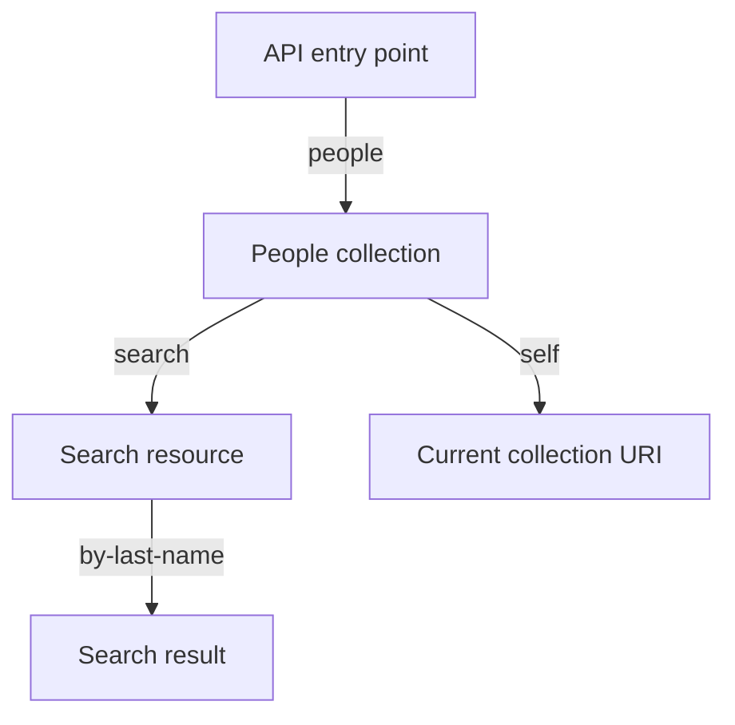

# Traverson với HAL trong Spring HATEOAS

Một client hypermedia nên bắt đầu từ URI entry point và khám phá các tài nguyên tiếp theo bằng link relation mà server công bố. Nếu client tự ghép `/people`, `/orders/{id}` hoặc `/search` từ quy ước URL, nó sẽ phụ thuộc vào cấu trúc routing của server. Khi mapping thay đổi, client phải được sửa dù ngữ nghĩa tài nguyên không đổi.

Spring HATEOAS cung cấp `Traverson`, một client Java để đi theo chuỗi link relation trong hypermedia API. Với HAL, client có thể bắt đầu tại root resource, theo relation như `people`, tiếp tục tới `search` rồi tới một search relation cụ thể, mở rộng URI template và chuyển response thành kiểu Java mong muốn. Bài này tập trung vào việc điều hướng bằng HAL, ánh xạ response có kiểu, xử lý template, cấu hình HTTP client và kiểm thử hành vi traversal.

## 1. Traverson giải quyết vấn đề gì?

Giả sử API quản lý người dùng có entry point tại `/api`. Từ root, server công bố link tới collection `people`. Collection có link `search`, và search resource có link `by-last-name`.

Client không cần biết các endpoint đó được đặt tại `/api/people`, `/api/people/search` hay một cấu trúc path khác. Client chỉ cần hiểu chuỗi quan hệ:



`Traverson` tự gửi request tới resource hiện tại, đọc HAL links, tìm relation được yêu cầu và tiếp tục tới `href` tương ứng. Cách làm này tách client khỏi cấu trúc URL cụ thể và giúp API có thể thay đổi route mà vẫn giữ semantics của relation.

## 2. Chuẩn bị dependency và media type

Client cần Spring HATEOAS để sử dụng `Traverson`, cùng một HTTP client của Spring để gửi request. Trong ứng dụng Spring Boot, có thể dùng starter HATEOAS phù hợp với phiên bản Boot đang quản lý; nếu quản lý dependency trực tiếp, cần dependency `spring-hateoas` và Spring Web client tương ứng.

HAL JSON dùng media type:

```java
import org.springframework.hateoas.MediaTypes;
```

`MediaTypes.HAL_JSON` đại diện cho `application/hal+json`. Khi khởi tạo `Traverson`, truyền entry point và media type mà API cung cấp:

```java
Traverson traverson = new Traverson(
        URI.create("https://api.example.test/api"),
        MediaTypes.HAL_JSON
);
```

URI ở đây là entry point đã được cấu hình của API. Sau bước này, các bước tiếp theo nên được xác định bằng relation trong response, không phải bằng cách tự nối path.

## 3. Theo một relation từ entry point

Ví dụ root resource công bố link `people`:

```json
{
  "_links": {
    "people": {
      "href": "https://api.example.test/api/people"
    }
  }
}
```

Client có thể theo relation đó:

```java
import org.springframework.hateoas.client.Traverson;

Traverson traverson = new Traverson(
        URI.create("https://api.example.test/api"),
        MediaTypes.HAL_JSON
);

Object people = traverson
        .follow("people")
        .toObject(Object.class);
```

`follow("people")` yêu cầu Traverson tìm link có relation `people` trong representation tại entry point. `.toObject(...)` thực hiện request tới link cuối cùng và chuyển response thành kiểu được yêu cầu.

Trong ứng dụng thực tế, nên dùng kiểu Java cụ thể thay cho `Object.class` để client dễ truy cập nội dung và link. Phần tiếp theo trình bày cách ánh xạ collection có generic type.

## 4. Ánh xạ HAL collection bằng ParameterizedTypeReference

HAL collection thường đặt các item dưới `_embedded`. Mỗi item có thể chứa payload cùng link riêng. Spring HATEOAS cung cấp `CollectionModel` và `EntityModel` để biểu diễn cấu trúc này ở phía client.

Giả sử API trả về người dùng với hai thuộc tính:

```java
public record Person(Long id, String firstName, String lastName) {}
```

Khai báo kiểu collection:

```java
import org.springframework.core.ParameterizedTypeReference;
import org.springframework.hateoas.CollectionModel;
import org.springframework.hateoas.EntityModel;

ParameterizedTypeReference<CollectionModel<EntityModel<Person>>> peopleType =
        new ParameterizedTypeReference<>() {};

CollectionModel<EntityModel<Person>> people = traverson
        .follow("people")
        .toObject(peopleType);
```

`ParameterizedTypeReference` giữ thông tin generic ở runtime để Jackson có thể ánh xạ collection và từng `EntityModel<Person>`. Nếu chỉ dùng `CollectionModel.class`, client có thể mất thông tin kiểu của item và phải xử lý payload như object không định kiểu.

Có thể duyệt item:

```java
for (EntityModel<Person> personModel : people) {
    Person person = personModel.getContent();
    System.out.println(person.firstName() + " " + person.lastName());
}
```

`CollectionModel` là container hypermedia; `EntityModel` giữ content cùng links của từng item. Vì vậy, client vừa đọc dữ liệu vừa có thể lấy link `self` hoặc association từ item model.

## 5. Theo nhiều relation liên tiếp

Một traversal có thể chứa nhiều relation. Ví dụ root có `people`, collection có `search`, search resource có `by-last-name`:

```java
CollectionModel<EntityModel<Person>> result = traverson
        .follow("people", "search", "by-last-name")
        .toObject(peopleType);
```

Traverson xử lý từng bước theo thứ tự:

1. GET entry point.
2. Tìm link `people` và GET target.
3. Tìm link `search` trong response collection và GET target.
4. Tìm link `by-last-name` trong search resource.
5. GET target cuối cùng và ánh xạ response thành `CollectionModel<EntityModel<Person>>`.

Chuỗi relation phải phản ánh đúng cấu trúc link thực tế. Nếu relation `search` không tồn tại trong collection response hoặc `by-last-name` không được công bố, traversal không thể hoàn tất. Hãy kiểm tra response HAL của từng bước khi phát triển client.

## 6. Mở rộng URI template bằng tham số

HAL có thể công bố link dưới dạng URI template. Ví dụ search link có tham số `name`:

```json
{
  "_links": {
    "by-last-name": {
      "href": "https://api.example.test/api/people/search/by-last-name{?name}",
      "templated": true
    }
  }
}
```

Client không nên tự nối `?name=...`. Hãy truyền giá trị template cho Traverson:

```java
Map<String, Object> parameters = Map.of("name", "Nguyen");

CollectionModel<EntityModel<Person>> result = traverson
        .follow("people", "search", "by-last-name")
        .withTemplateParameters(parameters)
        .toObject(peopleType);
```

Traverson mở rộng URI template dựa trên tên biến được server công bố. Giá trị chứa dấu cách, dấu tiếng Việt hoặc ký tự đặc biệt cần được URI template expansion encode đúng. Đừng tự encode trước nếu không muốn giá trị bị encode hai lần.

Tên key trong map phải khớp biến template. Nếu server công bố `{?name,page,size}`, client có thể truyền `name`, `page` và `size`; không truyền một key tự suy ra từ tên Java method.

## 7. Kết hợp template với pagination

Search hoặc collection link có thể chứa các tham số `page`, `size` và `sort`. Nếu server công bố URI template cho chúng, client có thể cung cấp các giá trị cần thiết:

```java
Map<String, Object> parameters = Map.of(
        "name", "Nguyen",
        "page", 0,
        "size", 20,
        "sort", "lastName,asc"
);

CollectionModel<EntityModel<Person>> result = traverson
        .follow("people", "search", "by-last-name")
        .withTemplateParameters(parameters)
        .toObject(peopleType);
```

Không phải link nào cũng là URI template. Nếu link chỉ công bố `href` tĩnh, client theo link đó như hiện tại. Khi API dùng pagination links `next` và `prev`, client nên theo các relation này thay vì tự tăng `page` hoặc tái tạo query string.

## 8. Dùng relation thay vì hard-code URI

Một client dễ bị phụ thuộc vào server nếu viết:

```java
URI peopleUri = URI.create(baseUrl + "/api/people");
URI searchUri = URI.create(baseUrl + "/api/people/search/by-last-name?name=Nguyen");
```

Các URI trên buộc client biết base path, tên collection, search path và query parameter. Khi server thay đổi prefix hoặc tổ chức endpoint, client phải sửa.

Với Traverson, chỉ entry point là cấu hình ban đầu:

```java
CollectionModel<EntityModel<Person>> result = traverson
        .follow("people", "search", "by-last-name")
        .withTemplateParameters(Map.of("name", "Nguyen"))
        .toObject(peopleType);
```

Server có thể thay đổi `href` của từng relation trong khi vẫn giữ relation semantics. Client tiếp tục hoạt động miễn là entry point và các relation mà client cần vẫn được công bố theo hợp đồng.

## 9. Lấy link từ embedded item và gọi resource cụ thể

Sau khi lấy collection, mỗi `EntityModel<Person>` có thể chứa self link:

```java
for (EntityModel<Person> personModel : people) {
    Link self = personModel.getRequiredLink(IanaLinkRelations.SELF);
    URI personUri = self.toUri();
    // Dùng HTTP client để GET resource cụ thể khi cần tải chi tiết.
}
```

Traverson chuyên điều hướng chuỗi relation bắt đầu từ entry point. Khi client đã có một link cụ thể từ embedded item và cần gọi URI đó, có thể dùng `RestOperations` hoặc HTTP client hiện có để gửi request. Cách này vẫn dựa trên `href` do server công bố, không tự dựng URI.

Ví dụ với `RestTemplate`:

```java
Person person = restTemplate.getForObject(personUri, Person.class);
```

Nếu cần giữ links trong response chi tiết, ánh xạ thành `EntityModel<Person>` thay vì chỉ `Person.class`.

## 10. Cấu hình HTTP client bên dưới Traverson

Trong ứng dụng thực tế, client có thể cần timeout, authentication, tracing, logging hoặc proxy. `Traverson` cho phép cấu hình `RestOperations` dùng để gửi request:

Đoạn code sau giả định `RestTemplate` đã được cấu hình message converter đọc HAL; cách đăng ký converter được trình bày ngay bên dưới.

```java
RestTemplate restTemplate = new RestTemplate();

restTemplate.getInterceptors().add((request, body, execution) -> {
    URI target = request.getURI();
    if (!"https".equalsIgnoreCase(target.getScheme())
            || !"api.example.test".equalsIgnoreCase(target.getHost())) {
        throw new IllegalStateException("Untrusted traversal target: " + target);
    }
    request.getHeaders().setBearerAuth(accessToken);
    return execution.execute(request, body);
});

Traverson traverson = new Traverson(
        URI.create("https://api.example.test/api"),
        MediaTypes.HAL_JSON
);
traverson.setRestOperations(restTemplate);
```

Interceptor gắn bearer token vào các request traversal. Trong ứng dụng thật, token nên được lấy từ cơ chế credential/token provider phù hợp và không hard-code trong source code.

Hãy cấu hình timeout kết nối và timeout đọc response cho HTTP client theo yêu cầu hệ thống. Với Spring Boot, có thể cấu hình `RestTemplateBuilder` hoặc một `RestTemplate` bean đã được thiết lập sẵn rồi truyền vào Traverson. Cũng cần bảo đảm message converters có thể đọc HAL và các kiểu Java mà client yêu cầu.

Nếu tự tạo `RestTemplate`, hãy đăng ký hypermedia message converter tương ứng. Trong cấu hình Spring HATEOAS có cung cấp `HypermediaRestTemplateConfigurer`, có thể dùng nó để đăng ký converter:

```java
@Bean
RestTemplate restTemplate(HypermediaRestTemplateConfigurer configurer) {
    RestTemplate template = new RestTemplate();
    configurer.registerHypermediaTypes(template);
    return template;
}
```

Sau đó truyền chính bean này vào `traverson.setRestOperations(...)`. Đừng thay thế converter mặc định bằng một danh sách converter chỉ hỗ trợ JSON thuần nếu client cần đọc `CollectionModel`, `EntityModel` hoặc HAL links.

## 11. Xử lý authentication và authorization

Nếu API yêu cầu xác thực, mọi request do Traverson gửi trong traversal đều cần thông tin xác thực phù hợp. Interceptor là một nơi có thể gắn header dùng chung, nhưng không nên giả định một access token có thể dùng vô thời hạn.

Một số nguyên tắc:

- Lấy token từ security context hoặc token provider.
- Làm mới token khi hết hạn theo quy trình của hệ thống.
- Không ghi token hoặc secret vào log.
- Không chuyển tiếp credential sang host khác nếu traversal link trỏ tới domain không được tin cậy.
- Xử lý `401 Unauthorized` và `403 Forbidden` theo ngữ cảnh, không tự động lặp request vô hạn.
- Server vẫn kiểm tra quyền trên từng resource và action.

Client không nên mặc định mọi link trong response đều trỏ tới cùng origin. Nếu API cho phép link ngoài domain, cần có chính sách rõ ràng về redirect và credential forwarding.

## 12. Đọc relation và content từ response

Traverson có thể ánh xạ response cuối thành `EntityModel`, `CollectionModel` hoặc DTO. Khi cần kiểm tra link của representation, hãy dùng API của Spring HATEOAS:

```java
EntityModel<Person> personModel = traverson
        .follow("people", "some-person")
        .toObject(new ParameterizedTypeReference<>() {});

Link self = personModel.getRequiredLink(IanaLinkRelations.SELF);
Optional<Link> orders = personModel.getLink("orders");
```

Đây là ví dụ minh họa khi API thực sự công bố relation `some-person` và trả một item representation. Nếu item chỉ xuất hiện trong `_embedded`, hãy lấy item từ `CollectionModel` trước rồi đọc link của chính item.

`getRequiredLink(...)` phù hợp khi relation là bắt buộc theo hợp đồng. `getLink(...)` phù hợp với relation tùy chọn; client cần quyết định hành vi nếu link không tồn tại.

## 13. Kiểm thử traversal với MockRestServiceServer

Có thể kiểm thử Traverson mà không cần chạy server thật bằng cách cung cấp `RestTemplate` được gắn với `MockRestServiceServer`:

Trong test class, inject `HypermediaRestTemplateConfigurer` do cấu hình Spring HATEOAS cung cấp để đăng ký converter HAL cho `RestTemplate` giả lập. Ví dụ, khai báo field `@Autowired HypermediaRestTemplateConfigurer hypermediaRestTemplateConfigurer;`.

```java
URI entryPoint = URI.create("https://api.example.test/api");
RestTemplate restTemplate = new RestTemplate();
hypermediaRestTemplateConfigurer.registerHypermediaTypes(restTemplate);
MockRestServiceServer server = MockRestServiceServer
        .bindTo(restTemplate)
        .build();

server.expect(requestTo(entryPoint))
        .andExpect(method(HttpMethod.GET))
        .andRespond(withSuccess("""
                {
                  "_links": {
                    "people": {
                      "href": "https://api.example.test/api/people"
                    }
                  }
                }
                """, MediaTypes.HAL_JSON));

server.expect(requestTo("https://api.example.test/api/people"))
        .andExpect(method(HttpMethod.GET))
        .andRespond(withSuccess("""
                {
                  "_embedded": { "people": [] },
                  "_links": {
                    "self": {
                      "href": "https://api.example.test/api/people"
                    }
                  }
                }
                """, MediaTypes.HAL_JSON));

Traverson traverson = new Traverson(entryPoint, MediaTypes.HAL_JSON);
traverson.setRestOperations(restTemplate);

CollectionModel<EntityModel<Person>> result = traverson
        .follow("people")
        .toObject(peopleType);

assertThat(result).isNotNull();
assertThat(result.getContent()).isEmpty();
server.verify();
```

Test cần import các matcher từ `MockRestRequestMatchers` và `MockRestResponseCreators`, cùng `HttpMethod`. Nếu ứng dụng dùng converter khác hoặc cấu hình HAL riêng, hãy gắn đúng `RestTemplate` mà production client sử dụng.

Kiểm thử thêm traversal nhiều bước và URI template để xác nhận request cuối cùng có URI được mở rộng đúng. Với template, nên kiểm tra query parameter đã encode và server response có đúng media type.

## 14. Xử lý lỗi khi relation không tồn tại hoặc request thất bại

Traversal có thể thất bại ở nhiều bước:

| Tình huống | Nguyên nhân có thể | Cách xử lý |
| --- | --- | --- |
| Relation không tồn tại | Server không công bố relation hoặc tên rel sai. | Kiểm tra HAL response và hợp đồng relation. |
| URI template thiếu biến | Client không truyền đủ template parameter. | So khớp key với biến trong `href`. |
| `404 Not Found` | Link trỏ tới resource đã bị xóa hoặc route không còn tồn tại. | Xử lý lỗi và kiểm tra tính nhất quán của server. |
| `401 Unauthorized` | Thiếu hoặc hết hạn credential. | Xác thực/làm mới token theo policy. |
| `403 Forbidden` | Người dùng không có quyền với target. | Hiển thị trạng thái phù hợp; không retry mù. |
| `406 Not Acceptable` hoặc lỗi chuyển đổi | Server không hỗ trợ media type hoặc client không có converter. | Kiểm tra `Accept`, `Content-Type` và message converters. |
| Timeout hoặc lỗi mạng | Server chậm, mạng gián đoạn hoặc URI không truy cập được. | Áp dụng timeout, retry có giới hạn và telemetry. |

Không nên bắt mọi exception rồi trả collection rỗng. Cách đó biến lỗi giao tiếp thành kết quả nghiệp vụ giả và khiến client khó chẩn đoán. Hãy phân biệt lỗi HTTP, lỗi mapping và trường hợp collection thực sự không có dữ liệu.

## 15. Traverson và pagination traversal

Khi response collection có link `next`, client có thể lấy relation đó và tiếp tục request. Nếu server trả link phân trang, hãy dùng URI của link thay vì tự tính `page + 1`.

Ví dụ, sau khi nhận page model:

```java
Optional<Link> next = page.getLink(IanaLinkRelations.NEXT);

if (next.isPresent()) {
    URI nextPage = next.get().toUri();
    // Dùng RestOperations để GET nextPage với Accept: application/hal+json.
}
```

Đối với link `next` đã lấy từ một representation hiện có, có thể dùng `RestOperations` để GET URI đó. Traverson thường được dùng để theo chuỗi relation từ entry point; việc duyệt page kế tiếp từ một model đã có có thể đơn giản hơn khi dùng trực tiếp HTTP client với link được cung cấp.

Server chịu trách nhiệm giữ filter, sort và page size trong pagination links. Client không nên tự dựng lại những query parameter đó. Nếu relation `next` không có, client đã tới cuối chuỗi trang theo representation hiện tại.

## 16. Traverson không thay thế mọi loại client workflow

Traverson tập trung vào việc khám phá và GET resource qua link relation. Nó không tự động biến mọi affordance thành request body, không thay thế validation và không tự thực thi toàn bộ workflow nghiệp vụ.

Nếu API công bố HAL-FORMS template hoặc affordance cho thao tác POST/PATCH, client cần đọc metadata thao tác và tạo request tương ứng bằng HTTP client phù hợp. Traverson có thể giúp tìm tài nguyên chứa link/template, nhưng không phải một form engine hoàn chỉnh.

Với response không dùng HAL, hãy kiểm tra media type và converter hỗ trợ. Ví dụ trong bài dùng `MediaTypes.HAL_JSON`; không giả định mọi định dạng hypermedia đều có thể được Traverson đọc mà không cấu hình bổ sung.

## 17. Các lỗi thường gặp

**Hard-code URI sau entry point.** Dùng `follow(...)` với relation để server kiểm soát `href`.

**Dùng sai tên relation.** Relation phải khớp đúng vocabulary server công bố; `people`, `search` và `by-last-name` là các bước khác nhau trong traversal.

**Quên khai báo HAL media type.** Khởi tạo Traverson với `MediaTypes.HAL_JSON` và xác nhận server trả `application/hal+json`.

**Ánh xạ generic collection bằng raw class.** Dùng `ParameterizedTypeReference<CollectionModel<EntityModel<T>>>` để giữ kiểu item.

**Tự nối query string cho URI template.** Dùng `.withTemplateParameters(...)` để expansion và encoding được xử lý đúng.

**Cho rằng Traverson tự hiểu mọi embedded item.** Embedded item là content trong collection; hãy ánh xạ thành `CollectionModel` rồi đọc link của item.

**Không cấu hình authentication cho từng request.** Cấu hình `RestOperations` với interceptor hoặc cơ chế credential phù hợp.

**Bỏ qua lỗi relation không tồn tại.** Kiểm tra response HAL ở từng bước và phân biệt lỗi giao tiếp với collection rỗng.

**Dùng Traverson cho mọi HTTP method.** Dùng HTTP client phù hợp cho POST, PATCH, DELETE hoặc thao tác affordance.

## 18. Bài tập thực hành và tiêu chí hoàn thành

Hãy viết một client Java khám phá API quản lý người dùng:

1. Cấu hình entry point của API và `MediaTypes.HAL_JSON`.
2. Gọi `follow("people")` để đọc collection.
3. Ánh xạ response thành `CollectionModel<EntityModel<Person>>` bằng `ParameterizedTypeReference`.
4. Đọc payload và self link của từng item.
5. Theo chuỗi `people`, `search`, `by-last-name` để tìm người theo họ.
6. Truyền template parameter `name` bằng `withTemplateParameters(...)`.
7. Lấy link `next` từ page model và gọi trang kế tiếp bằng HTTP client.
8. Cấu hình `RestOperations` để gửi bearer token và timeout phù hợp.
9. Viết test với `MockRestServiceServer` cho traversal một bước, nhiều bước và URI template.
10. Kiểm thử relation không tồn tại, lỗi xác thực, timeout và media type không hỗ trợ.
11. Xác nhận client không ghép path hoặc tự tính URL pagination.

Bạn đã hiểu Traverson khi có thể bắt đầu từ entry point, theo nhiều relation HAL, ánh xạ resource/collection thành kiểu Java, mở rộng URI template, dùng link do server công bố để tiếp tục điều hướng và xử lý lỗi HTTP một cách rõ ràng. Client như vậy phụ thuộc vào semantics hypermedia thay vì cấu trúc URL nội bộ, giúp API và client tiến hóa độc lập hơn.

## Tài liệu tham khảo chính thức

- [Spring HATEOAS Reference Documentation – Traverson](https://docs.spring.io/spring-hateoas/docs/current/reference/html/#client.traverson)
- [Traverson API](https://docs.spring.io/spring-hateoas/docs/current/api/org/springframework/hateoas/client/Traverson.html)
- [Spring HATEOAS Reference Documentation – HAL](https://docs.spring.io/spring-hateoas/docs/current/reference/html/#mediatypes.hal)
- [Spring Framework – REST Clients](https://docs.spring.io/spring-framework/reference/integration/rest-clients.html)
