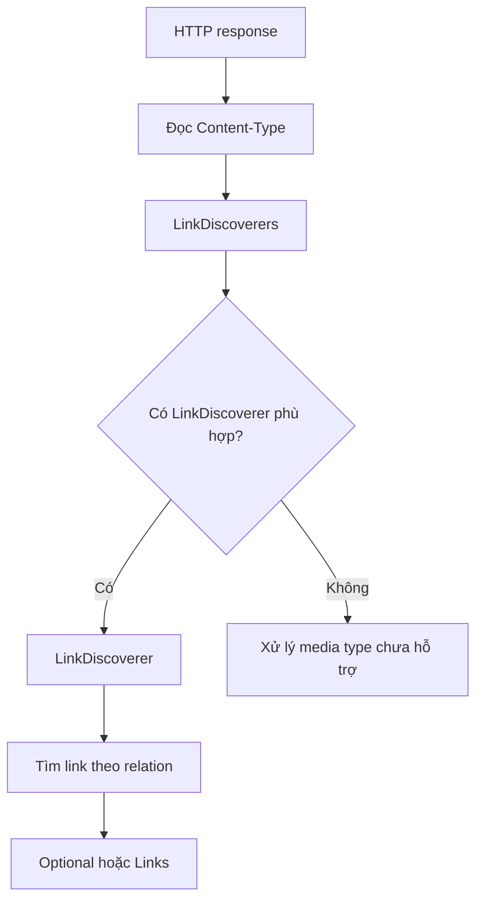

# LinkDiscoverers

Một client hypermedia nhận representation từ server và cần tìm link theo relation để tiếp tục điều hướng. Với HAL, link thường nằm trong phần `_links`; với media type khác, cấu trúc có thể hoàn toàn khác. Nếu client tự đọc từng cấu trúc JSON, mã nguồn sẽ gắn chặt với định dạng representation và khó mở rộng khi API thay đổi media type.

Spring HATEOAS cung cấp hai abstraction ở phía client: `LinkDiscoverer` phân tích một representation để tìm link theo relation; `LinkDiscoverers` quản lý tập hợp các implementation và chọn implementation phù hợp với media type. Nhờ đó, client có thể dùng cùng một cách gọi để khám phá link từ nhiều định dạng hypermedia.

Bài học này tập trung vào cách Spring HATEOAS chọn và sử dụng link discoverer, cách xử lý khi relation không tồn tại, và cách kiểm thử việc khám phá link.

## Mục tiêu

Sau bài học, bạn có thể:

- Phân biệt `LinkDiscoverer` và `LinkDiscoverers`.
- Giải thích cách `LinkDiscoverers` chọn implementation theo media type.
- Dùng `getLinkDiscovererFor()` và `getRequiredLinkDiscovererFor()`.
- Tìm một link hoặc tất cả link theo relation.
- Khám phá link nằm trong phần `_embedded` của HAL.
- Sử dụng discoverer được Spring Boot hoặc Spring HATEOAS cấu hình.
- Đăng ký implementation bổ sung khi ứng dụng dùng media type riêng.
- Kiểm thử link discovery và xử lý trường hợp không tìm thấy link.

## Vì sao cần LinkDiscoverers?

Giả sử client gọi API và nhận được response HAL:

```json
{
  "_links": {
    "self": { "href": "/orders/42" },
    "customer": { "href": "/customers/7" },
    "cancel": { "href": "/orders/42/cancellation" }
  }
}
```

Client cần lấy link có relation `customer` để điều hướng tới khách hàng. Nếu tự đọc JSON, client phải biết link nằm trong `_links`, biết cách xử lý một relation có một hoặc nhiều link, và biết cách đọc thuộc tính `href`.

Một media type khác có thể biểu diễn link bằng cấu trúc khác. Khi chuyển từ HAL sang HAL-FORMS hoặc Collection+JSON, mã client tự đọc JSON phải thay đổi theo.

Spring HATEOAS tách nhiệm vụ này thành hai phần:

- `LinkDiscoverer` biết cách đọc cấu trúc của một media type cụ thể.
- `LinkDiscoverers` là registry facade để tìm `LinkDiscoverer` tương thích với media type của response.

Client chỉ cần chọn discoverer bằng `Content-Type` thực tế rồi yêu cầu tìm relation. Phần phân tích cấu trúc representation được giao cho implementation phù hợp.

## LinkDiscoverer và LinkDiscoverers

Hai kiểu có tên gần giống nhau nhưng vai trò khác nhau:

| Kiểu | Vai trò | Ví dụ |
|---|---|---|
| `LinkDiscoverer` | Đọc một representation và tìm link theo relation | `findLinkWithRel("customer", body)` |
| `LinkDiscoverers` | Chọn discoverer dựa trên media type | `getLinkDiscovererFor(MediaType)` |

`LinkDiscoverer` triển khai plugin theo `MediaType`. Nó cung cấp các phương thức để tìm một link hoặc nhiều link trong nội dung dạng `String` hay `InputStream`. Các phương thức quan trọng:

| Phương thức | Kết quả |
|---|---|
| `findLinkWithRel(relation, representation)` | `Optional<Link>` chứa link đầu tiên nếu tìm thấy |
| `findLinksWithRel(relation, representation)` | `Links` chứa tất cả link có relation |
| `findRequiredLinkWithRel(relation, representation)` | `Link`; ném `IllegalArgumentException` nếu không tìm thấy |
| `supports(mediaType)` | Cho biết discoverer có hỗ trợ media type đó hay không |

`LinkDiscoverers` cung cấp hai nhóm phương thức:

| Phương thức | Ý nghĩa |
|---|---|
| `getLinkDiscovererFor(mediaType)` | Trả `Optional<LinkDiscoverer>` |
| `getRequiredLinkDiscovererFor(mediaType)` | Trả discoverer bắt buộc cho media type |

Các overload nhận `String` hoặc `org.springframework.http.MediaType`. Nên ưu tiên `MediaType` khi response đã có header được parse bởi Spring.

Về cấu trúc, `LinkDiscoverers` là value object bọc `PluginRegistry<LinkDiscoverer, MediaType>`. Registry quản lý các plugin đã đăng ký; `LinkDiscoverers` cung cấp API thuận tiện để tra implementation theo media type. Lưu ý `findRequiredLinkWithRel()` nhận một `LinkRelation`, trong khi các overload `findLinkWithRel()` và `findLinksWithRel()` có thể nhận relation dạng `String`.

## Luồng chọn discoverer

Client nhận response, đọc media type trong header `Content-Type`, sau đó yêu cầu registry chọn plugin hỗ trợ định dạng đó:



Điểm quan trọng là chọn discoverer dựa trên representation server thực sự trả về. Header `Accept` chỉ thể hiện định dạng client mong muốn; server có thể thương lượng và trả về một media type khác. Vì vậy, hãy dùng `Content-Type` của response để chọn parser.

## Các implementation có sẵn

Spring HATEOAS cung cấp nhiều implementation cho các định dạng hypermedia phổ biến:

| Implementation | Định dạng |
|---|---|
| `HalLinkDiscoverer` | HAL, `application/hal+json` |
| `HalFormsLinkDiscoverer` | HAL-FORMS |
| `CollectionJsonLinkDiscoverer` | Collection+JSON |
| `AlpsLinkDiscoverer` | ALPS |
| `UberLinkDiscoverer` | UBER |
| `JsonPathLinkDiscoverer` | Cơ sở JSONPath cho các cấu trúc JSON |

Không cần tạo một parser riêng cho HAL nếu implementation tương ứng đã được đăng ký. Các implementation là plugin theo media type, cho phép registry chọn đúng loại khi client làm việc với nhiều representation.

## Cấu hình tự động trong Spring Boot

Spring Boot cung cấp auto-configuration cho Spring HATEOAS. Với ứng dụng dùng Spring Boot và starter phù hợp, context có thể cung cấp bean `LinkDiscoverers` cùng các thành phần hypermedia cần thiết cho client.

Với ứng dụng Spring MVC, dependency thường dùng là:

```groovy
dependencies {
    implementation 'org.springframework.boot:spring-boot-starter-hateoas'
}
```

Có thể inject registry qua constructor:

```java
import org.springframework.hateoas.client.LinkDiscoverers;
import org.springframework.stereotype.Component;

@Component
class HypermediaClientSupport {

    private final LinkDiscoverers linkDiscoverers;

    HypermediaClientSupport(LinkDiscoverers linkDiscoverers) {
        this.linkDiscoverers = linkDiscoverers;
    }
}
```

Trong ứng dụng Spring Boot, thường không cần tự khởi tạo `LinkDiscoverers`. Auto-configuration đăng ký thành phần phù hợp với hypermedia support đang bật.

Nếu tự cấu hình Spring HATEOAS bằng `@EnableHypermediaSupport`, framework đăng ký `LinkDiscoverer` cho hypermedia type được cấu hình. Khi chủ động bật nhiều cấu hình hoặc dùng một web stack khác với stack đang phục vụ API, hãy kiểm tra cấu hình để bảo đảm discoverer mong muốn có trong context.

Lưu ý về dependency: `spring-boot-starter-hateoas` dành cho Spring MVC. Với ứng dụng Spring WebFlux, dùng `spring-boot-starter-webflux` cùng dependency `org.springframework.hateoas:spring-hateoas` thay vì kết hợp starter HATEOAS MVC với WebFlux.

## Chọn discoverer từ Content-Type

Ví dụ dưới đây nhận body và content type từ một HTTP response đã được client lấy về:

```java
import java.util.Optional;

import org.springframework.http.MediaType;
import org.springframework.hateoas.Link;
import org.springframework.hateoas.client.LinkDiscoverers;
import org.springframework.stereotype.Component;

@Component
class OrderLinkReader {

    private final LinkDiscoverers discoverers;

    OrderLinkReader(LinkDiscoverers discoverers) {
        this.discoverers = discoverers;
    }

    Optional<Link> findCustomerLink(
            MediaType contentType,
            String responseBody) {

        return discoverers.getLinkDiscovererFor(contentType)
            .flatMap(discoverer ->
                discoverer.findLinkWithRel("customer", responseBody)
            );
    }
}
```

Phương thức trả về `Optional<Link>` ở cả hai tình huống không có discoverer tương thích và không tìm thấy relation. Điều này phù hợp khi link là tùy chọn trong hợp đồng API.

Nếu ứng dụng yêu cầu media type phải được hỗ trợ, có thể dùng `getRequiredLinkDiscovererFor()`:

```java
import org.springframework.hateoas.Link;
import org.springframework.hateoas.LinkRelation;
import org.springframework.hateoas.client.LinkDiscoverer;

LinkDiscoverer discoverer =
    discoverers.getRequiredLinkDiscovererFor(contentType);

Link self = discoverer.findRequiredLinkWithRel(
    LinkRelation.of("self"),
    responseBody
);
```

Ở đây có hai điều kiện bắt buộc:

1. Registry phải có discoverer hỗ trợ `contentType`.
2. Representation phải chứa relation `self`.

Nếu một trong hai điều kiện không được đáp ứng, luồng xử lý sẽ báo lỗi. Chỉ dùng biến thể required khi hợp đồng ứng dụng thật sự yêu cầu link đó tồn tại; nếu không, xử lý kết quả `Optional` để client có thể phản hồi phù hợp.

## Tìm một link và tìm nhiều link

Một relation thường chỉ có một link trong representation, chẳng hạn `self` hoặc `profile`. Dùng `findLinkWithRel()`:

```java
Optional<Link> self = discoverer.findLinkWithRel(
    "self",
    responseBody
);

self.ifPresent(link ->
    System.out.println(link.getHref())
);
```

Một relation cũng có thể xuất hiện nhiều lần, chẳng hạn collection có nhiều link tới các tài nguyên cùng loại hoặc một representation cung cấp nhiều lựa chọn. Dùng `findLinksWithRel()` để lấy tất cả:

```java
import org.springframework.hateoas.Links;

Links payments = discoverer.findLinksWithRel(
    "payment",
    responseBody
);

payments.forEach(link ->
    System.out.println(link.getHref())
);
```

Không nên dùng `findLinkWithRel()` nếu logic cần xử lý tất cả link cùng relation. Phương thức singular chỉ trả link đầu tiên được tìm thấy; thứ tự xuất hiện không nên trở thành quy tắc nghiệp vụ của client.

Nếu relation bắt buộc phải tồn tại, dùng `findRequiredLinkWithRel()`:

```java
import org.springframework.hateoas.Link;
import org.springframework.hateoas.LinkRelation;

Link self = discoverer.findRequiredLinkWithRel(
    LinkRelation.of("self"),
    responseBody
);
```

Phương thức này ném `IllegalArgumentException` nếu không tìm thấy link. Trong ứng dụng thực tế, có thể bắt lỗi ở ranh giới tích hợp để chuyển thành lỗi giao tiếp API có ngữ cảnh, ghi log media type và relation bị thiếu, rồi trả lỗi phù hợp cho tầng gọi.

## Khám phá link trong embedded resource của HAL

HAL có thể đặt các representation con trong `_embedded`. Một `HalLinkDiscoverer` thông thường tìm link theo cấu trúc HAL; nếu cần tìm đệ quy cả các link nằm trong phần embedded, có thể dùng `inspectEmbeddeds()`:

```java
import org.springframework.hateoas.Link;
import org.springframework.hateoas.LinkRelation;
import org.springframework.hateoas.client.LinkDiscoverer;
import org.springframework.hateoas.mediatype.hal.HalLinkDiscoverer;

String body = """
{
  "_embedded": {
    "orders": [
      {
        "id": 42,
        "_links": {
          "self": { "href": "/orders/42" },
          "customer": { "href": "/customers/7" }
        }
      }
    ]
  }
}
""";

LinkDiscoverer embeddedAware =
    new HalLinkDiscoverer().inspectEmbeddeds();

Link customer = embeddedAware
    .findRequiredLinkWithRel(LinkRelation.of("customer"), body);
```

`inspectEmbeddeds()` trả về một discoverer mới có thể tìm link HAL đệ quy, bao gồm link trong `_embedded`. Tính năng này hữu ích khi client cần đọc link nằm trong từng phần tử của collection embedded.

Khi làm việc với collection, cần xác định rõ muốn tìm link ở representation gốc hay bên trong một embedded item cụ thể. Nếu nhiều item đều có relation `self`, việc tìm trên toàn document có thể trả về link đầu tiên theo thứ tự duyệt. Với logic cần xử lý từng item, nên duyệt từng representation con và khám phá link trong phạm vi item đó.

## Khởi tạo HalLinkDiscoverer thủ công

Khi chỉ làm việc với HAL trong một đoạn code nhỏ hoặc bài kiểm thử đơn vị, có thể khởi tạo trực tiếp:

```java
import java.util.Optional;

import org.springframework.hateoas.Link;
import org.springframework.hateoas.client.LinkDiscoverer;
import org.springframework.hateoas.mediatype.hal.HalLinkDiscoverer;

String body = """
{
  "_links": {
    "foo": { "href": "/foo/bar" }
  }
}
""";

LinkDiscoverer halDiscoverer = new HalLinkDiscoverer();

Optional<Link> foo = halDiscoverer.findLinkWithRel("foo", body);
```

Constructor mặc định của `HalLinkDiscoverer` hỗ trợ `MediaTypes.HAL_JSON`. Cách tạo trực tiếp hữu ích cho unit test hoặc một client cố định media type. Nếu ứng dụng cần nhiều media type hoặc cần chọn implementation theo response, dùng `LinkDiscoverers` để tránh tự quản lý danh sách parser.

## Tích hợp với client HTTP

`LinkDiscoverers` chỉ chọn bộ phân tích link; nó không tự gửi HTTP request, không tự deserialize toàn bộ domain object và không tự theo link tới request kế tiếp. Một client có thể phối hợp nó với `WebClient` hoặc `RestTemplate`:

1. Gửi request tới entry point.
2. Đọc response body và header `Content-Type`.
3. Dùng `LinkDiscoverers` chọn `LinkDiscoverer`.
4. Tìm relation cần dùng.
5. Dùng HTTP client gửi request tới URI trong link.

Spring HATEOAS cung cấp `HypermediaWebClientConfigurer` và `HypermediaRestTemplateConfigurer` để đăng ký message converter phù hợp khi cần deserialize representation thành model hypermedia. Nếu chỉ cần tìm link từ raw JSON, có thể dùng `LinkDiscoverer` trực tiếp; nếu cần map response thành `EntityModel<T>` hoặc `CollectionModel<T>`, hãy cấu hình converter cho media type tương ứng.

Một link được tìm thấy cũng có thể là URI template. `LinkDiscoverer` trả về `Link` cùng thông tin template; nó không tự điền các biến. Client có thể kiểm tra `isTemplated()`, đọc tên biến bằng `getVariableNames()` và mở rộng link bằng `expand()`:

Giả sử `discoverer` đã được chọn theo media type của response và `responseBody` chứa representation cần đọc:

```java
import java.util.Map;

import org.springframework.hateoas.Link;
import org.springframework.hateoas.LinkRelation;

Link search = discoverer.findRequiredLinkWithRel(
    LinkRelation.of("search"),
    responseBody
);

String searchUri = search.expand(
    Map.of("status", "OPEN", "page", 0)
).getHref();
```

Chỉ cung cấp các biến mà URI template yêu cầu. Nếu thiếu biến bắt buộc, client chưa thể tạo URI hoàn chỉnh để gửi request.

### Link discovery và Traverson

`Traverson` là abstraction cấp cao hơn để đi qua nhiều bước điều hướng theo relation. Nó dùng các link discoverer ở bên trong để tìm link và theo URI tiếp theo. Có thể chọn:

| Nhu cầu | API phù hợp |
|---|---|
| Tìm một link trong body hiện tại | `LinkDiscoverer` |
| Chọn parser theo media type | `LinkDiscoverers` |
| Đi qua chuỗi relation và gửi request tiếp theo | `Traverson` |
| Deserialize representation thành model typed | `HttpMessageConverter` và `TypeReferences` |

Không cần dùng `Traverson` nếu chỉ muốn kiểm tra một link trong response. Ngược lại, nếu client cần đi qua nhiều hop, tự viết vòng lặp HTTP và discovery có thể lặp lại chức năng mà `Traverson` đã cung cấp.

## Đăng ký discoverer cho media type riêng

Nếu ứng dụng sử dụng media type hypermedia riêng, có thể viết một implementation `LinkDiscoverer` để phân tích cấu trúc link của định dạng đó. Implementation phải:

- Khai báo media type mà nó hỗ trợ qua cơ chế plugin `supports(MediaType)`.
- Triển khai việc tìm một hoặc nhiều link theo relation.
- Chuyển dữ liệu link của media type thành đối tượng `Link` của Spring HATEOAS.
- Xử lý relation không tồn tại và nội dung representation không hợp lệ nhất quán.
- Được đăng ký trong plugin registry mà `LinkDiscoverers` sử dụng để registry có thể chọn nó.

Không nên đăng ký một discoverer cho media type mà nó không thể phân tích chính xác. Nếu hai implementation cùng khai báo hỗ trợ một media type, cần xem lại cấu hình plugin để tránh lựa chọn không rõ ràng.

Phần lớn ứng dụng không cần tự viết discoverer vì Spring HATEOAS đã có implementation cho các định dạng phổ biến. Chỉ mở rộng khi API thực sự dùng một cấu trúc hypermedia chưa được hỗ trợ.

## Kiểm thử LinkDiscoverers

Có thể kiểm thử việc tìm link HAL trực tiếp bằng `HalLinkDiscoverer`:

```java
import static org.assertj.core.api.Assertions.assertThat;

import org.junit.jupiter.api.Test;
import org.springframework.hateoas.Link;
import org.springframework.hateoas.LinkRelation;
import org.springframework.hateoas.client.LinkDiscoverer;
import org.springframework.hateoas.mediatype.hal.HalLinkDiscoverer;

class HalLinkDiscovererTest {

    private final LinkDiscoverer discoverer = new HalLinkDiscoverer();

    @Test
    void findsLinkByRelation() {
        String body = """
            {
              "_links": {
                "customer": { "href": "/customers/7" }
              }
            }
            """;

        Link customer = discoverer
            .findRequiredLinkWithRel(LinkRelation.of("customer"), body);

        assertThat(customer.getHref()).isEqualTo("/customers/7");
    }

    @Test
    void returnsEmptyWhenOptionalRelationIsMissing() {
        String body = """
            {
              "_links": {
                "self": { "href": "/orders/42" }
              }
            }
            """;

        assertThat(discoverer.findLinkWithRel("cancel", body)).isEmpty();
    }
}
```

Trong test tích hợp Spring Boot, có thể inject `LinkDiscoverers` để xác nhận registry có discoverer cho media type của ứng dụng:

```java
import static org.assertj.core.api.Assertions.assertThat;

import org.junit.jupiter.api.Test;
import org.springframework.beans.factory.annotation.Autowired;
import org.springframework.boot.test.context.SpringBootTest;
import org.springframework.hateoas.MediaTypes;
import org.springframework.hateoas.client.LinkDiscoverers;

@SpringBootTest
class LinkDiscoverersConfigurationTest {

    @Autowired
    LinkDiscoverers discoverers;

    @Test
    void hasDiscovererForHalJson() {
        assertThat(discoverers.getLinkDiscovererFor(MediaTypes.HAL_JSON))
            .isPresent();
    }
}
```

Kiểm thử thêm các trường hợp:

- Media type không được hỗ trợ trả về `Optional.empty()` từ `getLinkDiscovererFor()`.
- Relation tùy chọn không có trong body trả về `Optional.empty()`.
- Relation bắt buộc không có trong body làm `findRequiredLinkWithRel()` ném `IllegalArgumentException`.
- Một relation xuất hiện nhiều lần được lấy đầy đủ bằng `findLinksWithRel()`.
- Link nằm trong `_embedded` được tìm thấy khi dùng discoverer từ `inspectEmbeddeds()`.
- Body malformed được xử lý như lỗi parse thay vì bị coi là relation không tồn tại.

## Lỗi thường gặp

| Lỗi | Hệ quả | Cách xử lý |
|---|---|---|
| Dùng `LinkDiscoverer` cho mọi media type | Parser không hiểu cấu trúc representation khác | Chọn implementation qua `LinkDiscoverers` theo `Content-Type` |
| Chọn parser bằng `Accept` thay vì response `Content-Type` | Parser có thể không khớp định dạng server trả về | Dùng media type thực tế trong response |
| Giả định registry luôn có parser | Client gặp lỗi khi API trả media type mới | Dùng `getLinkDiscovererFor()` và xử lý `Optional.empty()` |
| Dùng phương thức required cho link tùy chọn | Relation vắng mặt làm luồng xử lý lỗi | Dùng `findLinkWithRel()` và kiểm tra `Optional` |
| Chỉ lấy một link khi relation có nhiều kết quả | Client bỏ qua các lựa chọn còn lại | Dùng `findLinksWithRel()` |
| Tìm link embedded bằng discoverer mặc định | Link trong `_embedded` không được duyệt đệ quy | Dùng `HalLinkDiscoverer.inspectEmbeddeds()` |
| Nghĩ discovery tự gửi request | Client chỉ nhận được đối tượng `Link` mà chưa điều hướng | Dùng HTTP client hoặc `Traverson` để theo href |
| Hard-code cấu trúc `_links` trong client | Mã bị khóa vào HAL | Dùng abstraction `LinkDiscoverer` |
| Bỏ qua relative URI | Client có thể gửi request sai host hoặc path | Resolve href theo URI của response trước khi gửi request tiếp theo |

## Ghi nhớ

`LinkDiscoverer` phân tích một representation và tìm link theo relation; `LinkDiscoverers` chọn implementation phù hợp với media type. Dùng `Content-Type` của response để chọn parser, sau đó dùng `findLinkWithRel()`, `findLinksWithRel()` hoặc `findRequiredLinkWithRel()` theo mức độ bắt buộc của link. Với HAL embedded, `inspectEmbeddeds()` hỗ trợ tìm link đệ quy. Spring Boot có thể tự cấu hình bean registry; chỉ cần tự viết discoverer khi ứng dụng dùng media type riêng. Link discovery chỉ tìm ra URI và metadata của link; HTTP client hoặc `Traverson` mới thực hiện bước điều hướng tiếp theo.

## Tài liệu tham khảo

- [Spring HATEOAS – Reference Documentation](https://docs.spring.io/spring-hateoas/docs/current/reference/html/)
- [LinkDiscoverers API](https://docs.spring.io/spring-hateoas/docs/current/api/org/springframework/hateoas/client/LinkDiscoverers.html)
- [LinkDiscoverer API](https://docs.spring.io/spring-hateoas/docs/current/api/org/springframework/hateoas/client/LinkDiscoverer.html)
- [HalLinkDiscoverer API](https://docs.spring.io/spring-hateoas/docs/current/api/org/springframework/hateoas/mediatype/hal/HalLinkDiscoverer.html)
- [Spring Boot – Spring HATEOAS auto-configuration](https://docs.spring.io/spring-boot/reference/web/spring-hateoas.html)
