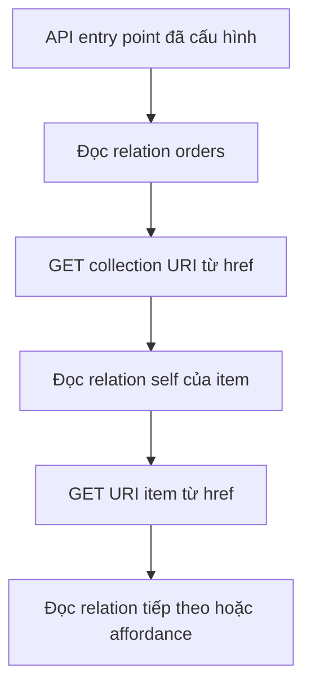
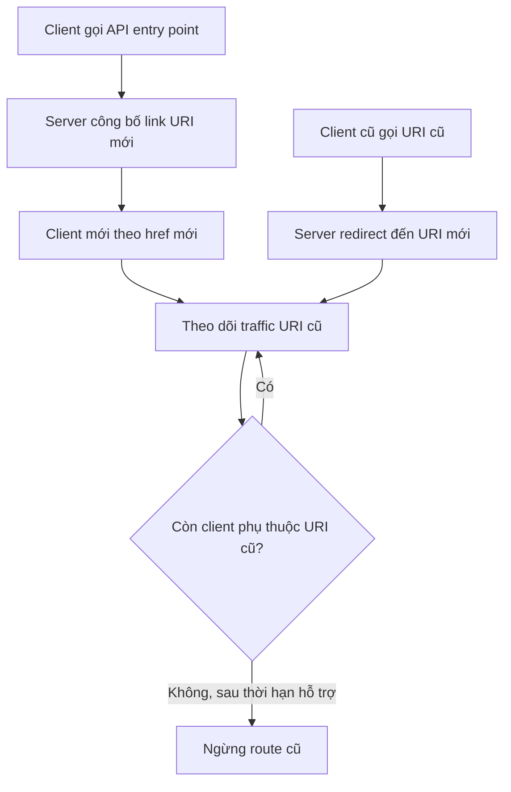

# Client và thay đổi URI

## Mục tiêu

Sau bài này, bạn có thể giải thích vì sao URI của tài nguyên có thể thay đổi trong quá trình phát triển API, xây dựng client điều hướng bằng hypermedia links thay vì ghép URL theo cấu trúc nội bộ, dùng relation để tìm tài nguyên tiếp theo, xử lý URI cũ bằng redirect và triển khai migration theo từng giai đoạn. Bạn cũng có thể dùng Spring HATEOAS Traverson để duyệt API và kiểm thử hành vi khi URI thay đổi.

## 1. Vì sao URI có thể thay đổi?

URI thường phản ánh cách server tổ chức và công bố tài nguyên tại một thời điểm. Khi hệ thống phát triển, cấu trúc đó có thể thay đổi vì nhiều lý do:

- Tổ chức lại API dưới base path mới, ví dụ từ `/orders` sang `/api/orders`.
- Chuyển dịch vụ sang hostname hoặc gateway khác.
- Thay đổi cấu trúc route sau khi tách một module thành microservice.
- Đổi cách biểu diễn định danh, ví dụ từ số nguyên sang UUID.
- Hợp nhất hai endpoint cũ thành một collection resource.
- Chuyển API sang phiên bản hoặc media type mới.

Giả sử phiên bản đầu của API trả về:

```json
{
  "id": "42",
  "status": "PAID",
  "_links": {
    "self": {
      "href": "https://api.example.com/v1/orders/42"
    },
    "collection": {
      "href": "https://api.example.com/v1/orders"
    }
  }
}
```

Sau khi tổ chức lại route, tài nguyên có thể được công bố ở URI mới:

```json
{
  "id": "42",
  "status": "PAID",
  "_links": {
    "self": {
      "href": "https://api.example.com/api/orders/42"
    },
    "collection": {
      "href": "https://api.example.com/api/orders"
    }
  }
}
```

Dữ liệu và ý nghĩa quan hệ vẫn như cũ; URI đích đã thay đổi. Nếu client lấy URI từ link relation, server có thể cập nhật href mà không yêu cầu client biết route mới.

## 2. Hypermedia giảm sự phụ thuộc vào cấu trúc URI

Một client phụ thuộc chặt vào URI thường tự ghép đường dẫn:

```java
URI orderUri = URI.create(
        apiBaseUrl + "/v1/orders/" + orderId
);
```

Cách làm này khiến client phải biết:

- Base path hiện tại.
- Tên collection.
- Cách mã hóa ID.
- Cấu trúc URI của item.
- Quy tắc thêm query parameter hoặc phiên bản API.

Khi server đổi `/v1/orders/{id}` thành `/api/orders/{id}`, client cần sửa code hoặc cấu hình ở mọi nơi đang ghép URL.

Với hypermedia, client bắt đầu từ một entry point đã biết, đọc representation, tìm link theo relation và theo href do server cung cấp:



Client vẫn cần biết entry point, media type và các relation semantics mà nó sử dụng. Nhưng sau khi vào API, client không cần tự suy ra đường dẫn cho từng tài nguyên.

Đây là mức giảm coupling quan trọng: server có thể thay đổi URI của tài nguyên miễn là các representation tiếp tục công bố quan hệ có ý nghĩa và các link mới dẫn đến target hợp lệ.

## 3. Relation ổn định, href có thể thay đổi

Trong một link, hai thành phần có vai trò khác nhau:

| Thành phần | Vai trò | Ví dụ |
|---|---|---|
| Relation | Mô tả ý nghĩa của quan hệ | `self`, `orders`, `next` |
| Href | URI cụ thể của tài nguyên đích | `/api/orders/42` |

Relation là vocabulary mà client dùng để hiểu liên kết. Href là địa chỉ hiện tại của target.

Ví dụ trước khi migration:

```json
{
  "_links": {
    "self": {
      "href": "/v1/orders/42"
    },
    "collection": {
      "href": "/v1/orders"
    }
  }
}
```

Sau migration:

```json
{
  "_links": {
    "self": {
      "href": "/api/orders/42"
    },
    "collection": {
      "href": "/api/orders"
    }
  }
}
```

Client tiếp tục tìm relation `self` hoặc `collection`; nó không cần biết href được xây từ controller nào hoặc route nào.

Không nên đổi relation chỉ vì URI đổi. Nếu semantics của quan hệ không đổi, giữ relation ổn định. Ngược lại, nếu target mang ý nghĩa khác, không tái sử dụng relation cũ chỉ để tránh thay đổi client.

## 4. Client cần một entry point ổn định

Hypermedia không loại bỏ mọi cấu hình phía client. Client vẫn cần biết URI bắt đầu, chẳng hạn:

```properties
api.entry-point=https://api.example.com/
```

Từ entry point, client đọc API root:

```http
GET / HTTP/1.1
Host: api.example.com
Accept: application/hal+json
```

Response có thể công bố collection:

```json
{
  "_links": {
    "orders": {
      "href": "https://api.example.com/api/orders"
    }
  }
}
```

Client theo relation `orders` để đến collection. Nếu collection sau đó chuyển sang `/commerce/orders`, server chỉ cần công bố href mới tại entry point hoặc representation liên quan.

Vì vậy, entry point là một điểm bootstrap cần được duy trì hoặc phân phối qua cấu hình, DNS, service discovery hay cơ chế triển khai phù hợp. Không nên nhầm khả năng khám phá sau entry point với việc client không cần biết địa chỉ ban đầu.

Một API có thể dùng base path ổn định như `/` hoặc `/api` và thay đổi các route phía sau. Dù chọn cách nào, hãy công bố link từ entry point để client có một đường bắt đầu rõ ràng.

## 5. Duyệt API bằng Spring HATEOAS Traverson

Spring HATEOAS cung cấp `Traverson` để client Java duyệt API bằng chuỗi relation. Thay vì tự tạo URL ở mỗi bước, client khai báo các quan hệ cần theo.

Ví dụ API root công bố relation `orders`; collection công bố relation `search`; search resource công bố relation `byStatus`:

```java
import java.net.URI;
import java.util.Map;

import org.springframework.core.ParameterizedTypeReference;
import org.springframework.hateoas.CollectionModel;
import org.springframework.hateoas.EntityModel;
import org.springframework.hateoas.MediaTypes;
import org.springframework.hateoas.client.Traverson;

Traverson traverson = new Traverson(
        URI.create("https://api.example.com/"),
        MediaTypes.HAL_JSON
);

Map<String, Object> parameters = Map.of(
        "status", "PAID"
);

CollectionModel<EntityModel<Order>> orders = traverson
        .follow("orders", "search", "byStatus")
        .withTemplateParameters(parameters)
        .toObject(new ParameterizedTypeReference<
                CollectionModel<EntityModel<Order>>>() {});
```

Trong ví dụ:

1. `Traverson` bắt đầu từ API entry point và gửi request với `Accept: application/hal+json`.
2. `follow("orders")` tìm link có relation `orders` trong API root.
3. `follow("search")` tìm link tìm kiếm trong collection.
4. `follow("byStatus")` tìm link truy vấn theo trạng thái.
5. `withTemplateParameters(...)` cung cấp giá trị để mở rộng URI template nếu link có biến.
6. `toObject(...)` đọc representation cuối cùng thành kiểu Java được yêu cầu.

Tên relation và số bước traversal phải khớp với API thực tế. `Traverson` thực hiện request qua từng bước, vì vậy một traversal nhiều relation có thể tạo nhiều HTTP request. Nếu client cần link cuối cùng thay vì deserialize body, có thể dùng API builder để lấy link hoặc response entity theo nhu cầu.

Các relation là một phần hợp đồng mà client cần hiểu. Nếu server đổi URI nhưng vẫn công bố các relation này, chuỗi traversal không cần biết route mới.

## 6. Theo link self thay vì tạo URI từ ID

Sau khi nhận representation của một đơn hàng, client có thể lấy link `self`:

```java
import java.net.URI;

import org.springframework.hateoas.EntityModel;
import org.springframework.hateoas.IanaLinkRelations;

EntityModel<Order> order = /* representation đã đọc từ HAL */;

URI selfUri = URI.create(
        order.getRequiredLink(IanaLinkRelations.SELF).getHref()
);
```

Client dùng `selfUri` cho thao tác tiếp theo. Không nên thay thế bằng:

```java
URI selfUri = URI.create(
        apiBaseUrl + "/orders/" + order.getContent().getId()
);
```

Cách ghép URL giả định ID nằm trực tiếp trong path và route luôn có dạng `/orders/{id}`. Server có thể đổi sang UUID, slug, route lồng nhau hoặc một gateway URI mà không đổi ý nghĩa relation `self`.

Trong Spring HATEOAS, `getRequiredLink(...)` phù hợp khi hợp đồng yêu cầu relation phải có. Nếu link có thể không tồn tại do trạng thái hoặc quyền truy cập, dùng `getLink(...)` và xử lý trường hợp không có link:

```java
order.getLink("cancel").ifPresent(link -> {
    URI cancelUri = URI.create(link.getHref());
    // Hiển thị hoặc gọi khả năng hủy khi link được công bố.
});
```

Không nên giả định mọi item đều có cùng tập link. Một đơn hàng đã giao có thể không có link `cancel`; một người dùng không đủ quyền có thể không nhận được link thao tác quản trị.

## 7. Xử lý URI template do server công bố

Collection hoặc search link có thể là URI template:

```json
{
  "_links": {
    "search": {
      "href": "/orders{?status,from,to,page,size}",
      "templated": true
    }
  }
}
```

Client không cần biết server ghép query parameter vào path ra sao. Nó đọc template và cung cấp các biến được công bố.

Với Traverson:

```java
Map<String, Object> parameters = Map.of(
        "status", "PAID",
        "page", 0,
        "size", 20
);

CollectionModel<EntityModel<Order>> result = traverson
        .follow("orders", "search", "byStatus")
        .withTemplateParameters(parameters)
        .toObject(new ParameterizedTypeReference<
                CollectionModel<EntityModel<Order>>>() {});
```

Chỉ truyền các biến mà template hỗ trợ. Không tự thêm tên parameter chưa được công bố hoặc giả định mọi endpoint đều nhận `page`, `size` và `sort`.

URI template không phải endpoint đã được gọi. Client phải mở rộng template với giá trị phù hợp trước khi gửi request. Nếu template thay đổi, client có thể tiếp tục làm việc miễn là nó dùng metadata được công bố và hiểu semantics của các biến.

## 8. Thay đổi URI theo từng giai đoạn

Một migration URI an toàn thường cần thời gian để server và client cùng chuyển đổi.

**Giai đoạn 1 – Công bố URI mới**

Server triển khai route mới và cập nhật các link trong API root, collection và item representation. Client mới bắt đầu theo href mới. Route cũ vẫn hoạt động trong thời gian chuyển tiếp.

**Giai đoạn 2 – Duy trì route cũ bằng redirect**

Khi client gọi URI cũ, server trả redirect đến URI mới nếu hai URI thực sự đại diện cùng tài nguyên hoặc cùng đích theo hợp đồng. Header `Location` chứa URI mới.

**Giai đoạn 3 – Theo dõi và chuyển client**

Theo dõi log truy cập route cũ, cập nhật client được kiểm soát và thông báo thời hạn ngừng hỗ trợ. Client hypermedia sẽ dần nhận URI mới từ representation; client cũ có thể tiếp tục dùng route cũ trong thời gian tương thích.

**Giai đoạn 4 – Ngừng route cũ**

Chỉ loại bỏ route cũ sau khi đã đánh giá thời hạn tương thích, traffic còn lại, cache và các bookmark hoặc tích hợp bên ngoài. Nếu không thể duy trì route cũ, trả lỗi phù hợp và cung cấp thông tin chuyển đổi thay vì để client gặp lỗi khó hiểu.

Sơ đồ chuyển đổi:



Việc cập nhật link và việc duy trì redirect giải quyết hai nhóm client khác nhau: client đã khám phá link mới và client còn giữ URI cũ.

## 9. Chọn HTTP redirect phù hợp

Các status 3xx có semantics khác nhau. Khi thay đổi URI, cần chọn status dựa trên việc thay đổi là tạm thời hay lâu dài và có cần giữ nguyên HTTP method hay không.

| Status | Ý nghĩa | Lưu ý khi migration |
|---|---|---|
| `301 Moved Permanently` | URI đã chuyển vĩnh viễn | Client được khuyến nghị dùng URI mới cho tham chiếu sau; với POST, một số client có thể đổi method thành GET |
| `308 Permanent Redirect` | URI đã chuyển vĩnh viễn | Giữ nguyên method khi tự động redirect; phù hợp khi cần bảo toàn method và body |
| `307 Temporary Redirect` | URI tạm thời chuyển sang vị trí khác | Giữ nguyên method; client tiếp tục dùng URI cũ trong các lần sau |
| `302 Found` | Chuyển hướng tạm thời theo semantics lịch sử | Không giả định mọi client giữ nguyên method |
| `303 See Other` | Chuyển sang một tài nguyên khác để truy xuất kết quả | Request tiếp theo dùng GET hoặc HEAD theo semantics của status |

Với request GET đến URI cũ, `301` hoặc `308` thường có thể dùng cho migration vĩnh viễn. Với request thay đổi trạng thái như POST hoặc PATCH, cần đặc biệt chú ý semantics method. Nếu muốn redirect vĩnh viễn mà vẫn giữ nguyên method và body, `308` được định nghĩa cho mục đích đó. Nếu chỉ chuyển tạm thời và cần giữ method, dùng `307`.

Ví dụ response:

```http
HTTP/1.1 308 Permanent Redirect
Location: https://api.example.com/api/orders/42
Cache-Control: max-age=3600
```

`Location` chỉ rõ URI mới. Cache policy cần được lựa chọn cẩn thận vì redirect vĩnh viễn có thể được cache; nếu migration còn trong giai đoạn thử nghiệm, không nên phát cache lifetime dài trước khi chắc chắn route mới ổn định.

Redirect không thay thế việc cập nhật link trong representation. Client hypermedia nên nhận href mới trực tiếp từ server, còn redirect là lớp tương thích cho client đang dùng URI cũ.

## 10. URI đổi không đồng nghĩa relation đổi

Khi route thay đổi nhưng target vẫn cùng ý nghĩa, giữ relation:

- `self` tiếp tục chỉ tài nguyên hiện tại.
- `collection` tiếp tục chỉ collection chứa tài nguyên.
- `next` tiếp tục chỉ trang kế tiếp.
- `search` tiếp tục chỉ khả năng tìm kiếm.

Nếu target thay đổi ý nghĩa, hãy đánh giá relation riêng. Không dùng relation `customer` cho một tài nguyên tổng hợp chứa cả khách hàng, hóa đơn và lịch sử chỉ vì endpoint mới có tên gần giống.

Cũng cần phân biệt thay đổi URI với thay đổi representation:

| Thay đổi | Client hypermedia có tự thích ứng không? |
|---|---|
| Đổi path nhưng giữ relation và media type | Thường có, nếu client theo href |
| Đổi hostname nhưng link mới hợp lệ và client được phép truy cập origin đó | Có thể, tùy chính sách mạng và xác thực |
| Đổi relation name | Không, client tìm relation cũ có thể không tìm thấy |
| Đổi media type hoặc schema theo cách không tương thích | Không tự động |
| Thay đổi semantics của relation | Không an toàn dù tên relation giữ nguyên |
| Bỏ link tùy chọn | Client phải xử lý trường hợp link không tồn tại |

Hypermedia giảm coupling với URI, nhưng không tự động bảo đảm tương thích khi vocabulary, media type, schema hoặc semantics thay đổi.

## 11. URI cũ, cache và link được lưu lại

Client có thể lưu representation hoặc href trong cache, database, log, bookmark hay job queue. Khi URI thay đổi, các tham chiếu đã lưu có thể trở thành stale.

Một client tốt nên:

- Ưu tiên link mới từ representation vừa lấy.
- Có chiến lược refresh khi nhận 404 hoặc 410 từ một href đã lưu.
- Không cache link lâu hơn chính sách mà API cho phép.
- Không xem URI đã nhận là vĩnh viễn nếu API không cam kết điều đó.
- Theo redirect theo chính sách an toàn của client.
- Giới hạn số lần redirect và phát hiện redirect loop.

Server nên cân nhắc cache control cho response chứa link và cho redirect. Nếu API thay đổi href nhưng representation bị cache quá lâu, client có thể tiếp tục nhận URI cũ dù server đã triển khai route mới.

Đối với các hệ thống có job chạy dài, không nên lưu một URI tạm thời rồi sử dụng vô thời hạn. Có thể lưu ID nghiệp vụ hoặc khóa tham chiếu cùng entry point, sau đó khám phá lại representation khi cần. Cách này chỉ phù hợp nếu API cung cấp một đường khám phá ổn định cho tài nguyên đó.

## 12. Redirect qua origin khác và thông tin xác thực

URI mới có thể nằm trên hostname khác, ví dụ từ `api.example.com` sang `orders.example.net`. Client cần xử lý thay đổi origin có chủ đích:

- Kiểm tra origin mới có nằm trong danh sách được phép hay không.
- Không chuyển tiếp `Authorization`, cookie hoặc thông tin nhạy cảm sang origin không tin cậy.
- Cập nhật token audience hoặc cơ chế xác thực nếu dịch vụ mới yêu cầu.
- Xử lý TLS và chính sách CORS trong client phù hợp.
- Không giả định redirect tự động luôn an toàn với mọi HTTP method.

HTTP Semantics khuyến nghị client cân nhắc loại bỏ các header nhạy cảm khi redirect, đặc biệt khi origin thay đổi. Với request không an toàn, client phải chú ý status redirect và chính sách gửi lại body. Hãy kiểm tra thư viện HTTP đang dùng thay vì mặc định mọi redirect đều được xử lý như mong muốn.

## 13. Kiểm thử client khi URI thay đổi

Kiểm thử migration nên xác nhận hai hành vi: representation mới công bố href mới và URI cũ chuyển hướng đúng.

Kiểm tra link mới trong response HAL:

```java
mockMvc.perform(get("/api/orders/{id}", orderId)
        .accept(MediaTypes.HAL_JSON))
    .andExpect(status().isOk())
    .andExpect(jsonPath("$._links.self.href")
            .value(endsWith("/api/orders/" + orderId)));
```

Kiểm tra route cũ trả permanent redirect:

```java
mockMvc.perform(get("/v1/orders/{id}", orderId))
    .andExpect(status().isPermanentRedirect())
    .andExpect(header().string(
            HttpHeaders.LOCATION,
            endsWith("/api/orders/" + orderId)
    ));
```

`isPermanentRedirect()` tương ứng với HTTP 308 trong MockMvc. Nếu migration dùng 301, hãy kiểm tra status 301 và xác định hành vi method của client riêng.

Kiểm tra redirect giữ method cho request ghi:

```java
mockMvc.perform(post("/v1/orders/{id}/cancel", orderId)
        .contentType(MediaType.APPLICATION_JSON)
        .content("""
            {
              "reason": "Customer request"
            }
            """))
    .andExpect(status().isPermanentRedirect())
    .andExpect(header().exists(HttpHeaders.LOCATION));
```

Test này chỉ xác nhận server trả 308 và Location. Để chứng minh client thực sự gửi lại POST cùng body đến URI mới, cần một integration test với HTTP client đang dùng và server test nhận request đích.

Ngoài ra nên kiểm tra:

1. API root vẫn có entry point relation cần thiết.
2. Link `self`, `collection`, `search`, `next` trỏ đến URI mới.
3. Client traversal bằng relation hoạt động sau khi route thay đổi.
4. Link tùy chọn bị thiếu được client xử lý bình thường.
5. Redirect không tạo vòng lặp.
6. Redirect cross-origin không làm rò rỉ credential.
7. Cache không giữ link cũ lâu hơn thời hạn tương thích đã công bố.

## 14. Những lỗi thường gặp

**Ghép URL từ base path và ID.** Client phụ thuộc vào route và định dạng ID. Theo link `self` do server cung cấp.

**Chỉ đổi route server mà không cập nhật link.** Client mới vẫn nhận URI cũ và phải dựa vào redirect. Cập nhật API root và mọi representation liên quan.

**Xóa URI cũ ngay khi route mới hoạt động.** Client cũ, bookmark hoặc cache có thể vẫn tham chiếu URI cũ. Duy trì redirect hoặc thời hạn tương thích phù hợp.

**Dùng 301 cho request POST mà không xem xét method.** Client có thể đổi POST thành GET. Dùng 308 nếu cần redirect vĩnh viễn và bảo toàn method.

**Cho rằng HATEOAS tự giải quyết mọi breaking change.** Client vẫn phụ thuộc relation, media type, schema và semantics. Giữ các phần hợp đồng đó tương thích hoặc version chúng có chủ đích.

**Giữ relation cũ nhưng thay target bằng tài nguyên mang ý nghĩa khác.** Client có thể thực hiện hành vi sai trên target mới. Relation phải phản ánh đúng semantics.

**Tin redirect từ origin khác mà không kiểm tra.** Credential có thể bị gửi đến host không tin cậy. Xác minh origin và xử lý header nhạy cảm.

**Cache link vô thời hạn.** Client có thể tiếp tục gọi URI đã lỗi thời. Áp dụng cache policy và refresh khi cần.

## 15. Nguyên tắc thiết kế

- Cung cấp một API entry point rõ ràng để client bắt đầu traversal.
- Dùng relation ổn định và để server công bố href hiện tại.
- Không ghép URI từ ID, tên controller hoặc cấu trúc route.
- Dùng link `self` cho tài nguyên đã được khám phá.
- Công bố lại link ở API root, collection và item khi URI thay đổi.
- Duy trì URI cũ bằng redirect trong giai đoạn tương thích khi có thể.
- Chọn 301/308 hoặc 307 theo tính lâu dài và yêu cầu giữ HTTP method.
- Kiểm tra redirect, cache và thay đổi origin.
- Xử lý link tùy chọn có thể không xuất hiện.
- Nhớ rằng relation, media type, schema và semantics vẫn phải tương thích.
- Dùng Traverson hoặc client hypermedia tương đương để kiểm thử traversal qua nhiều URI.

## Kết luận

URI là địa chỉ của tài nguyên tại một thời điểm; relation mô tả ý nghĩa của liên kết đến tài nguyên đó. Client dùng hypermedia nên bắt đầu từ entry point, tìm link theo relation và theo href server công bố thay vì tự ghép URL. Khi URI thay đổi, server cập nhật link mới và có thể duy trì URI cũ bằng redirect trong thời gian chuyển tiếp. Spring HATEOAS Traverson hỗ trợ client Java duyệt theo relation. Hypermedia giúp giảm phụ thuộc vào cấu trúc URI, nhưng client vẫn cần xử lý tương thích relation, media type, schema, cache, redirect và bảo mật khi origin thay đổi.

## Tài liệu tham khảo

- [Spring HATEOAS Reference – Client-side Support and Traverson](https://docs.spring.io/spring-hateoas/docs/current/reference/html/#client.traverson)
- [Spring HATEOAS API – Traverson](https://docs.spring.io/spring-hateoas/docs/current/api/org/springframework/hateoas/client/Traverson.html)
- [Spring HATEOAS API – Traverson.TraversalBuilder](https://docs.spring.io/spring-hateoas/docs/current/api/org/springframework/hateoas/client/Traverson.TraversalBuilder.html)
- [RFC 8288 – Web Linking](https://www.rfc-editor.org/rfc/rfc8288.html)
- [RFC 9110 – HTTP Semantics, Redirection](https://www.rfc-editor.org/rfc/rfc9110.html#section-15.4)

