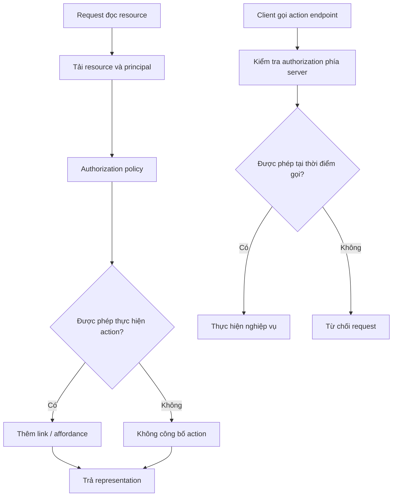

# Ẩn action không được phép

Một representation hypermedia nên công bố những link và affordance phù hợp với người dùng hiện tại. Nếu người dùng không có quyền hủy đơn hàng, representation của đơn hàng không nên quảng bá action `cancel`. Nếu người dùng có quyền, server có thể thêm link hoặc affordance để client khám phá thao tác đó.

Spring HATEOAS cho phép xây dựng representation theo điều kiện: chỉ thêm link khi chính sách phân quyền cho phép. Tuy nhiên, việc ẩn link chỉ điều khiển khả năng khám phá của client. Endpoint thực hiện thao tác vẫn phải kiểm tra quyền ở phía server, vì client có thể lưu URI cũ, tự tạo request hoặc gọi API bằng một công cụ khác.

Bài học này trình bày cách kết hợp Spring HATEOAS với Spring Security để công bố action theo quyền, vai trò, chủ sở hữu và trạng thái nghiệp vụ; đồng thời bảo vệ endpoint và tránh rò rỉ representation cá nhân hóa qua cache.

## Mục tiêu

Sau bài học, bạn có thể:

- Giải thích vì sao link và affordance cần phản ánh quyền hiện tại.
- Ẩn link hoặc affordance khi người dùng không được phép thực hiện action.
- Tách chính sách authorization khỏi logic tạo representation.
- Kết hợp Spring HATEOAS với `Authentication` và Spring Security method security.
- Kiểm tra cả quyền theo authority, quyền sở hữu và trạng thái domain.
- Bảo vệ endpoint ngay cả khi client tự gọi URI của action.
- Kiểm thử link được công bố và request bị từ chối.
- Thiết kế cache phù hợp với representation có link phụ thuộc người dùng.

## Vì sao cần ẩn action không được phép?

Giả sử API trả về đơn hàng:

```json
{
  "id": "42",
  "status": "SUBMITTED",
  "_links": {
    "self": { "href": "/orders/42" },
    "cancel": { "href": "/orders/42/cancellations" },
    "customer": { "href": "/customers/7" }
  }
}
```

Nếu người dùng hiện tại không được phép hủy đơn hàng, link `cancel` khiến client hiểu rằng thao tác này đang được cung cấp. Client có thể hiển thị nút hủy hoặc tự động đưa thao tác vào luồng công việc.

Server nên tạo representation phù hợp với quyền của principal:

- Người có quyền hủy thấy link hoặc affordance `cancel`.
- Người không có quyền hủy vẫn thấy các link mà họ được phép sử dụng, chẳng hạn `self` và `customer`.
- Nếu trạng thái đơn hàng không còn cho phép hủy, action `cancel` cũng không được công bố, kể cả người dùng có authority tương ứng.

Việc công bố action theo quyền giúp client không phải tự suy luận từ role, trạng thái hoặc quy tắc nội bộ của server. Client có thể điều hướng dựa trên những khả năng mà representation thực sự cung cấp.

## Link không phải ranh giới bảo mật

Không có link trong response không đồng nghĩa endpoint đã được bảo vệ. Một client có thể:

- Gọi URI action đã lưu từ response trước đó.
- Tự đoán hoặc tự tạo URI từ tài liệu API.
- Gửi request trực tiếp bằng HTTP client, browser hoặc công cụ khác.
- Tiếp tục dùng representation cũ sau khi quyền hoặc trạng thái domain đã thay đổi.

Vì vậy, cần hai lớp quyết định độc lập:

1. **Presentation:** chỉ công bố link hoặc affordance khi action được phép ở thời điểm tạo representation.
2. **Enforcement:** kiểm tra authorization lại khi request thực sự gọi endpoint hoặc application service.



Nếu client gọi một endpoint không được công bố trong representation, server vẫn phải trả kết quả theo chính sách bảo mật, thường là `403 Forbidden` hoặc `404 Not Found` tùy yêu cầu không tiết lộ sự tồn tại của resource.

## Những yếu tố quyết định một action có khả dụng

Không nên chỉ kiểm tra role hoặc authority rồi mặc định action luôn khả dụng. Một quyết định thực tế có thể phụ thuộc nhiều yếu tố:

| Yếu tố | Ví dụ |
|---|---|
| Authentication | Request có principal đã đăng nhập hay là anonymous? |
| Authority | Principal có `ORDER_CANCEL` hay không? |
| Ownership | Đơn hàng có thuộc về người dùng hiện tại không? |
| Domain state | Đơn hàng đang `DRAFT` hoặc `SUBMITTED`, hay đã `SHIPPED`? |
| Tenant hoặc phạm vi | Resource có thuộc tenant mà principal đang truy cập không? |
| Điều kiện thời gian | Cửa sổ hủy đơn đã đóng chưa? |
| Quy tắc nghiệp vụ | Đơn hàng có giao dịch thanh toán hoặc tranh chấp đang xử lý không? |

Một action chỉ nên được công bố khi tất cả điều kiện cần thiết đều đúng. Chính sách này cần được đặt ở một thành phần có thể tái sử dụng, để controller, assembler và application service dùng cùng một quy tắc.

## Mô hình ví dụ

Giả sử hệ thống có đơn hàng và action hủy. Principal ứng dụng chứa mã người dùng; authority `ORDER_CANCEL` cho biết người dùng có quyền thực hiện thao tác hủy nói chung.

```java
import java.util.UUID;

public record AppPrincipal(UUID userId) {
}
```

Domain model xác định trạng thái nào còn có thể hủy:

```java
import java.util.UUID;

enum OrderStatus {
    DRAFT,
    SUBMITTED,
    PAID,
    SHIPPED,
    CANCELLED
}

record Order(UUID id, UUID ownerId, OrderStatus status) {

    boolean isCancellable() {
        return status == OrderStatus.DRAFT
            || status == OrderStatus.SUBMITTED;
    }

    Order cancel() {
        if (!isCancellable()) {
            throw new IllegalStateException(
                "Order is no longer cancellable"
            );
        }

        return new Order(id, ownerId, OrderStatus.CANCELLED);
    }
}
```

Trong ứng dụng thật, entity có thể là JPA entity và việc đổi trạng thái sẽ được lưu trong transaction. Ví dụ record ở đây làm rõ điều kiện nghiệp vụ: quyền hủy của người dùng không thể làm một đơn hàng đã giao trở thành có thể hủy.

## Tập trung chính sách authorization

Tạo một policy service để quyết định người dùng có thể hủy đơn hàng hay không. Service kiểm tra authentication, authority, owner và trạng thái domain:

```java
import java.util.UUID;

import org.springframework.security.authentication.AnonymousAuthenticationToken;
import org.springframework.security.core.Authentication;
import org.springframework.security.core.GrantedAuthority;
import org.springframework.stereotype.Component;

@Component("orderAuthorization")
public class OrderAuthorization {

    private final OrderRepository orders;

    OrderAuthorization(OrderRepository orders) {
        this.orders = orders;
    }

    public boolean canCancel(Authentication authentication, UUID orderId) {
        if (!isAuthenticated(authentication)) {
            return false;
        }

        return orders.findById(orderId)
            .map(order -> canCancel(authentication, order))
            .orElse(false);
    }

    public boolean canCancel(Authentication authentication, Order order) {
        if (!isAuthenticated(authentication)) {
            return false;
        }

        boolean hasAuthority = authentication.getAuthorities().stream()
            .map(GrantedAuthority::getAuthority)
            .anyMatch("ORDER_CANCEL"::equals);

        boolean isOwner = authentication.getPrincipal()
            instanceof AppPrincipal principal
            && order.ownerId().equals(principal.userId());

        return hasAuthority && isOwner && order.isCancellable();
    }

    private boolean isAuthenticated(Authentication authentication) {
        return authentication != null
            && authentication.isAuthenticated()
            && !(authentication instanceof AnonymousAuthenticationToken);
    }
}
```

`AnonymousAuthenticationToken` cần được loại trừ rõ ràng: trong Spring Security, anonymous authentication có thể trả `true` từ `isAuthenticated()`. Chỉ kiểm tra boolean đó không đủ để xác định principal là người dùng đã đăng nhập.

`AppPrincipal` là principal tùy chỉnh của ví dụ. Nếu ứng dụng dùng `UserDetails`, JWT claim hoặc một kiểu principal khác, hãy chuyển đổi principal sang user ID theo cơ chế xác thực của ứng dụng. Không nên so sánh owner với username hiển thị nếu username có thể thay đổi.

Repository có thể là Spring Data repository hoặc abstraction của application:

```java
import java.util.Optional;
import java.util.UUID;

interface OrderRepository {
    Optional<Order> findById(UUID id);
    Order save(Order order);
}
```

`canCancel(authentication, order)` dùng khi controller đã tải resource. Overload nhận `orderId` dùng ở ranh giới thực thi khi cần tải resource để đánh giá policy.

## Chỉ thêm link khi policy cho phép

Trong controller, tải đơn hàng, tạo representation cơ bản và thêm các link điều hướng. Chỉ thêm relation `cancel` khi policy xác nhận action khả dụng:

```java
import java.util.UUID;

import org.springframework.hateoas.EntityModel;
import org.springframework.http.ResponseEntity;
import org.springframework.security.core.Authentication;
import org.springframework.web.bind.annotation.GetMapping;
import org.springframework.web.bind.annotation.PathVariable;
import org.springframework.web.bind.annotation.PostMapping;
import org.springframework.web.bind.annotation.RequestMapping;
import org.springframework.web.bind.annotation.RestController;

import static org.springframework.hateoas.server.mvc.WebMvcLinkBuilder.linkTo;
import static org.springframework.hateoas.server.mvc.WebMvcLinkBuilder.methodOn;

record OrderView(UUID id, String status) {
    static OrderView from(Order order) {
        return new OrderView(order.id(), order.status().name());
    }
}

@RestController
@RequestMapping("/orders")
class OrderController {

    private final OrderRepository orders;
    private final OrderAuthorization authorization;
    private final OrderCommandService commands;

    OrderController(
            OrderRepository orders,
            OrderAuthorization authorization,
            OrderCommandService commands) {
        this.orders = orders;
        this.authorization = authorization;
        this.commands = commands;
    }

    @GetMapping("/{orderId}")
    EntityModel<OrderView> one(
            @PathVariable("orderId") UUID orderId,
            Authentication authentication) {

        Order order = orders.findById(orderId)
            .orElseThrow(() -> new OrderNotFoundException(orderId));

        EntityModel<OrderView> model = EntityModel.of(
            OrderView.from(order),
            linkTo(OrderController.class).slash(orderId).withSelfRel()
        );

        if (authorization.canCancel(authentication, order)) {
            model.add(
                linkTo(methodOn(OrderController.class).cancel(orderId))
                    .withRel("cancel")
            );
        }

        return model;
    }

    @PostMapping("/{orderId}/cancellations")
    ResponseEntity<Void> cancel(@PathVariable("orderId") UUID orderId) {
        commands.cancel(orderId);
        return ResponseEntity.noContent().build();
    }
}
```

Trong response HAL, người có quyền có thể nhận:

```json
{
  "id": "42",
  "status": "SUBMITTED",
  "_links": {
    "self": { "href": "/orders/42" },
    "cancel": { "href": "/orders/42/cancellations" }
  }
}
```

Người không có quyền nhận representation không có relation `cancel`:

```json
{
  "id": "42",
  "status": "SUBMITTED",
  "_links": {
    "self": { "href": "/orders/42" }
  }
}
```

Hai response cùng mô tả một resource nhưng công bố khả năng khác nhau theo principal và trạng thái tại thời điểm đọc. Controller vẫn trả các link mà người dùng được phép sử dụng.

### Link HAL và affordance

Ví dụ trên thêm một link relation `cancel`. Với HAL thuần, link cung cấp relation và URI; bản thân HAL link không mô tả đầy đủ HTTP method hay input schema của thao tác. Nếu client cần khám phá cách gửi request, hãy công bố affordance bằng một media type hỗ trợ mô tả action, chẳng hạn HAL-FORMS.

Nguyên tắc áp dụng cho cả link lẫn affordance:

- Chỉ thêm affordance `cancel` khi policy cho phép.
- Không công bố template nhập dữ liệu hoặc phương thức thực hiện action cho principal không đủ quyền.
- Nếu policy thay đổi, representation mới phải phản ánh khả năng mới.
- Không coi việc client không thấy affordance là bằng chứng endpoint đã được bảo vệ.

Không nên thêm link rồi đánh dấu một thuộc tính tự đặt như `disabled: true` nếu media type và client contract không định nghĩa semantics đó. Nếu action không khả dụng, bỏ link/affordance là cách thể hiện rõ ràng hơn.

## Bảo vệ endpoint thực thi

Controller không phải ranh giới duy nhất của ứng dụng. Một service có thể được gọi từ controller khác, message listener, scheduled job hoặc thành phần nội bộ. Vì vậy, đặt kiểm tra method security ở application service thực hiện command:

```java
import java.util.UUID;

import org.springframework.security.access.prepost.PreAuthorize;
import org.springframework.security.core.parameters.P;
import org.springframework.stereotype.Service;
import org.springframework.transaction.annotation.Transactional;

@Service
public class OrderCommandService {

    private final OrderRepository orders;

    OrderCommandService(OrderRepository orders) {
        this.orders = orders;
    }

    @Transactional
    @PreAuthorize("@orderAuthorization.canCancel(authentication, #orderId)")
    public void cancel(@P("orderId") UUID orderId) {
        Order order = orders.findById(orderId)
            .orElseThrow(() -> new OrderNotFoundException(orderId));

        // Domain model kiểm tra trạng thái lần nữa trong transaction.
        orders.save(order.cancel());
    }
}
```

Bật method security trong cấu hình:

```java
import org.springframework.context.annotation.Configuration;
import org.springframework.security.config.annotation.method.configuration.EnableMethodSecurity;

@Configuration
@EnableMethodSecurity
class MethodSecurityConfiguration {
}
```

`@PreAuthorize` gọi lại policy ở thời điểm thực thi command. `@P("orderId")` đặt tên tham số rõ ràng cho biểu thức SpEL; cách khác là bật lưu tên tham số trong bytecode bằng compiler option `-parameters` và dùng tên tham số được Spring Security nhận diện.

Kiểm tra trong method security cần chạy qua Spring proxy. Tránh gọi method được bảo vệ từ một method khác trong cùng instance nếu kỳ vọng interceptor được kích hoạt; self-invocation không đi qua proxy. Các đường gọi khác của application service cũng phải đi qua bean được bảo vệ.

Trong ví dụ, domain method `order.cancel()` tiếp tục kiểm tra trạng thái trước khi thay đổi. Điều này bảo vệ invariant nếu trạng thái thay đổi giữa lúc policy được đánh giá và lúc transaction cập nhật. Với hệ thống đồng thời cao, cần thêm cơ chế locking hoặc optimistic versioning phù hợp để xử lý xung đột cập nhật.

## Quyền theo vai trò và quyền theo resource

Role hoặc authority là một phần của policy, nhưng thường không đủ để quyết định action trên một resource cụ thể:

```java
boolean hasCancelAuthority = authentication.getAuthorities().stream()
    .anyMatch(a -> a.getAuthority().equals("ORDER_CANCEL"));
```

Kiểm tra trên chỉ trả lời principal có quyền hủy nói chung. Nó không trả lời:

- Đơn hàng có thuộc người dùng này không?
- Đơn hàng đã giao hoặc đã thanh toán chưa?
- Đơn hàng có thuộc tenant hiện tại không?
- Yêu cầu hủy có nằm trong khoảng thời gian cho phép không?

Có thể dùng `hasRole("ADMIN")` hoặc `hasAuthority("ORDER_CANCEL")` cho các quy tắc đơn giản, nhưng policy thực tế nên xét resource và ngữ cảnh. Tránh nhân bản điều kiện trong nhiều controller vì các endpoint có thể dần đưa ra quyết định khác nhau.

## Không để lộ thông tin qua representation

Ẩn link action là một phần của thiết kế an toàn. Representation cũng cần tránh làm lộ thông tin mà principal không được phép xem:

- Không đưa dữ liệu nhạy cảm vào payload rồi chỉ ẩn link thao tác.
- Không trả danh sách link tới resource mà người dùng không được quyền truy cập.
- Không dùng tên relation hoặc URI chứa thông tin bí mật, token hay dữ liệu xác thực.
- Không dựa vào việc URI khó đoán để thay thế authorization.
- Không tiết lộ chi tiết policy nội bộ trong error response cho client không tin cậy.

Nếu người dùng không được quyền đọc resource, hãy áp dụng chính sách đọc resource ngay ở endpoint GET. Không tạo representation một phần có dữ liệu nhạy cảm chỉ vì action bị ẩn.

### Xử lý trạng thái thay đổi

Một representation có thể đã cũ ngay sau khi được trả về:

1. Người dùng nhận link `cancel` khi đơn hàng còn `SUBMITTED`.
2. Một tiến trình khác chuyển đơn hàng sang `SHIPPED`.
3. Client gọi link `cancel` đã lưu.
4. Server đánh giá policy và trạng thái mới, sau đó từ chối thao tác.

Đây là hành vi cần thiết. Link mô tả khả năng tại thời điểm representation được tạo, không phải giấy phép vĩnh viễn. Server phải kiểm tra lại ở request thực thi và trả lỗi HTTP phù hợp.

## Cache cho representation phụ thuộc người dùng

Khi link thay đổi theo quyền, representation của cùng một URI có thể khác nhau giữa hai principal. Ví dụ, người sở hữu đơn hàng thấy link `cancel`, còn người khác không thấy. Nếu shared cache lưu response của người sở hữu rồi trả cho người khác, cache có thể làm lộ action hoặc thậm chí dữ liệu cá nhân hóa.

Đối với representation nhạy cảm hoặc được cá nhân hóa, có thể tắt lưu cache:

```java
import org.springframework.http.CacheControl;
import org.springframework.http.ResponseEntity;

return ResponseEntity.ok()
    .cacheControl(CacheControl.noStore())
    .body(model);
```

Nếu có nhu cầu cache, hãy thiết kế cache key và chính sách cache theo danh tính/authorization context một cách rõ ràng. `Vary: Authorization` có thể tham gia vào lựa chọn representation của cache, nhưng không tự thay thế chính sách `private` hoặc `no-store`; cần bảo đảm shared cache không tái sử dụng response cá nhân hóa giữa các người dùng.

Không dùng ETag chỉ dựa trên dữ liệu domain nếu nội dung representation còn phụ thuộc principal. Validator phải phản ánh cả các khác biệt làm thay đổi representation được gửi cho người dùng.

## Kiểm thử chính sách và link được công bố

Nên kiểm thử riêng policy và representation. Policy test xác nhận authority, owner và domain state phối hợp đúng:

```java
import static org.assertj.core.api.Assertions.assertThat;

import java.util.UUID;
import java.util.List;

import org.junit.jupiter.api.Test;
import org.springframework.security.authentication.UsernamePasswordAuthenticationToken;
import org.springframework.security.core.Authentication;
import org.springframework.security.core.authority.SimpleGrantedAuthority;

class OrderAuthorizationTest {

    private final OrderAuthorization authorization =
        new OrderAuthorization(org.mockito.Mockito.mock(OrderRepository.class));

    @Test
    void allowsOwnerWithAuthorityToCancelSubmittedOrder() {
        UUID ownerId = UUID.randomUUID();
        Order order = new Order(
            UUID.randomUUID(),
            ownerId,
            OrderStatus.SUBMITTED
        );

        Authentication authentication =
            new UsernamePasswordAuthenticationToken(
                new AppPrincipal(ownerId),
                "n/a",
                List.of(new SimpleGrantedAuthority("ORDER_CANCEL"))
            );

        assertThat(authorization.canCancel(authentication, order)).isTrue();
    }

    @Test
    void deniesDifferentOwnerEvenWhenAuthorityIsPresent() {
        UUID ownerId = UUID.randomUUID();
        Order order = new Order(
            UUID.randomUUID(),
            ownerId,
            OrderStatus.SUBMITTED
        );
        Authentication authentication =
            new UsernamePasswordAuthenticationToken(
                new AppPrincipal(UUID.randomUUID()),
                "n/a",
                List.of(new SimpleGrantedAuthority("ORDER_CANCEL"))
            );

        assertThat(authorization.canCancel(authentication, order)).isFalse();
    }

    @Test
    void deniesOwnerWithoutCancelAuthority() {
        UUID ownerId = UUID.randomUUID();
        Order order = new Order(
            UUID.randomUUID(),
            ownerId,
            OrderStatus.SUBMITTED
        );
        Authentication authentication =
            new UsernamePasswordAuthenticationToken(
                new AppPrincipal(ownerId),
                "n/a",
                List.of(new SimpleGrantedAuthority("ORDER_READ"))
            );

        assertThat(authorization.canCancel(authentication, order)).isFalse();
    }

    @Test
    void deniesOwnerWhenOrderIsAlreadyShipped() {
        UUID ownerId = UUID.randomUUID();
        Order order = new Order(
            UUID.randomUUID(),
            ownerId,
            OrderStatus.SHIPPED
        );
        Authentication authentication =
            new UsernamePasswordAuthenticationToken(
                new AppPrincipal(ownerId),
                "n/a",
                List.of(new SimpleGrantedAuthority("ORDER_CANCEL"))
            );

        assertThat(authorization.canCancel(authentication, order)).isFalse();
    }
}
```

Test trên gọi overload nhận `Order` đã tải sẵn nên không dùng repository mock. Nếu kiểm thử overload nhận ID, hãy stub repository và xác nhận cả trường hợp resource không tồn tại. Có thể tách policy thuần thành thành phần chỉ nhận principal và resource nếu không muốn test phải dựng repository.

Với controller, kiểm thử representation ở cả hai trạng thái:

```java
import static org.springframework.security.test.web.servlet.request.SecurityMockMvcRequestPostProcessors.authentication;
import static org.springframework.test.web.servlet.request.MockMvcRequestBuilders.get;
import static org.springframework.test.web.servlet.request.MockMvcRequestBuilders.post;
import static org.springframework.test.web.servlet.result.MockMvcResultMatchers.jsonPath;
import static org.springframework.test.web.servlet.result.MockMvcResultMatchers.status;

import java.util.List;
import java.util.UUID;

import org.springframework.security.authentication.UsernamePasswordAuthenticationToken;
import org.springframework.security.core.Authentication;
import org.springframework.security.core.authority.SimpleGrantedAuthority;

UUID orderId = UUID.randomUUID();
UUID ownerId = UUID.randomUUID();
Authentication ownerWithCancelAuthority =
    new UsernamePasswordAuthenticationToken(
        new AppPrincipal(ownerId),
        "n/a",
        List.of(new SimpleGrantedAuthority("ORDER_CANCEL"))
    );
Authentication userWithoutCancelAuthority =
    new UsernamePasswordAuthenticationToken(
        new AppPrincipal(ownerId),
        "n/a",
        List.of(new SimpleGrantedAuthority("ORDER_READ"))
    );

mockMvc.perform(get("/orders/{orderId}", orderId)
        .with(authentication(ownerWithCancelAuthority)))
    .andExpect(status().isOk())
    .andExpect(jsonPath("$._links.cancel.href").exists());

mockMvc.perform(get("/orders/{orderId}", orderId)
        .with(authentication(userWithoutCancelAuthority)))
    .andExpect(status().isOk())
    .andExpect(jsonPath("$._links.cancel").doesNotExist());
```

Đây là mẫu kiểm thử; `ownerWithCancelAuthority` và `userWithoutCancelAuthority` là `Authentication` fixture được dựng với principal và authorities tương ứng. Cần cấu hình MockMvc với Spring Security filter chain để request đi qua cùng cơ chế xác thực như ứng dụng thật.
Trong test controller, stub `OrderRepository.findById(orderId)` để trả về đơn hàng `SUBMITTED`; như vậy cả hai request đọc cùng resource và chỉ khác quyền của principal.

Cuối cùng, kiểm thử endpoint thực thi:

```java
mockMvc.perform(post("/orders/{orderId}/cancellations", orderId)
        .with(authentication(userWithoutCancelAuthority)))
    .andExpect(status().isForbidden());
```

Nếu hệ thống cố ý trả `404 Not Found` để không tiết lộ resource, hãy kiểm thử đúng chính sách đó. Không chỉ xác nhận link bị ẩn; phải xác nhận request trực tiếp tới action cũng bị từ chối.

## Lỗi thường gặp

| Lỗi | Hệ quả | Cách xử lý |
|---|---|---|
| Nghĩ ẩn link là đủ bảo mật | Client vẫn có thể gọi URI trực tiếp | Bảo vệ endpoint và application service |
| Chỉ kiểm tra role | Người dùng có quyền chung có thể thao tác resource của người khác | Kiểm tra ownership, tenant và domain state |
| Lặp logic authorization trong nhiều controller | Các representation có thể công bố action không nhất quán | Tập trung policy trong authorization service |
| Chỉ kiểm tra quyền khi GET resource | Quyền hoặc trạng thái có thể đổi trước khi action được gọi | Kiểm tra lại khi thực thi command |
| Coi `isAuthenticated()` đủ để loại anonymous | Anonymous token có thể được đánh dấu authenticated | Loại `AnonymousAuthenticationToken` hoặc dùng cơ chế nhận diện principal phù hợp |
| Công bố affordance cho mọi người rồi chỉ từ chối POST | Client được quảng bá một action không khả dụng | Chỉ thêm link/affordance khi policy cho phép |
| Cache response theo URI nhưng bỏ qua principal | Link và dữ liệu của người dùng này có thể lộ cho người khác | Dùng `private`/`no-store` hoặc cache key theo authorization context |
| Dùng ETag chỉ theo domain data | Cache có thể coi hai representation cá nhân hóa là giống nhau | Tính validator theo representation thực tế |
| Tin vào link cũ | Client có thể gọi action sau khi trạng thái đã đổi | Kiểm tra lại policy và invariant trong transaction |

## Ghi nhớ

Representation hypermedia nên chỉ công bố link hoặc affordance mà principal hiện tại có thể sử dụng. Quyết định đó cần xét authentication, authority, ownership, tenant và trạng thái domain; nên tập trung trong một policy service để dùng nhất quán. Spring HATEOAS hỗ trợ thêm link có điều kiện bằng cách chỉ gọi `model.add(...)` khi policy cho phép. Nhưng link chỉ mô tả khả năng tại thời điểm response được tạo. Spring Security method security và domain invariant phải bảo vệ request thực thi, kể cả khi client gọi URI trực tiếp hoặc dùng link cũ. Cuối cùng, representation phụ thuộc người dùng cần chính sách cache phù hợp để tránh dùng chéo response giữa các principal.

## Tài liệu tham khảo

- [Spring HATEOAS – Reference Documentation](https://docs.spring.io/spring-hateoas/docs/current/reference/html/)
- [Spring Security – Method Security](https://docs.spring.io/spring-security/reference/servlet/authorization/method-security.html)
- [Spring Security – Authorization Architecture](https://docs.spring.io/spring-security/reference/servlet/authorization/architecture.html)
- [Spring Framework – CacheControl](https://docs.spring.io/spring-framework/docs/current/javadoc-api/org/springframework/http/CacheControl.html)
- [RFC 9111 – HTTP Caching](https://www.rfc-editor.org/rfc/rfc9111.html)
