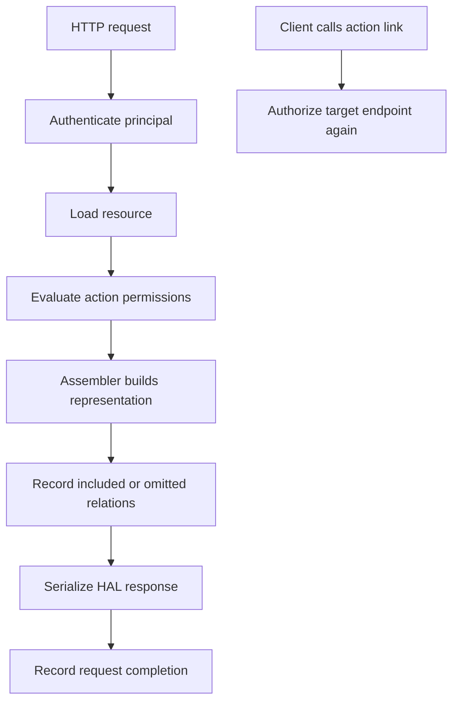

# Audit hypermedia response

## Mục tiêu

Sau bài này, bạn có thể xác định những quyết định bảo mật được phản ánh trong hypermedia response, ghi nhận relation được công bố hoặc bị ẩn theo quyền và trạng thái nghiệp vụ, tương quan các quyết định đó với request và principal, tránh đưa dữ liệu nhạy cảm vào audit log, đồng thời kiểm thử cả việc ẩn link lẫn việc endpoint đích vẫn thực thi authorization.

## 1. Vì sao cần audit hypermedia response?

Một hypermedia response không chỉ chứa dữ liệu. Các link còn cho client biết tài nguyên nào có thể được khám phá và hành động nào được công bố tại thời điểm response được tạo.

Ví dụ, một đơn hàng đang chờ thanh toán có thể cung cấp link hủy:

```json
{
  "id": "order-42",
  "status": "PENDING",
  "_links": {
    "self": {
      "href": "/orders/order-42"
    },
    "https://api.example.com/rels/cancel": {
      "href": "/orders/order-42/cancel"
    }
  }
}
```

Nếu người dùng không có quyền hủy, link này không nên xuất hiện trong representation của họ. Việc audit hypermedia response giúp trả lời các câu hỏi:

- Principal nào nhận được link của một hành động nhạy cảm?
- Link nào được công bố và link nào bị ẩn?
- Quy tắc quyền hoặc trạng thái nghiệp vụ nào quyết định kết quả?
- Quyết định đó thuộc request và tài nguyên nào?
- Sau khi link được công bố, request gọi endpoint đích có được kiểm tra quyền lại không?

Audit này hữu ích khi điều tra quyền truy cập, xác minh chính sách, phát hiện lỗi assembler và chứng minh API chỉ công bố các khả năng phù hợp với ngữ cảnh.

## 2. Link visibility là một quyết định bảo mật

Một link như `cancel`, `approve`, `refund` hoặc `download-invoice` có thể tiết lộ rằng một hành động tồn tại và cho biết URI để gọi hành động đó. Vì vậy, việc thêm link vào representation cần dựa trên quyền và trạng thái tài nguyên.

Có thể phân loại quyết định thành:

| Quyết định | Ý nghĩa | Ví dụ |
|---|---|---|
| `INCLUDED` | Link được đưa vào response | Người dùng có quyền hủy và đơn hàng còn ở trạng thái cho phép |
| `OMITTED_NOT_AUTHORIZED` | Link bị ẩn vì principal không có quyền | Người dùng chỉ có quyền xem đơn hàng |
| `OMITTED_INVALID_STATE` | Hành động không hợp lệ theo trạng thái nghiệp vụ | Đơn hàng đã giao nên không thể hủy |
| `OMITTED_POLICY` | Link bị ẩn theo chính sách khác | Tính năng bị tắt cho tenant |

Phân biệt lý do bị ẩn giúp đội vận hành biết vấn đề nằm ở authorization hay ở state transition. Tuy nhiên, reason code là dữ liệu nội bộ của audit; không nhất thiết phải trả lý do chi tiết cho client vì điều đó có thể tiết lộ chính sách hoặc trạng thái nhạy cảm.

Không nên coi sự vắng mặt của link là cơ chế bảo vệ duy nhất. Client có thể lưu URI từ response cũ, tự tạo request hoặc gọi endpoint trực tiếp. Server phải kiểm tra quyền trên mọi request đến endpoint đích.

## 3. Luồng tạo response và audit

Một luồng xử lý có thể được tổ chức như sau:



Các thành phần có trách nhiệm riêng:

- Spring Security xác thực principal và áp dụng authorization cho request.
- Service hoặc policy component đánh giá quyền đối với tài nguyên và hành động.
- Representation assembler chỉ thêm link khi chính sách cho phép và trạng thái nghiệp vụ phù hợp.
- Audit component ghi nhận quyết định công bố hoặc ẩn relation.
- HTTP filter hoặc request observability layer ghi nhận kết quả request, status và correlation ID.
- Endpoint đích thực thi authorization độc lập khi client gọi link.

Audit quyết định tạo link và audit kết quả HTTP là hai sự kiện khác nhau. Assembler biết link nào nó định đưa vào model; filter biết request hoàn tất với status nào. Tương quan chúng bằng request ID giúp phát hiện trường hợp representation đã được tạo nhưng serialization hoặc xử lý HTTP thất bại.

## 4. Những trường nên có trong audit event

Một audit event hữu ích cần đủ ngữ cảnh để điều tra mà không lưu cả representation.

| Trường | Mục đích | Ví dụ |
|---|---|---|
| `occurredAt` | Thời điểm quyết định | Timestamp UTC |
| `requestId` | Tương quan các sự kiện của request | Correlation ID |
| `actorRef` | Principal thực hiện request | Subject ID đã chuẩn hóa hoặc pseudonymized |
| `tenantRef` | Phạm vi tenant nếu có | Tenant key nội bộ |
| `resourceType` | Loại tài nguyên | `Order` |
| `resourceRef` | Tham chiếu tài nguyên | ID nội bộ hoặc mã đã che |
| `relation` | Link relation được đánh giá | URI relation của `cancel` |
| `decision` | Kết quả | `INCLUDED` hoặc `OMITTED_NOT_AUTHORIZED` |
| `policyId` | Chính sách được áp dụng | `order.cancel` |
| `reasonCode` | Mã lý do nội bộ | `MISSING_PERMISSION` |
| `responseStatus` | Kết quả HTTP khi request hoàn tất | `200`, `403` |
| `mediaType` | Định dạng response | `application/hal+json` |

Không phải hệ thống nào cũng cần tất cả trường. Chọn schema dựa trên yêu cầu điều tra, retention và quy định dữ liệu của tổ chức.

Một event tối thiểu có thể được biểu diễn bằng Java record:

```java
import java.time.Instant;

public record HypermediaLinkAuditEvent(
        Instant occurredAt,
        String requestId,
        String actorRef,
        String resourceType,
        String resourceRef,
        String relation,
        String decision,
        String policyId,
        String reasonCode
) {
}
```

`actorRef` và `resourceRef` nên là định danh đã được kiểm soát. Nếu ID gốc có thể tiết lộ thông tin cá nhân hoặc bí mật nghiệp vụ, dùng giá trị pseudonymized hoặc mã tham chiếu nội bộ phù hợp.

## 5. Không ghi toàn bộ href hoặc response body một cách mặc định

Href có thể chứa thông tin nhạy cảm, chẳng hạn query parameter chứa email, mã hồ sơ, token tải xuống hoặc dữ liệu tìm kiếm. Response body có thể chứa PII, dữ liệu tài chính hoặc nội dung nghiệp vụ.

Audit thường chỉ cần relation và loại target. Thay vì ghi:

```text
href=https://api.example.com/orders/42/invoice?access_token=eyJ...
```

hãy ghi dữ liệu có cấu trúc:

```json
{
  "relation": "https://api.example.com/rels/invoice",
  "targetType": "Invoice",
  "decision": "INCLUDED",
  "policyId": "order.invoice.read"
}
```

Các nguyên tắc bảo vệ log:

- Không ghi access token, refresh token, cookie, session ID hoặc header `Authorization`.
- Tránh ghi query string và fragment của href.
- Không ghi toàn bộ response body chỉ để biết link nào đã xuất hiện.
- Không ghi dữ liệu cá nhân nếu không cần cho mục đích audit.
- Dùng route template hoặc target type thay cho URL cụ thể khi có thể.
- Hạn chế quyền đọc audit log, đặt retention và bảo vệ tính toàn vẹn của log.
- Chuẩn hóa và giới hạn độ dài dữ liệu đầu vào để giảm nguy cơ log injection.

Nếu cần lưu URI để điều tra một trường hợp cụ thể, hãy dùng cơ chế masking hoặc allowlist các thành phần được phép. Không đưa token hoặc credential vào event kể cả khi log được lưu trong hệ thống nội bộ.

## 6. Đặt kiểm tra quyền ở policy component dùng chung

Assembler cần biết có nên công bố một hành động hay không. Controller hoặc service thực hiện hành động cũng phải dùng cùng chính sách để tránh tình trạng link và endpoint có cách đánh giá quyền khác nhau.

Ví dụ interface policy:

```java
import java.util.UUID;
import org.springframework.security.core.Authentication;

public interface OrderAccessPolicy {

    boolean canCancel(Authentication authentication, UUID orderId);

    boolean canViewInvoice(Authentication authentication, UUID orderId);
}
```

Implementation có thể kiểm tra authority, chủ sở hữu tài nguyên, tenant và trạng thái nghiệp vụ. Không nên đặt toàn bộ quy tắc này rải rác trong controller và assembler.

Có thể dùng method security để bảo vệ endpoint thực hiện hành động:

```java
import java.util.UUID;

import org.springframework.security.access.prepost.PreAuthorize;
import org.springframework.web.bind.annotation.PathVariable;
import org.springframework.web.bind.annotation.PostMapping;

@PostMapping("/orders/{id}/cancel")
@PreAuthorize("@orderAccessPolicy.canCancel(authentication, #id)")
public ResponseEntity<Void> cancel(@PathVariable UUID id) {
    orderService.cancel(id);
    return ResponseEntity.noContent().build();
}
```

Ứng dụng cần bật method security bằng `@EnableMethodSecurity` và đăng ký bean `orderAccessPolicy`. Tên bean trong biểu thức `@PreAuthorize` phải khớp với tên bean thực tế.

Nếu thao tác có thể được gọi từ nhiều controller, message handler hoặc service entry point, hãy bảo vệ ở tầng service thích hợp để mọi đường gọi đều được kiểm tra. Annotation trên controller không nên là lớp bảo vệ duy nhất nếu service còn được gọi trực tiếp từ nơi khác.

## 7. Ghi nhận link được công bố trong assembler

Ví dụ dưới đây dùng relation URI riêng cho hành động hủy và hóa đơn. Nếu API dùng HAL CURIE, relation URI có thể được hiển thị dưới dạng prefix rút gọn đã cấu hình.

```java
import java.util.UUID;

import org.springframework.hateoas.LinkRelation;
import org.springframework.hateoas.server.RepresentationModelAssembler;
import org.springframework.security.core.Authentication;
import org.springframework.security.core.context.SecurityContextHolder;
import org.springframework.stereotype.Component;

import static org.springframework.hateoas.server.mvc.WebMvcLinkBuilder.linkTo;
import static org.springframework.hateoas.server.mvc.WebMvcLinkBuilder.methodOn;

@Component
public class OrderModelAssembler
        implements RepresentationModelAssembler<Order, OrderModel> {

    private static final LinkRelation CANCEL =
            LinkRelation.of("https://api.example.com/rels/cancel");

    private static final LinkRelation INVOICE =
            LinkRelation.of("https://api.example.com/rels/invoice");

    private final OrderAccessPolicy accessPolicy;
    private final HypermediaAuditRecorder audit;

    public OrderModelAssembler(
            OrderAccessPolicy accessPolicy,
            HypermediaAuditRecorder audit) {
        this.accessPolicy = accessPolicy;
        this.audit = audit;
    }

    @Override
    public OrderModel toModel(Order order) {
        OrderModel model = new OrderModel(order.getId(), order.getStatus());

        model.add(linkTo(methodOn(OrderController.class)
                .getOrder(order.getId())).withSelfRel());

        Authentication authentication =
                SecurityContextHolder.getContext().getAuthentication();

        UUID orderId = order.getId();

        if (order.canBeCancelled()
                && accessPolicy.canCancel(authentication, orderId)) {

            model.add(linkTo(methodOn(OrderController.class)
                    .cancel(orderId)).withRel(CANCEL));

            audit.record(order, CANCEL, "INCLUDED",
                    "order.cancel", "PERMITTED");
        } else if (!order.canBeCancelled()) {
            audit.record(order, CANCEL, "OMITTED_INVALID_STATE",
                    "order.cancel", "ORDER_NOT_CANCELLABLE");
        } else {
            audit.record(order, CANCEL, "OMITTED_NOT_AUTHORIZED",
                    "order.cancel", "MISSING_PERMISSION");
        }

        if (accessPolicy.canViewInvoice(authentication, orderId)) {
            model.add(linkTo(methodOn(OrderController.class)
                    .getInvoice(orderId)).withRel(INVOICE));

            audit.record(order, INVOICE, "INCLUDED",
                    "order.invoice.read", "PERMITTED");
        } else {
            audit.record(order, INVOICE, "OMITTED_NOT_AUTHORIZED",
                    "order.invoice.read", "MISSING_PERMISSION");
        }

        return model;
    }
}
```

Ví dụ giả định `OrderModel`, `OrderController`, `OrderAccessPolicy` và `HypermediaAuditRecorder` đã được định nghĩa trong ứng dụng.

Các điểm quan trọng:

1. Link `self` được thêm theo chính sách đọc tài nguyên của endpoint.
2. Link `cancel` chỉ được thêm khi cả trạng thái đơn hàng và authorization đều cho phép.
3. Link `invoice` được đánh giá bằng quyền đọc hóa đơn.
4. Mỗi quyết định được ghi nhận bằng relation, policy ID và reason code.
5. Audit event không cần lưu href đầy đủ hoặc response body.

Trong ứng dụng thực tế, việc lấy principal có thể được đóng gói trong một `CurrentActor` hoặc `AuthenticationFacade` để assembler không phụ thuộc trực tiếp vào `SecurityContextHolder`. Ví dụ trên giữ cách truy xuất tường minh để dễ thấy ngữ cảnh authorization.

## 8. Định nghĩa audit recorder

Assembler chỉ nên gọi một abstraction chịu trách nhiệm ghi event. Nó không cần biết event được lưu trong database, gửi đến log collector hay chuyển vào message broker.

```java
import org.springframework.hateoas.LinkRelation;

public interface HypermediaAuditRecorder {

    void record(
            Order order,
            LinkRelation relation,
            String decision,
            String policyId,
            String reasonCode
    );
}
```

Implementation có thể xây event có cấu trúc và gửi đến `AuditSink`:

```java
public interface AuditSink {

    void append(HypermediaLinkAuditEvent event);
}
```

Recorder có thể lấy request ID từ tracing context và actor reference từ security context, sau đó tạo event. Nên kiểm soát cách xử lý khi audit sink không sẵn sàng:

- Với audit bắt buộc cho yêu cầu tuân thủ, có thể cần ghi bền vững trước khi response được phát hành hoặc dùng transactional outbox.
- Với telemetry hỗ trợ vận hành, có thể chấp nhận queue hoặc ghi bất đồng bộ, nhưng phải có metric cho event bị mất.
- Không để exception ghi log vô tình làm lộ dữ liệu hoặc biến một quyết định authorization thành cho phép.

Chính sách fail-open hay fail-closed phải được chọn theo yêu cầu hệ thống. Không được bỏ qua kiểm tra quyền chỉ vì audit sink gặp lỗi.

## 9. Tương quan quyết định link với kết quả HTTP

Event do assembler tạo cho biết link đã được quyết định đưa vào model hay bị ẩn. Nó chưa chứng minh response cuối cùng đã được gửi thành công: serializer có thể lỗi, client có thể ngắt kết nối hoặc một exception có thể thay đổi status.

Vì vậy, nên có thêm request completion event ở tầng HTTP, dùng cùng request ID:

| Event | Thời điểm | Thông tin |
|---|---|---|
| `hypermedia.link.decision` | Khi assembler đánh giá relation | Actor, resource, relation, decision, policy |
| `http.request.completed` | Khi request kết thúc | Request ID, route template, status, response media type, duration |

Không cần capture response body để tương quan. Request completion event xác nhận request kết thúc; link decision events cho biết những relation assembler đã chọn.

Nếu cần xác minh chính xác representation được gửi ra, hãy kiểm tra response trong integration test hoặc dùng instrumentation có kiểm soát. Tránh bật body logging toàn cục trên production chỉ để audit link.

## 10. Audit collection response mà không tạo log quá lớn

Collection có thể chứa hàng trăm hoặc hàng nghìn item. Nếu ghi một event cho mọi `self` link, log sẽ rất lớn nhưng ít giá trị bảo mật.

Có thể áp dụng các quy tắc:

- Chỉ audit relation nhạy cảm như `approve`, `cancel`, `refund`, `download` hoặc link chứa dữ liệu hạn chế.
- Ghi event theo từng quyết định quan trọng, không audit mọi `self` link.
- Với collection, ghi số item và số link nhạy cảm được công bố theo relation.
- Khi cần điều tra một item cụ thể, ghi event chi tiết cho item đó theo policy.
- Giới hạn kích thước event và tránh đưa danh sách href vào log.

Ví dụ event tổng hợp:

```json
{
  "requestId": "req-7f3a",
  "resourceType": "OrderCollection",
  "relation": "https://api.example.com/rels/cancel",
  "decision": "COLLECTION_SUMMARY",
  "itemCount": 100,
  "includedCount": 12,
  "omittedCount": 88,
  "policyId": "order.cancel"
}
```

Chỉ dùng aggregate khi nó đáp ứng mục tiêu audit. Nếu cần truy vết quyết định của một item cụ thể, cần event chi tiết hoặc một cơ chế sampling có kiểm soát; không nên suy ra rằng mọi item đều có cùng kết quả từ một con số tổng.

## 11. Kiểm thử link theo quyền

Kiểm thử cần xác nhận representation khác nhau theo principal và trạng thái. Ví dụ người có quyền hủy nhận được link:

```java
@Test
@WithMockUser(authorities = "ORDER_CANCEL")
void includesCancelLinkForAuthorizedUser() throws Exception {
    mockMvc.perform(get("/orders/{id}", orderId)
                    .accept(MediaTypes.HAL_JSON))
            .andExpect(status().isOk())
            .andExpect(jsonPath(
                    "$._links['https://api.example.com/rels/cancel'].href"
            ).exists());
}
```

Người không có quyền hủy không nhận link:

```java
@Test
@WithMockUser(authorities = "ORDER_READ")
void omitsCancelLinkForReadOnlyUser() throws Exception {
    mockMvc.perform(get("/orders/{id}", orderId)
                    .accept(MediaTypes.HAL_JSON))
            .andExpect(status().isOk())
            .andExpect(jsonPath(
                    "$._links['https://api.example.com/rels/cancel']"
            ).doesNotExist());
}
```

Các test giả định HAL dùng relation URI đầy đủ. Nếu ứng dụng cấu hình CURIE, key trong JSON có thể là dạng prefix như `acme:cancel`; hãy kiểm tra đúng representation thực tế.

Cần chuẩn bị dữ liệu và mock policy sao cho test phản ánh đúng trạng thái. Không chỉ kiểm tra role chung nếu quyết định còn phụ thuộc owner, tenant hoặc trạng thái đơn hàng.

## 12. Kiểm thử endpoint đích độc lập với link visibility

Một test quan trọng là gọi trực tiếp endpoint hủy bằng principal không có quyền, dù link đã bị ẩn khỏi response:

```java
@Test
@WithMockUser(authorities = "ORDER_READ")
void deniesDirectCancelRequestWithoutPermission() throws Exception {
    mockMvc.perform(post("/orders/{id}/cancel", orderId))
            .andExpect(status().isForbidden());
}
```

Test này chứng minh endpoint thực thi authorization độc lập với assembler. Nếu chỉ kiểm tra link không xuất hiện, một client có URI cũ vẫn có thể gọi endpoint thành công và vượt qua chính sách mong muốn.

Cũng nên kiểm tra người dùng có quyền nhận link thì endpoint đích thực sự cho phép hành động, với trạng thái và dữ liệu phù hợp. Điều đó giúp phát hiện lệch giữa policy dùng để tạo link và policy dùng để thực thi hành động.

Nếu hệ thống cố ý trả `404 Not Found` thay vì `403 Forbidden` để che giấu sự tồn tại của tài nguyên, test phải phản ánh chính sách concealment đó.

## 13. Kiểm thử audit event

Ngoài response, cần xác nhận audit recorder nhận đúng decision và reason code. Có thể mock recorder trong test assembler hoặc dùng test bean thu thập event.

Ví dụ với Mockito:

```java
verify(audit).record(
        eq(order),
        eq(LinkRelation.of(
                "https://api.example.com/rels/cancel")),
        eq("OMITTED_NOT_AUTHORIZED"),
        eq("order.cancel"),
        eq("MISSING_PERMISSION")
);
```

Với trường hợp được phép, kiểm tra `INCLUDED` và `PERMITTED`. Với trạng thái không hợp lệ, kiểm tra `OMITTED_INVALID_STATE` và reason code tương ứng.

Nên kiểm tra thêm:

1. Mỗi relation nhạy cảm được đánh giá đúng một lần cho một representation.
2. Event có request ID để liên kết với request completion log.
3. Actor reference đúng principal hoặc anonymous actor theo chính sách.
4. Event không chứa token, cookie, authorization header hoặc query string.
5. Audit sink lỗi được xử lý theo fail-open/fail-closed policy đã chọn.
6. Event collection aggregate có số lượng phù hợp với representation.
7. Link bị ẩn không xuất hiện trong response HAL.
8. Endpoint đích vẫn từ chối request trái quyền.

Không nên chỉ assert rằng recorder được gọi. Hãy kiểm tra nội dung event, vì sai relation hoặc reason code có thể làm audit trail không hữu ích.

## 14. Những lỗi thường gặp

**Cho rằng ẩn link đã đủ bảo mật.** Client có thể giữ URI cũ hoặc gọi endpoint trực tiếp. Authorization phải được thực thi tại endpoint.

**Ghi href đầy đủ vào log.** Query parameter hoặc path có thể chứa token và dữ liệu cá nhân. Ghi relation, target type và route template đã chuẩn hóa.

**Chỉ audit link được thêm.** Việc link bị ẩn có thể là dấu hiệu policy thay đổi hoặc dữ liệu ở trạng thái không hợp lệ. Audit cả quyết định quan trọng bị omit cùng reason code nội bộ.

**Không phân biệt bị từ chối quyền với sai trạng thái.** Hai nguyên nhân cần cách điều tra khác nhau. Dùng decision và reason code riêng.

**Dùng policy khác nhau trong assembler và endpoint.** Link có thể được công bố dù endpoint từ chối, hoặc bị ẩn dù endpoint cho phép. Dùng chung policy component và vẫn kiểm tra lại tại endpoint.

**Ghi toàn bộ response body để tìm link.** Body có thể chứa PII và dữ liệu nhạy cảm. Ghi event có cấu trúc ngay tại nơi quyết định link.

**Không tương quan event với request.** Audit record khó đối chiếu với status và trace. Dùng request/correlation ID xuyên suốt.

**Audit collection từng self link.** Log tăng nhanh và gây nhiễu. Chỉ audit relation nhạy cảm và aggregate khi phù hợp.

**Để audit failure làm thay đổi quyết định authorization.** Không bao giờ cho phép hành động chỉ vì không ghi được audit event. Quy tắc xử lý lỗi audit phải độc lập với kết quả authorization.

**Tin rằng link được công bố có thể được dùng mãi.** Quyền và trạng thái có thể thay đổi sau khi response được tạo. Kiểm tra quyền và trạng thái lại khi client gọi endpoint.

## 15. Nguyên tắc thiết kế

- Xem việc công bố relation nhạy cảm là quyết định cần được kiểm soát.
- Dùng policy component chung cho assembler và endpoint đích.
- Ghi nhận link được include hoặc omit cùng policy ID và reason code.
- Tương quan link decision với request completion bằng request ID.
- Không ghi credential, query string hoặc response body vào audit log.
- Chỉ audit relation có giá trị bảo mật; cân nhắc aggregate với collection lớn.
- Bảo vệ audit sink, quyền đọc log, retention và tính toàn vẹn dữ liệu.
- Quy định rõ hành vi khi audit sink không sẵn sàng.
- Kiểm thử response theo principal và kiểm thử endpoint trực tiếp.
- Kiểm thử nội dung event, không chỉ xác nhận recorder đã được gọi.
- Luôn authorization lại khi request thực sự đến endpoint đích.

## Kết luận

Audit hypermedia response giúp theo dõi vì sao một relation được công bố hoặc bị ẩn cho một principal và tài nguyên cụ thể. Spring HATEOAS assembler là nơi phù hợp để ghi nhận quyết định tạo link; policy component cần được dùng chung với authorization tại endpoint đích. Audit event nên lưu actor reference, request ID, resource, relation, decision và reason code, đồng thời tránh ghi href nhạy cảm hoặc toàn bộ response body. Kiểm thử phải xác nhận cả link visibility, audit event và việc endpoint trực tiếp vẫn từ chối request trái quyền. Như vậy, audit trail phản ánh được khả năng mà API công bố và các quy tắc bảo vệ hành động thực tế.

## Tài liệu tham khảo

- [Spring Security Reference – Authorization](https://docs.spring.io/spring-security/reference/servlet/authorization/index.html)
- [Spring Security Reference – Method Security](https://docs.spring.io/spring-security/reference/servlet/authorization/method-security.html)
- [Spring HATEOAS Reference – Representation models](https://docs.spring.io/spring-hateoas/docs/current/reference/html/#fundamentals.representation-models)
- [Spring HATEOAS Reference – Building links](https://docs.spring.io/spring-hateoas/docs/current/reference/html/#server.link-builder)
- [OWASP Logging Cheat Sheet](https://cheatsheetseries.owasp.org/cheatsheets/Logging_Cheat_Sheet.html)

