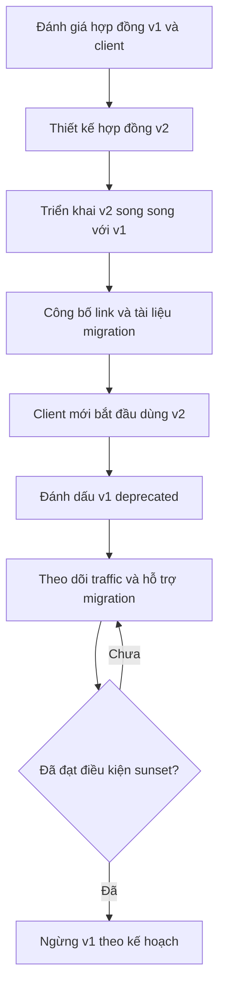

# Chuyển tiếp phiên bản

## Mục tiêu

Sau bài này, bạn có thể lập kế hoạch chuyển client từ phiên bản API cũ sang phiên bản mới, phân biệt thay đổi tương thích và breaking change, chọn chiến lược versioning phù hợp, duy trì hai hợp đồng hypermedia trong giai đoạn chuyển tiếp, công bố thông tin deprecation/sunset và kiểm thử việc điều hướng giữa các phiên bản bằng Spring HATEOAS.

## 1. Chuyển tiếp phiên bản là một quá trình

API thay đổi theo nhu cầu nghiệp vụ, mô hình dữ liệu, bảo mật và cách tổ chức hệ thống. Một thay đổi có thể không ảnh hưởng client hiện tại, nhưng thay đổi khác có thể làm client không còn đọc được representation hoặc không thực hiện được thao tác.

Chuyển tiếp phiên bản là quá trình đưa hợp đồng mới vào sử dụng trong khi quản lý client còn phụ thuộc hợp đồng cũ. Quá trình này thường gồm:

1. Xác định thay đổi nào tương thích và thay đổi nào phá vỡ tương thích.
2. Thiết kế hợp đồng mới và cách client khám phá phiên bản đó.
3. Duy trì phiên bản cũ trong thời gian chuyển đổi đã công bố.
4. Theo dõi client sử dụng phiên bản cũ và hỗ trợ họ di chuyển.
5. Đánh dấu phiên bản cũ deprecated, công bố thời điểm sunset nếu đã xác định.
6. Ngừng phiên bản cũ khi đã đáp ứng điều kiện kết thúc hỗ trợ.

Spring HATEOAS giúp server công bố tài nguyên và khả năng điều hướng qua links. Framework không tự quyết định chính sách versioning, thời gian hỗ trợ hay cách migrate client. Những quyết định đó thuộc thiết kế hợp đồng API và quy trình vận hành của ứng dụng.

## 2. Phân biệt thay đổi tương thích và breaking change

Không phải thay đổi nào cũng cần tạo phiên bản major mới. Hãy đánh giá tác động lên client dựa trên dữ liệu, relation, media type và hành vi HTTP.

| Thay đổi | Mức ảnh hưởng thường gặp | Cần version mới? |
|---|---|---|
| Thêm trường dữ liệu tùy chọn | Client bỏ qua trường chưa biết vẫn hoạt động | Thường không |
| Thêm link relation mới | Client cũ có thể bỏ qua link chưa biết | Thường không |
| Thêm giá trị enum mới | Client có switch exhaustive có thể lỗi | Tùy client và hợp đồng |
| Xóa trường đang được client sử dụng | Client có thể không deserialize hoặc xử lý được | Thường có |
| Đổi tên hoặc đổi semantics của relation | Client không tìm được hoặc hiểu sai link | Thường có |
| Đổi kiểu dữ liệu của trường | Client có thể parse thất bại | Thường có |
| Xóa endpoint hoặc affordance | Client mất khả năng đang sử dụng | Thường có |
| Đổi semantics của status code hoặc thao tác | Client có thể xử lý sai kết quả | Thường có |
| Siết validation hoặc authorization | Request trước đây hợp lệ có thể bị từ chối | Cần đánh giá tương thích |

Một thay đổi được xem là tương thích chỉ khi các client phù hợp với hợp đồng cũ vẫn có thể hoạt động. Ví dụ thêm một link `refund` có thể an toàn với client bỏ qua relation chưa biết. Nhưng nếu client được yêu cầu phải xử lý mọi relation xuất hiện, hoặc thêm link làm thay đổi luồng nghiệp vụ, đây không còn là thay đổi vô hại.

Đặc biệt với hypermedia, cần giữ semantics của relation ổn định. Không đổi relation `collection` từ “collection chứa item” thành “collection các tài nguyên có liên quan” chỉ vì hai target đang dùng chung một endpoint.

## 3. Những chiến lược versioning thường dùng

Có nhiều cách để client chọn phiên bản API. Mỗi cách có tác động đến URI, cache, content negotiation và cách công bố link.

| Chiến lược | Ví dụ | Ưu điểm | Điểm cần quản lý |
|---|---|---|---|
| URI path | `/v1/orders`, `/v2/orders` | Dễ nhận biết, dễ routing và quan sát | Duy trì nhiều route; version nằm trong URI |
| Media type | `Accept: application/vnd.acme.order-v2+json` | Phiên bản gắn với representation | Cần converter và negotiation phù hợp |
| Request header | `X-API-Version: 2` | URI có thể giữ nguyên | Cache phải phân biệt header version |
| Query parameter | `/orders?version=2` | Dễ thử nghiệm | Dễ tạo nhiều cache key và URL khó chuẩn hóa |

Không có chiến lược nào phù hợp cho mọi hệ thống. Với API công khai cần dễ khám phá và vận hành, URI path versioning thường dễ triển khai. Media type versioning phù hợp khi khác biệt chủ yếu nằm ở representation, nhưng cần cấu hình serialization chính xác. Header versioning cần bảo đảm proxy và cache không dùng nhầm response của phiên bản khác.

Không nên chọn versioning chỉ vì cách viết URL ngắn hơn. Hãy chọn dựa trên khả năng tương thích, caching, gateway, client library và quy trình triển khai.

## 4. URI path versioning với Spring MVC và Spring HATEOAS

Một cách đơn giản là giữ các route riêng cho từng phiên bản:

- `/v1/orders/{id}` trả representation của hợp đồng v1.
- `/v2/orders/{id}` trả representation của hợp đồng v2.

Ví dụ controller:

```java
import java.util.UUID;

import org.springframework.hateoas.MediaTypes;
import org.springframework.web.bind.annotation.GetMapping;
import org.springframework.web.bind.annotation.PathVariable;
import org.springframework.web.bind.annotation.RestController;

@RestController
public class VersionedOrderController {

    private final OrderService orderService;
    private final OrderV1Assembler v1Assembler;
    private final OrderV2Assembler v2Assembler;

    public VersionedOrderController(
            OrderService orderService,
            OrderV1Assembler v1Assembler,
            OrderV2Assembler v2Assembler) {
        this.orderService = orderService;
        this.v1Assembler = v1Assembler;
        this.v2Assembler = v2Assembler;
    }

    @GetMapping(
            value = "/v1/orders/{id}",
            produces = MediaTypes.HAL_JSON_VALUE
    )
    public OrderV1Model getV1(@PathVariable UUID id) {
        return v1Assembler.toModel(orderService.getRequired(id));
    }

    @GetMapping(
            value = "/v2/orders/{id}",
            produces = MediaTypes.HAL_JSON_VALUE
    )
    public OrderV2Model getV2(@PathVariable UUID id) {
        return v2Assembler.toModel(orderService.getRequired(id));
    }
}
```

Ví dụ này dùng chung `OrderService` để lấy domain object, nhưng có assembler và representation model riêng cho mỗi phiên bản. V1 có thể chỉ công bố `id`, `status` và `total`; v2 có thể thêm cấu trúc `fulfillment` hoặc thay đổi cách biểu diễn địa chỉ giao hàng.

Tách representation theo phiên bản giúp tránh việc một DTO thay đổi làm response cũ cũng thay đổi ngoài ý muốn. Không nhất thiết phải nhân đôi domain model, repository hoặc business service. Chỉ tách những phần thuộc hợp đồng công khai cần khác nhau.

## 5. Mỗi phiên bản phải tạo link trong đúng không gian URI

Một lỗi thường gặp là controller v2 trả model mới nhưng assembler vẫn tạo link trỏ về route v1. Client bắt đầu ở v2 rồi vô tình quay lại v1 khi theo `self`, `collection` hoặc link thao tác.

Assembler nên dùng controller method tương ứng với phiên bản:

```java
import org.springframework.hateoas.server.RepresentationModelAssembler;
import org.springframework.stereotype.Component;

import static org.springframework.hateoas.server.mvc.WebMvcLinkBuilder.linkTo;
import static org.springframework.hateoas.server.mvc.WebMvcLinkBuilder.methodOn;

@Component
public class OrderV2Assembler
        implements RepresentationModelAssembler<Order, OrderV2Model> {

    @Override
    public OrderV2Model toModel(Order order) {
        OrderV2Model model = new OrderV2Model(
                order.getId(),
                order.getStatus(),
                order.getTotal(),
                order.getFulfillment()
        );

        model.add(linkTo(methodOn(VersionedOrderController.class)
                .getV2(order.getId())).withSelfRel());

        return model;
    }
}
```

V1 assembler cần tạo link đến method `getV1(...)`. Nếu model có link đến collection, search, update hoặc cancel, các link đó cũng cần được xây theo controller hoặc route thuộc phiên bản tương ứng.

Một quy tắc hữu ích là: client đã vào entry point v2 thì các link điều hướng mặc định tiếp tục ở v2, trừ khi API chủ ý công bố một quan hệ liên phiên bản. Điều này giúp client không vô tình kết hợp request v1 và v2 trong cùng một workflow.

## 6. Dùng API entry point để công bố phiên bản mới

Client cần một điểm bắt đầu ổn định để khám phá phiên bản. API root có thể công bố collection mặc định và một relation riêng cho phiên bản mới:

```json
{
  "_links": {
    "orders": {
      "href": "/v1/orders"
    },
    "https://api.example.com/rels/orders-v2": {
      "href": "/v2/orders"
    }
  }
}
```

Client cũ có thể tiếp tục theo relation `orders`. Client mới được thiết kế để hỗ trợ v2 có thể tìm extension relation `https://api.example.com/rels/orders-v2`.

Relation extension phải được định nghĩa và tài liệu hóa như một phần vocabulary API. Nếu dùng HAL CURIE, có thể công bố prefix để rút gọn URI relation. Không nên dùng một tên tùy ý rồi giả định mọi client đều biết ý nghĩa của nó.

Có thể công bố thêm link đến tài liệu migration. Mục tiêu là để client biết phiên bản mới tồn tại và có tài liệu hướng dẫn, trong khi response v1 vẫn duy trì relation và semantics cũ trong giai đoạn tương thích.

## 7. Versioning bằng request header

Nếu cần giữ URI giống nhau nhưng chọn representation theo header, Spring MVC có thể phân biệt mapping bằng điều kiện header.

Ví dụ:

```java
@GetMapping(
        value = "/orders/{id}",
        headers = "X-API-Version=1",
        produces = MediaTypes.HAL_JSON_VALUE
)
public OrderV1Model getV1(@PathVariable UUID id) {
    return v1Assembler.toModel(orderService.getRequired(id));
}

@GetMapping(
        value = "/orders/{id}",
        headers = "X-API-Version=2",
        produces = MediaTypes.HAL_JSON_VALUE
)
public OrderV2Model getV2(@PathVariable UUID id) {
    return v2Assembler.toModel(orderService.getRequired(id));
}
```

Client phải gửi `X-API-Version` trong mỗi request:

```http
GET /orders/42 HTTP/1.1
X-API-Version: 2
Accept: application/hal+json
```

Vì cùng một URI có thể trả body khác nhau tùy header, response cần có:

```http
Vary: X-API-Version
```

`Vary` thông báo cho cache rằng header này ảnh hưởng đến representation. Nếu thiếu, shared cache có thể trả response v1 cho request v2 hoặc ngược lại.

Cần quy định rõ hành vi khi header bị thiếu hoặc chứa version không hỗ trợ. Có thể chọn một phiên bản mặc định hoặc trả lỗi theo hợp đồng, nhưng không nên để lựa chọn phụ thuộc vào thứ tự mapping hoặc cấu hình không được tài liệu hóa.

## 8. Versioning bằng media type

Một lựa chọn khác là để client yêu cầu media type biểu thị representation version:

```http
GET /orders/42 HTTP/1.1
Accept: application/vnd.acme.order-v2+json
```

Cách này thể hiện rõ client muốn representation v2. Tuy nhiên, Spring HATEOAS không tự động biến `application/hal+json` thành một họ media type có version. Nếu dùng vendor-specific media type, ứng dụng phải cấu hình converter và content negotiation để serialize đúng hypermedia format, bao gồm links và embedded resources.

Không nên chỉ thêm một giá trị vendor media type vào `produces` rồi cho rằng HAL converter mặc định sẽ xử lý nó. Hãy kiểm thử converter thực tế và response `Content-Type`.

Nếu ứng dụng dùng cùng media type HAL cho nhiều version theo URI path, chẳng hạn `application/hal+json` ở cả `/v1` và `/v2`, đây vẫn là một lựa chọn hợp lệ. Phiên bản được chọn bằng URI, còn media type mô tả định dạng hypermedia.

## 9. Giữ relation ổn định trong cùng một phiên bản

Trong quá trình chuyển tiếp, client thường dựa vào relation để tìm link. Vì vậy:

- Giữ relation cũ và semantics cũ trong v1.
- Dùng relation ổn định cho cùng một khái niệm trong v2 nếu semantics vẫn tương đương.
- Chỉ tạo relation mới khi quan hệ thực sự mang ý nghĩa khác hoặc client cần phân biệt khả năng mới.
- Không đổi relation chỉ vì route path thay đổi.
- Không tái sử dụng relation cũ cho target có semantics khác.

Ví dụ v1 và v2 đều có thể dùng `self` để trỏ đến representation hiện tại. Nhưng nếu v2 thay đổi ý nghĩa của link `cancel` thành một workflow yêu cầu xác nhận bổ sung, cần đánh giá xem relation đó còn cùng semantics không. Nếu không, hãy định nghĩa relation mới và tài liệu hóa.

Client hypermedia nên bỏ qua relation không biết và xử lý trường hợp link tùy chọn không xuất hiện. Đây là điều kiện giúp API thêm khả năng mới mà không buộc mọi client cũ phải cập nhật ngay.

## 10. Deprecation và Sunset cho phiên bản cũ

Khi phiên bản cũ đã được thay thế, hãy thông báo trạng thái vòng đời rõ ràng.

**Deprecation** cho biết API hoặc tài nguyên đã bị đánh dấu deprecated. Việc deprecated không có nghĩa endpoint đã ngừng hoạt động ngay lập tức.

**Sunset** cho biết thời điểm dự kiến tài nguyên sẽ không còn khả dụng. Đây là mốc vận hành cần được công bố đủ sớm để client chuyển đổi.

RFC 9745 định nghĩa header `Deprecation`; giá trị của nó dùng Structured Field Date để chỉ thời điểm deprecation có hiệu lực. RFC 8594 định nghĩa header `Sunset`, sử dụng HTTP-date để thông báo thời điểm tài nguyên dự kiến không còn được phục vụ.

Ví dụ response v1 trong giai đoạn chuyển tiếp:

```http
HTTP/1.1 200 OK
Content-Type: application/hal+json
Deprecation: @1798761600
Sunset: Fri, 31 Dec 2027 23:59:59 GMT
Link: <https://api.example.com/deprecations/orders-v1>; rel="deprecation"
```

Giá trị ngày trong ví dụ chỉ minh họa định dạng. Khi triển khai, phải dùng ngày deprecation thực tế và sunset đã được tổ chức cam kết.

Có thể thêm link relation `deprecation` vào HAL representation để client khám phá tài liệu:

```java
import org.springframework.hateoas.Link;

model.add(Link.of(
        "https://api.example.com/deprecations/orders-v1"
).withRel("deprecation"));
```

Header giúp client và công cụ HTTP nhận biết trạng thái vòng đời ở cấp response. Link hypermedia cung cấp đường dẫn đến hướng dẫn chuyển đổi. Hai cách có thể được dùng đồng thời.

## 11. Trả deprecation header bằng ResponseEntity

Với endpoint trả v1, có thể gắn metadata deprecation bằng `ResponseEntity`:

```java
import java.time.Instant;
import java.time.ZoneOffset;
import java.time.format.DateTimeFormatter;

import org.springframework.http.HttpHeaders;
import org.springframework.http.ResponseEntity;

Instant deprecatedAt =
        Instant.parse("2027-01-01T00:00:00Z");

Instant sunsetAt =
        Instant.parse("2027-12-31T23:59:59Z");

String deprecationValue =
        "@" + deprecatedAt.getEpochSecond();

String sunsetValue =
        DateTimeFormatter.RFC_1123_DATE_TIME.format(
                sunsetAt.atZone(ZoneOffset.UTC)
        );

return ResponseEntity.ok()
        .header("Deprecation", deprecationValue)
        .header("Sunset", sunsetValue)
        .header(
                HttpHeaders.LINK,
                "<https://api.example.com/deprecations/orders-v1>; rel=\"deprecation\""
        )
        .body(model);
```

Trong ứng dụng thực tế, ngày nên lấy từ cấu hình hoặc metadata vòng đời để tránh hard-code rải rác trong nhiều controller. Đảm bảo mọi endpoint thuộc phiên bản v1 trả thông tin nhất quán, kể cả collection, item và search resource nếu chúng cùng nằm trong phạm vi deprecation.

Không gửi `Sunset` nếu chưa có ngày ngừng hỗ trợ đủ tin cậy. Thông báo deprecation không nên tạo ra một cam kết thời gian giả.

## 12. Kế hoạch chuyển client theo từng giai đoạn

Một kế hoạch chuyển tiếp có thể chia thành các giai đoạn:



**Đánh giá hợp đồng:** liệt kê các trường, relation, affordance, status code và media type mà client hiện tại sử dụng. Xác định breaking change cụ thể thay vì chỉ đổi nhãn version.

**Triển khai song song:** cung cấp v2 trong khi v1 tiếp tục hoạt động. Chia sẻ domain service và logic nghiệp vụ khi phù hợp, nhưng giữ representation và link builder theo version.

**Công bố migration:** cung cấp tài liệu thay đổi, ví dụ request/response và thời hạn hỗ trợ. API root có thể công bố link đến v2 hoặc tài liệu migration.

**Đánh dấu deprecation:** thêm header và relation tài liệu deprecation vào response v1. Thông báo qua kênh phát hành API đã thỏa thuận với người dùng.

**Theo dõi:** đo request theo version, client hoặc API key đã chuẩn hóa, route template và thời gian. Không ghi access token hoặc dữ liệu nhạy cảm để xác định client.

**Sunset:** chỉ ngừng v1 khi đã đạt điều kiện hỗ trợ, đã qua thời hạn thông báo và có phương án xử lý cho client còn lại.

## 13. Theo dõi mức độ sử dụng phiên bản cũ

Trước khi loại bỏ v1, cần có số liệu để biết client nào còn phụ thuộc.

Các chỉ số có thể theo dõi:

| Chỉ số | Mục đích |
|---|---|
| Request count theo version | Biết mức sử dụng v1 và v2 |
| Unique client reference | Xác định số client còn hoạt động |
| Tỷ lệ lỗi theo version | Phát hiện client gặp lỗi khi migration |
| Request theo route template | Tìm endpoint v1 còn được gọi |
| Ngày request gần nhất của client | Hỗ trợ xác định client đã ngừng sử dụng |
| Tỷ lệ traversal sang link v2 | Đo mức độ khám phá phiên bản mới nếu có instrumentation |

Sử dụng client reference đã chuẩn hóa hoặc pseudonymized. Không dùng token, cookie hay toàn bộ header xác thực làm nhãn metric.

Không nên chỉ dựa vào tổng traffic. Một client tích hợp quan trọng có thể chỉ gọi API vài lần mỗi tháng. Kết hợp metric với danh sách consumer đã đăng ký và thời hạn hỗ trợ để ra quyết định sunset.

## 14. Kiểm thử hai phiên bản và link traversal

Kiểm thử cần xác nhận mỗi version trả đúng representation và link không trỏ nhầm sang version khác.

Ví dụ kiểm tra v1:

```java
mockMvc.perform(get("/v1/orders/{id}", orderId)
        .accept(MediaTypes.HAL_JSON))
    .andExpect(status().isOk())
    .andExpect(content().contentTypeCompatibleWith(
            MediaTypes.HAL_JSON))
    .andExpect(jsonPath("$.status").exists())
    .andExpect(jsonPath("$._links.self.href")
            .value(endsWith("/v1/orders/" + orderId)));
```

Kiểm tra v2:

```java
mockMvc.perform(get("/v2/orders/{id}", orderId)
        .accept(MediaTypes.HAL_JSON))
    .andExpect(status().isOk())
    .andExpect(content().contentTypeCompatibleWith(
            MediaTypes.HAL_JSON))
    .andExpect(jsonPath("$.fulfillment").exists())
    .andExpect(jsonPath("$._links.self.href")
            .value(endsWith("/v2/orders/" + orderId)));
```

Các assertion giả định v1 có `status`, v2 có `fulfillment` và mỗi assembler tạo self link theo đúng route. Hãy điều chỉnh theo schema thực tế.

Kiểm tra response v1 công bố metadata deprecation:

```java
mockMvc.perform(get("/v1/orders/{id}", orderId)
        .accept(MediaTypes.HAL_JSON))
    .andExpect(status().isOk())
    .andExpect(header().exists("Deprecation"))
    .andExpect(header().exists("Sunset"))
    .andExpect(header().string(
            HttpHeaders.LINK,
            containsString("rel=\"deprecation\"")
    ));
```

Nếu dùng header version trên cùng URI, kiểm tra cache variation:

```java
mockMvc.perform(get("/orders/{id}", orderId)
        .header("X-API-Version", "2")
        .accept(MediaTypes.HAL_JSON))
    .andExpect(status().isOk())
    .andExpect(header().string(
            HttpHeaders.VARY,
            containsString("X-API-Version")
    ));
```

Ngoài ra, nên kiểm tra:

1. API root công bố link v2 theo relation đã tài liệu hóa.
2. Client v1 vẫn nhận schema và relation cũ trong thời gian hỗ trợ.
3. Link `self`, collection, search và affordance của v2 tiếp tục trỏ trong không gian v2.
4. Link mới được thêm không làm client v1 lỗi khi bỏ qua relation chưa biết.
5. Version không hỗ trợ nhận status và error representation theo hợp đồng.
6. Deprecation date và sunset date có định dạng hợp lệ.
7. Route v1 ngừng hoạt động sau sunset theo kế hoạch đã công bố.

## 15. Những lỗi thường gặp

**Đổi schema v1 tại chỗ rồi chỉ đổi tên thành v2.** Client cũ có thể hỏng ngay khi deploy. Duy trì representation v1 riêng trong giai đoạn chuyển tiếp.

**Dùng chung một assembler cho mọi version.** Link có thể trỏ sai route hoặc model mới vô tình làm thay đổi response cũ. Tách assembler theo version khi hợp đồng khác nhau.

**Chỉ version URL nhưng không version các link được tạo.** Client bắt đầu ở v2 rồi theo link quay về v1. Kiểm thử toàn bộ traversal, không chỉ self link.

**Cho rằng thêm field luôn tương thích.** Client deserialize nghiêm ngặt hoặc xử lý enum exhaustive có thể lỗi. Kiểm tra cách client thực tế xử lý dữ liệu chưa biết.

**Dùng vendor media type mà không cấu hình converter.** Spring HATEOAS không tự động nhận mọi media type tùy chỉnh như HAL. Kiểm thử converter và content negotiation.

**Dùng header version nhưng quên Vary.** Cache có thể trả representation sai phiên bản. Thêm `Vary` cho header tham gia lựa chọn response.

**Đánh dấu deprecated mà không công bố cách chuyển đổi.** Client biết phiên bản cũ sắp ngừng nhưng không biết phải đi đâu. Cung cấp deprecation link và tài liệu migration.

**Nhầm deprecation với sunset.** Deprecated không có nghĩa endpoint đã ngừng ngay. Công bố ngày sunset riêng khi có kế hoạch chắc chắn.

**Xóa v1 chỉ vì traffic tổng đã thấp.** Một consumer ít gọi vẫn có thể là tích hợp quan trọng. Kiểm tra client reference và thỏa thuận hỗ trợ trước khi ngừng.

**Đổi relation cùng lúc với version mà không có hướng dẫn.** Client cần biết vocabulary mới. Giữ relation tương thích khi semantics không đổi hoặc công bố relation mới có tài liệu.

## 16. Nguyên tắc thiết kế

- Tạo version mới khi có breaking change đáng kể, không phải cho mọi thay đổi nhỏ.
- Định nghĩa rõ schema, relation, affordance, media type và status code của từng version.
- Duy trì representation model và assembler riêng khi hợp đồng khác nhau.
- Dùng chung domain service khi nghiệp vụ không thay đổi.
- Công bố version mới qua entry point hoặc cơ chế negotiation đã chọn.
- Giữ link traversal trong đúng version namespace.
- Dùng `Deprecation` và `Sunset` theo đúng semantics và định dạng chuẩn.
- Cung cấp link đến tài liệu deprecation và migration.
- Theo dõi mức sử dụng v1 trước khi sunset.
- Kiểm thử cả response version, link, cache và vòng đời hỗ trợ.
- Chỉ ngừng phiên bản cũ sau khi đã hoàn thành thời hạn và điều kiện chuyển tiếp.

## Kết luận

Chuyển tiếp phiên bản là quá trình quản lý tương thích giữa hợp đồng cũ và mới. Spring HATEOAS giúp mỗi phiên bản công bố representation và link phù hợp, nhưng ứng dụng phải quyết định cách chọn version, duy trì route, thông báo deprecation và thời điểm sunset. Hãy triển khai phiên bản mới song song, dùng assembler riêng để giữ link đúng không gian URI, cung cấp hướng dẫn migration và theo dõi client còn dùng phiên bản cũ. Kiểm thử schema, relation, media type, cache và các header vòng đời trước khi ngừng hợp đồng cũ.

## Tài liệu tham khảo

- [Spring HATEOAS Reference – Representation models](https://docs.spring.io/spring-hateoas/docs/current/reference/html/#fundamentals.representation-models)
- [Spring HATEOAS Reference – Building links](https://docs.spring.io/spring-hateoas/docs/current/reference/html/#server.link-builder)
- [Spring Framework Reference – Mapping Requests](https://docs.spring.io/spring-framework/reference/web/webmvc/mvc-controller/ann-requestmapping.html)
- [RFC 9745 – The Deprecation HTTP Response Header Field](https://www.rfc-editor.org/rfc/rfc9745.html)
- [RFC 8594 – The Sunset HTTP Header Field](https://www.rfc-editor.org/rfc/rfc8594.html)
- [RFC 9110 – HTTP Semantics](https://www.rfc-editor.org/rfc/rfc9110.html)

