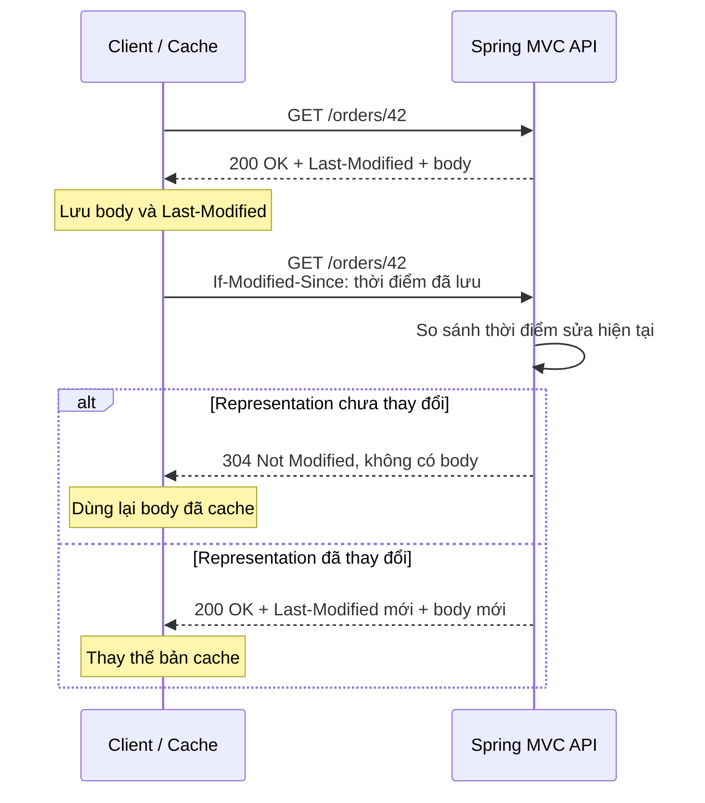

# Last-Modified

HTTP cache có thể giữ một representation đã tải để tái sử dụng. Khi bản dữ liệu ở server có thể đã thay đổi, client cần một cách hỏi server xem bản cache còn mới không mà không phải tải lại toàn bộ response. Header **`Last-Modified`** cung cấp thời điểm representation được sửa lần cuối; client gửi thời điểm đó trong **`If-Modified-Since`** ở request kế tiếp.

Nếu representation chưa thay đổi kể từ thời điểm client đã lưu, server trả **`304 Not Modified`** và không gửi lại body. Nếu đã thay đổi, server trả `200 OK`, body mới và `Last-Modified` mới. Spring MVC hỗ trợ xử lý conditional request qua `WebRequest.checkNotModified(...)` và qua header `Last-Modified` trên `ResponseEntity`.

Bài học này thuộc chương **Caching** trong module **SPRING_HATEOAS**, tập trung vào cách dùng `Last-Modified` để revalidate representation có hypermedia, cách phối hợp `If-Modified-Since`, `304`, `Cache-Control` và `ETag`, cách xử lý timestamp có độ chính xác giây, cùng kiểm thử bằng MockMvc.

Sau bài học, bạn có thể:

- Giải thích vai trò của `Last-Modified` trong HTTP caching.
- Mô tả luồng `If-Modified-Since` và `304 Not Modified`.
- Chọn timestamp phản ánh lần sửa cuối của representation.
- Chuẩn hóa timestamp theo độ chính xác của HTTP-date.
- Dùng `WebRequest.checkNotModified(long)` trong Spring MVC.
- Dùng `ResponseEntity.lastModified(...)` để công bố validator.
- Phân biệt `Last-Modified` với `Cache-Control`, `ETag` và `If-Unmodified-Since`.
- Xử lý link HATEOAS thay đổi theo state, association hoặc quyền người dùng.
- Kiểm thử response mới, response chưa đổi và response đã thay đổi bằng MockMvc.

## 1. Last-Modified là gì?

`Last-Modified` là response header chứa thời điểm representation được sửa lần cuối theo đồng hồ của origin server. Giá trị dùng HTTP-date, ví dụ:

```http
HTTP/1.1 200 OK
Content-Type: application/hal+json
Last-Modified: Wed, 21 Oct 2015 07:28:00 GMT
Cache-Control: private, max-age=60

{
  "id": 42,
  "status": "PENDING",
  "_links": {
    "self": { "href": "/orders/42" }
  }
}
```

Header này là một validator theo thời gian. Client hoặc cache lưu response cùng giá trị `Last-Modified`. Khi cần kiểm tra lại, client gửi giá trị đó trong `If-Modified-Since`.

`Last-Modified` mô tả thời điểm nội dung của representation được sửa. Nó không phải:

- Thời điểm client tải response.
- Thời điểm server nhận request gần nhất.
- Thời điểm người dùng đọc resource.
- Thời điểm database connection cập nhật hoặc backup chạy, nếu dữ liệu biểu diễn không đổi.

Server chỉ nên phát `Last-Modified` khi có một thời điểm sửa đáng tin cậy cho representation được chọn. Nếu không xác định được thời điểm đó, đừng tạo giá trị giả bằng `Instant.now()` cho mỗi request vì khi đó cache sẽ luôn thấy representation mới. Nếu timestamp metadata nằm sau thời điểm tạo response theo đồng hồ origin server, RFC 9110 yêu cầu thay nó bằng thời điểm message origination (`Date`) trước khi gửi.

## 2. Luồng If-Modified-Since và 304

Luồng revalidation cơ bản có hai request:



Request đầu tiên:

```http
GET /orders/42 HTTP/1.1
Accept: application/hal+json
```

Server trả:

```http
HTTP/1.1 200 OK
Last-Modified: Wed, 21 Oct 2015 07:28:00 GMT
Cache-Control: private, max-age=60
Content-Type: application/hal+json
```

Sau khi cache cần revalidate, client gửi:

```http
GET /orders/42 HTTP/1.1
Accept: application/hal+json
If-Modified-Since: Wed, 21 Oct 2015 07:28:00 GMT
```

Nếu thời điểm sửa của representation hiện tại sớm hơn hoặc bằng thời điểm trong `If-Modified-Since`, server có thể trả:

```http
HTTP/1.1 304 Not Modified
Last-Modified: Wed, 21 Oct 2015 07:28:00 GMT
Cache-Control: private, max-age=60
```

Response `304` không có body. Client giữ lại body đã cache và cập nhật metadata cache theo response validation.

Nếu representation đã thay đổi sau thời điểm client gửi, server trả `200 OK` cùng body mới và `Last-Modified` mới. Client thay thế bản cache cũ.

## 3. Điều kiện so sánh If-Modified-Since

Với request `GET` hoặc `HEAD`, điều kiện `If-Modified-Since` được đánh giá theo thời điểm sửa của representation:

| So sánh | Kết quả |
|---|---|
| `lastModified` sớm hơn `If-Modified-Since` | Chưa thay đổi theo validator; có thể trả `304`. |
| `lastModified` bằng `If-Modified-Since` | Chưa thay đổi theo validator; có thể trả `304`. |
| `lastModified` muộn hơn `If-Modified-Since` | Đã thay đổi; trả representation mới với `200`. |
| Không có timestamp đáng tin cậy | Bỏ qua điều kiện thời gian; không tự tạo validator giả. |

Ví dụ representation có `Last-Modified` lúc `10:00:00 GMT`:

- Client gửi `If-Modified-Since: 10:00:00 GMT`: server có thể trả `304`.
- Client gửi `If-Modified-Since: 09:59:00 GMT`: server trả `200` vì representation mới hơn.
- Client gửi `If-Modified-Since: 10:01:00 GMT`: server có thể trả `304` theo phép so sánh ngày, nhưng ngày tương lai thường phản ánh clock skew hoặc client gửi dữ liệu không hợp lệ; không dùng header này như cơ chế xác thực.

Server phải diễn giải thời điểm theo đồng hồ của origin server. `If-Modified-Since` không phải một phép so sánh version nghiệp vụ chính xác tới millisecond.

Server phải bỏ qua `If-Modified-Since` nếu request có `If-None-Match`, giá trị không phải HTTP-date hợp lệ, chứa nhiều giá trị ngày, method không phải `GET`/`HEAD`, hoặc resource không có modification date đáng tin cậy. Nếu request có `If-None-Match`, hãy đánh giá ETag theo thứ tự điều kiện HTTP thay vì tự xử lý ngày trước.

## 4. HTTP-date chỉ có độ chính xác đến giây

HTTP-date chuẩn dùng IMF-fixdate, thể hiện ngày giờ theo GMT/UTC và chỉ có độ chính xác đến giây:

```http
Last-Modified: Thu, 26 Nov 2026 05:27:18 GMT
```

Trong khi đó, database có thể lưu timestamp tới millisecond hoặc microsecond. Nếu so sánh trực tiếp timestamp có độ chính xác cao với giá trị HTTP-date đã bị làm tròn tới giây, ứng dụng có thể tạo kết quả không nhất quán.

Ví dụ database lưu:

```text
2026-11-26T05:27:18.850Z
```

Header HTTP chỉ biểu diễn được:

```text
Thu, 26 Nov 2026 05:27:18 GMT
```

Nên chuẩn hóa thời điểm về giây trước khi dùng làm validator:

```java
import java.time.Instant;
import java.time.temporal.ChronoUnit;

Instant lastModified = order.getUpdatedAt()
        .truncatedTo(ChronoUnit.SECONDS);

long lastModifiedMillis = lastModified.toEpochMilli();
```

Giá trị này phù hợp với API Spring nhận timestamp millisecond và với độ chính xác của HTTP-date. Không tự định dạng ngày bằng locale hoặc timezone của máy; hãy để Spring `HttpHeaders`/`ResponseEntity` ghi HTTP-date theo chuẩn.

## 5. Last-Modified là validator yếu trong nhiều trường hợp

HTTP-date chỉ có độ chính xác một giây. Nếu representation thay đổi hai lần trong cùng một giây, hai response có thể mang cùng giá trị `Last-Modified` dù body khác nhau.

Ví dụ:

| Thời điểm thực trong database | Nội dung |
|---|---|
| `10:15:20.100Z` | Đơn hàng có tổng tiền `100`. |
| `10:15:20.700Z` | Đơn hàng có tổng tiền `120`. |

Cả hai thời điểm có thể được biểu diễn thành `10:15:20 GMT`. Client gửi validator từ response đầu có thể nhận `304` dù nội dung đã thay đổi trong cùng giây.

RFC 9110 xem `Last-Modified` là validator yếu theo mặc định, trừ khi server có thể chứng minh các điều kiện để timestamp đủ mạnh. Nếu resource có tần suất cập nhật cao, cần tính chính xác hơn hoặc có nhiều thay đổi trong một giây, nên cung cấp `ETag` cùng `Last-Modified`.

`ETag` có thể dựa trên version, hash nội dung hoặc một định danh representation. Nó phân biệt được hai phiên bản có cùng timestamp giây. `Last-Modified` vẫn hữu ích như validator dự phòng và giúp cache cũ hoạt động.

## 6. Chọn timestamp phản ánh representation HATEOAS

Với API thông thường, developer thường lấy `updatedAt` của entity. Với HATEOAS, response có thể thay đổi ngay cả khi bảng entity chính không đổi:

- Link `cancel` xuất hiện hoặc biến mất khi trạng thái đơn hàng đổi.
- Link `customer` đổi khi association được cập nhật.
- Link `payment` thay đổi sau khi giao dịch được tạo.
- Embedded resource thay đổi khi dữ liệu liên quan thay đổi.
- Representation thay đổi theo role hoặc quyền của principal.
- Profile hoặc cấu hình serializer thay đổi cấu trúc representation.

Do đó, `Last-Modified` cần phản ánh lần sửa cuối của **representation được chọn**, không nhất thiết chỉ là `updatedAt` của một hàng database.

Ví dụ, nếu order response nhúng customer và danh sách payment, timestamp đại diện có thể là thời điểm mới nhất trong các nguồn dữ liệu ảnh hưởng tới response:

```java
import java.time.Instant;
import java.time.temporal.ChronoUnit;
import java.util.Comparator;
import java.util.Objects;
import java.util.stream.Stream;

Instant representationModifiedAt = Stream.of(
                order.getUpdatedAt(),
                customer.getUpdatedAt(),
                paymentSummary.getUpdatedAt())
        .filter(Objects::nonNull)
        .max(Comparator.naturalOrder())
        .orElse(order.getCreatedAt())
        .truncatedTo(ChronoUnit.SECONDS);
```

Đây chỉ là ví dụ nếu các timestamp thành phần thực sự bao phủ mọi thay đổi ảnh hưởng representation. Với dữ liệu aggregate, một `representationVersion` tăng mỗi khi bất kỳ thành phần liên quan thay đổi có thể dễ kiểm soát hơn.

Nếu relation phụ thuộc policy hoặc principal, timestamp entity không phản ánh việc quyền người dùng thay đổi. Khi đó, cân nhắc `ETag` dựa trên representation đã chọn, cache riêng theo principal hoặc không cache response nhạy cảm.

## 7. Spring MVC: dùng WebRequest.checkNotModified

Spring MVC cung cấp `WebRequest.checkNotModified(long lastModifiedTimestamp)`. Phương thức này so sánh validator với conditional request headers, tự thiết lập `Last-Modified` và status khi phù hợp.

Ví dụ controller:

```java
import java.time.temporal.ChronoUnit;

import org.springframework.hateoas.EntityModel;
import org.springframework.web.bind.annotation.GetMapping;
import org.springframework.web.bind.annotation.PathVariable;
import org.springframework.web.context.request.WebRequest;

@GetMapping("/orders/{id}")
EntityModel<OrderResponse> one(
        @PathVariable Long id,
        WebRequest request) {

    Order order = orderService.findById(id);
    long lastModified = order.getUpdatedAt()
            .truncatedTo(ChronoUnit.SECONDS)
            .toEpochMilli();

    if (request.checkNotModified(lastModified)) {
        return null;
    }

    return orderModelAssembler.toModel(order);
}
```

Khi request chưa cần xử lý tiếp, `checkNotModified(...)` đã đặt response thành `304` nếu điều kiện phù hợp; controller trả `null` để dừng xử lý và không serialize representation. Nếu representation cần gửi, phương thức trả `false`, Spring đã thêm `Last-Modified` response header và controller tiếp tục tạo body.

Ví dụ giả định `order.getUpdatedAt()` bao phủ mọi thay đổi ảnh hưởng response. Nếu assembler thêm link dựa trên association hoặc quyền người dùng, hãy dùng timestamp đại diện phù hợp hơn như mục 6.

Nếu controller dùng early return như trên, hãy cấu hình `Cache-Control` ở filter/interceptor hoặc trên servlet response để policy cache cũng có mặt ở nhánh `304`. `CacheControl.noCache()` có nghĩa cache có thể lưu response nhưng phải revalidate trước khi dùng lại; `.cachePrivate()` giới hạn cache vào private cache như browser. Nó khác `no-store`, vốn yêu cầu không lưu response.

## 8. Spring MVC: dùng ResponseEntity.lastModified

Nếu controller đã tạo representation và chỉ cần công bố validator, có thể đặt `Last-Modified` trên `ResponseEntity`:

```java
import java.time.temporal.ChronoUnit;
import java.util.concurrent.TimeUnit;

import org.springframework.hateoas.EntityModel;
import org.springframework.http.CacheControl;
import org.springframework.http.ResponseEntity;
import org.springframework.web.bind.annotation.GetMapping;
import org.springframework.web.bind.annotation.PathVariable;

@GetMapping("/orders/{id}")
ResponseEntity<EntityModel<OrderResponse>> one(@PathVariable Long id) {
    Order order = orderService.findById(id);
    long lastModified = order.getUpdatedAt()
            .truncatedTo(ChronoUnit.SECONDS)
            .toEpochMilli();

    EntityModel<OrderResponse> model = orderModelAssembler.toModel(order);

    return ResponseEntity.ok()
            .lastModified(lastModified)
            .cacheControl(CacheControl.maxAge(30, TimeUnit.SECONDS).cachePrivate())
            .body(model);
}
```

Spring MVC sử dụng header điều kiện để có thể trả `304 Not Modified` thay cho body khi representation chưa thay đổi. Cách này ngắn gọn, nhưng controller vẫn tải entity và dựng model trước khi trả `ResponseEntity`. Nếu việc dựng model tốn chi phí, kiểm tra sớm bằng `WebRequest.checkNotModified(...)` như mục 7 để bỏ qua phần xử lý phía sau.

`ResponseEntity.lastModified(long)` nhận timestamp millisecond tính từ epoch UTC. Hãy truyền thời điểm đã chuẩn hóa tới giây; không truyền một giá trị `System.currentTimeMillis()` mới ở mỗi request.

## 9. Phối hợp Last-Modified với Cache-Control

`Last-Modified` và `Cache-Control` giải quyết hai phần khác nhau:

| Header | Vai trò |
|---|---|
| `Last-Modified` | Validator cho biết representation được sửa lần cuối khi nào. |
| `If-Modified-Since` | Request header để cache hỏi representation có mới hơn thời điểm đã lưu không. |
| `Cache-Control: max-age` | Xác định thời gian response còn fresh mà cache có thể dùng lại mà không cần revalidate. |
| `Cache-Control: no-cache` | Cho phép lưu nhưng yêu cầu revalidate trước khi dùng lại. |
| `Cache-Control: no-store` | Yêu cầu cache không lưu response. |
| `Cache-Control: private` | Chỉ private cache được lưu; shared cache không được lưu response. |

Ví dụ:

```http
Cache-Control: max-age=60, private
Last-Modified: Wed, 21 Oct 2015 07:28:00 GMT
```

Trong 60 giây, browser có thể dùng bản cache còn fresh. Sau thời gian đó, cache có thể gửi `If-Modified-Since` để revalidate. Nếu server trả `304`, browser tái sử dụng body cũ.

Nếu response chứa dữ liệu cá nhân hoặc link phụ thuộc quyền, không dùng shared cache công khai chỉ vì có `Last-Modified`. Chọn `private` hoặc `no-store` theo độ nhạy cảm và chính sách ứng dụng.

## 10. Last-Modified và ETag: validator nào được ưu tiên?

`ETag` và `Last-Modified` có thể cùng xuất hiện:

```http
HTTP/1.1 200 OK
ETag: "order-42-v17"
Last-Modified: Wed, 21 Oct 2015 07:28:00 GMT
Cache-Control: private, no-cache
```

Client có thể gửi:

```http
GET /orders/42 HTTP/1.1
If-None-Match: "order-42-v17"
If-Modified-Since: Wed, 21 Oct 2015 07:28:00 GMT
```

Theo HTTP semantics, nếu request có `If-None-Match`, server phải bỏ qua `If-Modified-Since`. `If-None-Match` là validator chính xác hơn và được ưu tiên. Vì vậy, không thiết kế logic tự kiểm tra `If-Modified-Since` trước rồi trả `304` mà bỏ qua ETag.

Spring `WebRequest` có overload kiểm tra cả hai:

```java
if (request.checkNotModified(etag, lastModifiedMillis)) {
    return null;
}
```

Overload này thiết lập cả `ETag` và `Last-Modified`, đồng thời xử lý conditional request theo logic của Spring. Nếu ứng dụng cần validator mạnh, hãy xây ETag từ version hoặc nội dung representation; dùng Last-Modified như validator bổ sung.

## 11. Phân biệt If-Modified-Since và If-Unmodified-Since

Hai request header có tên gần giống nhưng mục đích khác nhau:

| Header | Mục đích | Hành vi thường gặp |
|---|---|---|
| `If-Modified-Since` | Revalidate cache khi đọc | Với `GET`/`HEAD`, nếu chưa đổi thì `304`. |
| `If-Unmodified-Since` | Bảo vệ thao tác khỏi ghi đè phiên bản đã thay đổi | Với request ghi, nếu resource đã đổi sau thời điểm client biết thì có thể `412 Precondition Failed`. |

`If-Modified-Since` trả lời: “Từ lần tôi lưu bản này đến nay, resource có thay đổi không?”

`If-Unmodified-Since` trả lời: “Hãy thực hiện thay đổi chỉ khi resource chưa bị sửa kể từ thời điểm tôi biết.”

Không dùng `If-Modified-Since` để chống lost update cho `PUT` hoặc `PATCH`. Với optimistic concurrency, ưu tiên `If-Match` cùng ETag; nếu chỉ có timestamp, `If-Unmodified-Since` có thể là lựa chọn yếu hơn.

Spring `WebRequest.checkNotModified(long)` cũng hỗ trợ một số conditional request cho `POST`, `PUT` và `DELETE`, nhưng cần hiểu status và semantics của precondition trước khi dùng. Đối với update API, thiết kế rõ `If-Match`/`If-Unmodified-Since` và trả `412` khi precondition thất bại.

## 12. Tính Last-Modified đúng khi response có HATEOAS links

Với representation HAL, body gồm cả dữ liệu domain và hypermedia controls:

```json
{
  "id": 42,
  "status": "PENDING",
  "_links": {
    "self": { "href": "/orders/42" },
    "cancel": { "href": "/orders/42/cancellation" },
    "customer": { "href": "/customers/7" }
  }
}
```

Khi trạng thái đổi từ `PENDING` sang `SHIPPED`, link `cancel` có thể biến mất và link `tracking` xuất hiện. Ngay cả khi một field khác không đổi, representation HAL đã thay đổi. Timestamp phải được cập nhật khi state transition làm thay đổi link.

Tương tự, nếu association `customer` thay đổi, hoặc embedded representation được cập nhật, `Last-Modified` cần phản ánh thay đổi đó. Một trường `order.updatedAt` chỉ đủ khi mọi nguồn thay đổi liên quan đều cập nhật trường này.

Một cách quản lý là lưu `representationModifiedAt` ở aggregate root và cập nhật nó trong mọi use case làm thay đổi representation. Cách khác là tính timestamp từ các thành phần phụ thuộc. Với representation phức tạp hoặc có nhiều biến thể, ETag hash trên representation có thể chính xác và dễ kiểm chứng hơn.

## 13. Representation cá nhân hóa và cache

Nếu link `approve`, `cancel` hoặc `refund` phụ thuộc quyền của principal, hai người dùng có thể nhận body khác nhau tại cùng một URI và cùng một timestamp entity.

Ví dụ:

- User A có `ORDER_CANCEL`, response chứa `_links.cancel`.
- User B chỉ có `ORDER_READ`, response không chứa `_links.cancel`.

Nếu cả hai response dùng cùng `Last-Modified` dựa trên `order.updatedAt`, validator có thể không phân biệt hai representation. Shared cache còn có nguy cơ trả link của user A cho user B.

Với response cá nhân hóa:

- Dùng `Cache-Control: private` hoặc `no-store` theo chính sách dữ liệu.
- Cân nhắc `Vary: Authorization` nếu representation thực sự phụ thuộc header đó và cache được cấu hình phân biệt variant.
- Với session cookie, xem xét cache policy tương ứng; không thêm `Vary: Cookie` một cách máy móc nếu tạo quá nhiều cache variants.
- Cân nhắc ETag gắn với representation và policy variant.
- Luôn kiểm tra quyền tại endpoint; cache validator không phải authorization.

Nếu không thể tạo validator chính xác theo principal và policy, `no-store` hoặc `private, no-cache` thường an toàn hơn một timestamp entity dùng chung.

## 14. Xử lý resource không tồn tại và timestamp không đáng tin cậy

Server cần xác định resource có tồn tại và người dùng có quyền truy cập trước khi quyết định trả `304` cho representation đó. Không trả `304` chỉ vì client gửi ngày trong tương lai khi resource không tồn tại; trường hợp đó vẫn phải tuân theo hợp đồng `404 Not Found` hoặc policy che giấu resource.

Không phát `Last-Modified` trong các trường hợp:

- Không có nguồn timestamp đáng tin cậy.
- Timestamp không đại diện cho mọi thay đổi của representation.
- Không có đồng hồ hoặc nguồn thời gian có thẩm quyền để xác định modification date.
- Representation cá nhân hóa nhưng timestamp không phân biệt được các variant và cache policy không an toàn.

Nếu timestamp tính được nằm sau thời điểm message origination theo đồng hồ origin server, RFC 9110 yêu cầu thay nó bằng thời điểm tạo response (`Date`) trước khi gửi `Last-Modified`; không gửi một ngày sửa trong tương lai.

Nếu hệ thống nhập dữ liệu từ nguồn ngoài, hãy xác định timestamp nào là thời điểm sửa có thẩm quyền. Không trộn thời gian từ nhiều máy không đồng bộ mà không có quy tắc rõ ràng.

## 15. Kiểm thử Last-Modified bằng MockMvc

Test đầu tiên xác nhận response `200` công bố `Last-Modified`:

```java
import org.junit.jupiter.api.Test;
import org.springframework.beans.factory.annotation.Autowired;
import org.springframework.boot.test.autoconfigure.web.servlet.AutoConfigureMockMvc;
import org.springframework.boot.test.context.SpringBootTest;
import org.springframework.http.HttpHeaders;
import org.springframework.hateoas.MediaTypes;
import org.springframework.test.web.servlet.MockMvc;
import org.springframework.test.web.servlet.MvcResult;

import static org.assertj.core.api.Assertions.assertThat;
import static org.springframework.test.web.servlet.request.MockMvcRequestBuilders.get;
import static org.springframework.test.web.servlet.result.MockMvcResultMatchers.header;
import static org.springframework.test.web.servlet.result.MockMvcResultMatchers.status;

@SpringBootTest
@AutoConfigureMockMvc
class OrderLastModifiedTest {

    @Autowired
    MockMvc mockMvc;

    @Test
    void returnsLastModifiedForOrder() throws Exception {
        MvcResult result = mockMvc.perform(get("/orders/42")
                        .accept(MediaTypes.HAL_JSON))
                .andExpect(status().isOk())
                .andExpect(header().exists(HttpHeaders.LAST_MODIFIED))
                .andReturn();

        assertThat(result.getResponse().getHeader(HttpHeaders.LAST_MODIFIED))
                .isNotBlank();
    }
}
```

Test giả định fixture của đơn hàng `42` có `updatedAt` ổn định và controller dùng `WebRequest.checkNotModified` hoặc `ResponseEntity.lastModified`.

## 16. Kiểm thử request chưa thay đổi trả 304

Sau khi nhận `Last-Modified`, test gửi lại chính giá trị đó trong `If-Modified-Since`:

```java
import org.springframework.http.HttpHeaders;

import static org.springframework.test.web.servlet.result.MockMvcResultMatchers.content;

@Test
void returnsNotModifiedWhenOrderHasNotChanged() throws Exception {
    MvcResult first = mockMvc.perform(get("/orders/42")
                    .accept(MediaTypes.HAL_JSON))
            .andExpect(status().isOk())
            .andReturn();

    String lastModified = first.getResponse()
            .getHeader(HttpHeaders.LAST_MODIFIED);

    mockMvc.perform(get("/orders/42")
                    .header(HttpHeaders.IF_MODIFIED_SINCE, lastModified)
                    .accept(MediaTypes.HAL_JSON))
            .andExpect(status().isNotModified())
            .andExpect(content().string(""));
}
```

Test giả định không có thay đổi nào xảy ra giữa hai request. `304` không có body; không kiểm tra JSON body trong response này.

## 17. Kiểm thử khi resource đã thay đổi

Để kiểm thử `200` sau revalidation, gửi một `If-Modified-Since` cũ hơn thời điểm sửa hiện tại:

```java
import java.time.Instant;
import org.springframework.http.HttpHeaders;

@Test
void returnsRepresentationWhenModifiedAfterClientTimestamp() throws Exception {
    Instant oldTimestamp = Instant.parse("2025-01-01T00:00:00Z");
    HttpHeaders headers = new HttpHeaders();
    headers.setIfModifiedSince(oldTimestamp.toEpochMilli());

    mockMvc.perform(get("/orders/42")
                    .headers(headers)
                    .accept(MediaTypes.HAL_JSON))
            .andExpect(status().isOk())
            .andExpect(header().exists(HttpHeaders.LAST_MODIFIED));
}
```

Test cần fixture có `updatedAt` sau `2025-01-01T00:00:00Z`. Dùng `HttpHeaders.setIfModifiedSince(...)` giúp Spring định dạng HTTP-date đúng thay vì tự ghép chuỗi ngày.

## 18. Kiểm thử ETag được ưu tiên hơn If-Modified-Since

Khi response có cả ETag và Last-Modified, request có `If-None-Match` phải được đánh giá theo ETag; `If-Modified-Since` bị bỏ qua theo HTTP semantics.

Test có thể thiết lập ETag phù hợp với fixture:

```java
import java.time.Instant;
import org.springframework.http.HttpHeaders;

@Test
void ifNoneMatchTakesPrecedenceOverIfModifiedSince() throws Exception {
    HttpHeaders headers = new HttpHeaders();
    headers.setIfNoneMatch("\"order-42-v17\"");
    headers.setIfModifiedSince(Instant.parse("2099-01-01T00:00:00Z").toEpochMilli());

    mockMvc.perform(get("/orders/42")
                    .headers(headers)
                    .accept(MediaTypes.HAL_JSON))
            .andExpect(status().isOk());
}
```

Test này giả định ETag hiện tại khác `"order-42-v17"`. Dù `If-Modified-Since` là ngày tương lai, server vẫn phải ưu tiên `If-None-Match`; vì ETag không khớp, request nhận representation mới. Nếu ETag khớp, request `GET` sẽ nhận `304`.

## 19. Các lỗi thường gặp

| Lỗi | Hệ quả | Cách xử lý |
|---|---|---|
| Dùng thời điểm hiện tại cho mọi response | Cache luôn thấy representation mới. | Dùng timestamp sửa cuối có ý nghĩa. |
| Dùng `createdAt` thay `updatedAt` | Nội dung thay đổi nhưng validator không đổi. | Cập nhật timestamp khi representation thay đổi. |
| Chỉ dùng timestamp entity chính | Link hoặc embedded resource đổi nhưng Last-Modified không đổi. | Dùng aggregate timestamp hoặc ETag của representation. |
| So sánh nanosecond với HTTP-date | Validator có thể không ổn định. | Chuẩn hóa timestamp về giây. |
| Hai thay đổi trong cùng một giây | Last-Modified có thể giống nhau dù body khác. | Dùng ETag bổ sung hoặc làm validator chính. |
| Trả body cùng status 304 | Vi phạm semantics của response Not Modified. | Dừng xử lý và không gửi body khi `checkNotModified` trả true. |
| Nhầm no-cache với no-store | Cache behavior khác với mong đợi. | `no-cache` cho phép lưu nhưng phải revalidate; `no-store` cấm lưu. |
| Bỏ qua If-None-Match | Server có thể trả 304 sai khi ETag không khớp. | Ưu tiên ETag khi request có `If-None-Match`. |
| Dùng If-Modified-Since để chống lost update | Không bảo vệ chính xác thao tác ghi. | Dùng `If-Match` hoặc `If-Unmodified-Since` phù hợp. |
| Cache representation theo user trong shared cache | Có thể lộ link/action giữa các principal. | Dùng private/no-store và cache variation phù hợp. |

## 20. Quy trình triển khai Last-Modified

1. Xác định representation nào được cache và media type nào được trả về.
2. Xác định nguồn timestamp phản ánh mọi thay đổi của representation, gồm field, association, embedded resource và link state.
3. Chuẩn hóa timestamp theo UTC và độ chính xác một giây.
4. Nếu timestamp không đủ chính xác hoặc representation thay đổi nhanh, tạo ETag bổ sung.
5. Dùng `WebRequest.checkNotModified(...)` nếu muốn dừng sớm trước khi dựng representation.
6. Hoặc dùng `ResponseEntity.lastModified(...)` nếu muốn công bố validator qua response builder.
7. Thiết lập `Cache-Control` phù hợp với dữ liệu public, private hoặc cá nhân hóa.
8. Bảo đảm request có `If-None-Match` được ưu tiên hơn `If-Modified-Since`.
9. Kiểm thử response `200`, `304`, thay đổi timestamp, ETag precedence và body rỗng.
10. Kiểm tra representation HATEOAS ở nhiều trạng thái và principal để bảo đảm validator không che mất thay đổi link.

`Last-Modified` giúp client kiểm tra representation có thay đổi kể từ lần tải trước hay không mà không cần tải lại body khi dữ liệu vẫn giữ nguyên. Trong Spring HATEOAS, validator phải theo dõi cả dữ liệu và hypermedia controls của representation. Kết hợp timestamp đáng tin cậy, conditional request của Spring MVC, `Cache-Control` và ETag giúp cache hiệu quả mà vẫn giữ response đúng với trạng thái resource.

## Tài liệu tham khảo

- [Spring Framework – HTTP Caching](https://docs.spring.io/spring-framework/reference/web/webmvc/mvc-caching.html)
- [Spring Framework – WebRequest API](https://docs.spring.io/spring-framework/docs/current/javadoc-api/org/springframework/web/context/request/WebRequest.html)
- [Spring Framework – ResponseEntity.HeadersBuilder API](https://docs.spring.io/spring-framework/docs/current/javadoc-api/org/springframework/http/ResponseEntity.HeadersBuilder.html)
- [RFC 9110 – HTTP Semantics, Last-Modified and Conditional Requests](https://www.rfc-editor.org/rfc/rfc9110)
- [RFC 9111 – HTTP Caching](https://www.rfc-editor.org/rfc/rfc9111)
