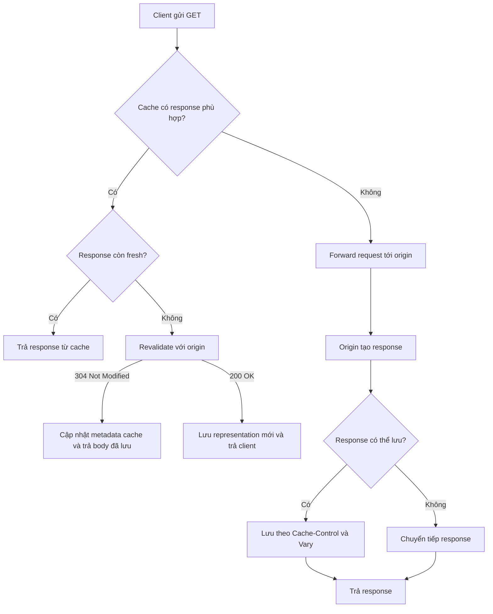

# Cache-Control

Một response REST không chỉ chứa dữ liệu mà còn có thể chứa link, embedded resource, affordance và metadata phân trang. Khi client hoặc proxy lưu response đó vào cache, các request sau có thể được phục vụ nhanh hơn mà không phải gọi lại origin server. Tuy nhiên, response hypermedia chỉ hữu ích khi còn phản ánh đúng dữ liệu và khả năng mà server muốn công bố. `Cache-Control` cho phép server định nghĩa response được lưu ở đâu, dùng lại trong bao lâu và khi nào phải kiểm tra lại.

Trong Spring HATEOAS, cache áp dụng cho toàn bộ HTTP representation được serialize, bao gồm `_links`, `_embedded`, `_templates`, `page` và các field nghiệp vụ. Nếu trạng thái đơn hàng thay đổi khiến link `cancel` bị gỡ bỏ, response cache cũ vẫn có thể công bố link đó cho tới khi hết freshness hoặc được revalidate. Vì vậy, thời gian cache cần tính tới vòng đời của cả dữ liệu và hypermedia links.

## HTTP caching hoạt động như thế nào?

HTTP cache lưu response để tái sử dụng cho request tương đương. Hai loại cache thường gặp:

- **Private cache:** dành cho một người dùng, thường là browser hoặc HTTP client trên thiết bị của người dùng.
- **Shared cache:** được nhiều người dùng chia sẻ, thường là reverse proxy, CDN hoặc gateway có caching.

Một response có thể ở trạng thái *fresh* hoặc *stale*. Response fresh có thể được cache dùng lại mà không liên hệ origin server. Khi response stale, cache thường phải revalidate với origin trước khi sử dụng lại, trừ khi một directive cho phép phục vụ stale trong điều kiện cụ thể.



Cache không bắt buộc phải lưu mọi response. Nó phải tuân theo method, status, cache directives, validator và các điều kiện của request. Với response có `Vary`, cache còn phải phân biệt các biến thể theo những request header được nêu trong `Vary`.

## Cache-Control là header điều khiển cache

`Cache-Control` có thể xuất hiện trong request hoặc response. Directive trong request thể hiện cách client muốn cache xử lý request đó; directive trong response do server công bố chính sách cho response. Hai chiều độc lập, request có `no-cache` không có nghĩa server phải lặp lại directive đó trong response.

Ví dụ response có thể cho phép browser cache trong 60 giây:

```http
HTTP/1.1 200 OK
Content-Type: application/hal+json
Cache-Control: private, max-age=60
ETag: "order-ORD-1001-v7-hal"

{
  "id": "ORD-1001",
  "status": "OPEN",
  "_links": {
    "self": { "href": "/api/orders/ORD-1001" }
  }
}
```

`private` giới hạn response vào private cache; `max-age=60` cho biết response fresh trong 60 giây kể từ khi được tạo hoặc revalidated. `ETag` là validator để cache kiểm tra representation có thay đổi hay chưa.

Các directive được phân biệt chữ hoa/thường không quan trọng theo HTTP. Tuy vậy, nên dùng dạng chữ thường nhất quán trong ví dụ và cấu hình để dễ đọc.

### Cache-Control khác với Spring Cache abstraction

`Cache-Control` điều khiển browser, proxy và CDN khi tái sử dụng HTTP response. Spring Cache abstraction (`@Cacheable`, `@CacheEvict`, `CacheManager`) lưu kết quả xử lý ở phía server để tránh thực hiện lại method hoặc truy vấn. Hai lớp cache độc lập và có thể cùng tồn tại: server có thể lấy dữ liệu từ Spring Cache rồi trả response với `Cache-Control` cho HTTP cache. Khi dữ liệu thay đổi, cần xử lý cả việc xóa cache server-side và thời hạn/validator của response đã phát ra.

## Các directive quan trọng của response

| Directive | Ý nghĩa | Trường hợp thường dùng |
|---|---|---|
| `max-age=N` | Response fresh tối đa N giây trong cache | Dữ liệu có thể tái sử dụng trong khoảng ngắn đã biết |
| `s-maxage=N` | Freshness lifetime riêng cho shared cache; ghi đè `max-age` trong shared cache | CDN/proxy có TTL riêng với browser |
| `public` | Cho phép shared cache lưu response trong các trường hợp thông thường response không được shared cache lưu | Representation công khai, giống nhau giữa người dùng |
| `private` | Shared cache không được lưu response; private cache vẫn có thể lưu | Dữ liệu phụ thuộc người dùng đăng nhập |
| `no-cache` | Có thể lưu response nhưng phải revalidate trước khi dùng lại | Dữ liệu cần kiểm tra phiên bản mỗi lần truy cập |
| `no-store` | Cache không được lưu request/response | Dữ liệu nhạy cảm hoặc không muốn lưu trong cache |
| `must-revalidate` | Khi stale, không được dùng lại nếu chưa revalidate thành công | Dữ liệu cần chính xác sau khi hết freshness |
| `proxy-revalidate` | Shared cache phải revalidate response stale | Chính sách stale nghiêm ngặt cho proxy |
| `no-transform` | Intermediary không được tự ý biến đổi representation | Nội dung mà thay đổi byte/encoding không mong muốn |

### max-age và s-maxage

`max-age` định nghĩa số giây response còn fresh. Ví dụ:

```http
Cache-Control: max-age=300
```

Cache có thể dùng lại response trong 5 phút mà không hỏi origin. Khi hết 5 phút, response stale và cần revalidation hoặc một chính sách stale khác.

`s-maxage` áp dụng cho shared cache và có độ ưu tiên cao hơn `max-age` trong shared cache. Ví dụ:

```http
Cache-Control: public, max-age=30, s-maxage=300
```

Browser private cache có thể dùng response trong 30 giây; CDN shared cache có thể dùng trong 300 giây. Khi dùng `s-maxage`, shared cache cũng phải revalidate response sau khi stale.

Không chọn TTL chỉ dựa vào khả năng tiết kiệm request. Hãy xét tần suất thay đổi của dữ liệu, độ trễ chấp nhận được và thời gian mà một link hypermedia có thể còn hợp lệ.

### public và private

`public` cho phép shared cache lưu response. Chỉ dùng khi representation thực sự an toàn để chia sẻ giữa các người dùng. Ví dụ danh mục sản phẩm công khai có thể được cache chung:

```http
Cache-Control: public, max-age=120, s-maxage=600
```

`private` chỉ cho phép private cache lưu response; shared cache không được lưu. Ví dụ trang chi tiết đơn hàng của một người dùng:

```http
Cache-Control: private, max-age=30
```

Một representation có thể chứa các link hoặc affordance tùy theo quyền hiện tại. Nếu cache dùng chung response cho hai người dùng, người thứ hai có thể nhận link hoặc thông tin không dành cho họ. Với response được cá nhân hóa, `private` hoặc `no-store` thường phù hợp hơn `public`.

Không suy luận rằng request có `Authorization` thì shared cache tuyệt đối không thể lưu response. RFC 9111 quy định riêng việc lưu response cho request đã xác thực và cho phép trong một số trường hợp nếu response có directive cho phép rõ ràng như `public`, `s-maxage` hoặc `must-revalidate`. Chỉ cấu hình ngoại lệ này khi representation được xác định là an toàn để chia sẻ và cache key phân biệt đúng các biến thể cần thiết.

### no-cache và no-store khác nhau

Hai directive này thường bị nhầm lẫn:

- `no-cache`: cache có thể lưu response, nhưng phải hỏi origin và nhận xác nhận thành công trước khi dùng lại. Nếu representation chưa đổi, server có thể trả `304 Not Modified` mà không gửi lại body.
- `no-store`: cache không được lưu request hoặc response để tái sử dụng.

`max-age=0` làm response stale ngay sau khi được tạo, nhưng không diễn đạt rõ yêu cầu revalidation như `no-cache`. Khi muốn cache vẫn lưu bản response và luôn xác nhận với origin trước khi tái sử dụng, dùng `no-cache` cùng validator.

Ví dụ response cần revalidate mỗi lần:

```http
Cache-Control: no-cache
ETag: "catalog-v12"
```

Ví dụ response không nên lưu:

```http
Cache-Control: no-store
```

`no-store` không phải biện pháp bảo mật toàn diện. Nó yêu cầu cache tuân thủ giao thức không lưu response, nhưng không mã hóa dữ liệu, không ngăn phần mềm độc hại hoặc hệ thống ngoài giao thức ghi lại dữ liệu và không thay thế authorization.

### must-revalidate

`must-revalidate` quy định cache không được sử dụng response đã stale cho request tiếp theo nếu chưa revalidate thành công. Nếu origin không thể truy cập, cache phải trả lỗi thay vì dùng response stale. Directive này hữu ích khi dữ liệu stale có thể dẫn tới hành vi sai, nhưng không cần thêm vào mọi response.

Ví dụ:

```http
Cache-Control: public, max-age=60, must-revalidate
```

Trong đó response được dùng trực tiếp tối đa 60 giây. Sau thời gian đó cache cần xác nhận với origin trước khi dùng lại.

## Directive trong request

Client cũng có thể gửi `Cache-Control` để yêu cầu cache xử lý theo một cách nhất định. Các directive request mang tính hướng dẫn; cache có thể không hỗ trợ tất cả.

| Request directive | Ý nghĩa |
|---|---|
| `no-cache` | Ưu tiên không dùng stored response nếu chưa revalidate với origin |
| `no-store` | Yêu cầu cache không lưu request và response tương ứng |
| `max-age=N` | Ưu tiên response có age không vượt quá N giây |
| `max-stale=N` | Chấp nhận response stale tối đa N giây |
| `min-fresh=N` | Ưu tiên response còn fresh ít nhất N giây nữa |
| `only-if-cached` | Chỉ muốn nhận response từ cache; cache không có response phù hợp có thể trả `504 Gateway Timeout` |

Ví dụ client yêu cầu revalidation:

```http
GET /api/orders/ORD-1001 HTTP/1.1
Accept: application/hal+json
Cache-Control: no-cache
```

Directive request không thay thế chính sách response. Server vẫn nên gửi `Cache-Control` rõ ràng để định nghĩa cách các cache có thể lưu và tái sử dụng representation.

## Freshness, Age và Expires

Cache tính freshness lifetime theo thứ tự ưu tiên: với shared cache, `s-maxage` được ưu tiên; tiếp theo là `max-age`; sau đó là `Expires` so với `Date`. Nếu không có thông tin expiration tường minh, cache có thể áp dụng heuristic freshness trong một số trường hợp.

`Age` biểu thị ước tính số giây response đã tồn tại kể từ khi được tạo hoặc revalidated tại origin. Ví dụ:

```http
Date: Tue, 24 Nov 2026 10:00:00 GMT
Age: 45
Cache-Control: public, max-age=300
```

Response đã có age 45 giây; nó còn khoảng 255 giây freshness theo ví dụ này, nếu không có điều kiện khác làm response không thể tái sử dụng.

`Expires` là cách cũ hơn để xác định thời điểm response hết hạn. Nếu response có cả `max-age` và `Expires`, `max-age` được ưu tiên theo RFC 9111. Với API mới, thường nên dùng `Cache-Control: max-age` vì biểu đạt thời lượng trực tiếp và dễ vận hành hơn.

## Revalidation với ETag và Last-Modified

`Cache-Control` quyết định khi nào cache được phép dùng lại response; validator giúp xác định representation có thay đổi hay chưa. Hai validator thường dùng:

- `ETag`: mã định danh opaque cho một phiên bản representation.
- `Last-Modified`: thời điểm representation được sửa lần cuối.

Khi cache có response stale kèm `ETag`, nó gửi `If-None-Match`:

```http
GET /api/orders/ORD-1001 HTTP/1.1
Accept: application/hal+json
If-None-Match: "order-ORD-1001-v7-hal"
```

Nếu representation vẫn tương ứng với validator đó, server trả:

```http
HTTP/1.1 304 Not Modified
ETag: "order-ORD-1001-v7-hal"
Cache-Control: private, max-age=30
```

Response `304` không chứa representation body. Cache giữ body đã lưu, cập nhật metadata phù hợp và có thể dùng response đó như fresh theo chính sách mới. Nếu nội dung đã đổi, server trả `200 OK` cùng body và validator mới.

Với `Last-Modified`, client gửi `If-Modified-Since`. Nếu resource chưa thay đổi sau thời điểm đó, server có thể trả `304 Not Modified`. Khi cả `If-None-Match` và `If-Modified-Since` cùng có mặt, `If-None-Match` được ưu tiên vì validator này chính xác hơn.

### ETag mạnh và yếu

ETag mạnh có dạng:

```http
ETag: "order-ORD-1001-v7"
```

ETag yếu có tiền tố `W/`:

```http
ETag: W/"order-ORD-1001-v7"
```

Strong validator phù hợp khi cần xác định representation data giống hệt nhau. Weak validator cho phép server coi hai representation là tương đương về mặt ngữ nghĩa dù dữ liệu byte có thể khác. `If-None-Match` dùng weak comparison khi revalidation cache; các điều kiện khác như `If-Match` có yêu cầu so sánh mạnh.

Nếu cùng resource được serialize thành HAL JSON và JSON thuần, hoặc link được tạo theo host/locale khác nhau, không nên dùng một strong ETag giống nhau nếu representation data thực tế khác nhau. Validator cần phản ánh đúng representation đã chọn.

## Cache-Control cho representation Spring HATEOAS

Một HAL representation có thể thay đổi khi:

- Field nghiệp vụ thay đổi.
- Relation mới được thêm hoặc relation cũ bị gỡ.
- `href` thay đổi do mapping, API base path hoặc gateway.
- Affordance thay đổi do trạng thái nghiệp vụ hoặc quyền truy cập.
- Embedded resource thay đổi.
- Metadata pagination hoặc URI template thay đổi.
- Media type, locale hoặc API version thay đổi.

Vì vậy, ETag và cache lifetime nên dựa trên toàn bộ representation mà client nhận được. Nếu ETag chỉ dựa trên `order.version` nhưng link `cancel` được thêm/gỡ theo một policy độc lập, ETag có thể không đổi dù body hypermedia đã đổi. Có thể kết hợp version của aggregate với version của policy, profile hoặc biến thể representation, hoặc tính hash từ representation đã serialize.

Ví dụ response cho danh mục công khai, ít thay đổi:

```http
Cache-Control: public, max-age=120, s-maxage=600
ETag: "orders-collection-v18-hal"
Vary: Accept
```

Ví dụ response chi tiết đơn hàng cá nhân hóa:

```http
Cache-Control: private, no-cache
ETag: W/"order-ORD-1001-v7-user-view"
Vary: Accept, Accept-Language
```

Ví dụ response chứa dữ liệu nhạy cảm, không nên lưu:

```http
Cache-Control: no-store
```

`private` chỉ ngăn shared cache lưu response; browser của người dùng vẫn có thể lưu. Nếu không muốn cache lưu nội dung response, chọn `no-store`.

## Vary và nhiều representation hypermedia

`Vary` cho cache biết request header nào làm thay đổi representation. Nếu API trả HAL hoặc HAL-FORMS theo `Accept`, response cần phân biệt các biến thể:

```http
Vary: Accept
```

Nếu response còn phụ thuộc locale:

```http
Vary: Accept, Accept-Language
```

Cache chỉ được dùng stored response mà không revalidate khi các request header được liệt kê trong `Vary` khớp với request ban đầu. Nếu response phụ thuộc header tùy chỉnh như `API-Version`, header đó cũng cần được xét trong `Vary`.

Ví dụ:

```http
GET /api/orders/ORD-1001 HTTP/1.1
Accept: application/hal+json
Accept-Language: vi
```

và:

```http
GET /api/orders/ORD-1001 HTTP/1.1
Accept: application/prs.hal-forms+json
Accept-Language: en
```

Hai request có thể nhận representation khác nhau: media type khác, nhãn hoặc nội dung localized khác và affordance có thể được serialize khác. Nếu cache không phân biệt các header tương ứng, client có thể nhận nhầm representation.

Không thêm mọi request header vào `Vary` một cách máy móc. Mỗi header được thêm có thể làm tăng số biến thể cache và giảm hit ratio. Chỉ đưa vào những header thực sự làm thay đổi representation hoặc chính sách cache.

## Cấu hình Cache-Control bằng Spring Framework

Spring cung cấp `org.springframework.http.CacheControl` để xây dựng response directive. Có thể dùng trực tiếp với `ResponseEntity`:

```java
import java.time.Duration;
import java.util.UUID;

import org.springframework.http.CacheControl;
import org.springframework.http.HttpHeaders;
import org.springframework.http.ResponseEntity;
import org.springframework.hateoas.EntityModel;
import org.springframework.hateoas.MediaTypes;
import org.springframework.web.bind.annotation.GetMapping;
import org.springframework.web.bind.annotation.PathVariable;
import org.springframework.web.bind.annotation.RestController;

@RestController
public class OrderController {

    private final OrderService service;
    private final OrderModelAssembler assembler;

    public OrderController(OrderService service, OrderModelAssembler assembler) {
        this.service = service;
        this.assembler = assembler;
    }

    @GetMapping(value = "/api/orders/{id}", produces = MediaTypes.HAL_JSON_VALUE)
    public ResponseEntity<EntityModel<OrderResponse>> one(@PathVariable UUID id) {
        Order order = service.findRequired(id);

        return ResponseEntity.ok()
                .cacheControl(CacheControl.maxAge(Duration.ofSeconds(30)).cachePrivate())
                .body(assembler.toModel(order));
    }
}
```

`CacheControl.maxAge(...)` đặt `max-age`; `cachePrivate()` thêm `private`. Các method thường dùng khác:

```java
CacheControl publicCache = CacheControl.maxAge(Duration.ofMinutes(5))
        .cachePublic()
        .noTransform();

CacheControl privateCache = CacheControl.maxAge(Duration.ofSeconds(30))
        .cachePrivate();

CacheControl revalidateEveryTime = CacheControl.noCache();

CacheControl doNotStore = CacheControl.noStore();

CacheControl strictAfterExpiry = CacheControl.maxAge(Duration.ofSeconds(60))
        .mustRevalidate();
```

Spring `CacheControl` là builder cho các directive phổ biến. Nếu cần extension directive như `stale-while-revalidate` hoặc `stale-if-error`, hãy kiểm tra phiên bản Spring Framework đang dùng có hỗ trợ builder tương ứng hay không; có thể gắn header tường minh qua `ResponseEntity.header(...)` khi cần.

### Đặt Cache-Control trên ResponseEntity

Ví dụ collection resource công khai:

```java
import java.time.Duration;

import org.springframework.hateoas.CollectionModel;
import org.springframework.hateoas.EntityModel;
import org.springframework.hateoas.MediaTypes;
import org.springframework.http.CacheControl;
import org.springframework.http.HttpHeaders;
import org.springframework.http.ResponseEntity;
import org.springframework.web.bind.annotation.GetMapping;

@GetMapping(value = "/api/products", produces = MediaTypes.HAL_JSON_VALUE)
public ResponseEntity<CollectionModel<EntityModel<ProductResponse>>> all() {
    CollectionModel<EntityModel<ProductResponse>> model = assembler.toCollectionModel(
            service.findPublicProducts());

    return ResponseEntity.ok()
            .cacheControl(CacheControl.maxAge(Duration.ofMinutes(2)).cachePublic())
            .header(HttpHeaders.VARY, HttpHeaders.ACCEPT)
            .body(model);
}
```

Ví dụ endpoint chứa dữ liệu cá nhân:

```java
@GetMapping(value = "/api/me/orders", produces = MediaTypes.HAL_JSON_VALUE)
public ResponseEntity<CollectionModel<EntityModel<OrderResponse>>> myOrders() {
    var model = assembler.toCollectionModel(service.findOrdersForCurrentUser());

    return ResponseEntity.ok()
            .cacheControl(CacheControl.noStore())
            .body(model);
}
```

Chọn `no-store` nếu response có dữ liệu mà ứng dụng không muốn browser hoặc proxy lưu. Nếu browser được phép giữ bản riêng nhưng shared cache không được lưu, `private` là lựa chọn khác.

### Kết hợp ETag với Cache-Control

Controller có thể gửi ETag và cache policy cùng response:

```java
@GetMapping(value = "/api/orders/{id}", produces = MediaTypes.HAL_JSON_VALUE)
public ResponseEntity<EntityModel<OrderResponse>> one(@PathVariable UUID id) {
    Order order = service.findRequired(id);
    EntityModel<OrderResponse> representation = assembler.toModel(order);

    String etag = "\"order-" + order.getId()
            + "-v" + order.getVersion() + "-hal\"";

    return ResponseEntity.ok()
            .eTag(etag)
            .cacheControl(CacheControl.maxAge(Duration.ofSeconds(30)).cachePrivate())
            .header(HttpHeaders.VARY, HttpHeaders.ACCEPT)
            .body(representation);
}
```

Trong ví dụ, ETag thay đổi khi version của đơn hàng thay đổi. Nếu representation còn phụ thuộc locale, quyền, policy hoặc dữ liệu embedded, hãy đưa các yếu tố có thể làm thay đổi body vào validator hoặc tính ETag từ representation cuối cùng. Giá trị ETag mạnh phải đặt trong dấu nháy kép; không tự thêm `W/` trừ khi chủ ý dùng weak validator.

Spring MVC có thể tự xử lý conditional GET khi controller gắn `eTag(...)` hoặc `lastModified(...)` vào `ResponseEntity`. Nếu validator khớp với `If-None-Match` hoặc `If-Modified-Since`, framework có thể trả `304 Not Modified` mà không cần gửi body mới.

## ShallowEtagHeaderFilter

Spring cung cấp `ShallowEtagHeaderFilter` để tính ETag từ response content đã render. Filter này giúp giảm lượng dữ liệu truyền qua mạng khi response không đổi, nhưng vẫn phải render response để tính hash; vì vậy nó tiết kiệm bandwidth chứ không tiết kiệm CPU hoặc công sức truy vấn/serialize.

Ví dụ đăng ký filter trong Spring Boot:

```java
import org.springframework.boot.web.servlet.FilterRegistrationBean;
import org.springframework.context.annotation.Bean;
import org.springframework.context.annotation.Configuration;
import org.springframework.web.filter.ShallowEtagHeaderFilter;

@Configuration
public class EtagConfiguration {

    @Bean
    FilterRegistrationBean<ShallowEtagHeaderFilter> shallowEtagFilter() {
        FilterRegistrationBean<ShallowEtagHeaderFilter> registration =
                new FilterRegistrationBean<>();
        registration.setFilter(new ShallowEtagHeaderFilter());
        registration.addUrlPatterns("/api/public/*");
        return registration;
    }
}
```

Chỉ áp dụng filter vào các response phù hợp. Với response lớn, filter có thể cần buffer body. Nếu controller đã tính ETag hiệu quả từ version hoặc checksum dữ liệu, ETag chủ động thường tiết kiệm CPU hơn.

## stale-while-revalidate và stale-if-error

RFC 5861 định nghĩa hai Cache-Control extension cho phép cache phục vụ response stale trong giới hạn:

- `stale-while-revalidate=N`: cache có thể trả response stale trong tối đa N giây trong khi revalidate ở background.
- `stale-if-error=N`: cache có thể trả response stale trong tối đa N giây nếu origin gặp lỗi như `500`, `502`, `503` hoặc `504`.

Ví dụ:

```http
Cache-Control: public, max-age=300, stale-while-revalidate=30, stale-if-error=600
```

Response fresh 5 phút; sau đó cache có thể phục vụ stale tối đa 30 giây trong lúc revalidate nền, hoặc dùng stale tối đa 10 phút nếu gặp lỗi phù hợp. Đây là extension directive; mức hỗ trợ phụ thuộc cache/CDN đang vận hành. Không giả định mọi browser hoặc proxy đều thực thi chúng.

Đối với hypermedia, stale response có thể chứa link tới thao tác không còn khả dụng. Chỉ dùng stale extension khi business chấp nhận mức độ trễ cập nhật đó. Một trang danh mục sản phẩm có thể chấp nhận vài phút dữ liệu cũ; trạng thái thanh toán hoặc quyền phê duyệt thường cần chính sách chặt chẽ hơn.

## Cache và các link hypermedia thay đổi theo trạng thái

Giả sử đơn hàng `OPEN` có link `cancel`, nhưng sau khi thanh toán thành công, link đó bị loại khỏi representation. Nếu response `OPEN` được cache quá lâu, client vẫn nhìn thấy link `cancel` dù thao tác không còn hợp lệ.

Có ba lớp bảo vệ:

1. **Chọn freshness lifetime phù hợp:** thời gian cache phải ngắn hơn khoảng trễ mà nghiệp vụ chấp nhận đối với link/capability.
2. **Dùng validator phản ánh hypermedia:** ETag thay đổi khi link, embedded resource hoặc affordance thay đổi, không chỉ khi field chính đổi.
3. **Kiểm tra lại ở server:** endpoint thao tác luôn xác thực quyền và trạng thái hiện tại. Sự xuất hiện của link không thay thế validation khi request được gửi tới.

Ví dụ response có thể công bố capability theo trạng thái:

```json
{
  "id": "ORD-1001",
  "status": "OPEN",
  "_links": {
    "self": { "href": "/api/orders/ORD-1001" },
    "cancel": { "href": "/api/orders/ORD-1001/cancellation" }
  }
}
```

Sau khi đơn hàng chuyển sang `PAID`, representation mới không còn `cancel`. Nếu cache còn lưu bản cũ, nó chỉ được dùng trong giới hạn `max-age` hoặc phải revalidate theo validator.

### Invalidation sau thao tác ghi

Theo RFC 9111, cache nhận được response không lỗi (`2xx` hoặc `3xx`) cho một request method không an toàn như `POST`, `PUT`, `PATCH` hoặc `DELETE` phải invalidate URI đích của request. Cache có thể invalidate thêm URI trong `Location` hoặc `Content-Location`, nhưng không thể tự suy ra mọi URI khác có liên quan tới thay đổi nghiệp vụ. Invalidation chỉ ảnh hưởng các cache mà request đi qua, không bảo đảm mọi cache trên toàn hệ thống được xóa.

Ví dụ `POST /api/orders` tạo một đơn hàng mới. Cache đi qua request phải invalidate URI `/api/orders`, nhưng không nhất thiết biết cần làm mới:

- `/api/orders/search?status=OPEN`;
- `/api/customers/C-42/orders`;
- `/api/dashboard/summary`;
- các collection hoặc search resource có embedded link tới đơn hàng mới.

Các response liên quan có thể tiếp tục được phục vụ từ cache cho tới khi hết freshness hoặc được revalidate. Với CDN/shared cache, hãy thiết kế TTL ngắn phù hợp, dùng validator, hoặc cấu hình purge/tag-based invalidation theo khả năng của hạ tầng. Không giả định một lệnh cập nhật resource tự động xóa mọi representation có chứa resource đó.

## Cache key, authentication và dữ liệu cá nhân hóa

Cache thường dùng method và target URI làm thành phần tối thiểu của cache key. `Vary` bổ sung request header để phân biệt representation. Với API có authentication, còn phải xét các quy tắc về response cho request chứa `Authorization` và cách hệ thống cache phân vùng dữ liệu.

Các quy tắc thực tế:

- Không công bố `public` cho response có field, embedded resource hoặc link phụ thuộc user hiện tại.
- Dùng `private` nếu browser được phép lưu bản riêng nhưng shared cache không được lưu.
- Dùng `no-store` khi response không nên được lưu trong cache.
- Nếu response thay đổi theo `Accept`, `Accept-Language` hoặc version header, khai báo `Vary` tương ứng.
- Không dùng `Vary: Cookie` như cách thay thế authorization; nó có thể tạo cache key rất lớn và vẫn không thay thế kiểm soát truy cập.
- Không để shared cache bỏ qua query parameter hoặc header ảnh hưởng tới tenant, locale hay API version.

`Cache-Control` không cấp quyền truy cập. Mỗi endpoint vẫn phải kiểm tra authentication và authorization. Không dựa vào việc link không xuất hiện để bảo vệ dữ liệu hoặc thao tác.

## Kiểm thử Cache-Control và ETag bằng MockMvc

Test đầu tiên xác nhận response công bố cache policy đúng:

```java
import static org.hamcrest.Matchers.containsString;

import static org.springframework.test.web.servlet.request.MockMvcRequestBuilders.get;
import static org.springframework.test.web.servlet.result.MockMvcResultMatchers.header;
import static org.springframework.test.web.servlet.result.MockMvcResultMatchers.status;

import org.junit.jupiter.api.Test;
import org.springframework.beans.factory.annotation.Autowired;
import org.springframework.boot.test.autoconfigure.web.servlet.AutoConfigureMockMvc;
import org.springframework.boot.test.context.SpringBootTest;
import org.springframework.hateoas.MediaTypes;
import org.springframework.test.web.servlet.MockMvc;

@SpringBootTest
@AutoConfigureMockMvc
class OrderCacheHeadersTest {

    @Autowired
    MockMvc mockMvc;

    @Test
    void publishesPrivateCachePolicyAndValidator() throws Exception {
        mockMvc.perform(get("/api/orders/ORD-1001")
                .accept(MediaTypes.HAL_JSON))
            .andExpect(status().isOk())
            .andExpect(header().string("Cache-Control", containsString("private")))
            .andExpect(header().string("Cache-Control", containsString("max-age=30")))
            .andExpect(header().exists("ETag"))
            .andExpect(header().string("Vary", containsString("Accept")));
    }
}
```

Trong class test, import `containsString` từ `org.hamcrest.Matchers`. Dữ liệu `ORD-1001` cần có trong fixture hoặc test database.

Để kiểm tra conditional GET, gửi lại ETag nhận được từ response đầu:

Thêm `MvcResult` và static import `content` ở đầu file test; sau đó thêm method dưới đây vào class `OrderCacheHeadersTest`:

```java
import org.springframework.test.web.servlet.MvcResult;

import static org.springframework.test.web.servlet.result.MockMvcResultMatchers.content;
```

```java
@Test
void returnsNotModifiedWhenEtagMatches() throws Exception {
    MvcResult first = mockMvc.perform(get("/api/orders/ORD-1001")
            .accept(MediaTypes.HAL_JSON))
        .andExpect(status().isOk())
        .andReturn();

    String etag = first.getResponse().getHeader("ETag");

    mockMvc.perform(get("/api/orders/ORD-1001")
            .accept(MediaTypes.HAL_JSON)
            .header("If-None-Match", etag))
        .andExpect(status().isNotModified())
        .andExpect(content().string(""));
}
```

Đoạn test thứ hai được thêm vào cùng class `OrderCacheHeadersTest`. Nếu resource thay đổi giữa hai request, ETag phải khác và server trả representation mới với `200 OK`.

Hai assertion sau là các test bổ sung trong cùng class `OrderCacheHeadersTest`, sử dụng các import và `mockMvc` đã khai báo ở trên.

Kiểm tra endpoint không cho lưu cache:

```java
@Test
void doesNotStorePersonalizedOrders() throws Exception {
    mockMvc.perform(get("/api/me/orders")
            .accept(MediaTypes.HAL_JSON))
        .andExpect(status().isOk())
        .andExpect(header().string("Cache-Control", containsString("no-store")));
}
```

Kiểm tra biến thể media type có `Vary`:

```java
@Test
void variesCacheByAcceptedMediaType() throws Exception {
    mockMvc.perform(get("/api/orders/ORD-1001")
            .accept(MediaTypes.HAL_JSON))
        .andExpect(status().isOk())
        .andExpect(header().string("Vary", containsString("Accept")));
}
```

Nếu server hỗ trợ HAL-FORMS tại cùng URI, thêm test với `Accept: application/prs.hal-forms+json` và xác nhận `Content-Type` cùng body tương ứng. Không chỉ kiểm tra `Vary`; cần chắc chắn controller thực sự trả đúng representation cho từng media type.

## Những lỗi thường gặp

| Lỗi | Hệ quả | Cách xử lý |
|---|---|---|
| Nhầm `no-cache` với `no-store` | Tắt cache trong khi chỉ cần revalidate, hoặc lưu response ngoài ý muốn | Chọn theo yêu cầu lưu và tái sử dụng |
| Dùng `public` cho response cá nhân hóa | Shared cache có thể phát lại link hoặc dữ liệu của người dùng khác | Dùng `private` hoặc `no-store` |
| Đặt `max-age` quá dài | Cache giữ relation hoặc affordance đã lỗi thời | Chọn TTL theo mức chấp nhận stale của nghiệp vụ |
| Chỉ tạo ETag từ entity version | Link hoặc embedded data thay đổi nhưng ETag không đổi | Validator phải phản ánh toàn representation |
| Cùng ETag cho HAL và HAL-FORMS khác nhau | Cache có thể revalidate nhầm biến thể | ETag riêng theo representation hoặc validator đúng semantics |
| Thiếu `Vary: Accept` khi content negotiation | Cache có thể trả HAL cho client yêu cầu HAL-FORMS | Thêm `Vary` cho header ảnh hưởng representation |
| Cho rằng `private` nghĩa là không cache | Browser vẫn có thể lưu response | Dùng `no-store` nếu cần cấm lưu |
| Cho rằng `no-store` bảo đảm bí mật tuyệt đối | Dữ liệu vẫn có thể bị lưu ngoài cache tuân thủ HTTP | Kết hợp TLS, authorization, logging và data handling phù hợp |
| Dùng `stale-while-revalidate` mà không kiểm tra hỗ trợ | Cache có thể bỏ qua extension | Kiểm tra CDN/proxy thực tế và chấp nhận độ stale |
| Chỉ dùng `ShallowEtagHeaderFilter` để tối ưu CPU | Filter vẫn render và hash body | Tạo validator từ version/checksum khi có thể |
| Cho rằng link ẩn đồng nghĩa endpoint an toàn | Client có thể gọi URI đã biết hoặc cache cũ | Kiểm tra quyền và trạng thái tại endpoint |

## Quy trình thiết kế Cache-Control cho API hypermedia

1. Xác định response có công khai, cá nhân hóa hay chứa dữ liệu nhạy cảm.
2. Chọn cache scope: shared, private hoặc không lưu.
3. Chọn freshness lifetime theo tốc độ thay đổi dữ liệu và link.
4. Dùng `max-age` cho cache nói chung và `s-maxage` nếu cần TTL riêng cho shared cache.
5. Chọn `no-cache` nếu muốn cache lưu nhưng phải revalidate; chọn `no-store` nếu không muốn lưu.
6. Tạo ETag hoặc Last-Modified để hỗ trợ conditional request.
7. Bảo đảm validator thay đổi khi field, relation, href, affordance hoặc embedded resource thay đổi.
8. Khai báo `Vary` cho mọi request header làm thay đổi representation.
9. Chỉ bật stale extension nếu nghiệp vụ chấp nhận response cũ và hạ tầng cache hỗ trợ.
10. Kiểm thử Cache-Control, ETag, 304, Vary và các link quan trọng bằng MockMvc.

## Kết luận

`Cache-Control` điều khiển cách browser, proxy và CDN lưu cũng như tái sử dụng HTTP response. `max-age` và `s-maxage` xác định freshness; `public` và `private` phân biệt phạm vi cache; `no-cache` yêu cầu revalidation còn `no-store` cấm lưu; `must-revalidate` ngăn dùng response stale khi chưa xác nhận. Spring Framework cung cấp `CacheControl`, `ResponseEntity.eTag(...)`, `lastModified(...)` và `ShallowEtagHeaderFilter` để triển khai chính sách cache. Với Spring HATEOAS, cần tính cả link relation, href, affordance, embedded resource và pagination metadata vào vòng đời representation. Khi cache scope, validator, `Vary` và TTL phản ánh đúng dữ liệu hypermedia, API giảm băng thông và độ trễ mà vẫn giữ khả năng điều hướng đáng tin cậy.

## Tài liệu tham khảo

- [RFC 9111 – HTTP Caching](https://www.rfc-editor.org/rfc/rfc9111.html): Cache-Control, freshness, shared/private cache, Vary, validation và response reuse.
- [RFC 9110 – HTTP Semantics](https://www.rfc-editor.org/rfc/rfc9110.html): ETag, Last-Modified, If-None-Match, If-Modified-Since và 304 Not Modified.
- [RFC 5861 – HTTP Cache-Control Extensions for Stale Content](https://www.rfc-editor.org/rfc/rfc5861.html): `stale-while-revalidate` và `stale-if-error`.
- [Spring Framework – HTTP Caching](https://docs.spring.io/spring/reference/web/webmvc/mvc-caching.html): `CacheControl`, ResponseEntity validators, conditional requests và ShallowEtagHeaderFilter.
- [Spring Framework – CacheControl API](https://docs.spring.io/spring-framework/docs/current/javadoc-api/org/springframework/http/CacheControl.html): các builder và directive cache phổ biến.
