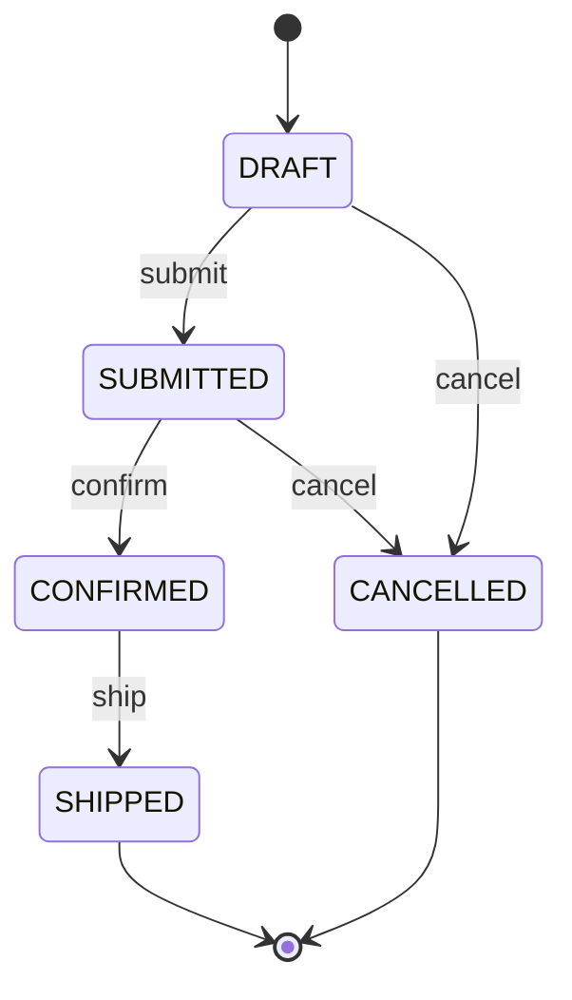
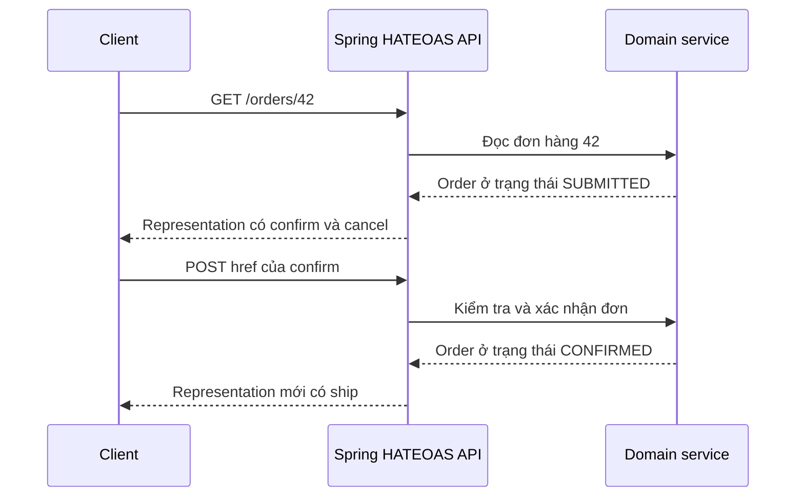

# Resource state

Resource state là trạng thái nghiệp vụ hiện tại của một tài nguyên mà server quản lý và cung cấp thông qua representation. Trong API quản lý đơn hàng, tài nguyên `/orders/42` có thể ở trạng thái `DRAFT`, `SUBMITTED`, `CONFIRMED`, `SHIPPED` hoặc `CANCELLED`. Trạng thái này quyết định dữ liệu mà server trả về và những hành động mà client có thể thực hiện tiếp theo.

Spring HATEOAS giúp đưa trạng thái tài nguyên vào một representation có liên kết. Server có thể công bố `confirm`, `cancel` hoặc `ship` tùy theo trạng thái và quyền của người dùng hiện tại. Client khám phá các bước tiếp theo từ liên kết nhận được, còn server vẫn chịu trách nhiệm kiểm tra và thực thi quy tắc nghiệp vụ khi request đến.

## Mục tiêu

Sau bài học, bạn có thể:

- Phân biệt resource state, representation state và application state của client.
- Mô hình hóa vòng đời tài nguyên bằng các trạng thái và chuyển trạng thái hợp lệ.
- Dùng `RepresentationModel`, `EntityModel` và `RepresentationModelAssembler` để công bố tài nguyên.
- Tạo liên kết hành động có điều kiện theo trạng thái và quyền truy cập.
- Xử lý liên kết cũ, request cạnh tranh và kiểm thử các chuyển trạng thái.

## Resource state là gì?

Một tài nguyên là khái niệm mà API định danh bằng URI. Resource state là dữ liệu và trạng thái nghiệp vụ hiện tại của khái niệm đó. Ví dụ, đơn hàng số 42 có thể có:

```text
URI:       /orders/42
ID:        42
Status:    SUBMITTED
Version:   3
Items:     2 sản phẩm
Total:     1.250.000 VND
```

Server lưu trạng thái nghiệp vụ này trong hệ thống của mình. Khi client gửi `GET /orders/42`, server tạo một representation phản ánh trạng thái tại thời điểm xử lý request. Representation có thể chứa các trường `id`, `status`, `total`, `version` cùng các liên kết hypermedia.

Không nên đồng nhất resource state với trạng thái của phiên client. Một đơn hàng vẫn tồn tại và có trạng thái riêng dù client nào đang truy cập. Client có thể đang ở màn hình chi tiết đơn hàng, đang hiển thị danh sách, hoặc đang chờ kết quả thao tác; đó là trạng thái ứng dụng phía client.

### Phân biệt ba loại trạng thái

| Khái niệm | Nơi được quản lý | Ví dụ |
|---|---|---|
| Resource state | Server, gắn với tài nguyên nghiệp vụ | Đơn hàng 42 đang `SUBMITTED` |
| Representation state | Nội dung server gửi trong một response | JSON có `status`, `version` và `_links` |
| Client application state | Client, mô tả vị trí và bước tương tác hiện tại | Người dùng đang xem đơn hàng 42 và có thể chọn `confirm` |

REST có ràng buộc stateless: server xử lý mỗi request dựa trên thông tin request và trạng thái tài nguyên cần thiết, không phụ thuộc vào một phiên hội thoại client được giữ ngầm giữa các request. Stateless không có nghĩa server không lưu dữ liệu. Server vẫn lưu resource state như đơn hàng, khách hàng hoặc thanh toán; điều không nên phụ thuộc là trạng thái phiên client ẩn để diễn giải request tiếp theo.

## Resource state và vòng đời nghiệp vụ

Trạng thái thường biểu diễn những giai đoạn trong vòng đời của tài nguyên. Một đơn hàng có thể đi qua các trạng thái:



Đây là một quy trình minh họa. Quy tắc thực tế phụ thuộc vào miền nghiệp vụ. Chẳng hạn, một đơn hàng đã thanh toán có thể cần quy trình hoàn tiền thay vì cho phép hủy trực tiếp.

Mỗi chuyển trạng thái cần xác định:

- Trạng thái nguồn mà thao tác được phép bắt đầu.
- Hành động nghiệp vụ được yêu cầu.
- Điều kiện bổ sung như quyền người dùng, tồn kho hoặc thanh toán.
- Trạng thái đích và các thay đổi dữ liệu đi kèm.
- Kết quả khi tài nguyên không còn ở trạng thái phù hợp.

| Trạng thái hiện tại | Hành động | Trạng thái tiếp theo | Quan hệ có thể công bố |
|---|---|---|---|
| `DRAFT` | Gửi đơn | `SUBMITTED` | `submit`, `cancel` |
| `SUBMITTED` | Xác nhận | `CONFIRMED` | `confirm`, `cancel` |
| `CONFIRMED` | Giao hàng | `SHIPPED` | `ship` |
| `SHIPPED` | Hành động kết thúc | `SHIPPED` | Chỉ các liên kết đọc phù hợp |
| `CANCELLED` | Hành động kết thúc | `CANCELLED` | Chỉ các liên kết đọc phù hợp |

Một hành động có thể bị giới hạn bởi cả trạng thái và quyền. Ví dụ, đơn hàng đang `SUBMITTED` có thể được xác nhận, nhưng chỉ nhân viên có quyền xác nhận mới được phép thực hiện. Vì vậy, việc công bố liên kết phải xét cả điều kiện nghiệp vụ lẫn quyền của người dùng hiện tại.

## Biểu diễn trạng thái bằng Spring HATEOAS

Spring HATEOAS cung cấp các lớp model để gắn dữ liệu và liên kết:

- `RepresentationModel<T>` là lớp cơ sở cho representation có liên kết.
- `EntityModel<T>` bọc một đối tượng dữ liệu cùng các liên kết.
- `CollectionModel<T>` biểu diễn một tập hợp model và các liên kết ở cấp tập hợp.
- `RepresentationModelAssembler<T, D>` chuyển đổi đối tượng miền nghiệp vụ thành representation model.

Tách đối tượng miền nghiệp vụ khỏi representation giúp API kiểm soát dữ liệu công khai và các liên kết được tạo. Ví dụ, đối tượng `Order` có thể chứa logic nghiệp vụ và dữ liệu nội bộ; `OrderView` chỉ chứa những trường client cần đọc.

```java
public enum OrderStatus {
    DRAFT,
    SUBMITTED,
    CONFIRMED,
    SHIPPED,
    CANCELLED
}

public record Order(
    long id,
    OrderStatus status,
    long version,
    long totalInVnd
) {
    public boolean canSubmit() {
        return status == OrderStatus.DRAFT;
    }

    public boolean canConfirm() {
        return status == OrderStatus.SUBMITTED;
    }

    public boolean canShip() {
        return status == OrderStatus.CONFIRMED;
    }

    public boolean canCancel() {
        return status == OrderStatus.DRAFT
            || status == OrderStatus.SUBMITTED;
    }
}

public record OrderView(
    long id,
    String status,
    long version,
    long totalInVnd
) {
    static OrderView from(Order order) {
        return new OrderView(
            order.id(),
            order.status().name(),
            order.version(),
            order.totalInVnd()
        );
    }
}
```

Các phương thức `canSubmit`, `canConfirm`, `canShip` và `canCancel` diễn tả điều kiện chuyển trạng thái trong ví dụ. Trong ứng dụng thực tế, quy tắc có thể nằm trong aggregate hoặc domain service; không nên sao chép những quy tắc phức tạp vào controller.

Các dependency được dùng trong những ví dụ tiếp theo có thể được khai báo qua interface như sau:

```java
interface OrderService {
    Order findById(long id);
    Order submit(long id);
    Order confirm(long id);
    Order ship(long id);
    Order cancel(long id);
}

interface OrderAccessPolicy {
    boolean canSubmitCurrentUser(Order order);
    boolean canConfirmCurrentUser(Order order);
    boolean canShipCurrentUser(Order order);
    boolean canCancelCurrentUser(Order order);
}
```

### Tạo representation model và liên kết theo trạng thái

Assembler nhận đối tượng `Order`, tạo `OrderView`, thêm liên kết `self`, rồi thêm các liên kết hành động tương ứng. Ví dụ dùng `OrderAccessPolicy` để kiểm tra quyền của người dùng hiện tại.

```java
import static org.springframework.hateoas.server.mvc.WebMvcLinkBuilder.linkTo;
import static org.springframework.hateoas.server.mvc.WebMvcLinkBuilder.methodOn;

import org.springframework.hateoas.EntityModel;
import org.springframework.hateoas.server.RepresentationModelAssembler;
import org.springframework.stereotype.Component;

@Component
class OrderModelAssembler
        implements RepresentationModelAssembler<Order, EntityModel<OrderView>> {

    private final OrderAccessPolicy accessPolicy;

    OrderModelAssembler(OrderAccessPolicy accessPolicy) {
        this.accessPolicy = accessPolicy;
    }

    @Override
    public EntityModel<OrderView> toModel(Order order) {
        var model = EntityModel.of(
            OrderView.from(order),
            linkTo(methodOn(OrderController.class).one(order.id())).withSelfRel()
        );

        if (order.canSubmit() && accessPolicy.canSubmitCurrentUser(order)) {
            model.add(linkTo(methodOn(OrderController.class)
                .submit(order.id())).withRel("submit"));
        }

        if (order.canConfirm() && accessPolicy.canConfirmCurrentUser(order)) {
            model.add(linkTo(methodOn(OrderController.class)
                .confirm(order.id())).withRel("confirm"));
        }

        if (order.canShip() && accessPolicy.canShipCurrentUser(order)) {
            model.add(linkTo(methodOn(OrderController.class)
                .ship(order.id())).withRel("ship"));
        }

        if (order.canCancel() && accessPolicy.canCancelCurrentUser(order)) {
            model.add(linkTo(methodOn(OrderController.class)
                .cancel(order.id())).withRel("cancel"));
        }

        return model;
    }
}
```

`linkTo` và `methodOn` tạo URI dựa trên mapping của controller. Assembler không tự ghép chuỗi đường dẫn. Khi trạng thái đơn hàng thay đổi, assembler tạo lại representation và chỉ công bố những liên kết hợp lệ ở trạng thái mới.

`OrderAccessPolicy` là một thành phần của ứng dụng, ví dụ có các phương thức `canSubmitCurrentUser`, `canConfirmCurrentUser`, `canShipCurrentUser` và `canCancelCurrentUser`. Policy phải kiểm tra quyền của principal hiện tại. Nếu API không phân biệt quyền ở mức representation, có thể bỏ policy và chỉ dựa vào điều kiện trạng thái.

### Controller thực hiện chuyển trạng thái

Controller cung cấp endpoint cho từng thao tác. Mỗi phương thức gọi service nghiệp vụ, nhận tài nguyên sau khi chuyển trạng thái thành công và trả representation mới.

```java
import org.springframework.hateoas.EntityModel;
import org.springframework.web.bind.annotation.GetMapping;
import org.springframework.web.bind.annotation.PathVariable;
import org.springframework.web.bind.annotation.PostMapping;
import org.springframework.web.bind.annotation.RequestMapping;
import org.springframework.web.bind.annotation.RestController;

@RestController
@RequestMapping("/orders")
class OrderController {

    private final OrderService orders;
    private final OrderModelAssembler assembler;

    OrderController(OrderService orders, OrderModelAssembler assembler) {
        this.orders = orders;
        this.assembler = assembler;
    }

    @GetMapping("/{id}")
    EntityModel<OrderView> one(@PathVariable long id) {
        return assembler.toModel(orders.findById(id));
    }

    @PostMapping("/{id}/submission")
    EntityModel<OrderView> submit(@PathVariable long id) {
        return assembler.toModel(orders.submit(id));
    }

    @PostMapping("/{id}/confirmation")
    EntityModel<OrderView> confirm(@PathVariable long id) {
        return assembler.toModel(orders.confirm(id));
    }

    @PostMapping("/{id}/shipment")
    EntityModel<OrderView> ship(@PathVariable long id) {
        return assembler.toModel(orders.ship(id));
    }

    @PostMapping("/{id}/cancellation")
    EntityModel<OrderView> cancel(@PathVariable long id) {
        return assembler.toModel(orders.cancel(id));
    }
}
```

`OrderService` đại diện cho tầng nghiệp vụ, với các phương thức `findById`, `submit`, `confirm`, `ship` và `cancel`. Service phải kiểm tra trạng thái hiện tại và quyền thực hiện thao tác trước khi ghi dữ liệu. Controller chỉ điều phối request và chuyển kết quả thành representation.

## Client khám phá hành động từ resource state

Giả sử client đọc đơn hàng 42 khi đơn ở trạng thái `SUBMITTED`. Server có thể trả HAL như sau:

```json
{
  "id": 42,
  "status": "SUBMITTED",
  "version": 3,
  "totalInVnd": 1250000,
  "_links": {
    "self": {
      "href": "https://api.example.test/orders/42"
    },
    "confirm": {
      "href": "https://api.example.test/orders/42/confirmation"
    },
    "cancel": {
      "href": "https://api.example.test/orders/42/cancellation"
    }
  }
}
```

Sau khi client gửi `POST` tới liên kết `confirm`, server chuyển trạng thái thành `CONFIRMED` và trả representation mới. Representation mới có thể chứa `ship`, không còn `confirm`, và có thể tiếp tục chứa `cancel` nếu quy tắc nghiệp vụ cho phép.



Client không cần tự tạo URI cho `confirm` hoặc tự suy luận mọi đường dẫn từ ID. Client đọc relation mà server công bố và đi theo `href`. Ý nghĩa của relation như `confirm`, `cancel` và `ship` cần được mô tả ổn định trong hợp đồng API hoặc profile để client biết cách sử dụng. Các tên ngắn trong ví dụ giúp dễ đọc; API công khai nên định danh relation tùy chỉnh bằng URI hoặc CURIE theo quy ước hypermedia đã chọn.

## Liên kết hành động là mô tả khả năng hiện tại

Một liên kết hành động cho client biết server đang công bố khả năng chuyển tiếp nào từ representation hiện tại. Nó giúp giao diện client quyết định nút hoặc thao tác nào nên hiển thị. Tuy nhiên, liên kết không phải là giấy phép thực thi vĩnh viễn và cũng không thay thế kiểm tra nghiệp vụ.

Có thể xảy ra tình huống:

1. Client đọc đơn hàng ở trạng thái `SUBMITTED` và nhận liên kết `confirm`.
2. Một nhân viên khác xác nhận đơn hàng trước.
3. Client cũ gửi request theo liên kết `confirm` đã đọc.
4. Server nhận thấy đơn hàng đã ở trạng thái `CONFIRMED` và từ chối chuyển trạng thái lần nữa.

Server nên trả mã trạng thái phù hợp, thường là `409 Conflict` cho xung đột trạng thái nghiệp vụ. Nếu tài nguyên không tồn tại, có thể trả `404 Not Found`; nếu người dùng không có quyền, trả `403 Forbidden` hoặc áp dụng chính sách bảo mật phù hợp.

Do đó, cần kiểm tra điều kiện chuyển trạng thái ở tầng nghiệp vụ tại thời điểm xử lý command. Không nên chỉ dựa vào việc client đã nhìn thấy liên kết ở response trước đó.

## Resource state, quyền và cache

Representation có thể thay đổi theo trạng thái tài nguyên và quyền của người dùng. Hai người dùng đọc cùng `/orders/42` có thể nhận các liên kết khác nhau: nhân viên bán hàng có thể thấy `cancel`, còn người chỉ có quyền xem có thể chỉ thấy `self`.

Điều này ảnh hưởng đến cache. Nếu response có liên kết phụ thuộc vào người dùng hoặc quyền truy cập, cache dùng chung không được phục vụ representation của người này cho người khác. Cần thiết lập chính sách cache phù hợp, chẳng hạn `Cache-Control: private` hoặc `no-store` khi response không nên được cache dùng chung. Nếu cache có thể lưu representation trong thời gian ngắn, cần cấu hình validator và revalidation thích hợp để tránh client sử dụng liên kết đã cũ.

Với tài nguyên thay đổi thường xuyên, ETag có thể giúp client nhận biết representation đã thay đổi. Client có thể gửi `If-None-Match` khi đọc lại representation để kiểm tra cache. Với thao tác cập nhật, `If-Match` có thể dùng để yêu cầu server chỉ thực hiện nếu phiên bản tài nguyên vẫn khớp, giúp phát hiện cập nhật cạnh tranh. ETag và điều kiện request phải được triển khai nhất quán ở server; chỉ thêm trường `version` vào JSON không tự động kích hoạt cơ chế HTTP conditional request.

## Kiểm thử resource state và các liên kết

Kiểm thử nên xác nhận cả dữ liệu trạng thái và các quan hệ được công bố. Ví dụ với MockMvc:

```java
import static org.springframework.test.web.servlet.request.MockMvcRequestBuilders.get;
import static org.springframework.test.web.servlet.result.MockMvcResultMatchers.jsonPath;
import static org.springframework.test.web.servlet.result.MockMvcResultMatchers.status;
import static org.mockito.ArgumentMatchers.any;
import static org.mockito.BDDMockito.given;

import org.junit.jupiter.api.BeforeEach;
import org.junit.jupiter.api.Test;
import org.springframework.beans.factory.annotation.Autowired;
import org.springframework.boot.test.autoconfigure.web.servlet.WebMvcTest;
import org.springframework.boot.test.mock.mockito.MockBean;
import org.springframework.context.annotation.Import;
import org.springframework.hateoas.MediaTypes;
import org.springframework.test.web.servlet.MockMvc;

@WebMvcTest(OrderController.class)
@Import(OrderModelAssembler.class)
class OrderControllerTest {

    @Autowired
    MockMvc mockMvc;

    @MockBean
    OrderService orders;

    @MockBean
    OrderAccessPolicy accessPolicy;

    @BeforeEach
    void setUp() {
        given(orders.findById(42L)).willReturn(
            new Order(42L, OrderStatus.SUBMITTED, 3L, 1_250_000L)
        );
        given(accessPolicy.canConfirmCurrentUser(any(Order.class))).willReturn(true);
        given(accessPolicy.canCancelCurrentUser(any(Order.class))).willReturn(true);
    }

    @Test
    void submittedOrderPublishesConfirmAndCancel() throws Exception {
        mockMvc.perform(get("/orders/{id}", 42).accept(MediaTypes.HAL_JSON))
            .andExpect(status().isOk())
            .andExpect(jsonPath("$.status").value("SUBMITTED"))
            .andExpect(jsonPath("$._links.self.href").exists())
            .andExpect(jsonPath("$._links.confirm.href").exists())
            .andExpect(jsonPath("$._links.cancel.href").exists())
            .andExpect(jsonPath("$._links.ship").doesNotExist());
    }
}
```

Test slice import assembler và cung cấp mock cho `OrderService` cùng `OrderAccessPolicy`; dữ liệu giả lập đặt đơn hàng ở trạng thái `SUBMITTED`. Nên bổ sung các trường hợp sau:

- Đơn `DRAFT` có `submit` và `cancel`, không có `ship`.
- Đơn `CONFIRMED` có `ship`, không có `confirm`.
- Đơn `CANCELLED` không công bố các hành động chuyển trạng thái đã kết thúc.
- Người dùng thiếu quyền không nhận liên kết hành động bị hạn chế.
- Request theo liên kết cũ bị từ chối khi trạng thái đã thay đổi.
- Sau khi chuyển trạng thái thành công, response chứa representation và liên kết của trạng thái mới.

Một kiểm thử tích hợp tốt nên lấy URI từ `href` trong response rồi gọi URI đó. Cách làm này kiểm tra luồng hypermedia từ khám phá đến chuyển trạng thái, thay vì chỉ kiểm tra chuỗi đường dẫn được viết cứng trong test.

## Lỗi thường gặp

| Cách làm | Hệ quả | Cách xử lý |
|---|---|---|
| Nhầm stateless với việc server không lưu trạng thái tài nguyên | Hiểu sai ràng buộc REST | Lưu resource state trên server, giữ request độc lập với session client ngầm |
| Trả mọi hành động bất kể trạng thái | Client nhìn thấy thao tác không hợp lệ | Tạo liên kết dựa trên điều kiện chuyển trạng thái |
| Chỉ ẩn nút ở giao diện client | Client khác vẫn có thể gọi endpoint không hợp lệ | Server luôn xác thực trạng thái và quyền ở tầng nghiệp vụ |
| Cho rằng liên kết cũ luôn còn hiệu lực | Request có thể đến sau khi tài nguyên đã thay đổi | Xử lý xung đột, kiểm tra version hoặc dùng conditional request |
| Dùng trực tiếp entity persistence làm response | Dễ lộ trường nội bộ và gắn API với cấu trúc lưu trữ | Tạo DTO và assembler riêng cho representation |
| Cache representation theo quyền mà không phân biệt người dùng | Có thể trả nhầm liên kết cho người khác | Thiết lập cache policy và validator phù hợp |

## Ghi nhớ

Resource state là trạng thái nghiệp vụ mà server quản lý cho một tài nguyên. Representation phản ánh trạng thái đó tại thời điểm response và có thể chứa các liên kết mô tả hành động hiện có. Spring HATEOAS giúp tạo representation bằng `RepresentationModel`, `EntityModel` và assembler, sau đó công bố relation dựa trên trạng thái và quyền của người dùng. Client đi theo các liên kết được cung cấp để tiếp tục tương tác. Server vẫn phải xác thực lại mọi chuyển trạng thái, xử lý request cũ hoặc cạnh tranh và bảo vệ representation bằng chính sách cache phù hợp.
