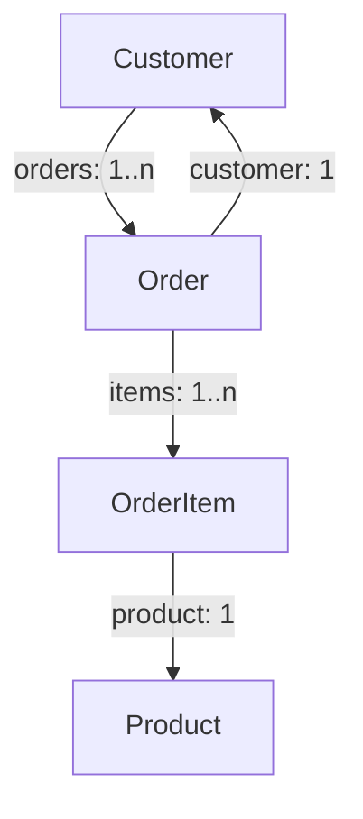

# Resource relationship

Trong REST API, **resource relationship** là cách mô hình hóa và công bố mối quan hệ giữa các tài nguyên. Một khách hàng có thể có nhiều đơn hàng; một đơn hàng thuộc về một khách hàng và có nhiều dòng hàng; mỗi dòng hàng tham chiếu đến một sản phẩm. Những quan hệ này tạo nên cấu trúc nghiệp vụ của API và giúp client khám phá dữ liệu liên quan.

Với Spring HATEOAS, quan hệ giữa các resource thường được thể hiện bằng hypermedia link gắn vào representation. Link có một URI đích và một relation (*link relation*) mô tả ý nghĩa của đường dẫn. Client sử dụng relation để hiểu liên kết là `customer`, `orders`, `items` hay `product`, thay vì tự suy luận từ cấu trúc URL.

## 1. Quan hệ resource là hợp đồng của API

Giả sử hệ thống bán hàng có các resource `Customer`, `Order`, `OrderItem` và `Product`. Mô hình nghiệp vụ có thể có các quan hệ:



Sơ đồ mô tả quan hệ nghiệp vụ. Khi thiết kế API, cần quyết định cách client truy cập từng quan hệ. Ví dụ:

| Relation | Tài nguyên nguồn | Tài nguyên đích | Ý nghĩa |
| --- | --- | --- | --- |
| `customer` | Order | Customer | Khách hàng sở hữu đơn hàng |
| `orders` | Customer | Collection of Order | Các đơn hàng của khách hàng |
| `items` | Order | Collection of OrderItem | Các dòng hàng trong đơn hàng |
| `product` | OrderItem | Product | Sản phẩm được tham chiếu bởi dòng hàng |

Các relation là một phần của hợp đồng API. Tên và ý nghĩa của chúng cần ổn định, dễ hiểu và được dùng nhất quán giữa các response. Một client có thể không cần biết URI thực tế được tổ chức theo đường dẫn nào nếu nó có thể bắt đầu từ một resource đã biết và theo các relation được cung cấp.

Quan hệ resource không đồng nghĩa với khóa ngoại trong cơ sở dữ liệu. Một quan hệ có thể được tổng hợp từ nhiều nguồn, đi qua dịch vụ khác hoặc chỉ tồn tại ở cấp nghiệp vụ. Ngược lại, không phải mọi khóa ngoại nội bộ đều cần được công bố thành một link công khai. API nên thể hiện những quan hệ có ý nghĩa đối với client và quy trình nghiệp vụ.

## 2. Biểu diễn quan hệ bằng link

Một cách phổ biến là trả về URI của resource liên quan dưới dạng link. Ví dụ, representation của đơn hàng có thể chứa liên kết đến khách hàng và danh sách dòng hàng:

```json
{
  "id": "ORD-2048",
  "status": "PROCESSING",
  "total": 890000,
  "_links": {
    "self": {
      "href": "https://api.example.test/orders/ORD-2048"
    },
    "customer": {
      "href": "https://api.example.test/customers/C-105"
    },
    "items": {
      "href": "https://api.example.test/orders/ORD-2048/items"
    }
  }
}
```

Client đọc relation `customer` để truy cập khách hàng liên quan, hoặc `items` để lấy các dòng hàng. Link không cần chứa toàn bộ dữ liệu của resource đích. Khi client cần chi tiết khách hàng, nó theo link `customer` và nhận representation của khách hàng qua request riêng.

Một link thường gồm:

- `href`: URI đích mà client có thể truy cập.
- `rel`: tên quan hệ mô tả vai trò của link trong representation hiện tại.
- Các thuộc tính tùy chọn của định dạng hoặc thư viện, ví dụ `type`, `title`, `hreflang` hay metadata khác khi phù hợp.

Relation `self` chỉ chính resource đang được biểu diễn. Các relation khác thể hiện quan hệ với resource hoặc khả năng điều hướng liên quan. Nên ưu tiên relation chuẩn đã có ý nghĩa phù hợp, chẳng hạn `next` và `prev` cho phân trang. Với quan hệ nghiệp vụ riêng như `customer` hoặc `items`, API có thể dùng tên tùy chỉnh và phải công bố ý nghĩa của chúng trong tài liệu hợp đồng.

## 3. Quan hệ một-nhiều và collection resource

Quan hệ một-nhiều thường được biểu diễn bằng một link đến collection. Ví dụ, khách hàng có thể cung cấp relation `orders` trỏ đến danh sách đơn hàng:

```json
{
  "id": "C-105",
  "name": "Nguyen An",
  "_links": {
    "self": {
      "href": "https://api.example.test/customers/C-105"
    },
    "orders": {
      "href": "https://api.example.test/customers/C-105/orders"
    }
  }
}
```

Collection được truy cập qua relation `orders` có thể trả về các phần tử cùng link `self` riêng:

```json
{
  "_embedded": {
    "orders": [
      {
        "id": "ORD-2048",
        "status": "PROCESSING",
        "_links": {
          "self": {
            "href": "https://api.example.test/orders/ORD-2048"
          }
        }
      },
      {
        "id": "ORD-2051",
        "status": "SHIPPED",
        "_links": {
          "self": {
            "href": "https://api.example.test/orders/ORD-2051"
          }
        }
      }
    ]
  },
  "_links": {
    "self": {
      "href": "https://api.example.test/customers/C-105/orders"
    }
  }
}
```

Trong HAL, `_embedded` dùng để đưa representation của resource liên quan vào response. Một collection có thể được phân trang và cung cấp thêm `next`, `prev` hoặc `first`, `last` tùy chính sách API. Việc đưa danh sách lớn vào response của khách hàng thường không phù hợp; link đến collection cho phép client tải dữ liệu theo nhu cầu, áp dụng bộ lọc và phân trang.

## 4. Link hay embedded resource?

Không phải quan hệ nào cũng cần nhúng dữ liệu resource đích vào representation nguồn. Có hai lựa chọn chính:

| Cách biểu diễn | Đặc điểm | Phù hợp khi |
| --- | --- | --- |
| Link đến resource | Response cung cấp URI và relation; client gọi thêm request khi cần dữ liệu đích | Resource đích lớn, thay đổi độc lập, có phân trang hoặc được nhiều nơi tái sử dụng |
| Embedded resource | Response chứa representation của resource liên quan trong `_embedded` | Client thường cần dữ liệu liên quan cùng lúc và dữ liệu nhúng có kích thước hợp lý |

Ví dụ, representation của đơn hàng có thể nhúng một bản tóm tắt khách hàng gồm tên hiển thị và mã khách hàng, đồng thời vẫn cung cấp link `customer` đến resource khách hàng đầy đủ. Cách này giúp màn hình hiển thị nhanh mà vẫn giữ đường dẫn điều hướng đến dữ liệu gốc.

Khi quyết định nhúng, hãy cân nhắc kích thước response, độ mới của dữ liệu, tần suất client cần dữ liệu liên quan và khả năng cache. Dữ liệu nhúng có thể trở nên cũ so với resource gốc. Nếu client cần thao tác trên resource đích hoặc cần dữ liệu cập nhật, link riêng thường rõ ràng hơn. Nếu nhúng collection lớn, response có thể nặng và khó phân trang.

Link và embedded cũng không loại trừ nhau. Một representation có thể chứa `_embedded` để cung cấp dữ liệu tóm tắt, đồng thời cung cấp link có cùng relation hoặc relation khác để client truy cập resource độc lập theo hợp đồng media type.

## 5. Tạo quan hệ resource bằng Spring HATEOAS

Spring HATEOAS cho phép gắn các link vào `EntityModel`, `CollectionModel` hoặc kiểu tùy chỉnh kế thừa `RepresentationModel`. Với Spring MVC, `linkTo(...)` và `methodOn(...)` tạo URI dựa trên mapping controller.

Ví dụ, controller trả về đơn hàng cùng link đến khách hàng và các dòng hàng:

```java
import org.springframework.hateoas.EntityModel;
import org.springframework.web.bind.annotation.GetMapping;
import org.springframework.web.bind.annotation.PathVariable;
import org.springframework.web.bind.annotation.RequestMapping;
import org.springframework.web.bind.annotation.RestController;

import static org.springframework.hateoas.server.mvc.WebMvcLinkBuilder.linkTo;
import static org.springframework.hateoas.server.mvc.WebMvcLinkBuilder.methodOn;

@RestController
@RequestMapping("/orders")
class OrderController {

    private final OrderService orderService;

    OrderController(OrderService orderService) {
        this.orderService = orderService;
    }

    @GetMapping("/{id}")
    EntityModel<OrderView> one(@PathVariable String id) {
        OrderView order = orderService.findViewById(id);

        return EntityModel.of(order,
                linkTo(methodOn(OrderController.class).one(id)).withSelfRel(),
                linkTo(methodOn(CustomerController.class)
                        .one(order.customerId())).withRel("customer"),
                linkTo(methodOn(OrderItemController.class)
                        .allForOrder(id)).withRel("items"));
    }
}
```

Trong ví dụ, `customerId()` lấy định danh khách hàng liên quan từ view model. `one(...)` của `CustomerController` và `allForOrder(...)` của `OrderItemController` là các handler được giả định có mapping tương ứng trong ứng dụng. `withRel("customer")` và `withRel("items")` đặt tên cho quan hệ mà client sẽ dùng để khám phá.

Nếu URI của controller đích thay đổi, Spring HATEOAS có thể tạo lại link theo mapping mới khi ứng dụng được cập nhật. Cách này giảm việc lặp lại chuỗi URI trong nhiều nơi. Relation vẫn cần giữ ổn định về ý nghĩa để client tiếp tục hiểu response.

## 6. Biểu diễn collection và quan hệ trong assembler

Khi cùng một kiểu resource xuất hiện ở nhiều endpoint, `RepresentationModelAssembler` giúp gom logic tạo representation và liên kết. Ví dụ, assembler cho đơn hàng có thể luôn thêm `self` và `customer`, sau đó thêm các quan hệ khác tùy trạng thái:

```java
import org.springframework.hateoas.EntityModel;
import org.springframework.hateoas.server.RepresentationModelAssembler;

import static org.springframework.hateoas.server.mvc.WebMvcLinkBuilder.linkTo;
import static org.springframework.hateoas.server.mvc.WebMvcLinkBuilder.methodOn;

class OrderModelAssembler
        implements RepresentationModelAssembler<OrderView, EntityModel<OrderView>> {

    @Override
    public EntityModel<OrderView> toModel(OrderView order) {
        EntityModel<OrderView> model = EntityModel.of(order,
                linkTo(methodOn(OrderController.class)
                        .one(order.id())).withSelfRel(),
                linkTo(methodOn(CustomerController.class)
                        .one(order.customerId())).withRel("customer"),
                linkTo(methodOn(OrderItemController.class)
                        .allForOrder(order.id())).withRel("items"));

        if (order.canBeCancelled()) {
            model.add(linkTo(methodOn(OrderController.class)
                    .cancel(order.id())).withRel("cancel"));
        }

        return model;
    }
}
```

Ví dụ này minh họa việc tổ chức liên kết; các controller và phương thức được tham chiếu cần tồn tại trong ứng dụng. `canBeCancelled()` là quy tắc nghiệp vụ minh họa. Endpoint hủy vẫn phải xác thực, phân quyền và kiểm tra lại trạng thái hiện tại khi nhận request. Link chỉ giúp client khám phá khả năng, không thay thế kiểm tra ở server.

Với collection, có thể bọc từng phần tử bằng assembler rồi tạo `CollectionModel`:

```java
import java.util.List;

import org.springframework.hateoas.CollectionModel;
import org.springframework.hateoas.EntityModel;

CollectionModel<EntityModel<OrderView>> model =
        CollectionModel.of(orders.stream()
                .map(orderAssembler::toModel)
                .toList());
```

Sau đó thêm link `self` của collection hoặc các link phân trang như `next` và `prev` nếu endpoint hỗ trợ. Cách tạo link phân trang cần sử dụng đúng tham số phân trang của API để URI tiếp theo giữ lại bộ lọc và thứ tự sắp xếp hiện tại.

## 7. Quan hệ resource và thiết kế URI

URI thường phản ánh một phần cấu trúc quan hệ, nhưng quan hệ không nên chỉ được suy ra từ đường dẫn. Ví dụ, `/customers/C-105/orders` thể hiện collection đơn hàng trong ngữ cảnh khách hàng. Đây là một lựa chọn thiết kế hợp lý khi việc truy vấn đơn hàng gắn với khách hàng là một use case quan trọng.

Tuy nhiên, một đơn hàng vẫn có thể là resource độc lập với URI `/orders/ORD-2048`. Hai URI có mục đích khác nhau:

- `/orders/ORD-2048` định danh trực tiếp đơn hàng.
- `/customers/C-105/orders` định danh collection các đơn hàng trong ngữ cảnh khách hàng.

Link relation nối các resource này theo ý nghĩa nghiệp vụ. Client có thể bắt đầu từ khách hàng, theo `orders` để lấy collection, rồi theo `self` của một phần tử để mở đơn hàng. Từ đơn hàng, client có thể theo `customer` để quay lại khách hàng.

Khi thiết kế URI lồng nhau, tránh tạo đường dẫn quá sâu như `/customers/{customerId}/orders/{orderId}/items/{itemId}/product`. Đường dẫn sâu làm lộ cấu trúc nội bộ và khiến việc thay đổi quan hệ khó khăn. Có thể cung cấp URI độc lập cho resource cần truy cập trực tiếp, rồi sử dụng hypermedia link để diễn tả các quan hệ giữa chúng.

## 8. Những quyết định cần cân nhắc

**Vòng đời và quyền sở hữu:** nếu resource con không có ý nghĩa độc lập ngoài resource cha, endpoint lồng nhau có thể phù hợp. Nếu resource con có vòng đời riêng, được tham chiếu từ nhiều nơi hoặc cần truy cập độc lập, nên cân nhắc URI riêng.

**Tính nhất quán của relation:** dùng một relation cho cùng một ý nghĩa trên toàn API. Không nên để `customer`, `owner` và `client` thay thế nhau tùy controller nếu tất cả đều chỉ cùng một quan hệ khách hàng.

**Phân quyền:** việc client nhìn thấy link đến resource không có nghĩa là người dùng hiện tại được phép truy cập. Server phải kiểm tra quyền cho từng request đến resource đích và cả các thao tác trên collection.

**Dữ liệu lớn và phân trang:** với quan hệ một-nhiều có thể chứa hàng nghìn phần tử, hãy cung cấp link đến collection và phân trang thay vì nhúng toàn bộ vào resource cha.

**Cập nhật đồng thời:** quan hệ được trả về có thể thay đổi sau khi response được tạo. Client phải xử lý trường hợp resource đã bị xóa, quan hệ đã thay đổi hoặc hành động không còn hợp lệ khi theo link.

**Ổn định hợp đồng:** URI có thể được thay đổi khi cần, nhưng relation và ý nghĩa của nó phải được duy trì hoặc được thay đổi theo một lộ trình tương thích có chủ đích. Client nên theo link thay vì tự tạo URI dựa trên quy ước chưa được công bố.

## 9. Kiểm thử quan hệ resource

Kiểm thử cần xác nhận cả sự hiện diện và ý nghĩa của liên kết. Với Spring MVC, `MockMvc` có thể gọi endpoint và kiểm tra JSON response. Ví dụ các assertion có thể xác nhận:

```java
mockMvc.perform(get("/orders/ORD-2048")
        .accept("application/hal+json"))
    .andExpect(status().isOk())
    .andExpect(jsonPath("$._links.self.href").exists())
    .andExpect(jsonPath("$._links.customer.href").exists())
    .andExpect(jsonPath("$._links.items.href").exists());
```

Đây là ví dụ minh họa; test thực tế cần có mock hoặc dữ liệu kiểm thử cho `OrderService` và cấu hình ứng dụng xuất HAL. Ngoài việc kiểm tra link tồn tại, nên kiểm tra:

- Relation có đúng tên và đúng URI đích.
- Theo link `customer` trả về đúng khách hàng của đơn hàng.
- Theo link `items` trả về collection dòng hàng thuộc đúng đơn hàng.
- Mỗi phần tử trong collection có link `self` hợp lệ.
- Collection lớn có các link phân trang và giữ nguyên bộ lọc cần thiết.
- Người dùng không có quyền nhận lỗi phù hợp khi truy cập resource đích, dù URI của link có thể được biết.
- Khi quan hệ hoặc trạng thái nghiệp vụ thay đổi, representation mới phản ánh đúng các liên kết đang khả dụng.

Một API có quan hệ resource tốt giúp client khám phá cấu trúc nghiệp vụ theo từng bước. Spring HATEOAS cung cấp các abstraction để công bố quan hệ đó trong representation, còn việc chọn resource, relation, URI và cách nhúng dữ liệu vẫn là quyết định thiết kế của API.
