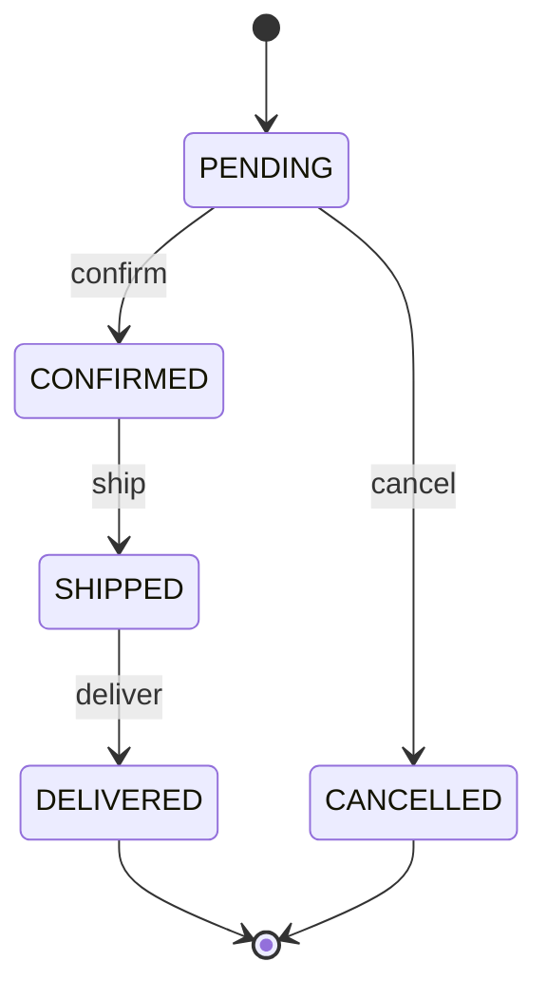

# Resource action

## Mục tiêu

Trong REST API có hypermedia, tài nguyên không chỉ cung cấp dữ liệu hiện tại mà còn có thể chỉ ra những hành động client được phép khám phá tiếp theo. Một đơn hàng đang chờ xử lý có thể cho phép hủy; đơn hàng đã giao có thể cho phép xác nhận nhận hàng hoặc yêu cầu hoàn trả. Spring HATEOAS giúp biểu diễn các hành động này bằng link relation và affordance gắn với representation.

Sau bài học, bạn có thể:

- Phân biệt tài nguyên, trạng thái tài nguyên, hành động và link mô tả hành động.
- Chọn cách biểu diễn hành động bằng endpoint chuyển trạng thái hoặc tài nguyên con.
- Dùng link relation và affordance trong Spring HATEOAS để công bố hành động khả dụng.
- Thiết kế hành động theo semantics HTTP và trạng thái nghiệp vụ.
- Kiểm thử sự hiện diện của link, dữ liệu affordance và việc server từ chối hành động không hợp lệ.

## Hành động trong kiến trúc tài nguyên

Tài nguyên REST là đối tượng mà client có thể tham chiếu qua URI. Representation mô tả một phần trạng thái của tài nguyên tại thời điểm trả lời request. Hành động là thao tác có thể làm thay đổi trạng thái hoặc tạo ra một tài nguyên liên quan. Hypermedia cho phép server công bố đường dẫn tới những bước tiếp theo phù hợp với trạng thái hiện tại.

Ví dụ, đơn hàng có thể trải qua các trạng thái:



Khi đơn hàng ở trạng thái `PENDING`, representation có thể công bố các link `confirm` và `cancel`. Khi đơn hàng đã `SHIPPED`, hai hành động đó không còn phù hợp; thay vào đó, API có thể công bố `track` hoặc `confirm-delivery`. Client dựa vào quan hệ link để khám phá khả năng hiện tại thay vì tự suy luận từ trạng thái hoặc tự ghép URL.

Điều này không có nghĩa link là quyền thực thi. Link chỉ mô tả khả năng mà server đang công bố. Khi request thực sự đến, server vẫn phải xác thực người gọi, kiểm tra quyền, kiểm tra trạng thái mới nhất và áp dụng quy tắc nghiệp vụ. Trạng thái có thể thay đổi sau khi representation được tải về, nên endpoint phải xử lý trường hợp hành động không còn hợp lệ, thường bằng lỗi miền được ánh xạ thành `409 Conflict` hoặc status phù hợp.

## Link relation mô tả hành động

Một link gồm URI đích và quan hệ (`rel`) cho biết link có ý nghĩa gì đối với tài nguyên hiện tại. Các quan hệ chuẩn như `self`, `next`, `prev` có ý nghĩa phổ biến; các quan hệ nghiệp vụ như `cancel`, `approve`, `ship` thường là quan hệ tùy chỉnh do API định nghĩa.

Ví dụ representation HAL:

```json
{
  "id": "order-42",
  "status": "PENDING",
  "_links": {
    "self": { "href": "/api/orders/order-42" },
    "confirm": { "href": "/api/orders/order-42/confirmation" },
    "cancel": { "href": "/api/orders/order-42/cancellation" }
  }
}
```

Client tìm quan hệ `cancel` để biết URI của hành động hủy. Nếu đường dẫn thay đổi, client vẫn có thể tiếp tục tìm link theo quan hệ. Để quan hệ tùy chỉnh có thể được hiểu ổn định giữa nhiều client, hãy đặt tên rõ ràng, ghi tài liệu ngữ nghĩa của quan hệ và giữ ý nghĩa đó nhất quán qua các phiên bản API. Với hệ sinh thái cần namespace hoặc mô tả quan hệ phong phú, có thể dùng CURIE hoặc URI quan hệ theo chính sách của API.

Một link HAL thông thường chủ yếu cho biết URI và quan hệ. Nó không tự mô tả đầy đủ HTTP method, kiểu nội dung request hay các trường mà client phải gửi. Nếu client cần thông tin đó để thực hiện hành động mà không phải dựa vào tài liệu ngoài, hãy công bố affordance bằng một định dạng hypermedia hỗ trợ affordance, chẳng hạn HAL-FORMS.

## Chọn cách mô hình hóa hành động

Không phải mọi hành động đều cần trở thành một tài nguyên độc lập. Hãy xem xét ý nghĩa miền và vòng đời của kết quả hành động.

| Cách mô hình hóa | Ví dụ URI | Khi phù hợp |
|---|---|---|
| Hành động chuyển trạng thái trên tài nguyên | `POST /orders/{id}/cancellation` | Hủy đơn hàng là một thao tác nghiệp vụ gắn với đơn hàng; kết quả chính là trạng thái đơn hàng mới. |
| Tạo tài nguyên con biểu diễn kết quả | `POST /orders/{id}/cancellations` | Yêu cầu hủy hoặc bản ghi hủy có vòng đời riêng, cần URI, trạng thái, thời điểm và khả năng truy cập độc lập. |
| Cập nhật biểu diễn tài nguyên | `PATCH /orders/{id}` | Client cập nhật một phần các thuộc tính được phép của tài nguyên theo hợp đồng PATCH rõ ràng. |
| Thay thế biểu diễn tại URI đã biết | `PUT /orders/{id}/delivery-address` | Client đặt trạng thái của tài nguyên con tại URI xác định; thao tác có tính idempotent theo semantics PUT. |
| Xóa tài nguyên | `DELETE /orders/{id}` | Hành động nghiệp vụ thực sự là xóa tài nguyên và API cho phép client làm điều đó. |

Với thao tác nghiệp vụ như phê duyệt, hủy hoặc phát hành, một endpoint có ngữ nghĩa rõ ràng thường dễ kiểm soát hơn việc cho client tự cập nhật một trường trạng thái tùy ý. Ví dụ, `POST /orders/42/cancellation` thể hiện ý định hủy và để server kiểm tra điều kiện hủy, ghi nhận lý do, phát sự kiện và cập nhật trạng thái trong một use case.

Nếu hành động tạo ra một đối tượng có danh tính và vòng đời riêng, hãy cân nhắc mô hình hóa đối tượng đó thành tài nguyên. Ví dụ `POST /orders/42/cancellations` có thể tạo một yêu cầu hủy, trả `201 Created` cùng `Location` trỏ tới tài nguyên yêu cầu. Sau đó client có thể theo dõi trạng thái yêu cầu qua URI của nó.

Chọn HTTP method theo semantics của HTTP:

- `GET` dùng để đọc và phải an toàn; không dùng GET để thực hiện thao tác làm thay đổi trạng thái.
- `POST` thường dùng để gửi lệnh hoặc tạo tài nguyên khi server quyết định kết quả hay URI.
- `PUT` thay thế trạng thái tại URI đã biết và có tính idempotent.
- `PATCH` áp dụng thay đổi một phần theo định dạng và quy tắc PATCH được API công bố.
- `DELETE` yêu cầu xóa tài nguyên; việc lặp lại request không nên tạo ra tác dụng phụ mới ngoài ý nghĩa xóa.

POST không được đảm bảo idempotent. Với hành động có thể được gửi lại do timeout hoặc retry, hãy cân nhắc idempotency key, mã yêu cầu duy nhất hoặc thiết kế URI và semantics phù hợp để tránh xử lý trùng. Dù chọn method nào, API cần trả status và representation đủ rõ để client hiểu kết quả.

## Tạo link hành động bằng Spring HATEOAS

Spring HATEOAS cho phép assembler gắn link tới method của controller bằng `linkTo` và `methodOn`. Assembler nên chỉ công bố những hành động phù hợp với trạng thái tài nguyên. Ví dụ dưới đây giả định `Order` có `canBeCancelled()` và `OrderResponse.from(order)` chuyển dữ liệu miền thành DTO.

```java
import org.springframework.hateoas.EntityModel;
import org.springframework.hateoas.Link;
import org.springframework.hateoas.server.RepresentationModelAssembler;
import org.springframework.stereotype.Component;

import static org.springframework.hateoas.server.mvc.WebMvcLinkBuilder.linkTo;
import static org.springframework.hateoas.server.mvc.WebMvcLinkBuilder.methodOn;

@Component
class OrderModelAssembler
        implements RepresentationModelAssembler<Order, EntityModel<OrderResponse>> {

    @Override
    public EntityModel<OrderResponse> toModel(Order order) {
        EntityModel<OrderResponse> model = EntityModel.of(OrderResponse.from(order));

        model.add(linkTo(methodOn(OrderController.class)
                .findById(order.getId())).withSelfRel());

        if (order.canBeCancelled()) {
            Link cancelLink = linkTo(methodOn(OrderController.class)
                    .cancel(order.getId(), null))
                    .withRel("cancel");
            model.add(cancelLink);
        }

        return model;
    }
}
```

`methodOn` tạo lời gọi giả lập để Spring HATEOAS đọc mapping của controller; nó không gọi thực thi use case. Link `cancel` chỉ được thêm khi trạng thái hiện tại cho phép hủy. Khi đơn hàng không thể hủy, representation vẫn có `self` nhưng không công bố quan hệ `cancel`.

Controller định nghĩa endpoint tương ứng:

```java
import java.util.UUID;

import org.springframework.hateoas.EntityModel;
import org.springframework.http.ResponseEntity;
import org.springframework.web.bind.annotation.GetMapping;
import org.springframework.web.bind.annotation.PathVariable;
import org.springframework.web.bind.annotation.PostMapping;
import org.springframework.web.bind.annotation.RequestBody;
import org.springframework.web.bind.annotation.RequestMapping;
import org.springframework.web.bind.annotation.RestController;

@RestController
@RequestMapping("/api/orders")
class OrderController {

    private final OrderService orderService;
    private final OrderModelAssembler assembler;

    OrderController(OrderService orderService, OrderModelAssembler assembler) {
        this.orderService = orderService;
        this.assembler = assembler;
    }

    @GetMapping("/{id}")
    EntityModel<OrderResponse> findById(@PathVariable UUID id) {
        return assembler.toModel(orderService.findById(id));
    }

    @PostMapping("/{id}/cancellation")
    ResponseEntity<EntityModel<OrderResponse>> cancel(
            @PathVariable UUID id,
            @RequestBody CancelOrderRequest request) {

        Order updatedOrder = orderService.cancel(id, request.reason());
        return ResponseEntity.ok(assembler.toModel(updatedOrder));
    }
}

record CancelOrderRequest(String reason) {
}
```

Service chịu trách nhiệm kiểm tra trạng thái và quyền nghiệp vụ rồi mới thực hiện hủy. Nếu đơn hàng đã được giao hoặc đã hủy, service từ chối hành động theo quy tắc miền; controller hoặc exception handler ánh xạ lỗi đó thành response HTTP phù hợp. Không dựa vào việc link `cancel` có xuất hiện trong response trước đó để cho phép bỏ qua các kiểm tra này.

## Mô tả thao tác bằng affordance

Affordance bổ sung thông tin về cách thực hiện hành động, ví dụ HTTP method và dữ liệu đầu vào mà endpoint yêu cầu. Spring HATEOAS có thể gắn affordance vào link bằng `andAffordance(afford(...))`. Ví dụ, assembler có thể mô tả link hủy đơn hàng cùng endpoint POST nhận `CancelOrderRequest`:

```java
import org.springframework.hateoas.EntityModel;
import org.springframework.hateoas.Link;
import org.springframework.hateoas.server.RepresentationModelAssembler;
import org.springframework.stereotype.Component;

import static org.springframework.hateoas.server.mvc.WebMvcLinkBuilder.afford;
import static org.springframework.hateoas.server.mvc.WebMvcLinkBuilder.linkTo;
import static org.springframework.hateoas.server.mvc.WebMvcLinkBuilder.methodOn;

@Component
class OrderModelAssembler
        implements RepresentationModelAssembler<Order, EntityModel<OrderResponse>> {

    @Override
    public EntityModel<OrderResponse> toModel(Order order) {
        EntityModel<OrderResponse> model = EntityModel.of(OrderResponse.from(order));

        model.add(linkTo(methodOn(OrderController.class)
                .findById(order.getId())).withSelfRel());

        if (order.canBeCancelled()) {
            Link cancel = linkTo(methodOn(OrderController.class)
                    .cancel(order.getId(), null))
                    .withRel("cancel")
                    .andAffordance(afford(methodOn(OrderController.class)
                            .cancel(order.getId(), null)));
            model.add(cancel);
        }

        return model;
    }
}
```

Affordance được suy ra từ mapping và chữ ký handler method. `@PostMapping` cho biết method HTTP, còn `@RequestBody CancelOrderRequest` cho biết kiểu dữ liệu đầu vào. Khi được tuần tự hóa bằng định dạng hỗ trợ affordance như HAL-FORMS, response có thể công bố thông tin biểu mẫu và các thuộc tính đầu vào để client xây dựng request phù hợp.

Trong ứng dụng Spring Boot dùng starter HATEOAS, hãy cấu hình hoặc thương lượng media type hypermedia mà client hỗ trợ. Với cấu hình Spring HATEOAS thủ công, có thể bật loại hypermedia tương ứng, ví dụ `HypermediaType.HAL_FORMS`. Link HAL JSON thông thường vẫn có thể biểu diễn URI và relation, nhưng không nên kỳ vọng nó tự chứa toàn bộ mô tả affordance. Hãy kiểm thử đúng media type và cấu trúc affordance mà client sẽ nhận.

## Kiểm thử hành động khả dụng và hành động bị từ chối

Kiểm thử representation nên xác minh hành động xuất hiện đúng với trạng thái tài nguyên. Ví dụ với MockMvc và HAL JSON:

```java
import static org.springframework.test.web.servlet.request.MockMvcRequestBuilders.get;
import static org.springframework.test.web.servlet.result.MockMvcResultMatchers.jsonPath;
import static org.springframework.test.web.servlet.result.MockMvcResultMatchers.status;

import org.springframework.hateoas.MediaTypes;

mockMvc.perform(get("/api/orders/{id}", pendingOrderId)
                .accept(MediaTypes.HAL_JSON))
        .andExpect(status().isOk())
        .andExpect(jsonPath("$._links.self.href").exists())
        .andExpect(jsonPath("$._links.cancel.href").exists());

mockMvc.perform(get("/api/orders/{id}", shippedOrderId)
                .accept(MediaTypes.HAL_JSON))
        .andExpect(status().isOk())
        .andExpect(jsonPath("$._links.self.href").exists())
        .andExpect(jsonPath("$._links.cancel").doesNotExist());
```

Ngoài kiểm thử link, cần kiểm thử endpoint trực tiếp: gửi POST hủy một đơn hàng đang chờ để xác nhận trạng thái được cập nhật; gửi POST hủy đơn đã giao để xác nhận server trả lỗi phù hợp; gửi request từ người không có quyền để xác nhận authorization vẫn được thực thi. Với HAL-FORMS, bổ sung kiểm thử media type và metadata form như method, target và thuộc tính đầu vào theo hợp đồng client đang sử dụng.

Một tình huống quan trọng là trạng thái thay đổi giữa lúc client đọc representation và lúc client thực hiện hành động. Ví dụ, client nhìn thấy link `cancel`, nhưng một tiến trình khác đã chuyển đơn hàng sang `SHIPPED`. Request hủy phải bị từ chối dựa trên trạng thái mới nhất. Đây là lý do kiểm tra trong service/domain là bắt buộc dù assembler đã lọc link.

## Những lỗi thường gặp

- **Dùng GET để thực hiện hành động:** GET phải an toàn; dùng POST hoặc method thích hợp cho chuyển trạng thái.
- **Coi link như quyền truy cập:** link giúp khám phá hành động, còn server vẫn phải xác thực và phân quyền tại endpoint.
- **Công bố mọi hành động ở mọi trạng thái:** client sẽ nhận những lựa chọn không thể thực hiện. Tạo link dựa trên trạng thái và ngữ cảnh hiện tại.
- **Chỉ kiểm tra trạng thái trong assembler:** representation có thể cũ ngay sau khi được tạo. Service/domain phải kiểm tra lại khi thực thi.
- **Dùng relation tùy chỉnh thiếu tài liệu:** client không thể hiểu ý nghĩa `do-it` hoặc `action1`. Dùng tên ổn định, có ngữ nghĩa và mô tả rõ hợp đồng.
- **Nhầm link HAL với affordance:** link thông thường không tự mô tả đầy đủ method và input. Dùng affordance cùng định dạng hỗ trợ affordance nếu client cần các thông tin này.
- **Tạo tài nguyên con cho mọi thao tác:** chỉ nên tạo tài nguyên độc lập khi kết quả hành động có danh tính hoặc vòng đời cần quản lý riêng.
- **Bỏ qua retry và request trùng:** với POST có tác dụng phụ, cân nhắc idempotency key hoặc cơ chế chống xử lý lặp.

## Quy trình thiết kế resource action

1. Xác định tài nguyên và các trạng thái hợp lệ trong vòng đời nghiệp vụ.
2. Liệt kê hành động có thể thực hiện tại từng trạng thái và điều kiện quyền tương ứng.
3. Chọn mô hình endpoint theo ý nghĩa: chuyển trạng thái, tạo tài nguyên con, cập nhật hoặc xóa tài nguyên.
4. Chọn HTTP method đúng semantics và xác định request/response body, status, lỗi và chính sách retry.
5. Đặt link relation ổn định; thêm link có điều kiện trong assembler và affordance nếu client cần mô tả thao tác.
6. Kiểm thử representation theo trạng thái, kiểm thử endpoint theo quyền và kiểm thử trường hợp trạng thái thay đổi trước khi hành động được thực thi.

Resource action giúp API diễn đạt rõ những bước tiếp theo mà server cho phép tại thời điểm tạo representation. Khi kết hợp link relation, affordance và kiểm tra nghiệp vụ ở server, Spring HATEOAS giúp client điều hướng theo khả năng thực tế của tài nguyên mà không phải tự mã hóa toàn bộ quy trình trạng thái và đường dẫn endpoint.
