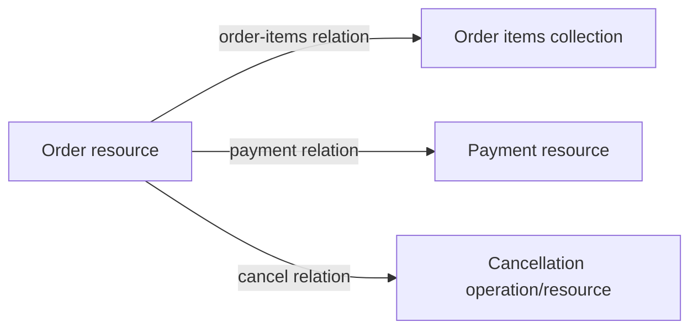

# Resource boundary trong Spring HATEOAS

**Resource boundary** là ranh giới xác định một tài nguyên API đại diện cho điều gì, có danh tính nào, công bố dữ liệu nào và cho phép máy khách điều hướng đến những tài nguyên hoặc hành động nào. Khi thiết kế REST API, ranh giới này quyết định cách chia endpoint, tổ chức biểu diễn, đặt quan hệ liên kết và kiểm soát quyền truy cập.

Trong Spring HATEOAS, ranh giới tài nguyên được thể hiện qua representation model và các liên kết hypermedia. Một tài nguyên có thể liên kết đến tài nguyên con, tài nguyên liên quan hoặc thao tác khả dụng. Máy khách khám phá các liên kết đó từ biểu diễn hiện tại thay vì phải biết trước toàn bộ cấu trúc URL.

Ranh giới tài nguyên cần phản ánh ngôn ngữ nghiệp vụ và nhu cầu sử dụng API. Nó không nên được quyết định chỉ bởi tên bảng dữ liệu, entity JPA hay số lượng controller.

## 1. Resource boundary là gì?

Một tài nguyên REST là một khái niệm được định danh mà máy khách có thể tham chiếu thông qua URI. Tài nguyên thường có trạng thái, biểu diễn và các tương tác được xác định bởi hợp đồng API.

Ví dụ trong hệ thống bán hàng:

- Đơn hàng là một tài nguyên có mã định danh và trạng thái riêng.
- Danh sách mặt hàng của đơn hàng có thể là một tập hợp con được truy cập trong ngữ cảnh đơn hàng.
- Khoản thanh toán có thể là tài nguyên riêng vì có vòng đời, trạng thái và quy tắc nghiệp vụ riêng.
- Hành động hủy đơn có thể được công bố dưới dạng liên kết tới một endpoint thực hiện lệnh hoặc một tài nguyên yêu cầu hủy.

Có thể hình dung quan hệ giữa các tài nguyên như sau:



Sơ đồ thể hiện các liên kết điều hướng. Nó không bắt buộc mọi tài nguyên phải được lưu trong một bảng riêng hoặc một service riêng. Ranh giới API là quyết định về hợp đồng giao tiếp; cách lưu trữ và triển khai nội bộ có thể khác.

Một resource boundary tốt giúp trả lời được các câu hỏi:

1. Tài nguyên có danh tính ổn định nào?
2. Trạng thái nào thuộc về tài nguyên?
3. Những thao tác nào có ý nghĩa trong ngữ cảnh của tài nguyên?
4. Những tài nguyên nào nên được truy cập độc lập, tài nguyên nào chỉ cần xuất hiện trong biểu diễn?
5. Ai được phép xem hoặc thay đổi tài nguyên?
6. Máy khách cần những liên kết nào để tiếp tục quy trình?

## 2. Phân biệt ranh giới tài nguyên API với ranh giới domain và aggregate

Ba loại ranh giới thường liên quan nhưng không đồng nhất.

| Loại ranh giới | Mục đích | Ví dụ |
|---|---|---|
| Domain boundary | Chia phạm vi nghiệp vụ và ngôn ngữ chuyên môn | Bán hàng, thanh toán, vận chuyển |
| Aggregate boundary | Bảo vệ invariant và nhất quán trạng thái trong mô hình domain | Order aggregate quản lý các OrderLine |
| API resource boundary | Xác định tài nguyên và biểu diễn mà máy khách có thể truy cập | `/orders/42`, `/payments/91` |

Một aggregate thường có aggregate root làm điểm truy cập để bảo vệ các invariant. Tuy nhiên, không nhất thiết phải công bố mỗi aggregate thành một tài nguyên API riêng, cũng không cần tạo endpoint cho từng entity bên trong aggregate.

Ví dụ, `Order` có thể là aggregate root và `OrderLine` là các thành phần bên trong. API có thể công bố toàn bộ thông tin mặt hàng trong biểu diễn đơn hàng, hoặc cung cấp tập hợp mặt hàng qua `/orders/{orderId}/items` khi máy khách cần truy cập, phân trang hay lọc chúng riêng.

Ngược lại, một biểu diễn API tổng hợp có thể lấy dữ liệu từ nhiều aggregate. Trang chi tiết đơn hàng có thể hiển thị thông tin đơn hàng, trạng thái thanh toán và trạng thái giao hàng, dù các dữ liệu đó thuộc các miền hoặc service khác nhau. Representation model lúc này là một read model phục vụ use case.

Do đó, cần xác định ranh giới API theo cách máy khách sử dụng tài nguyên và theo hợp đồng cần duy trì. Domain và aggregate cung cấp các quy tắc nghiệp vụ để API tôn trọng, còn representation model quyết định phần nào được công bố qua HTTP.

## 3. Tiêu chí chọn ranh giới tài nguyên

Không có một công thức duy nhất cho mọi API. Các tiêu chí dưới đây giúp xác định khi nào một khái niệm nên có URI riêng, khi nào nên là dữ liệu nhúng và khi nào nên chỉ được biểu diễn bằng liên kết.

### Danh tính và vòng đời

Nếu một khái niệm có danh tính ổn định, có thể được tham chiếu từ nhiều nơi và có vòng đời riêng, nó thường phù hợp với một tài nguyên độc lập.

Ví dụ, khoản thanh toán có mã riêng, có thể được truy vấn từ đơn hàng, giao dịch hoặc màn hình đối soát. Vì vậy, `Payment` thường có URI riêng như `/payments/91`. Đơn hàng có thể cung cấp relation `payment` trỏ tới URI đó.

Nếu một đối tượng chỉ có ý nghĩa bên trong một aggregate và không được truy cập độc lập, biểu diễn lồng hoặc tập hợp con có thể phù hợp hơn. Một dòng hàng có thể chỉ được định danh trong phạm vi đơn hàng, ví dụ `/orders/42/items/3`.

### Invariant và quyền sở hữu nghiệp vụ

Nếu thay đổi một đối tượng phải tuân thủ invariant của aggregate root, API nên giữ thao tác trong ngữ cảnh aggregate đó. Ví dụ, cập nhật số lượng một dòng hàng có thể cần kiểm tra trạng thái đơn hàng và tổng tiền. Endpoint có thể nằm dưới `/orders/{orderId}/items/{itemId}`, còn service vẫn thực thi quy tắc của aggregate `Order`.

Nếu một khái niệm do một bounded context khác sở hữu, API có thể biểu diễn nó như tài nguyên liên quan và điều hướng qua liên kết. Không nên để một service tùy tiện thay đổi dữ liệu nội bộ thuộc quyền sở hữu của service khác.

### Khối lượng dữ liệu và cách truy vấn

Tập hợp lớn, cần lọc, sắp xếp hoặc phân trang thường nên có endpoint riêng. Nhúng hàng nghìn phần tử vào biểu diễn cha làm phản hồi lớn, khó cache và khó tải theo nhu cầu.

Ngược lại, vài thuộc tính nhỏ, luôn cần để hiển thị tài nguyên cha và không có nhu cầu truy vấn riêng có thể được nhúng vào representation model.

### Tính độc lập của thay đổi

Nếu một phần dữ liệu có hợp đồng, nhịp thay đổi hoặc quyền truy cập khác với tài nguyên cha, nên cân nhắc tách thành tài nguyên riêng. Cách này giúp máy khách chỉ tải phần cần dùng và cho phép từng tài nguyên tiến hóa theo hợp đồng riêng.

### Quyền truy cập

Nếu một tài nguyên có chính sách truy cập riêng, API phải thể hiện ranh giới bảo mật tương ứng. Ví dụ người dùng có thể xem đơn hàng nhưng không có quyền xem thông tin thanh toán chi tiết. Khi đó, biểu diễn đơn hàng không nên nhúng dữ liệu thanh toán nhạy cảm chỉ vì hai đối tượng có quan hệ nghiệp vụ.

Việc có link đến tài nguyên liên quan cũng không đồng nghĩa mọi người dùng đều có quyền truy cập. Endpoint đích phải xác thực và phân quyền độc lập.

## 4. Chọn tài nguyên lồng, tài nguyên độc lập hay dữ liệu nhúng

Ba cách tổ chức phổ biến có thể được so sánh như sau:

| Cách tổ chức | Khi phù hợp | Ví dụ |
|---|---|---|
| Tài nguyên lồng (nested resource) | Đối tượng con chỉ có ý nghĩa trong ngữ cảnh tài nguyên cha | `/orders/42/items/3` |
| Tài nguyên độc lập (top-level resource) | Đối tượng có danh tính, vòng đời hoặc quyền truy cập riêng | `/payments/91` |
| Dữ liệu nhúng (embedded representation) | Dữ liệu nhỏ, thường được tiêu thụ cùng tài nguyên cha | `items` tóm tắt trong phản hồi đơn hàng |

### Nested resource

Ví dụ:

```http
GET /orders/42/items
GET /orders/42/items/3
```

Cấu trúc URI cho thấy mặt hàng được truy cập trong ngữ cảnh đơn hàng. Đây là lựa chọn hợp lý nếu mặt hàng không có danh tính toàn cục hoặc mọi thao tác đều phải kiểm tra invariant của đơn hàng.

Không nên lồng đường dẫn quá sâu chỉ để phản ánh cấu trúc object. Một URI như `/customers/7/orders/42/items/3/discounts/5` có thể khiến API phụ thuộc vào toàn bộ cây sở hữu nội bộ. Nếu tài nguyên con có danh tính riêng, có thể cấp URI trực tiếp và cung cấp liên kết từ tài nguyên cha.

### Top-level resource

Ví dụ:

```http
GET /payments/91
```

Một khoản thanh toán có thể được tham chiếu từ đơn hàng, giao dịch hoặc báo cáo. Tài nguyên có URI riêng giúp các máy khách khác nhau khám phá nó qua cùng một hợp đồng. Đơn hàng chỉ cần cung cấp link relation `payment` trỏ tới URI khoản thanh toán.

### Embedded representation

Ví dụ đơn hàng có thể trả về một số trường tóm tắt của mặt hàng:

```json
{
  "id": 42,
  "status": "PENDING",
  "items": [
    {
      "sku": "KB-01",
      "name": "Keyboard",
      "quantity": 2
    }
  ]
}
```

Dữ liệu nhúng giúp máy khách giảm số lần gọi khi các trường luôn được sử dụng cùng nhau. Tuy nhiên, nếu mặt hàng cần phân trang, chỉnh sửa riêng hoặc có quyền truy cập khác, nên công bố một liên kết tới tập hợp hoặc tài nguyên mặt hàng.

Embedded representation và link có thể cùng tồn tại. Một phản hồi có thể chứa vài trường tóm tắt và relation `order-items` để máy khách mở tập hợp đầy đủ khi cần.

## 5. Thiết kế URI và relation quanh ranh giới tài nguyên

URI nên ổn định và biểu đạt danh tính tài nguyên. Ví dụ:

| URI | Ý nghĩa |
|---|---|
| `/orders` | Tập hợp đơn hàng |
| `/orders/42` | Một đơn hàng |
| `/orders/42/items` | Tập hợp mặt hàng thuộc đơn hàng |
| `/orders/42/items/3` | Một mặt hàng trong đơn hàng |
| `/payments/91` | Một khoản thanh toán |
| `/orders/42/cancellations` | Tập hợp yêu cầu hủy hoặc tài nguyên hủy theo thiết kế API |

Tên đường dẫn chỉ là một phần của hợp đồng. Với HATEOAS, máy khách nên nhận URI qua liên kết trong biểu diễn. Máy khách có thể bắt đầu từ một entry point đã biết, sau đó đi theo relation như `orders`, `order-items`, `payment` hoặc relation hành động hủy.

Các relation chuẩn có thể dùng tên đã đăng ký như `self`, `collection`, `next` hoặc `related`. Relation mở rộng của ứng dụng nên có URI ổn định, ví dụ:

- `https://api.example.com/rels/order-items`
- `https://api.example.com/rels/payment`
- `https://api.example.com/rels/cancel`

Tài liệu API cần mô tả ý nghĩa relation, loại tài nguyên đích, media type và cách máy khách sử dụng liên kết. Đổi URI của endpoint có thể ít ảnh hưởng đến máy khách nếu relation vẫn ổn định và máy khách đi theo link do máy chủ trả về. Đổi ý nghĩa relation hoặc cấu trúc dữ liệu vẫn có thể là thay đổi hợp đồng.

## 6. Biểu diễn ranh giới tài nguyên bằng Spring HATEOAS

Spring HATEOAS cho phép định nghĩa kiểu biểu diễn riêng kế thừa `RepresentationModel`. Kiểu này chỉ chứa dữ liệu API muốn công bố; assembler thêm liên kết tới các ranh giới tài nguyên liên quan.

Ví dụ định nghĩa mô hình đơn hàng:

```java
import org.springframework.hateoas.RepresentationModel;
import org.springframework.hateoas.server.core.Relation;

import java.math.BigDecimal;

@Relation(itemRelation = "order", collectionRelation = "orders")
public class OrderRepresentation
        extends RepresentationModel<OrderRepresentation> {

    private final Long id;
    private final String status;
    private final BigDecimal total;

    public OrderRepresentation(
            Long id,
            String status,
            BigDecimal total) {
        this.id = id;
        this.status = status;
        this.total = total;
    }

    public Long getId() {
        return id;
    }

    public String getStatus() {
        return status;
    }

    public BigDecimal getTotal() {
        return total;
    }
}
```

Mô hình chỉ công bố ID, trạng thái và tổng tiền. Các trường nội bộ như thông tin kết nối, cờ xử lý, dữ liệu audit hoặc chi tiết thanh toán nhạy cảm không tự động bị đưa ra HTTP.

Tiếp theo, assembler tạo link cho tài nguyên cha, tập hợp con và tài nguyên liên quan:

```java
import static org.springframework.hateoas.server.mvc.WebMvcLinkBuilder.linkTo;
import static org.springframework.hateoas.server.mvc.WebMvcLinkBuilder.methodOn;

import org.springframework.hateoas.server.RepresentationModelAssembler;
import org.springframework.stereotype.Component;

@Component
public class OrderRepresentationAssembler
        implements RepresentationModelAssembler<Order, OrderRepresentation> {

    private static final String ORDER_ITEMS_REL =
        "https://api.example.com/rels/order-items";
    private static final String PAYMENT_REL =
        "https://api.example.com/rels/payment";
    private static final String CANCEL_REL =
        "https://api.example.com/rels/cancel";

    @Override
    public OrderRepresentation toModel(Order order) {
        var model = new OrderRepresentation(
            order.getId(),
            order.getStatus().name(),
            order.getTotal()
        );

        model.add(
            linkTo(methodOn(OrderController.class).one(order.getId()))
                .withSelfRel()
        );

        model.add(
            linkTo(methodOn(OrderItemController.class).all(order.getId()))
                .withRel(ORDER_ITEMS_REL)
        );

        if (order.getPaymentId() != null) {
            model.add(
                linkTo(methodOn(PaymentController.class)
                    .one(order.getPaymentId()))
                    .withRel(PAYMENT_REL)
            );
        }

        if (order.canBeCancelled()) {
            model.add(
                linkTo(methodOn(OrderCancellationController.class)
                    .create(order.getId()))
                    .withRel(CANCEL_REL)
            );
        }

        return model;
    }
}
```

Trong ví dụ:

- `self` định danh chính tài nguyên đơn hàng.
- `order-items` điều hướng tới tập hợp mặt hàng trong ngữ cảnh đơn hàng.
- `payment` trỏ tới khoản thanh toán nếu đơn hàng có liên kết thanh toán.
- `cancel` được công bố khi trạng thái đơn hàng cho phép gửi yêu cầu hủy.

Các lớp `Order`, `OrderController`, `OrderItemController`, `PaymentController` và `OrderCancellationController` là thành phần minh họa cho domain và controller của ứng dụng. Khi triển khai, các phương thức được tham chiếu trong `methodOn` phải tồn tại và có mapping Spring MVC tương ứng.

## 7. Controller và endpoint theo ranh giới đã chọn

Controller công bố endpoint theo từng loại tài nguyên. Ví dụ rút gọn:

```java
@RestController
@RequestMapping("/orders")
class OrderController {

    private final OrderService orderService;
    private final OrderRepresentationAssembler assembler;

    OrderController(
            OrderService orderService,
            OrderRepresentationAssembler assembler) {
        this.orderService = orderService;
        this.assembler = assembler;
    }

    @GetMapping("/{id}")
    OrderRepresentation one(@PathVariable Long id) {
        return assembler.toModel(orderService.findById(id));
    }
}

@RestController
@RequestMapping("/orders/{orderId}/items")
class OrderItemController {

    private final OrderItemService itemService;

    OrderItemController(OrderItemService itemService) {
        this.itemService = itemService;
    }

    @GetMapping
    CollectionModel<OrderItemRepresentation> all(
            @PathVariable Long orderId) {
        // Lấy các mặt hàng thuộc đơn hàng và tạo representation.
        throw new UnsupportedOperationException("Ví dụ minh họa");
    }
}

@RestController
@RequestMapping("/payments")
class PaymentController {

    private final PaymentService paymentService;

    PaymentController(PaymentService paymentService) {
        this.paymentService = paymentService;
    }

    @GetMapping("/{id}")
    PaymentRepresentation one(@PathVariable Long id) {
        // Trả về representation của khoản thanh toán.
        throw new UnsupportedOperationException("Ví dụ minh họa");
    }
}
```

Cấu trúc trên thể hiện hai loại ranh giới: mặt hàng được truy cập trong ngữ cảnh đơn hàng, còn thanh toán có URI cấp cao nhất. Một API khác có thể chọn URI độc lập cho mặt hàng nếu mặt hàng cần được tham chiếu và quản lý ngoài ngữ cảnh đơn hàng.

Một thao tác thay đổi trạng thái có thể được mô hình hóa theo nhiều cách. Ví dụ, `POST /orders/{id}/cancellations` tạo yêu cầu hủy như một tài nguyên nghiệp vụ. API đơn giản hơn cũng có thể dùng endpoint lệnh như `POST /orders/{id}/cancel`. HATEOAS không áp đặt một mẫu URL duy nhất; điều quan trọng là semantics của HTTP, relation công bố và hợp đồng request/response phải nhất quán.

## 8. Biểu diễn HAL cho các ranh giới liên quan

Với HAL JSON, liên kết được đặt trong `_links`. Một phản hồi đơn hàng có thể có dạng:

```json
{
  "id": 42,
  "status": "PENDING",
  "total": 1250000,
  "_links": {
    "self": {
      "href": "https://api.example.com/orders/42"
    },
    "https://api.example.com/rels/order-items": {
      "href": "https://api.example.com/orders/42/items"
    },
    "https://api.example.com/rels/payment": {
      "href": "https://api.example.com/payments/91"
    },
    "https://api.example.com/rels/cancel": {
      "href": "https://api.example.com/orders/42/cancellations"
    }
  }
}
```

Máy khách không cần tự ghép `/orders/{id}/items` hoặc suy ra URI thanh toán từ mã đơn hàng. Nó đọc relation phù hợp và theo `href` được cung cấp.

Nếu máy khách chỉ cần thông tin tóm tắt, biểu diễn có thể nhúng một phần dữ liệu và đồng thời cung cấp link đến tài nguyên đầy đủ. Với tập hợp lớn, relation trỏ tới collection endpoint để máy khách phân trang và lọc độc lập.

## 9. Ranh giới tài nguyên và quyền truy cập

Resource boundary cũng là một ranh giới cần được bảo vệ. Một người dùng có quyền xem đơn hàng không nhất thiết có quyền xem mọi tài nguyên liên quan đến đơn hàng đó.

Ví dụ:

- Người mua có thể xem trạng thái và mặt hàng của đơn hàng.
- Bộ phận tài chính có thể xem chi tiết thanh toán.
- Đơn vị vận chuyển có thể xem địa chỉ giao hàng và thông tin vận đơn theo phạm vi được cấp.
- Nhân viên hỗ trợ có thể xem dữ liệu giới hạn theo chính sách.

Assembler có thể nhận ngữ cảnh người dùng hoặc thông tin quyền đã được xác định để quyết định link nào xuất hiện. Tuy nhiên, việc ẩn link chỉ là cách công bố khả năng điều hướng. Endpoint đích phải tự kiểm tra xác thực, phân quyền, quyền sở hữu tài nguyên và điều kiện nghiệp vụ. Không được dựa vào việc máy khách không nhìn thấy link để bảo vệ dữ liệu.

Cần chú ý truy cập trực tiếp bằng ID. Nếu máy khách thay `/payments/91` thành `/payments/92`, server phải xác minh người gọi có quyền với khoản thanh toán 92. Đây là kiểm soát truy cập ở cấp đối tượng, thường liên quan đến lỗi IDOR/BOLA nếu bị bỏ qua.

## 10. Ranh giới tài nguyên và khả năng tiến hóa API

Một ranh giới tài nguyên rõ ràng giúp API thay đổi cấu trúc triển khai mà vẫn duy trì cách máy khách điều hướng. Ví dụ, khoản thanh toán có thể chuyển từ một service nội bộ sang một service riêng. Nếu API đơn hàng tiếp tục công bố relation `payment` với URI đích hợp lệ, máy khách không cần biết service nào đang xử lý tài nguyên đó.

Tương tự, tập hợp mặt hàng có thể thay đổi cách phân trang hoặc cách định tuyến. Máy khách theo link `order-items` từ đơn hàng rồi dùng các link phân trang do collection trả về. Hợp đồng vẫn cần giữ relation và semantics mà máy khách dựa vào.

Các thay đổi có thể ảnh hưởng hợp đồng gồm:

- Xóa hoặc đổi ý nghĩa một relation mà máy khách đang sử dụng.
- Thay đổi cấu trúc dữ liệu công khai theo cách phá vỡ máy khách.
- Thay đổi chính sách quyền khiến máy khách không còn truy cập được tài nguyên.
- Đổi media type hoặc cấu trúc affordance mà không có cơ chế tương thích.

Vì vậy, resource boundary cần được xem như một phần của thiết kế hợp đồng API. URI, relation, media type, dữ liệu biểu diễn và quy tắc quyền cần được tài liệu hóa và kiểm thử.

## 11. Kiểm thử ranh giới tài nguyên

Kiểm thử nên xác nhận API công bố đúng các ranh giới đã thiết kế. Với MockMvc, có thể kiểm tra liên kết từ đơn hàng tới tập hợp mặt hàng:

```java
mockMvc.perform(
        get("/orders/42").accept(MediaTypes.HAL_JSON)
    )
    .andExpect(status().isOk())
    .andExpect(jsonPath("$._links.self.href").exists())
    .andExpect(jsonPath(
        "$._links['https://api.example.com/rels/order-items'].href"
    ).exists());
```

Ngoài sự tồn tại của link, cần kiểm tra:

- Tài nguyên con chỉ xuất hiện trong ngữ cảnh phù hợp.
- Tài nguyên có vòng đời độc lập có URI riêng và relation từ tài nguyên liên quan.
- Dữ liệu nhúng không chứa trường nội bộ hoặc thông tin nhạy cảm.
- Link hành động chỉ xuất hiện khi trạng thái và quyền cho phép công bố hành động.
- Endpoint đích vẫn từ chối truy cập trái phép dù người gọi tự tạo URI.
- Collection endpoint giữ các bộ lọc, sắp xếp và phân trang trong các link điều hướng.
- Các relation mở rộng được duy trì đúng ý nghĩa qua các phiên bản API.

Nên kiểm thử cả phản hồi thành công lẫn trường hợp truy cập sai phạm vi. Điều đó xác nhận ranh giới tài nguyên tồn tại trong hành vi thực tế của API, không chỉ trong sơ đồ hoặc tên controller.

## 12. Checklist thiết kế Resource boundary

Trước khi triển khai một tài nguyên mới, hãy rà soát:

- Tài nguyên có danh tính và URI ổn định chưa?
- Nó có vòng đời hoặc quy tắc nghiệp vụ độc lập không?
- Nó thuộc aggregate hoặc bounded context nào?
- Máy khách có cần truy cập nó độc lập, phân trang hoặc lọc không?
- Dữ liệu nào nên nhúng, dữ liệu nào nên công bố qua link?
- Relation nào mô tả đúng liên kết từ tài nguyên hiện tại?
- Người dùng nào được xem và thực hiện thao tác trên tài nguyên?
- Endpoint có kiểm tra quyền ở cấp đối tượng và điều kiện nghiệp vụ không?
- Hợp đồng URI, relation và representation có thể tiến hóa mà không phá vỡ máy khách không?

Resource boundary tốt giúp API công bố đúng khái niệm nghiệp vụ, dữ liệu và khả năng điều hướng mà máy khách cần. Spring HATEOAS hỗ trợ thể hiện ranh giới đó qua representation model, assembler và link relation. Khi ranh giới API được thiết kế rõ, máy khách có thể khám phá tài nguyên liên quan theo hợp đồng, còn ứng dụng vẫn giữ quyền kiểm soát cấu trúc domain, dữ liệu lưu trữ và chính sách truy cập nội bộ.
