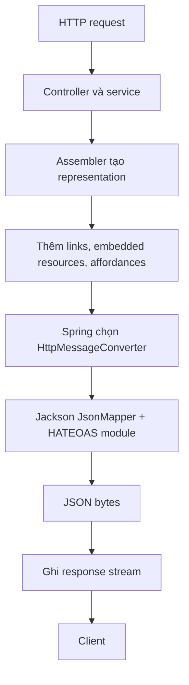

# Đo thời gian serialize

Một response Spring HATEOAS đi qua nhiều công đoạn trước khi được gửi tới client: controller lấy dữ liệu, assembler tạo `RepresentationModel`, link được bổ sung, HTTP message converter chọn định dạng, rồi Jackson serialize representation thành JSON và ghi vào response stream. Khi endpoint chậm, cần biết phần nào chiếm thời gian. Đo toàn bộ request chỉ cho biết độ trễ tổng; nó không cho biết riêng chi phí serialize.

Bài này tập trung đo thời gian chuyển các model như `EntityModel`, `CollectionModel` và `PagedModel` thành JSON HAL. Có hai mục tiêu khác nhau:

- **Benchmark trong môi trường kiểm soát:** so sánh chi phí serialize của DTO, model HATEOAS, collection và page bằng JMH.
- **Quan sát khi ứng dụng chạy:** ghi thời gian converter/serializer bằng Micrometer để theo dõi xu hướng, percentile và ảnh hưởng của dữ liệu thực.

Đo đúng ranh giới giúp tránh tối ưu nhầm. Nếu assembler mất 40 ms để tạo link nhưng Jackson chỉ mất 2 ms để serialize, thay serializer sẽ không giải quyết nguyên nhân chính.

## Một response HATEOAS tiêu tốn thời gian ở đâu?

Với Spring MVC, controller thường trả một object có `@ResponseBody` hoặc `ResponseEntity`. Spring chọn `HttpMessageConverter` theo kiểu body và media type; converter JSON dùng Jackson để ghi representation vào response. Spring HATEOAS đăng ký cấu hình Jackson đặc thù để `Link`, `EntityModel`, `CollectionModel` và `PagedModel` được serialize theo hypermedia format đã chọn.



Các công đoạn có chi phí riêng:

| Công đoạn | Công việc | Cách đo phù hợp |
|---|---|---|
| Truy vấn và xử lý nghiệp vụ | Database, remote call, mapping | Timer ở service/repository hoặc tracing span |
| Assembly | Tạo DTO, `EntityModel`, collection, page | Timer quanh assembler hoặc factory |
| Tạo link | Tính URI, relation, URI template, affordance | Timer riêng khi có lý do; thường gộp trong assembly |
| Serialization | Jackson đọc object graph và tạo JSON token/bytes | JMH hoặc timer quanh `JsonMapper`/converter |
| Ghi response | Ghi bytes vào servlet output stream, có thể chịu backpressure | Đo converter write và request latency; cân nhắc network/container |
| Toàn request | Từ nhận request đến hoàn tất response | `http.server.requests` hoặc distributed tracing |

`http.server.requests` là metric hữu ích để theo dõi latency API, nhưng nó bao gồm nhiều công đoạn trên. Không nên coi giá trị của metric này là thời gian serialize.

## Serialization của HATEOAS có thêm những gì?

Một DTO thông thường thường chỉ chứa field dữ liệu. Representation HATEOAS còn có thể chứa:

- `_links`: link `self`, link collection, link điều hướng, relation tùy chỉnh và URI template.
- `_embedded`: các resource lồng nhau, mỗi resource có thể có field và link riêng.
- `page`: metadata phân trang trong `PagedModel`.
- `_templates`: template và property mô tả affordance trong HAL-FORMS.
- CURIE và relation mapping: tên relation có thể cần được rút gọn hoặc mở rộng.
- Các serializer và handler đặc thù của media type.

Chi phí không chỉ phụ thuộc số field. Một collection 20 phần tử, mỗi phần tử có 4 link, có thể tạo nhiều object và nhiều thao tác serialize hơn một DTO có cùng số field nghiệp vụ. Embedded resource lồng sâu, affordance phong phú hoặc URI template cũng có thể làm representation lớn hơn.

Để hiểu yếu tố nào làm tăng chi phí, hãy benchmark các trường hợp khác nhau thay vì chỉ đo một endpoint tổng hợp:

| Biến thể | Điều cần quan sát |
|---|---|
| DTO không có link | Baseline của dữ liệu nghiệp vụ |
| `EntityModel` không có link | Chi phí wrapper representation |
| `EntityModel` có vài link | Chi phí serialize relation và `href` |
| `CollectionModel` 10/50/100 phần tử | Tác động của số embedded item |
| `PagedModel` | Chi phí thêm metadata và pagination links |
| HAL-FORMS | Chi phí `_templates` và affordance |
| Embedded resource lồng nhau | Tác động của độ sâu object graph |

## Phân biệt thời gian serialize với thời gian ghi response

Có hai ranh giới đo thường dùng:

**Đo Jackson trực tiếp:** gọi `JsonMapper.writeValueAsBytes(model)`. Khoảng thời gian đo bao gồm việc Jackson serialize object và tạo byte array UTF-8. Cách này phù hợp với benchmark serializer vì không có database hoặc network trong vùng đo.

**Đo message converter:** đo quanh `HttpMessageConverter.write(...)`. Khoảng thời gian này bao gồm serialize và ghi body vào `HttpOutputMessage`; nó phản ánh chi phí ghi response phía server sát với MVC hơn, nhưng có thể chịu ảnh hưởng của output stream/container.

Không dùng `ResponseBodyAdvice.beforeBodyWrite(...)` để kết luận thời gian serialize đã hoàn tất. Callback này chạy sau khi converter được chọn nhưng ngay trước khi converter ghi body. Nó phù hợp để quan sát hoặc thay đổi body trước serialization, không phải callback kết thúc serialization.

Nếu muốn so sánh riêng Jackson, dùng benchmark trực tiếp. Nếu muốn hiểu thời gian converter thực tế trong MVC, đo quanh `write(...)`. Nếu muốn biết client phải chờ bao lâu, đo request latency và kiểm tra network/container riêng.

## Dùng đúng JsonMapper đang cấu hình cho HAL

Spring Boot cung cấp auto-configuration cho Spring HATEOAS. Với Spring Boot 4 và Jackson 3, ứng dụng nhận bean `tools.jackson.databind.json.JsonMapper` đã được cấu hình cùng hypermedia support. Spring HATEOAS đăng ký module và serializer để `RepresentationModel` được render theo HAL.

Khi benchmark, hãy dùng mapper từ cấu hình ứng dụng hoặc cấu hình benchmark giống hệt production. Không tạo một `new JsonMapper()` mặc định rồi dùng để đo `EntityModel`; mapper trống không có đủ cấu hình HAL nên kết quả có thể không phản ánh response thật.

Ví dụ service dùng mapper đã được inject:

```java
import org.springframework.stereotype.Component;
import tools.jackson.core.JacksonException;
import tools.jackson.databind.json.JsonMapper;

@Component
public class RepresentationSerializer {

    private final JsonMapper mapper;

    public RepresentationSerializer(JsonMapper mapper) {
        this.mapper = mapper;
    }

    public byte[] toHalJson(Object representation) throws JacksonException {
        return mapper.writeValueAsBytes(representation);
    }
}
```

Đây là ví dụ cho luồng ứng dụng chủ động serialize thành byte array. Trong controller Spring MVC thông thường, hãy trả `EntityModel` hoặc `PagedModel` để `HttpMessageConverter` ghi response. Không cần gọi service này từ mọi controller chỉ để lấy metric.

Với dự án Spring Boot 3/Spring HATEOAS dùng Jackson 2, mapper có kiểu `com.fasterxml.jackson.databind.ObjectMapper`. Không trộn `ObjectMapper` Jackson 2 với `JsonMapper` Jackson 3 trong cùng cấu hình. Các nguyên tắc benchmark giống nhau, nhưng import và converter phải theo phiên bản thực tế của dự án.

## Benchmark serialization bằng JMH

JMH (Java Microbenchmark Harness) được thiết kế để đo các thao tác nhỏ trên JVM. Nó quản lý warmup, measurement iterations, fork JVM và chế độ đo. Không nên thay JMH bằng một vòng `System.nanoTime()` trong JUnit vì kết quả dễ bị ảnh hưởng bởi JIT compilation, GC, class loading, CPU scheduling và test runner.

### Chuẩn bị dữ liệu ngoài vùng benchmark

Tạo các representation trong `@Setup(Level.Trial)`. Việc dựng model, tạo link và khởi động Spring context không được đặt bên trong method `@Benchmark` nếu mục tiêu là đo riêng serialization.

Ví dụ dưới đây sử dụng Spring Boot context tối giản để lấy `JsonMapper` đã cấu hình cho HATEOAS. `BenchmarkApplication` là application configuration của benchmark, có cùng Spring HATEOAS auto-configuration và Jackson customizer với ứng dụng thực tế.

```java
import java.util.List;
import java.util.concurrent.TimeUnit;
import java.util.stream.IntStream;

import org.openjdk.jmh.annotations.Benchmark;
import org.openjdk.jmh.annotations.BenchmarkMode;
import org.openjdk.jmh.annotations.Fork;
import org.openjdk.jmh.annotations.Level;
import org.openjdk.jmh.annotations.Measurement;
import org.openjdk.jmh.annotations.Mode;
import org.openjdk.jmh.annotations.OutputTimeUnit;
import org.openjdk.jmh.annotations.Scope;
import org.openjdk.jmh.annotations.Setup;
import org.openjdk.jmh.annotations.State;
import org.openjdk.jmh.annotations.TearDown;
import org.openjdk.jmh.annotations.Warmup;
import org.springframework.boot.WebApplicationType;
import org.springframework.boot.builder.SpringApplicationBuilder;
import org.springframework.context.ConfigurableApplicationContext;
import org.springframework.hateoas.CollectionModel;
import org.springframework.hateoas.EntityModel;
import org.springframework.hateoas.Link;
import org.springframework.hateoas.PagedModel;
import tools.jackson.core.JacksonException;
import tools.jackson.databind.json.JsonMapper;

@State(Scope.Benchmark)
@BenchmarkMode(Mode.AverageTime)
@OutputTimeUnit(TimeUnit.MICROSECONDS)
@Warmup(iterations = 5, time = 1)
@Measurement(iterations = 8, time = 1)
@Fork(2)
public class HalSerializationBenchmark {

    private ConfigurableApplicationContext context;
    private JsonMapper mapper;

    private OrderView order;
    private EntityModel<OrderView> entityModelWithoutLinks;
    private EntityModel<OrderView> entityModel;
    private CollectionModel<EntityModel<OrderView>> collectionModel;
    private PagedModel<EntityModel<OrderView>> pagedModel;

    @Setup(Level.Trial)
    public void setUp() {
        context = new SpringApplicationBuilder(BenchmarkApplication.class)
                .web(WebApplicationType.SERVLET)
                .properties("server.port=0")
                .run();

        mapper = context.getBean(JsonMapper.class);

        order = new OrderView(
                "ORD-1001",
                "OPEN",
                List.of(
                        new OrderLine("SKU-01", 2, 120_000),
                        new OrderLine("SKU-02", 1, 85_000)
                )
        );

        entityModelWithoutLinks = EntityModel.of(order);

        entityModel = EntityModel.of(
                order,
                Link.of("/api/orders/ORD-1001", "self"),
                Link.of("/api/orders/ORD-1001/customer", "customer"),
                Link.of("/api/orders/ORD-1001/cancellation", "cancel")
        );

        List<EntityModel<OrderView>> items = IntStream.range(0, 20)
                .mapToObj(index -> {
                    String id = "ORD-" + (1000 + index);
                    OrderView item = new OrderView(
                            id, "OPEN", order.lines());
                    return EntityModel.of(
                            item,
                            Link.of("/api/orders/" + id, "self")
                    );
                })
                .toList();

        collectionModel = CollectionModel.of(
                items,
                Link.of("/api/orders", "self")
        );

        pagedModel = PagedModel.of(
                items,
                new PagedModel.PageMetadata(20, 0, 200, 10),
                Link.of("/api/orders?page=0&size=20", "self"),
                Link.of("/api/orders?page=1&size=20", "next")
        );
    }

    @TearDown(Level.Trial)
    public void tearDown() {
        if (context != null) {
            context.close();
        }
    }

    @Benchmark
    public byte[] serializePlainDto() throws JacksonException {
        return mapper.writeValueAsBytes(order);
    }

    @Benchmark
    public byte[] serializeEntityModelWithoutLinks() throws JacksonException {
        return mapper.writeValueAsBytes(entityModelWithoutLinks);
    }

    @Benchmark
    public byte[] serializeEntityModel() throws JacksonException {
        return mapper.writeValueAsBytes(entityModel);
    }

    @Benchmark
    public byte[] serializeCollectionModel() throws JacksonException {
        return mapper.writeValueAsBytes(collectionModel);
    }

    @Benchmark
    public byte[] serializePagedModel() throws JacksonException {
        return mapper.writeValueAsBytes(pagedModel);
    }

    public record OrderView(
            String id,
            String status,
            List<OrderLine> lines
    ) {}

    public record OrderLine(String sku, int quantity, long unitPrice) {}
}
```

`BenchmarkApplication` nên là một cấu hình Spring Boot nhẹ có `spring-boot-starter-hateoas`, cùng `JsonMapperBuilderCustomizer` hoặc cấu hình hypermedia mà ứng dụng production đang sử dụng. Benchmark khởi động servlet context trên cổng ngẫu nhiên để kích hoạt cùng auto-configuration Spring MVC/HATEOAS; không có request HTTP nào được gửi trong method benchmark. Nếu ứng dụng bật `@EnableHypermediaSupport` hoặc `HalConfiguration` tùy chỉnh, hãy đưa đúng cấu hình đó vào benchmark. Context chỉ khởi động một lần trong `@Setup(Level.Trial)`, không nằm trong vùng đo của từng lần serialize.

Các benchmark method trả về `byte[]`, nhờ đó kết quả serialization được sử dụng và JMH không thể loại bỏ thao tác như một kết quả không quan sát được. `writeValueAsBytes` cũng tính chi phí tạo byte array; đây là một phần thường có trong serialization thực tế. Nếu mục tiêu là đo một ranh giới khác, hãy định nghĩa benchmark riêng và ghi rõ nó bao gồm những gì.

### Chạy benchmark

Đặt benchmark trong source set/module JMH riêng và cấu hình JMH annotation processor theo hướng dẫn của OpenJDK. Khi build tạo ra benchmark jar, có thể chạy:

```bash
java -jar target/benchmarks.jar HalSerializationBenchmark
```

Để quan sát allocation và GC:

```bash
java -jar target/benchmarks.jar HalSerializationBenchmark -prof gc
```

Tên jar và đường dẫn phụ thuộc build tool/plugin của dự án. JMH khuyến nghị dùng một benchmark project riêng hoặc archetype chính thức để annotation processor và generated harness được cấu hình đúng. Không nên lấy kết quả chạy trực tiếp từ IDE làm số liệu chuẩn.

### Đọc kết quả

Với `Mode.AverageTime` và `OutputTimeUnit(MICROSECONDS)`, JMH báo thời gian trung bình cho mỗi operation. Có thể dùng thêm `Mode.SampleTime` để quan sát phân phối sample latency hoặc `Mode.Throughput` để đo số operation mỗi đơn vị thời gian. Không so sánh số liệu từ các mode khác nhau như thể chúng cùng đơn vị.

Khi đọc kết quả, kiểm tra:

- Thời gian mỗi operation và độ dao động giữa các fork.
- Allocation bytes/op từ `-prof gc`.
- GC count/time và dấu hiệu allocation pressure.
- Kích thước output bytes của từng representation.
- Số item, số link, số field và độ sâu embedded trong dữ liệu benchmark.

Nếu cần đo payload size, serialize từng representation một lần trong `@Setup` và ghi lại `bytes.length` ngoài method benchmark. Không thêm `println`, log hoặc ghi file vào method `@Benchmark`, vì I/O sẽ làm sai số liệu.

## Thiết kế phép đo để so sánh có ý nghĩa

Benchmark chỉ có giá trị khi các phương án khác nhau ở đúng yếu tố cần so sánh. Một số nguyên tắc:

1. Dùng cùng một `JsonMapper` đã cấu hình HAL cho mọi biến thể.
2. Tạo dữ liệu trong `@Setup`, không query database hoặc tạo UUID ngẫu nhiên trong method benchmark.
3. Giữ số field nghiệp vụ giống nhau khi so DTO với `EntityModel`.
4. Tăng dần số link để đo chi phí relation/`href`.
5. Tăng dần số embedded item để quan sát độ tăng theo kích thước collection.
6. Benchmark `PagedModel` riêng vì nó còn serialize metadata và pagination links.
7. Nếu dùng HAL-FORMS, chạy benchmark với media type/configuration và model có affordance tương ứng.
8. Giữ JVM, Java version, heap, CPU, OS và dependency version cố định khi so sánh.
9. Chạy warmup và nhiều fork; không lấy một lần đo duy nhất làm kết luận.
10. Chạy `-prof gc` để biết tối ưu thời gian có làm allocation tăng hay không.

Nên dùng dữ liệu đại diện cho endpoint thật: một order có số line trung bình, collection có page size phổ biến, số relation thực tế và độ sâu embedded giống production. Một benchmark chỉ có 1 link và 1 field không dự báo được collection chứa hàng trăm resource.

## Đo thời gian serialize trong ứng dụng với Micrometer

JMH trả lời câu hỏi “serializer mất bao lâu trong môi trường kiểm soát?”. Production cần câu trả lời “serialization đang tốn bao lâu với traffic và dữ liệu thật?”. Micrometer `Timer` phù hợp để ghi thời gian các thao tác ngắn và tần suất thực hiện.

Nếu ứng dụng có luồng serialize rõ ràng bằng `JsonMapper`, có thể đo trực tiếp:

```java
import org.springframework.stereotype.Component;
import io.micrometer.core.instrument.MeterRegistry;
import io.micrometer.core.instrument.Timer;
import tools.jackson.core.JacksonException;
import tools.jackson.databind.json.JsonMapper;

@Component
public class TimedRepresentationSerializer {

    private final JsonMapper mapper;
    private final MeterRegistry registry;
    private final Timer serializationTimer;

    public TimedRepresentationSerializer(
            JsonMapper mapper,
            MeterRegistry registry,
            Timer serializationTimer
    ) {
        this.mapper = mapper;
        this.registry = registry;
        this.serializationTimer = serializationTimer;
    }

    public byte[] serialize(Object representation) throws JacksonException {
        Timer.Sample sample = Timer.start(registry);
        try {
            return mapper.writeValueAsBytes(representation);
        } finally {
            sample.stop(serializationTimer);
        }
    }
}
```

`Timer.Sample` ghi nhận thời điểm bắt đầu và dừng timer trong `finally`, vì vậy cả trường hợp serialize ném exception cũng được tính vào số lần thực hiện và thời gian. Timer được cấu hình thành bean và inject một lần, không tạo meter mới cho từng request.

Ví dụ này đo đúng lời gọi `JsonMapper.writeValueAsBytes` và tạo byte array. Nó không đo database, assembler, controller hay network. Nếu ứng dụng trả object trực tiếp để Spring MVC tự serialize, service này không nằm trên đường xử lý và không thể đại diện cho thời gian converter thực tế.

### Đo quanh HttpMessageConverter trong Spring MVC

Để đo gần với response MVC thật, đặt timer quanh lời gọi `HttpMessageConverter.write(...)` của converter đang ghi HAL response. Phần cốt lõi trong một decorator converter có thể được triển khai như sau:

Đoạn trích giả định decorator đã có field `MeterRegistry registry`, `Timer serializationTimer` và `HttpMessageConverter<Object> delegate` được cấu hình từ Spring; một implementation generic thực tế cần giữ kiểu `T` tương ứng của converter được bọc.

```java
void writeWithTiming(
        Object body,
        MediaType contentType,
        HttpOutputMessage outputMessage
) throws IOException {
    Timer.Sample sample = Timer.start(registry);
    try {
        delegate.write(body, contentType, outputMessage);
    } finally {
        sample.stop(serializationTimer);
    }
}
```

Đây là phần cốt lõi của decorator, không phải một converter hoàn chỉnh. Converter thực tế còn phải giữ nguyên `canRead`, `canWrite`, supported media types, generic type support và thứ tự chọn converter. Nếu wrap converter mà bỏ mất `GenericHttpMessageConverter` hoặc khả năng xử lý generic type, các response như `PagedModel<EntityModel<Order>>` có thể được chọn sai hoặc serialize khác đi.

Thời gian quanh `delegate.write(...)` bao gồm serialization và việc ghi body qua output message. Nó gần với chi phí response body hơn đo trực tiếp `JsonMapper`, nhưng vẫn có thể bao gồm buffering và hoạt động của output stream. Hãy đặt tên metric đúng với ranh giới đo, ví dụ `api.hateoas.converter.write`, thay vì khẳng định đó là CPU time thuần của Jackson.

`ResponseBodyAdvice` không tự đo được thời gian kết thúc của `write(...)`: callback của nó chạy trước khi converter ghi body. Nếu chỉ cần biết toàn bộ request chậm hay nhanh, dùng metric request của Spring Boot/Actuator và tracing; không cần thay converter.

## Theo dõi phân phối latency thay vì chỉ xem trung bình

`Timer` của Micrometer ghi ít nhất count và total time. Tùy registry và cấu hình, có thể xuất histogram, max hoặc percentile. Với API, p95 và p99 thường hữu ích hơn average vì một số response collection lớn có thể làm tail latency tăng mạnh dù trung bình vẫn thấp.

Có thể bật percentile histogram và SLO bucket cho metric:

```java
import java.time.Duration;

import org.springframework.context.annotation.Bean;
import org.springframework.context.annotation.Configuration;
import io.micrometer.core.instrument.MeterRegistry;
import io.micrometer.core.instrument.Timer;

@Configuration
class SerializationMetricsConfiguration {

    @Bean
    Timer serializationTimer(MeterRegistry registry) {
        return Timer.builder("api.hateoas.serialization")
                .description("HATEOAS serialization duration")
                .publishPercentileHistogram()
                .serviceLevelObjectives(
                        Duration.ofMillis(1),
                        Duration.ofMillis(5),
                        Duration.ofMillis(10),
                        Duration.ofMillis(25),
                        Duration.ofMillis(50)
                )
                .register(registry);
    }
}
```

Đoạn cấu hình này giả định `registry` là `MeterRegistry` được inject. Histogram có thể làm tăng số time series và bộ nhớ; chọn bucket theo SLO và range thực tế, không bật mọi percentile cho mọi metric một cách đại trà. Nếu backend hỗ trợ histogram percentile có thể tổng hợp, đây thường là cách phù hợp hơn client-side percentile khi cần gộp nhiều instance.

### Gắn tag có cardinality thấp

Có thể tách timer theo format và loại representation:

| Tag | Giá trị ví dụ |
|---|---|
| `format` | `hal`, `hal-forms` |
| `model` | `entity`, `collection`, `paged` |
| `outcome` | `success`, `error` |

Không đưa các giá trị có cardinality cao vào tag:

- URL đầy đủ hoặc ID tài nguyên.
- User ID, tenant ID hoặc correlation ID.
- Tên relation tùy ý do client gửi.
- Class name của từng DTO nếu số lượng class lớn.

Tag cardinality cao tạo nhiều meter và time series, làm tăng chi phí bộ nhớ và hệ thống monitoring. Nếu cần phân tích endpoint cụ thể, dùng tracing hoặc log có sampling thay vì tạo tag động cho mọi URI.

## Đo kích thước payload song song với thời gian

Thời gian serialize và kích thước JSON có liên quan nhưng không đồng nhất. Một serializer có thể nhanh nhưng tạo payload lớn; một response có thể serialize nhanh nhưng mất nhiều thời gian truyền qua mạng.

Với luồng serialize thành byte array, có thể ghi kích thước bằng `DistributionSummary`:

```java
import io.micrometer.core.instrument.DistributionSummary;

DistributionSummary payloadSize = DistributionSummary.builder("api.hateoas.payload.size")
        .description("Serialized HATEOAS response size")
        .baseUnit("bytes")
        .tag("format", "hal")
        .register(registry);

byte[] body = serializer.serialize(model);
payloadSize.record(body.length);
```

Đặt `record(body.length)` sau khi serialize thành công. Nếu đo converter ghi trực tiếp vào HTTP response stream, muốn biết kích thước body cần một cơ chế đếm bytes riêng; không thể suy ra chính xác từ thời gian converter.

Khi đọc số liệu, hãy xem đồng thời:

- p50/p95/p99 của serialization timer.
- bytes/op hoặc payload size.
- allocation bytes/op và GC.
- số item trong collection và số link trung bình trên mỗi item.
- request latency tổng và network response size.

Nếu p95 tăng cùng payload size, nguyên nhân có thể là collection lớn hoặc embedded graph sâu. Nếu thời gian tăng nhưng payload size gần như không đổi, hãy xem allocation, custom serializer, CPU contention hoặc chi phí tính toán trong serializer.

## Những yếu tố thường làm serialization chậm

| Yếu tố | Vì sao tốn thời gian | Hướng điều tra |
|---|---|---|
| Collection lớn | Nhiều item và link cần serialize | Giới hạn page size, kiểm tra pagination |
| Embedded resource lồng sâu | Object graph lớn, nhiều serializer được gọi | Giảm embedded depth hoặc chỉ nhúng dữ liệu client cần |
| Quá nhiều link trên mỗi item | Tạo nhiều JSON object cho relation và `href` | Kiểm tra relation nào thực sự cần thiết |
| Affordance/HAL-FORMS phong phú | Phải serialize template, method và property metadata | So sánh HAL với HAL-FORMS trên cùng dữ liệu |
| CURIE và custom relation | Có thêm logic mapping relation | Đo trước khi tối ưu; giữ relation contract rõ ràng |
| Custom Jackson serializer | Có thể thực hiện reflection, mapping hoặc lookup lặp | Profile serializer và loại bỏ công việc lặp |
| Pretty printing | Tạo thêm whitespace và bytes | Tắt indentation trong production nếu không cần |
| Object graph có getter tính toán | Getter có thể chạy logic khi Jackson đọc property | Tránh getter có I/O hoặc tính toán nặng |
| Cấu hình mapper khác production | Benchmark không đại diện serializer thật | Dùng đúng JsonMapper và module của ứng dụng |

Không nên xóa link chỉ để giảm vài microsecond nếu link đó là một phần của workflow client. Tối ưu phải giữ nguyên semantics và khả năng khám phá mà API đã cam kết.

## Đọc kết quả và quyết định tối ưu

Giả sử benchmark cho thấy:

| Representation | Average time | Output size |
|---|---:|---:|
| DTO đơn | 8 µs | 420 bytes |
| `EntityModel` có 3 link | 12 µs | 690 bytes |
| `CollectionModel` 20 item | 95 µs | 13 KB |
| `PagedModel` 20 item | 108 µs | 13.8 KB |

Đây chỉ là số liệu minh họa để giải thích cách đọc, không phải kết quả benchmark của một ứng dụng thực tế. Trong ví dụ, chi phí tăng chủ yếu khi số embedded item tăng. Chênh lệch giữa collection và page nhỏ hơn chênh lệch giữa DTO đơn và collection; vì vậy, cần kiểm tra page size và payload trước khi tối ưu serializer cho một metadata page.

Một quy trình điều tra có thể làm theo:

1. Chọn endpoint có p95/p99 hoặc CPU cao dựa trên metric production.
2. Ghi nhận media type, số item, số link, embedded depth và payload size.
3. Đo riêng assembly và serialization để tìm phần chiếm thời gian.
4. Tạo JMH benchmark với representation tương tự và đúng JsonMapper.
5. Dùng `-prof gc` để xác định allocation và GC pressure.
6. Thử một thay đổi tại một thời điểm, ví dụ giảm embedded depth hoặc bỏ một lookup lặp trong custom serializer.
7. Chạy lại benchmark với cùng JVM, dữ liệu, fork và môi trường.
8. Kiểm tra response JSON và link contract vẫn đúng sau tối ưu.
9. Triển khai canary hoặc theo dõi production để xác nhận p95/p99 cải thiện.

Nếu serialization chỉ chiếm một phần rất nhỏ của request latency, việc tối ưu nó có thể không tạo ra thay đổi đáng kể ở thời gian client quan sát. Hãy ưu tiên công đoạn chiếm nhiều thời gian nhất.

## Những sai lầm thường gặp khi đo

| Sai lầm | Vì sao kết quả sai | Cách khắc phục |
|---|---|---|
| Đo cả controller rồi gọi đó là serialize time | Bao gồm service, database và assembly | Tách timer theo ranh giới |
| Tạo `JsonMapper` mới cho mỗi lần đo | Đo cả mapper construction và module setup | Reuse mapper đã cấu hình |
| Khởi tạo representation trong `@Benchmark` | Đo cả object/link assembly | Dựng dữ liệu ở `@Setup` |
| Dùng JUnit với `System.currentTimeMillis()` | Độ phân giải và JVM noise lớn | Dùng JMH cho microbenchmark |
| Chạy benchmark một lần | JIT và GC làm kết quả không ổn định | Warmup, nhiều measurement và fork |
| Chạy benchmark trong IDE rồi kết luận | Môi trường không kiểm soát | Chạy benchmark jar trên môi trường ổn định |
| So DTO và HAL bằng mapper khác nhau | Cấu hình serializer không tương đương | Dùng cùng mapper được cấu hình cho production |
| Bỏ qua allocation và payload size | Chỉ tối ưu latency mà có thể tăng memory/bytes | Đo thêm `-prof gc` và payload size |
| Đưa request ID vào metric tag | Tạo cardinality lớn | Chỉ dùng tag có tập giá trị hữu hạn |
| Dùng `ResponseBodyAdvice` làm timer kết thúc serialization | Advice chạy trước converter write | Đo quanh converter `write(...)` hoặc mapper |
| Bỏ link để benchmark nhanh hơn | Thay đổi hợp đồng hypermedia | Dùng dữ liệu đại diện và giữ semantics |

## Checklist đo thời gian serialize

1. Xác định ranh giới cần đo: mapper, converter hay toàn request.
2. Dùng đúng `JsonMapper`/`ObjectMapper` và hypermedia module của ứng dụng.
3. Chuẩn bị `EntityModel`, `CollectionModel`, `PagedModel` và dữ liệu đại diện.
4. Dùng JMH với warmup, measurement iterations và fork.
5. So sánh DTO baseline với representation có link và embedded resources.
6. Ghi output size và allocation cùng thời gian.
7. Dùng Micrometer `Timer` để theo dõi production p50/p95/p99.
8. Dùng tag có cardinality thấp, không đưa ID hoặc URI động vào metric.
9. Đối chiếu serializer time với assembly time và `http.server.requests`.
10. Kiểm tra hypermedia contract sau mỗi tối ưu.

## Kết luận

Đo thời gian serialize trong Spring HATEOAS cần tách rõ chi phí assembly, Jackson serialization, ghi response và latency toàn request. JMH phù hợp để benchmark riêng `EntityModel`, `CollectionModel`, `PagedModel` và các biến thể HAL với đúng mapper đã cấu hình. Micrometer `Timer` giúp theo dõi thời gian thực tế và percentile trong production; payload size cùng allocation giúp giải thích vì sao latency thay đổi. Khi dữ liệu benchmark đại diện cho số item, link, affordance và embedded depth thật, kết quả sẽ chỉ ra nên tối ưu serializer, representation hay công đoạn khác mà vẫn giữ nguyên khả năng điều hướng của API.

## Tài liệu tham khảo

- [Spring HATEOAS Reference – Configuration](https://docs.spring.io/spring-hateoas/docs/current/reference/html/#configuration): đăng ký hypermedia support và Jackson module cho `RepresentationModel`.
- [Spring Boot – Spring HATEOAS](https://docs.spring.io/spring-boot/reference/web/spring-hateoas.html): auto-configuration và `JsonMapper` được cấu hình cho hypermedia.
- [Spring Framework – @ResponseBody](https://docs.spring.io/spring-framework/reference/web/webmvc/mvc-controller/ann-methods/responsebody.html): response body được ghi qua `HttpMessageConverter`.
- [Spring Framework – HTTP Message Conversion](https://docs.spring.io/spring-framework/reference/web/webmvc/message-converters.html): converter JSON và cách sử dụng Jackson mapper.
- [OpenJDK JMH](https://github.com/openjdk/jmh): benchmark harness cho JVM, cách thiết lập benchmark project và các sample.
- [Micrometer – Timers](https://docs.micrometer.io/micrometer/reference/concepts/timers.html): đo duration, count, total time, histogram và `Timer.Sample`.
- [Micrometer – Histograms and Percentiles](https://docs.micrometer.io/micrometer/reference/concepts/histogram-quantiles.html): cấu hình percentile histogram và SLO buckets.
