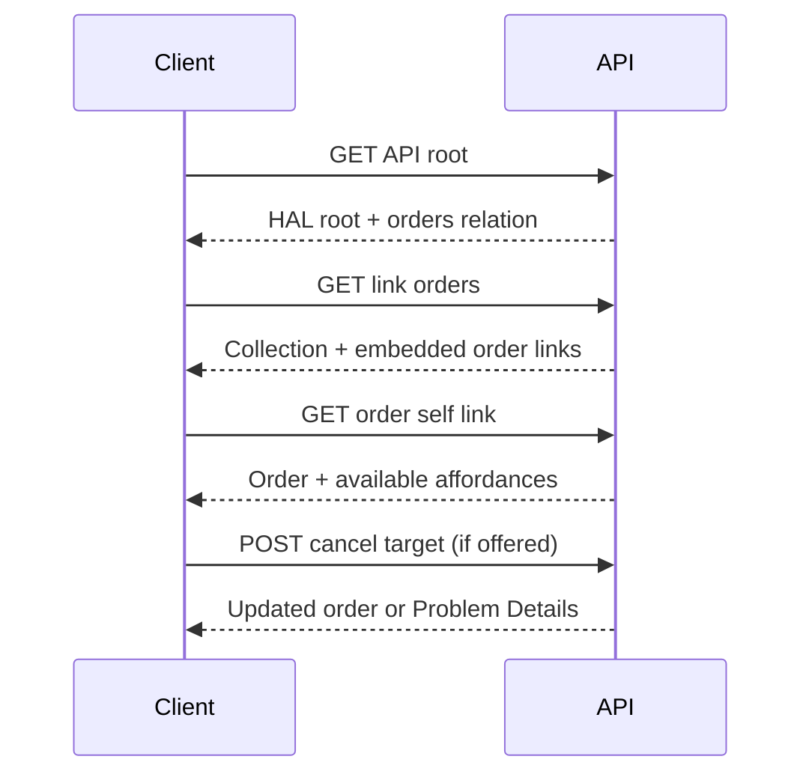

# Tài liệu cho client

Client tích hợp với API HATEOAS cần hiểu cách bắt đầu từ entry point, đọc representation và theo các relation do server công bố để tìm resource hoặc hành động tiếp theo. Tài liệu dành cho client vì vậy phải mô tả cách sử dụng API theo góc nhìn của consumer: gửi request nào, chọn media type ra sao, khám phá link thế nào, xử lý affordance và lỗi như thế nào, cùng các quy tắc tương thích khi API tiến hóa.

Với Spring HATEOAS, server có thể tạo representation bằng `EntityModel`, `CollectionModel`, `RepresentationModel`, link và affordance. Client có thể dùng `Traverson`, `LinkDiscoverer` hoặc HTTP client thông thường để đi theo relation. Tài liệu nên chỉ dẫn các quy tắc giao tiếp ổn định, đồng thời dùng ví dụ thực tế để người tích hợp có thể kiểm chứng cách điều hướng.

Bài học này thuộc chương **Tài liệu HATEOAS** trong module **SPRING_HATEOAS**, tập trung vào hướng dẫn client sử dụng một API hypermedia: khám phá entry point, chọn media type, theo relation thay vì ghép URL, xử lý URI template và affordance, duyệt collection, xử lý lỗi, authentication, cache, version/profile và xây dựng client bền vững.

Sau bài học, bạn có thể:

- Viết hướng dẫn tích hợp API theo hành trình của client.
- Bắt đầu từ API root và khám phá resource qua relation.
- Chọn đúng `Accept` và đọc `Content-Type` của response.
- Dùng `Traverson` hoặc `LinkDiscoverer` để điều hướng HAL.
- Xử lý URI template mà không tự ghép query string.
- Đọc affordance/HAL-FORMS để biết method và input của action.
- Duyệt collection, embedded resource và pagination links.
- Xử lý Problem Details, authorization, retry và cache validation.
- Thiết kế client chịu được field, link và profile mới.
- Viết integration test bảo vệ hành vi điều hướng của client.

## 1. Tài liệu client khác tài liệu resource như thế nào?

Tài liệu resource mô tả một resource: field, relation, affordance và representation của nó. Tài liệu client hướng dẫn consumer hoàn thành một mục tiêu bằng cách sử dụng nhiều resource và transition.

Ví dụ, thay vì chỉ liệt kê resource `Order`, hướng dẫn client có thể mô tả hành trình:

1. Gọi API root để lấy relation `orders`.
2. Theo link `orders` để lấy collection đơn hàng.
3. Chọn một embedded item và theo `self` để lấy representation đầy đủ.
4. Đọc `status` và các relation được công bố.
5. Nếu có relation `cancel`, đọc affordance hoặc form template để gửi yêu cầu hủy.
6. Đọc response mới để xác định trạng thái và các hành động tiếp theo.

Tài liệu client nên trả lời câu hỏi “consumer phải làm gì tiếp theo với response này?” thay vì yêu cầu client ghi nhớ cấu trúc route nội bộ.

## 2. Bắt đầu từ entry point

Client nên được cấu hình một URI entry point do API công bố, ví dụ:

```text
https://api.example.com/api
```

Request đầu tiên:

```http
GET /api HTTP/1.1
Accept: application/hal+json
Authorization: Bearer <access-token>
```

Response ví dụ:

```json
{
  "_links": {
    "self": { "href": "/api" },
    "orders": { "href": "/api/orders" },
    "customers": { "href": "/api/customers" },
    "profile": { "href": "/profiles/api" }
  }
}
```

Client tìm relation `orders` trong `_links` rồi dùng `href` trả về. Tài liệu có thể nêu entry point để cấu hình ban đầu, nhưng các bước tiếp theo nên đi theo link trong response.

Không yêu cầu client tự ghép `/api/orders`, `/api/orders/{id}` hoặc `/api/orders/{id}/cancellation` từ một quy ước URL. Khi server thay đổi context path, gateway hoặc route, client tiếp tục hoạt động nếu relation semantics và link contract vẫn được giữ.

## 3. Mô tả một hành trình client hoàn chỉnh

Một hướng dẫn tích hợp hữu ích nên mô tả một use case từ đầu đến cuối. Ví dụ luồng tạo và theo dõi đơn hàng:



Mỗi bước trong tài liệu nên có request, response rút gọn, relation được sử dụng và điều kiện chuyển sang bước tiếp theo. Hãy thêm nhánh lỗi hoặc nhánh state khác nếu workflow có thể đi theo nhiều hướng.

## 4. Chọn media type và content negotiation

Client gửi `Accept` để cho server biết representation mong muốn. Server trả `Content-Type` để xác nhận định dạng thực tế.

| Media type | Khi client cần dùng | Cách đọc |
|---|---|---|
| `application/hal+json` | Resource HAL thông thường | Đọc field dữ liệu, `_links` và `_embedded`. |
| `application/prs.hal-forms+json` | Representation có form template | Đọc `_links` và `_templates` để khám phá input/action. |
| `application/problem+json` | Response lỗi theo RFC 9457 | Đọc `type`, `title`, `status`, `detail`, `instance` và extension fields. |
| `application/json` | JSON thông thường nếu API hỗ trợ | Không giả định có `_links` hoặc `_embedded`. |

Ví dụ client yêu cầu HAL:

```http
GET /api/orders/42 HTTP/1.1
Accept: application/hal+json
```

Sau khi nhận response, client cần kiểm tra `Content-Type` trước khi chọn parser. Request lỗi có thể trả `application/problem+json` dù request ban đầu gửi `Accept: application/hal+json`; tài liệu API cần nêu rõ cách server thương lượng lỗi.

Không parse mọi response thành một DTO HAL cố định. Status và media type cùng quyết định cách đọc body.

## 5. Theo relation thay vì ghép URL

Relation định danh ý nghĩa của link; `href` là URI hiện tại để truy cập đích. Client tìm relation cần dùng rồi gọi URI đó.

Ví dụ response:

```json
{
  "id": 42,
  "status": "PENDING",
  "_links": {
    "self": { "href": "https://api.example.com/api/orders/42" },
    "customer": { "href": "https://api.example.com/api/customers/7" },
    "cancel": { "href": "https://api.example.com/api/orders/42/cancellation" }
  }
}
```

Client cần tìm `customer` hoặc `cancel` theo relation. Đừng suy ra rằng mọi order đều có `cancel`; relation có thể vắng khi đơn hàng đã giao hoặc principal không có quyền hủy.

Với relation chuẩn, dùng semantics được đăng ký bởi IANA như `self`, `next`, `prev`, `first`, `last` hoặc `collection`. Với extension relation, tài liệu cần cung cấp URI định danh hoặc CURIE và giải thích semantics. Client không nên so sánh relation theo cách viết tùy tiện hoặc tự rút gọn URI relation.

## 6. Giải quyết relative link và bảo vệ origin

`href` có thể là URI tuyệt đối hoặc URI reference tương đối. Client phải resolve URI tương đối dựa trên URI hiệu lực của response hiện tại theo quy tắc URI resolution, không dựa trên thư mục làm việc hoặc một base URL tự đoán.

Ví dụ, nếu response được lấy từ `https://api.example.com/api/orders/42` và link có `href: "../customers/7"`, client resolve link dựa trên URI response:

```java
import java.net.URI;

URI responseUri = URI.create("https://api.example.com/api/orders/42");
URI customerUri = responseUri.resolve("../customers/7");
// https://api.example.com/api/customers/7
```

Nếu server trả redirect, dùng URI cuối cùng của response làm base khi thư viện HTTP cung cấp thông tin đó. Khi theo link tới origin khác, không tự động chuyển tiếp bearer token, cookie hoặc credential của API hiện tại. Chỉ gửi credential tới origin được cấu hình hoặc allowlist rõ ràng.

Với ứng dụng server-side tự gọi URI do API khác cung cấp, cần kiểm soát scheme, host và port được phép để tránh biến link thành đường truy cập tới địa chỉ nội bộ ngoài dự kiến. Link do server công bố là dữ liệu đầu vào; client vẫn phải áp dụng trust policy của mình.

## 7. Xử lý relation bắt buộc và tùy chọn

Client nên phân biệt relation bắt buộc của hợp đồng với relation chỉ xuất hiện khi thỏa điều kiện:

| Relation | Kỳ vọng | Hành vi client |
|---|---|---|
| `self` trên item resource | Thường bắt buộc | Thiếu relation là response không đáp ứng contract của item. |
| `orders` trên API root | Bắt buộc nếu client workflow cần duyệt đơn hàng | Báo lỗi contract hoặc fallback được tài liệu hóa. |
| `cancel` | Tùy chọn theo state và quyền | Chỉ hiển thị hành động nếu link tồn tại. |
| `next` | Tùy chọn khi collection còn trang sau | Dừng duyệt khi không còn link. |
| `customer` | Tùy chọn nếu order không có customer hoặc API che giấu quan hệ | Xử lý trường hợp thiếu theo quy tắc nghiệp vụ. |

Không dùng một API “required link” cho mọi relation. Relation bắt buộc có thể khiến client báo lỗi contract khi bị thiếu; relation tùy chọn nên được biểu diễn bằng kiểu optional và nhánh xử lý phù hợp.

## 8. Dùng LinkDiscoverer để đọc HAL

Spring HATEOAS có `LinkDiscoverer` để tìm link theo relation trong representation. Đây là lựa chọn phù hợp khi client nhận HAL JSON dưới dạng chuỗi và không muốn tự viết logic đọc `_links`.

Ví dụ với discoverer được cấu hình trong ứng dụng:

```java
import org.springframework.hateoas.Link;
import org.springframework.hateoas.LinkRelation;
import org.springframework.hateoas.MediaTypes;
import org.springframework.hateoas.client.LinkDiscoverer;
import org.springframework.hateoas.client.LinkDiscoverers;

class HalNavigation {

    private final LinkDiscoverers discoverers;

    HalNavigation(LinkDiscoverers discoverers) {
        this.discoverers = discoverers;
    }

    Link requiredLink(String relation, String halDocument) {
        LinkDiscoverer discoverer = discoverers
                .getRequiredLinkDiscovererFor(MediaTypes.HAL_JSON);

        return discoverer.findRequiredLinkWithRel(
                LinkRelation.of(relation), halDocument);
    }
}
```

`LinkDiscoverers` chọn implementation theo media type. `findRequiredLinkWithRel(...)` thất bại nếu relation không tồn tại; với relation tùy chọn, dùng `findLinkWithRel(...)` để nhận `Optional<Link>`. Nếu cần nhiều link cùng relation, dùng `findLinksWithRel(...)`.

Ứng dụng dùng Spring Boot có thể inject registry được cấu hình tự động khi các hypermedia module phù hợp có trên classpath. Nếu tự cấu hình, cần đăng ký discoverer cho media type mà client thực sự nhận.

## 9. Dùng Traverson để điều hướng nhiều bước

`Traverson` là client API của Spring HATEOAS dành cho việc đi theo chuỗi relation. Thay vì lấy một URL rồi tự nối URL tiếp theo, client chỉ ra các relation cần follow.

Ví dụ lấy collection `orders` từ API root:

```java
import java.net.URI;

import org.springframework.core.ParameterizedTypeReference;
import org.springframework.hateoas.CollectionModel;
import org.springframework.hateoas.EntityModel;
import org.springframework.hateoas.MediaTypes;
import org.springframework.hateoas.client.Traverson;

Traverson traverson = new Traverson(
        URI.create("https://api.example.com/api"),
        MediaTypes.HAL_JSON);

ParameterizedTypeReference<CollectionModel<EntityModel<OrderSummary>>> type =
        new ParameterizedTypeReference<>() {};

CollectionModel<EntityModel<OrderSummary>> orders = traverson
        .follow("orders")
        .toObject(type);
```

Ví dụ giả định client đã cấu hình message converters phù hợp để deserialize HAL thành `CollectionModel` và `EntityModel`. URI API root là cấu hình ban đầu; relation `orders` được lấy từ representation root.

Với collection, client có thể duyệt embedded items và theo `self` link của từng item. Nếu cần tải item đầy đủ, dùng URI của link đó với HTTP client hoặc khởi tạo traversal từ URI vừa nhận. Không giả định `self` ở collection root là `self` của một item.

## 10. Theo link item và association

Một collection HAL thường chứa embedded items:

```json
{
  "_embedded": {
    "orders": [
      {
        "id": 42,
        "status": "PENDING",
        "_links": {
          "self": { "href": "/api/orders/42" }
        }
      }
    ]
  },
  "_links": {
    "self": { "href": "/api/orders" }
  }
}
```

Client cần phân biệt:

- `self` ở root collection: URI của collection.
- `self` trong embedded item: URI của item cụ thể.
- `customer` trên order: URI của association customer.

Nếu embedded item có đủ dữ liệu cho màn hình hiện tại, client có thể dùng ngay. Nếu cần field chi tiết hơn, theo link `self` của item. Với association, theo relation như `customer` thay vì đoán `/customers/{id}` từ một field ID.

## 11. URI template và query parameter

Một link có thể là URI template thay vì URI hoàn chỉnh:

```json
{
  "_links": {
    "search": {
      "href": "/api/orders{?status,page,size,sort}",
      "templated": true
    }
  }
}
```

Client cần kiểm tra `templated` và expand biến theo quy tắc URI Template (RFC 6570). Không nối `?status=` hoặc `&page=` bằng string thủ công vì template có thể đã có query expression, encoding hoặc biến khác.

Tài liệu cần liệt kê tên biến, kiểu, giá trị hợp lệ, default và ý nghĩa của từng query parameter. Ví dụ `status` có thể nhận `PENDING`, `PAID`, `SHIPPED`; `page` bắt đầu từ `0`; `size` bị giới hạn bởi server.

Với Traverson, có thể truyền template parameters vào traversal builder theo API của phiên bản Spring HATEOAS đang dùng. Với HTTP client khác, dùng URI Template implementation tương thích RFC 6570 và encode value đúng một lần.

## 12. Đọc affordance và HAL-FORMS template

HAL link thông thường cho biết relation và target. Affordance có thể bổ sung method và mô tả input/output; HAL-FORMS biểu diễn các template đó trong `_templates`.

Ví dụ:

```json
{
  "_links": {
    "self": { "href": "/api/orders/42" },
    "cancel": { "href": "/api/orders/42/cancellation" }
  },
  "_templates": {
    "cancel": {
      "method": "POST",
      "target": "/api/orders/42/cancellation",
      "contentType": "application/json",
      "properties": [
        {
          "name": "reason",
          "type": "text",
          "required": true,
          "maxLength": 500
        }
      ]
    }
  }
}
```

Client cần đọc method, target, content type và properties từ template. Không giả định mọi action là `POST` hoặc body luôn là JSON; dùng metadata được công bố. Nếu API chỉ trả `application/hal+json`, client có thể nhận link nhưng không nhận đầy đủ form template.

Affordance là thông tin về thao tác khả dụng tại thời điểm representation được tạo. Server vẫn có thể từ chối request nếu state hoặc quyền thay đổi trước khi client gửi action.

## 13. Không biến relation thành tên nút hoặc role nội bộ

Relation là semantics của API, không phải label giao diện. Client có thể ánh xạ relation `cancel` thành nút “Hủy đơn hàng”, nhưng label hiển thị có thể được bản địa hóa riêng.

Tương tự, relation không nên chứa tên role như `admin-cancel`. Client không cần biết server dùng role nào để cho phép hành động; nó chỉ cần biết action có được công bố hay không.

Tài liệu nên phân biệt:

- Relation: định danh hành động hoặc resource, ví dụ `cancel`.
- Title/label: văn bản hiển thị cho người dùng nếu server cung cấp.
- Affordance: metadata mô tả method, input và output.
- Authorization: quyết định của server khi request thực tế tới endpoint.

## 14. Duyệt collection và pagination

Client không nên tự tăng page number nếu collection đã công bố các link điều hướng. Ví dụ:

```json
{
  "_links": {
    "self": { "href": "/api/orders?page=0&size=20" },
    "next": { "href": "/api/orders?page=1&size=20" },
    "last": { "href": "/api/orders?page=2&size=20" }
  },
  "page": {
    "size": 20,
    "totalElements": 57,
    "totalPages": 3,
    "number": 0
  }
}
```

Client có thể lặp:

1. Xử lý items của trang hiện tại.
2. Tìm relation `next`.
3. Nếu không có `next`, kết thúc.
4. Nếu có, gọi URI trong `next.href` và lặp lại.

Không suy ra rằng `last` hoặc `prev` luôn có mặt. Collection rỗng, trang đầu, trang cuối hoặc policy của server có thể làm một số relation biến mất.

Khi duyệt nhiều trang, giới hạn số request đồng thời và xử lý retry/backoff để tránh tạo tải lớn. Nếu dữ liệu thay đổi trong lúc pagination, server có thể trả collection không phải snapshot; tài liệu cần nêu rõ semantics nếu client yêu cầu kết quả nhất quán.

## 15. Xử lý lỗi bằng Problem Details

Request lỗi có thể trả `application/problem+json` theo RFC 9457:

```json
{
  "type": "https://api.example.com/problems/order-cannot-be-cancelled",
  "title": "Order cannot be cancelled",
  "status": 409,
  "detail": "Đơn hàng đã được giao.",
  "instance": "/api/orders/42/cancellation",
  "code": "ORDER_CANNOT_BE_CANCELLED"
}
```

Client nên:

- Dựa vào HTTP status cho nhóm xử lý tổng quát.
- Dùng `type` hoặc extension `code` ổn định để nhận diện problem.
- Hiển thị `detail` nếu phù hợp với người dùng, nhưng không parse nó để quyết định logic.
- Giữ `instance` hoặc `requestId` để hỗ trợ tra cứu sự cố.
- Chấp nhận extension mới mà client chưa biết.

Không giả định lỗi luôn là HAL document có `_links`. Chọn parser dựa trên `Content-Type` và xử lý fallback nếu server trả body rỗng hoặc media type không mong đợi.

## 16. Authentication và authorization

Tài liệu client cần mô tả cách lấy và gửi credential theo cơ chế mà API hỗ trợ, ví dụ bearer token hoặc session cookie. Với bearer token:

```http
Authorization: Bearer <access-token>
```

Client không nên ghi token vào log, URL, query parameter hoặc exception message. Khi nhận `401`, thực hiện quy trình refresh/login theo hợp đồng authentication; khi nhận `403`, không lặp lại cùng request với credential không thay đổi.

Một relation như `cancel` có thể chỉ xuất hiện với principal đủ quyền. Nếu link không xuất hiện, client nên ẩn action tương ứng. Tuy nhiên, link vắng mặt không thay thế authorization; client vẫn phải xử lý `403` nếu quyền thay đổi sau khi representation được tải.

Nếu API dùng `404` để che giấu resource, tài liệu cần nói rõ client không thể luôn phân biệt resource không tồn tại với resource mà principal không được phép thấy.

## 17. Retry và tính an toàn của thao tác

Không phải mọi request đều có thể retry tự động. Tài liệu client nên phân biệt safe method, idempotent method và thao tác có side effect:

| Method | Semantics chung | Hướng dẫn retry |
|---|---|---|
| `GET` | Safe và idempotent | Có thể retry lỗi mạng tạm thời với backoff. |
| `HEAD` | Safe và idempotent | Có thể retry theo chính sách đọc. |
| `PUT` | Idempotent theo HTTP semantics | Có thể retry nếu request cùng semantics và precondition được xử lý đúng. |
| `DELETE` | Idempotent theo HTTP semantics | Có thể retry nhưng response lần sau có thể khác do resource đã bị xóa. |
| `POST` | Không mặc định idempotent | Không retry mù khi không biết server đã xử lý request trước đó hay chưa. |

Với thao tác tạo hoặc thanh toán, API có thể hỗ trợ idempotency key. Tài liệu cần nêu header, phạm vi duy nhất, thời gian lưu key và response khi client gửi lại cùng key.

Nếu affordance cho biết action dùng `POST`, client không được tự suy ra action có thể retry an toàn. Hãy dựa vào semantics được tài liệu hóa và cơ chế idempotency do API công bố.

## 18. Cache và conditional request

Client có thể nhận `Cache-Control`, `ETag` và `Last-Modified` để cache representation:

```http
HTTP/1.1 200 OK
Content-Type: application/hal+json
ETag: "order-42-v17"
Last-Modified: Thu, 26 Nov 2026 05:27:18 GMT
Cache-Control: private, no-cache
```

Khi cần revalidate, client có thể gửi `If-None-Match` hoặc `If-Modified-Since`. Nếu server trả `304 Not Modified`, client dùng lại body đã cache và cập nhật metadata theo response.

Với response cá nhân hóa theo principal, không chia sẻ cache giữa người dùng khác nhau. Tôn trọng `private`, `no-store`, `Vary` và validator của server. Không tự cache link action nhạy cảm lâu hơn chính sách response cho phép.

Client không nên tự tạo ETag hoặc Last-Modified cho server. Validator do origin server công bố và client gửi lại nguyên vẹn theo HTTP semantics.

## 19. Profile và versioning

Resource có thể công bố relation `profile` trỏ tới tài liệu semantics. Client có thể tải profile để hiểu descriptor, relation hoặc transition mà representation sử dụng.

Nếu profile có trường `version`, client nên kiểm tra version có nằm trong tập hỗ trợ không. Không đồng nhất profile version với API route version hoặc HAL media type version; chúng có thể tiến hóa độc lập.

Khi client gặp relation hoặc field mới:

- Bỏ qua field không cần thiết nếu hợp đồng cho phép.
- Không thất bại chỉ vì có thêm relation chưa biết.
- Chỉ dùng relation đã hiểu semantics.
- Không gọi action dựa trên tên lạ hoặc phỏng đoán.
- Dùng profile/version metadata nếu cần xác định semantics mới.

Tài liệu cần mô tả cách client nhận biết profile mới, thời gian duy trì profile cũ và fallback khi version không được hỗ trợ.

## 20. Viết client Java bằng Traverson và HTTP client

Một ứng dụng Spring có thể dùng `Traverson` cho bước điều hướng relation và dùng HTTP client cho request tiếp theo. Ví dụ dưới đây lấy collection từ API root, sau đó theo link `self` của item đầu tiên:

```java
import java.net.URI;
import java.util.Optional;

import org.springframework.core.ParameterizedTypeReference;
import org.springframework.hateoas.CollectionModel;
import org.springframework.hateoas.EntityModel;
import org.springframework.hateoas.IanaLinkRelations;
import org.springframework.hateoas.MediaTypes;
import org.springframework.hateoas.client.Traverson;
import org.springframework.web.client.RestClient;

Traverson traverson = new Traverson(
        URI.create("https://api.example.com/api"),
        MediaTypes.HAL_JSON);

ParameterizedTypeReference<CollectionModel<EntityModel<OrderSummary>>> type =
        new ParameterizedTypeReference<>() {};

CollectionModel<EntityModel<OrderSummary>> collection = traverson
        .follow("orders")
        .toObject(type);

Optional<EntityModel<OrderSummary>> first = collection.getContent()
        .stream()
        .findFirst();

if (first.isPresent()) {
    URI orderUri = first.get()
            .getRequiredLink(IanaLinkRelations.SELF)
            .toUri();

    RestClient client = RestClient.builder().build();
    EntityModel<OrderRepresentation> order = client.get()
            .uri(orderUri)
            .accept(MediaTypes.HAL_JSON)
            .retrieve()
            .body(new ParameterizedTypeReference<>() {});
}
```

Ví dụ giả định Jackson được cấu hình với module Spring HATEOAS để deserialize `EntityModel` và `CollectionModel`. Trong ứng dụng thực tế, nên tái sử dụng một `RestClient` đã cấu hình base settings, authentication interceptor và message converters thay vì tạo client cho mỗi request.

`getRequiredLink(IanaLinkRelations.SELF)` phù hợp khi item contract bắt buộc có self link. Nếu relation có thể vắng mặt, dùng `getLink(...)` và xử lý `Optional`.

## 21. Xây client chịu được thay đổi

Client HATEOAS bền vững nên tuân thủ các nguyên tắc:

- Bắt đầu từ entry point đã cấu hình.
- Theo relation và href do server cung cấp.
- Bỏ qua field hoặc relation không biết nếu không cần dùng.
- Không giả định thứ tự property JSON hoặc link.
- Chấp nhận link tùy chọn và collection rỗng.
- Kiểm tra media type trước khi parse body.
- Dùng URI template expansion đúng chuẩn.
- Đọc affordance thay vì tự suy đoán method/input.
- Re-check state và quyền qua response của server.
- Xử lý lỗi và retry theo HTTP semantics.
- Tôn trọng cache headers và profile metadata.

Không nên xây một client “quá linh hoạt” tới mức gọi relation chưa biết. Bỏ qua semantics không hỗ trợ là an toàn hơn tự đoán hành vi của action mới.

## 22. Kiểm thử client contract

Test của client nên kiểm tra hành vi điều hướng, không chỉ so sánh chuỗi URL:

1. API root có relation bắt buộc mà workflow cần.
2. Client theo `href` của relation, kể cả khi host/path khác fixture trước.
3. Client xử lý relation tùy chọn vắng mặt.
4. Client duyệt collection qua `next` đến khi relation biến mất.
5. Client chọn parser theo `Content-Type`.
6. Client đọc affordance và gửi method/body phù hợp.
7. Client xử lý `application/problem+json` theo type/code.
8. Client không retry POST mù khi kết quả request chưa rõ.
9. Client tôn trọng `ETag`, `Last-Modified` và `Cache-Control`.
10. Client bỏ qua extension field/relation mới chưa biết khi hợp đồng cho phép.

Có thể dùng mock HTTP server hoặc WireMock để trả fixture HAL và xác nhận client theo relation. Nên có ít nhất một integration test với server thật hoặc contract test được sinh từ response thực tế để tránh fixture lệch khỏi API.

## 23. Mẫu cấu trúc tài liệu client

Một guide cho consumer có thể được tổ chức như sau:

```markdown
# Client integration guide

## Prerequisites
- API entry point
- Authentication method
- Supported media types

## Discover the API
- Read the API root
- Follow the orders relation

## Read an order
- Follow self and customer links
- Understand the representation

## Perform an action
- Check for cancel relation
- Read the affordance or form template
- Submit the request

## Handle responses
- Success and state transitions
- Problem Details
- Retry and idempotency

## Production concerns
- Pagination
- Caching
- Version/profile compatibility
- Security and observability
```
```

Tài liệu nên có ít nhất một ví dụ end-to-end bằng ngôn ngữ client mà nhóm consumer sử dụng phổ biến. Nếu có nhiều SDK, phần semantics và HTTP examples nên là nguồn chuẩn chung; từng SDK có thể bổ sung cách gọi tương ứng.

## 24. Những lỗi thường gặp

| Lỗi | Hệ quả | Cách xử lý |
|---|---|---|
| Bắt client ghép URL theo route | Client hỏng khi route hoặc gateway đổi. | Bắt đầu từ entry point và follow relation. |
| Chỉ đưa JSON mẫu, không giải thích hành trình | Consumer không biết bước tiếp theo. | Viết workflow với request/response theo từng bước. |
| Giả định mọi relation luôn tồn tại | Client lỗi khi link tùy chọn vắng mặt. | Tài liệu hóa required/optional và state conditions. |
| Dùng sai parser cho error response | Client parse Problem Details như HAL. | Chọn parser theo Content-Type. |
| Coi affordance là authorization guarantee | Request có thể bị từ chối khi state/quyền thay đổi. | Xử lý `403`, `409` và re-fetch resource. |
| Tự nối query string vào URI template | Sai encoding hoặc duplicate query parameter. | Dùng URI Template expansion. |
| Retry POST sau timeout mà không idempotency | Có thể tạo thao tác trùng. | Dùng idempotency key hoặc reconciliation workflow. |
| Bỏ qua cache headers | Dữ liệu cũ hoặc rò rỉ response cá nhân hóa. | Tôn trọng validator và cache directives. |
| Hard-code mọi field/extension | Client dễ hỏng khi API thêm dữ liệu tương thích. | Bỏ qua field chưa biết khi hợp đồng cho phép. |
| Không kiểm thử điều hướng | Client chỉ chạy với fixture có URL cố định. | Test relation-driven traversal với URI thay đổi. |

## 25. Quy trình viết tài liệu cho client

1. Xác định use case mà consumer cần hoàn thành.
2. Ghi API entry point, authentication và media types được hỗ trợ.
3. Mô tả request đầu tiên và relation client cần follow.
4. Minh họa representation và cách tìm link bắt buộc/tùy chọn.
5. Mô tả URI template, affordance và form input nếu có.
6. Hướng dẫn collection, embedded resource và pagination.
7. Ghi success response, state transition và Problem Details.
8. Mô tả security, retry, idempotency và cache behavior.
9. Ghi profile/version compatibility và cách xử lý relation mới.
10. Cung cấp ví dụ client chạy được và test hành vi điều hướng.
11. Tạo tài liệu từ response/test thực tế và cập nhật khi contract thay đổi.

Tài liệu dành cho client tốt giúp consumer hoàn thành workflow bằng những khả năng mà server công bố. Khi client bắt đầu từ entry point, theo relation, đọc affordance và xử lý HTTP semantics đúng cách, server có thể thay đổi route hoặc cấu trúc triển khai mà không buộc client phải mã hóa lại toàn bộ đường dẫn.

## Tài liệu tham khảo

- [Spring HATEOAS – Client Support and Traverson](https://docs.spring.io/spring-hateoas/docs/current/reference/html/#client)
- [Spring HATEOAS – LinkDiscoverer API](https://docs.spring.io/spring-hateoas/docs/current/api/org/springframework/hateoas/client/LinkDiscoverer.html)
- [Spring HATEOAS – Traverson API](https://docs.spring.io/spring-hateoas/docs/current/api/org/springframework/hateoas/client/Traverson.html)
- [RFC 8288 – Web Linking](https://www.rfc-editor.org/rfc/rfc8288)
- [RFC 6570 – URI Template](https://www.rfc-editor.org/rfc/rfc6570)
- [RFC 9457 – Problem Details for HTTP APIs](https://www.rfc-editor.org/rfc/rfc9457)
