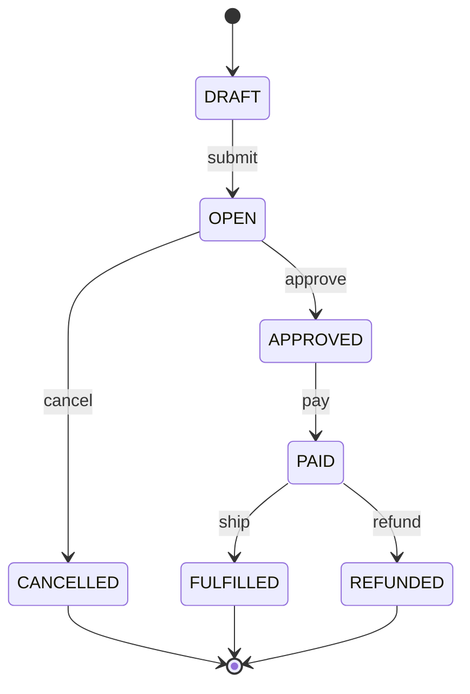

# Lạm dụng link

Hypermedia links giúp client khám phá tài nguyên liên quan và các bước tiếp theo mà server đang công bố. Tuy nhiên, thêm càng nhiều link không có nghĩa API càng RESTful hoặc càng dễ dùng. Khi representation chứa hàng chục link trùng ý nghĩa, link tới mọi field nội bộ hoặc các thao tác không thể thực hiện trong trạng thái hiện tại, client phải xử lý nhiều lựa chọn không hữu ích và response trở nên nặng hơn.

Trong Spring HATEOAS, `RepresentationModel`, `EntityModel`, `CollectionModel` và `PagedModel` cho phép bổ sung nhiều `Link`. Việc thêm link rất dễ về mặt kỹ thuật; khó hơn là quyết định link nào thật sự thuộc về representation, quan hệ của nó có ý nghĩa gì và client có thể sử dụng nó trong ngữ cảnh hiện tại hay không.

Lạm dụng link là anti-pattern khi số lượng hoặc ngữ nghĩa link vượt quá nhu cầu điều hướng của client: link không phục vụ một quan hệ tài nguyên hoặc capability rõ ràng, lặp lại cùng một lựa chọn, làm lộ cấu trúc nội bộ hoặc gây hiểu nhầm về khả năng thực thi. Mục tiêu là cung cấp đủ đường đi cho workflow mà API hỗ trợ, giữ relation ổn định và tránh biến `_links` thành danh sách endpoint.

## Link có vai trò gì trong HATEOAS?

Một link có hai thành phần cốt lõi:

- `href`: URI hoặc URI template của tài nguyên đích.
- `rel`: link relation mô tả quan hệ giữa representation hiện tại và đích.

Ví dụ:

```json
{
  "id": "ORD-1001",
  "status": "OPEN",
  "_links": {
    "self": {
      "href": "/api/orders/ORD-1001"
    },
    "customer": {
      "href": "/api/customers/C-42"
    },
    "cancel": {
      "href": "/api/orders/ORD-1001/cancellation"
    }
  }
}
```

`self` nhận diện chính resource; `customer` cho biết quan hệ tới khách hàng; `cancel` mô tả capability hủy đơn được công bố trong ngữ cảnh này. Client có thể theo link mà không phải tự ghép URI theo quy tắc nội bộ của server.

Spring HATEOAS biểu diễn link bằng `Link` và relation bằng `LinkRelation`. `RepresentationModel` là container cho các link; media type như HAL quyết định cách serialize chúng, ví dụ dưới `_links`. Link relation mang semantics, không đơn thuần là nhãn trang trí cho một URL. Vì vậy, một link chỉ hữu ích khi client có thể hiểu quan hệ của đích và quyết định có nên theo nó hay không.

## Khi nào số lượng link trở thành vấn đề?

Không có một con số cố định để kết luận response đã có quá nhiều link. Một tài nguyên quy trình phức tạp có thể cần nhiều relation hơn một tài nguyên tra cứu đơn giản. Vấn đề xuất hiện khi link không bổ sung khả năng điều hướng có ý nghĩa hoặc khiến client phải lọc nhiều lựa chọn không phù hợp.

Một response bị lạm dụng link thường có một hay nhiều dấu hiệu:

1. Có link tới mọi field, getter hoặc thuộc tính của entity, dù client không cần điều hướng tới từng field.
2. Có nhiều relation khác tên nhưng cùng dẫn tới một URI và cùng biểu đạt một ý nghĩa.
3. Công bố mọi thao tác có thể tưởng tượng ra, bất kể trạng thái resource hoặc quyền hiện tại.
4. Lặp lại link collection, search, export, audit và endpoint quản trị trên từng item dù workflow không cần chúng ở mọi item.
5. Dùng relation theo tên method/controller hoặc tên implementation, khiến client phụ thuộc cấu trúc code.
6. Tạo nhiều URI template với các tham số ít khi dùng hoặc không liên quan tới resource.
7. Vừa embed một object lớn vừa cung cấp nhiều link tới cùng dữ liệu mà không có nhu cầu tải độc lập.
8. Dùng `RepresentationModelProcessor` toàn cục để thêm link không điều kiện vào mọi representation phù hợp kiểu, dù link chỉ hợp lệ trong một số trạng thái.

Link count tăng có thể làm JSON lớn hơn, tăng thời gian tạo representation và serialization, tăng bytes truyền qua mạng, đồng thời làm client phải duyệt nhiều lựa chọn. Với collection có `N` item và mỗi item có `L` link, số link trong body tăng theo `N × L`, chưa tính link cấp collection và metadata khác. Đây là lý do nên xem xét cả link ở cấp collection lẫn link ở từng item.

## Anti-pattern 1: Biến _links thành danh sách endpoint

Một số API thêm link cho mọi thao tác của controller chỉ vì endpoint tồn tại:

```java
EntityModel<OrderView> model = EntityModel.of(OrderView.from(order));

model.add(linkTo(methodOn(OrderController.class).one(order.getId()))
        .withSelfRel());
model.add(linkTo(methodOn(OrderController.class).cancel(order.getId()))
        .withRel("cancel"));
model.add(linkTo(methodOn(OrderController.class).approve(order.getId()))
        .withRel("approve"));
model.add(linkTo(methodOn(OrderController.class).ship(order.getId()))
        .withRel("ship"));
model.add(linkTo(methodOn(OrderController.class).refund(order.getId()))
        .withRel("refund"));
model.add(linkTo(methodOn(OrderController.class).archive(order.getId()))
        .withRel("archive"));
model.add(linkTo(methodOn(OrderController.class).audit(order.getId()))
        .withRel("audit"));
model.add(linkTo(methodOn(OrderController.class).export(order.getId()))
        .withRel("export"));
```

Đoạn code trên công bố toàn bộ endpoint mà controller có, nhưng không xét đơn hàng hiện đang ở trạng thái nào. Một đơn đã hủy vẫn có thể nhận link `cancel`; một đơn chưa được thanh toán vẫn có thể nhận `refund`; một người dùng không có quyền duyệt vẫn nhìn thấy `approve`.

Hệ quả là client không biết link nào thật sự có thể sử dụng. Client có thể gọi một thao tác chắc chắn bị từ chối, hoặc phải tự xây logic nghiệp vụ để lọc link. Khi đó, API đã đẩy quyết định mà hypermedia nên hỗ trợ trở lại phía client.

### Cách làm tốt hơn: chỉ công bố capability phù hợp

Tạo representation với link `self` và chỉ thêm các thao tác hợp lệ trong trạng thái hiện tại:

```java
import org.springframework.hateoas.EntityModel;
import org.springframework.hateoas.LinkRelation;
import org.springframework.hateoas.server.RepresentationModelAssembler;
import org.springframework.stereotype.Component;

import static org.springframework.hateoas.server.mvc.WebMvcLinkBuilder.linkTo;
import static org.springframework.hateoas.server.mvc.WebMvcLinkBuilder.methodOn;

@Component
public class OrderModelAssembler implements
        RepresentationModelAssembler<Order, EntityModel<OrderView>> {

    private final OrderPolicy policy;

    public OrderModelAssembler(OrderPolicy policy) {
        this.policy = policy;
    }

    @Override
    public EntityModel<OrderView> toModel(Order order) {
        var id = order.getId();
        var model = EntityModel.of(OrderView.from(order));

        model.add(linkTo(methodOn(OrderController.class).one(id))
                .withSelfRel());

        model.addIf(order.isCancellable(), () ->
                linkTo(methodOn(OrderController.class).cancel(id))
                        .withRel(LinkRelation.of(
                                "https://api.example.com/rels/cancel-order")));

        model.addIf(policy.canApprove(order), () ->
                linkTo(methodOn(OrderController.class).approve(id))
                        .withRel(LinkRelation.of(
                                "https://api.example.com/rels/approve-order")));

        model.addIf(order.hasInvoice(), () ->
                linkTo(methodOn(OrderController.class).invoice(id))
                        .withRel(LinkRelation.of(
                                "https://api.example.com/rels/order-invoice")));

        return model;
    }
}
```

`Order`, `OrderView`, `OrderPolicy` và các method controller là kiểu nghiệp vụ của ví dụ. `isCancellable()`, `canApprove(...)` và `hasInvoice()` phải phản ánh quy tắc nghiệp vụ thực tế. `addIf(condition, supplier)` chỉ tạo và thêm link khi điều kiện đúng; API này có trong `RepresentationModel` của Spring HATEOAS.

Các relation trong đoạn code là custom relation URI do API sở hữu. Nếu muốn dùng tên ngắn như `cancel` hoặc `approve` trong HAL, hãy khai báo CURIE mapping tương ứng; không để client phải đoán một relation tùy ý không được định nghĩa.

Nếu đơn hàng đang `OPEN`, người dùng có quyền duyệt và hóa đơn chưa được phát hành, representation có thể công bố `cancel` và `approve`. Khi đơn đã `PAID`, link `cancel` có thể biến mất; khi hóa đơn đã phát hành, link `invoice` có thể xuất hiện. Client đọc capability từ response thay vì tự suy luận toàn bộ state machine.

Điều kiện link nên dùng cùng policy với endpoint thực thi. Link chỉ là chỉ dẫn về khả năng hiện tại, không phải cơ chế bảo mật. Controller/service vẫn phải kiểm tra quyền và trạng thái khi request thao tác được gửi đến, vì client có thể gọi URI đã biết, dùng response cache cũ hoặc bỏ qua giao diện.

## Anti-pattern 2: Thêm link cho mọi field hoặc thuộc tính nội bộ

Một resource `Order` có các field như `id`, `status`, `createdAt`, `total`, `internalVersion` và `riskScore`. Không nên tự động tạo link riêng cho từng field:

```json
{
  "id": "ORD-1001",
  "status": "OPEN",
  "_links": {
    "self": { "href": "/api/orders/ORD-1001" },
    "id": { "href": "/api/orders/ORD-1001/id" },
    "status": { "href": "/api/orders/ORD-1001/status" },
    "createdAt": { "href": "/api/orders/ORD-1001/created-at" },
    "total": { "href": "/api/orders/ORD-1001/total" },
    "internalVersion": { "href": "/api/orders/ORD-1001/internal-version" },
    "riskScore": { "href": "/api/orders/ORD-1001/risk-score" }
  }
}
```

Các link này biến cấu trúc dữ liệu nội bộ thành một tập endpoint công khai. Client phải thực hiện thêm request để đọc field vốn có thể được trả trong representation; server phải duy trì nhiều endpoint nhỏ; API dễ lộ thông tin implementation không cần thiết.

Hãy phân biệt **field dữ liệu** với **resource có vòng đời hoặc quan hệ độc lập**:

- `status` thường là field của đơn hàng; client không cần link tới `/status` nếu không có một resource trạng thái độc lập với hành vi riêng.
- `customer` có thể là resource liên quan có URI và vòng đời riêng; link `customer` là hợp lý.
- `invoice` có thể là tài liệu riêng được tải hoặc xem độc lập; link `invoice` có ý nghĩa.
- `audit-history` chỉ nên công bố khi client cụ thể có nhu cầu xem lịch sử và được phép truy cập.

Nếu client cần thay đổi một phần dữ liệu, hãy mô tả capability cập nhật phù hợp (chẳng hạn affordance/form hoặc endpoint hành động) thay vì tạo link GET cho từng property chỉ để phản ánh cấu trúc object.

## Anti-pattern 3: Công bố link không phù hợp với trạng thái

Một link hành động chỉ hữu ích khi hành động có ý nghĩa ở thời điểm response được tạo. Ví dụ state machine của đơn hàng:



Nếu representation `FULFILLED` vẫn chứa link `approve`, `cancel`, `pay` và `ship`, client phải biết các link đó vô nghĩa trong trạng thái này. Đó là dấu hiệu server đang công bố toàn bộ sơ đồ endpoint thay vì capability có thể dùng từ trạng thái hiện tại.

Một bảng capability có thể giúp xác định link nào nên xuất hiện:

| Trạng thái hiện tại | Capability có thể công bố | Capability không nên công bố |
|---|---|---|
| `DRAFT` | `submit`, `edit`, `delete` | `ship`, `refund` |
| `OPEN` | `approve`, `cancel` | `ship`, `refund` |
| `APPROVED` | `pay`, `cancel` nếu policy cho phép | `approve`, `refund` |
| `PAID` | `ship`, `invoice`, `refund` nếu policy cho phép | `pay`, `approve`, `cancel` |
| `FULFILLED` | `invoice`, `tracking` | `ship`, `cancel` |
| `CANCELLED` | `self`, `collection` | `approve`, `pay`, `ship` |

Bảng chỉ là ví dụ. Quy tắc thực tế phụ thuộc domain và policy. Không cần đưa link cho mọi chuyển trạng thái có thể có trong mô hình nếu client không cần biết hoặc không thể thực hiện chúng.

## Anti-pattern 4: Nhầm link với authorization

Ẩn link `delete` với người dùng không có quyền xóa giúp giao diện không hiển thị một hành động không khả dụng. Nhưng điều đó không ngăn người dùng gửi `DELETE` trực tiếp tới URI đã biết.

Thiết kế sai thường có suy nghĩ: “Nếu không trả link thì người dùng không thể gọi endpoint”. Đây là giả định bảo mật không đúng.

Thiết kế đúng có hai lớp:

1. **Hypermedia capability:** chỉ công bố link/affordance phù hợp với trạng thái và quyền mà server nhận biết trong request hiện tại.
2. **Authorization tại endpoint:** mỗi request vẫn xác thực principal, quyền, tenant, ownership và trạng thái resource trước khi thực hiện thao tác.

Nếu permission service tốn kém, tránh gọi lặp lại cùng một policy cho từng link. Có thể tính một `OrderCapabilities`/policy result trong một lần, rồi dùng kết quả đó để thêm các link liên quan. Tuy nhiên, không cache quyền qua nhiều người dùng hoặc nhiều request nếu ngữ cảnh bảo mật có thể thay đổi.

## Anti-pattern 5: Trùng link và relation không nhất quán

Ví dụ một response công bố nhiều relation khác tên nhưng cùng chỉ tới một thao tác:

```json
{
  "_links": {
    "cancel": { "href": "/api/orders/ORD-1001/cancellation" },
    "cancelOrder": { "href": "/api/orders/ORD-1001/cancellation" },
    "remove": { "href": "/api/orders/ORD-1001/cancellation" },
    "delete": { "href": "/api/orders/ORD-1001/cancellation" }
  }
}
```

Client không biết relation nào là hợp đồng chính. Nếu các relation chỉ là alias do server thêm để phục vụ nhiều nhóm client, mỗi alias sẽ trở thành một cam kết cần duy trì và kiểm thử.

Hãy chọn một relation có semantics rõ ràng. Dùng relation chuẩn IANA khi ngữ nghĩa phù hợp; nếu cần relation riêng, định nghĩa một custom relation ổn định, tốt nhất bằng URI do API kiểm soát và có tài liệu. Không tạo relation mới chỉ vì tên method controller khác nhau.

### Nhiều link cùng relation không phải lúc nào cũng là trùng lặp

HAL cho phép một relation chứa nhiều link khi chúng thực sự trỏ tới nhiều đích cùng quan hệ. Ví dụ một giỏ hàng có nhiều `item` link. Spring HATEOAS có thể serialize các link cùng relation thành array theo quy tắc HAL.

Điều cần tránh là lặp cùng một cặp `rel`/`href` hoặc dùng nhiều relation làm alias cho cùng capability mà không có lý do. Không gộp các đích khác nhau thành một link chỉ để giảm số lượng; điều đó có thể làm mất khả năng điều hướng.

## Anti-pattern 6: Nhân bản link collection trên mọi item

Một collection response có thể có link `self`, `next`, `prev`, `search` ở cấp collection. Nếu mọi item đều lặp lại những link giống hệt nhau tới collection hoặc search endpoint, response sẽ phình ra mà không cung cấp thêm ngữ cảnh.

Ví dụ không cần thiết:

```json
{
  "_links": {
    "self": { "href": "/api/orders" },
    "search": { "href": "/api/orders/search{?status}" }
  },
  "_embedded": {
    "orders": [
      {
        "id": "ORD-1001",
        "_links": {
          "self": { "href": "/api/orders/ORD-1001" },
          "orders": { "href": "/api/orders" },
          "search": { "href": "/api/orders/search{?status}" }
        }
      },
      {
        "id": "ORD-1002",
        "_links": {
          "self": { "href": "/api/orders/ORD-1002" },
          "orders": { "href": "/api/orders" },
          "search": { "href": "/api/orders/search{?status}" }
        }
      }
    ]
  }
}
```

Link `orders` và `search` ở cấp collection đã đủ cho client bắt đầu một truy vấn mới. Trong mỗi item, link `self` và các capability riêng của item thường có giá trị hơn.

Tuy nhiên, không loại bỏ mọi link collection khỏi item theo một quy tắc máy móc. Nếu một item được gửi riêng qua endpoint detail, link quay lại collection có thể giúp client điều hướng. Quyết định dựa trên workflow và context của representation.

## Anti-pattern 7: Embed tất cả và vẫn thêm link tới mọi thứ

`_embedded` và `_links` giải quyết nhu cầu khác nhau:

- Embed dữ liệu khi client thường xuyên cần nó cùng representation hiện tại và chi phí tải kèm chấp nhận được.
- Dùng link khi tài nguyên liên quan có thể được tải riêng, có vòng đời độc lập, có thể lớn hoặc chỉ được một số client cần.

Embed toàn bộ customer, invoice, shipment, payment, audit log và product detail vào mỗi order khiến response trở thành object graph lớn. Nếu đồng thời tạo thêm link cho từng embedded object, client phải chọn giữa dữ liệu đã có và một endpoint khác trả cùng nội dung.

Ví dụ, order detail có thể embed summary của customer nhưng cung cấp link tới customer resource đầy đủ:

```json
{
  "id": "ORD-1001",
  "customerSummary": {
    "displayName": "Nguyen An"
  },
  "_links": {
    "self": { "href": "/api/orders/ORD-1001" },
    "customer": { "href": "/api/customers/C-42" }
  }
}
```

Client có đủ dữ liệu hiển thị thường dùng và vẫn có thể theo link khi cần chi tiết khách hàng. Cách tổ chức embed/link phải nhất quán với media type và hợp đồng API; không cần embed toàn bộ resource chỉ để giảm số link.

## Anti-pattern 8: Tạo URI template cho mọi bộ lọc có thể có

URI template giúp client khám phá tên biến mà không phải biết cấu trúc URI. Tuy nhiên, một template với hàng chục tham số không liên quan tới use case hiện tại sẽ gây khó hiểu và làm contract phức tạp.

Ví dụ template quá rộng:

```json
{
  "_links": {
    "search": {
      "href": "/api/orders/search{?status,customerId,from,to,sort,page,size,includeAudit,includePayments,includeShipment,internalFlag,debug}",
      "templated": true
    }
  }
}
```

Không công bố tham số nội bộ như `debug` hoặc `internalFlag` cho client công khai. Chỉ đưa vào template các tham số mà API thực sự hỗ trợ và có semantics ổn định. Có thể tách các use case rõ ràng thành link riêng, ví dụ `search` và `by-customer`, thay vì một template tổng hợp khó sử dụng.

## Chọn link theo workflow, không theo số lượng endpoint

Trước khi thêm link, hãy trả lời các câu hỏi:

1. Client cần điều hướng tới một resource khác hay cần thực hiện một capability?
2. Relation này có ý nghĩa ổn định và client có thể hiểu mà không biết tên controller không?
3. Link có hợp lệ trong trạng thái resource và ngữ cảnh quyền hiện tại không?
4. Link có trùng ý nghĩa với một relation đã có không?
5. Link nên nằm ở cấp resource, item hay collection?
6. Client có thực sự cần dữ liệu ngay trong response, hay chỉ cần link để tải khi cần?
7. Link có làm lộ endpoint nội bộ hoặc chi tiết triển khai không?
8. Khi link biến mất hoặc target thay đổi, client có thể xử lý theo semantics đã công bố không?

Một quy tắc thực tế là ưu tiên:

- `self` cho chính resource.
- Link tới resource liên quan có ý nghĩa với client.
- Link collection hoặc điều hướng phân trang ở đúng cấp.
- Link search/template khi client cần khám phá cách truy vấn.
- Link capability khi hành động hợp lệ trong trạng thái và ngữ cảnh hiện tại.
- Affordance khi client cần mô tả method, input hoặc form của thao tác.

Không cần tạo link chỉ để phản chiếu mọi method trong controller, mọi field trong entity hoặc mọi route nội bộ.

## Tổ chức link trong Spring HATEOAS

### Để assembler chịu trách nhiệm representation của resource

`RepresentationModelAssembler` là nơi phù hợp để ánh xạ domain object thành representation và thêm các link gắn với resource đó. Cách này giúp link được tạo nhất quán khi resource xuất hiện trong detail endpoint hoặc collection.

Không nên tạo link rải rác trong controller, service và serializer khiến cùng một resource có tập relation khác nhau mà không có lý do. Tách policy tính capability ra thành service/domain policy nếu logic trạng thái hoặc quyền phức tạp; assembler dùng kết quả đó để xây link.

### Dùng RepresentationModelProcessor cho concern xuyên suốt có giới hạn

`RepresentationModelProcessor` hữu ích khi một nhóm resource cần bổ sung link từ concern khác, ví dụ payment link vào order representation. Nhưng processor chạy trên mọi model khớp kiểu đã khai báo. Nếu processor thêm link không điều kiện, nó có thể tạo ra overlinking trên mọi resource, kể cả resource không ở trạng thái phù hợp.

Hãy giới hạn processor theo kiểu model và điều kiện nghiệp vụ. Nếu link chỉ liên quan tới một endpoint hoặc một workflow cụ thể, assembler của resource đó có thể rõ ràng hơn. Không dùng processor toàn cục như nơi tập hợp tất cả endpoint của ứng dụng.

### Dùng addIf để thể hiện capability có điều kiện

Spring HATEOAS cung cấp `RepresentationModel.addIf(boolean, Supplier<Link>)` và `addAllIf(...)`. Supplier chỉ được gọi khi điều kiện đúng, nên có thể tránh tạo URI không cần thiết:

```java
model.addIf(order.isCancellable(), () ->
        linkTo(methodOn(OrderController.class).cancel(order.getId()))
                .withRel("cancel"));
```

Nếu nhiều link phụ thuộc cùng một permission, tính policy một lần:

```java
OrderCapabilities capabilities = policy.capabilitiesFor(order);

model.addIf(capabilities.canCancel(), () -> cancelLink(order));
model.addIf(capabilities.canApprove(), () -> approveLink(order));
model.addIf(capabilities.canRefund(), () -> refundLink(order));
```

`OrderCapabilities` là kiểu ứng dụng tự định nghĩa. Việc gom kết quả policy giúp tránh gọi lặp cùng một permission check và làm rõ các capability mà representation sẽ công bố.

## Chọn relation có ngữ nghĩa ổn định

Relation là hợp đồng giữa server và client. Một số nguyên tắc:

- Dùng IANA link relation khi relation chuẩn diễn đạt đúng quan hệ.
- Dùng custom relation khi domain cần semantics riêng; công bố tài liệu hoặc URI relation ổn định.
- Không đặt relation theo tên class, tên method Java, tên database table hoặc đường dẫn controller.
- Không dùng nhiều relation đồng nghĩa chỉ để hỗ trợ các cách đặt tên khác nhau.
- Không đổi relation chỉ vì URI endpoint được refactor nếu semantics không thay đổi.
- Không tái sử dụng một relation cho hai hành vi khác nhau chỉ vì chúng tình cờ cùng trỏ tới một URI.

Ví dụ tạo link relation chuẩn bằng `IanaLinkRelations`:

```java
import org.springframework.hateoas.IanaLinkRelations;
import org.springframework.hateoas.Link;

Link self = Link.of("/api/orders/ORD-1001", IanaLinkRelations.SELF);
Link next = Link.of("/api/orders?page=2", IanaLinkRelations.NEXT);
```

Với relation riêng, có thể dùng URI relation do API sở hữu:

```java
import org.springframework.hateoas.Link;
import org.springframework.hateoas.LinkRelation;

Link cancel = Link.of(
        "/api/orders/ORD-1001/cancellation",
        LinkRelation.of("https://api.example.com/rels/cancel-order")
);
```

URI relation cần được duy trì ổn định và tài liệu tại URI nên giải thích semantics của quan hệ. Client không nên phải đoán `cancel`, `cancelOrder` và `remove` có giống nhau hay không.

## Đo tác động của link count

Khi nghi ngờ overlinking, hãy đo response thực tế thay vì dựa vào cảm giác. Một số chỉ số hữu ích:

| Chỉ số | Cách dùng |
|---|---|
| Tổng link trên representation | Phát hiện response có nhiều relation bất thường |
| Số link theo từng item | Nhận diện link collection bị lặp trên mọi phần tử |
| Payload bytes | Đánh giá ảnh hưởng tới truyền tải và cache |
| Serialization duration | Xem chi phí Jackson/HAL tăng theo số link hay không |
| Số relation duy nhất | Phát hiện relation proliferation |
| Tỷ lệ link được client theo | Tìm link ít được sử dụng, nếu có telemetry phù hợp |

Không loại bỏ link chỉ vì tỷ lệ theo thấp trong một khoảng thời gian ngắn. Một link có thể cần cho workflow hiếm nhưng quan trọng. Dữ liệu sử dụng nên kết hợp với yêu cầu nghiệp vụ, compatibility và vai trò của client.

Với collection, đo cả số item và số link/item. Nếu page size tăng từ 20 lên 100, mỗi item có thêm 8 link giống nhau, payload có thể tăng đáng kể. Có thể giảm lặp bằng cách chuyển link dùng chung lên collection level, hoặc giảm page size nếu response thực sự quá lớn.

## Kiểm thử để ngăn overlinking quay trở lại

Test nên kiểm tra link bắt buộc xuất hiện, link có điều kiện chỉ xuất hiện trong trạng thái phù hợp và link nội bộ không bị công bố.

Ví dụ MockMvc cho một đơn hàng đang mở:

```java
import static org.springframework.test.web.servlet.request.MockMvcRequestBuilders.get;
import static org.springframework.test.web.servlet.result.MockMvcResultMatchers.jsonPath;
import static org.springframework.test.web.servlet.result.MockMvcResultMatchers.status;

import org.springframework.hateoas.MediaTypes;

mockMvc.perform(get("/api/orders/ORD-1001")
        .accept(MediaTypes.HAL_JSON))
    .andExpect(status().isOk())
    .andExpect(jsonPath("$._links.self.href").exists())
    .andExpect(jsonPath(
            "$._links['https://api.example.com/rels/cancel-order'].href").exists())
    .andExpect(jsonPath(
            "$._links['https://api.example.com/rels/approve-order'].href").exists())
    .andExpect(jsonPath("$._links.internal-debug").doesNotExist());
```

Với đơn hàng đã thanh toán hoặc đã hủy, kiểm tra capability tương ứng không còn được công bố:

```java
mockMvc.perform(get("/api/orders/ORD-1002")
        .accept(MediaTypes.HAL_JSON))
    .andExpect(status().isOk())
    .andExpect(jsonPath("$._links.self.href").exists())
    .andExpect(jsonPath(
            "$._links['https://api.example.com/rels/cancel-order']").doesNotExist())
    .andExpect(jsonPath(
            "$._links['https://api.example.com/rels/approve-order']").doesNotExist());
```

Các đoạn assertion giả định `mockMvc` đã được inject và ID trong ví dụ được tạo bởi fixture tương ứng với trạng thái. Nếu API cho phép nhiều link cùng relation, test nên kiểm tra đúng tập target mong muốn thay vì giả định mọi relation chỉ có một link.

Ở unit test assembler, có thể kiểm tra số link của một relation khi contract yêu cầu một link duy nhất:

```java
import static org.assertj.core.api.Assertions.assertThat;

import org.springframework.hateoas.EntityModel;

EntityModel<OrderView> model = assembler.toModel(openOrder);

assertThat(model.getLinks("self")).hasSize(1);
assertThat(model.getLinks(
        "https://api.example.com/rels/cancel-order")).hasSize(1);
assertThat(model.getLinks("internal-debug")).isEmpty();
```

Nếu một relation được phép có nhiều đích, kiểm tra danh sách `href` và relation thay vì chỉ kiểm tra số lượng.

## Những lỗi thường gặp

| Anti-pattern | Hệ quả | Hướng xử lý |
|---|---|---|
| Thêm link cho mọi endpoint | Client nhận danh sách thao tác không phù hợp | Chỉ công bố capability liên quan đến workflow |
| Thêm link cho mọi field | Lộ cấu trúc entity và tăng request không cần thiết | Phân biệt field với resource độc lập |
| Link hành động không xét state | Client thử thao tác chắc chắn thất bại | Dùng policy để thêm link có điều kiện |
| Coi link ẩn là bảo mật | Endpoint vẫn có thể bị gọi trực tiếp | Authorization tại endpoint luôn bắt buộc |
| Nhiều relation alias cho cùng URI | Contract khó hiểu và khó duy trì | Chọn relation ổn định, có semantics |
| Lặp link collection trên từng item | Payload lớn và nhiều lựa chọn lặp | Đặt link dùng chung ở cấp collection khi phù hợp |
| Embed toàn bộ object graph | Response nặng và khó cache | Embed phần client cần ngay, link phần tải riêng |
| Template chứa mọi query parameter | Client khó biết tham số nào có ý nghĩa | Chỉ công bố biến được hỗ trợ cho use case |
| Processor thêm link vô điều kiện | Link xuất hiện trên mọi model cùng kiểu | Giới hạn processor theo state và policy |
| Tạo custom relation theo tên method | Client phụ thuộc implementation | Đặt relation theo semantics domain ổn định |
| Xóa link chỉ để giảm payload | Workflow client bị phá vỡ | Đo và tối ưu link dư thừa, giữ link có giá trị |

## Checklist thiết kế link vừa đủ

1. Mỗi link có `rel` diễn đạt một quan hệ hoặc capability mà client hiểu được.
2. Giữ link `self` và các link điều hướng cốt lõi của resource.
3. Chỉ thêm link tới resource liên quan mà client có lý do để khám phá.
4. Chỉ công bố action link khi trạng thái và policy hiện tại cho phép.
5. Không dùng link thay cho authorization hoặc validation tại endpoint.
6. Tránh relation alias và URI trùng lặp không có mục đích.
7. Đặt link collection/search/pagination ở đúng cấp representation.
8. Chọn embed hoặc link theo nhu cầu tải dữ liệu của client.
9. Giới hạn URI template vào tham số công khai và có semantics ổn định.
10. Dùng assembler hoặc processor có phạm vi rõ ràng để quản lý link.
11. Đo link count, payload size và serialization time khi response lớn.
12. Kiểm thử cả link phải có và link phải vắng theo trạng thái resource.

## Kết luận

Lạm dụng link biến hypermedia thành danh sách endpoint dài, trùng lặp và khó hiểu. Một representation tốt cung cấp đủ link để client khám phá resource liên quan và capability hợp lệ trong trạng thái hiện tại. Spring HATEOAS hỗ trợ tổ chức việc này qua `RepresentationModel`, `RepresentationModelAssembler`, `RepresentationModelProcessor` và `addIf(...)`. Hãy giữ relation có semantics ổn định, đặt link ở đúng cấp, chỉ embed dữ liệu client cần ngay và luôn kiểm tra authorization tại endpoint. Khi đánh giá link theo workflow, trạng thái, payload và khả năng sử dụng của client, API vừa dễ điều hướng vừa tránh chi phí do link dư thừa.

## Tài liệu tham khảo

- [Spring HATEOAS Reference – Links](https://docs.spring.io/spring-hateoas/docs/current/reference/html/#fundamentals.links): cấu trúc link, URI template và link relation.
- [Spring HATEOAS Reference – Representation Models](https://docs.spring.io/spring-hateoas/docs/current/reference/html/#fundamentals.representation-models): `RepresentationModel`, `EntityModel` và `CollectionModel`.
- [Spring HATEOAS Reference – Representation Model Assembler](https://docs.spring.io/spring-hateoas/docs/current/reference/html/#server.representation-model-assembler): tập trung mapping entity sang representation.
- [Spring HATEOAS Reference – Representation Model Processors](https://docs.spring.io/spring-hateoas/docs/current/reference/html/#server.representation-model-processors): bổ sung link sau khi assemble và xử lý concern xuyên suốt.
- [Spring HATEOAS – RepresentationModel API](https://docs.spring.io/spring-hateoas/docs/current/api/org/springframework/hateoas/RepresentationModel.html): `addIf`, `addAllIf`, truy vấn và quản lý links.
- [RFC 8288 – Web Linking](https://www.rfc-editor.org/rfc/rfc8288.html): link relation và semantics của Web Linking.
- [Microsoft Azure Architecture Center – Web API Design Best Practices](https://learn.microsoft.com/en-us/azure/architecture/best-practices/api-design#implement-hateoas): mục tiêu discoverability và điều hướng tài nguyên qua hyperlink.
