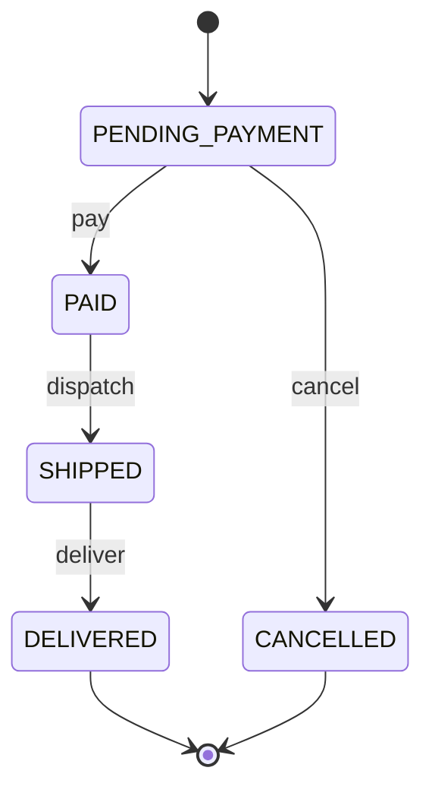

# Dự án thực hành: Thêm affordance

Trong dự án này, bạn sẽ mở rộng một Orders API bằng Spring HATEOAS để client không chỉ đọc được trạng thái đơn hàng mà còn khám phá được cách thực hiện các thao tác hợp lệ. Bạn sẽ thêm affordance cho việc đổi địa chỉ giao hàng và hủy đơn hàng, mô tả input bằng HAL-FORMS, rồi kiểm thử để bảo đảm affordance xuất hiện đúng theo trạng thái nghiệp vụ.

Kết quả cần đạt là một client có thể bắt đầu từ `GET /api/orders/{id}`, đọc representation và các form được server công bố, sau đó gửi request tới target cùng HTTP method và dữ liệu phù hợp. Client không phải tự suy luận endpoint hay tự đoán các field cần gửi.

## Bối cảnh dự án

Bạn đang xây dựng API quản lý đơn hàng. Mỗi đơn hàng có mã, trạng thái, tổng tiền và địa chỉ giao hàng. Ứng dụng hiện đã có endpoint đọc đơn hàng và representation có link `self`.

Nhóm sản phẩm yêu cầu client hỗ trợ hai thao tác:

1. **Đổi địa chỉ giao hàng:** người dùng có thể cập nhật địa chỉ trước khi đơn được giao cho đơn vị vận chuyển.
2. **Hủy đơn hàng:** người dùng có thể hủy đơn khi đơn vẫn đang chờ thanh toán. Request hủy phải có lý do.

Hai thao tác có input khác nhau và chỉ hợp lệ trong một số trạng thái. Client cần khám phá các điều kiện này từ representation nhận được. Server vẫn phải xác thực request và kiểm tra nghiệp vụ khi thao tác được gửi tới.

## Mục tiêu và tiêu chí hoàn thành

Sau khi hoàn thành, API phải đáp ứng các yêu cầu sau:

- `GET /api/orders/{id}` trả về `EntityModel<OrderRepresentation>` có link `self`.
- Link `self` mang affordance cho `PUT /api/orders/{id}/delivery-address` khi đơn chưa được giao.
- Link `self` mang affordance cho `POST /api/orders/{id}/cancellation` khi đơn đang chờ thanh toán.
- Response HAL-FORMS mô tả HTTP method, target và các property của request body.
- Affordance không xuất hiện khi thao tác không hợp lệ với trạng thái đơn hàng.
- Controller/service vẫn kiểm tra trạng thái và validation, kể cả khi client gọi trực tiếp URI không được công bố.
- MockMvc xác nhận đúng media type, link, template, property và hành vi theo trạng thái.

## Chuẩn bị project

Sử dụng ứng dụng Spring Boot có Spring MVC và Spring HATEOAS. Nếu project đã có các dependency tương ứng, giữ nguyên cấu hình hiện tại. Với Gradle, các dependency cần thiết có thể khai báo như sau:

```kotlin
dependencies {
    implementation("org.springframework.boot:spring-boot-starter-web")
    implementation("org.springframework.boot:spring-boot-starter-hateoas")
    implementation("org.springframework.boot:spring-boot-starter-validation")

    testImplementation("org.springframework.boot:spring-boot-starter-test")
}
```

Với Maven, dùng các starter tương đương và để Spring Boot dependency management quản lý version. Không thêm version riêng cho Spring HATEOAS nếu project đang dùng Spring Boot BOM.

### Bật HAL-FORMS

HAL-FORMS bổ sung `_templates` để mô tả các form/action gắn với link. HAL và HAL-FORMS là hai media type riêng; client phải yêu cầu đúng media type.

Nếu ứng dụng chưa cấu hình hypermedia support, có thể khai báo:

```java
import org.springframework.context.annotation.Configuration;
import org.springframework.hateoas.config.EnableHypermediaSupport;
import org.springframework.hateoas.config.EnableHypermediaSupport.HypermediaType;

@Configuration
@EnableHypermediaSupport(type = HypermediaType.HAL_FORMS)
public class HypermediaConfiguration {
}
```

Nếu ứng dụng đã có cấu hình Spring HATEOAS hoặc Spring Boot auto-configuration, hãy tích hợp HAL-FORMS vào cấu hình hiện có thay vì đăng ký nhiều cấu hình hypermedia trùng nhau. Kiểm tra media type `application/prs.hal-forms+json` thực sự được hỗ trợ trước khi viết test.

Lưu ý với Spring Boot: auto-configuration HATEOAS đã đăng ký mapper phù hợp cho hypermedia. Khi dùng `@EnableHypermediaSupport` để tự điều khiển cấu hình media type, Spring Boot chuyển quyền cấu hình cho ứng dụng và không áp dụng một số tùy chỉnh `JsonMapper` auto-configured như trước. Nếu chọn cách này, hãy bảo đảm mapper/customizer và các module cần thiết được cấu hình theo project.

## Bước 1: Xác định trạng thái và capability của đơn hàng

Dùng state model đơn giản sau cho bài thực hành:



Quy tắc công bố affordance:

| Trạng thái | Đổi địa chỉ giao hàng | Hủy đơn |
|---|---|---|
| `PENDING_PAYMENT` | Có | Có |
| `PAID` | Có, nếu chưa giao cho vận chuyển | Không |
| `SHIPPED` | Không | Không |
| `DELIVERED` | Không | Không |
| `CANCELLED` | Không | Không |

Tạo enum và domain object. Bạn có thể điều chỉnh tên package theo project:

```java
public enum OrderStatus {
    PENDING_PAYMENT,
    PAID,
    SHIPPED,
    DELIVERED,
    CANCELLED
}
```

```java
import java.math.BigDecimal;
import java.util.UUID;

public record Order(
        UUID id,
        OrderStatus status,
        BigDecimal total,
        String deliveryAddress
) {

    public boolean canChangeDeliveryAddress() {
        return status == OrderStatus.PENDING_PAYMENT
                || status == OrderStatus.PAID;
    }

    public boolean canCancel() {
        return status == OrderStatus.PENDING_PAYMENT;
    }
}
```

Trong hệ thống thật, trạng thái `PAID` chỉ cho phép đổi địa chỉ nếu quy trình fulfillment chưa bắt đầu. Bài lab dùng enum trên để thể hiện rõ cách state ảnh hưởng tới affordance.

## Bước 2: Tạo representation và request DTO

Không đưa domain entity trực tiếp vào form input. Tạo DTO riêng cho representation đọc và từng thao tác ghi.

```java
import java.math.BigDecimal;
import java.util.UUID;

public record OrderRepresentation(
        UUID id,
        String status,
        BigDecimal total,
        String deliveryAddress
) {
    public static OrderRepresentation from(Order order) {
        return new OrderRepresentation(
                order.id(),
                order.status().name(),
                order.total(),
                order.deliveryAddress()
        );
    }
}
```

Request đổi địa chỉ:

```java
import jakarta.validation.constraints.NotBlank;
import jakarta.validation.constraints.NotNull;
import jakarta.validation.constraints.Size;

public record ChangeDeliveryAddressRequest(
        @NotNull
        @NotBlank
        @Size(max = 160)
        String street,

        @NotNull
        @NotBlank
        @Size(max = 80)
        String city,

        @NotNull
        @NotBlank
        @Size(max = 20)
        String postalCode
) {}
```

Request hủy đơn:

```java
import jakarta.validation.constraints.NotBlank;
import jakarta.validation.constraints.NotNull;
import jakarta.validation.constraints.Size;

public record CancelOrderRequest(
        @NotNull
        @NotBlank
        @Size(max = 500)
        String reason
) {}
```

Các annotation validation vừa bảo vệ request khi được gửi tới controller, vừa cung cấp metadata để Spring HATEOAS có thể mô tả một phần ràng buộc của property trong HAL-FORMS. HAL-FORMS không thay thế validation ở server.

## Bước 3: Khai báo controller method cho từng affordance

Spring HATEOAS phân tích controller method được tham chiếu để xác định HTTP method, target, input và output metadata. Vì vậy, hãy khai báo endpoint thật trước khi gắn affordance.

```java
import java.util.UUID;

import jakarta.validation.Valid;

import org.springframework.http.MediaType;
import org.springframework.http.ResponseEntity;
import org.springframework.web.bind.annotation.GetMapping;
import org.springframework.web.bind.annotation.PathVariable;
import org.springframework.web.bind.annotation.PostMapping;
import org.springframework.web.bind.annotation.PutMapping;
import org.springframework.web.bind.annotation.RequestBody;
import org.springframework.web.bind.annotation.RequestMapping;
import org.springframework.web.bind.annotation.RestController;

import org.springframework.hateoas.EntityModel;

@RestController
@RequestMapping("/api/orders")
public class OrderController {

    private final OrderService service;
    private final OrderModelAssembler assembler;

    public OrderController(OrderService service, OrderModelAssembler assembler) {
        this.service = service;
        this.assembler = assembler;
    }

    @GetMapping("/{id}")
    public EntityModel<OrderRepresentation> one(@PathVariable UUID id) {
        return assembler.toModel(service.findRequired(id));
    }

    @PutMapping(
            value = "/{id}/delivery-address",
            consumes = MediaType.APPLICATION_JSON_VALUE
    )
    public ResponseEntity<EntityModel<OrderRepresentation>> changeDeliveryAddress(
            @PathVariable UUID id,
            @Valid @RequestBody ChangeDeliveryAddressRequest request
    ) {
        Order updated = service.changeDeliveryAddress(id, request);
        return ResponseEntity.ok(assembler.toModel(updated));
    }

    @PostMapping(
            value = "/{id}/cancellation",
            consumes = MediaType.APPLICATION_JSON_VALUE
    )
    public ResponseEntity<EntityModel<OrderRepresentation>> cancelOrder(
            @PathVariable UUID id,
            @Valid @RequestBody CancelOrderRequest request
    ) {
        Order cancelled = service.cancel(id, request);
        return ResponseEntity.ok(assembler.toModel(cancelled));
    }
}
```

`OrderService` là service nghiệp vụ của project, cần cung cấp các method `findRequired`, `changeDeliveryAddress` và `cancel`. Trong mỗi command, service phải kiểm tra trạng thái hiện tại trước khi cập nhật. Nếu thao tác không hợp lệ, trả lỗi nghiệp vụ phù hợp (ví dụ `409 Conflict`).

Contract tối thiểu của service:

```java
import java.util.UUID;

public interface OrderService {
    Order findRequired(UUID id);

    Order changeDeliveryAddress(
            UUID id,
            ChangeDeliveryAddressRequest request);

    Order cancel(UUID id, CancelOrderRequest request);
}
```

Implementation có thể dùng repository hoặc test fixture. Với project hoàn chỉnh, hãy kiểm tra trạng thái và quyền trong service trước khi ghi dữ liệu; không dựa vào việc assembler đã ẩn affordance.

## Bước 4: Gắn affordance vào link self

Đây là phần chính của dự án. Tạo `OrderModelAssembler` để xây representation và mô tả các thao tác gắn với link `self`.

```java
import org.springframework.hateoas.EntityModel;
import org.springframework.hateoas.Link;
import org.springframework.hateoas.server.RepresentationModelAssembler;
import org.springframework.stereotype.Component;

import static org.springframework.hateoas.server.mvc.WebMvcLinkBuilder.afford;
import static org.springframework.hateoas.server.mvc.WebMvcLinkBuilder.linkTo;
import static org.springframework.hateoas.server.mvc.WebMvcLinkBuilder.methodOn;

@Component
public class OrderModelAssembler implements
        RepresentationModelAssembler<Order, EntityModel<OrderRepresentation>> {

    @Override
    public EntityModel<OrderRepresentation> toModel(Order order) {
        var id = order.id();

        Link self = linkTo(methodOn(OrderController.class).one(id))
                .withSelfRel();

        if (order.canChangeDeliveryAddress()) {
            self = self.andAffordance(afford(
                    methodOn(OrderController.class)
                            .changeDeliveryAddress(id, null)
            ));
        }

        if (order.canCancel()) {
            self = self.andAffordance(afford(
                    methodOn(OrderController.class)
                            .cancelOrder(id, null)
            ));
        }

        return EntityModel.of(OrderRepresentation.from(order), self);
    }
}
```

Các điểm cần hiểu:

- `linkTo(methodOn(...).one(id))` tạo URI theo mapping của controller thay vì nối chuỗi URI thủ công.
- `withSelfRel()` đánh dấu link trỏ tới chính đơn hàng.
- `afford(methodOn(...))` lấy metadata từ controller method được chỉ định.
- `andAffordance(...)` gắn thao tác bổ sung vào link `self`.
- Đối số `null` trong `methodOn` là placeholder cho `@RequestBody`; Spring HATEOAS đọc chữ ký method và annotation để mô tả input. Giá trị đó không được gửi đi trong lúc tạo link.
- Điều kiện state quyết định affordance nào được công bố.

Trong HAL-FORMS, các affordance sẽ được chuyển thành form template. Với cấu hình phù hợp, template có thể mô tả HTTP method, target, content type và properties của request body. Trong HAL JSON thông thường, client chủ yếu thấy link; thông tin form không được biểu diễn đầy đủ như HAL-FORMS.

## Bước 5: Kiểm tra representation trả về

Khởi chạy ứng dụng và gửi request yêu cầu HAL-FORMS:

```http
GET /api/orders/8b8c6c22-4f9e-4e90-8f7c-6f53e2a1d1a0 HTTP/1.1
Host: localhost:8080
Accept: application/prs.hal-forms+json
```

Với đơn hàng `PENDING_PAYMENT`, response có dạng khái quát:

```json
{
  "id": "8b8c6c22-4f9e-4e90-8f7c-6f53e2a1d1a0",
  "status": "PENDING_PAYMENT",
  "total": 125000,
  "deliveryAddress": "12 Nguyen Trai, Quan 1",
  "_links": {
    "self": {
      "href": "http://localhost:8080/api/orders/8b8c6c22-4f9e-4e90-8f7c-6f53e2a1d1a0"
    }
  },
  "_templates": {
    "changeDeliveryAddress": {
      "method": "put",
      "target": "http://localhost:8080/api/orders/8b8c6c22-4f9e-4e90-8f7c-6f53e2a1d1a0/delivery-address",
      "contentType": "application/json",
      "properties": [
        { "name": "street", "required": true },
        { "name": "city", "required": true },
        { "name": "postalCode", "required": true }
      ]
    },
    "cancelOrder": {
      "method": "post",
      "target": "http://localhost:8080/api/orders/8b8c6c22-4f9e-4e90-8f7c-6f53e2a1d1a0/cancellation",
      "contentType": "application/json",
      "properties": [
        { "name": "reason", "required": true }
      ]
    }
  }
}
```

Đây là representation minh họa. URI thực tế được tạo theo host, context path và request hiện tại; metadata property phụ thuộc DTO, validation annotations và cấu hình HAL-FORMS. Tên template mặc định được suy ra từ tên controller method; nếu đổi tên method, tên template có thể đổi theo. Nếu client cần tên ổn định độc lập với tên method, hãy cân nhắc đặt tên affordance tường minh bằng API builder phù hợp.

Với đơn hàng `SHIPPED`, response vẫn có link `self` nhưng không nên có `_templates.changeDeliveryAddress` hoặc `_templates.cancelOrder`.

## Bước 6: Gửi request theo affordance

Client đọc template và gửi đúng method, target cùng payload. Ví dụ đổi địa chỉ:

```http
PUT /api/orders/8b8c6c22-4f9e-4e90-8f7c-6f53e2a1d1a0/delivery-address HTTP/1.1
Host: localhost:8080
Content-Type: application/json
Accept: application/prs.hal-forms+json

{
  "street": "25 Le Loi",
  "city": "Ho Chi Minh City",
  "postalCode": "700000"
}
```

Ví dụ hủy đơn:

```http
POST /api/orders/8b8c6c22-4f9e-4e90-8f7c-6f53e2a1d1a0/cancellation HTTP/1.1
Host: localhost:8080
Content-Type: application/json
Accept: application/prs.hal-forms+json

{
  "reason": "Customer requested cancellation"
}
```

Khi thao tác thành công, server trả representation mới. Client nên đọc lại các link và template từ response mới vì trạng thái đơn hàng có thể đã thay đổi, khiến một số affordance biến mất.

## Bước 7: Kiểm thử affordance bằng MockMvc

Test cần kiểm tra cả trạng thái, media type, target và template. Ví dụ dưới đây giả định test fixture có một đơn `PENDING_PAYMENT` và một đơn `SHIPPED`.

```java
import static org.springframework.test.web.servlet.request.MockMvcRequestBuilders.get;
import static org.springframework.test.web.servlet.result.MockMvcResultMatchers.content;
import static org.springframework.test.web.servlet.result.MockMvcResultMatchers.jsonPath;
import static org.springframework.test.web.servlet.result.MockMvcResultMatchers.status;

import org.junit.jupiter.api.Test;
import org.springframework.beans.factory.annotation.Autowired;
import org.springframework.boot.test.autoconfigure.web.servlet.AutoConfigureMockMvc;
import org.springframework.boot.test.context.SpringBootTest;
import org.springframework.test.web.servlet.MockMvc;

@SpringBootTest
@AutoConfigureMockMvc
class OrderAffordanceTest {

    private static final String HAL_FORMS = "application/prs.hal-forms+json";

    @Autowired
    MockMvc mockMvc;

    @Test
    void exposesBothActionsForPendingPaymentOrder() throws Exception {
        mockMvc.perform(get("/api/orders/8b8c6c22-4f9e-4e90-8f7c-6f53e2a1d1a0")
                .accept(HAL_FORMS))
            .andExpect(status().isOk())
            .andExpect(content().contentTypeCompatibleWith(HAL_FORMS))
            .andExpect(jsonPath("$._links.self.href").exists())
            .andExpect(jsonPath("$._templates.changeDeliveryAddress.method")
                    .value("put"))
            .andExpect(jsonPath("$._templates.changeDeliveryAddress.target")
                    .value(org.hamcrest.Matchers.containsString("/delivery-address")))
            .andExpect(jsonPath("$._templates.changeDeliveryAddress.properties")
                    .isArray())
            .andExpect(jsonPath("$._templates.cancelOrder.method")
                    .value("post"))
            .andExpect(jsonPath("$._templates.cancelOrder.properties[0].name")
                    .value("reason"));
    }

    @Test
    void hidesActionsForShippedOrder() throws Exception {
        mockMvc.perform(get("/api/orders/0eacfe70-fb1f-40c7-85b4-5bd55dd11f6d")
                .accept(HAL_FORMS))
            .andExpect(status().isOk())
            .andExpect(jsonPath("$._links.self.href").exists())
            .andExpect(jsonPath("$._templates.changeDeliveryAddress")
                    .doesNotExist())
            .andExpect(jsonPath("$._templates.cancelOrder")
                    .doesNotExist());
    }
}
```

Nếu muốn tránh gọi trực tiếp `Matchers.containsString` trong assertion, có thể thêm static import `containsString`. Các ID phải được tạo bởi fixture/test database với trạng thái tương ứng.

### Kiểm thử server vẫn chặn thao tác không hợp lệ

Ẩn affordance không phải cơ chế authorization hoặc business validation. Bổ sung test gửi trực tiếp request hủy đơn đã giao:

```java
import static org.springframework.test.web.servlet.request.MockMvcRequestBuilders.post;
import static org.springframework.test.web.servlet.result.MockMvcResultMatchers.status;

import org.springframework.http.MediaType;

mockMvc.perform(post("/api/orders/0eacfe70-fb1f-40c7-85b4-5bd55dd11f6d/cancellation")
        .contentType(MediaType.APPLICATION_JSON)
        .content("""
                { "reason": "Too late" }
                """))
    .andExpect(status().isConflict());
```

Đây là test bổ sung trong cùng class; import `MediaType` và static import request matcher cần thiết. Service phải từ chối thao tác vì trạng thái `SHIPPED`, dù client tự biết URI.

## Bước 8: Kiểm tra validation metadata

Thử gửi request đổi địa chỉ thiếu `street` hoặc có `postalCode` quá dài. Controller phải từ chối request qua Bean Validation. Ví dụ:

```http
PUT /api/orders/8b8c6c22-4f9e-4e90-8f7c-6f53e2a1d1a0/delivery-address HTTP/1.1
Content-Type: application/json

{
  "street": "",
  "city": "Ho Chi Minh City",
  "postalCode": "700000"
}
```

Kết quả mong đợi là response lỗi validation theo cơ chế exception handling của ứng dụng. Nếu API đã chuẩn hóa lỗi bằng Problem Details, giữ media type và schema lỗi nhất quán. Đồng thời kiểm tra HAL-FORMS template có đánh dấu các property bắt buộc dựa trên metadata mà Spring HATEOAS nhận diện.

## Bước 9: Thử nghiệm bằng HTTP client

Có thể dùng `curl` để kiểm tra nhanh luồng end-to-end:

```bash
curl -i \
  -H "Accept: application/prs.hal-forms+json" \
  http://localhost:8080/api/orders/8b8c6c22-4f9e-4e90-8f7c-6f53e2a1d1a0
```

Sau khi đọc `_templates`, gửi request tới `target` với `method` và body đúng template. Khi kiểm tra thủ công, không hard-code target từ ví dụ; hãy lấy target từ response vì host, context path và API mapping có thể khác.

## Sản phẩm cần nộp

Hoàn thành project khi có đủ các kết quả sau:

1. `OrderController` có GET resource, PUT đổi địa chỉ và POST hủy đơn.
2. Request DTO có Bean Validation constraints.
3. `OrderModelAssembler` tạo link `self` và gắn affordance từ controller method.
4. HAL-FORMS được bật và response có `_templates`.
5. Affordance thay đổi theo trạng thái đơn hàng.
6. Test xác nhận method, target, properties và trường hợp affordance vắng mặt.
7. Test xác nhận server từ chối thao tác không hợp lệ dù request được gửi trực tiếp.
8. Có ít nhất một lần kiểm tra response thực tế bằng HTTP client.

## Thang đánh giá

| Tiêu chí | Điểm |
|---|---:|
| Controller mapping và request DTO rõ ràng | 15 |
| Gắn affordance đúng controller method | 25 |
| HAL-FORMS mô tả đúng method, target và input | 20 |
| Công bố affordance đúng theo state | 15 |
| Validation và business rule ở server | 10 |
| MockMvc tests bao phủ có/không affordance | 10 |
| Mã nguồn dễ đọc, tách assembler/service | 5 |
| **Tổng** | **100** |

## Thử thách mở rộng

Sau khi hoàn thành yêu cầu chính, hãy thử một hoặc nhiều phần sau:

- Thêm affordance `PATCH` để cập nhật một phần ghi chú giao hàng.
- Dùng `@InputType`, `@Pattern`, `@Size` hoặc `@NotNull` để cải thiện metadata của form.
- Đặt title và prompt cho template/property bằng `rest-messages.properties`.
- Tách custom relation hoặc action link thành URI relation có tài liệu.
- Bổ sung affordance phụ thuộc quyền người dùng hiện tại và viết test cho hai principal khác nhau.
- So sánh response HAL JSON với HAL-FORMS để thấy sự khác nhau giữa link điều hướng và mô tả thao tác.
- Viết client test đọc template rồi gửi request dựa trên target/method thay vì tự ghép URI.

## Lỗi thường gặp và cách xử lý

| Hiện tượng | Nguyên nhân có thể | Cách kiểm tra |
|---|---|---|
| Không có `_templates` | Client gửi `Accept: application/hal+json` hoặc HAL-FORMS chưa được cấu hình | Kiểm tra `Accept` và hypermedia configuration |
| Có `self` nhưng không có action template | Affordance chưa được gắn vào link hoặc controller method không được ánh xạ đúng | Kiểm tra `andAffordance(afford(methodOn(...)))` và mapping annotation |
| Template thiếu property | Request DTO không được nhận diện hoặc property không có metadata phù hợp | Kiểm tra `@RequestBody`, DTO accessor/record component và validation annotations |
| Template không có contentType | Controller mapping không khai báo `consumes` | Khai báo `consumes = application/json` nếu endpoint nhận JSON |
| Action xuất hiện sai trạng thái | Điều kiện assembler không đồng nhất với business rule | Đưa quy tắc capability về domain/policy dùng chung |
| Request trực tiếp vẫn thực hiện được khi không có link | Endpoint không kiểm tra state/permission | Thêm validation tại service và authorization tại endpoint |
| Target bị hard-code sai host/context path | Tự nối URI thay vì dùng `WebMvcLinkBuilder` | Tạo link từ `methodOn` và kiểm tra forwarded headers khi chạy sau proxy |

## Kết luận

Affordance giúp representation mô tả cách client có thể tương tác với resource, gồm HTTP method, target và input cần gửi. Trong Spring HATEOAS, bạn có thể gắn affordance vào link bằng `afford(methodOn(...))` và `andAffordance(...)`; HAL-FORMS chuyển metadata đó thành `_templates` mà client có thể đọc để tạo form hoặc gửi request. Khi kết hợp assembler, DTO validation và điều kiện theo trạng thái, client khám phá được thao tác hợp lệ từ response hiện tại. Server vẫn phải kiểm tra quyền và business rule ở endpoint để bảo đảm request trực tiếp hoặc response cache cũ không vượt qua quy tắc nghiệp vụ.

## Tài liệu tham khảo

- [Spring HATEOAS Reference – Affordances](https://docs.spring.io/spring-hateoas/docs/current/reference/html/#server.affordances): gắn controller method vào link bằng `afford(...)` và `andAffordance(...)`.
- [Spring HATEOAS Reference – HAL-FORMS](https://docs.spring.io/spring-hateoas/docs/current/reference/html/#mediatypes.hal-forms): cấu hình HAL-FORMS, `_templates` và metadata property.
- [Spring HATEOAS – WebMvcLinkBuilder API](https://docs.spring.io/spring-hateoas/docs/current/api/org/springframework/hateoas/server/mvc/WebMvcLinkBuilder.html): tạo link và affordance từ Spring MVC controller method.
- [HAL-FORMS Specification](https://rwcbook.github.io/hal-forms/): cấu trúc template, method, target và property.
