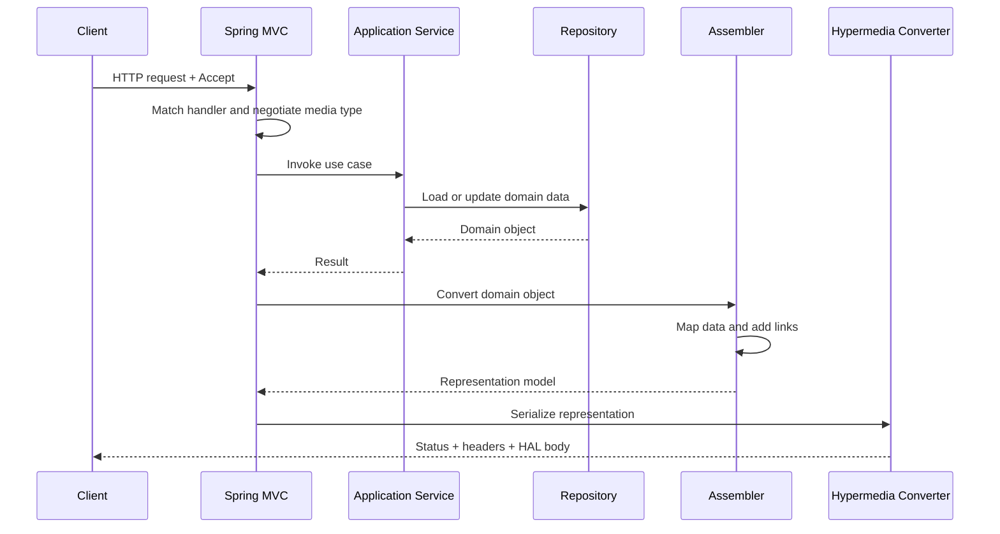

# Luồng tạo representation

## Mục tiêu

Luồng tạo representation trong Spring HATEOAS bắt đầu từ HTTP request, đi qua Spring MVC và application service, chuyển domain object thành resource model bằng assembler, bổ sung links hoặc affordances, rồi serialize model theo hypermedia media type đã thương lượng.

Sau bài này, bạn có thể giải thích trách nhiệm của controller, service, `RepresentationModel`, `RepresentationModelAssembler` và message converter; mô tả cách tạo representation cho một resource hoặc collection; và xác định các kiểm thử cần có để bảo vệ HTTP contract.

## 1. Representation là gì?

Representation là cách server trình bày tài nguyên cho client trong một response HTTP. Nó thường kết hợp data properties với hypermedia controls như links và affordances.

Ví dụ một order representation theo HAL:

```json
{
  "id": "order-42",
  "status": "PENDING",
  "total": 125000.00,
  "_links": {
    "self": {
      "href": "/orders/order-42"
    },
    "collection": {
      "href": "/orders"
    },
    "https://api.example.com/rels/cancel": {
      "href": "/orders/order-42/cancel"
    }
  }
}
```

Các field `id`, `status` và `total` mô tả trạng thái order. Các relation trong `_links` cho client biết có thể đọc tài nguyên nào hoặc khám phá hành động nào.

Representation không nhất thiết giống entity trong database. Entity phục vụ lưu trữ và nghiệp vụ; representation phục vụ hợp đồng HTTP. Tách hai mô hình giúp API kiểm soát field được công bố và thay đổi persistence mà không buộc client thay đổi theo.

Trong Spring HATEOAS, `RepresentationModel` là nền tảng để gắn links. `EntityModel<T>` biểu diễn một resource, `CollectionModel<T>` biểu diễn collection và `PagedModel<T>` biểu diễn collection có phân trang.

## 2. Luồng tổng thể từ request đến response



Các bước chính:

1. Client gửi request và khai báo response media type có thể xử lý bằng `Accept`.
2. Spring MVC chọn handler, bind path/query parameters và thực hiện content negotiation.
3. Controller gọi application service.
4. Service thực hiện nghiệp vụ và truy xuất repository.
5. Assembler chuyển domain object thành representation model.
6. Assembler tạo links và có thể bổ sung affordances.
7. Controller trả model cho Spring MVC.
8. Hypermedia converter serialize model thành HAL hoặc format đã cấu hình.
9. Server trả status, headers và body cho client.

Đây là mô hình trách nhiệm ở mức kiến trúc. Cấu hình cụ thể có thể khác giữa các ứng dụng Spring Boot, nhưng HTTP response cuối cùng vẫn là hợp đồng cần kiểm thử.

## 3. Request và content negotiation

Header `Accept` cho biết client muốn nhận representation nào:

```http
GET /orders/order-42 HTTP/1.1
Accept: application/hal+json
```

Controller có thể công bố media type bằng `produces`:

```java
@GetMapping(
        value = "/orders/{id}",
        produces = MediaTypes.HAL_JSON_VALUE
)
public OrderModel getOrder(@PathVariable UUID id) {
    // Lấy order và trả representation.
}
```

Nếu endpoint chỉ hỗ trợ HAL JSON mà client chỉ chấp nhận XML, Spring MVC thường trả `406 Not Acceptable`. Việc khai báo `produces` không tự tạo converter; ứng dụng vẫn cần hypermedia support tương ứng.

Với request body, `Content-Type` mô tả định dạng client gửi. Ví dụ client gửi JSON để tạo order và muốn nhận HAL:

```http
POST /orders HTTP/1.1
Content-Type: application/json
Accept: application/hal+json

{
  "customerId": "customer-7"
}
```

`consumes` có thể giới hạn media type đầu vào. Không nhầm `Accept` với `Content-Type`: một header thương lượng response, header còn lại mô tả body đang được gửi.

## 4. Controller điều phối, service xử lý nghiệp vụ

Controller là điểm nối giữa HTTP và application layer. Nó bind tham số request, gọi service và trả kiểu response phù hợp. Controller không nên chứa toàn bộ logic truy vấn, chuyển trạng thái và tạo link.

Ví dụ controller rút gọn:

```java
@RestController
@RequestMapping("/orders")
public class OrderController {

    private final OrderService orderService;
    private final OrderModelAssembler assembler;

    public OrderController(
            OrderService orderService,
            OrderModelAssembler assembler) {
        this.orderService = orderService;
        this.assembler = assembler;
    }

    @GetMapping(
            value = "/{id}",
            produces = MediaTypes.HAL_JSON_VALUE
    )
    public OrderModel getOrder(@PathVariable UUID id) {
        return assembler.toModel(orderService.getRequired(id));
    }

    @PostMapping("/{id}/cancel")
    public ResponseEntity<Void> cancel(@PathVariable UUID id) {
        orderService.cancel(id);
        return ResponseEntity.noContent().build();
    }
}
```

`OrderService` và `Order` đại diện cho lớp nghiệp vụ và domain model của ứng dụng. `getRequired` lấy order hoặc phát sinh lỗi not found; `cancel` thực hiện quy tắc hủy.

Controller tập trung điều phối. Việc order có thể hủy hay không thuộc về domain/service. Assembler dùng trạng thái đã được xác định để quyết định có công bố link hủy trong representation.

## 5. Domain object và representation model

Domain object chứa dữ liệu và hành vi nghiệp vụ, chẳng hạn kiểm tra trạng thái hoặc bảo vệ invariant. Representation model mô tả dữ liệu công bố qua HTTP cùng các quan hệ hypermedia client có thể khám phá.

Ví dụ model:

```java
import java.math.BigDecimal;
import java.util.UUID;

import org.springframework.hateoas.RepresentationModel;

public class OrderModel extends RepresentationModel<OrderModel> {

    private final UUID id;
    private final String status;
    private final BigDecimal total;

    public OrderModel(UUID id, String status, BigDecimal total) {
        this.id = id;
        this.status = status;
        this.total = total;
    }

    public UUID getId() {
        return id;
    }

    public String getStatus() {
        return status;
    }

    public BigDecimal getTotal() {
        return total;
    }
}
```

Kế thừa `RepresentationModel<OrderModel>` cho phép model mang links. Các data properties được chọn có chủ đích; API không cần công bố mọi field trong entity.

Trả trực tiếp JPA entity có thể làm lộ field nội bộ, quan hệ lazy hoặc cấu trúc database. Representation riêng giúp kiểm soát dữ liệu công khai và tiến hóa hợp đồng độc lập hơn.
## 6. Assembler chuyển domain object thành representation

`RepresentationModelAssembler` gom logic ánh xạ domain object sang representation. Đây là nơi phù hợp để tạo model và bổ sung links gắn với tài nguyên.

Với quan hệ nghiệp vụ riêng, định nghĩa relation ổn định:

```java
import org.springframework.hateoas.LinkRelation;

public final class OrderRelations {

    private OrderRelations() {
    }

    public static final LinkRelation CANCEL =
            LinkRelation.of(
                    "https://api.example.com/rels/cancel"
            );
}
```

Assembler sử dụng relation đó:

```java
import static org.springframework.hateoas.server.mvc.WebMvcLinkBuilder.linkTo;
import static org.springframework.hateoas.server.mvc.WebMvcLinkBuilder.methodOn;

import org.springframework.hateoas.server.RepresentationModelAssembler;
import org.springframework.stereotype.Component;

@Component
public class OrderModelAssembler
        implements RepresentationModelAssembler<Order, OrderModel> {

    @Override
    public OrderModel toModel(Order order) {
        OrderModel model = new OrderModel(
                order.getId(),
                order.getStatus(),
                order.getTotal()
        );

        model.add(linkTo(methodOn(OrderController.class)
                .getOrder(order.getId()))
                .withSelfRel());

        if (order.canBeCancelled()) {
            model.add(linkTo(methodOn(OrderController.class)
                    .cancel(order.getId()))
                    .withRel(OrderRelations.CANCEL));
        }

        return model;
    }
}
```

Ví dụ giả định domain object có `canBeCancelled()`. `linkTo(methodOn(...))` xây link dựa trên mapping controller và tham số thực tế. `withSelfRel()` gắn relation `self`; relation extension `CANCEL` định danh khả năng hủy theo vocabulary của API.

Assembler không thực hiện thao tác hủy. Nó chỉ công bố khả năng nếu trạng thái hiện tại cho phép. Endpoint hủy vẫn phải kiểm tra trạng thái và authorization khi request thực sự đến.

Không tạo relation động chứa ID như `cancel-order-42`. Relation mô tả loại quan hệ; định danh tài nguyên nằm trong `href`.

## 7. Link, relation và href có trách nhiệm khác nhau

Một link thường có ba thành phần:

| Thành phần | Vai trò |
|---|---|
| Relation | Cho biết quan hệ hoặc khả năng |
| `href` | URI đích do server cung cấp |
| `title` | Nhãn thân thiện cho con người nếu có |

Client nên tìm relation đã biết rồi theo `href`. Client không nên ghép ID vào URL hard-code hoặc suy ra hành động từ tên path.

Ví dụ:

```json
{
  "_links": {
    "self": {
      "href": "/orders/order-42"
    },
    "https://api.example.com/rels/cancel": {
      "href": "/order-actions/action-91",
      "title": "Hủy đơn hàng"
    }
  }
}
```

Server có thể thay URI hủy từ `/orders/{id}/cancel` sang `/order-actions/{actionId}` mà client vẫn tìm relation cancel. Điều kiện là semantics của relation không đổi và URI mới được công bố trong response.

Ưu tiên relation IANA khi semantics phù hợp. Với quan hệ nghiệp vụ riêng, dùng URI relation ổn định và tài liệu hóa semantics. `title` không thay thế relation vì title có thể được bản địa hóa.

## 8. Affordance mô tả cách thực hiện hành động

HAL link cơ bản cung cấp relation và `href`, nhưng không phải lúc nào cũng mô tả đủ cách gửi request ghi. Với hành động như hủy, duyệt hoặc hoàn tiền, client có thể cần biết:

- HTTP method.
- Request media type.
- Các input properties.
- Trường bắt buộc và validation.
- Response hoặc error type dự kiến.

Spring HATEOAS hỗ trợ affordances để bổ sung metadata cho hành động. Khi serialize theo format có hỗ trợ affordance, chẳng hạn HAL-FORMS, thông tin có thể được biểu diễn thành template để client khám phá.

Ví dụ HAL-FORMS minh họa:

```json
{
  "_links": {
    "self": {
      "href": "/orders/order-42"
    }
  },
  "_templates": {
    "cancel": {
      "title": "Yêu cầu hủy đơn hàng",
      "method": "POST",
      "contentType": "application/json",
      "properties": [
        {
          "name": "reason",
          "prompt": "Lý do hủy",
          "required": true
        }
      ]
    }
  }
}
```

Đây là ví dụ hợp đồng minh họa. Tên template, input fields và cách cấu hình affordance trong code phải khớp với API thực tế. Không giả định một HAL link đơn giản tự động chứa method hoặc request schema.

Affordance mô tả hành động mà server công bố tại thời điểm tạo representation. Server vẫn phải kiểm tra quyền, trạng thái và dữ liệu đầu vào ở endpoint đích vì điều kiện có thể thay đổi sau khi client đọc response.

## 9. Collection và pagination tạo representation như thế nào?

Khi response chứa nhiều tài nguyên, Spring HATEOAS cung cấp các model phù hợp:

| Kiểu model | Khi dùng |
|---|---|
| `EntityModel<T>` | Một tài nguyên có links |
| `CollectionModel<T>` | Collection các resource models |
| `PagedModel<T>` | Collection có page metadata và navigation links |

Với collection đơn giản, có thể chuyển từng entity qua assembler rồi đóng gói:

```java
List<OrderModel> items = orderResults.stream()
        .map(assembler::toModel)
        .toList();

CollectionModel<OrderModel> collection =
        CollectionModel.of(items);
```

Với Spring Data `Page<Order>`, `PagedResourcesAssembler<Order>` chuyển page thành `PagedModel<OrderModel>`:

```java
Page<Order> page = orderService.findOrders(pageable);

PagedModel<OrderModel> representation =
        pagedAssembler.toModel(page, assembler);
```

Assembler được gọi cho từng item để tạo resource model riêng. Paged assembler bổ sung page metadata và các link điều hướng như `first`, `prev`, `self`, `next` và `last` khi phù hợp.

Client phải kiểm tra link có tồn tại trước khi theo. Trang đầu không có `prev`; trang cuối không có `next`. Không tự dựng URL bằng cách tăng page number khi server đã cung cấp link.

## 10. RepresentationModelProcessor bổ sung quy tắc dùng chung

Trong một số ứng dụng, nhiều representation cần được bổ sung cùng một loại link hoặc metadata. Có thể dùng `RepresentationModelProcessor` để áp dụng logic dùng chung cho model phù hợp.

Ví dụ, một processor có thể thêm link đến trang hướng dẫn hoặc API root cho một nhóm resource. Cách này giúp tránh lặp lại cùng logic trong nhiều assembler.

Tuy nhiên, không nên chuyển mọi logic tạo link vào processor. Assembler vẫn là nơi tự nhiên để tạo links gắn trực tiếp với domain object và trạng thái của nó. Processor phù hợp với quy tắc cross-cutting, có phạm vi rõ và không phụ thuộc quá nhiều vào từng loại nghiệp vụ.

Khi dùng processor, cần xác định rõ:

- Loại `RepresentationModel` mà processor xử lý.
- Điều kiện processor áp dụng.
- Link có thể trùng với link assembler đã tạo hay không.
- Processor có phụ thuộc request context, principal hoặc locale không.
- Test nào xác nhận link bổ sung không xuất hiện sai resource.

Processor là bước mở rộng của pipeline, không phải yêu cầu bắt buộc cho mọi API.
## 11. Serialize model thành HAL response

Sau khi controller trả `RepresentationModel` hoặc model collection, Spring MVC chọn message converter phù hợp với response media type. Spring HATEOAS cung cấp tích hợp để serialize model thành hypermedia format đã cấu hình.

Ví dụ response HAL:

```http
HTTP/1.1 200 OK
Content-Type: application/hal+json

{
  "id": "order-42",
  "status": "PENDING",
  "total": 125000.00,
  "_links": {
    "self": {
      "href": "/orders/order-42"
    },
    "https://api.example.com/rels/cancel": {
      "href": "/orders/order-42/cancel"
    }
  }
}
```

Các model Java không tự trở thành JSON HAL chỉ vì chúng kế thừa `RepresentationModel`. Ứng dụng phải có hypermedia support và converter phù hợp, đồng thời request cần thương lượng đúng media type.

Với HAL JSON, links được serialize dưới `_links`; collection có thể có `_embedded`; paged model còn có metadata `page`. Với HAL-FORMS, affordance có thể được serialize thành `_templates` theo cấu hình và model.

Không gắn nhãn `application/hal+json` cho JSON thuần không có cấu trúc HAL. Ngược lại, nếu endpoint cam kết HAL, hãy kiểm tra body thực tế có các relation mà hợp đồng công bố.

## 12. Xử lý lỗi trong luồng tạo representation

Không phải mọi request đều tạo được resource model thành công. Tài nguyên có thể không tồn tại, dữ liệu đầu vào không hợp lệ hoặc principal không đủ quyền.

Lỗi nên được biểu diễn bằng HTTP status và error representation có hợp đồng rõ. Ví dụ Problem Details:

```http
HTTP/1.1 404 Not Found
Content-Type: application/problem+json

{
  "type": "https://api.example.com/problems/order-not-found",
  "title": "Không tìm thấy đơn hàng",
  "status": 404,
  "detail": "Đơn hàng được yêu cầu không tồn tại."
}
```

`application/problem+json` là media type riêng. Problem Details không tự động là HAL và không tự có `_links`. Nếu API cần link đến tài liệu lỗi, có thể dùng HTTP `Link` header với relation `describedby` hoặc extension đã được tài liệu hóa.

Lỗi phát sinh trong controller có thể được xử lý bằng `@RestControllerAdvice`. Lỗi xác thực và authorization phát sinh trong Spring Security filter chain có thể cần `AuthenticationEntryPoint` và `AccessDeniedHandler` để giữ cùng error contract.

## 13. Kiểm soát link theo trạng thái và quyền

Assembler có thể chỉ công bố link khi khả năng tương ứng đang khả dụng. Ví dụ order ở trạng thái `PENDING` và principal có quyền hủy thì representation có thể chứa relation cancel.

Điều này cải thiện trải nghiệm client: client biết những hành động nào server đang công bố. Nhưng việc ẩn link không phải cơ chế bảo mật. Client có thể lưu URI từ response trước đó hoặc tự gửi request đến endpoint. Vì vậy:

- Assembler chỉ công bố link khi trạng thái và quyền phù hợp.
- Service/domain kiểm tra lại invariant nghiệp vụ khi thực hiện action.
- Security layer xác thực principal và authority ở endpoint.
- Server trả lỗi phù hợp nếu trạng thái hoặc quyền đã thay đổi.

Nếu representation được cache nhưng links phụ thuộc principal, cần đánh giá cache policy. Response có thể cần `Cache-Control: private` hoặc `no-store` tùy dữ liệu và yêu cầu. Không để cache dùng representation của người có quyền cho người không có quyền.

## 14. Kiểm thử từng chặng và kiểm thử hợp đồng cuối cùng

Có thể kiểm thử riêng từng lớp và thêm integration test cho toàn bộ luồng.

| Lớp | Nội dung kiểm thử |
|---|---|
| Service | Trả đúng domain object, xử lý not found và quy tắc nghiệp vụ |
| Assembler | Map đúng data properties và tạo đúng relation/href |
| Controller | Bind tham số, gọi đúng service, trả đúng model và status |
| Hypermedia converter | Serialize đúng media type và cấu trúc HAL/HAL-FORMS |
| HTTP contract | Status, headers, body, links và điều kiện link xuất hiện |

Ví dụ test assembler:

```java
@Test
void addsSelfAndCancelLinksForCancellableOrder() {
    Order order = anOrderThatCanBeCancelled();

    OrderModel model = assembler.toModel(order);

    assertThat(model.getRequiredLink(IanaLinkRelations.SELF))
            .isNotNull();
    assertThat(model.getLink(OrderRelations.CANCEL))
            .isPresent();
}
```

Ví dụ MockMvc test cho response HAL:

```java
@Test
void returnsHalOrderRepresentation() throws Exception {
    mockMvc.perform(get("/orders/{id}", orderId)
                    .accept(MediaTypes.HAL_JSON))
            .andExpect(status().isOk())
            .andExpect(content().contentTypeCompatibleWith(
                    MediaTypes.HAL_JSON))
            .andExpect(jsonPath("$.id").value(orderId.toString()))
            .andExpect(jsonPath("$._links.self.href").exists());
}
```

Với link tùy chọn, cần test cả trường hợp có và không có link:

- Order có thể hủy và principal đủ quyền: relation cancel xuất hiện.
- Order đã hoàn tất hoặc principal thiếu quyền: relation cancel không xuất hiện.
- Gọi endpoint cancel trực tiếp khi không đủ quyền vẫn bị từ chối.
- `Accept` không hỗ trợ dẫn đến 406 theo mapping.
- Request body có `Content-Type` không hỗ trợ dẫn đến 415 nếu endpoint giới hạn `consumes`.

Đừng chỉ kiểm tra JSON parse được. Test phải xác nhận response `Content-Type`, relation key, `href`, status và semantics của link.

## 15. Các điểm dễ sai trong pipeline

**Trả entity trực tiếp từ controller.** Persistence model bị phơi ra và khó kiểm soát links. Dùng representation model và assembler.

**Đặt nghiệp vụ vào assembler.** Quy tắc trạng thái bị tách khỏi domain/service. Assembler nên đọc trạng thái đã được domain xác định rồi biểu diễn khả năng.

**Hard-code URI trong client.** Client phụ thuộc route nội bộ. Server công bố `href`; client theo relation đã biết.

**Tạo link mà không có relation rõ.** Client phải đoán mục đích. Dùng IANA relation hoặc URI extension có semantics.

**Công bố link ghi nhưng không mô tả request.** Client biết action nhưng không biết method/body. Dùng affordance hoặc HAL-FORMS khi cần mô tả thao tác.

**Cho rằng link bị ẩn là authorization.** Request cũ vẫn có thể được gửi. Endpoint phải kiểm tra quyền và trạng thái.

**Gắn `Content-Type` sai.** Client không thể tin vào representation. Dùng `produces`, converter đúng và contract test.

**Bỏ qua error representation.** Client nhận HTML hoặc body khác schema khi lỗi. Chuẩn hóa Problem Details và kiểm thử cả security errors.

**Dùng processor thay mọi assembler.** Logic domain trở nên khó truy vết. Dùng processor cho quy tắc cross-cutting, assembler cho mapping tài nguyên.

**Không kiểm tra base URI phía sau proxy.** Link có thể chứa host hoặc scheme nội bộ. Cấu hình forwarded headers và kiểm thử URL được sinh trong môi trường triển khai.

## 16. Checklist đọc một representation

Khi nhận một response Spring HATEOAS, hãy đọc theo trình tự:

1. Kiểm tra HTTP status và `Content-Type`.
2. Nhận diện media type: HAL, HAL-FORMS hay Problem Details.
3. Đọc data properties để hiểu trạng thái tài nguyên.
4. Tìm relation `self` để xác định tài nguyên hiện tại.
5. Đọc các relation khác để khám phá collection, tài nguyên liên quan hoặc hành động.
6. Nếu có embedded resources, đọc relation của từng embedded collection.
7. Nếu có page metadata, kiểm tra page number, size và total.
8. Nếu có affordance/template, đọc method, content type và input properties.
9. Bỏ qua relation chưa biết một cách an toàn; không suy diễn từ URL.
10. Theo `href` do server cung cấp và xử lý status response tiếp theo.

Checklist này cũng hữu ích khi review response trong log, Postman, MockMvc output hoặc contract test.

## Kết luận

Luồng tạo representation trong Spring HATEOAS bắt đầu từ HTTP request và content negotiation, đi qua controller và service, rồi chuyển domain object thành resource model bằng assembler. Assembler tạo data properties, links và các affordances phù hợp; collection hoặc pagination được đóng gói bằng model tương ứng; cuối cùng hypermedia converter serialize representation theo media type đã chọn. Client đọc relation và theo `href` do server cung cấp để tiếp tục điều hướng. Khi mỗi lớp giữ đúng trách nhiệm và HTTP contract được kiểm thử ở đầu ra, API có thể thay đổi route hoặc cấu trúc nội bộ mà client vẫn tương tác theo semantics ổn định.

## Tài liệu tham khảo

- [Spring HATEOAS Reference – Fundamentals](https://docs.spring.io/spring-hateoas/docs/current/reference/html/#fundamentals)
- [Spring HATEOAS Reference – Links](https://docs.spring.io/spring-hateoas/docs/current/reference/html/#fundamentals.links)
- [Spring HATEOAS Reference – Representation models](https://docs.spring.io/spring-hateoas/docs/current/reference/html/#fundamentals.representation-models)
- [Spring HATEOAS Reference – Affordances](https://docs.spring.io/spring-hateoas/docs/current/reference/html/#mediatypes.hal-forms)
- [Spring HATEOAS Reference – Paging](https://docs.spring.io/spring-hateoas/docs/current/reference/html/#server.paging)
- [Spring Framework Reference – Spring MVC](https://docs.spring.io/spring-framework/reference/web/webmvc.html)
- [RFC 8288 – Web Linking](https://www.rfc-editor.org/rfc/rfc8288.html)
- [RFC 9457 – Problem Details for HTTP APIs](https://www.rfc-editor.org/rfc/rfc9457.html)


