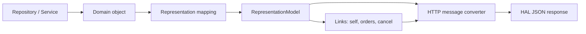
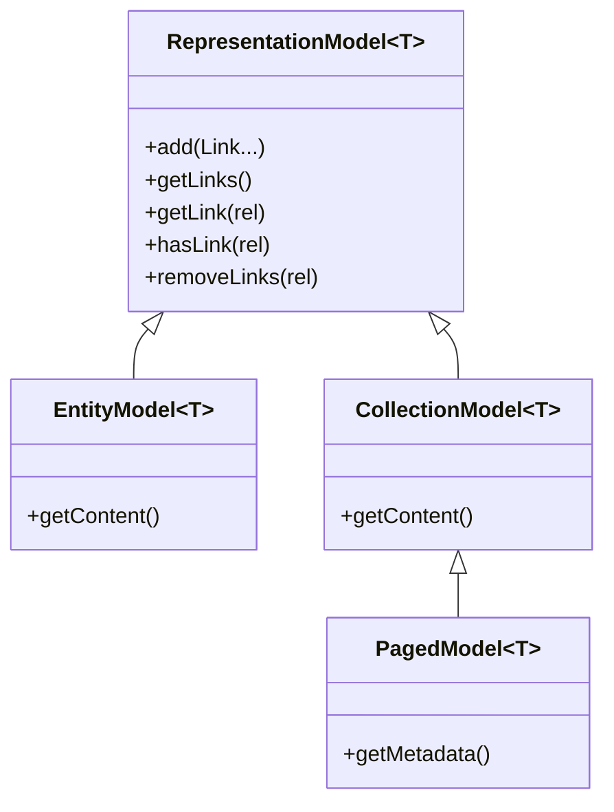

# Vai trò RepresentationModel

Trong một API REST có hypermedia, phản hồi cần biểu diễn cả dữ liệu tài nguyên lẫn các liên kết cho phép client tiếp tục điều hướng. Spring HATEOAS cung cấp `RepresentationModel` làm lớp cơ sở cho những mô hình biểu diễn như vậy. Lớp này quản lý tập hợp liên kết và cung cấp API để thêm, truy vấn hoặc loại bỏ liên kết; lớp con quyết định dữ liệu nghiệp vụ nào xuất hiện trong phần thân phản hồi.

`RepresentationModel` thuộc gói `org.springframework.hateoas`. Nó không phải entity JPA, repository hay controller. Vai trò của nó nằm ở ranh giới HTTP: chuyển dữ liệu của ứng dụng thành một biểu diễn có thể mang liên kết hypermedia. Nhờ vậy, mô hình miền có thể tiếp tục tập trung vào nghiệp vụ, còn mô hình biểu diễn chịu trách nhiệm về cấu trúc mà client nhìn thấy.

Sau bài học, bạn có thể:

- Giải thích trách nhiệm của `RepresentationModel` trong kiến trúc Spring HATEOAS.
- Hiểu tham số generic tự tham chiếu và lợi ích của API fluent.
- Tạo một mô hình biểu diễn riêng bằng cách kế thừa `RepresentationModel`.
- Thêm, kiểm tra và loại bỏ liên kết theo quan hệ.
- Chọn giữa `RepresentationModel`, `EntityModel`, `CollectionModel` và `PagedModel`.
- Đưa mô hình vào controller và hiểu cách nó được tuần tự hóa thành HAL.

## 1. RepresentationModel đứng ở đâu trong kiến trúc?

Một endpoint thường lấy dữ liệu từ service hoặc repository, sau đó tạo phản hồi HTTP. Với REST thông thường, controller có thể trả entity hoặc DTO. Khi cần hypermedia, ứng dụng tạo một mô hình biểu diễn có liên kết trước khi trả kết quả:



Mỗi phần có một trách nhiệm riêng:

| Thành phần | Trách nhiệm |
|---|---|
| Entity hoặc domain object | Giữ dữ liệu và quy tắc nghiệp vụ của ứng dụng. |
| DTO hoặc representation class | Chọn dữ liệu được công bố trong API và cách đặt tên trường. |
| `RepresentationModel` | Cung cấp khả năng gắn các liên kết hypermedia vào biểu diễn. |
| `Link` | Mô tả một quan hệ và URI đích, cùng metadata liên quan nếu có. |
| Controller | Điều phối request và trả mô hình biểu diễn qua HTTP. |
| HAL hoặc định dạng hypermedia khác | Quy định cách mô hình và liên kết được tuần tự hóa trên wire. |

Điểm quan trọng là `RepresentationModel` quản lý liên kết, còn dữ liệu cụ thể do lớp con hoặc kiểu wrapper cung cấp. Bản thân lớp cơ sở không tự biết tài nguyên nào đang được biểu diễn và không tự tìm endpoint để tạo URL. Ứng dụng phải tạo các `Link` phù hợp rồi gắn vào mô hình.

## 2. Cấu trúc và generic tự tham chiếu

Khai báo khái quát của lớp có dạng:

```java
public abstract class RepresentationModel<T extends RepresentationModel<T>> {
    // Quản lý các Link gắn với biểu diễn
}
```

Tham số `T` bị ràng buộc là một kiểu kế thừa `RepresentationModel<T>`. Đây là mẫu generic tự tham chiếu (*self-referential generic*). Khi tạo lớp riêng, ta truyền chính lớp đó làm tham số:

```java
public class OrderRepresentation
        extends RepresentationModel<OrderRepresentation> {
    // Các trường dữ liệu của biểu diễn đơn hàng
}
```

Nhờ kiểu tự tham chiếu, các phương thức thêm hoặc loại bỏ liên kết có thể trả về kiểu mô hình cụ thể. Ví dụ, khi `add(...)` được gọi trên `OrderRepresentation`, kiểu kết quả vẫn là `OrderRepresentation`; mã gọi có thể tiếp tục dùng API của lớp con mà không phải ép kiểu từ `RepresentationModel<?>`.

Đây là thiết kế phục vụ API fluent. Nó giúp các lớp mô hình có thể nối tiếp thao tác:

```java
import java.math.BigDecimal;
import org.springframework.hateoas.Link;

Link selfLink = Link.of("https://api.example.com/orders/42").withSelfRel();
Link ordersLink = Link.of("https://api.example.com/orders").withRel("orders");

OrderRepresentation representation = new OrderRepresentation(
        42L, "PENDING", new BigDecimal("125000"));

representation
        .add(selfLink)
        .add(ordersLink);
```

`RepresentationModel` là lớp trừu tượng. Thông thường bạn dùng một trong hai hướng: tạo lớp con để kiểm soát dữ liệu biểu diễn, hoặc dùng các lớp có sẵn như `EntityModel<T>` để bọc đối tượng hiện hữu.

## 3. Tạo lớp biểu diễn riêng

Giả sử hệ thống quản lý đơn hàng có dữ liệu `Order` với mã, trạng thái và tổng tiền. Ta có thể tạo một representation class kế thừa `RepresentationModel`:

```java
import java.math.BigDecimal;

import org.springframework.hateoas.RepresentationModel;

public class OrderRepresentation
        extends RepresentationModel<OrderRepresentation> {

    private final Long id;
    private final String status;
    private final BigDecimal total;

    public OrderRepresentation(Long id, String status, BigDecimal total) {
        this.id = id;
        this.status = status;
        this.total = total;
    }

    public Long getId() {
        return id;
    }

    public String getStatus() {
        return status;
    }

    public BigDecimal getTotal() {
        return total;
    }
}
```

Lớp này có hai nhóm nội dung:

- Các trường `id`, `status`, `total` mô tả dữ liệu đơn hàng được công bố.
- Các liên kết được kế thừa từ `RepresentationModel` mô tả nơi client có thể điều hướng hoặc hành động tiếp theo.

Không cần tự khai báo một trường `List<Link>` hay viết getter/setter để quản lý liên kết. Lớp cơ sở đã cung cấp cơ chế này. Khi serializer hypermedia phù hợp được cấu hình, các liên kết sẽ được đưa vào phần cấu trúc dành cho link của định dạng được chọn.

Một representation class cũng có thể chứa dữ liệu đã tính toán hoặc được tổng hợp từ nhiều nguồn. Ví dụ, `displayStatus` có thể là nhãn thân thiện với người dùng, còn `total` được lấy từ phép tính của service. Nhờ tách riêng lớp biểu diễn, API không nhất thiết phải công bố nguyên trạng mọi thuộc tính của entity.

## 4. Thêm liên kết vào mô hình

`RepresentationModel` cung cấp phương thức `add(...)` để gắn một hoặc nhiều `Link`. Ứng dụng thường tạo link bằng `WebMvcLinkBuilder` để liên kết bám theo mapping của controller.

```java
import org.springframework.hateoas.Link;

import static org.springframework.hateoas.server.mvc.WebMvcLinkBuilder.linkTo;
import static org.springframework.hateoas.server.mvc.WebMvcLinkBuilder.methodOn;

import java.math.BigDecimal;

Long orderId = 42L;
BigDecimal total = new BigDecimal("125000");

Link selfLink = linkTo(methodOn(OrderController.class).one(orderId))
        .withSelfRel();

Link ordersLink = linkTo(methodOn(OrderController.class).all())
        .withRel("orders");

OrderRepresentation model = new OrderRepresentation(orderId, "PENDING", total);
model.add(selfLink, ordersLink);
```

`withSelfRel()` tạo quan hệ `self`, tức liên kết tới chính tài nguyên đang được biểu diễn. `withRel("orders")` tạo quan hệ có tên `orders`, thường dùng để điều hướng tới tập hợp đơn hàng. Chuỗi quan hệ phải mang ý nghĩa ổn định trong hợp đồng API.

Một controller có thể xây mô hình và trả trực tiếp:

```java
import org.springframework.web.bind.annotation.GetMapping;
import org.springframework.web.bind.annotation.PathVariable;
import org.springframework.web.bind.annotation.PostMapping;
import org.springframework.web.bind.annotation.RequestMapping;
import org.springframework.web.bind.annotation.RestController;
import org.springframework.http.ResponseEntity;
import org.springframework.hateoas.CollectionModel;
import org.springframework.hateoas.EntityModel;

import java.util.List;

import static org.springframework.hateoas.server.mvc.WebMvcLinkBuilder.linkTo;
import static org.springframework.hateoas.server.mvc.WebMvcLinkBuilder.methodOn;

@RestController
@RequestMapping("/orders")
public class OrderController {

    private final OrderService orderService;

    public OrderController(OrderService orderService) {
        this.orderService = orderService;
    }

    @GetMapping("/{id}")
    public OrderRepresentation one(@PathVariable Long id) {
        Order order = orderService.findById(id);
        OrderRepresentation model = new OrderRepresentation(
                order.getId(), order.getStatus(), order.getTotal());

        model.add(linkTo(methodOn(OrderController.class).one(id)).withSelfRel());
        model.add(linkTo(methodOn(OrderController.class).all()).withRel("orders"));

        if ("PENDING".equals(order.getStatus())) {
            model.add(linkTo(methodOn(OrderController.class).cancel(id))
                    .withRel("cancel"));
        }

        return model;
    }

    @GetMapping
    public CollectionModel<EntityModel<Order>> all() {
        List<EntityModel<Order>> items = orderService.findAll().stream()
                .map(order -> EntityModel.of(order,
                        linkTo(methodOn(OrderController.class).one(order.getId()))
                                .withSelfRel()))
                .toList();

        return CollectionModel.of(items,
                linkTo(methodOn(OrderController.class).all()).withSelfRel());
    }

    @PostMapping("/{id}/cancellation")
    public ResponseEntity<Void> cancel(@PathVariable Long id) {
        orderService.cancel(id);
        return ResponseEntity.noContent().build();
    }
}
```

Đây là ví dụ minh họa ranh giới controller và representation; `OrderService` là thành phần của ứng dụng cung cấp các phương thức `findById`, `findAll` và `cancel` tương ứng.

Liên kết `cancel` chỉ được thêm khi trạng thái đơn hàng là `PENDING`. Client có thể đọc quan hệ này để quyết định có hiển thị thao tác hủy hay không. Server vẫn phải kiểm tra trạng thái và quyền truy cập khi nhận request, vì việc một liên kết xuất hiện không phải là cơ chế bảo mật.

## 5. Đọc và thay đổi tập hợp liên kết

Ngoài `add`, `RepresentationModel` cung cấp các thao tác để truy vấn hoặc điều chỉnh liên kết. Một số phương thức thường dùng:

| Phương thức | Ý nghĩa |
|---|---|
| `add(Link...)` | Thêm một hoặc nhiều liên kết vào mô hình. |
| `add(Iterable<Link>)` | Thêm các liên kết từ một tập hợp. |
| `getLinks()` | Lấy tập hợp liên kết hiện có dưới dạng `Links`. |
| `getLink(String rel)` | Tìm liên kết theo quan hệ; kết quả là `Optional<Link>`. |
| `hasLink(String rel)` | Kiểm tra mô hình có liên kết mang quan hệ đã cho hay không. |
| `hasLinks()` | Kiểm tra mô hình có ít nhất một liên kết hay không. |
| `removeLinks(String rel)` | Loại bỏ liên kết theo quan hệ. |
| `removeLinks()` | Loại bỏ toàn bộ liên kết khỏi mô hình. |

Ví dụ kiểm tra khả năng và xử lý liên kết:

```java
if (model.hasLink("cancel")) {
    model.getLink("cancel").ifPresent(link -> {
        // Có thể ghi nhận hoặc xử lý URI của thao tác hủy.
        System.out.println(link.getHref());
    });
}

// Khi cần dựng lại quan hệ theo trạng thái mới:
model.removeLinks("cancel");
```

`getLinks()` hữu ích khi cần duyệt hoặc biến đổi toàn bộ tập hợp. Với logic nghiệp vụ, nên ưu tiên kiểm tra theo quan hệ thay vì dựa vào vị trí của link trong danh sách. Thứ tự liên kết không phải hợp đồng điều hướng của client; tên relation mới là khóa ngữ nghĩa.

Trong trường hợp cần thêm link có điều kiện, có thể kiểm tra điều kiện trước khi gọi `add`, như ví dụ `cancel` ở trên. Cách này giúp biểu diễn phản ánh trạng thái nghiệp vụ hiện tại và tránh đưa ra hành động mà ứng dụng không hỗ trợ tại thời điểm tạo phản hồi.

## 6. RepresentationModel và các lớp mô hình có sẵn

Spring HATEOAS xây dựng một số kiểu mô hình phổ biến trên `RepresentationModel`:



| Kiểu | Dùng khi nào? | Quan hệ với `RepresentationModel` |
|---|---|---|
| `RepresentationModel<T>` | Cần lớp biểu diễn riêng với dữ liệu và liên kết do ứng dụng định nghĩa. | Lớp cơ sở trừu tượng. |
| `EntityModel<T>` | Muốn bọc một đối tượng hiện có và gắn link mà không tạo lớp con. | Mô hình đơn tài nguyên. |
| `CollectionModel<T>` | Muốn biểu diễn tập hợp các mô hình phần tử và liên kết cấp collection. | Mô hình tập hợp. |
| `PagedModel<T>` | Muốn biểu diễn tập hợp có metadata trang và liên kết điều hướng trang. | Mở rộng mô hình collection. |

Ví dụ `EntityModel`:

```java
import org.springframework.hateoas.EntityModel;

import static org.springframework.hateoas.server.mvc.WebMvcLinkBuilder.linkTo;
import static org.springframework.hateoas.server.mvc.WebMvcLinkBuilder.methodOn;

EntityModel<Order> model = EntityModel.of(
        order,
        linkTo(methodOn(OrderController.class).one(order.getId())).withSelfRel(),
        linkTo(methodOn(OrderController.class).all()).withRel("orders")
);
```

Ví dụ `CollectionModel`:

```java
import org.springframework.hateoas.CollectionModel;
import org.springframework.hateoas.EntityModel;

import static org.springframework.hateoas.server.mvc.WebMvcLinkBuilder.linkTo;
import static org.springframework.hateoas.server.mvc.WebMvcLinkBuilder.methodOn;

CollectionModel<EntityModel<Order>> collection = CollectionModel.of(
        orderModels,
        linkTo(methodOn(OrderController.class).all()).withSelfRel()
);
```

Hãy chọn kiểu đơn giản nhất đáp ứng cấu trúc API. Nếu chỉ cần bọc entity và thêm liên kết, `EntityModel` thường ngắn gọn. Nếu cần trường API được chọn lọc, tên trường khác domain hoặc logic biểu diễn riêng, kế thừa `RepresentationModel` tạo ra ranh giới rõ ràng. Với tập hợp và trang, dùng các kiểu tương ứng để giữ metadata và liên kết ở đúng cấp.

## 7. Quan hệ liên kết và biểu diễn HAL

`RepresentationModel` lưu các đối tượng `Link`, trong đó mỗi link mô tả một quan hệ (`rel`) và đích URI (`href`). Ví dụ:

```java
Link self = Link.of("https://api.example.com/orders/42").withSelfRel();
Link orders = Link.of("https://api.example.com/orders").withRel("orders");
model.add(self, orders);
```

Với endpoint Spring MVC, `linkTo(methodOn(...))` thường phù hợp hơn việc viết URI cố định vì nó tạo liên kết dựa trên mapping. `Link.of(...)` vẫn hữu ích khi đích đến là URI ngoài ứng dụng hoặc được lấy từ một nguồn khác.

Khi ứng dụng thương lượng HAL JSON, một `OrderRepresentation` có thể được tuần tự hóa thành:

```json
{
  "id": 42,
  "status": "PENDING",
  "total": 125000,
  "_links": {
    "self": {
      "href": "https://api.example.com/orders/42"
    },
    "orders": {
      "href": "https://api.example.com/orders"
    },
    "cancel": {
      "href": "https://api.example.com/orders/42/cancellation"
    }
  }
}
```

Trong HAL, `_links` là vùng chứa liên kết. Client tìm `cancel` theo quan hệ thay vì tự ghép URI `/orders/{id}/cancellation`. Nếu trạng thái đổi và server bỏ link `cancel`, client hiểu thao tác đó hiện không được cung cấp. Nếu cần biểu diễn liên kết đến một tài nguyên khác, hãy đặt tên relation theo ngữ nghĩa mà client có thể hiểu và duy trì ổn định.

Một quan hệ có thể xuất hiện nhiều lần nếu biểu diễn có nhiều link cùng relation. HAL có thể tuần tự hóa trường hợp này thành một mảng link. Vì vậy, client nên xử lý quan hệ theo quy tắc của media type và không giả định mọi relation luôn chỉ có một URI.

`RepresentationModel` không ép buộc ứng dụng phải dùng HAL. Định dạng cuối cùng phụ thuộc converter và media type được cấu hình. HAL thường được chọn bằng `Accept: application/hal+json`; nếu API hỗ trợ định dạng hypermedia khác, serializer tương ứng quyết định cách biểu diễn link.

## 8. Metadata của Link và affordance

Một link cơ bản chứa quan hệ và URI. Spring HATEOAS còn hỗ trợ metadata mô tả liên kết, ví dụ tiêu đề, kiểu media, ngôn ngữ hoặc profile. Các metadata này có thể giúp client hiểu mục đích và cách xử lý đích đến.

```java
Link help = Link.of("https://api.example.com/docs/orders")
        .withRel("help")
        .withTitle("Hướng dẫn đơn hàng")
        .withType("text/html");

model.add(help);
```

Ngoài metadata của link, Spring HATEOAS hỗ trợ affordance để mô tả hành động gắn với tài nguyên, chẳng hạn phương thức HTTP hoặc dữ liệu đầu vào của thao tác. `RepresentationModel` là nơi chứa link mà affordance có thể được gắn vào; việc tạo affordance dựa trên mapping controller và được xuất ra theo định dạng hypermedia hỗ trợ nó.

```java
import static org.springframework.hateoas.server.mvc.WebMvcLinkBuilder.afford;
import static org.springframework.hateoas.server.mvc.WebMvcLinkBuilder.linkTo;
import static org.springframework.hateoas.server.mvc.WebMvcLinkBuilder.methodOn;

Link self = linkTo(methodOn(OrderController.class).one(orderId))
        .withSelfRel()
        .andAffordance(afford(methodOn(OrderController.class).cancel(orderId)));

model.add(self);
```

Đoạn code minh họa cách gắn mô tả hành động vào link `self`. Trong ứng dụng thực tế, chỉ thêm affordance khi thao tác khả dụng và cấu hình media type hỗ trợ việc tuần tự hóa affordance. HAL JSON cơ bản chủ yếu biểu diễn `_links`; nếu client cần biểu mẫu thao tác, hãy cân nhắc HAL-FORMS và kiểm thử metadata form theo hợp đồng.

Affordance không gọi endpoint và không thay thế kiểm tra bảo mật. Server vẫn phải xác thực người dùng, phân quyền, kiểm tra trạng thái và xác thực dữ liệu khi request thực sự đến.

## 9. Tổ chức việc tạo mô hình bằng assembler và processor

Khi nhiều endpoint cần biểu diễn cùng một loại tài nguyên, không nên lặp việc tạo trường và link trong mọi controller. `RepresentationModelAssembler<T, D>` chuyển đối tượng miền `T` thành mô hình biểu diễn `D`. Assembler thường là nơi thích hợp để tạo một `RepresentationModel` riêng hoặc `EntityModel`.

```java
import org.springframework.hateoas.server.RepresentationModelAssembler;
import org.springframework.stereotype.Component;

import static org.springframework.hateoas.server.mvc.WebMvcLinkBuilder.linkTo;
import static org.springframework.hateoas.server.mvc.WebMvcLinkBuilder.methodOn;

@Component
public class OrderAssembler
        implements RepresentationModelAssembler<Order, OrderRepresentation> {

    @Override
    public OrderRepresentation toModel(Order order) {
        OrderRepresentation model = new OrderRepresentation(
                order.getId(), order.getStatus(), order.getTotal());

        model.add(linkTo(methodOn(OrderController.class).one(order.getId()))
                .withSelfRel());

        if ("PENDING".equals(order.getStatus())) {
            model.add(linkTo(methodOn(OrderController.class).cancel(order.getId()))
                    .withRel("cancel"));
        }

        return model;
    }
}
```

Nếu cần bổ sung liên kết dùng chung sau khi mô hình đã được tạo, `RepresentationModelProcessor<T>` có thể xử lý các mô hình thuộc kiểu `T` trước khi trả ra. Ví dụ, processor có thể thêm một liên kết trợ giúp chung cho mọi `OrderRepresentation`. Hãy dùng processor cho quy tắc xuyên suốt nhiều nơi; giữ các link phụ thuộc trạng thái của từng entity trong assembler hoặc lớp tạo mô hình để tránh phân tán logic nghiệp vụ.

## 10. Những điều RepresentationModel không đảm nhiệm

`RepresentationModel` giải quyết việc gắn link vào một biểu diễn. Nó không thay thế các trách nhiệm khác của ứng dụng:

- **Không truy vấn dữ liệu:** repository hoặc service vẫn lấy entity và tính toán nghiệp vụ.
- **Không tự tạo link từ tên trường:** ứng dụng hoặc assembler phải định nghĩa quan hệ và URI.
- **Không quyết định quyền truy cập:** ẩn một link không ngăn client gọi URI đã biết.
- **Không định nghĩa toàn bộ HTTP contract:** controller vẫn quyết định status code, header, request mapping và xử lý lỗi.
- **Không tự chọn mọi định dạng:** converter, cấu hình hypermedia và content negotiation quyết định cách tuần tự hóa.
- **Không thay thế DTO/domain model:** nó bổ sung khả năng hypermedia cho lớp biểu diễn, không phải nơi đặt quy tắc nghiệp vụ cốt lõi.

Việc giữ ranh giới này giúp mã nguồn dễ kiểm soát. Domain object có thể được dùng trong service và persistence; representation class có thể thay đổi theo nhu cầu của API mà không kéo theo thay đổi schema cơ sở dữ liệu.

## 11. Lỗi thường gặp và cách xử lý

| Lỗi | Hệ quả | Cách xử lý |
|---|---|---|
| Cho entity JPA kế thừa `RepresentationModel` | Domain layer phụ thuộc trực tiếp vào thư viện web và hypermedia. | Tạo representation riêng hoặc bọc bằng `EntityModel`. |
| Quên tham số generic tự tham chiếu | API fluent có thể trả kiểu cha hoặc không khớp ràng buộc generic. | Dùng `extends RepresentationModel<ConcreteRepresentation>`. |
| Nghĩ rằng kế thừa lớp cơ sở tự sinh link | Phản hồi có dữ liệu nhưng thiếu `_links`. | Chủ động thêm `Link` bằng assembler hoặc controller. |
| Dùng URL cố định trong mọi mô hình | Mapping đổi có thể làm link lỗi thời. | Dùng `linkTo(methodOn(...))` cho endpoint nội bộ. |
| Client dựa vào thứ tự link | Hành vi có thể hỏng khi link được thêm hoặc sắp xếp lại. | Tra cứu bằng relation. |
| Dùng link như cơ chế phân quyền | Request trực tiếp vẫn có thể tới endpoint. | Kiểm tra quyền và trạng thái ở server. |
| Dùng lớp cơ sở cho collection hoặc page | Mất cấu trúc phần tử hoặc metadata trang chuyên biệt. | Chọn `CollectionModel` hoặc `PagedModel`. |

## 12. Quy trình xây dựng RepresentationModel

Khi thiết kế một biểu diễn hypermedia mới, có thể làm theo trình tự sau:

1. Xác định dữ liệu nghiệp vụ nào được công bố trong phản hồi.
2. Chọn `EntityModel` nếu chỉ cần bọc đối tượng; tạo lớp con `RepresentationModel` nếu cần DTO và cấu trúc riêng.
3. Khai báo generic tự tham chiếu bằng chính kiểu biểu diễn cụ thể.
4. Xác định các quan hệ cần thiết như `self`, `orders`, `cancel` và ý nghĩa của từng quan hệ.
5. Tạo link theo mapping controller bằng `linkTo(methodOn(...))` hoặc dùng URI ngoài khi có lý do phù hợp.
6. Thêm liên kết theo trạng thái và khả năng nghiệp vụ; dùng assembler để tái sử dụng quy tắc tạo mô hình.
7. Trả mô hình từ controller và kiểm thử dữ liệu, relation, media type cũng như các trạng thái có/không có link.

`RepresentationModel` là nền tảng chung để Spring HATEOAS gắn hypermedia vào dữ liệu API. Khi dùng đúng vai trò của nó, ứng dụng có thể thiết kế biểu diễn độc lập với entity, đặt liên kết theo ý nghĩa nghiệp vụ và giúp client khám phá tài nguyên qua quan hệ thay vì phụ thuộc vào cấu trúc URL được mã hóa sẵn.

## Tài liệu tham khảo

- [Spring HATEOAS – Representation Models](https://docs.spring.io/spring-hateoas/reference/server/representation-models.html)
- [Spring HATEOAS – Building links](https://docs.spring.io/spring-hateoas/reference/server/links.html)
- [Spring HATEOAS – Hypermedia representations and HAL](https://docs.spring.io/spring-hateoas/reference/mediatypes.html)
