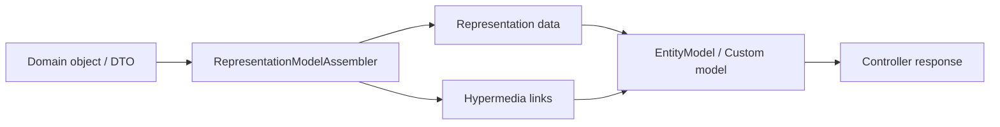

# Model assembler

Trong Spring HATEOAS, **model assembler** là thành phần chuyển đổi một đối tượng miền nghiệp vụ hoặc DTO thành hypermedia representation dành cho REST API. Assembler tạo mô hình phản hồi, đưa dữ liệu cần công bố vào đó và gắn các liên kết như `self`, `customer`, `items` hoặc `cancel`. Nhờ vậy, controller có thể tập trung tiếp nhận request và điều phối nghiệp vụ, còn quy tắc dựng representation được tổ chức tại một nơi có thể tái sử dụng.

Spring HATEOAS định nghĩa interface `RepresentationModelAssembler<T, D>` cho mục đích này. `T` là kiểu đầu vào, thường là entity hoặc DTO; `D` là kiểu representation đầu ra và phải kế thừa `RepresentationModel`. Phương thức cốt lõi `toModel(T)` chuyển một đối tượng đầu vào thành một representation. Interface cũng cung cấp phương thức tạo collection model từ nhiều đối tượng.

## 1. Vì sao cần model assembler?

Giả sử API quản lý đơn hàng. Một controller cần trả về đơn hàng cùng liên kết `self`, `customer` và `items`. Nếu mỗi handler tự tạo `EntityModel`, chuyển đổi dữ liệu và ghép liên kết, logic này sẽ lặp lại giữa endpoint xem chi tiết, tìm kiếm và danh sách. Khi relation hoặc cấu trúc response thay đổi, đội phát triển phải sửa nhiều nơi và dễ tạo ra representation không nhất quán.

Assembler gom quy tắc chuyển đổi đó:



Một assembler thường chịu trách nhiệm:

- Chọn dữ liệu từ entity hoặc DTO để đưa vào response.
- Tạo kiểu representation phù hợp, ví dụ `EntityModel<OrderModel>`.
- Thêm link `self` và các link đến resource liên quan.
- Thêm link hành động khi trạng thái tài nguyên cho phép.
- Dựng collection representation theo cùng quy tắc cho từng phần tử.

Việc gom logic giúp các endpoint biểu diễn cùng một loại resource theo một hợp đồng nhất quán. Khi muốn đổi tên relation hoặc bổ sung một trường trong representation, thay đổi có thể được thực hiện tập trung.

## 2. Interface RepresentationModelAssembler

Interface nằm trong package `org.springframework.hateoas.server`:

```java
public interface RepresentationModelAssembler<T, D extends RepresentationModel<?>> {

    D toModel(T entity);

    // Interface còn cung cấp phương thức mặc định để dựng collection model.
}
```

Hai tham số generic thể hiện ranh giới chuyển đổi:

| Tham số | Ý nghĩa | Ví dụ |
| --- | --- | --- |
| `T` | Kiểu đối tượng đầu vào | `Order`, `OrderView` |
| `D` | Kiểu hypermedia representation đầu ra | `EntityModel<OrderRepresentation>`, `OrderModel` |

Nếu dùng `EntityModel<T>`, assembler bọc dữ liệu trong một model có thể chứa link. Nếu cần một cấu trúc response riêng, có thể tạo class kế thừa `RepresentationModel` và dùng class đó làm kiểu `D`.

Phương thức `toModel` nên có kết quả xác định từ đối tượng đầu vào và ngữ cảnh cần thiết để tạo representation. Không nên biến assembler thành nơi xử lý giao dịch, cập nhật entity hoặc quyết định các quy tắc nghiệp vụ cốt lõi. Assembler có thể đọc trạng thái đã được tính toán từ domain object hoặc DTO để quyết định link nào được công bố.

## 3. Tạo representation và liên kết cho một resource

Giả sử ứng dụng có domain object `Order` với các phương thức `getId()`, `getStatus()`, `canBeCancelled()` và `getCustomerId()`. DTO xuất ra API được định nghĩa riêng:

```java
import java.util.UUID;

public record OrderRepresentation(
        UUID id,
        String status,
        boolean cancellable) {

    static OrderRepresentation from(Order order) {
        return new OrderRepresentation(
                order.getId(),
                order.getStatus().name(),
                order.canBeCancelled());
    }
}
```

Assembler chuyển `Order` thành `EntityModel<OrderRepresentation>` và tạo các liên kết bằng `WebMvcLinkBuilder`:

```java
import org.springframework.hateoas.EntityModel;
import org.springframework.hateoas.server.RepresentationModelAssembler;
import org.springframework.stereotype.Component;

import static org.springframework.hateoas.server.mvc.WebMvcLinkBuilder.linkTo;
import static org.springframework.hateoas.server.mvc.WebMvcLinkBuilder.methodOn;

@Component
class OrderModelAssembler
        implements RepresentationModelAssembler<Order, EntityModel<OrderRepresentation>> {

    @Override
    public EntityModel<OrderRepresentation> toModel(Order order) {
        EntityModel<OrderRepresentation> model = EntityModel.of(
                OrderRepresentation.from(order),
                linkTo(methodOn(OrderController.class)
                        .one(order.getId())).withSelfRel(),
                linkTo(methodOn(CustomerController.class)
                        .one(order.getCustomerId())).withRel("customer"),
                linkTo(methodOn(OrderItemController.class)
                        .allForOrder(order.getId())).withRel("items"));

        if (order.canBeCancelled()) {
            model.add(linkTo(methodOn(OrderController.class)
                    .cancel(order.getId())).withRel("cancel"));
        }

        return model;
    }
}
```

Trong ví dụ:

- `@Component` đăng ký assembler để Spring có thể inject vào controller.
- `OrderRepresentation.from(order)` chọn dữ liệu công khai từ domain object.
- `EntityModel.of(...)` tạo representation và nhận các link ban đầu.
- `linkTo(methodOn(...))` xây URI từ mapping controller và phương thức handler.
- `withSelfRel()` tạo quan hệ `self`; `withRel("customer")` và `withRel("items")` tạo các relation nghiệp vụ.
- `cancel` chỉ được thêm khi đơn hàng hiện có thể hủy.

Các class `Order`, `OrderController`, `CustomerController` và `OrderItemController` cùng các handler được tham chiếu là thành phần của ứng dụng giả định. Khi áp dụng, kiểu tham số và kiểu trả về của các handler phải khớp với lời gọi trong `methodOn(...)`.

`methodOn(...)` tạo proxy để mô tả lời gọi handler phục vụ việc dựng link; nó không thực thi logic nghiệp vụ của controller. `linkTo(...)` sử dụng mapping của Spring MVC để tạo URI. Cách này tránh việc ghép chuỗi đường dẫn thủ công ở nhiều vị trí.

## 4. Dùng assembler trong controller

Khi đã có assembler, controller có thể inject nó qua constructor và gọi `toModel`:

```java
import java.util.UUID;

import org.springframework.hateoas.EntityModel;
import org.springframework.http.ResponseEntity;
import org.springframework.web.bind.annotation.GetMapping;
import org.springframework.web.bind.annotation.PathVariable;
import org.springframework.web.bind.annotation.PostMapping;
import org.springframework.web.bind.annotation.RequestMapping;
import org.springframework.web.bind.annotation.RestController;

@RestController
@RequestMapping("/orders")
class OrderController {

    private final OrderService orderService;
    private final OrderModelAssembler assembler;

    OrderController(OrderService orderService, OrderModelAssembler assembler) {
        this.orderService = orderService;
        this.assembler = assembler;
    }

    @GetMapping("/{id}")
    EntityModel<OrderRepresentation> one(@PathVariable UUID id) {
        return assembler.toModel(orderService.getRequired(id));
    }

    @PostMapping("/{id}/cancellation")
    ResponseEntity<EntityModel<OrderRepresentation>> cancel(@PathVariable UUID id) {
        Order updated = orderService.cancel(id);
        return ResponseEntity.ok(assembler.toModel(updated));
    }
}
```

Controller vẫn thực hiện các bước cần thiết cho request: đọc path variable, gọi service, chọn HTTP response. Việc dựng representation và liên kết được chuyển cho assembler. Sau thao tác hủy, controller chuyển trạng thái mới nhận từ service cho assembler để response phản ánh đúng các hành động hiện còn khả dụng.

Assembler không làm thay service. `orderService.cancel(id)` vẫn phải kiểm tra quyền, trạng thái hiện tại và quy tắc nghiệp vụ trước khi cập nhật đơn hàng. Việc response không chứa link `cancel` chỉ giúp client hiểu hành động đó hiện không được quảng bá; nó không phải cơ chế bảo mật.

## 5. Dựng collection representation

Một endpoint danh sách thường cần áp dụng cùng quy tắc cho từng phần tử. `RepresentationModelAssembler` cung cấp phương thức mặc định `toCollectionModel(...)`, nhận một `Iterable` và chuyển các phần tử bằng `toModel(...)`.

```java
import org.springframework.hateoas.CollectionModel;
import org.springframework.hateoas.EntityModel;

@GetMapping
CollectionModel<EntityModel<OrderRepresentation>> all() {
    CollectionModel<EntityModel<OrderRepresentation>> model =
            assembler.toCollectionModel(orderService.findAll());

    model.add(linkTo(methodOn(OrderController.class).all()).withSelfRel());
    return model;
}
```

Ở đây, mỗi đơn hàng được chuyển thành `EntityModel<OrderRepresentation>` thông qua `toModel`. Sau đó controller thêm link `self` ở cấp collection. Có thể bổ sung link `next`, `prev`, `first` hoặc `last` nếu API có phân trang. Những link này cần giữ lại tham số tìm kiếm, lọc và sắp xếp thích hợp để client tiếp tục cùng một truy vấn.

Với collection lớn, nên dùng cơ chế phân trang của ứng dụng thay vì tải toàn bộ dữ liệu vào bộ nhớ chỉ để gọi `toCollectionModel`. Có thể lấy một trang từ service, dựng representation cho các phần tử trong trang rồi thêm link điều hướng dựa trên thông tin trang hiện tại.

## 6. Assembler với RepresentationModel tùy chỉnh

Không bắt buộc phải dùng `EntityModel`. Khi cần kiểu response có cấu trúc riêng, có thể kế thừa `RepresentationModel`:

```java
import java.util.UUID;

import org.springframework.hateoas.RepresentationModel;

class OrderModel extends RepresentationModel<OrderModel> {

    private UUID id;
    private String status;

    OrderModel(UUID id, String status) {
        this.id = id;
        this.status = status;
    }

    public UUID getId() {
        return id;
    }

    public String getStatus() {
        return status;
    }
}
```

Assembler có thể trả về `OrderModel` trực tiếp:

```java
import org.springframework.hateoas.server.RepresentationModelAssembler;
import org.springframework.stereotype.Component;

import static org.springframework.hateoas.server.mvc.WebMvcLinkBuilder.linkTo;
import static org.springframework.hateoas.server.mvc.WebMvcLinkBuilder.methodOn;

@Component
class CustomOrderAssembler
        implements RepresentationModelAssembler<Order, OrderModel> {

    @Override
    public OrderModel toModel(Order order) {
        OrderModel model = new OrderModel(
                order.getId(), order.getStatus().name());

        model.add(linkTo(methodOn(OrderController.class)
                .one(order.getId())).withSelfRel());

        return model;
    }
}
```

Kiểu custom phù hợp khi response có nhiều trường hoặc cấu trúc riêng, và ứng dụng muốn kiểm soát rõ ràng dữ liệu được serialize. `EntityModel` phù hợp khi chỉ cần bọc một DTO có sẵn cùng liên kết. Nên chọn kiểu đơn giản đáp ứng hợp đồng response, tránh tạo nhiều lớp chỉ để bọc dữ liệu mà không mang lại lợi ích rõ ràng.

## 7. Ranh giới trách nhiệm của assembler

Assembler là lớp chuyển đổi và dựng hypermedia representation. Để dễ bảo trì, cần giữ ranh giới rõ ràng giữa assembler, controller và service:

| Thành phần | Trách nhiệm chính |
| --- | --- |
| Controller | Nhận HTTP request, gọi service và trả HTTP response |
| Service/domain | Thực hiện quy tắc nghiệp vụ, kiểm tra điều kiện và thay đổi trạng thái |
| Assembler | Chuyển domain object/DTO thành representation và tạo link |
| Representation/DTO | Xác định dữ liệu công khai được gửi cho client |

Assembler có thể dựa trên thông tin đã được tính toán trong domain object hoặc DTO để quyết định liên kết nào xuất hiện. Ví dụ `canBeCancelled()` có thể phản ánh quy tắc miền. Nếu việc quyết định cần truy vấn dữ liệu, kiểm tra quyền hoặc thực hiện giao dịch phức tạp, nên xử lý ở service hoặc một thành phần nghiệp vụ phù hợp trước khi assembler nhận dữ liệu.

Không nên để assembler:

- Cập nhật entity hoặc ghi dữ liệu xuống database.
- Thực hiện giao dịch nghiệp vụ như hủy đơn, thanh toán hoặc phê duyệt.
- Tự quyết định quyền truy cập chỉ bằng cách thêm hoặc bỏ link.
- Gọi service nhiều lần cho từng trường để truy xuất dữ liệu rời rạc, gây N+1 query.
- Tạo URI bằng cách nối chuỗi khi có thể tham chiếu mapping controller.

Nếu cần dữ liệu liên quan để dựng link, nên chuẩn bị dữ liệu đó qua service hoặc DTO phù hợp. Điều này giúp assembler dễ kiểm thử và tránh tạo tải truy vấn ngoài dự kiến.

## 8. Kiểm thử model assembler

Assembler có thể được kiểm thử đơn vị bằng cách tạo một domain object mẫu, gọi `toModel(...)` và kiểm tra dữ liệu cùng danh sách relation. Kiểm thử nên xác nhận cả hai trạng thái nghiệp vụ, chẳng hạn đơn hàng được phép hủy và đơn hàng không được phép hủy.

Ví dụ kiểm thử ở mức đơn vị:

```java
import static org.assertj.core.api.Assertions.assertThat;

import org.springframework.hateoas.EntityModel;
import org.junit.jupiter.api.Test;

class OrderModelAssemblerTest {

    private final OrderModelAssembler assembler = new OrderModelAssembler();

    @Test
    void addsCancelLinkWhenOrderCanBeCancelled() {
        Order order = OrderFixture.pendingOrder();

        EntityModel<OrderRepresentation> model = assembler.toModel(order);

        assertThat(model.getContent()).isNotNull();
        assertThat(model.getLink("self")).isPresent();
        assertThat(model.getLink("customer")).isPresent();
        assertThat(model.getLink("items")).isPresent();
        assertThat(model.getLink("cancel")).isPresent();
    }
}
```

`OrderFixture.pendingOrder()` là fixture minh họa, cần được cung cấp trong test thực tế. Cần có thêm trường hợp đơn hàng không thể hủy và xác nhận relation `cancel` không xuất hiện. Nếu muốn kiểm tra URI đầy đủ, hãy cấu hình môi trường Spring MVC phù hợp và xác nhận `href` theo mapping mong đợi.

Kiểm thử tích hợp với `MockMvc` xác nhận assembler được gọi trong luồng controller và kết quả được serialize đúng media type, ví dụ HAL:

```java
mockMvc.perform(get("/orders/{id}", orderId)
        .accept("application/hal+json"))
    .andExpect(status().isOk())
    .andExpect(jsonPath("$._links.self.href").exists())
    .andExpect(jsonPath("$._links.customer.href").exists())
    .andExpect(jsonPath("$._links.items.href").exists());
```

Nên kiểm tra URI và relation cụ thể, không chỉ kiểm tra link có tồn tại. Với link hành động, cần kiểm tra response thay đổi theo trạng thái tài nguyên và endpoint vẫn từ chối request không hợp lệ nếu client tự gọi URI đó.

## 9. Lỗi thường gặp và cách tránh

**Đặt toàn bộ logic vào controller:** controller vừa chuyển DTO, vừa dựng link và xử lý điều kiện khiến logic bị lặp. Hãy chuyển phần dựng representation dùng chung vào assembler.

**Nhầm assembler với mapper đơn thuần:** mapper chỉ chuyển đổi dữ liệu; `RepresentationModelAssembler` còn tạo representation hypermedia và liên kết. Có thể dùng mapper để tạo DTO bên trong assembler nếu ứng dụng cần tách hai bước.

**Trả về entity trực tiếp:** entity thường chứa chi tiết persistence và quan hệ nội bộ. Dùng DTO hoặc representation riêng để kiểm soát dữ liệu công khai và tránh serialize ngoài ý muốn.

**Relation không nhất quán:** cùng một ý nghĩa nhưng nơi dùng `customer`, nơi dùng `client`. Hãy thống nhất relation như một phần hợp đồng API.

**Bỏ kiểm tra nghiệp vụ vì link đã bị ẩn:** client có thể lưu link cũ hoặc gọi URI trực tiếp. Service vẫn phải kiểm tra quyền và trạng thái khi request đến.

**Assembler truy vấn dữ liệu quá nhiều:** việc truy xuất từng quan hệ riêng lẻ trong lúc dựng từng model có thể gây N+1 query. Hãy chuẩn bị projection hoặc dữ liệu cần thiết trước khi gọi assembler.

## 10. Checklist khi triển khai

- Chọn rõ kiểu đầu vào `T` và kiểu representation `D` của assembler.
- Đặt assembler ở component riêng và inject vào controller qua constructor.
- Chuyển đổi domain object hoặc DTO thành representation có dữ liệu công khai phù hợp.
- Tạo link `self` và relation liên quan bằng mapping controller.
- Chỉ công bố link hành động phù hợp với trạng thái hiện tại của resource.
- Dùng `toCollectionModel(...)` cho collection khi phù hợp và bổ sung link ở cấp collection.
- Giữ logic nghiệp vụ và phân quyền trong service/domain, không giao cho link hoặc assembler.
- Kiểm thử dữ liệu, relation, URI và các trường hợp trạng thái khác nhau.
- Xác nhận response được serialize đúng media type mà API công bố, ví dụ `application/hal+json`.

Khi sử dụng đúng, `RepresentationModelAssembler` tạo một ranh giới rõ ràng giữa dữ liệu nghiệp vụ và hypermedia representation. Controller có thể trả về model nhất quán qua nhiều endpoint, client khám phá các quan hệ và hành động từ link, còn service tiếp tục chịu trách nhiệm bảo vệ quy tắc nghiệp vụ khi mỗi request được thực hiện.
