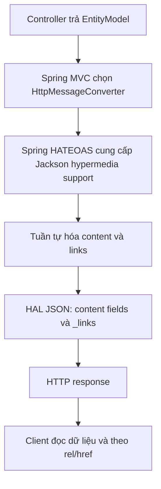

# Serialize EntityModel

`EntityModel<T>` là kiểu representation của Spring HATEOAS dùng để bọc nội dung một tài nguyên cùng các liên kết hypermedia. Khi controller trả `EntityModel` qua Spring MVC, Spring HATEOAS phối hợp với Jackson và HTTP message converter để tuần tự hóa nội dung cùng các liên kết thành response HTTP. Với HAL JSON, dữ liệu của đối tượng được biểu diễn ở cấp tài nguyên và các liên kết được đặt trong `_links`.

Quá trình này giúp API trả về một tài nguyên có thể được client đọc và điều hướng. Client nhận dữ liệu nghiệp vụ, tìm các quan hệ như `self`, `orders` hoặc `cancel`, rồi truy cập `href` tương ứng. Để response hoạt động đúng, ứng dụng cần có cấu hình hypermedia phù hợp và client cần thương lượng media type mà server hỗ trợ.

## EntityModel chứa gì?

`EntityModel<T>` kế thừa cơ chế liên kết từ `RepresentationModel`. Nó chứa:

- **Content:** đối tượng dữ liệu kiểu `T`, thường là DTO dành cho API.
- **Links:** tập hợp các liên kết `Link`, mỗi liên kết có quan hệ (`rel`) và đích (`href`).

Ví dụ tạo model đơn hàng:

```java
OrderResponse response = new OrderResponse(
        order.getId(),
        order.getStatus().name(),
        order.getTotal()
);

EntityModel<OrderResponse> model = EntityModel.of(
        response,
        linkTo(methodOn(OrderController.class).one(order.getId())).withSelfRel(),
        linkTo(methodOn(OrderController.class).all()).withRel("orders")
);
```

`EntityModel.of(content, links...)` tạo model với nội dung và các liên kết ban đầu. Có thể tạo model trước rồi dùng `model.add(...)` để thêm link sau. `EntityModel` giữ dữ liệu và liên kết trong cùng một đối tượng representation; việc tuần tự hóa sẽ được thực hiện khi Spring ghi response.

## Luồng tuần tự hóa trong Spring MVC

Khi một controller trả `EntityModel`, luồng xử lý ở mức khái quát như sau:



Spring MVC chọn converter dựa trên kiểu response, cấu hình ứng dụng và media type được thương lượng. Khi HAL converter được chọn, Jackson hypermedia support của Spring HATEOAS chuyển các link thành cấu trúc HAL. Vì vậy, controller chỉ cần trả về model; thông thường không cần tự gọi `ObjectMapper.writeValueAsString(...)` để tạo JSON.

## Cấu hình hỗ trợ HAL

### Với Spring Boot

Trong ứng dụng Spring Boot, dependency `spring-boot-starter-hateoas` cung cấp Spring HATEOAS cùng các tích hợp cần thiết. Cấu hình tự động của Spring Boot thiết lập hỗ trợ hypermedia cho ứng dụng.

Ví dụ dependency trong Gradle:

```groovy
dependencies {
    implementation 'org.springframework.boot:spring-boot-starter-web'
    implementation 'org.springframework.boot:spring-boot-starter-hateoas'
}
```

Khi dùng Spring Boot, nên để cấu hình tự động quản lý các converter và Jackson module. Nếu tự thay thế `ObjectMapper` hoặc `HttpMessageConverters`, cần bảo đảm cấu hình hypermedia của Spring HATEOAS vẫn được giữ lại.

### Với cấu hình Spring MVC thủ công

Nếu ứng dụng không dùng cấu hình tự động của Spring Boot, có thể bật hỗ trợ HAL bằng `@EnableHypermediaSupport`:

```java
import org.springframework.context.annotation.Configuration;
import org.springframework.hateoas.config.EnableHypermediaSupport;
import org.springframework.hateoas.config.EnableHypermediaSupport.HypermediaType;

@Configuration
@EnableHypermediaSupport(type = HypermediaType.HAL)
public class HypermediaConfiguration {
}
```

Annotation này bật cơ chế hỗ trợ hypermedia cho loại HAL. Trong cấu hình MVC tùy chỉnh sâu hơn, hãy kiểm tra converter và Jackson module được đăng ký trong `RequestMappingHandlerAdapter` để bảo đảm `EntityModel` được xử lý đúng.

## Tuần tự hóa EntityModel thành HAL JSON

Giả sử DTO có cấu trúc như sau:

```java
import java.math.BigDecimal;
import java.util.UUID;

public record OrderResponse(
        UUID id,
        String status,
        BigDecimal total
) {}
```

Assembler tạo `EntityModel` và gắn liên kết:

```java
import org.springframework.hateoas.EntityModel;
import org.springframework.hateoas.server.RepresentationModelAssembler;
import org.springframework.stereotype.Component;

import static org.springframework.hateoas.server.mvc.WebMvcLinkBuilder.linkTo;
import static org.springframework.hateoas.server.mvc.WebMvcLinkBuilder.methodOn;

@Component
public class OrderModelAssembler
        implements RepresentationModelAssembler<Order, EntityModel<OrderResponse>> {

    @Override
    public EntityModel<OrderResponse> toModel(Order order) {
        var id = order.getId();
        OrderResponse content = new OrderResponse(
                id,
                order.getStatus().name(),
                order.getTotal()
        );

        EntityModel<OrderResponse> model = EntityModel.of(
                content,
                linkTo(methodOn(OrderController.class).one(id)).withSelfRel(),
                linkTo(methodOn(OrderController.class).all()).withRel("orders")
        );

        if (order.canBeCancelled()) {
            model.add(linkTo(methodOn(OrderController.class).cancel(id))
                    .withRel("cancel"));
        }

        return model;
    }
}
```

Controller trả về `EntityModel<OrderResponse>`:

```java
import java.util.List;
import java.util.UUID;
import java.util.stream.Collectors;

import org.springframework.hateoas.CollectionModel;
import org.springframework.hateoas.EntityModel;
import org.springframework.http.ResponseEntity;
import org.springframework.web.bind.annotation.GetMapping;
import org.springframework.web.bind.annotation.PathVariable;
import org.springframework.web.bind.annotation.PostMapping;
import org.springframework.web.bind.annotation.RequestMapping;
import org.springframework.web.bind.annotation.RestController;

import static org.springframework.hateoas.server.mvc.WebMvcLinkBuilder.linkTo;
import static org.springframework.hateoas.server.mvc.WebMvcLinkBuilder.methodOn;

@RestController
@RequestMapping("/api/orders")
public class OrderController {

    private final OrderService service;
    private final OrderModelAssembler assembler;

    public OrderController(OrderService service, OrderModelAssembler assembler) {
        this.service = service;
        this.assembler = assembler;
    }

    @GetMapping(value = "/{id}", produces = "application/hal+json")
    public EntityModel<OrderResponse> one(@PathVariable UUID id) {
        Order order = service.findRequired(id);
        return assembler.toModel(order);
    }

    @GetMapping
    public CollectionModel<EntityModel<OrderResponse>> all() {
        List<EntityModel<OrderResponse>> orders = service.findAll().stream()
                .map(assembler::toModel)
                .collect(Collectors.toList());

        return CollectionModel.of(orders,
                linkTo(methodOn(OrderController.class).all()).withSelfRel());
    }

    @PostMapping("/{id}/cancel")
    public ResponseEntity<Void> cancel(@PathVariable UUID id) {
        service.cancel(id);
        return ResponseEntity.noContent().build();
    }
}
```

Các kiểu `Order`, `OrderService` và import của controller được lược bớt để tập trung vào kiểu trả về. Trong ứng dụng thực tế, cần thêm link `self` cho collection nếu client cần điều hướng về chính danh sách. Liên kết `cancel` chỉ được assembler thêm khi trạng thái đơn hàng cho phép; endpoint vẫn phải kiểm tra quyền và trạng thái khi nhận request.

Khi client gửi request với `Accept: application/hal+json`, response HAL có dạng minh họa:

```http
GET /api/orders/8a31 HTTP/1.1
Accept: application/hal+json
```

```json
{
  "id": "8a31",
  "status": "PENDING",
  "total": 1250000,
  "_links": {
    "self": {
      "href": "http://localhost:8080/api/orders/8a31"
    },
    "orders": {
      "href": "http://localhost:8080/api/orders"
    },
    "cancel": {
      "href": "http://localhost:8080/api/orders/8a31/cancel"
    }
  }
}
```

Các trường `id`, `status` và `total` đến từ content của `EntityModel`. Các quan hệ nằm trong `_links`; mỗi quan hệ trỏ tới một `href`. Content không bị đặt trong một thuộc tính tên `content` khi tuần tự hóa HAL thông thường. Client đọc các trường tài nguyên ở cấp ngoài cùng và khám phá các link theo `rel`.

## Content negotiation: client yêu cầu HAL

Header `Accept` cho biết media type mà client muốn nhận. Đối với HAL JSON, client gửi:

```http
Accept: application/hal+json
```

Spring MVC chọn converter có thể tạo media type phù hợp. Có thể giới hạn endpoint chỉ trả HAL bằng thuộc tính `produces`:

```java
@GetMapping(value = "/{id}", produces = "application/hal+json")
public EntityModel<OrderResponse> one(@PathVariable UUID id) {
    return assembler.toModel(service.findRequired(id));
}
```

Nếu client yêu cầu media type không được endpoint hỗ trợ, Spring MVC có thể trả `406 Not Acceptable`. Nếu ứng dụng cung cấp nhiều representation, có thể khai báo nhiều media type và cấu hình converter tương ứng. Cần thống nhất định dạng response với client thay vì giả định mọi client đều hiểu HAL.

`Content-Type` của response cho biết định dạng thực tế server trả về. Khi kiểm thử, hãy xác nhận `Content-Type` tương thích với `application/hal+json`, đặc biệt khi ứng dụng có nhiều converter hoặc cấu hình MVC tùy chỉnh.

## Jackson và các trường content

Jackson tuần tự hóa đối tượng content theo các quy tắc thông thường của DTO, đồng thời Spring HATEOAS xử lý các liên kết. Các annotation Jackson trên DTO như `@JsonProperty`, `@JsonIgnore` hoặc cấu hình đặt tên thuộc tính vẫn có thể ảnh hưởng tới phần content.

Ví dụ:

```java
import com.fasterxml.jackson.annotation.JsonProperty;
import java.util.UUID;

public record CustomerResponse(
        UUID id,
        @JsonProperty("display_name") String displayName
) {}
```

Khi được bọc trong `EntityModel<CustomerResponse>`, trường `displayName` được xuất ra với tên `display_name`; các link vẫn được biểu diễn trong `_links`. Hãy dùng DTO để xác định rõ dữ liệu công khai của API, tránh đưa trực tiếp entity persistence vào response nếu entity có trường nội bộ, quan hệ lazy hoặc vòng tham chiếu.

Không nên tạo một `new ObjectMapper()` riêng để tự serialize `EntityModel` trong controller. ObjectMapper độc lập có thể không có module và cấu hình hypermedia mà Spring đã đăng ký. Hãy trả đối tượng representation từ controller để Spring MVC dùng converter đã cấu hình. Nếu ứng dụng thật sự cần serialize ngoài luồng MVC, phải cấu hình Jackson module và hypermedia support tương ứng theo phiên bản Spring HATEOAS đang dùng.

## EntityModel và JSON thông thường

`EntityModel` là một representation model, vì vậy kết quả serialization phụ thuộc vào media type và converter được chọn. Khi dùng HAL, cấu trúc `_links` tuân theo HAL. Nếu client yêu cầu `application/json` thông thường, không nên mặc định rằng nó sẽ nhận cùng hợp đồng HAL; hãy xác định rõ các media type được hỗ trợ và kiểm tra kết quả thương lượng nội dung.

Trong một API hypermedia, nên công bố media type rõ ràng để client biết cách đọc liên kết. Nếu cần HAL, dùng `application/hal+json` và bảo đảm server đã cấu hình HAL converter. Nếu cần một định dạng hypermedia khác, cấu hình loại hypermedia tương ứng và kiểm tra cấu trúc response theo định dạng đó.

## Kiểm thử serialization của EntityModel

Kiểm thử tích hợp với MockMvc có thể xác nhận cả dữ liệu content, cấu trúc link và media type:

```java
import static org.springframework.test.web.servlet.request.MockMvcRequestBuilders.get;
import static org.springframework.test.web.servlet.result.MockMvcResultMatchers.content;
import static org.springframework.test.web.servlet.result.MockMvcResultMatchers.jsonPath;
import static org.springframework.test.web.servlet.result.MockMvcResultMatchers.status;

import org.springframework.hateoas.MediaTypes;

mockMvc.perform(get("/api/orders/{id}", pendingOrderId)
        .accept(MediaTypes.HAL_JSON))
    .andExpect(status().isOk())
    .andExpect(content().contentTypeCompatibleWith(MediaTypes.HAL_JSON))
    .andExpect(jsonPath("$.id").value(pendingOrderId.toString()))
    .andExpect(jsonPath("$.status").value("PENDING"))
    .andExpect(jsonPath("$._links.self.href").exists())
    .andExpect(jsonPath("$._links.orders.href").exists())
    .andExpect(jsonPath("$._links.cancel.href").exists());
```

Với đơn hàng đã hoàn tất, có thể kiểm tra link `cancel` không xuất hiện:

```java
mockMvc.perform(get("/api/orders/{id}", deliveredOrderId)
        .accept(MediaTypes.HAL_JSON))
    .andExpect(status().isOk())
    .andExpect(jsonPath("$._links.self.href").exists())
    .andExpect(jsonPath("$._links.cancel").doesNotExist());
```

Kiểm thử riêng trường hợp client yêu cầu media type không hỗ trợ:

```java
mockMvc.perform(get("/api/orders/{id}", pendingOrderId)
        .accept("application/xml"))
    .andExpect(status().isNotAcceptable());
```

Kiểm thử `406` chỉ phù hợp khi endpoint thực sự giới hạn `produces` và không có converter khác đáp ứng `application/xml`. Nếu ứng dụng có converter XML, hãy chọn một media type chắc chắn không được hỗ trợ trong cấu hình kiểm thử.

## Những lỗi thường gặp khi serialize EntityModel

| Lỗi | Hệ quả | Cách xử lý |
|---|---|---|
| Trả DTO hoặc entity mà không bọc model | Response không có liên kết hypermedia | Trả `EntityModel<T>` khi cần representation đơn có link |
| Dùng `ObjectMapper` tự tạo | Thiếu cấu hình hypermedia hoặc serialize link sai | Dùng converter Spring MVC đã cấu hình |
| Không cấu hình HAL support | Không tạo được response HAL như mong đợi | Dùng starter Spring Boot hoặc `@EnableHypermediaSupport` |
| Client không gửi `Accept` phù hợp | Converter có thể chọn representation khác hoặc từ chối | Thống nhất và gửi `application/hal+json` |
| Gắn link sai quan hệ | Client không tìm được khả năng mong đợi | Dùng `rel` ổn định và kiểm thử `_links` |
| Đưa entity persistence trực tiếp vào content | Có thể lộ trường nội bộ hoặc gặp vòng tham chiếu | Dùng DTO cho dữ liệu công khai |
| Xem link hành động là cơ chế phân quyền | Request trực tiếp có thể bỏ qua giao diện client | Kiểm tra quyền và trạng thái ở server |

## Quy trình kiểm tra trước khi công bố response

1. Xác định DTO làm content của `EntityModel`.
2. Tạo các link với quan hệ có ngữ nghĩa ổn định.
3. Trả `EntityModel<T>` từ controller.
4. Bảo đảm Spring HATEOAS và HAL converter được cấu hình.
5. Thống nhất media type với client, thường là `application/hal+json`.
6. Kiểm tra response thực tế: trường content, `_links` và `Content-Type`.
7. Kiểm thử link theo trạng thái nghiệp vụ và quyền truy cập.

## Kết luận

Tuần tự hóa `EntityModel` là bước chuyển nội dung tài nguyên cùng các liên kết thành response hypermedia. Trong Spring MVC, controller trả model và HTTP message converter phối hợp với Jackson hypermedia support để tạo HAL JSON khi media type được thương lượng phù hợp. Cấu hình đúng, dùng DTO làm content, tạo link có quan hệ rõ ràng và kiểm thử cả `_links` lẫn `Content-Type` giúp API cung cấp response nhất quán để client đọc và điều hướng.
