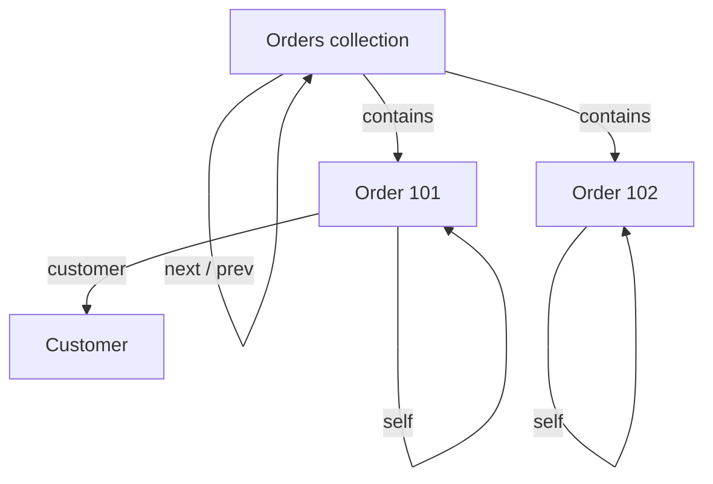

# Tập hợp tài nguyên

Trong REST API, một **tập hợp tài nguyên** (*resource collection*) là một resource đại diện cho nhóm các resource cùng loại hoặc cùng một tiêu chí nghiệp vụ. Ví dụ, `/orders` có thể đại diện cho tập hợp đơn hàng; `/customers/C-105/orders` đại diện cho các đơn hàng thuộc về một khách hàng. Client truy cập collection để duyệt, lọc hoặc lấy các phần tử, sau đó có thể đi đến từng resource riêng lẻ.

Spring HATEOAS cung cấp `CollectionModel<T>` để biểu diễn một tập hợp hypermedia. Mô hình này chứa các representation của phần tử và có thể mang các liên kết ở cấp collection như `self`, `next`, `prev` hoặc `create`. Mỗi phần tử cũng có thể có các liên kết riêng như `self`, `customer` hay `cancel`. Nhờ vậy, response mô tả được cả tập hợp và cách client tiếp tục tương tác với từng resource.

## 1. Collection là một resource

Một collection không chỉ là một mảng JSON. Nó có URI, có thể có trạng thái và quy tắc truy cập riêng, đồng thời có thể cung cấp các liên kết điều hướng. Ví dụ, collection đơn hàng có thể hỗ trợ:

- Liệt kê các đơn hàng mà người dùng hiện tại được phép xem.
- Lọc theo trạng thái, ngày tạo hoặc khách hàng.
- Phân trang và sắp xếp kết quả.
- Điều hướng đến từng đơn hàng.
- Khởi tạo một đơn hàng mới nếu API công bố hành động đó.

Có thể hình dung cấu trúc như sau:



Collection và phần tử là hai cấp representation khác nhau. Link `next` thuộc collection vì nó điều hướng giữa các trang của cùng một tập hợp. Link `self` của từng đơn hàng thuộc representation của đơn hàng vì nó trỏ đến chính phần tử đó.

## 2. Vì sao dùng CollectionModel?

Nếu controller trả về `List<OrderDto>`, Spring MVC có thể tuần tự hóa danh sách thành một JSON array. Cách này phù hợp với API đơn giản, nhưng bản thân array không có chỗ chuẩn hóa để gắn link ở cấp collection. Client phải dựa vào quy ước URI bên ngoài để biết trang tiếp theo hoặc cách quay về collection.

`CollectionModel<T>` giải quyết điều đó bằng cách bọc các representation thành phần tử và cho phép thêm link ở cấp tập hợp. Trong Spring HATEOAS, `T` phải là một kiểu representation kế thừa `RepresentationModel<?>`, chẳng hạn `EntityModel<OrderRepresentation>` hoặc một model tùy chỉnh.

| Kiểu trả về | Nội dung chính | Khả năng hypermedia |
| --- | --- | --- |
| `List<OrderDto>` | Danh sách DTO | Không có API của Spring HATEOAS để gắn link collection trực tiếp |
| `CollectionModel<EntityModel<OrderDto>>` | Collection gồm các phần tử có thể mang link | Có link cấp collection và link riêng cho từng phần tử |
| `PagedModel<EntityModel<OrderDto>>` | Collection có thêm metadata phân trang | Có link điều hướng cùng thông tin trang |

`CollectionModel` phù hợp cho một tập hợp nói chung. Khi cần mô tả số trang, kích thước trang và tổng số phần tử, có thể dùng `PagedModel` hoặc tích hợp Spring Data để tạo paged representation.

## 3. Tạo CollectionModel cơ bản

Giả sử ứng dụng có `Order` là domain object và `OrderRepresentation` là DTO công khai:

```java
import java.util.UUID;
import org.springframework.hateoas.server.core.Relation;

@Relation(itemRelation = "order", collectionRelation = "orders")
public record OrderRepresentation(UUID id, String status) {

    static OrderRepresentation from(Order order) {
        return new OrderRepresentation(order.getId(), order.getStatus().name());
    }
}
```

Ta có thể chuyển từng DTO thành `EntityModel` rồi đưa vào `CollectionModel`:

```java
import java.util.List;

import org.springframework.hateoas.CollectionModel;
import org.springframework.hateoas.EntityModel;

import static org.springframework.hateoas.server.mvc.WebMvcLinkBuilder.linkTo;
import static org.springframework.hateoas.server.mvc.WebMvcLinkBuilder.methodOn;

List<EntityModel<OrderRepresentation>> orders = orderService.findAll().stream()
        .map(order -> EntityModel.of(
                OrderRepresentation.from(order),
                linkTo(methodOn(OrderController.class)
                        .one(order.getId())).withSelfRel()))
        .toList();

CollectionModel<EntityModel<OrderRepresentation>> model =
        CollectionModel.of(orders,
                linkTo(methodOn(OrderController.class).all()).withSelfRel());
```

Trong ví dụ:

- Mỗi `EntityModel` chứa dữ liệu của một đơn hàng và link `self` đến endpoint chi tiết.
- `CollectionModel.of(...)` nhận danh sách các model cùng link `self` của collection.
- `linkTo(methodOn(...))` tạo URI từ mapping của controller, hạn chế việc nối chuỗi URL thủ công.

Các lớp `Order`, `OrderService`, `OrderController` và các phương thức được gọi là thành phần minh họa của ứng dụng. Phương thức `one(...)` cần có mapping cho chi tiết đơn hàng; `all()` cần có mapping cho collection. `methodOn(...)` tạo proxy mô tả lời gọi handler để dựng URI, không thực thi logic nghiệp vụ của handler.

## 4. Dùng CollectionModel trong controller

Trong ứng dụng Spring MVC, controller có thể trả về `CollectionModel` trực tiếp. Ví dụ sau dùng assembler để tạo representation nhất quán cho từng đơn hàng:

```java
import org.springframework.hateoas.CollectionModel;
import org.springframework.hateoas.EntityModel;
import org.springframework.web.bind.annotation.GetMapping;
import org.springframework.web.bind.annotation.RequestMapping;
import org.springframework.web.bind.annotation.RestController;

import static org.springframework.hateoas.server.mvc.WebMvcLinkBuilder.linkTo;
import static org.springframework.hateoas.server.mvc.WebMvcLinkBuilder.methodOn;

@RestController
@RequestMapping("/orders")
class OrderController {

    private final OrderService orderService;
    private final OrderModelAssembler assembler;

    OrderController(OrderService orderService, OrderModelAssembler assembler) {
        this.orderService = orderService;
        this.assembler = assembler;
    }

    @GetMapping
    CollectionModel<EntityModel<OrderRepresentation>> all() {
        CollectionModel<EntityModel<OrderRepresentation>> model =
                assembler.toCollectionModel(orderService.findAll());

        model.add(linkTo(methodOn(OrderController.class).all()).withSelfRel());
        return model;
    }
}
```

`RepresentationModelAssembler` cung cấp phương thức mặc định `toCollectionModel(Iterable<? extends T>)`. Phương thức này gọi `toModel(...)` cho từng phần tử và trả về `CollectionModel` chứa các representation đã tạo. Controller bổ sung link `self` ở cấp collection để client có thể nhận diện địa chỉ của tập hợp.

Trong dự án thực tế, `OrderModelAssembler` có thể thêm link `self`, `customer`, `items` hoặc các link hành động cho mỗi đơn hàng. Collection controller không cần lặp lại logic đó. Nếu một phần tử có trạng thái khác nhau, assembler quyết định các link của phần tử dựa trên trạng thái tương ứng.

## 5. Cấu trúc HAL của collection

Khi ứng dụng xuất HAL, các phần tử của collection thường được đặt trong `_embedded`, còn các liên kết ở cấp collection nằm trong `_links`. Ví dụ minh họa:

```json
{
  "_embedded": {
    "orders": [
      {
        "id": "ORD-101",
        "status": "PENDING",
        "_links": {
          "self": {
            "href": "https://api.example.test/orders/ORD-101"
          }
        }
      },
      {
        "id": "ORD-102",
        "status": "SHIPPED",
        "_links": {
          "self": {
            "href": "https://api.example.test/orders/ORD-102"
          }
        }
      }
    ]
  },
  "_links": {
    "self": {
      "href": "https://api.example.test/orders"
    },
    "next": {
      "href": "https://api.example.test/orders?page=1"
    }
  }
}
```

Trong cấu trúc này:

- `_embedded.orders` là danh sách representation đơn hàng được nhúng; `orders` là tên relation của collection nhúng.
- `_links.self` trỏ đến chính collection.
- `_links.next` cho client biết có thể theo liên kết để lấy trang kế tiếp.
- Mỗi phần tử có `_links.self` riêng để client truy cập resource đơn hàng độc lập.

Tên relation trong `_embedded` phụ thuộc vào cách Spring HATEOAS xác định relation cho kiểu representation. Có thể tùy chỉnh relation bằng annotation `@Relation` trên kiểu model khi cần công bố tên collection cụ thể. Vì vậy, nếu client phụ thuộc vào tên `orders`, cần kiểm tra JSON thực tế và giữ tên relation ổn định.

Client nên đọc relation và `href` thay vì tự tạo URI `?page=1`. Server có thể đổi cách biểu diễn trang, thêm tham số lọc hoặc chuyển sang URI khác mà client vẫn có thể tiếp tục theo link được công bố.

## 6. CollectionModel và PagedModel

`CollectionModel` biểu diễn một tập hợp và các liên kết liên quan. Nó không bắt buộc chứa thông tin về số trang hay tổng số phần tử. Nếu API có phân trang, client thường cần biết thêm:

- Trang hiện tại hoặc vị trí hiện tại.
- Kích thước trang.
- Tổng số phần tử hoặc tổng số trang nếu API cung cấp.
- Các liên kết điều hướng đến trang trước, trang sau, trang đầu hoặc trang cuối.

`PagedModel<T>` mở rộng ý tưởng collection bằng metadata trang. Trong ứng dụng tích hợp Spring Data, `PagedResourcesAssembler` có thể chuyển `Page<T>` thành `PagedModel` và sử dụng một `RepresentationModelAssembler` để tạo representation cho từng phần tử:

```java
import org.springframework.data.domain.Page;
import org.springframework.data.web.PagedResourcesAssembler;
import org.springframework.hateoas.PagedModel;
import org.springframework.data.domain.Pageable;

private final PagedResourcesAssembler<Order> pagedResourcesAssembler;
private final OrderModelAssembler orderModelAssembler;

@GetMapping
PagedModel<EntityModel<OrderRepresentation>> all(Pageable pageable) {
    Page<Order> page = orderService.findAll(pageable);
    return pagedResourcesAssembler.toModel(page, orderModelAssembler);
}
```

Đoạn code minh họa trường hợp ứng dụng đã cấu hình Spring Data Web và inject `PagedResourcesAssembler<Order>` cùng assembler phù hợp. Nếu không dùng Spring Data, có thể tự tạo `PagedModel` từ nội dung trang và `PagedModel.PageMetadata` theo dữ liệu phân trang của ứng dụng.

Không nên dùng `CollectionModel` thay cho `PagedModel` khi hợp đồng cần công bố metadata trang. Ngược lại, nếu collection nhỏ hoặc không có khái niệm trang, `CollectionModel` đơn giản hơn và đủ dùng.

## 7. Collection rỗng và link điều hướng

Một collection không có phần tử vẫn là một resource hợp lệ. Ví dụ, khách hàng mới tạo có thể chưa có đơn hàng. Response có thể chứa collection rỗng nhưng vẫn cung cấp link `self` và các hành động có ý nghĩa như `create` nếu người dùng được phép tạo đơn:

```java
CollectionModel<EntityModel<OrderRepresentation>> model =
        CollectionModel.empty();

model.add(linkTo(methodOn(OrderController.class).all()).withSelfRel());
```

Nếu API công bố hành động tạo đơn, có thể bổ sung relation `create` bằng cách tham chiếu handler tạo đơn phù hợp với chữ ký thực tế của controller. Link đó chỉ nên xuất hiện khi hành động phù hợp với ngữ cảnh và quyền của người gọi. Endpoint tạo đơn vẫn phải kiểm tra phân quyền và dữ liệu đầu vào.

Không nên xem collection rỗng là lỗi chỉ vì không có phần tử. Thông thường, API trả về thành công với representation của collection rỗng. Lỗi như không tìm thấy khách hàng hoặc không có quyền truy cập collection là tình huống khác và cần mã HTTP phù hợp.

## 8. Link ở cấp collection và link ở cấp phần tử

Khi thiết kế response, cần phân biệt rõ hai nhóm liên kết:

| Vị trí | Ví dụ relation | Vai trò |
| --- | --- | --- |
| Collection | `self` | Trỏ đến tập hợp hiện tại |
| Collection | `next`, `prev`, `first`, `last` | Điều hướng giữa các trang |
| Collection | `create`, `search` | Hành động hoặc điểm truy cập áp dụng cho tập hợp |
| Phần tử | `self` | Trỏ đến resource cụ thể |
| Phần tử | `customer`, `items`, `product` | Truy cập resource liên quan |
| Phần tử | `cancel`, `approve` | Hành động phụ thuộc trạng thái của phần tử |

Không nên đặt link `next` vào từng phần tử vì nó không điều hướng giữa các resource đơn lẻ. Cũng không nên đặt link `cancel` ở cấp collection nếu hành động hủy chỉ áp dụng cho từng đơn hàng cụ thể. Chọn đúng cấp giúp client hiểu ngữ cảnh của liên kết.

## 9. Lọc, sắp xếp và phân trang

Collection endpoint thường hỗ trợ query parameter để lọc và sắp xếp. Ví dụ:

```http
GET /orders?status=PENDING&sort=createdAt,desc&page=0&size=20
Accept: application/hal+json
```

Khi response có link `next`, URI của nó nên giữ lại điều kiện `status=PENDING`, thứ tự `createdAt,desc` và kích thước trang. Nếu bỏ các điều kiện đó, client có thể chuyển sang một tập kết quả khác khi điều hướng.

Spring HATEOAS hỗ trợ tạo link từ URI hoặc controller mapping; phần tạo link phân trang cần dựa trên đối tượng `Pageable` hoặc metadata truy vấn thực tế. Không nên tự ghép link `next` từ một số trang cố định nếu có thể dùng thông tin phân trang do service trả về.

Với dữ liệu thay đổi liên tục, offset pagination có thể khiến phần tử trùng hoặc bị bỏ qua giữa các trang khi có bản ghi mới được thêm vào. API có thể cân nhắc cursor pagination nếu nghiệp vụ cần duyệt ổn định trên tập dữ liệu lớn. Dù dùng cách nào, relation và ý nghĩa của các link điều hướng phải rõ ràng.

## 10. Kiểm thử CollectionModel

Kiểm thử collection cần xác nhận cả dữ liệu, link cấp collection và link của từng phần tử. Với `MockMvc`, có thể kiểm tra response HAL:

```java
mockMvc.perform(get("/orders")
        .accept("application/hal+json"))
    .andExpect(status().isOk())
    .andExpect(jsonPath("$._links.self.href").exists())
    .andExpect(jsonPath("$._embedded.orders").isArray())
    .andExpect(jsonPath("$._embedded.orders[0]._links.self.href").exists());
```

Đây là ví dụ minh họa; test thực tế cần có dữ liệu cho `OrderService`, cấu hình HAL và relation collection đúng với kiểu representation của dự án. Ngoài trường hợp có dữ liệu, nên kiểm thử:

- Collection rỗng vẫn trả representation hợp lệ và giữ link `self`.
- Link `next` và `prev` xuất hiện đúng theo trang hiện tại.
- Link phân trang giữ lại filter và sort.
- Mỗi phần tử có link `self` trỏ đúng resource.
- Link hành động của từng phần tử phản ánh trạng thái hiện tại.
- Quyền truy cập collection và từng phần tử được kiểm tra độc lập.
- Response sử dụng đúng media type mà API công bố.

## 11. Lỗi thường gặp

**Trả về List khi cần hypermedia:** array thuần không mang link cấp collection. Dùng `CollectionModel` khi client cần khám phá collection và điều hướng.

**Chỉ thêm link self cho collection:** client có thể mở collection nhưng không biết cách truy cập từng phần tử. Hãy dùng assembler để thêm link cho mỗi phần tử khi API hỗ trợ truy cập độc lập.

**Nhầm link cấp collection với link cấp phần tử:** `next` thuộc collection; `cancel` thường thuộc một đơn hàng. Đặt link đúng ngữ cảnh để tránh client hiểu sai.

**Nhúng tất cả phần tử vào response:** collection lớn gây response nặng và khó cập nhật. Dùng link đến collection và phân trang khi dữ liệu lớn.

**Coi CollectionModel là cơ chế phân trang:** `CollectionModel` không tự cung cấp metadata trang. Dùng `PagedModel` hoặc giải pháp phân trang phù hợp nếu hợp đồng cần thông tin trang.

**Giả định tên relation `_embedded` luôn tự động đúng:** tên relation phụ thuộc quy tắc xác định relation hoặc cấu hình của ứng dụng. Hãy kiểm tra output và công bố relation ổn định.

## 12. Checklist thiết kế collection resource

- Xác định URI và phạm vi nghiệp vụ của collection.
- Dùng `CollectionModel` khi response cần link ở cấp collection.
- Dùng `EntityModel` hoặc model kế thừa `RepresentationModel` cho từng phần tử khi cần link riêng.
- Thêm link `self` cho collection và từng resource phù hợp.
- Dùng relation nhất quán cho `_embedded` và link điều hướng.
- Chọn `PagedModel` khi cần metadata phân trang.
- Giữ filter, sort và kích thước trang trong link điều hướng.
- Trả representation hợp lệ cho collection rỗng.
- Kiểm tra phân quyền ở endpoint collection và endpoint phần tử.
- Kiểm thử JSON HAL, relation, URI và các trường hợp có/không có dữ liệu.

`CollectionModel` giúp Spring HATEOAS biểu diễn tập hợp tài nguyên như một phần của hợp đồng hypermedia. Khi kết hợp link cấp collection, link cấp phần tử và metadata phân trang phù hợp, client có thể duyệt dữ liệu theo các quan hệ do server công bố thay vì phụ thuộc vào cấu trúc URL được mã hóa sẵn.
