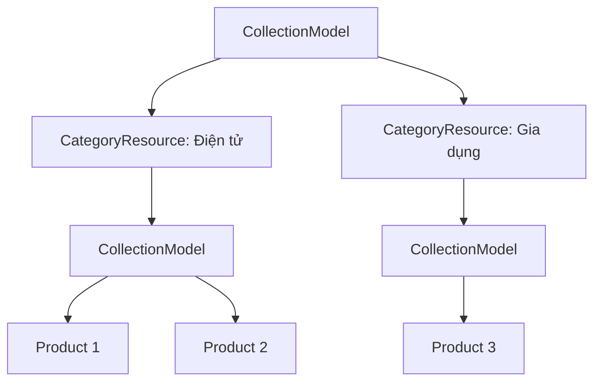

# CollectionModel lồng nhau

Một API đôi khi cần trả về dữ liệu theo nhiều cấp. Ví dụ, trang danh mục sản phẩm hiển thị danh sách nhóm hàng; mỗi nhóm có một danh sách sản phẩm bên trong. Với Spring HATEOAS, có thể dùng `CollectionModel` cho collection ngoài và đặt một `CollectionModel` khác trong resource model của từng nhóm. Mỗi cấp có dữ liệu, relation và self link riêng, giúp client hiểu collection nào đang được biểu diễn và truy cập lại đúng cấp đó.

Điều quan trọng là xác định ranh giới tài nguyên trước khi lồng model. Collection danh mục và collection sản phẩm của một danh mục là hai tài nguyên khác nhau. Collection ngoài cần self link đến danh sách danh mục; collection trong cần self link đến danh sách sản phẩm thuộc đúng danh mục. Mỗi sản phẩm lại có thể có self link riêng.

## Mô hình dữ liệu nhiều cấp

Giả sử cửa hàng có các danh mục như `Điện tử` và `Gia dụng`. Mỗi danh mục chứa một tập sản phẩm. API muốn trả về danh sách danh mục cùng một collection sản phẩm gọn cho mỗi danh mục.

Sơ đồ cấu trúc có thể hình dung như sau:



Ở đây:

- Collection ngoài chứa các resource danh mục.
- Mỗi `CategoryResource` chứa thông tin danh mục và một collection sản phẩm.
- Collection sản phẩm chứa các `EntityModel<ProductDto>`, mỗi model có thể có self link riêng.
- Collection danh mục và collection sản phẩm đều có self link của chính collection đó.

`CollectionModel<T>` biểu diễn một tập hợp `T` cùng các link. Khi lồng collection, nên đặt collection con trong một resource có ý nghĩa nghiệp vụ, chẳng hạn `CategoryResource`, thay vì dùng một generic lồng sâu khó xác định relation như `CollectionModel<CollectionModel<T>>`. Resource trung gian đặt tên và ranh giới rõ ràng cho collection con.

## Định nghĩa DTO và resource chứa collection con

DTO sản phẩm mô tả dữ liệu mà API muốn công bố. `@Relation` cung cấp tên relation khi các sản phẩm được nhúng trong collection HAL:

```java
import java.math.BigDecimal;
import java.util.UUID;

import org.springframework.hateoas.server.core.Relation;

@Relation(itemRelation = "product", collectionRelation = "products")
public record ProductDto(
        UUID id,
        String name,
        BigDecimal price
) {
}
```

Resource danh mục chứa dữ liệu danh mục và collection sản phẩm. Vì đây là resource model riêng, nó kế thừa `RepresentationModel` để có thể mang link của chính danh mục:

```java
import java.util.UUID;

import org.springframework.hateoas.CollectionModel;
import org.springframework.hateoas.EntityModel;
import org.springframework.hateoas.RepresentationModel;
import org.springframework.hateoas.server.core.Relation;

@Relation(itemRelation = "category", collectionRelation = "categories")
public class CategoryResource extends RepresentationModel<CategoryResource> {

    private final UUID id;
    private final String name;
    private final CollectionModel<EntityModel<ProductDto>> products;

    public CategoryResource(
            UUID id,
            String name,
            CollectionModel<EntityModel<ProductDto>> products) {
        this.id = id;
        this.name = name;
        this.products = products;
    }

    public UUID getId() {
        return id;
    }

    public String getName() {
        return name;
    }

    public CollectionModel<EntityModel<ProductDto>> getProducts() {
        return products;
    }
}
```

`CategoryResource` không phải JPA entity. Nó là representation được thiết kế cho client. Thuộc tính `products` là một `CollectionModel` độc lập, vì vậy collection con có thể chứa `_embedded` và `_links` riêng khi được serialize bằng cấu hình hypermedia của Spring HATEOAS.

## Tạo model cho từng sản phẩm

Trước khi tạo collection con, cần chuyển mỗi sản phẩm thành model có dữ liệu và link. Có thể dùng `RepresentationModelAssembler`:

```java
import static org.springframework.hateoas.server.mvc.WebMvcLinkBuilder.linkTo;
import static org.springframework.hateoas.server.mvc.WebMvcLinkBuilder.methodOn;

import org.springframework.hateoas.EntityModel;
import org.springframework.hateoas.server.RepresentationModelAssembler;
import org.springframework.stereotype.Component;

@Component
class ProductModelAssembler
        implements RepresentationModelAssembler<Product, EntityModel<ProductDto>> {

    @Override
    public EntityModel<ProductDto> toModel(Product product) {
        ProductDto dto = new ProductDto(
                product.getId(), product.getName(), product.getPrice());

        return EntityModel.of(dto,
                linkTo(methodOn(ProductController.class)
                        .one(product.getId())).withSelfRel());
    }
}
```

`ProductController.one(UUID)` là endpoint chi tiết sản phẩm. `methodOn` mô tả method và ID, còn `linkTo` tạo URI theo mapping controller. Nhờ vậy, mỗi sản phẩm có self link trỏ đến đúng tài nguyên của nó.

## Lắp collection con vào resource danh mục

Assembler danh mục tạo collection sản phẩm trước, sau đó đưa collection đó vào `CategoryResource`:

```java
import static org.springframework.hateoas.server.mvc.WebMvcLinkBuilder.linkTo;
import static org.springframework.hateoas.server.mvc.WebMvcLinkBuilder.methodOn;

import java.util.List;

import org.springframework.hateoas.CollectionModel;
import org.springframework.hateoas.EntityModel;
import org.springframework.hateoas.server.RepresentationModelAssembler;
import org.springframework.stereotype.Component;

@Component
class CategoryResourceAssembler
        implements RepresentationModelAssembler<Category, CategoryResource> {

    private final ProductService productService;
    private final ProductModelAssembler productAssembler;

    CategoryResourceAssembler(
            ProductService productService,
            ProductModelAssembler productAssembler) {
        this.productService = productService;
        this.productAssembler = productAssembler;
    }

    @Override
    public CategoryResource toModel(Category category) {
        List<EntityModel<ProductDto>> productModels = productService
                .findByCategoryId(category.getId())
                .stream()
                .map(productAssembler::toModel)
                .toList();

        CollectionModel<EntityModel<ProductDto>> products = CollectionModel.of(
                productModels,
                linkTo(methodOn(CategoryController.class)
                        .products(category.getId())).withSelfRel());

        CategoryResource resource = new CategoryResource(
                category.getId(), category.getName(), products);

        resource.add(linkTo(methodOn(CategoryController.class)
                .one(category.getId())).withSelfRel());

        return resource;
    }
}
```

Đoạn code tạo hai cấp self link:

1. `products` có self link đến collection sản phẩm của danh mục đang xử lý.
2. `resource` có self link đến chính danh mục.

Các sản phẩm bên trong đã có self link do `ProductModelAssembler` tạo. Do đó, client có thể mở lại danh mục, mở collection sản phẩm của danh mục hoặc mở một sản phẩm cụ thể.

## Trả collection ngoài từ controller

Controller trả về `CollectionModel<CategoryResource>` cho danh sách danh mục. Mỗi phần tử đã chứa collection sản phẩm của riêng nó:

```java
import static org.springframework.hateoas.server.mvc.WebMvcLinkBuilder.linkTo;
import static org.springframework.hateoas.server.mvc.WebMvcLinkBuilder.methodOn;

import java.util.List;
import java.util.UUID;

import org.springframework.hateoas.CollectionModel;
import org.springframework.hateoas.EntityModel;
import org.springframework.hateoas.MediaTypes;
import org.springframework.web.bind.annotation.GetMapping;
import org.springframework.web.bind.annotation.PathVariable;
import org.springframework.web.bind.annotation.RequestMapping;
import org.springframework.web.bind.annotation.RestController;

@RestController
@RequestMapping("/api/categories")
class CategoryController {

    private final CategoryService categoryService;
    private final ProductService productService;
    private final CategoryResourceAssembler assembler;
    private final ProductModelAssembler productAssembler;

    CategoryController(
            CategoryService categoryService,
            ProductService productService,
            CategoryResourceAssembler assembler,
            ProductModelAssembler productAssembler) {
        this.categoryService = categoryService;
        this.productService = productService;
        this.assembler = assembler;
        this.productAssembler = productAssembler;
    }

    @GetMapping(produces = MediaTypes.HAL_JSON_VALUE)
    CollectionModel<CategoryResource> all() {
        List<CategoryResource> categories = categoryService.findAll().stream()
                .map(assembler::toModel)
                .toList();

        return CollectionModel.of(categories,
                linkTo(methodOn(CategoryController.class).all()).withSelfRel());
    }

    @GetMapping(value = "/{id}", produces = MediaTypes.HAL_JSON_VALUE)
    CategoryResource one(@PathVariable UUID id) {
        return assembler.toModel(categoryService.findById(id));
    }

    @GetMapping(value = "/{id}/products", produces = MediaTypes.HAL_JSON_VALUE)
    CollectionModel<EntityModel<ProductDto>> products(@PathVariable UUID id) {
        List<EntityModel<ProductDto>> products = productService.findByCategoryId(id)
                .stream()
                .map(productAssembler::toModel)
                .toList();

        return CollectionModel.of(products,
                linkTo(methodOn(CategoryController.class).products(id)).withSelfRel());
    }
}
```

`all()` trả collection ngoài. `CategoryResourceAssembler` tạo collection sản phẩm con và thêm self link của danh mục. Endpoint `products(id)` công bố cùng collection con dưới một URI riêng; nó cũng là đích của self link ở cấp collection con. Các service và model `Category`, `Product` là thành phần nghiệp vụ của ứng dụng.

## Hình dạng response HAL

Với cấu trúc trên, response có thể có dạng minh họa như sau. Collection ngoài có `_links.self`; mỗi danh mục có `_links.self`; thuộc tính `products` là một hypermedia collection lồng bên trong và có `_embedded` cùng `_links` riêng:

```json
{
  "_embedded": {
    "categories": [
      {
        "id": "c1",
        "name": "Điện tử",
        "products": {
          "_embedded": {
            "products": [
              {
                "id": "p1",
                "name": "Bàn phím",
                "price": 450000,
                "_links": {
                  "self": {
                    "href": "https://shop.example/api/products/p1"
                  }
                }
              }
            ]
          },
          "_links": {
            "self": {
              "href": "https://shop.example/api/categories/c1/products"
            }
          }
        },
        "_links": {
          "self": {
            "href": "https://shop.example/api/categories/c1"
          }
        }
      }
    ]
  },
  "_links": {
    "self": {
      "href": "https://shop.example/api/categories"
    }
  }
}
```

Đây là một collection hypermedia được lồng trong thuộc tính `products` của resource danh mục. Tên `categories` ở collection ngoài lấy từ relation của `CategoryResource`; tên `products` của collection trong lấy từ relation của `ProductDto`. Hình dạng JSON cuối cùng cần được xác nhận bằng serializer và cấu hình HAL của ứng dụng, đặc biệt khi có custom Jackson module hoặc naming strategy.

## Khi nào nên lồng collection?

Lồng collection giúp client có dữ liệu nhiều cấp trong một response, nhưng làm tăng kích thước payload và chi phí truy vấn. Nên quyết định dựa trên cách client sử dụng dữ liệu:

| Tình huống | Thiết kế phù hợp |
| --- | --- |
| Mỗi danh mục chỉ có vài sản phẩm nổi bật và màn hình luôn hiển thị cùng nhau | Có thể nhúng collection sản phẩm nhỏ vào resource danh mục. |
| Danh mục có hàng nghìn sản phẩm | Trả link đến collection sản phẩm và phân trang riêng. |
| Client cần dữ liệu danh mục trước, có thể xem sản phẩm sau | Chỉ công bố relation `products`; client tải collection con khi cần. |
| Cần dữ liệu tóm tắt nhanh và có thể mở chi tiết | Nhúng một số trường tóm tắt, đồng thời cung cấp link đến collection đầy đủ. |

`CollectionModel` không tự giới hạn số phần tử và không tự tạo phân trang. Nếu collection con lớn, dùng `PagedModel` hoặc endpoint phân trang để client đi theo các link `next`, `prev`, `first` và `last`. Tránh tải tất cả sản phẩm của mọi danh mục trong một request.

## Hiệu năng và tính nhất quán

Khi assembler tạo một collection con cho mỗi danh mục, ứng dụng có thể vô tình thực hiện một truy vấn cho danh sách danh mục và thêm một truy vấn cho mỗi danh mục. Với nhiều danh mục, đây là vấn đề N+1. Có thể cải thiện bằng cách:

- Lấy dữ liệu sản phẩm theo batch cho toàn bộ danh sách ID danh mục.
- Dùng projection hoặc query tổng hợp chỉ lấy các trường cần cho resource.
- Giới hạn số sản phẩm nhúng trong mỗi danh mục.
- Dùng link đến endpoint con nếu client không cần dữ liệu con ngay lập tức.
- Tránh serialize JPA entity và quan hệ lazy trực tiếp; ánh xạ sang DTO/resource model có chủ đích.

Mỗi cấp collection cũng cần có quy tắc nhất quán. Self link của collection sản phẩm phải chứa đúng ID danh mục; relation `products` phải luôn mang cùng ý nghĩa; link self của sản phẩm phải dẫn đến endpoint chi tiết sản phẩm. Nếu quyền truy cập khác nhau theo danh mục hoặc sản phẩm, assembler chỉ nên công bố các khả năng phù hợp với người dùng hiện tại. Endpoint vẫn phải kiểm tra quyền khi client gọi link.

## Kiểm thử cấu trúc collection lồng nhau

Kiểm thử qua MockMvc giúp xác nhận cả collection ngoài lẫn collection con được serialize theo HAL:

```java
import static org.springframework.test.web.servlet.request.MockMvcRequestBuilders.get;
import static org.springframework.test.web.servlet.result.MockMvcResultMatchers.content;
import static org.springframework.test.web.servlet.result.MockMvcResultMatchers.jsonPath;
import static org.springframework.test.web.servlet.result.MockMvcResultMatchers.status;

import org.junit.jupiter.api.Test;
import org.springframework.beans.factory.annotation.Autowired;
import org.springframework.boot.test.autoconfigure.web.servlet.AutoConfigureMockMvc;
import org.springframework.boot.test.context.SpringBootTest;
import org.springframework.hateoas.MediaTypes;
import org.springframework.test.web.servlet.MockMvc;

@SpringBootTest
@AutoConfigureMockMvc
class CategoryControllerTest {

    @Autowired
    MockMvc mockMvc;

    @Test
    void categoriesContainNestedProductCollection() throws Exception {
        mockMvc.perform(get("/api/categories").accept(MediaTypes.HAL_JSON))
                .andExpect(status().isOk())
                .andExpect(content().contentTypeCompatibleWith(MediaTypes.HAL_JSON))
                .andExpect(jsonPath("$._links.self.href").exists())
                .andExpect(jsonPath("$._embedded.categories[0]._links.self.href").exists())
                .andExpect(jsonPath("$._embedded.categories[0].products._links.self.href").exists())
                .andExpect(jsonPath("$._embedded.categories[0].products._embedded.products").isArray())
                .andExpect(jsonPath("$._embedded.categories[0].products._embedded.products[0]._links.self.href").exists());
    }
}
```

Test giả định fixture có ít nhất một danh mục và một sản phẩm. Nếu collection rỗng, hãy kiểm tra `_embedded` theo quy tắc serializer đang dùng và không truy cập phần tử `[0]`. Nên bổ sung test cho danh mục không có sản phẩm, collection con có phân trang, người dùng thiếu quyền và trường hợp chuyển từ embedded collection sang link riêng.

Một số lỗi thường gặp:

| Lỗi | Hệ quả | Cách xử lý |
| --- | --- | --- |
| Dùng một self link cho mọi cấp | Client không biết đang ở collection ngoài hay collection con. | Tạo self link riêng cho từng collection và từng resource. |
| Lồng collection không có relation rõ ràng | Tên `_embedded` khó đoán hoặc không ổn định. | Dùng resource trung gian và khai báo `@Relation` cho từng loại resource. |
| Nhúng toàn bộ collection lớn | Response nặng, truy vấn chậm và tốn bộ nhớ. | Dùng phân trang hoặc link đến endpoint collection con. |
| Tạo truy vấn trong vòng lặp assembler | Dễ phát sinh N+1 query. | Batch fetch, projection hoặc chỉ cung cấp link. |
| Dựa vào cấu trúc JSON chưa được kiểm thử | Client phụ thuộc vào đường dẫn JSON sai. | Kiểm thử response HAL thực tế bằng JSONPath. |

## Nguyên tắc thiết kế

- Xác định mỗi collection là một tài nguyên có relation và self link riêng.
- Đặt collection con trong resource trung gian có ý nghĩa, chẳng hạn danh mục chứa sản phẩm.
- Dùng `CollectionModel` cho từng tập hợp và `EntityModel` hoặc `RepresentationModel` cho item.
- Dùng assembler để chuyển domain model thành resource và tạo link nhất quán.
- Chỉ nhúng collection nhỏ, có giới hạn; dùng `PagedModel` hoặc link khi dữ liệu lớn.
- Kiểm thử `_embedded`, `_links`, media type và các cấp relation sau serialize.

CollectionModel lồng nhau hữu ích khi client cần một representation có cấu trúc phân cấp. Mỗi cấp nên có ranh giới, relation và URI rõ ràng. Khi dữ liệu con lớn hoặc được truy cập độc lập, công bố link đến collection riêng sẽ giúp response gọn hơn và cho phép client tải đúng phần dữ liệu cần dùng.
