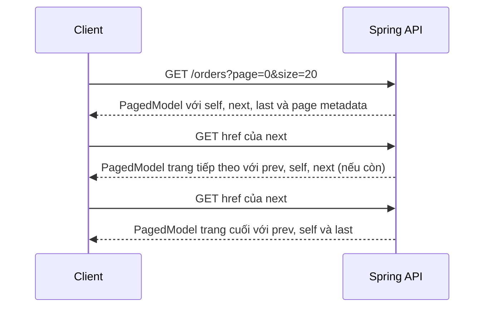

# PagedModel là gì

`PagedModel<T>` trong Spring HATEOAS biểu diễn một tập hợp tài nguyên được chia thành nhiều trang. Ngoài các phần tử của trang hiện tại, model còn có thể mang metadata phân trang và các liên kết để client đi tới trang đầu, trang trước, trang hiện tại, trang tiếp theo hoặc trang cuối.

Khi xây dựng REST API với Spring HATEOAS, `PagedModel` giúp trả danh sách lớn theo từng phần và công bố cách điều hướng ngay trong response. Client đọc các liên kết phân trang do server cung cấp, thay vì tự ghép query parameter hoặc đoán trang tiếp theo.

## Mục tiêu

Sau bài học, bạn có thể:

- Giải thích vai trò của `PagedModel<T>` và metadata phân trang.
- Phân biệt `PagedModel`, `CollectionModel` và `Page<T>` của Spring Data.
- Tạo `PagedModel` thủ công từ content, metadata và links.
- Dùng `PagedResourcesAssembler` để chuyển `Page<T>` thành `PagedModel`.
- Tích hợp phân trang vào Spring MVC controller và trả HAL.
- Kiểm thử metadata, nội dung và các liên kết điều hướng của trang.

## Vì sao API cần phân trang?

Giả sử hệ thống có hàng trăm nghìn đơn hàng. Nếu endpoint `GET /orders` trả tất cả bản ghi trong một response, server phải đọc và serialize lượng dữ liệu lớn, mạng truyền nhiều dữ liệu, còn client phải xử lý một tập hợp có thể vượt quá nhu cầu hiển thị.

Phân trang giới hạn mỗi response vào một phần của tập hợp. Ví dụ, client yêu cầu trang đầu với 20 đơn hàng:

```http
GET /orders?page=0&size=20 HTTP/1.1
Host: api.example.test
Accept: application/hal+json
```

Trang tiếp theo có thể được yêu cầu bằng `page=1`. Tuy nhiên, client không cần tự suy ra URI đó nếu response đã cung cấp relation `next`. Server có thể thay đổi cách xây URL, giới hạn kích thước trang hoặc thêm tham số lọc mà client vẫn điều hướng theo liên kết.

## `PagedModel<T>` là gì?

`PagedModel<T>` là một kiểu representation của Spring HATEOAS dành cho tập hợp có phân trang. Nó kế thừa `CollectionModel<T>`, vì vậy ngoài các phần tử còn có thể mang links. Điểm bổ sung quan trọng là metadata mô tả trang hiện tại và toàn bộ tập hợp.

Một `PagedModel` thường chứa ba phần:

- **Content:** các phần tử thuộc trang hiện tại. Mỗi phần tử có thể là `EntityModel<T>` để mang liên kết riêng.
- **Page metadata:** kích thước trang, chỉ số trang hiện tại, tổng số phần tử và tổng số trang.
- **Pagination links:** các liên kết điều hướng như `first`, `prev`, `self`, `next` và `last`.

Ví dụ cấu trúc metadata:

```json
{
  "page": {
    "size": 20,
    "totalElements": 53,
    "totalPages": 3,
    "number": 0
  }
}
```

Trong Spring Data, chỉ số `page` thường bắt đầu từ `0`. Với 53 phần tử và kích thước trang 20, server có 3 trang: trang 0 chứa tối đa 20 phần tử, trang 1 chứa tối đa 20 phần tử và trang 2 chứa 13 phần tử.

## Phân biệt `Page`, `PagedModel` và `CollectionModel`

Các kiểu này có vai trò liên quan nhưng thuộc những lớp trách nhiệm khác nhau:

| Kiểu | Vai trò | Thường dùng ở đâu |
|---|---|---|
| `Page<T>` | Kết quả truy vấn có content và metadata phân trang của Spring Data | Repository và tầng service |
| `PagedModel<T>` | Representation hypermedia có content, page metadata và links | API response |
| `CollectionModel<T>` | Representation cho một tập hợp có links, không bắt buộc có metadata phân trang | API response cho tập hợp |
| `Slice<T>` | Một lát dữ liệu, thường cho biết còn trang tiếp theo mà không cần tổng số phần tử | Tầng truy vấn khi không cần tổng số trang |

`Page<T>` là kết quả truy vấn dữ liệu. `PagedModel<T>` là cách công bố kết quả đó qua API hypermedia. `PagedResourcesAssembler` kết nối hai lớp này. Không nên dùng `CollectionModel` khi client cần biết tổng số trang hoặc cần liên kết điều hướng phân trang.

## Tạo `PagedModel` thủ công

Khi đã có danh sách content và metadata, có thể tạo model bằng `PagedModel.of(...)`:

```java
import java.util.List;

import org.springframework.hateoas.Link;
import org.springframework.hateoas.PagedModel;
import org.springframework.hateoas.server.core.Relation;

@Relation(itemRelation = "order", collectionRelation = "orders")
record OrderView(long id, String status, long total) {
}

List<OrderView> content = List.of(
    new OrderView(42L, "NEW", 1_250_000L),
    new OrderView(43L, "CONFIRMED", 980_000L)
);

PagedModel.PageMetadata metadata = new PagedModel.PageMetadata(
    2,   // size: số phần tử tối đa trên một trang
    0,   // number: chỉ số trang hiện tại, bắt đầu từ 0
    4,   // totalElements: tổng số phần tử
    2    // totalPages: tổng số trang
);

PagedModel<OrderView> model = PagedModel.of(
    content,
    metadata,
    Link.of("https://api.example.test/orders?page=0&size=2", "self"),
    Link.of("https://api.example.test/orders?page=1&size=2", "next"),
    Link.of("https://api.example.test/orders?page=1&size=2", "last")
);
```

Constructor `PageMetadata` nhận lần lượt `size`, `number`, `totalElements` và `totalPages`. Mỗi `Link` cung cấp một URI cùng relation. Ví dụ này có hai phần tử trên trang đầu, bốn phần tử toàn bộ và hai trang. Đây là cách tạo model thủ công; ứng dụng phải tự bảo đảm metadata chính xác và chỉ thêm các liên kết hợp lệ. Ví dụ trên đang ở trang đầu nên không có `prev`.

Trong ứng dụng có Spring Data, thường nên lấy metadata trực tiếp từ `Page<T>` và dùng `PagedResourcesAssembler` để tạo các liên kết phân trang. Cách này giảm nguy cơ tự tính sai số trang hoặc bỏ sót query parameter.

## Tích hợp Spring Data và `PagedResourcesAssembler`

Với Spring Boot, thêm dependency HATEOAS và một starter Spring Data phù hợp với kho dữ liệu. Ví dụ dùng JPA:

```groovy
dependencies {
    implementation 'org.springframework.boot:spring-boot-starter-hateoas'
    implementation 'org.springframework.boot:spring-boot-starter-data-jpa'
}
```

Spring Data cung cấp `Page<T>`, `Pageable`, `PageRequest` và `PagedResourcesAssembler`. Tích hợp web của Spring Data đăng ký cơ chế phân tích tham số `page`, `size`, `sort` và cung cấp assembler cho controller. Spring Boot thường tự cấu hình phần này khi có starter tương ứng; ứng dụng Spring MVC tự cấu hình có thể cần bật `@EnableSpringDataWebSupport`.

### Khai báo entity, DTO và assembler cho ví dụ

Ví dụ tiếp theo dùng một entity JPA có các trường `id`, `status`, `createdAt` và `total`. DTO được gắn `@Relation` để đặt tên collection trong HAL. Assembler chuyển entity thành `EntityModel<OrderView>` và tạo liên kết chi tiết cho từng đơn hàng.

```java
import java.time.Instant;

import jakarta.persistence.Column;
import jakarta.persistence.Entity;
import jakarta.persistence.GeneratedValue;
import jakarta.persistence.GenerationType;
import jakarta.persistence.Id;
import jakarta.persistence.Table;

@Entity
@Table(name = "orders")
class Order {

    @Id
    @GeneratedValue(strategy = GenerationType.IDENTITY)
    private Long id;

    @Column(nullable = false)
    private String status;

    @Column(nullable = false)
    private Instant createdAt;

    @Column(nullable = false)
    private long total;

    protected Order() {
    }

    Long getId() { return id; }
    String getStatus() { return status; }
    Instant getCreatedAt() { return createdAt; }
    long getTotal() { return total; }
}

```

```java
import org.springframework.hateoas.EntityModel;
import org.springframework.hateoas.server.RepresentationModelAssembler;
import org.springframework.stereotype.Component;

import static org.springframework.hateoas.server.mvc.WebMvcLinkBuilder.linkTo;
import static org.springframework.hateoas.server.mvc.WebMvcLinkBuilder.methodOn;

@Component
class OrderModelAssembler
        implements RepresentationModelAssembler<Order, EntityModel<OrderView>> {

    @Override
    public EntityModel<OrderView> toModel(Order order) {
        OrderView view = new OrderView(
            order.getId(), order.getStatus(), order.getTotal()
        );

        return EntityModel.of(
            view,
            linkTo(methodOn(OrderController.class).one(order.getId())).withSelfRel()
        );
    }
}
```

### Repository trả về `Page<T>`

Ví dụ repository:

```java
import org.springframework.data.domain.Page;
import org.springframework.data.domain.Pageable;
import org.springframework.data.jpa.repository.JpaRepository;

interface OrderRepository extends JpaRepository<Order, Long> {
    Page<Order> findByStatus(String status, Pageable pageable);
}
```

Spring Data nhận `Pageable` để truy vấn một phần dữ liệu. Đối tượng `Page<Order>` chứa content của trang hiện tại, số trang, kích thước trang, tổng số phần tử và tổng số trang. Với truy vấn JPA, việc lấy tổng số phần tử thường cần thêm count query.

### Chuyển `Page<T>` thành `PagedModel<T>`

`PagedResourcesAssembler<T>` nằm trong package `org.springframework.data.web`. Tên lớp vẫn là `PagedResourcesAssembler` dù kiểu representation hiện tại là `PagedModel`.

```java
import org.springframework.data.domain.Page;
import org.springframework.data.domain.Pageable;
import org.springframework.data.domain.Sort;
import org.springframework.data.web.PagedResourcesAssembler;
import org.springframework.data.web.PageableDefault;
import org.springframework.hateoas.EntityModel;
import org.springframework.hateoas.PagedModel;
import org.springframework.web.bind.annotation.GetMapping;
import org.springframework.web.bind.annotation.PathVariable;
import org.springframework.web.bind.annotation.RequestMapping;
import org.springframework.web.bind.annotation.RestController;
@RestController
@RequestMapping("/orders")
class OrderController {

    private final OrderRepository orders;
    private final OrderModelAssembler orderAssembler;

    OrderController(OrderRepository orders, OrderModelAssembler orderAssembler) {
        this.orders = orders;
        this.orderAssembler = orderAssembler;
    }

    @GetMapping
    PagedModel<EntityModel<OrderView>> all(
            @PageableDefault(size = 20, sort = {"createdAt", "id"}, direction = Sort.Direction.DESC)
            Pageable pageable,
            PagedResourcesAssembler<Order> pagedAssembler) {

        Page<Order> page = orders.findAll(pageable);
        return pagedAssembler.toModel(page, orderAssembler);
    }

    @GetMapping("/{id}")
    EntityModel<OrderView> one(@PathVariable long id) {
        return orderAssembler.toModel(orders.findById(id).orElseThrow());
    }
}
```

`OrderModelAssembler` là một `RepresentationModelAssembler<Order, EntityModel<OrderView>>`: nó chuyển từng `Order` thành `EntityModel<OrderView>` và tạo liên kết `self` cho từng đơn hàng. `PagedResourcesAssembler` nhận `Page<Order>`, gọi assembler cho từng phần tử, giữ metadata phân trang và thêm các liên kết điều hướng.

`@PageableDefault` đặt giá trị mặc định cho request không truyền tham số. Client vẫn có thể yêu cầu trang khác, ví dụ `/orders?page=1&size=10`. Nếu cần lọc theo trạng thái, có thể nhận thêm `status` rồi gọi `findByStatus(status, pageable)`.

### Cấu trúc response HAL

Response của trang đầu có thể có cấu trúc như sau (tên collection relation phụ thuộc cấu hình relation của model):

```json
{
  "_embedded": {
    "orders": [
      {
        "id": 42,
        "status": "NEW",
        "_links": {
          "self": { "href": "https://api.example.test/orders/42" }
        }
      },
      {
        "id": 43,
        "status": "CONFIRMED",
        "_links": {
          "self": { "href": "https://api.example.test/orders/43" }
        }
      }
    ]
  },
  "_links": {
    "first": { "href": "https://api.example.test/orders?page=0&size=20" },
    "self": { "href": "https://api.example.test/orders?page=0&size=20" },
    "next": { "href": "https://api.example.test/orders?page=1&size=20" },
    "last": { "href": "https://api.example.test/orders?page=2&size=20" }
  },
  "page": {
    "size": 20,
    "totalElements": 53,
    "totalPages": 3,
    "number": 0
  }
}
```

Ở trang đầu, response không có `prev`; ở trang cuối, response không có `next`. Các liên kết `first`, `prev`, `self`, `next` và `last` được tạo theo vị trí trang hiện tại. Tên relation trong `_embedded` có thể được tùy chỉnh bằng annotation `@Relation` trên kiểu representation hoặc bằng cấu hình relation phù hợp.

Ví dụ định nghĩa relation cho DTO:

DTO `OrderView` đã được gắn `@Relation(itemRelation = "order", collectionRelation = "orders")` ở phần tạo model thủ công. Vì vậy collection relation được công bố là `orders`, giúp client đọc phần tử trong `_embedded.orders` một cách ổn định.

## Cách client điều hướng các trang

Client nên bắt đầu từ điểm vào hoặc URI danh sách đã được cung cấp, sau đó đọc relation `next` để lấy trang kế tiếp. Khi server đổi cấu trúc URI hoặc bổ sung query parameter, client vẫn dùng liên kết mà server trả về.



Client không nên giả định mọi response đều có `next` hoặc `prev`. Nếu không có liên kết `next`, không còn trang kế tiếp theo kết quả hiện tại. Nếu không có `prev`, client đang ở trang đầu hoặc server không công bố liên kết đó.

## Tham số phân trang và sắp xếp

Spring Data Web thường ánh xạ các query parameter:

| Tham số | Ý nghĩa | Ví dụ |
|---|---|---|
| `page` | Chỉ số trang, bắt đầu từ 0 | `page=2` |
| `size` | Số phần tử yêu cầu trên một trang | `size=25` |
| `sort` | Trường và hướng sắp xếp | `sort=createdAt,desc` |

Có thể truyền nhiều tham số `sort`, ví dụ `sort=status,asc&sort=createdAt,desc`. Thứ tự sắp xếp ổn định rất quan trọng: nếu nhiều bản ghi có cùng `createdAt`, nên thêm trường phân biệt như `id` làm tiêu chí phụ để hạn chế bản ghi nhảy giữa các trang.

Server cần giới hạn kích thước trang tối đa để client không yêu cầu một trang quá lớn. Có thể cấu hình `PageableHandlerMethodArgumentResolver` hoặc thiết lập `spring.data.web.pageable.max-page-size` theo phiên bản Spring Boot đang dùng. Chỉ cho phép sắp xếp theo các trường mà API hỗ trợ; không đưa tên thuộc tính tùy ý của client trực tiếp vào truy vấn động nếu chưa kiểm soát.

Ví dụ request có lọc và sắp xếp:

```http
GET /orders?status=NEW&page=0&size=10&sort=createdAt,desc&sort=id,desc
Accept: application/hal+json
```

Khi theo liên kết `next`, client nên dùng nguyên URI server cung cấp để giữ các tham số lọc và sắp xếp. Không tự dựng lại URI chỉ từ `page` và `size`, vì có thể làm mất điều kiện truy vấn khác.

## `Page<T>` hay `Slice<T>`?

`Page<T>` thường cung cấp tổng số phần tử và tổng số trang. Để có các con số đó, cơ sở dữ liệu thường cần thực hiện count query. Với bảng rất lớn hoặc truy vấn phức tạp, count query có thể tốn chi phí đáng kể.

`Slice<T>` thường chỉ cần biết có phần dữ liệu tiếp theo hay không. Nó phù hợp khi giao diện chỉ cần nút “Tải thêm” hoặc “Tiếp theo”, không cần hiển thị “trang 2 trên 30”. Vì `PagedModel` có metadata tổng trang, không nên tự điền tổng số giả khi nguồn dữ liệu chỉ trả `Slice`. Có thể công bố một collection model với liên kết `next` tự tạo, hoặc thiết kế representation phân trang theo cursor phù hợp với nhu cầu.

Phân trang theo offset (`page`, `size`) dễ tích hợp và điều hướng tới trang bất kỳ, nhưng dữ liệu thay đổi giữa các lần truy vấn có thể khiến phần tử bị lặp hoặc bị bỏ qua. Với luồng dữ liệu thay đổi liên tục hoặc tập hợp rất lớn, cursor/keyset pagination có thể phù hợp hơn. Khi đó cursor là điểm tiếp tục do server cấp và client tiếp tục dùng URI liên kết mà server trả về.

## Kiểm thử `PagedModel` bằng MockMvc

Kiểm thử endpoint phân trang nên xác nhận metadata, content và links. Ví dụ dưới đây giả định test application đã nạp 53 đơn hàng và endpoint dùng relation `orders`:

```java
import static org.springframework.test.web.servlet.request.MockMvcRequestBuilders.get;
import static org.springframework.test.web.servlet.result.MockMvcResultMatchers.content;
import static org.springframework.test.web.servlet.result.MockMvcResultMatchers.jsonPath;
import static org.springframework.test.web.servlet.result.MockMvcResultMatchers.status;

import org.junit.jupiter.api.Test;
import org.springframework.beans.factory.annotation.Autowired;
import org.springframework.boot.test.autoconfigure.web.servlet.AutoConfigureMockMvc;
import org.springframework.boot.test.context.SpringBootTest;
import org.springframework.hateoas.MediaTypes;
import org.springframework.test.web.servlet.MockMvc;

@SpringBootTest
@AutoConfigureMockMvc
class OrderPaginationIntegrationTest {

    @Autowired
    MockMvc mockMvc;

    @Test
    void returnsPagedOrdersWithNavigationLinks() throws Exception {
        mockMvc.perform(get("/orders")
                .param("page", "0")
                .param("size", "20")
                .accept(MediaTypes.HAL_JSON))
            .andExpect(status().isOk())
            .andExpect(content().contentTypeCompatibleWith(MediaTypes.HAL_JSON))
            .andExpect(jsonPath("$.page.size").value(20))
            .andExpect(jsonPath("$.page.number").value(0))
            .andExpect(jsonPath("$.page.totalElements").value(53))
            .andExpect(jsonPath("$.page.totalPages").value(3))
            .andExpect(jsonPath("$._links.self.href").exists())
            .andExpect(jsonPath("$._links.next.href").exists())
            .andExpect(jsonPath("$._links.last.href").exists())
            .andExpect(jsonPath("$._embedded.orders").isArray());
    }
}
```

Đây là kiểm thử tích hợp; fixture của test phải nạp đúng 53 đơn hàng trước khi request được thực hiện và cấu hình collection relation là `orders`. Nên kiểm thử thêm trang giữa và trang cuối: trang giữa có `prev` và `next`, trang cuối không có `next`, còn trang đầu không có `prev`. Nếu dữ liệu được nạp qua repository, hãy cô lập fixture để kết quả không phụ thuộc dữ liệu từ môi trường khác.

Một kiểm thử điều hướng đầy đủ có thể đọc URI của `next` từ response đầu, gửi request đến URI đó và xác nhận metadata `number` tăng lên. Cách này kiểm tra client có thể đi theo liên kết hypermedia, thay vì chỉ kiểm tra một chuỗi URL cố định.

## Lỗi thường gặp

| Lỗi | Hệ quả | Cách xử lý |
|---|---|---|
| Trả toàn bộ tập hợp trong một response | Response lớn, tốn bộ nhớ và băng thông | Phân trang từ tầng truy vấn |
| Nhầm `Page<T>` với `PagedModel<T>` | Trộn kết quả truy vấn với representation API | Dùng `PagedResourcesAssembler` để chuyển Page thành PagedModel |
| Tự tính `totalPages` không nhất quán | Metadata không khớp số phần tử thực tế | Dùng metadata từ `Page<T>` |
| Tạo liên kết `next` ở trang cuối | Client điều hướng tới trang rỗng ngoài dự kiến | Chỉ công bố links hợp lệ cho trang hiện tại |
| Bỏ query filter khi tạo link trang tiếp theo | Client mất điều kiện tìm kiếm | Dùng `PagedResourcesAssembler` hoặc giữ nguyên query parameters |
| Cho phép `size` quá lớn | Truy vấn và response có thể quá nặng | Đặt giới hạn kích thước trang |
| Sắp xếp không ổn định | Bản ghi có thể lặp hoặc bị bỏ qua giữa các trang | Thêm tiêu chí sắp xếp duy nhất làm tie-breaker |
| Dùng `Page` khi không cần tổng số trang | Phát sinh count query không cần thiết | Cân nhắc `Slice` hoặc cursor pagination |

## Ghi nhớ

`PagedModel<T>` là representation hypermedia cho một trang dữ liệu, gồm content, metadata và các liên kết điều hướng. `Page<T>` của Spring Data chứa kết quả truy vấn và thông tin phân trang; `PagedResourcesAssembler` chuyển kết quả đó thành `PagedModel`, tạo liên kết cho các trang và dùng assembler riêng để biểu diễn từng phần tử. Client nên theo `first`, `prev`, `self`, `next` và `last` từ response, đồng thời giữ nguyên các bộ lọc và thứ tự sắp xếp. Hãy giới hạn kích thước trang, chọn thứ tự ổn định và cân nhắc `Slice` hoặc cursor khi không cần tổng số trang hoặc dữ liệu thay đổi liên tục.
