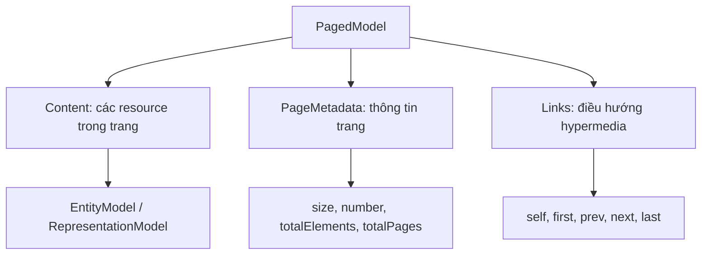

# PageMetadata

Khi một REST API trả về collection có phân trang, client cần biết trang hiện tại chứa bao nhiêu phần tử, đang ở vị trí nào trong tập kết quả và tổng số dữ liệu là bao nhiêu. Trong Spring HATEOAS, `PagedModel.PageMetadata` biểu diễn những thông tin này. Metadata được đặt trong `PagedModel` cùng nội dung trang và các hypermedia link điều hướng.

`PageMetadata` giúp client hiểu trạng thái phân trang của response. Nó không chứa các phần tử, không tự tạo URI cho trang tiếp theo và cũng không thay thế các link `next`, `prev` hay `self`. Nội dung, metadata và link phối hợp với nhau để tạo thành một paged representation hoàn chỉnh.

## 1. PageMetadata là gì?

`PagedModel<T>` là kiểu representation của một tập hợp có thông tin phân trang. Bên cạnh các phần tử và liên kết, nó có thể mang một đối tượng `PagedModel.PageMetadata` mô tả trang hiện tại và quy mô của tập kết quả.

`PageMetadata` có bốn trường chính:

| Trường | Ý nghĩa | Ví dụ |
| --- | --- | --- |
| `size` | Kích thước trang, tức số phần tử tối đa được yêu cầu cho một trang | `20` |
| `number` | Số thứ tự của trang hiện tại, bắt đầu từ `0` | `1` là trang thứ hai |
| `totalElements` | Tổng số phần tử phù hợp với truy vấn trên toàn bộ tập kết quả | `43` |
| `totalPages` | Tổng số trang cần thiết với kích thước trang hiện tại | `3` |

Ví dụ, metadata `{ "size": 20, "number": 1, "totalElements": 43, "totalPages": 3 }` cho biết client đang xem trang thứ hai, mỗi trang có sức chứa 20 phần tử, toàn bộ truy vấn có 43 phần tử và cần 3 trang.

Chú ý `number` là chỉ số trang bắt đầu từ 0. Vì vậy, `number: 0` là trang đầu tiên, `number: 1` là trang thứ hai. Đây là quy ước phổ biến của Spring Data `Pageable` và cần được hiểu đúng khi đọc response.

## 2. Phân biệt nội dung, metadata và link

Một paged representation có ba thành phần có vai trò khác nhau:



- **Content** chứa những resource thuộc trang hiện tại. Mỗi phần tử có thể là `EntityModel<T>` hoặc kiểu kế thừa `RepresentationModel` để mang link riêng.
- **PageMetadata** mô tả vị trí và quy mô của trang, ví dụ kích thước trang và tổng số phần tử.
- **Links** cho phép client điều hướng đến collection, trang trước, trang tiếp theo hoặc trang đầu/cuối nếu API công bố.

Metadata chỉ cho client biết trang hiện tại có số thứ tự nào và tổng số trang là bao nhiêu. Client nên theo link `next` hoặc `prev` để điều hướng thay vì tự ghép URI từ `number`. Cách này giữ client tách khỏi quy ước URL và tham số phân trang cụ thể của server.

## 3. Cách tạo PageMetadata thủ công

Spring HATEOAS định nghĩa `PageMetadata` là kiểu lồng trong `PagedModel`. Có thể tạo metadata bằng constructor với thứ tự tham số: kích thước trang, số trang hiện tại, tổng số phần tử và tổng số trang.

```java
import org.springframework.hateoas.PagedModel;

PagedModel.PageMetadata metadata = new PagedModel.PageMetadata(
        20,  // size
        1,   // number: trang thứ hai, vì chỉ số bắt đầu từ 0
        43,  // totalElements
        3    // totalPages
);
```

Đối tượng metadata có thể được truyền vào `PagedModel.of(...)` cùng nội dung và link:

```java
import org.springframework.data.domain.Page;
import org.springframework.data.domain.Pageable;
import java.util.List;

import org.springframework.hateoas.EntityModel;
import org.springframework.hateoas.PagedModel;
import static org.springframework.hateoas.server.mvc.WebMvcLinkBuilder.linkTo;
import static org.springframework.hateoas.server.mvc.WebMvcLinkBuilder.methodOn;

Page<Order> page = orderRepository.findAll(pageable);
List<EntityModel<OrderRepresentation>> content = page.getContent().stream()
        .map(orderAssembler::toModel)
        .toList();

PagedModel.PageMetadata metadata = new PagedModel.PageMetadata(
        page.getSize(),
        page.getNumber(),
        page.getTotalElements(),
        page.getTotalPages());

PagedModel<EntityModel<OrderRepresentation>> model = PagedModel.of(
        content,
        metadata);
model.add(linkTo(methodOn(OrderController.class).all(pageable)).withSelfRel());
```

Ví dụ trên minh họa cách lắp ghép một trang. `content` và metadata đều được lấy từ cùng một `Page<Order>`, còn link `self` được tạo từ mapping controller với tham số `Pageable`. Nếu chỉ thêm link `self`, API chưa có các link điều hướng khác; cần bổ sung `first`, `prev`, `next`, `last` theo quy tắc phân trang của ứng dụng hoặc dùng `PagedResourcesAssembler` để tạo chúng từ `Page`.

Không nên tự nhập các con số cố định như ví dụ vào response thật. Chúng cần phản ánh dữ liệu truy vấn ở thời điểm xử lý request.

## 4. Tính toán các trường metadata

Với phân trang theo offset thông thường, các giá trị có thể được lấy từ đối tượng `Page<T>` của Spring Data:

```java
Page<Order> page = orderRepository.findAll(pageable);

long size = page.getSize();
long number = page.getNumber();
long totalElements = page.getTotalElements();
long totalPages = page.getTotalPages();
```

Ý nghĩa của từng giá trị:

- `getSize()` trả về kích thước trang được áp dụng, không phải số phần tử thực tế ở trang cuối.
- `getNumber()` trả về chỉ số trang hiện tại, bắt đầu từ `0`.
- `getTotalElements()` trả về tổng số phần tử khớp truy vấn, không chỉ số phần tử trong trang hiện tại.
- `getTotalPages()` trả về số trang dựa trên tổng số phần tử và kích thước trang.

Về mặt toán học, khi `size` lớn hơn 0, số trang thường được tính theo công thức:

\[
totalPages = \left\lceil \frac{totalElements}{size} \right\rceil
\]

Ví dụ với 43 phần tử và kích thước 20, số trang là 3: trang 0 có tối đa 20 phần tử, trang 1 có tối đa 20 phần tử và trang 2 còn 3 phần tử. Khi không có phần tử, tổng số trang là 0 trong mô hình phân trang Spring Data thông thường.

Khi lấy dữ liệu từ một nguồn khác Spring Data, ứng dụng phải tự bảo đảm bốn giá trị nhất quán. `totalElements` phải là tổng số phần tử sau khi áp dụng filter, còn `totalPages` phải phù hợp với kích thước trang đang dùng. Nếu metadata không khớp content, client có thể hiển thị sai số trang hoặc điều hướng đến một trang không tồn tại.

## 5. Tích hợp PageMetadata với Spring Data

Trong nhiều ứng dụng, cách đơn giản nhất là lấy `Page<T>` từ service hoặc repository, rồi dùng `PagedResourcesAssembler` để chuyển nó thành `PagedModel`. Assembler này tạo metadata từ `Page` và sử dụng `RepresentationModelAssembler` để dựng representation cho từng phần tử.

```java
import org.springframework.data.domain.Page;
import org.springframework.data.domain.Pageable;
import org.springframework.data.web.PagedResourcesAssembler;
import org.springframework.hateoas.EntityModel;
import org.springframework.hateoas.PagedModel;
import org.springframework.web.bind.annotation.GetMapping;
import org.springframework.web.bind.annotation.RestController;

@RestController
class OrderController {

    private final OrderService orderService;
    private final OrderModelAssembler orderAssembler;
    private final PagedResourcesAssembler<Order> pagedAssembler;

    OrderController(
            OrderService orderService,
            OrderModelAssembler orderAssembler,
            PagedResourcesAssembler<Order> pagedAssembler) {
        this.orderService = orderService;
        this.orderAssembler = orderAssembler;
        this.pagedAssembler = pagedAssembler;
    }

    @GetMapping("/orders")
    PagedModel<EntityModel<OrderRepresentation>> all(Pageable pageable) {
        Page<Order> page = orderService.findAll(pageable);
        return pagedAssembler.toModel(page, orderAssembler);
    }
}
```

Ví dụ giả định ứng dụng đã có `Order`, `OrderService`, `OrderModelAssembler` và cấu hình Spring Data Web tương ứng. `PagedResourcesAssembler<Order>` nhận một `Page<Order>` cùng assembler của từng đơn hàng. Nó tạo `PagedModel` có metadata dựa trên kết quả trang và các link điều hướng thích hợp.

Nếu cần tùy chỉnh URI cơ sở hoặc cách tạo link phân trang, có thể cấu hình `PagedResourcesAssembler` và resolver phân trang của Spring Data Web. Cách này giúp các link phản ánh đúng tham số `page`, `size`, `sort` và các điều kiện truy vấn mà endpoint hỗ trợ.

## 6. Cấu trúc PageMetadata trong HAL

Khi `PagedModel` được serialize theo HAL, nội dung phần tử thường nằm trong `_embedded`, các liên kết điều hướng nằm trong `_links`, còn metadata trang được thể hiện trong đối tượng `page`.

```json
{
  "_embedded": {
    "orders": [
      {
        "id": "ORD-021",
        "status": "PENDING",
        "_links": {
          "self": {
            "href": "https://api.example.test/orders/ORD-021"
          }
        }
      }
    ]
  },
  "_links": {
    "self": {
      "href": "https://api.example.test/orders?page=1&size=20"
    },
    "prev": {
      "href": "https://api.example.test/orders?page=0&size=20"
    },
    "next": {
      "href": "https://api.example.test/orders?page=2&size=20"
    }
  },
  "page": {
    "size": 20,
    "totalElements": 43,
    "totalPages": 3,
    "number": 1
  }
}
```

Ví dụ trên cho thấy trang thứ hai trong tổng số ba trang. Phần tử hiện tại được nhúng dưới relation `orders`; link `prev` và `next` điều hướng đến hai trang lân cận. Tên relation `_embedded` phụ thuộc cấu hình relation của model và có thể được tùy chỉnh bằng `@Relation`.

Client có thể sử dụng `page.size`, `page.number`, `page.totalElements` và `page.totalPages` để hiển thị “trang 2/3” hoặc “43 kết quả”. Khi cần tải trang kế tiếp, client theo `next.href` thay vì tự tính `page=2`.

## 7. PageMetadata không thay thế link điều hướng

Một sai lầm thường gặp là nghĩ rằng `totalPages` đủ để client điều hướng. Metadata chỉ mô tả trang. Để truy cập trang tiếp theo, client cần URI hợp lệ và các tham số truy vấn cần thiết. Đó là vai trò của hypermedia link.

Ví dụ, nếu request ban đầu là:

```http
GET /orders?status=PENDING&sort=createdAt,desc&page=1&size=20
Accept: application/hal+json
```

Link `next` nên giữ lại điều kiện `status=PENDING`, thứ tự `createdAt,desc` và kích thước `20`. Nếu client chỉ lấy `totalPages` rồi tự ghép `?page=2`, nó có thể vô tình làm mất filter hoặc sort và nhận một tập kết quả khác.

Các link điều hướng thường dùng:

| Relation | Ý nghĩa |
| --- | --- |
| `self` | Trang hiện tại |
| `first` | Trang đầu tiên |
| `prev` | Trang ngay trước trang hiện tại |
| `next` | Trang ngay sau trang hiện tại |
| `last` | Trang cuối cùng |

Không phải response nào cũng cần đủ năm relation. Trang đầu không có `prev`; trang cuối không có `next`. Client nên kiểm tra link có tồn tại trước khi hiển thị thao tác điều hướng.

## 8. Các trường hợp biên cần xử lý

**Tập kết quả rỗng:** `totalElements` bằng 0 và `totalPages` thường bằng 0. `content` là collection rỗng nhưng response vẫn có thể có `self`. Không nên tạo link `next` hoặc `prev` khi không có trang tương ứng.

**Trang cuối không đầy:** nếu `size` là 20 nhưng chỉ còn 3 phần tử, metadata vẫn có thể ghi `size: 20`; `size` mô tả kích thước trang, còn số phần tử thực tế được đếm trong `content`.

**Chỉ số trang ngoài phạm vi:** request có thể yêu cầu một trang lớn hơn trang cuối. API cần có chính sách rõ ràng, ví dụ trả trang rỗng với metadata hiện tại hoặc trả lỗi theo hợp đồng. Không được tạo link `prev`/`next` dẫn đến trang sai.

**Kích thước trang không hợp lệ:** cần giới hạn `size` tối thiểu và tối đa để tránh truy vấn quá lớn. Với Spring Data `PageRequest`, kích thước trang phải lớn hơn 0 và chỉ số trang không âm. Metadata phải phản ánh kích thước thực tế đã được áp dụng sau khi giới hạn.

**Dữ liệu thay đổi giữa các request:** `totalElements` và `totalPages` là ảnh chụp kết quả tại thời điểm truy vấn. Khi có bản ghi mới hoặc bị xóa, metadata ở request sau có thể thay đổi. Client không nên xem tổng số trang là cam kết bất biến.

**Tổng số phần tử tốn kém:** để cung cấp `totalElements` chính xác, truy vấn có thể cần một count query. Với tập dữ liệu lớn, count query có thể tốn chi phí. Nếu nghiệp vụ không cần tổng số trang, có thể cân nhắc `Slice<T>` và chỉ cung cấp thông tin có trang tiếp theo, hoặc thiết kế cursor pagination. Không nên điền số tổng giả vào `PageMetadata` chỉ để thỏa mãn cấu trúc response.

## 9. Kiểm thử PageMetadata

Kiểm thử cần xác nhận metadata phản ánh đúng `Page` và các link điều hướng tương ứng. Có thể kiểm tra response HAL bằng `MockMvc`:

```java
mockMvc.perform(get("/orders")
        .param("page", "1")
        .param("size", "20")
        .accept("application/hal+json"))
    .andExpect(status().isOk())
    .andExpect(jsonPath("$.page.size").value(20))
    .andExpect(jsonPath("$.page.number").value(1))
    .andExpect(jsonPath("$.page.totalElements").value(43))
    .andExpect(jsonPath("$.page.totalPages").value(3))
    .andExpect(jsonPath("$._links.self.href").exists())
    .andExpect(jsonPath("$._links.prev.href").exists())
    .andExpect(jsonPath("$._links.next.href").exists());
```

Đây là ví dụ minh họa; test thực tế cần chuẩn bị dữ liệu hoặc mock service để trả về trang có 43 phần tử và cấu hình HAL. Nên có các ca kiểm thử:

- Trang đầu: `number` bằng 0 và không có link `prev`.
- Trang giữa: có cả `prev` và `next` khi các trang lân cận tồn tại.
- Trang cuối: không có link `next`, content có thể ít hơn `size`.
- Collection rỗng: `totalElements` và `totalPages` bằng 0, content rỗng.
- Filter và sort được giữ lại trong link điều hướng.
- Kích thước trang vượt giới hạn được xử lý theo chính sách endpoint.
- Metadata không mâu thuẫn với content và kết quả truy vấn.

## 10. Lỗi thường gặp

**Nhầm `number` là số thứ tự bắt đầu từ 1:** Spring Data sử dụng chỉ số trang bắt đầu từ 0. Khi hiển thị cho người dùng, giao diện có thể cộng 1; không nên thay đổi giá trị metadata gốc.

**Dùng số phần tử trong content làm `totalElements`:** content chỉ chứa một trang. `totalElements` phải là tổng số phần tử khớp truy vấn trên toàn bộ tập kết quả.

**Tính `totalPages` bằng phép chia làm tròn xuống:** khi còn phần dư, cần có thêm một trang. Hãy dùng `Page.getTotalPages()` hoặc phép tính làm tròn lên phù hợp.

**Coi `size` là số phần tử chắc chắn có trong response:** trang cuối thường có ít phần tử hơn kích thước trang. `size` mô tả sức chứa trang, không phải số lượng thực tế của content.

**Tự tạo URI từ metadata:** client nên theo link `next`, `prev` thay vì tự nối query parameter. Metadata và link có vai trò khác nhau.

**Cung cấp tổng số giả:** nếu không thể tính tổng số phần tử, hãy chọn mô hình phân trang phù hợp thay vì đưa metadata sai lệch.

## 11. Checklist triển khai

- Dùng `PagedModel` khi API cần representation collection có metadata phân trang.
- Lấy `size`, `number`, `totalElements`, `totalPages` từ cùng một kết quả truy vấn.
- Hiểu `number` là chỉ số bắt đầu từ 0.
- Bảo đảm metadata khớp với content và filter hiện tại.
- Dùng `PagedResourcesAssembler` khi tích hợp Spring Data để giảm việc dựng metadata và link thủ công.
- Cung cấp các link `self`, `prev`, `next` và link đầu/cuối khi phù hợp.
- Giữ filter, sort và kích thước trang trong link điều hướng.
- Xử lý collection rỗng, trang cuối và chỉ số trang ngoài phạm vi.
- Giới hạn kích thước trang và cân nhắc chi phí count query.
- Kiểm thử JSON HAL, metadata, link và các trường hợp biên.

`PageMetadata` cho client biết quy mô và vị trí của trang hiện tại trong tập kết quả. Khi kết hợp metadata chính xác với content và các hypermedia link phù hợp, `PagedModel` cung cấp một hợp đồng phân trang rõ ràng, giúp client hiển thị và điều hướng mà không phải tự suy luận cấu trúc URI của server.
