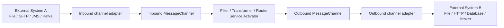
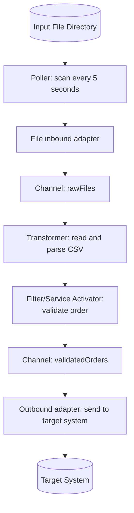

# The Role of Channel Adapters in Messaging Architecture

## Learning Objectives

After this lesson, you will be able to:

- Explain why an integration system needs a **channel adapter** and where adapters sit in a Spring Integration flow.
- Distinguish between an **inbound channel adapter**, an **outbound channel adapter**, and a **messaging gateway** based on the direction of message transfer.
- Describe how adapters collaborate with `Message`, `MessageChannel`, pollers, and processing endpoints to connect external systems.
- Read, build, and test a simple flow from an input directory to an output directory using Java DSL.
- Identify real-world operational concerns such as duplicate messages, I/O errors, rate limiting, transactions, and system observability.

## 1. Why Do We Need Channel Adapters?

Suppose an application must receive CSV files from a partner over SFTP, validate the data, transform it into an internal model, publish events to Kafka, and persist processing status to a database. Each system has a different protocol, data format, and coordination mechanism. If business logic directly opens SFTP connections, manages a Kafka producer, schedules directory scans itself, and handles network errors, the codebase becomes tightly coupled to each external technology.

**Spring Integration** applies the *Enterprise Integration Patterns* (EIP) model: components communicate via `MessageChannel` using `Message<?>` objects. A message consists of a **payload** (the primary data) and **headers** (metadata used for routing, correlation, tracing, or control). With this organization, business processing logic can focus on the message rather than knowing how external connections work.

A **channel adapter** is an endpoint at the boundary between Spring Integration and the outside world:

- An **inbound channel adapter** brings data/events **from an external system into** a `MessageChannel`.
- An **outbound channel adapter** receives a message **from a `MessageChannel` and sends it out** to an external system.

The *inbound/outbound* direction is always determined **relative to the Spring Integration application**, not by whether an external system calls itself a client or a server.



In this diagram, adapters are responsible for **connecting at the boundary**; channels are responsible for **delivering messages between endpoints**; and the endpoints in between handle validation, transformation, routing, or executing business logic.

## 2. Roles and Responsibility Boundaries

| Component | Primary Responsibility | Example |
| --- | --- | --- |
| Inbound channel adapter | Receives/reads data from outside, creates a message, and sends it to a channel | Reading new files, receiving messages from a queue, consuming Kafka records |
| `MessageChannel` | Acts as the pathway transferring messages between endpoints according to the chosen channel semantics | `DirectChannel`, `QueueChannel`, `ExecutorChannel` |
| Transformer / Filter / Router | Transforms payload, accepts or discards messages, selects flow branches | Parsing CSV into a DTO, filtering out invalid data, routing by event type |
| Service Activator | Invokes application logic when a message arrives | Validating business rules, persisting processing results |
| Outbound channel adapter | Converts a message into an external action | Writing a file, sending a message to a broker, writing to a database |
| Gateway | Bridges interactions that require a response or request–reply API invocations | An HTTP inbound gateway returning an HTTP response; a messaging gateway invoking a flow and receiving the result |

An adapter is **not synonymous** with a channel. An adapter moves data across a protocol boundary; a channel connects endpoints within the application. Separating these two concepts allows replacing SFTP with Kafka or changing the output to HTTP without necessarily rewriting all intermediate processing steps. However, replacing an adapter still requires reviewing the message contract and the delivery semantics of the new system.

### 2.1. Inbound Adapter: Bringing Events into the Flow

An inbound adapter typically performs the following sequence of steps:

1. Connects to or monitors an external source.
2. Receives a record, event, file, or input data.
3. Represents that data as a `Message<?>` with the appropriate payload and headers.
4. Pushes the message onto the `MessageChannel` configured for the endpoint.

Inbound adapters have two common ways of receiving data:

- **Polling:** actively queries the source on a schedule, such as scanning a directory, querying a database table, or checking an SFTP source. The endpoint usually requires a `Poller` with an interval and a limit on how many messages to fetch per poll.
- **Event-driven:** receives events when the source actively emits them, such as a JMS/AMQP listener or a broker-triggered consumer. A Spring Integration poller schedule does not necessarily participate in this endpoint; the receiving mechanism depends on the adapter and protocol client.

You should not assume that *every* inbound adapter needs a poller: this is a characteristic of **polling-based sources**, not a mandatory requirement for all connections.

### 2.2. Outbound Adapter: Creating External Side Effects

An outbound adapter receives a message and translates it into an operation on the target system, such as creating a file, sending a message to a queue, or writing a record to a database. Typically, it is a **one-way** endpoint: the message is processed to produce an effect, and the flow does not wait for a business reply message on that same interaction.

This differs from an **outbound gateway**, which serves request–reply interactions. For example, when calling an HTTP API and needing the response to decide the next step, an outbound HTTP gateway is more appropriate than a one-way outbound HTTP channel adapter. Note that an adapter can still receive an acknowledgment or an error report at the protocol level; that **does not turn** it into a gateway that returns a reply `Message` to the flow.

## 3. A Typical Flow: From File to Processing and Dispatch

Consider the problem of ingesting orders from files dropped into a directory by a partner. A practical design might include:



Here:

- The inbound adapter knows **how to fetch files**, without needing to know the business rule for a "valid order".
- The transformer knows **how to turn a file into data**, without needing to know whether the file came from disk or SFTP.
- The business validator knows **the order rules**, not the receiving or sending protocols.
- The outbound adapter knows **how to write/send** to the target system, not the entire origin of the order.

Thanks to this separation of concerns, when replacing a local file source with SFTP, only the components related to connectivity, the message contract, and inbound operations need to be reviewed, rather than modifying all order-processing logic.

## 4. Java DSL Example: Connecting Two Directories with Adapters

The example below intentionally leaves the payload unchanged to clearly show the connecting role of **inbound** and **outbound** adapters. The flow scans `./data/inbox` every 5 seconds, picks up `*.csv` files, sends them through the `incomingFiles` channel, and writes a copy to `./data/archive`. This is a **file transfer** example, not yet a CSV parsing or order-processing example.

For Spring Boot, you can use `spring-boot-starter-integration` and the `spring-integration-file` module corresponding to the Spring Integration version managed by Spring Boot.

```java
import java.io.File;
import java.time.Duration;

import org.springframework.context.annotation.Bean;
import org.springframework.context.annotation.Configuration;
import org.springframework.integration.channel.DirectChannel;
import org.springframework.integration.config.EnableIntegration;
import org.springframework.integration.dsl.IntegrationFlow;
import org.springframework.integration.dsl.Pollers;
import org.springframework.integration.file.dsl.Files;
import org.springframework.messaging.MessageChannel;

@Configuration
@EnableIntegration
public class FileAdaptersConfiguration {

    @Bean
    public MessageChannel incomingFiles() {
        return new DirectChannel();
    }

    @Bean
    public IntegrationFlow fileArchiveFlow() {
        return IntegrationFlow
            .from(
                Files.inboundAdapter(new File("./data/inbox"))
                    .autoCreateDirectory(true)
                    .patternFilter("*.csv"),
                endpoint -> endpoint.poller(
                    Pollers.fixedDelay(Duration.ofSeconds(5))
                        .maxMessagesPerPoll(10)))
            .channel("incomingFiles")
            .handle(
                Files.outboundAdapter(new File("./data/archive"))
                    .autoCreateDirectory(true))
            .get();
    }
}
```

**Reading the code along the data flow:**

1. `Files.inboundAdapter(...)` creates a source that receives `File` objects from the input directory. Each received message has a `File` object pointing to the selected file as its payload.
2. `patternFilter("*.csv")` restricts which files the source considers. Filtering solely by file extension **does not guarantee** that the file has finished being written or that the CSV content is valid.
3. `Pollers.fixedDelay(...)` configures the polling schedule. `maxMessagesPerPoll(10)` limits the number of messages fetched in **each poll execution**, not the total number of files across the entire system.
4. `incomingFiles` is a `DirectChannel`: the subscriber processes the message on the sender's thread unless another asynchronous execution configuration is present.
5. `Files.outboundAdapter(...)` writes the file to the target directory. This flow does not automatically validate the content or confirm that a business process has completed.

You can quickly test this by creating the two directories, starting the application, placing `order-001.csv` into `./data/inbox`, and checking that the file appears in `./data/archive`. Try adding `readme.txt` to verify that the filter does not pick up files outside the `*.csv` pattern. For production processing, you also need to design mechanisms to wait for file completion, prevent duplicates, name output files, and handle errors; behavior after a restart also depends on the source's filter and state configuration.

> **Key takeaway:** The code demonstrates how adapters connect external systems to a message flow. If you need to parse CSV, you can insert a transformer after `incomingFiles`; if you need to publish events to a broker, replace the outbound file adapter with the corresponding outbound adapter and redesign the payload/headers to match the broker's contract.

## 5. How Do Adapters Interact with Message and MessageChannel?

### 5.1. Message Contract at the Boundary

A message in Spring Integration has the following conceptual structure:

```text
Message
├── payload: File | byte[] | String | DTO | ...
└── headers
    ├── id, timestamp
    ├── correlationId, replyChannel, errorChannel (if present)
    └── adapter/protocol-specific metadata (if present)
```

In the file flow above, the payload is `File`. A Kafka adapter may provide a record and metadata related to topic, partition, or offset, depending on configuration. An SFTP adapter may add metadata about the remote filename. **Do not assume** two adapters will produce identical payloads or headers just because they serve the same business use case.

When designing the boundary, you should determine:

| Contract Question | Decision Needed |
| --- | --- |
| What is the inbound payload? | `File`, `String`, bytes, DTO, or a protocol library message? |
| Who normalizes the data? | A converter configured on the adapter or a dedicated transformer in the flow? |
| What metadata must be retained? | Correlation ID, source name, key, tracing info, receipt timestamp |
| Which headers can be propagated outbound? | Only headers supported by the target adapter or explicitly mapped |
| How to handle reprocessing? | Idempotency key, offset/acknowledgment, file state, retry mechanism |

For example, converting from `File` to a DTO changes the payload type. Downstream handlers must declare the matching type; otherwise, conversion errors or runtime processing failures may occur. Headers are message metadata within the flow; whether a header is mapped to Kafka/JMS/HTTP depends on the target adapter's header mapper and configuration.

### 5.2. Channel Selection Changes How the Flow Operates

Adapters send and receive messages through channels, but synchronous, asynchronous, and queueing semantics reside in the **channel type**:

| Channel | Delivery Mechanism | Design Consequences |
| --- | --- | --- |
| `DirectChannel` | Invokes subscriber synchronously on the sender thread | Easy to follow processing order; slow downstream tasks can block the receiving thread for a long time |
| `ExecutorChannel` | Hands off work to an executor | Decouples sending thread from processing; requires managing thread pool, backpressure/overload, and ordering |
| `QueueChannel` | Places messages into a queue for the receiver to poll | Provides buffering; must configure capacity, consumer/poller, and full-queue policy |
| `PublishSubscribeChannel` | Broadcasts to subscribers | Suitable when multiple branches need the same event; not equivalent to load balancing |

`DirectChannel` does not by itself make message delivery durable; `QueueChannel` by default does not equate to a disk-backed durable queue either. Durability, transactions, ordering, and message redelivery must be evaluated across the **entire pipeline**, including adapters, channels, brokers, and handlers.

## 6. Pollers, Processing Cadence, and Connection Lifecycle

For an inbound polling adapter, the poller controls **when** and **how often** the system attempts to receive data. At least four factors should be considered:

1. **Interval:** Polling too frequently increases I/O or API load; polling too infrequently increases latency.
2. **Batch size per poll:** `maxMessagesPerPoll` helps cap the amount fetched in each cycle; if a large backlog builds up, you must balance throughput against downstream capacity.
3. **Slow processing:** When a flow uses a synchronous channel, sending operations can prolong a poll cycle. With asynchronous channels, you must control backlog growth and prevent generating load exceeding downstream capacity.
4. **Lifecycle:** Adapters may depend on sockets, sessions, connection factories, consumer clients, or schedulers. During startup and shutdown, ensure connections and workers are managed properly; do not assume the source is ready immediately when the application starts.

For Kafka, JMS, or AMQP, listener/consumer mechanisms and processing acknowledgments have their own specific details. Do not apply a single poller or retry formula to every adapter.

## 7. When to Use an Adapter vs. a Gateway?

Distinguish by **interaction contract** before choosing an API:

| Scenario | Typically Appropriate Choice | Reason |
| --- | --- | --- |
| Scanning files from disk with no caller waiting for a response | File inbound channel adapter | Feeds files into the flow on a schedule |
| Pushing processed events to a broker where the flow needs no business reply | Outbound channel adapter | One-way send model |
| An HTTP client calls the application and needs a status/body based on processing results | HTTP inbound gateway | Has a request–reply interaction that must map to an HTTP response |
| A flow calls a REST API and uses the returned body in the next step | HTTP outbound gateway | Needs to bring the response back into the flow |
| Java code in the application wants to invoke a flow via an interface that returns a result | Messaging gateway | Provides a method-style invocation interface, hiding how messages are sent/received |

For example, if an external system sends an HTTP POST and expects the newly created order ID returned immediately, designing only a one-way inbound adapter lacks the reply contract. Conversely, writing a log file from a message does not require a request–reply gateway.

## 8. Errors, Delivery Semantics, and Guarantee Boundaries

Channel adapters **do not automatically guarantee end-to-end exactly-once processing**. A poll might re-read data; a broker might redeliver a message; or a send request might succeed at the target system while the application loses connectivity before receiving the acknowledgment. You must design according to the actual source and target mechanisms.

### 8.1. Where Can Errors Occur?

- **Inbound source:** SFTP connection drop, partially written file, unreadable data, expired token.
- **Inside the flow:** wrong payload type, CSV parsing error, business rule violation, handler throwing an exception.
- **Outbound target:** HTTP timeout, unavailable broker, missing directory write permissions, database error.
- **In coordination:** full queue, overloaded executor, messages arriving faster than consumption capacity.

In some asynchronous or poller-triggered flows, the framework can route errors to `errorChannel` as an `ErrorMessage`, depending on the endpoint and configuration. In synchronous flows, exceptions may propagate back to the caller. Do not assume the default `errorChannel` configuration will automatically handle or retry every exception; you must explicitly configure an error flow, retry policy, and final action once retries are exhausted.

### 8.2. Distinguishing Retry from Idempotency

**Retry** means re-attempting an operation after a transient error; **idempotency** means ensuring that receiving or reprocessing the same event does not produce duplicate business effects. Both often need to work together:

- Create a business-meaningful unique key, such as `partnerId + orderId`, and check it before writing an order.
- For files, consider an accept-once filter backed by persistent state or moving the file after successful processing. An in-memory-only filter can lose state on restart.
- For brokers, understand when offset commits or acknowledgments occur relative to when business work actually completes.
- Only retry automatically when the operation is safe to retry; resending a resource-creation request without deduplication keys can create two records.
- Route unrecoverable failed messages to a holding location for investigation or manual handling per system policy; retain sufficient metadata for tracing.

### 8.3. Transactions and Acknowledgments

The events "received from source", "processed in Spring Integration", and "written to target" can occur at **three different points in time**. There is no default single transaction spanning the file system, database, and broker. If strong consistency is required, choose a model suited to your infrastructure: local transactions where supported, outbox/inbox, idempotent consumers, appropriate acknowledgment modes, or compensating workflows.

## 9. Designing Adapters for Operability

A good messaging architecture must make the **flow across boundaries** observable, not just print logs inside handlers.

| Concern | Recommended Practice |
| --- | --- |
| Connectivity | Manage timeouts, reconnects, and credentials via configuration/secrets; avoid hard-coding passwords |
| Throughput | Monitor messages received/sent, processing duration, backlog, queue depth, error counts, and retries |
| Tracing | Propagate a correlation ID across the flow; log business keys and relevant error details while avoiding sensitive data exposure |
| Data loss or duplication | Align acknowledgment, retry, idempotency policies, and restart state handling |
| Protecting target systems | Limit rate, concurrency, capacity, and apply backpressure according to real source/target capabilities |
| Deployment | Separate adapter configuration from business rules; test startup, shutdown, and connection recovery |

For example, a file inbound adapter scanning 1,000 files/minute while downstream only processes 100 files/minute will create a bottleneck. Dropping an `ExecutorChannel` in between does not by itself resolve the load mismatch; you need concurrency limits, bounded buffers with capacity, and a backlog handling policy.

## 10. Common Pitfalls

**Confusing adapters with channels.** Channels do not read SFTP or call HTTP on their own; adapters handle communication with external systems.

**Assuming an outbound adapter returns a business reply.** If the next step depends on a response, you need a gateway or a well-designed asynchronous reply correlation mechanism.

**Putting all processing logic into adapters.** Parsing, validation, and complex routing belong in flow endpoints so they are easy to test, reuse, and swap sources/targets.

**Believing scanning once equals processing exactly once.** You must account for restarts, mid-flight failures, acknowledgments, and idempotency. For partner-delivered files, also avoid reading files that have not finished writing.

**Swapping adapters while forgetting the message contract.** A file adapter produces a `File` payload, whereas other sources may produce `byte[]`, `String`, or record objects. Always check payloads, headers, and type conversions at the boundary.

## 11. Self-Check Questions

1. A flow currently receives files from SFTP, parses the data, and saves it to a database. If the partner switches to sending via Kafka, which parts of the architecture must definitely be reviewed? **Hint:** inbound adapter, payload type, metadata/acknowledgment, and processing guarantees.
2. Why does a `DirectChannel` not solve the problem of slow downstream processing? **Hint:** subscribers typically execute on the sender's thread.
3. When should you use an HTTP outbound gateway instead of an outbound adapter? **Hint:** when the flow needs to use the HTTP response in the next step.
4. A file was successfully sent to the target system, but the program crashed before recording completion; on the next run, the file is read again. How do you avoid creating duplicate data? **Hint:** idempotency key combined with recording and retry policies.
5. Why does adding a `QueueChannel` not guarantee zero message loss when the application stops? **Hint:** durability depends on the backing store configuration and the entire delivery pipeline.

## Conclusion

In Spring Integration, **a channel adapter is the bridge between external protocols/systems and the internal message model**. Inbound adapters bring data into channels; outbound adapters turn messages into outbound operations; gateways fit interactions that require responses. Separating adapters from channels and business logic helps integration flows scale cleanly across files, SFTP, HTTP, JMS, AMQP, Kafka, or databases. In production implementations, design the payload/header contract, pollers or listeners, channel semantics, retries, idempotency, and operational observability together.
